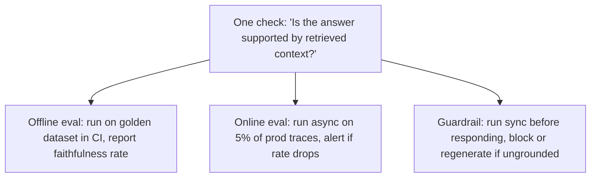
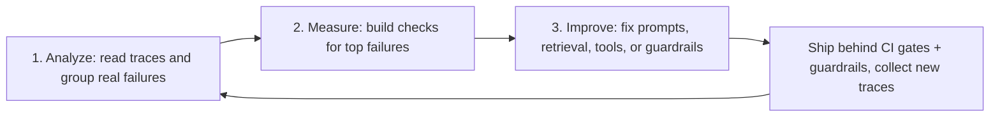

# Why Evals and Guardrails

> **TL;DR**
>
> - **Demos are easy, but reliability is hard.** You can build an agentic RAG prototype in days. Making it safe and accurate in production takes months.
> - **Evals measure; guardrails enforce.** Evals score system quality on datasets or traffic samples. Guardrails block or fix unsafe behavior on live requests.
> - **One check powers both.** You write a check once (such as *"Is this answer supported by retrieved docs?"*) and run it offline, online, or at runtime.
> - **Start with error analysis, not metrics.** Read real traces first, group your actual failures, and build checks only for what breaks.
> - **Check that a change is real.** Re-run the baseline on the same rows, use paired tests and confidence intervals, and run agents more than once per task.

- **You will learn:**
    - Why prototypes fail in production
    - How evals and guardrails share checks
    - How to run the **Analyze → Measure → Improve** loop
    - How to tell a real improvement from noise
    - What makes an agent reliable
    - Which governance frameworks your checks map to
    - Who owns what on the team
- **Prerequisites:** None (start here)
- **Related guides:**
    - [The Evals & Guardrails Map](./02-the-evals-and-guardrails-map.md)
    - [Failure Modes](./03-agentic-rag-failure-modes.md)
    - [Glossary](./04-glossary.md)
    - [Implementation Playbook](../05-decision-framework/04-implementation-playbook.md)

---

## 1. The running example

Abstract rules are hard to remember. To keep every concept concrete, this guide uses one example system throughout:

> **Acme Internal Assistant**, an enterprise agent that does four jobs:
>
> 1. **Answers document questions** over company policies, wikis, and runbooks using **vector search + reranking** (`search_docs`).
> 2. **Answers data questions** by **generating SQL** and running it against a data warehouse (`run_sql`).
> 3. **Takes actions** by calling tools such as `create_ticket`, `update_ticket`, and `send_email`.
> 4. **Enforces role-based access control (RBAC)** across roles (`employee`, `manager`, `analyst`, `support_agent`, `hr_partner`, `finance`, `admin`) for every document, table, and tool.

The full tool inventory and the risk tier of each tool (T0 read → T3 destructive) live in [Tool & Action Guardrails](../04-guardrails/05-tool-and-action-guardrails.md). We treat HR and finance intents, and every turn that can call a tool, as **Tier 3 (high risk)**. Read-only general policy Q&A is **Tier 2**, and so is the system as a whole. See the [Guardrail Selection Decision Tree](../05-decision-framework/02-guardrail-selection-decision-tree.md) for the tier definitions.


How to read this diagram:

- **Every box can fail on its own.** The router can pick the wrong path, the retriever can miss a policy doc, or the SQL generator can join the wrong table.
- **Every arrow passes errors downstream.** If the retriever fetches an outdated 2022 policy, the generator will confidently state the wrong rule.

---

## 2. Why reliability is the hard part

### 2.1 The gap between a demo and production

Building a prototype that answers ten hand-picked questions is easy. Running that same system for thousands of real users is much harder:

| Prototype reality | Production reality |
|---|---|
| 10–20 clear questions written by the developer | Thousands of messy questions with typos, slang, and follow-ups |
| Clean, hand-picked documents | Stale, duplicated, contradictory, and permission-restricted files |
| One test user with full access | Many user roles, each allowed to see different data |
| Happy-path tool calls | Bad arguments, API timeouts, partial failures, and retries |
| Developer checks answers by eye ("looks good") | Users act on wrong answers ("it gave me the wrong parental leave rule") |
| Friendly testers | Curious users, malicious attackers, and poisoned documents |
| Cost and latency do not matter | Cost per query and p95 latency are strict product limits |

The LLM itself is rarely your main bottleneck. Your real bottleneck is **knowing whether the system works**, **knowing when it breaks**, and **preventing harm when it fails**.

### 2.2 Non-determinism (the same input gives different outputs)

Traditional software returns the same output for the same input. LLM systems change their behavior across four layers:

- **Sampling:** At `temperature > 0`, the model samples different tokens on each run. Even at `temperature = 0`, hosted APIs often do not return bit-identical outputs. A main cause is that inference kernels are not *batch-invariant*: your result depends on how many other requests share the server batch ([He, 2025](https://thinkingmachines.ai/blog/defeating-nondeterminism-in-llm-inference/)).
- **Model drift:** Cloud providers update model weights behind an alias, which can silently change how your prompts behave.
- **Data drift:** Your document index and database change daily. The same question retrieves different chunks tomorrow than it did today.
- **Path dependence:** In a multi-step agent, a small change in step 1 (such as picking a different tool) creates a completely different path.

What this means for how you test:

1. **One test case proves almost nothing.** You need a **dataset** of many inputs (and, for agents, several runs per input) to measure behavior reliably. See [Running Offline Experiments](../02-offline-evals/08-running-offline-experiments.md).
2. **Exact string matching fails on free text.** Instead, use **structural checks** (JSON schema, SQL results) or **semantic checks** (LLM-as-a-judge, embeddings).
3. **Report pass rates with uncertainty, not single pass/fail booleans.** Measure percentages (such as *92% faithfulness on 500 rows, 95% CI 89–94%*) and track how they move over time. See [Section 5.4](#54-is-the-change-real-statistics-in-one-page).

### 2.3 Errors compound across steps

When an agent runs multiple steps in sequence, small error rates multiply fast:

```text
P(end-to-end success) ≈ P(route) × P(retrieve) × P(generate) × P(cite) ...

Illustrative math (assuming independent steps):
  5 steps at 95% reliability each  → 0.95^5  ≈ 77% end-to-end success
  10 steps at 95% reliability each → 0.95^10 ≈ 60% end-to-end success
  10 steps at 99% reliability each → 0.99^10 ≈ 90% end-to-end success
```

Four rules follow from this math:

1. **Measure individual components.** An end-to-end score of 77% tells you the system is broken. Component evals tell you *which step* broke it. See [The Map: Scope](./02-the-evals-and-guardrails-map.md#2-axis-b-scope-end-to-end-vs-component).
2. **Catch silent errors.** A bad retrieval does not throw an exception. Instead, the generator writes a confident, wrong answer from the wrong chunk.
3. **Evaluate the trajectory, not just the final answer.** A good agent recovers from a tool error; a bad agent loops forever. See [Agent, Tool & Trajectory Evals](../02-offline-evals/04-agent-tool-and-trajectory-evals.md).
4. **Place guardrails between steps.** Do not wait until the final output. Filter documents by role before generation, and validate SQL before execution.

### 2.4 Your data is part of the attack surface

In classic web apps, you validate untrusted input at the API boundary. In agentic RAG, untrusted text also enters the prompt from retrieved documents, database rows, and tool outputs.

If an attacker hides malicious instructions inside a wiki page or support ticket, the LLM may read that page and obey the attacker (**indirect prompt injection**, `LLM01:2026`). When your agent can call tools or run SQL, a text bug becomes an unauthorized action. That is why every agent needs runtime guardrails.

Two short rules help you see the risk before you write any guardrail:

- **The lethal trifecta** ([Willison, 2025](https://simonwillison.net/2025/Jun/16/the-lethal-trifecta/)): an agent that has (1) access to private data, (2) exposure to untrusted content, and (3) a way to communicate externally can be tricked into sending your data to an attacker.
- **The Agents Rule of Two** ([Meta, 2025](https://ai.meta.com/blog/practical-ai-agent-security/)): in one session, an agent should satisfy at most two of [A] processes untrustworthy inputs, [B] has access to sensitive systems or private data, and [C] can change state or communicate externally. If it needs all three, add human approval or another reliable validation step. Note that [C] is broader than the trifecta's exfiltration leg: it also covers state changes such as writes.

Acme Internal Assistant meets all three conditions by default (it reads wiki pages, sees HR data, and can call `send_email`). That is why its tool-enabled turns are Tier 3. See [Threat Model & OWASP](../04-guardrails/07-threat-model-owasp.md) for the full OWASP Top 10 for LLM Applications 2026 and Agentic Applications 2026 mapping.

---

## 3. Evals vs. guardrails

### 3.1 How they differ

**Evals** measure system quality so your team can make decisions. **Guardrails** enforce safety and policy rules on a single live request.

| Dimension | Evals (Measure) | Guardrails (Enforce) |
|---|---|---|
| **Goal** | Measure quality and safety across many inputs | Stop harm on one live request right now |
| **When it runs** | Offline (before deploy) or online (async on live traffic) | Inline during the live request path |
| **Output** | Pass rates, scores, dashboards, CI pass/fail | Allow, block, modify (mask or rewrite), escalate (to a human), or flag (log only) |
| **Time budget** | Seconds to hours (does not slow down users) | Milliseconds to ~1 second (users wait for it) |
| **Cost budget** | Can use slower, stronger LLM judges or human reviewers | Must be cheap enough to run on 100% of traffic |
| **Cost of a mistake** | Adds noise to a dashboard or blocks a PR | False positive blocks a real user; false negative leaks data |
| **Consumer** | Engineers, product managers, and domain experts | The application itself (plus security and ops logs) |

### 3.2 How they share the same checks

Here is the most important pattern in this repository: **a check is a single function `f(input, context, output, trace) → verdict`.**

Whether that check is an **eval** or a **guardrail** depends only on **where you run it**:



| Check | Used as an offline eval | Used as an online monitor | Used as a runtime guardrail |
|---|---|---|---|
| **PII detector** | % of test answers that leak PII | Daily PII leak rate in production | Mask PII before showing the answer |
| **Faithfulness check** | Faithfulness score on golden dataset | Rolling faithfulness score on 5% of traffic | Regenerate or abstain if answer is unsupported |
| **SQL safety parser** | % of test SQL queries that break rules | Count of blocked queries by role | Reject non-`SELECT` or forbidden tables before running |
| **Tool schema validator** | Tool-call accuracy rate | Rate of malformed tool calls | Reject bad arguments and ask the model to retry |
| **Prompt-injection scanner** | Recall on red-team attack dataset | Daily count of injection attempts | Block the request before calling the agent |
| **Citation validator** | Citation precision and recall scores | Rate of uncited claims in production | Strip invalid citations before returning the answer |

What this means in practice:

- **Write each check once and reuse it in three places.** Keep your check functions in a shared library.
- **Evaluate your guardrails using offline evals.** Every guardrail is a classifier. Measure its **false-positive rate** on normal user questions and its **recall** (1 − attack success rate) on attack datasets before you turn it on. Roll it out in stages: `shadow` (log only) → `flag` → `block`. See [Guardrails Architecture](../04-guardrails/01-guardrails-architecture.md).
- **Use guardrail triggers as monitoring signals.** A sudden spike in blocked requests means you are either under attack or shipping a bug.
- **Remember that reference-based checks cannot be guardrails.** A check that compares an answer against a human-written reference answer needs that reference, so it cannot run on a new live request. It runs offline, or online only on a labeled sample of traces (after SMEs label them, with a delay). Runtime guardrails must use **reference-free** checks. See [The Map: Ground Truth](./02-the-evals-and-guardrails-map.md#4-axis-d-ground-truth-reference-based-vs-reference-free).

---

## 4. Vibes-based vs systematic evaluation

Most teams start with **vibe checks**: a developer changes a prompt, tries five questions by hand, and eyeballs the output. Vibe checks are fine on day one, but they fail as soon as your system grows.

| Vibe checks | Systematic evaluation |
|---|---|
| 5–10 questions the developer remembers to try | A versioned dataset covering real user intents and past bugs |
| *"It looks better to me now"* | *"Faithfulness rose from 81% to 88%, and p95 latency stayed flat"* |
| Users discover regressions in production | CI catches regressions before code merges |
| Prompt changes turn into opinion debates | Prompt changes are tested with data |
| Hard to compare two models fairly | Side-by-side runs on the exact same inputs |
| Breaks when a second engineer joins | Shared definition of "good" across engineering, product, and SMEs |

> **Rule of thumb:** As soon as more than one person edits prompts, retrieval, or models, build offline evals. As soon as real users touch the system, add runtime guardrails and online monitoring.

Note that systematic evaluation does **not** mean turning on 30 generic metrics from a library. Generic scores (like a vague 1–5 *"helpfulness"* rating) rarely match what your users care about. Always build evals around **your system's actual failures**.

---

## 5. The error-analysis loop (Analyze, Measure, Improve)

High-performing AI teams follow a three-step loop: **Analyze → Measure → Improve**. Practitioners such as Hamel Husain and Shreya Shankar popularized this *error-analysis-first* approach ([AI Evals FAQ](https://hamel.dev/blog/posts/evals-faq/)).

> **Note on names:** Some people call any eval-centric workflow "eval-driven development" (EDD). In the strict sense, EDD means *writing evaluators before you build a feature*, like test-driven development. Husain and Shankar advise against that in general: you cannot predict how an LLM will fail, so you write evals for failures you have **observed**. This guide uses the error-analysis loop below.



### 5.1 Analyze: error analysis first

**Look at your data before writing code.** Do not write a single metric until you have read real traces end-to-end (question, router choice, retrieved chunks, SQL query, tool calls, and final answer).

Follow this five-step procedure to run error analysis:

1. **Collect at least ~100 diverse traces.** Pull them from production logs if you have users, or generate realistic test conversations across different roles and topics (see [Synthetic Datasets](../01-datasets/03-synthetic-datasets.md)). Keep reading past 100 traces while you still find new ways the system breaks; stop when new traces show no new failure types (**theoretical saturation**).
2. **Label the first error (open coding).** Read each trace. When a trace has a problem, write a short, plain-English note on the *first* upstream step that went wrong. Do not invent abstract categories yet. Write concrete notes:
    - *"Retrieved the 2023 PTO policy instead of the 2024 policy."*
    - *"SQL filtered on `created_at` instead of `closed_at`."*
    - *"Answer cited doc #3, but the fact came from doc #1."*
    - *"Called `create_ticket` without asking the user to confirm priority."*
3. **Group notes into failure modes (axial coding).** Cluster your notes into 5–10 clear failure categories, such as *Stale policy retrieved*, *Wrong SQL date column*, *Citation mismatch*, or *Action without confirmation*.
4. **Count and rank.** Count how many traces fall into each category. Usually, 2 or 3 failure modes cause most of your bad answers.
5. **Choose your response.** If a failure is a simple bug (like a typo in a tool description), just fix it and add one regression test. If a failure is common, subtle, or likely to come back, build a dedicated eval for it.

> **Tip:** Do this review in a simple spreadsheet or trace viewer alongside a **Subject-Matter Expert (SME)**. An engineer can spot a broken SQL join, but only an HR expert will notice an outdated parental-leave rule.

### 5.2 Measure: build targeted checks

For each top failure mode, pick the simplest check that can catch it reliably:

1. **Use deterministic code first.** If you can check a rule with a regex, JSON schema, SQL parser, or ID check, use code. Code is free, instant, and 100% repeatable.
2. **Use reference-based metrics when you have labeled data.** Measure retrieval with `Recall@k` against labeled document IDs, or measure SQL with execution accuracy against a reference query.
3. **Use an LLM-as-a-judge for semantic rules.** When checking faithfulness, tone, or completeness, use an LLM judge. Keep each judge **binary (Pass / Fail)**, test **one criterion per judge**, and **validate the judge against human labels** before trusting its score. See [LLM-as-a-Judge](../02-offline-evals/07-llm-as-a-judge.md).
4. **Use human review as your anchor.** Use domain experts to label your golden dataset and verify that your automated checks agree with human judgment.

Once your checks are ready, run them on your dataset (see [Dataset Strategy](../01-datasets/01-dataset-strategy.md)) and record your **baseline score**.

### 5.3 Improve: change one thing and re-measure

1. **Change one variable at a time** (such as chunk size, reranker model, system prompt, or tool schema).
2. **Run your eval suite** and compare the new score against your baseline. **Re-run the baseline** on the same dataset version at the same time, so that a model or data change does not look like your improvement. Check that the difference is larger than the noise (see [Section 5.4](#54-is-the-change-real-statistics-in-one-page)).
3. **Inspect the changed traces.** Even when the overall score goes up, read the traces that flipped from Pass to Fail to make sure you did not introduce a new bug.
4. **Feed production failures back into your dataset.** Every bug you fix in production should become a permanent test row. See [Production Data Flywheel](../01-datasets/04-production-data-flywheel.md).

### 5.4 Is the change real? Statistics in one page

LLM systems are non-deterministic (Section 2.2), and eval datasets are small. A score that moves by a few points can be noise. Use these four tools before you claim a win. The numbers below are rules of thumb, not laws.

1. **Report a confidence interval (CI) with every pass rate.** For a pass rate, use the **Wilson score interval**. It behaves well near 0% and 100%, where the simple `p ± 1.96·√(p(1−p)/n)` formula breaks. Example: 81/100 has a 95% CI of about 72–87%, and 88/100 has a 95% CI of about 80–93%. The intervals overlap, so "81% → 88%" on 100 rows is **not** clear evidence on its own.
2. **Compare paired results, not two averages.** Run the old and new versions on the **same rows**, and re-run the baseline at the same time. Then look only at the rows that changed. **McNemar's test** (or a paired bootstrap) uses the rows that flipped Fail → Pass (`c`) and Pass → Fail (`b`). Example: on 300 rows, 30 rows flip to Pass and 12 rows flip to Fail; the exact McNemar test gives p ≈ 0.008, so the gain is very likely real. If you test many slices (roles, intents) at once, correct for multiple comparisons (for example, Benjamini–Hochberg).
3. **Size the dataset for the claim you want to make.** If you see zero failures in `n` rows, the 95% upper bound on the failure rate is about `3/n` (the **rule of three**). To claim "fewer than 1% of answers leak PII", you need at least ~300 clean cases. To detect a 5-point change, you usually need hundreds of rows, not 50. See [Dataset Strategy](../01-datasets/01-dataset-strategy.md).
4. **Run agents more than once per task.** For a non-deterministic agent, one run per task hides flaky behavior. Run each task `n` times and report both metrics ([Anthropic, 2026](https://www.anthropic.com/engineering/demystifying-evals-for-ai-agents)):
    - **pass@k**: the chance that **at least one** of `k` tries passes ([Chen et al., 2021](https://arxiv.org/abs/2107.03374)). Use it when a user or a verifier can pick the good try.
    - **pass^k**: the chance that **all** `k` tries pass ([Yao et al., 2024, τ-bench](https://arxiv.org/abs/2406.12045)). Use it for reliability: a user who asks the same thing `k` times should get a correct answer every time.

```python
# Standard library only. Python 3.9+.
from math import comb, sqrt

def wilson_ci(passed: int, n: int, z: float = 1.96) -> tuple[float, float]:
    """Wilson score interval for a pass rate (95% by default)."""
    if n == 0:
        raise ValueError("n must be > 0")
    p = passed / n
    denom = 1 + z * z / n
    center = (p + z * z / (2 * n)) / denom
    half = z * sqrt(p * (1 - p) / n + z * z / (4 * n * n)) / denom
    return max(0.0, center - half), min(1.0, center + half)

def mcnemar_exact_p(b: int, c: int) -> float:
    """Two-sided exact McNemar test. b = Pass->Fail rows, c = Fail->Pass rows."""
    n = b + c
    if n == 0:
        return 1.0
    tail = sum(comb(n, i) for i in range(min(b, c) + 1)) / 2 ** n
    return min(1.0, 2 * tail)

def pass_at_k(n: int, c: int, k: int) -> float:
    """Unbiased pass@k (Chen et al., 2021): n tries, c of them passed."""
    if not (0 < k <= n and 0 <= c <= n):
        raise ValueError("need 0 < k <= n and 0 <= c <= n")
    if n - c < k:
        return 1.0
    return 1 - comb(n - c, k) / comb(n, k)

def pass_hat_k(n: int, c: int, k: int) -> float:
    """pass^k (Yao et al., 2024): chance that k tries drawn from n all pass."""
    if not (0 < k <= n and 0 <= c <= n):
        raise ValueError("need 0 < k <= n and 0 <= c <= n")
    return comb(c, k) / comb(n, k)

print([round(x, 2) for x in wilson_ci(81, 100)])          # [0.72, 0.87]
print(round(mcnemar_exact_p(b=12, c=30), 3))               # 0.008
print(round(pass_at_k(n=10, c=7, k=3), 3))                 # 0.992
print(round(pass_hat_k(n=10, c=7, k=3), 3))                # 0.292
```

The last two lines show why both metrics matter: an agent that passes a task 7 times out of 10 almost always succeeds in at least one of 3 tries (pass@3 ≈ 0.99), but it succeeds in all 3 tries only about 29% of the time (pass^3 ≈ 0.29).

> **CI gate rule of thumb:** Fail the build if any **critical** item that passed on the baseline now fails, or if the paired test (or a threshold you set from repeated baseline runs) shows a real drop. See [Running Offline Experiments](../02-offline-evals/08-running-offline-experiments.md) for comparisons and [Agent, Tool & Trajectory Evals](../02-offline-evals/04-agent-tool-and-trajectory-evals.md) for pass@k and pass^k.

### 5.5 Common traps to avoid

- ❌ **Installing 20 generic metrics before reading a single trace.** You will waste weeks optimizing numbers that do not fix user complaints.
- ❌ **Using 1-to-5 or 1-to-10 rating scales with an uncalibrated LLM judge.** In practice, raters rarely agree on the difference between a 3 and a 4 ([Husain](https://hamel.dev/blog/posts/llm-judge/)). Prefer binary Pass/Fail. If you must use a scale, anchor every score with a written example and calibrate it against human labels.
- ❌ **Building one "overall quality" judge that checks ten rules at once.** When it fails, you will not know why.
- ❌ **Scoring only the final answer in a multi-step agent.** You will miss broken tool calls, infinite loops, and lucky guesses.
- ❌ **Freezing your dataset forever.** User questions and company documents change every month; your dataset must grow with them.
- ❌ **Doing error analysis without domain experts.** Engineers often mark wrong domain answers as "Pass" because the prose sounds fluent.
- ❌ **Tuning a judge on the same items you use to measure it.** Split your human-labeled items into train (few-shot examples), dev (prompt tuning), and a **held-out test** split. Report judge agreement only on the held-out split. See [LLM-as-a-Judge](../02-offline-evals/07-llm-as-a-judge.md).
- ❌ **Using the same model family as the generator and the judge without checking.** LLM judges can prefer their own outputs (**self-preference bias**, [Panickssery et al., 2024](https://arxiv.org/abs/2404.13076)). Validate the judge against humans, or use a judge from a different model family.
- ❌ **Overfitting to your golden set.** "When a measure becomes a target, it ceases to be a good measure" (**Goodhart's law**; see [Manheim & Garrabrant, 2018](https://arxiv.org/abs/1803.04585)). If you tune prompts on the full golden set, the score rises but real quality may not. Keep a held-out slice that you do not tune on, and keep adding fresh production traces.
- ❌ **Testing only on synthetic data from the same model.** Questions that the generator model wrote are often easier for that model family to answer. Mix in real user questions and SME-written cases. See [Synthetic Datasets](../01-datasets/03-synthetic-datasets.md).

---

## 6. What "reliable" actually means

An agent that gives accurate answers is still a failure if it leaks executive salaries, takes 45 seconds to respond, or costs $3 per question. Reliability has eight dimensions:

| Dimension | Question it answers | Key metrics | Where to learn more |
|---|---|---|---|
| **1. Quality & correctness** | Does it give accurate answers and run the right actions? | Answer correctness, faithfulness, context recall, SQL accuracy, task success | [End-to-End RAG Evals](../02-offline-evals/01-end-to-end-rag-evals.md), [Retrieval Metrics](../02-offline-evals/02-retrieval-metrics.md), [Text-to-SQL Evals](../02-offline-evals/05-text-to-sql-evals.md) |
| **2. Safety** | Does it avoid toxic, biased, or harmful outputs? | Toxicity rate, bias score, refusal accuracy | [Generation Quality & Safety](../02-offline-evals/03-generation-quality-and-safety-evals.md), [Output Guardrails](../04-guardrails/04-output-guardrails.md) |
| **3. Security & privacy** | Does it resist attacks and enforce user permissions? | Injection block rate, PII leak rate, RBAC violation count | [Threat Model & OWASP](../04-guardrails/07-threat-model-owasp.md), [Access Control & RBAC](../04-guardrails/06-access-control-rbac.md) |
| **4. Instruction & citation adherence** | Does it follow formatting rules and back up claims with citations? | Format pass rate, citation precision, citation recall | [Instruction & Citation Adherence](../02-offline-evals/06-instruction-and-citation-adherence.md) |
| **5. Cost** | Can you afford to run it at scale? | Tokens per task, cost per successful task, tool calls per task | [Monitoring, Alerting & Drift](../03-online-evals-and-observability/04-monitoring-alerting-and-drift.md) |
| **6. Latency** | Is it fast enough for the user's workflow? | Time to first token (TTFT), p50 and p95 latency | [Observability & Tracing](../03-online-evals-and-observability/02-observability-and-tracing.md) |
| **7. Robustness** | Does it handle typos, vague questions, missing docs, and API errors gracefully? | Pass rate on perturbed inputs, abstention accuracy | [Synthetic Datasets](../01-datasets/03-synthetic-datasets.md) |
| **8. Calibrated user trust** | Do users know when to trust the answer and when to verify it? | Thumbs-up/down rate, escalation rate, citation click rate | [User Feedback & Implicit Signals](../03-online-evals-and-observability/03-user-feedback-and-implicit-signals.md) |

> **The ultimate business metric:** Measure **cost per correct, safe, policy-compliant task within your latency budget**. Every other metric helps you diagnose that number.

### 6.1 Aim for calibrated trust, not blind trust

You do not want users to trust the agent 100% of the time. You want **calibrated trust**:

- When the documents have the answer, the agent answers clearly and cites the exact source so the user can verify it.
- When the documents do not have the answer, the agent **abstains** (*"I could not find this in the documents you can access"*).
- Before the agent runs an important action (such as filing a high-priority ticket), it asks the user to confirm.

### 6.2 Reliability is a system property, not a model property

Upgrading to a newer LLM will not fix missing document permissions, broken SQL joins, or bad chunking. Reliable agents combine clean retrieval, strict tool schemas, deterministic access control, layered guardrails, and continuous evaluation.

### 6.3 Map your checks to governance frameworks

Your security and compliance team will ask how your evals and guardrails map to external frameworks. Know these five:

| Framework | What it is | How your evals and guardrails help |
|---|---|---|
| [NIST AI RMF 1.0](https://www.nist.gov/itl/ai-risk-management-framework) | A voluntary US framework with four functions: Govern, Map, Measure, Manage | Your eval suite is the evidence for **Measure**; your guardrails and runbooks are part of **Manage** |
| [NIST AI 600-1](https://nvlpubs.nist.gov/nistpubs/ai/NIST.AI.600-1.pdf) (Generative AI Profile, 2024) | A companion profile to the AI RMF that lists risks specific to generative AI (such as confabulation, information security, and data privacy) and suggested actions | Use its risk list to check that your failure-mode taxonomy has no large gaps |
| [MITRE ATLAS](https://atlas.mitre.org/) | A knowledge base of real attack tactics and techniques against AI systems | Use it to build red-team datasets and to name the attacks your guardrails block |
| [ISO/IEC 42001:2023](https://www.iso.org/standard/42001) | A certifiable standard for an AI **management system** (policies, roles, risk processes) | Versioned datasets, eval reports, and incident logs are audit evidence |
| [EU AI Act (Regulation (EU) 2024/1689)](https://eur-lex.europa.eu/eli/reg/2024/1689/oj) | EU law that sets obligations by risk level | See the note below |

> **EU AI Act and HR use cases:** Annex III, point 4 lists AI systems used for recruitment and selection, and for decisions about promotion, termination, task allocation, or monitoring and evaluating workers, as **high-risk**. A policy Q&A assistant is not automatically in this category. But if Acme lets the agent *rank candidates* or *evaluate employee performance*, it can become high-risk, with duties for risk management, logging, human oversight, and accuracy testing. The Act first scheduled most Annex III duties for 2 August 2026. A later amendment moved them; at the time of writing the [implementation timeline](https://artificialintelligenceact.eu/implementation-timeline/) lists 2 December 2027. Check the current status with your legal team. This guide is not legal advice.

The practical link is simple: **full tracing, versioned eval datasets, and logged guardrail decisions** are the evidence that most of these frameworks ask for. Turn them on early.

---

## 7. Who owns what on the team

Evals fail when they are treated as "just an engineering chore." Building a reliable agent requires collaboration across roles:

| Role | What they own | Key deliverables |
|---|---|---|
| **AI / ML Engineers** | Eval harness, automated checks, judge prompts, CI gates, and tracing | Eval code, experiment reports, trace pipelines |
| **Subject-Matter Experts (SMEs)** | Defining what "correct" means in the domain (HR, Finance, Legal) | Golden dataset answers, grading rubrics, labeled traces |
| **Product Managers** | Prioritizing failure modes, setting launch bars, designing refusal UX | Acceptance criteria, launch sign-off |
| **Security & Compliance** | Threat modeling, RBAC rules, PII policies, red-teaming | Security rules, attack datasets, audit logs |
| **Data & Platform Engineers** | Document indexing, permission metadata, database schemas | Search indexes, row-level security (RLS) policies |
| **SRE / Operations** | Production dashboards, latency/cost alerts, incident response | SLO alerts, rollback runbooks |

> **Assign one "benevolent dictator" per domain.** Pick one person (usually lead SME or PM) to make the final call when labelers disagree on what counts as a Pass. Committees create inconsistent labels.

---

## 8. Your first-week checklist

If you are starting from zero today, do these six steps in order:

- [ ] **Turn on full tracing** so you log every user input, retrieved chunk, SQL query, tool call, and final answer. → [Observability & Tracing](../03-online-evals-and-observability/02-observability-and-tracing.md)
- [ ] **Add deterministic guardrails for high-severity risks:** enforce RBAC filters at retrieval, restrict SQL to read-only `SELECT` queries, validate tool JSON schemas, and mask PII. → [Guardrails](../04-guardrails/README.md)
- [ ] **Read at least ~100 traces with an SME** (stop when you see no new failure types) and group the failures you see (open and axial coding). → [Analyze: error analysis first](#51-analyze-error-analysis-first)
- [ ] **Build a starter golden dataset (50–100 rows)** and write 3–5 checks that catch your top failure modes. At this size, only large changes are real; grow it to hundreds of rows before you trust small differences ([Section 5.4](#54-is-the-change-real-statistics-in-one-page)). → [SME Golden Datasets](../01-datasets/02-sme-golden-datasets.md)
- [ ] **Run those checks in CI** so every pull request is tested against your baseline. → [Running Offline Experiments](../02-offline-evals/08-running-offline-experiments.md)
- [ ] **Sample live production traces** after launch and feed failed traces back into your golden dataset. → [Online Evals](../03-online-evals-and-observability/01-online-evals.md)

---

## Key takeaways

- **Reliability is the bottleneck.** Non-determinism, multi-step error compounding, and untrusted data make naive testing useless.
- **Evals measure; guardrails enforce.** Both use the exact same underlying checks. Build your checks once and reuse them offline, online, and inline.
- **Only reference-free checks can run as runtime guardrails.** Reference-based checks need labeled references, so they run offline or on a labeled sample of production traces.
- **Always start with error analysis.** Read at least ~100 traces, label the first upstream error, group the failures, and count them before choosing metrics.
- **Prefer code over judges, and binary over stars.** Use deterministic code checks whenever possible. When you need an LLM judge, make it binary (Pass/Fail) and validate it against human labels on a held-out split.
- **Check that a change is real.** Report pass rates with confidence intervals, compare paired results on the same rows, and run agents several times per task (pass@k and pass^k).

## Further reading

- Hamel Husain, [Your AI Product Needs Evals](https://hamel.dev/blog/posts/evals/)
- Hamel Husain, [A Field Guide to Rapidly Improving AI Products](https://hamel.dev/blog/posts/field-guide/)
- Hamel Husain, [Using LLM-as-a-Judge For Evaluation: A Complete Guide](https://hamel.dev/blog/posts/llm-judge/)
- Hamel Husain & Shreya Shankar, [AI Evals FAQ](https://hamel.dev/blog/posts/evals-faq/)
- Shankar et al., 2024, [Who Validates the Validators? Aligning LLM-Assisted Evaluation of LLM Outputs with Human Preferences](https://arxiv.org/abs/2404.12272)
- Shreya Shankar, [Homepage & writing](https://www.sh-reya.com/)
- Eugene Yan, [Task-Specific LLM Evals that Do & Don't Work](https://eugeneyan.com/writing/evals/)
- Yan, Bischof, Frye, Husain, Liu, Shankar, [What We've Learned From A Year of Building with LLMs](https://applied-llms.org/)
- Anthropic, [Building effective agents](https://www.anthropic.com/research/building-effective-agents)
- Anthropic, [Demystifying evals for AI agents](https://www.anthropic.com/engineering/demystifying-evals-for-ai-agents)
- Barnett et al., 2024, [Seven Failure Points When Engineering a Retrieval Augmented Generation System](https://arxiv.org/abs/2401.05856)
- NIST, [AI Risk Management Framework](https://www.nist.gov/itl/ai-risk-management-framework)
- NIST, 2024, [AI 600-1: Generative Artificial Intelligence Profile](https://nvlpubs.nist.gov/nistpubs/ai/NIST.AI.600-1.pdf)
- MITRE, [ATLAS: Adversarial Threat Landscape for AI Systems](https://atlas.mitre.org/)
- ISO, [ISO/IEC 42001:2023 AI management systems](https://www.iso.org/standard/42001)
- European Union, [Regulation (EU) 2024/1689 (AI Act)](https://eur-lex.europa.eu/eli/reg/2024/1689/oj)
- Simon Willison, 2025, [The lethal trifecta for AI agents](https://simonwillison.net/2025/Jun/16/the-lethal-trifecta/)
- Meta, 2025, [Agents Rule of Two: A Practical Approach to AI Agent Security](https://ai.meta.com/blog/practical-ai-agent-security/)
- OWASP, 2026, [Top 10 for LLM Applications 2026](https://genai.owasp.org/resource/owasp-genai-llm-top-10-2026/)
- Horace He, 2025, [Defeating Nondeterminism in LLM Inference](https://thinkingmachines.ai/blog/defeating-nondeterminism-in-llm-inference/)
- Chen et al., 2021, [Evaluating Large Language Models Trained on Code](https://arxiv.org/abs/2107.03374) (pass@k)
- Yao et al., 2024, [τ-bench: A Benchmark for Tool-Agent-User Interaction in Real-World Domains](https://arxiv.org/abs/2406.12045) (pass^k)
- Panickssery et al., 2024, [LLM Evaluators Recognize and Favor Their Own Generations](https://arxiv.org/abs/2404.13076)
- Manheim & Garrabrant, 2018, [Categorizing Variants of Goodhart's Law](https://arxiv.org/abs/1803.04585)
- **Next guide:** [The Evals & Guardrails Map](./02-the-evals-and-guardrails-map.md)
