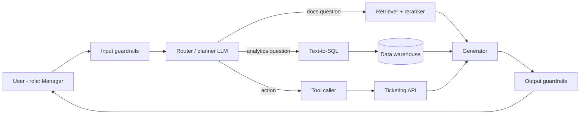
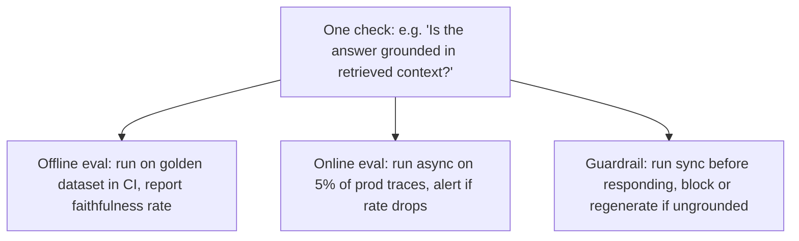
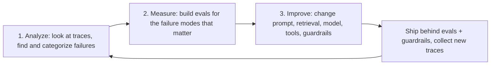

# Why Evals and Guardrails

> **TL;DR** — Getting an agentic RAG demo to work takes days; making it reliable takes months, and the gap is closed by evals (which *measure* behavior) and guardrails (which *enforce* behavior at runtime). Both are built from the same checks, and both only work if you start by looking at real failures — error analysis first, metrics second.

**You'll learn:** why reliability is the hard part · how non-determinism and multi-step compounding break naive testing · the difference (and overlap) between evals and guardrails · the eval-driven development loop (analyze → measure → improve) · what "a successful, reliable agent" actually means · who owns what
 · **Prerequisites:** none — start here
 · **Related:** [The evals & guardrails map](./02-the-evals-and-guardrails-map.md) · [Failure modes](./03-agentic-rag-failure-modes.md) · [Glossary](./04-glossary.md) · [Implementation playbook](../05-decision-framework/04-implementation-playbook.md)

---

## 1. The running example

Throughout this repo we use one concrete system so that abstract ideas stay grounded:

> **Acme Internal Assistant** — an internal enterprise assistant that:
> 1. answers questions over company documents (policies, wikis, runbooks) using **vector search + reranking**,
> 2. answers analytical questions by **generating SQL** against a data warehouse,
> 3. can **take actions** via tools (e.g. `create_ticket`, `lookup_employee`),
> 4. serves users in **different roles** (Employee, Manager, HR, Finance, Admin) with **RBAC** on documents, tables, and tools.



Every box in this diagram can fail independently, and every arrow is a place where an error can propagate. That is the core of why reliability is hard.

---

## 2. Why reliability is the hard part

### 2.1 The demo-to-production gap

A RAG prototype that answers ten hand-picked questions correctly is easy. What's hard:

| Prototype reality | Production reality |
|---|---|
| 10–20 questions the builder wrote | Thousands of questions with long-tail phrasing, typos, mixed languages, follow-ups |
| Clean, curated documents | Stale, duplicated, contradictory, access-restricted documents |
| One user, one role | Many roles, each allowed to see different data |
| Happy path tool calls | Malformed arguments, API timeouts, partial failures, retries |
| Builder judges by eye ("looks good") | Users judge by outcomes ("it told me the wrong PTO policy") |
| No adversaries | Curious and malicious users, poisoned documents, injected instructions |
| Cost and latency ignored | Cost per query and p95 latency are product requirements |

The model is rarely the bottleneck. The bottleneck is **knowing whether the system works**, **knowing when it stops working**, and **stopping it from doing harm while it doesn't**.

### 2.2 Non-determinism

LLM-based systems are non-deterministic in several layers:

- **Sampling**: temperature > 0 produces different outputs for the same input. Even at temperature 0, many hosted APIs do not guarantee bit-identical outputs (batching, hardware, and model updates can change results).
- **Model drift**: the provider silently updates a model alias; your prompts behave differently.
- **Data drift**: the document index changes daily; the same question retrieves different chunks.
- **Path dependence**: in an agent, a slightly different first step (e.g. a different tool choice) leads to an entirely different trajectory.

Consequences for testing:

- A single run of a single test proves very little. You need **datasets** (many inputs) and sometimes **repeated trials** (multiple samples per input) to estimate behavior. See [Running offline experiments](../02-offline-evals/08-running-offline-experiments.md).
- Exact-match assertions on free text are mostly useless; you need **semantic** checks (embedding similarity, LLM-as-a-judge) or **structural** checks (JSON schema, SQL result sets).
- You report **rates** (pass rate, hallucination rate) with uncertainty, not booleans.

### 2.3 Compounding error in multi-step agents

In a pipeline, the end-to-end success probability is roughly the product of per-step success probabilities (if failures are independent — they usually aren't, but the intuition holds):

```text
P(success) ≈ p_route × p_retrieve × p_generate × p_cite × ...

Illustrative (not measured) numbers:
  5 steps each at 95%  → 0.95^5  ≈ 0.77
  10 steps each at 95% → 0.95^10 ≈ 0.60
  10 steps each at 99% → 0.99^10 ≈ 0.90
```

Implications:

1. **Component evals matter.** A 77% end-to-end number tells you something is wrong; component evals tell you *where*. See [the map](./02-the-evals-and-guardrails-map.md#2-axis-b--scope-end-to-end-vs-component).
2. **Errors propagate silently.** A wrong retrieval doesn't raise an exception — the generator confidently answers from the wrong chunk. A wrong SQL filter returns a plausible-looking number.
3. **Agents can recover — or spiral.** A good agent notices a failed tool call and retries; a bad one loops. You need **trajectory** evals, not only final-answer evals. See [Agent tool & trajectory evals](../02-offline-evals/04-agent-tool-and-trajectory-evals.md).
4. **Guardrails between steps** (not only at input/output) cut the propagation chain: validating SQL before execution, checking tool arguments before calling, filtering retrieved chunks by ACL before generation.

### 2.4 The attack surface is the input *and* the data

Classic apps have an input-validation boundary. Agentic RAG apps blur it: retrieved documents, tool outputs, and database rows all flow back into the prompt, and any of them can carry instructions (**indirect prompt injection**). An agent that can call tools turns a text-generation bug into an *action* bug. This is why guardrails are not optional for agents. See [Threat model & OWASP](../04-guardrails/07-threat-model-owasp.md).

---

## 3. Evals vs guardrails

### 3.1 Definitions

| | **Evals** | **Guardrails** |
|---|---|---|
| Purpose | **Measure** quality/safety so you can decide and improve | **Enforce** policy on a live request so harm doesn't happen |
| When | Offline (pre-deploy on datasets) and online (on production traffic, usually async) | Runtime, in the request path (or right beside it) |
| Output | Scores, pass rates, dashboards, regressions | Allow / deny / modify / escalate decisions, plus logs |
| Latency budget | Seconds to hours — doesn't block users | Milliseconds to ~1–2s — directly adds to user latency |
| Cost tolerance | Can use expensive LLM judges, humans | Must be cheap per request (or sampled / tiered) |
| Error tolerance | False positives just add noise to a dashboard | False positives block legitimate users; false negatives let harm through |
| Who consumes the result | Engineers, PMs, SMEs | The application itself (and security / ops) |

### 3.2 They share the same checks

The most important insight: **a check is a function `f(input, context, output, trace) → verdict`. Where you run it determines whether it's an eval or a guardrail.**



| Check | As offline eval | As online monitor | As runtime guardrail |
|---|---|---|---|
| PII detector | % of test outputs leaking PII | PII leak rate per day | Redact PII before returning |
| Faithfulness / groundedness | Faithfulness score on golden set | Sampled faithfulness trend | Block/regenerate ungrounded answers (if latency allows) |
| SQL safety (read-only, allowed tables) | % of generated SQL violating policy | Violation count by role | Reject non-`SELECT`, unauthorized tables before execution |
| Tool-argument schema validation | Tool-call correctness rate | Malformed-call rate | Reject + re-prompt on invalid args |
| Prompt-injection classifier | Detection rate on attack set (red-team) | Attack attempts per day | Block or sandbox the request |
| Citation check | Citation precision/recall | Uncited-claim rate | Strip or flag uncited claims |

Practical consequences:

- **Build checks once, deploy them in three places.** Keep them in a shared library with a stable interface.
- **Evaluate your guardrails with evals.** A guardrail is itself a classifier with precision and recall; measure its false-positive rate on legitimate traffic and its false-negative rate on attack datasets. See [Guardrails architecture](../04-guardrails/01-guardrails-architecture.md).
- **Guardrail decisions are eval signals.** A spike in blocks is either an attack or a regression — both are worth an alert. See [Monitoring, alerting & drift](../03-online-evals-and-observability/04-monitoring-alerting-and-drift.md).
- **Not every eval can be a guardrail.** Reference-based metrics (answer correctness vs a gold answer) need ground truth that doesn't exist at runtime. Only **reference-free** checks transfer to online/runtime use. See [the map, axis (d)](./02-the-evals-and-guardrails-map.md#4-axis-d--ground-truth-reference-based-vs-reference-free).

---

## 4. Vibes-based vs systematic evaluation

Most teams start with "vibe checks": the developer tries a few prompts after each change and eyeballs the output. This is a fine *first* step and a terrible *only* step.

| Vibes-based | Systematic |
|---|---|
| A handful of memorable prompts | A versioned dataset that covers real usage and known failure modes |
| "It looks better now" | "Faithfulness went 0.81 → 0.88; tool-call accuracy unchanged; p95 latency +200ms" |
| Regressions discovered by users | Regressions caught in CI before merge |
| Changes are arguments of opinion | Changes are decisions backed by data |
| Can't compare models/prompts fairly | Side-by-side experiments on identical inputs |
| Doesn't scale past one developer | Shared ground truth across eng, product, SMEs |

> Heuristic: once more than one person is changing prompts, retrieval settings, or models, you need systematic evals. Once real users are on the system, you need online evals and guardrails.

Systematic does **not** mean "adopt 30 generic metrics from a framework". Generic metrics (e.g. a generic "helpfulness" score) often correlate poorly with what your users care about. The systematic approach starts from **your** failures.

---

## 5. The eval-driven development loop

The most effective practitioners (see Hamel Husain's and Shreya Shankar's writing in [Further reading](#further-reading)) converge on a loop:



### 5.1 Analyze — error analysis first

**Look at your data.** Before writing a single metric, read real (or realistic) traces end-to-end: the user question, the plan, retrieved chunks, SQL, tool calls, final answer.

A practical procedure, adapted from qualitative research and popularized for LLM apps by Hamel Husain and Shreya Shankar:

1. **Collect ~100 diverse traces.** From production if you have it, otherwise from a synthetic set that varies persona, intent, and difficulty (see [Synthetic datasets](../01-datasets/03-synthetic-datasets.md)). "~100" is a heuristic starting point — keep going until new traces stop revealing new failure types (*theoretical saturation*).
2. **Open coding.** For each trace, write a short free-text note on the *first* thing that went wrong (the most upstream error). Don't use a predefined taxonomy yet. Examples:
   - "Retrieved 2023 PTO policy instead of 2024."
   - "SQL filtered on `created_at` instead of `closed_at`."
   - "Answer cites doc #3, but claim is from doc #1."
   - "Called `create_ticket` without confirming priority with user."
3. **Axial coding.** Cluster the open codes into categories (failure modes), e.g. *stale retrieval*, *wrong SQL filter column*, *citation mismatch*, *action without confirmation*. Merge, split, and rename until categories are crisp and mutually exclusive enough to count.
4. **Count.** Tally traces per category. This gives you a prioritized, data-driven list of what's actually broken. Often 2–3 categories account for most failures.
5. **Decide per category:** is it a quick fix (obvious prompt bug — just fix it), or does it need an eval to track (subjective, recurring, or regression-prone)?

Use a simple annotation tool — a spreadsheet works; a custom trace viewer that shows the whole trace on one screen with keyboard shortcuts works better. The person doing the coding should have **domain expertise** (or be paired with an SME): a policy question needs someone who knows the policy.

### 5.2 Measure — build targeted evals

For each failure mode worth tracking, pick the cheapest reliable check:

1. **Code-based / deterministic** first: regex, schema validation, SQL parse + allowlist, exact match on structured outputs, "did it call tool X". Cheap, fast, unambiguous.
2. **Reference-based metrics** when you have ground truth: retrieval recall@k against labeled relevant docs, SQL execution accuracy against a gold query.
3. **LLM-as-a-judge** for subjective or semantic criteria: faithfulness, tone, "did it ask for confirmation before acting". Make judges **binary pass/fail with a critique**, scoped to *one* failure mode, and **validate them against human labels** (agreement, TPR/TNR) before trusting them. See [LLM-as-a-judge](../02-offline-evals/07-llm-as-a-judge.md).
4. **Human review** for the highest-stakes decisions and to calibrate everything else.

Then assemble a dataset whose shape matches the eval (see [Dataset strategy](../01-datasets/01-dataset-strategy.md)) and get a **baseline**.

### 5.3 Improve — change one thing, re-measure

- Change one variable at a time (prompt, chunking, embedding model, reranker, top-k, LLM, tool schema).
- Re-run the relevant evals and the full regression suite.
- Look at the *diff in traces*, not only the aggregate score — a score improvement can hide new failure types.
- Watch for overfitting to the eval set; keep a held-out set and keep feeding in fresh production samples.

### 5.4 Close the loop — the data flywheel

Production traces → error analysis → new dataset rows → new/updated evals and guardrails → better system → new production traces. See [Production data flywheel](../01-datasets/04-production-data-flywheel.md).

### 5.5 Anti-patterns

- [ ] ❌ Starting with an off-the-shelf metric suite before reading a single trace.
- [ ] ❌ 1–10 Likert scores from an LLM judge with no rubric and no human calibration.
- [ ] ❌ One giant "quality" judge that checks ten things at once.
- [ ] ❌ Optimizing a metric nobody has shown correlates with user outcomes.
- [ ] ❌ Evaluating only the final answer of a multi-step agent.
- [ ] ❌ Treating the eval dataset as frozen forever.
- [ ] ❌ Delegating error analysis entirely to people without domain context (or entirely to an LLM).

---

## 6. What a "successful, reliable agent" means

Reliability is multi-dimensional. A system that is accurate but leaks salary data, or safe but takes 40 seconds and costs $2 per question, is not successful.

| Dimension | Question it answers | Typical measures | Where covered |
|---|---|---|---|
| **Quality / correctness** | Does it give right, complete, useful answers and take the right actions? | Answer correctness, faithfulness, context recall/precision, tool-call accuracy, SQL execution accuracy, task success rate | [End-to-end RAG evals](../02-offline-evals/01-end-to-end-rag-evals.md), [Retrieval metrics](../02-offline-evals/02-retrieval-metrics.md), [Text-to-SQL evals](../02-offline-evals/05-text-to-sql-evals.md) |
| **Safety** | Does it avoid harmful, toxic, biased, or inappropriate content? | Toxicity/bias rates, refusal appropriateness | [Generation quality & safety](../02-offline-evals/03-generation-quality-and-safety-evals.md), [Output guardrails](../04-guardrails/04-output-guardrails.md) |
| **Security & privacy** | Can it be manipulated, and does it respect who may see/do what? | Injection resistance, PII leak rate, RBAC violations, unsafe action rate | [Threat model & OWASP](../04-guardrails/07-threat-model-owasp.md), [Access control](../04-guardrails/06-access-control-rbac.md) |
| **Instruction adherence** | Does it follow system/policy instructions, format, and cite sources? | Instruction-following pass rate, citation precision/recall | [Instruction & citation adherence](../02-offline-evals/06-instruction-and-citation-adherence.md) |
| **Cost** | Is cost per task sustainable at scale? | Tokens per task, $ per successful task, tool calls per task | [Monitoring](../03-online-evals-and-observability/04-monitoring-alerting-and-drift.md) |
| **Latency** | Is it fast enough for the use case? | Time to first token, p50/p95 end-to-end, steps per task | [Observability & tracing](../03-online-evals-and-observability/02-observability-and-tracing.md) |
| **Robustness** | Does it degrade gracefully on paraphrases, typos, missing data, tool errors? | Pass rate on perturbed sets, "I don't know" correctness | [Synthetic datasets](../01-datasets/03-synthetic-datasets.md) |
| **Trust & UX** | Do users rely on it appropriately and come back? | Thumbs up/down, escalation rate, retention, answer acceptance | [User feedback](../03-online-evals-and-observability/03-user-feedback-and-implicit-signals.md) |

A useful framing: **"$ per correct, safe, policy-compliant task, within latency budget"** is the business metric; everything else decomposes it.

### 6.1 Trust is calibrated, not maximized

A reliable assistant is one users trust *the right amount*: it says "I don't know" or "I couldn't find that in documents you have access to" when appropriate, shows citations so users can verify, and asks for confirmation before consequential actions. Over-trust (users acting on hallucinations) is as dangerous as under-trust (users ignoring correct answers).

### 6.2 Reliability is a property of the system, not the model

Swapping in a stronger model rarely fixes retrieval misses, ACL bugs, or bad tool schemas. Reliability comes from: good data and retrieval, constrained interfaces (structured outputs, typed tools, read-only SQL), defense-in-depth guardrails, observability, and a steady eval-driven improvement loop.

---

## 7. Roles and responsibilities

Evals are a team sport. The most common failure is "the engineers own evals" with no domain or product input.

| Role | Owns / contributes | Typical artifacts |
|---|---|---|
| **AI / ML engineers** | Pipelines, eval harness, metrics, judges, CI gates, tracing | Eval code, experiment reports, dashboards |
| **Subject-matter experts (SMEs)** — HR, Finance, Legal, domain owners | What "correct" means; golden answers; labeling; judge calibration; error analysis of domain failures | Golden datasets, rubrics, labeled traces |
| **Product managers** | Which failure modes matter most, acceptable trade-offs, launch criteria, user-facing behavior (refusals, confirmations) | Quality bars, prioritized failure taxonomy, release decisions |
| **Security / privacy / compliance** | Threat model, access policy, PII rules, red-teaming, audit requirements | Threat model, policy-as-code, red-team datasets, audit logs |
| **Data / platform engineers** | Document ingestion, ACL metadata propagation, warehouse schemas, semantic layer | Index pipelines, data contracts |
| **SRE / ops** | Online monitoring, alerting, incident response, rollback | Alerts, runbooks, SLOs |
| **End users** | Implicit and explicit feedback | Thumbs, comments, escalations |

> Opinion: appoint one **"benevolent dictator" for quality** per product area — usually a domain expert or PM — who has final say on what counts as a pass. Committees produce inconsistent labels.

---

## 8. What to do first (if you're starting today)

- [ ] Instrument tracing for every step (LLM calls, retrieval, SQL, tools) — you can't analyze what you can't see. → [Observability & tracing](../03-online-evals-and-observability/02-observability-and-tracing.md)
- [ ] Put cheap, deterministic guardrails in place for the obvious risks: RBAC filtering at retrieval, read-only SQL with table allowlists, tool-argument schemas, PII redaction. → [Guardrails](../04-guardrails/README.md)
- [ ] Gather ~100 diverse traces and do open + axial coding with an SME. → §5.1
- [ ] Turn the top 3–5 failure modes into evals; build a small golden dataset (50–200 rows is a reasonable start, heuristic). → [SME golden datasets](../01-datasets/02-sme-golden-datasets.md)
- [ ] Wire evals into CI as a regression gate. → [Running offline experiments](../02-offline-evals/08-running-offline-experiments.md)
- [ ] After launch, sample production traffic into online evals and route failures back into datasets. → [Online evals](../03-online-evals-and-observability/01-online-evals.md)
- [ ] Revisit the [maturity model](../05-decision-framework/05-maturity-model.md) quarterly.

---

## Key takeaways

- Reliability — not capability — is the hard part of agentic RAG; it's undermined by non-determinism, compounding multi-step errors, and an attack surface that includes your own data.
- **Evals measure; guardrails enforce.** They are the same checks deployed at different points (offline, online, in-path). Build checks once and reuse them; measure guardrails like any classifier.
- Only reference-free checks can run online or as guardrails; reference-based metrics need datasets.
- Start with **error analysis**: read traces, open-code, axial-code, count. Build evals for the failure modes that matter, not generic metric suites.
- Prefer deterministic checks; use binary, single-purpose, human-validated LLM judges for the rest.
- "Reliable" spans quality, safety, security, instruction adherence, cost, latency, robustness, and calibrated trust.
- Evals need SMEs, product, and security in the loop — not only engineers.

## Further reading

- Hamel Husain — [Your AI Product Needs Evals](https://hamel.dev/blog/posts/evals/)
- Hamel Husain — [A Field Guide to Rapidly Improving AI Products](https://hamel.dev/blog/posts/field-guide/)
- Hamel Husain — [Using LLM-as-a-Judge For Evaluation: A Complete Guide](https://hamel.dev/blog/posts/llm-judge/)
- Hamel Husain & Shreya Shankar — [AI Evals FAQ](https://hamel.dev/blog/posts/evals-faq/)
- Shankar et al., 2024 — [Who Validates the Validators? Aligning LLM-Assisted Evaluation of LLM Outputs with Human Preferences](https://arxiv.org/abs/2404.12272)
- Shreya Shankar — [homepage & writing](https://www.sh-reya.com/)
- Eugene Yan — [Task-Specific LLM Evals that Do & Don't Work](https://eugeneyan.com/writing/evals/)
- Yan, Bischof, Frye, Husain, Liu, Shankar — [What We've Learned From A Year of Building with LLMs](https://applied-llms.org/)
- Anthropic — [Building effective agents](https://www.anthropic.com/research/building-effective-agents)
- Anthropic — [Demystifying evals for AI agents](https://www.anthropic.com/engineering/demystifying-evals-for-ai-agents)
- Barnett et al., 2024 — [Seven Failure Points When Engineering a Retrieval Augmented Generation System](https://arxiv.org/abs/2401.05856)
- NIST — [AI Risk Management Framework](https://www.nist.gov/itl/ai-risk-management-framework)
- Next in this section: [The evals & guardrails map](./02-the-evals-and-guardrails-map.md)
