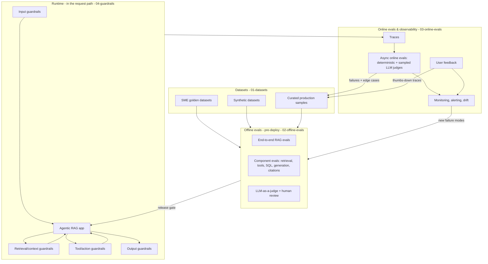
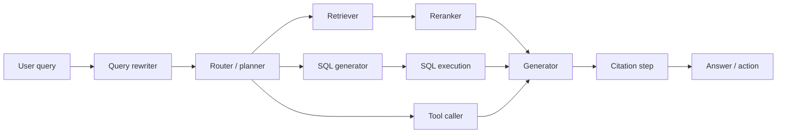
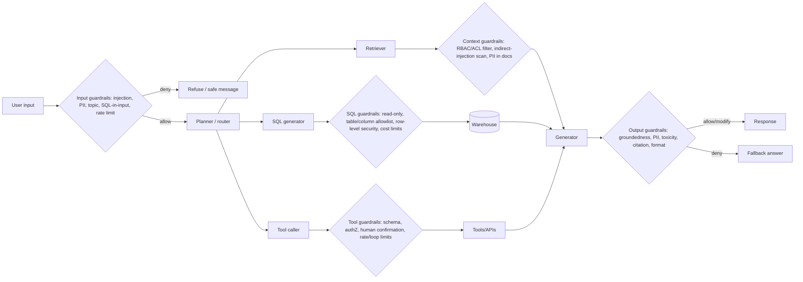
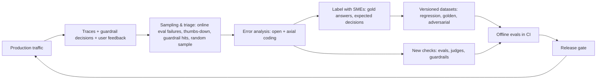

# The Evals & Guardrails Map

> **TL;DR** — Every eval or guardrail in an agentic RAG system can be placed on five axes: **when** it runs (offline / online / in-path), **scope** (end-to-end vs a specific component), **method** (code, statistical, LLM judge, human), **ground truth** (reference-based vs reference-free), and — for guardrails — **mode** (blocking vs non-blocking, sync vs async). This page is the master mental model for the whole repo: learn the axes once, then use the big matrix to jump to the right file.

**You'll learn:** the five axes and their trade-offs · where each eval/guardrail type sits · how datasets feed offline evals and production feeds datasets (the flywheel) · how one check becomes an offline eval, an online monitor, and a guardrail
 · **Prerequisites:** [Why evals and guardrails](./01-why-evals-and-guardrails.md)
 · **Related:** [Failure modes](./03-agentic-rag-failure-modes.md) · [Glossary](./04-glossary.md) · [Eval selection decision tree](../05-decision-framework/01-eval-selection-decision-tree.md) · [Guardrail selection decision tree](../05-decision-framework/02-guardrail-selection-decision-tree.md) · [Metric cheatsheet](../05-decision-framework/03-metric-cheatsheet.md)

---

## 0. The whole picture on one page



Read it as three loops:

1. **Pre-deploy loop:** datasets → offline evals → release decision.
2. **Runtime protection:** guardrails wrap the app on every request.
3. **Learning loop (flywheel):** traces → online evals + feedback → curated into datasets → better offline evals → better releases.

---

## 1. Axis A — When: offline vs online vs runtime guardrails

| | **Offline evals** | **Online evals** | **Runtime guardrails** |
|---|---|---|---|
| Runs on | Fixed datasets (golden, synthetic, curated prod) | Real production traffic (all or sampled) | Every live request, in the path |
| Timing | Before deploy (dev loop, CI, release gate) | After response, usually async (seconds–hours) | Synchronous before/after a step (or async with fast kill-switch) |
| Ground truth | Usually available (reference-based possible) | Usually **not** available (reference-free only) | **Not** available (reference-free only) |
| Purpose | Compare variants, prevent regressions, gate releases | Detect drift, regressions, emerging failure modes; measure real quality | Prevent harm on this request |
| Cost tolerance | High (big judges, many samples, human review) | Medium (sampling, cheap judges) | Low per request (fast classifiers, rules) |
| Latency tolerance | Very high | High | Very low |
| Action on failure | Block the merge/release; investigate | Alert, triage, add to dataset | Allow / deny / modify / escalate |
| Main files | [02-offline-evals](../02-offline-evals/README.md) | [03-online-evals-and-observability](../03-online-evals-and-observability/README.md) | [04-guardrails](../04-guardrails/README.md) |

Nuances:

- **Shadow mode** and **canary** sit between offline and online: you run a new variant on real traffic but don't show its output to users (shadow) or show it to a small slice (canary), then evaluate online. See [Running offline experiments](../02-offline-evals/08-running-offline-experiments.md) and [Online evals](../03-online-evals-and-observability/01-online-evals.md).
- **Online A/B tests** compare variants on business metrics (task success, retention, escalations) — the only way to measure real user impact.
- **Red teaming** is an offline activity that produces adversarial datasets; those datasets then evaluate guardrails offline. See [Threat model & OWASP](../04-guardrails/07-threat-model-owasp.md).

---

## 2. Axis B — Scope: end-to-end vs component

An agentic RAG app is a pipeline/graph. You can evaluate the **whole** thing (input → final answer/action) or **one node** with its inputs held fixed.



| | **End-to-end** | **Component** |
|---|---|---|
| Question answered | "Did the user get a correct, safe, useful result?" | "Is *this step* doing its job?" |
| Inputs | User input (+ conversation) → final output (+ trace) | Fixed step inputs → step output |
| Strengths | Closest to user experience; catches integration bugs | Localizes failures; fast, cheap; enables targeted iteration |
| Weaknesses | Hard to diagnose; noisy; needs more ground truth | A good component score doesn't guarantee E2E quality |
| Typical metrics | Answer correctness, faithfulness, answer relevancy, task success, trajectory success | Recall@k, nDCG, routing accuracy, tool-call correctness, SQL execution accuracy, citation precision |

**Rule of thumb:** use end-to-end evals to know *whether* you're good, component evals to know *why* not. Run both.

### 2.1 Component-by-component

| Component | What can go wrong | Key component evals | Ground truth needed | File |
|---|---|---|---|---|
| Query rewriter / understanding | Drops constraints, changes intent, bad decomposition | Intent preservation (judge), rewrite → downstream recall delta | Optional | [End-to-end RAG evals](../02-offline-evals/01-end-to-end-rag-evals.md) |
| Router / planner | Wrong route (docs vs SQL vs tool), bad plan | Routing accuracy (exact match on label), plan quality (judge) | Yes (route label) | [Agent tool & trajectory evals](../02-offline-evals/04-agent-tool-and-trajectory-evals.md) |
| Retriever | Relevant chunks not found | Recall@k, hit rate, MRR, context recall | Yes (relevant doc IDs) or judge | [Retrieval metrics](../02-offline-evals/02-retrieval-metrics.md) |
| Reranker | Relevant chunks ranked too low | nDCG@k, MAP, precision@k, context precision | Yes (graded relevance) or judge | [Retrieval metrics](../02-offline-evals/02-retrieval-metrics.md) |
| Tool caller | Wrong tool, wrong args, unnecessary calls, loops | Tool selection accuracy, argument correctness, schema validity, trajectory match | Yes (expected calls) or judge | [Agent tool & trajectory evals](../02-offline-evals/04-agent-tool-and-trajectory-evals.md) |
| SQL generator | Wrong joins/filters/aggregations, unsafe SQL | Execution accuracy, exact/component match, SQL validity, safety rules | Yes (gold SQL or gold result) | [Text-to-SQL evals](../02-offline-evals/05-text-to-sql-evals.md) |
| Generator | Hallucination, incomplete, wrong format, toxic | Faithfulness, answer relevancy, correctness, format checks, toxicity/bias | Mixed | [E2E RAG evals](../02-offline-evals/01-end-to-end-rag-evals.md), [Generation quality & safety](../02-offline-evals/03-generation-quality-and-safety-evals.md) |
| Citation step | Missing, wrong, or fabricated citations | Citation precision/recall, citation-support (judge/NLI) | Optional | [Instruction & citation adherence](../02-offline-evals/06-instruction-and-citation-adherence.md) |
| Whole agent (multi-step) | Doesn't complete task, inefficient, unsafe actions | Task success, trajectory evals, steps/cost per task | Yes (success criteria) | [Agent tool & trajectory evals](../02-offline-evals/04-agent-tool-and-trajectory-evals.md) |

---

## 3. Axis C — Method: how the check is computed

| Method | Examples | Cost | Latency | Reliability | Best for | Pitfalls |
|---|---|---|---|---|---|---|
| **Deterministic / code-based** | Regex, JSON-schema validation, SQL parse + allowlist, exact match on labels, "tool X called with arg Y", length limits, ACL checks | ~free | µs–ms | Perfectly consistent (but only as good as the rule) | Structured outputs, safety policies, format, routing, tool calls | Brittle on free text; false sense of coverage |
| **Statistical / reference-based** | BLEU, ROUGE, token F1, embedding cosine similarity, BERTScore; retrieval IR metrics (recall@k, nDCG) | Low | ms | Consistent; weak semantic validity for free text | Retrieval (with labels), short factual answers, regression tracking | BLEU/ROUGE correlate poorly with correctness for long-form answers; embedding sim rewards topical-but-wrong answers |
| **Model-based classifiers** | Toxicity, PII NER, prompt-injection classifiers, NLI entailment models | Low–medium | ms–100s of ms | Good within training distribution | Safety, PII, injection, groundedness via NLI — often used as guardrails | Domain shift; need threshold tuning; measure FP/FN rates |
| **LLM-as-a-judge** | Faithfulness, answer relevancy, correctness vs reference, instruction adherence, pairwise preference, trajectory quality | Medium–high | 100s ms–s | Variable; must be validated against humans | Semantic, subjective, or multi-factor criteria | Position/verbosity/self-preference bias; drift when judge model changes; vague rubrics |
| **Human review** | SME labeling, annotation queues, pairwise preference, red teaming | High | hours–days | Highest validity (if guidelines are clear) | Ground truth, judge calibration, high-stakes decisions, error analysis | Slow; inter-annotator disagreement; doesn't scale |

**Default preference order:** deterministic → reference-based (if labels exist) → small classifier → LLM judge → human. Use humans to **calibrate** everything above them. See [LLM-as-a-judge](../02-offline-evals/07-llm-as-a-judge.md).

---

## 4. Axis D — Ground truth: reference-based vs reference-free

| | **Reference-based** | **Reference-free** |
|---|---|---|
| Needs | A gold answer, gold SQL/result, gold relevant docs, gold tool calls | Only the input, context, output, and/or trace |
| Examples | Answer correctness, context recall, recall@k, nDCG, SQL execution accuracy, tool-call exact match, BLEU/ROUGE | Faithfulness/groundedness, answer relevancy, context precision (LLM-judged), toxicity, PII, format validity, citation support, SQL safety |
| Where it can run | Offline only (or online on the rare labeled subset) | Offline, online, **and** as guardrails |
| Strength | Measures *correctness* directly | Scales to all traffic; no labeling cost |
| Weakness | Labels are expensive and go stale | Can't tell you an answer is *wrong* if it's faithfully grounded in the wrong/outdated doc |

> **Key insight:** a faithful answer can still be incorrect (grounded in the wrong context), and a correct answer can still be unfaithful (right by luck from model priors). You need both families. See [End-to-end RAG evals](../02-offline-evals/01-end-to-end-rag-evals.md).

Some metrics come in both flavors. Example: **context precision** can be computed against labeled relevant chunks (reference-based) or by an LLM judging each chunk's relevance to the question (reference-free, e.g. RAGAS offers both variants).

---

## 5. Axis E — Guardrail mode: blocking vs non-blocking, sync vs async

| | **Blocking** (enforcing) | **Non-blocking** (observing) |
|---|---|---|
| Decision | **Allow / deny / modify** (redact, rewrite, regenerate, strip) / **escalate** (ask human, ask user to confirm) | **Flag / log / alert / score** |
| Effect on user | Changes or stops the response | None (immediately) |
| Must be | Fast, high precision (false positives hurt UX) | Can be slower, higher recall |
| Examples | RBAC filter on retrieval, SQL read-only enforcement, PII redaction, injection block, tool-call confirmation | Toxicity score logged, sampled faithfulness judge, anomaly alert on tool usage |

| | **Synchronous** | **Asynchronous** |
|---|---|---|
| When | In the request path, before the next step proceeds | In parallel or after the response |
| Latency impact | Added directly to user latency | None (or overlapped) |
| Can it prevent harm? | Yes | Only for *future* requests (or via streaming cut-off / retraction) |
| Typical | Input/tool/SQL/ACL guardrails, fast output checks | Expensive judges, monitoring, audit |

Common patterns combining both:

- **Parallel guard:** start the LLM call and the input classifier concurrently; cancel the LLM call if the classifier blocks. Saves latency.
- **Streaming with tripwire:** stream tokens to the user while an async checker runs; cut the stream and retract if it fires. Lower latency, but users may glimpse content.
- **Shadow guardrail:** run a new guardrail in non-blocking mode first, measure its false-positive rate on real traffic, then promote to blocking.
- **Tiered:** cheap rule/classifier sync → expensive LLM check only when the cheap one is uncertain.

Deep dive: [Guardrails architecture](../04-guardrails/01-guardrails-architecture.md).

### 5.1 Where guardrails sit in the agent



| Stage | File |
|---|---|
| Input | [Input guardrails](../04-guardrails/02-input-guardrails.md) |
| Retrieval / context | [Retrieval & context guardrails](../04-guardrails/03-retrieval-and-context-guardrails.md) |
| Output | [Output guardrails](../04-guardrails/04-output-guardrails.md) |
| Tools / actions / SQL execution | [Tool & action guardrails](../04-guardrails/05-tool-and-action-guardrails.md) |
| Cross-cutting authorization | [Access control & RBAC](../04-guardrails/06-access-control-rbac.md) |
| Threats these defend against | [Threat model & OWASP](../04-guardrails/07-threat-model-owasp.md) |

---

## 6. The big matrix

Legend — **When:** Off = offline eval · On = online eval/monitor · GR = runtime guardrail. **Ref:** Yes = needs ground truth · No = reference-free · Opt = both variants exist. **Method:** Code · Stat · Clf (classifier) · Judge (LLM) · Human.

### 6.1 Evals

| Eval / metric | Scope | Method | Ref | Off | On | GR | Covered in |
|---|---|---|---|:-:|:-:|:-:|---|
| Answer correctness | E2E | Judge / Stat | Yes | ✅ | ◐ (labeled subset) | ❌ | [E2E RAG evals](../02-offline-evals/01-end-to-end-rag-evals.md) |
| Faithfulness / groundedness | E2E / Generator | Judge / Clf (NLI) | No | ✅ | ✅ | ◐ (if latency allows) | [E2E RAG evals](../02-offline-evals/01-end-to-end-rag-evals.md) |
| Answer relevancy | E2E / Generator | Judge / Stat (embedding) | No | ✅ | ✅ | ◐ | [E2E RAG evals](../02-offline-evals/01-end-to-end-rag-evals.md) |
| Context recall | Retriever | Judge / Code | Yes | ✅ | ❌ | ❌ | [E2E RAG evals](../02-offline-evals/01-end-to-end-rag-evals.md) |
| Context precision | Retriever / Reranker | Judge / Code | Opt | ✅ | ✅ (ref-free) | ❌ | [E2E RAG evals](../02-offline-evals/01-end-to-end-rag-evals.md) |
| Precision@k / Recall@k / F1@k | Retriever | Code | Yes | ✅ | ❌ | ❌ | [Retrieval metrics](../02-offline-evals/02-retrieval-metrics.md) |
| Hit rate@k | Retriever | Code | Yes | ✅ | ❌ | ❌ | [Retrieval metrics](../02-offline-evals/02-retrieval-metrics.md) |
| MRR | Retriever / Reranker | Code | Yes | ✅ | ❌ | ❌ | [Retrieval metrics](../02-offline-evals/02-retrieval-metrics.md) |
| nDCG@k | Reranker | Code | Yes (graded) | ✅ | ❌ | ❌ | [Retrieval metrics](../02-offline-evals/02-retrieval-metrics.md) |
| MAP | Retriever / Reranker | Code | Yes | ✅ | ❌ | ❌ | [Retrieval metrics](../02-offline-evals/02-retrieval-metrics.md) |
| BLEU / ROUGE / token F1 | Generator | Stat | Yes | ✅ | ❌ | ❌ | [Generation quality & safety](../02-offline-evals/03-generation-quality-and-safety-evals.md) |
| Semantic similarity (embedding, BERTScore) | Generator / E2E | Stat | Yes | ✅ | ❌ | ❌ | [Generation quality & safety](../02-offline-evals/03-generation-quality-and-safety-evals.md) |
| Toxicity / profanity | Generator | Clf / Judge | No | ✅ | ✅ | ✅ | [Generation quality & safety](../02-offline-evals/03-generation-quality-and-safety-evals.md) |
| Bias / fairness | Generator | Judge / Clf / Human | No (or paired) | ✅ | ✅ | ◐ | [Generation quality & safety](../02-offline-evals/03-generation-quality-and-safety-evals.md) |
| Coherence / fluency / conciseness | Generator | Judge | No | ✅ | ✅ | ❌ | [Generation quality & safety](../02-offline-evals/03-generation-quality-and-safety-evals.md) |
| Routing accuracy | Router | Code | Yes | ✅ | ◐ | ❌ | [Agent tool & trajectory evals](../02-offline-evals/04-agent-tool-and-trajectory-evals.md) |
| Tool selection accuracy | Tool caller | Code / Judge | Opt | ✅ | ◐ | ❌ | [Agent tool & trajectory evals](../02-offline-evals/04-agent-tool-and-trajectory-evals.md) |
| Tool argument correctness / schema validity | Tool caller | Code / Judge | Opt | ✅ | ✅ | ✅ (schema) | [Agent tool & trajectory evals](../02-offline-evals/04-agent-tool-and-trajectory-evals.md) |
| Trajectory match (exact / in-order / any-order) | Agent | Code | Yes | ✅ | ❌ | ❌ | [Agent tool & trajectory evals](../02-offline-evals/04-agent-tool-and-trajectory-evals.md) |
| Trajectory quality / efficiency (steps, loops) | Agent | Judge / Code | No | ✅ | ✅ | ✅ (step limits) | [Agent tool & trajectory evals](../02-offline-evals/04-agent-tool-and-trajectory-evals.md) |
| Task success / goal completion | E2E agent | Judge / Code / Human | Opt | ✅ | ✅ | ❌ | [Agent tool & trajectory evals](../02-offline-evals/04-agent-tool-and-trajectory-evals.md) |
| SQL execution accuracy | SQL generator | Code | Yes | ✅ | ❌ | ❌ | [Text-to-SQL evals](../02-offline-evals/05-text-to-sql-evals.md) |
| SQL exact / component match, SQL similarity | SQL generator | Code / Stat | Yes | ✅ | ❌ | ❌ | [Text-to-SQL evals](../02-offline-evals/05-text-to-sql-evals.md) |
| SQL validity (parses, executes) | SQL generator | Code | No | ✅ | ✅ | ✅ | [Text-to-SQL evals](../02-offline-evals/05-text-to-sql-evals.md) |
| SQL safety (read-only, allowlist, RLS) | SQL generator | Code | No | ✅ | ✅ | ✅ | [Text-to-SQL evals](../02-offline-evals/05-text-to-sql-evals.md), [Tool & action guardrails](../04-guardrails/05-tool-and-action-guardrails.md) |
| Instruction adherence | Generator / E2E | Code / Judge | No | ✅ | ✅ | ◐ | [Instruction & citation adherence](../02-offline-evals/06-instruction-and-citation-adherence.md) |
| Format / schema adherence | Generator | Code | No | ✅ | ✅ | ✅ | [Instruction & citation adherence](../02-offline-evals/06-instruction-and-citation-adherence.md) |
| Citation precision / recall / support | Citation step | Code / Judge / Clf | Opt | ✅ | ✅ | ◐ | [Instruction & citation adherence](../02-offline-evals/06-instruction-and-citation-adherence.md) |
| Pairwise preference (A vs B) | E2E | Judge / Human | No | ✅ | ◐ (A/B) | ❌ | [LLM-as-a-judge](../02-offline-evals/07-llm-as-a-judge.md) |
| Judge–human agreement (kappa, TPR/TNR) | Meta-eval | Code + Human | Yes (human labels) | ✅ | ◐ | ❌ | [LLM-as-a-judge](../02-offline-evals/07-llm-as-a-judge.md) |
| User feedback (explicit/implicit) | E2E | Human | No | ❌ | ✅ | ❌ | [User feedback & implicit signals](../03-online-evals-and-observability/03-user-feedback-and-implicit-signals.md) |
| Latency, cost, tokens, error rate | System | Code | No | ✅ | ✅ | ✅ (budgets) | [Observability & tracing](../03-online-evals-and-observability/02-observability-and-tracing.md), [Monitoring](../03-online-evals-and-observability/04-monitoring-alerting-and-drift.md) |
| Drift (input, retrieval, output distributions) | System | Stat | No | ❌ | ✅ | ❌ | [Monitoring, alerting & drift](../03-online-evals-and-observability/04-monitoring-alerting-and-drift.md) |

◐ = possible with caveats (sampled, labeled subset, or only when latency budget allows).

### 6.2 Guardrails

| Guardrail | Stage | Method | Mode (typical) | Sync/async | Also usable as eval? | Covered in |
|---|---|---|---|---|---|---|
| Direct prompt-injection / jailbreak detection | Input | Clf / Judge / rules | Blocking (deny) | Sync (often parallel) | ✅ detection rate on attack sets | [Input guardrails](../04-guardrails/02-input-guardrails.md) |
| PII detection / redaction (input) | Input | Clf (NER) / regex | Modify (redact) or deny | Sync | ✅ | [Input guardrails](../04-guardrails/02-input-guardrails.md) |
| Topic / scope restriction | Input | Clf / Judge | Deny (polite refusal) | Sync | ✅ | [Input guardrails](../04-guardrails/02-input-guardrails.md) |
| SQL-in-input / code-injection detection | Input | Code / Clf | Deny or flag | Sync | ✅ | [Input guardrails](../04-guardrails/02-input-guardrails.md) |
| Rate limiting / abuse / input length | Input | Code | Deny | Sync | ✅ (rates) | [Input guardrails](../04-guardrails/02-input-guardrails.md) |
| Document-level ACL / RBAC filtering | Retrieval | Code (metadata filter) | Blocking (filter) | Sync | ✅ (leak tests) | [Retrieval & context guardrails](../04-guardrails/03-retrieval-and-context-guardrails.md), [Access control](../04-guardrails/06-access-control-rbac.md) |
| Indirect prompt-injection scan on retrieved content / tool output | Context | Clf / Judge / rules | Modify (drop/quarantine) or flag | Sync | ✅ | [Retrieval & context guardrails](../04-guardrails/03-retrieval-and-context-guardrails.md) |
| Relevance threshold / "no good context → abstain" | Context | Stat / Clf | Modify (abstain) | Sync | ✅ | [Retrieval & context guardrails](../04-guardrails/03-retrieval-and-context-guardrails.md) |
| SQL read-only, table/column allowlist, row-level security, query cost limit | Tool (SQL) | Code (parser) + DB permissions | Deny | Sync | ✅ | [Tool & action guardrails](../04-guardrails/05-tool-and-action-guardrails.md), [Access control](../04-guardrails/06-access-control-rbac.md) |
| Tool-argument schema validation | Tool | Code | Deny + re-prompt | Sync | ✅ | [Tool & action guardrails](../04-guardrails/05-tool-and-action-guardrails.md) |
| Tool authorization (role may call tool?) | Tool | Code (policy) | Deny | Sync | ✅ | [Access control](../04-guardrails/06-access-control-rbac.md) |
| Human-in-the-loop confirmation for consequential actions | Tool | Policy | Escalate | Sync | ◐ | [Tool & action guardrails](../04-guardrails/05-tool-and-action-guardrails.md) |
| Step / loop / budget limits | Agent | Code | Deny (stop) | Sync | ✅ | [Tool & action guardrails](../04-guardrails/05-tool-and-action-guardrails.md) |
| Groundedness / hallucination check | Output | Clf (NLI) / Judge | Modify (regenerate/caveat) or flag | Sync or async | ✅ | [Output guardrails](../04-guardrails/04-output-guardrails.md) |
| PII / secret leakage in output | Output | Clf / regex | Modify (redact) | Sync | ✅ | [Output guardrails](../04-guardrails/04-output-guardrails.md) |
| Toxicity / brand-safety | Output | Clf / Judge | Deny or modify | Sync (or streaming tripwire) | ✅ | [Output guardrails](../04-guardrails/04-output-guardrails.md) |
| Citation presence / validity | Output | Code / Judge | Modify (strip uncited) or flag | Sync | ✅ | [Output guardrails](../04-guardrails/04-output-guardrails.md) |
| Output schema / format validation | Output | Code | Modify (repair/retry) | Sync | ✅ | [Output guardrails](../04-guardrails/04-output-guardrails.md) |
| System-prompt leakage detection | Output | Code (canary string) / Clf | Deny | Sync | ✅ | [Output guardrails](../04-guardrails/04-output-guardrails.md), [Threat model](../04-guardrails/07-threat-model-owasp.md) |

For "which should I use?", go to the decision trees: [eval selection](../05-decision-framework/01-eval-selection-decision-tree.md), [guardrail selection](../05-decision-framework/02-guardrail-selection-decision-tree.md). For tools that implement these, see [eval tools](../06-tooling-landscape/01-eval-and-observability-tools.md) and [guardrail tools](../06-tooling-landscape/02-guardrail-tools.md).

---

## 7. Datasets: the fuel for offline evals

Each eval needs a dataset whose **shape** matches what the eval consumes.

| Eval family | Minimum dataset row | Example (running example) |
|---|---|---|
| Retrieval metrics | `question`, `relevant_doc_ids` (optionally graded) | "What's the parental leave policy?" → `[hr-policy-2024#leave]` |
| E2E RAG (reference-based) | `question`, `reference_answer`, optionally `reference_contexts` | "How many PTO days for L5?" → "25 days per year" |
| E2E RAG (reference-free) | `question` (system produces answer + contexts) | Any question |
| Text-to-SQL | `question`, `gold_sql` and/or `gold_result`, `schema/db snapshot` | "Q3 revenue by region" → `SELECT region, SUM(...)` |
| Tool / trajectory | `input`, `expected_tool_calls` (name + args) or `success_criteria`, mocked tool env | "Open a P2 ticket for VPN outage" → `create_ticket(priority="P2", ...)` |
| Safety / guardrails | `input`, `expected_decision` (allow/deny/redact), `attack_type` | Injection prompt → `deny` |
| RBAC | `user_role`, `question`, `forbidden_doc_ids` / `must_refuse` | Employee asks for exec salaries → refuse, no leak |
| Multi-turn | `conversation[]`, `expected_final_outcome` | 3-turn ticket-filing dialogue |
| Judge calibration | `input`, `output`, `human_label`, `human_critique` | 100–200 labeled traces (heuristic) |

Sources:

| Source | Strength | Weakness | File |
|---|---|---|---|
| SME golden | Highest validity; defines "correct" | Slow, expensive, small | [SME golden datasets](../01-datasets/02-sme-golden-datasets.md) |
| Synthetic | Fast coverage, edge cases, adversarial | May not match real distribution; needs filtering | [Synthetic datasets](../01-datasets/03-synthetic-datasets.md) |
| Production (curated) | Real distribution, real failures | Needs labeling, privacy handling | [Production data flywheel](../01-datasets/04-production-data-flywheel.md) |

Strategy (what mix, how many, how to version): [Dataset strategy](../01-datasets/01-dataset-strategy.md).

---

## 8. The flywheel: production → datasets → evals → production



Practical notes:

- Every guardrail block and every online-eval failure is a **candidate dataset row**.
- Keep **regression sets** (bugs you fixed must stay fixed) separate from **capability sets** (things you're trying to improve).
- Scrub PII and respect access controls when moving traces into datasets.
- See [Production data flywheel](../01-datasets/04-production-data-flywheel.md) and [Online evals](../03-online-evals-and-observability/01-online-evals.md).

---

## 9. One check, three deployments — worked example

**Check:** *"Every factual claim in the answer is supported by the retrieved context"* (groundedness).

| Deployment | How it's run | Threshold / action | Cost/latency choice |
|---|---|---|---|
| **Offline eval** | On 300-row golden set in CI, with strong LLM judge decomposing claims and verifying each | Fail the build if faithfulness drops by more than a set margin vs main (heuristic: a few points) | Strongest judge model, full claim decomposition |
| **Online monitor** | Async on a sample of production traces (e.g. 5–10%, heuristic) + all thumbs-down traces | Alert if 24h rolling rate drops below baseline band; queue failures for review | Cheaper judge model; sampling |
| **Runtime guardrail** | Sync, after generation, before returning — only for high-risk intents (e.g. HR policy, finance numbers) | If ungrounded: regenerate once with stricter prompt; if still failing, return "I couldn't verify this in your documents" + sources | Small NLI model or fast judge; only on high-risk routes to bound latency |

```python
# Shared check, three call sites — illustrative pure Python
import random
from dataclasses import dataclass

@dataclass
class Verdict:
    passed: bool
    score: float
    reason: str

def groundedness_check(answer: str, contexts: list[str], judge) -> Verdict:
    """judge(answer, contexts) -> (score in [0,1], reason). Plug in NLI or LLM judge."""
    score, reason = judge(answer, contexts)
    return Verdict(passed=score >= 0.8, score=score, reason=reason)  # 0.8: heuristic

# 1) Offline: aggregate over a dataset
def offline_eval(rows, app, judge):
    verdicts = [groundedness_check(*app(r["question"]), judge) for r in rows]
    return sum(v.passed for v in verdicts) / len(verdicts)

# 2) Online: async on sampled traces
def on_trace(trace, judge, log_metric, sample_rate=0.05):
    if random.random() < sample_rate or trace.get("thumbs_down"):
        v = groundedness_check(trace["answer"], trace["contexts"], judge)
        log_metric("groundedness", v.score, trace_id=trace["id"])  # your metrics sink

# 3) Guardrail: sync, blocking
def guarded_answer(question, app, judge, high_risk: bool):
    answer, contexts = app(question)
    if high_risk and not groundedness_check(answer, contexts, judge).passed:
        return "I couldn't verify an answer in the documents you can access."
    return answer
```

The same pattern applies to PII, SQL safety, citation validity, tool-argument validity, and injection detection.

---

## 10. How to navigate this repo from here

| If you want to… | Go to |
|---|---|
| Understand what breaks in agentic RAG | [Failure modes](./03-agentic-rag-failure-modes.md) |
| Look up a term | [Glossary](./04-glossary.md) |
| Build or choose datasets | [01-datasets](../01-datasets/README.md) |
| Pick and implement offline metrics | [02-offline-evals](../02-offline-evals/README.md) |
| Monitor production | [03-online-evals-and-observability](../03-online-evals-and-observability/README.md) |
| Design guardrails | [04-guardrails](../04-guardrails/README.md) |
| Decide what to do for *your* system | [05-decision-framework](../05-decision-framework/README.md) |
| Compare tools | [06-tooling-landscape](../06-tooling-landscape/README.md) |
| Find papers and sources | [07-references](../07-references/README.md) |

---

## Key takeaways

- Place every check on five axes: **when** (offline/online/runtime), **scope** (E2E/component), **method** (code/statistical/classifier/judge/human), **ground truth** (reference-based/free), and for guardrails **mode** (blocking/non-blocking, sync/async).
- End-to-end evals tell you *whether* the system works; component evals tell you *where* it breaks.
- Only reference-free checks can run online or as guardrails; reference-based metrics live offline on datasets.
- Prefer deterministic checks; calibrate LLM judges against humans; reserve humans for ground truth and high-stakes calls.
- Blocking guardrails must be fast and precise; promote them from shadow (non-blocking) mode after measuring false positives.
- The same check can be an offline eval, an online monitor, and a guardrail — build it once.
- Production traces, guardrail hits, and user feedback flow back into datasets: that flywheel is how systems get reliably better.

## Further reading

- Es et al., 2023 — [Ragas: Automated Evaluation of Retrieval Augmented Generation](https://arxiv.org/abs/2309.15217) · [RAGAS docs](https://docs.ragas.io/)
- Zheng et al., 2023 — [Judging LLM-as-a-Judge with MT-Bench and Chatbot Arena](https://arxiv.org/abs/2306.05685)
- Shankar et al., 2024 — [Who Validates the Validators?](https://arxiv.org/abs/2404.12272)
- Hamel Husain — [Your AI Product Needs Evals](https://hamel.dev/blog/posts/evals/)
- Eugene Yan — [Patterns for Building LLM-based Systems & Products](https://eugeneyan.com/writing/llm-patterns/)
- OWASP — [Top 10 for LLM Applications](https://genai.owasp.org/llm-top-10/)
- Anthropic — [Demystifying evals for AI agents](https://www.anthropic.com/engineering/demystifying-evals-for-ai-agents)
- Next: [Agentic RAG failure modes](./03-agentic-rag-failure-modes.md)
