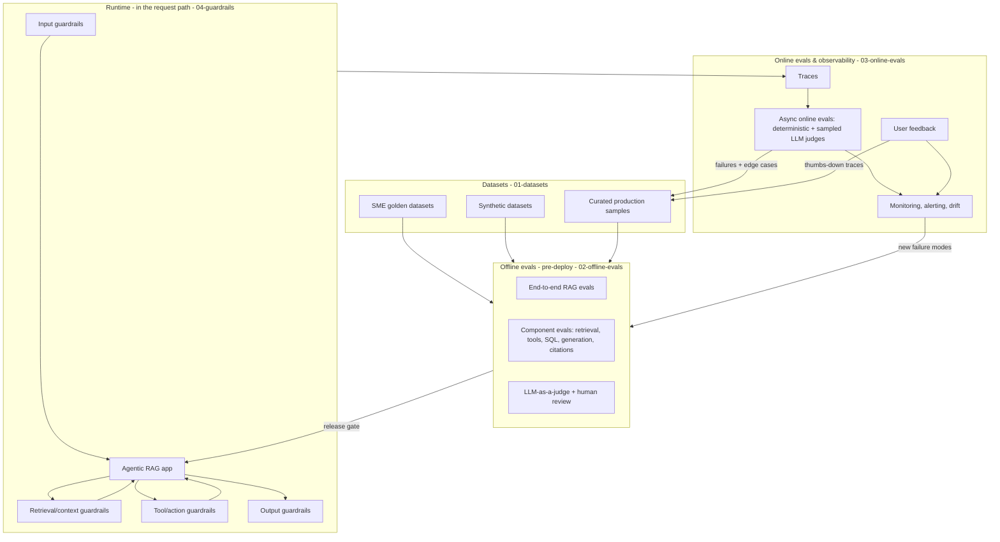
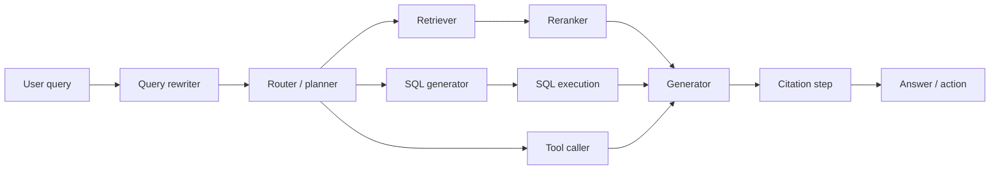
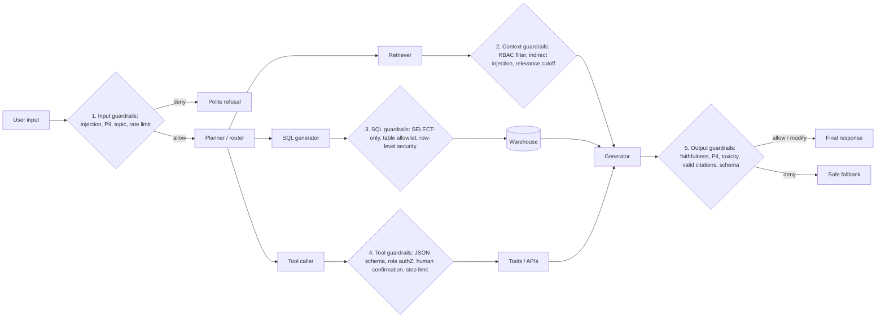
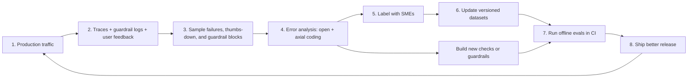

# The Evals & Guardrails Map

> **TL;DR**
> - **Five questions classify every check:** **When** does it run? **What** is its scope? **How** is it computed? **Does** it need reference data? And for guardrails, **how** does it act?
> - **Three loops keep an agent reliable:** Offline evals gate your releases, runtime guardrails protect live requests, and online evals turn production traffic into new test data.
> - **Use this page as your compass.** Learn the five axes once, then use the master tables in Section 6 to jump to the exact guide you need.

- **You will learn:** The five axes of evals and guardrails · Where every metric and guardrail fits · How datasets feed offline evals and how production feeds datasets · How to deploy one check in three places (with Python code)
- **Prerequisites:** [Why Evals and Guardrails](./01-why-evals-and-guardrails.md)
- **Related guides:** [Failure Modes](./03-agentic-rag-failure-modes.md) · [Glossary](./04-glossary.md) · [Eval Selection Decision Tree](../05-decision-framework/01-eval-selection-decision-tree.md) · [Guardrail Selection Decision Tree](../05-decision-framework/02-guardrail-selection-decision-tree.md) · [Metric Cheatsheet](../05-decision-framework/03-metric-cheatsheet.md)

---

## 0. The whole picture on one page



Read this diagram as three connected loops:
1. **Pre-deploy loop (top):** Datasets feed **offline evals**. Passing scores allow your code to ship.
2. **Runtime protection (middle):** **Guardrails** inspect inputs, retrieved context, tool calls, and outputs on every live request.
3. **Learning flywheel (bottom):** Live requests produce **traces** and **user feedback**. Online evals flag bad traces, which you label and add back to your datasets.

---

## 1. Axis A — When: offline vs online vs runtime guardrails

Every check runs at one of three times: before deployment, after a live response, or during a live request.

| Dimension | Offline evals | Online evals | Runtime guardrails |
|---|---|---|---|
| **What it runs on** | Fixed datasets (golden, synthetic, past bugs) | Live production traffic (all or sampled) | Every live request, inline |
| **When it runs** | Before deploy (local dev, CI, release gate) | After the response (async, seconds to hours later) | During the request, before the next step runs |
| **Has reference data?** | Usually **Yes** | Usually **No** (reference-free only) | **Never** (reference-free only) |
| **Main goal** | Compare changes and block regressions before shipping | Catch drift, new failure modes, and live quality drops | Stop harm on this specific request |
| **Cost budget** | High (can use strong judges and human review) | Medium (use sampling and cheaper judges) | Low per request (must run on 100% of traffic) |
| **Latency budget** | Minutes to hours | Seconds to hours (users do not wait) | Milliseconds to ~1 second (users wait) |
| **Action on failure** | Fail the CI build and investigate | Send an alert and add the trace to your dataset | Allow, deny, modify, or escalate |
| **Detailed guides** | [02 · Offline Evals](../02-offline-evals/README.md) | [03 · Online Evals & Observability](../03-online-evals-and-observability/README.md) | [04 · Guardrails](../04-guardrails/README.md) |

Three useful bridges between these modes:
- **Shadow mode:** Run a new model, prompt, or guardrail on live traffic without showing its output to users. You get real-world scores with zero user risk.
- **Canary rollout:** Route 1–5% of live traffic to the new version and watch online evals before rolling out to 100%.
- **Red teaming:** Attack the system offline to build an adversarial dataset, then use that dataset in CI to test your runtime guardrails. See [Threat Model & OWASP](../04-guardrails/07-threat-model-owasp.md).

---

## 2. Axis B — Scope: end-to-end vs component

An agentic RAG system is a chain of steps. You can score the **entire chain** from question to final answer, or you can isolate and score **one step** at a time.



| Dimension | End-to-end (E2E) evals | Component evals |
|---|---|---|
| **Question answered** | *"Did the user get a right, safe, helpful result?"* | *"Did this specific step do its job?"* |
| **Inputs & outputs** | User question → Final answer or action | Fixed step input → Single step output |
| **Strength** | Measures what the user actually experiences | Pinpoints the exact broken step; runs fast and cheap |
| **Weakness** | Hard to tell *which* step caused a low score | High component scores do not guarantee a good final answer |
| **Example metrics** | Answer correctness, faithfulness, task success | Recall@k, nDCG@k, routing accuracy, SQL execution accuracy |

> **Rule of thumb:** Use **end-to-end evals** to see *if* your system is healthy. Use **component evals** to see *where* it is broken. Run both.

### 2.1 Component-by-component lookup

| Component | What goes wrong | Key component evals | Needs reference data? | Guide |
|---|---|---|---|---|
| **Query rewriter** | Drops dates/regions or changes user intent | Intent preservation (judge), downstream recall gain | Optional | [End-to-End RAG Evals](../02-offline-evals/01-end-to-end-rag-evals.md) |
| **Router / planner** | Picks the wrong path (docs vs. SQL vs. tool) | Routing accuracy (exact match), plan quality (judge) | Yes (route label) | [Agent, Tool & Trajectory Evals](../02-offline-evals/04-agent-tool-and-trajectory-evals.md) |
| **Retriever** | Misses the relevant document chunks | Recall@k, Hit Rate@k, MRR, context recall | Yes (doc IDs) or judge | [Retrieval Metrics](../02-offline-evals/02-retrieval-metrics.md) |
| **Reranker** | Ranks relevant chunks below noisy chunks | nDCG@k, MAP, Precision@k, context precision | Yes (graded labels) or judge | [Retrieval Metrics](../02-offline-evals/02-retrieval-metrics.md) |
| **Tool caller** | Picks wrong tool, invents arguments, or loops | Tool selection accuracy, argument schema check | Yes (expected call) | [Agent, Tool & Trajectory Evals](../02-offline-evals/04-agent-tool-and-trajectory-evals.md) |
| **SQL generator** | Uses wrong table, join, or filter; writes unsafe SQL | Execution accuracy, SQL syntax check, safety rules | Yes (gold SQL/result) | [Text-to-SQL Evals](../02-offline-evals/05-text-to-sql-evals.md) |
| **Generator** | Hallucinates, skips facts, breaks format, or is rude | Faithfulness, answer relevancy, answer correctness | Mixed | [End-to-End RAG Evals](../02-offline-evals/01-end-to-end-rag-evals.md), [Generation Quality & Safety](../02-offline-evals/03-generation-quality-and-safety-evals.md) |
| **Citation step** | Omits citations, cites wrong doc, or invents IDs | Citation precision, citation recall, ID existence check | Optional | [Instruction & Citation Adherence](../02-offline-evals/06-instruction-and-citation-adherence.md) |
| **Whole agent** | Fails the overall goal or takes too many steps | Task success rate, trajectory match, step count | Yes (success criteria) | [Agent, Tool & Trajectory Evals](../02-offline-evals/04-agent-tool-and-trajectory-evals.md) |

---

## 3. Axis C — Method: how the check is computed

You can build a check using five different methods. Always start at the top of this table and move down only when a simpler method cannot test your rule.

| Method | Examples | Cost & speed | Best used for | Watch out for |
|---|---|---|---|---|
| **1. Deterministic code** | Regex, JSON schema, SQL parser, exact ID match, length check, RBAC check | Free · microseconds | Formats, schemas, SQL safety, tool arguments, permissions | Too rigid for free-form text |
| **2. Statistical & IR math** | Recall@k, nDCG, embedding cosine similarity, BERTScore, ROUGE | Very cheap · milliseconds | Retrieval ranking, short factual answers | Embedding similarity often gives high scores to wrong answers on the right topic |
| **3. Small ML classifiers** | Toxicity models, PII NER (Presidio), NLI entailment models, injection detectors | Cheap · 10–100 ms | Runtime guardrails for PII, toxicity, prompt injection, and fast groundedness | Can struggle on unusual domain jargon; requires threshold tuning |
| **4. LLM-as-a-judge** | Binary Pass/Fail rubric prompts for faithfulness, correctness, or tone | Moderate to high · 0.5–5 seconds | Semantic checks, completeness, tone, and complex rules | Position bias, verbosity bias, and model drift; must be calibrated against humans |
| **5. Human review (SMEs)** | Expert grading, side-by-side comparisons, error analysis | Expensive · hours to days | Creating golden datasets, calibrating LLM judges, launch sign-off | Slow and expensive; requires clear written rubrics so reviewers agree |

> **Golden rule of grading:** Use **code** whenever possible. Use **LLM judges** when you need semantic understanding. Use **humans** to define "good" and to calibrate your LLM judges. See [LLM-as-a-Judge](../02-offline-evals/07-llm-as-a-judge.md).

---

## 4. Axis D — Ground truth: reference-based vs reference-free

Some checks compare the system's output against a known-correct **reference answer** (ground truth). Other checks grade the output using only the question and the retrieved context.

| Dimension | Reference-based checks | Reference-free checks |
|---|---|---|
| **What inputs it needs** | Question + System output + **Reference data** (gold answer, doc IDs, or SQL) | Question + Retrieved context + System output (no reference data) |
| **Example checks** | Answer correctness, context recall, Recall@k, nDCG, SQL execution accuracy | Faithfulness, answer relevancy, PII detection, toxicity, SQL safety, format checks |
| **Where it can run** | **Offline only** (because live user traffic has no reference answers) | **Offline, online, and as runtime guardrails** |
| **Main strength** | Directly measures whether the answer is **true and complete** | Runs on any live traffic with zero human labeling |
| **Main weakness** | Reference datasets are slow to build and go stale when policies change | Cannot tell if an answer is **wrong** when the retrieved document itself is wrong or outdated |

> **Why you need both:** An answer can be **100% faithful** to an outdated 2021 document and still be **100% wrong**. Conversely, an answer can be **correct by luck** from pre-training memory while ignoring your documents. Combine reference-free checks (faithfulness) with reference-based checks (answer correctness). See [End-to-End RAG Evals](../02-offline-evals/01-end-to-end-rag-evals.md).

---

## 5. Axis E — Guardrail mode: blocking vs non-blocking, sync vs async

When you run a check at runtime as a guardrail, you must make two design choices:
1. **Blocking vs. non-blocking:** Does it change what the user gets, or does it just log an alert?
2. **Synchronous vs. asynchronous:** Does the request wait for the check to finish?

| Mode | How it behaves | Typical examples |
|---|---|---|
| **Blocking (enforcing)** | Allows, denies, modifies (masks PII, strips bad citations), or escalates to a human. Must have very few false positives. | RBAC retrieval filters, read-only SQL checks, PII redaction, human confirmation before `create_ticket`. |
| **Non-blocking (observing)** | Flags, scores, and logs the event without stopping the response. Great for testing new guardrails safely. | Shadow-mode classifiers, async faithfulness scoring, anomaly alerts on tool calls. |
| **Synchronous (in-path)** | Runs before the next step starts. Directly adds latency to the user's request, so it can prevent harm before it happens. | Input injection checks, RBAC filters, SQL syntax/safety checks, fast output regexes. |
| **Asynchronous (out-of-path)** | Runs in parallel or after the response is sent. Adds zero latency unless it cancels a live stream. | Sampled LLM judges, audit logging, drift monitors. |

Four practical runtime patterns:
- **Parallel guardrail:** Start your input guardrail and your LLM call at the same time. If the guardrail fires, cancel the LLM call before showing anything to the user.
- **Streaming tripwire:** Stream tokens to the user while a background check watches the output. If the check detects a leak, cut the stream and replace the message.
- **Shadow rollout:** Deploy every new guardrail in **non-blocking** mode first. Measure how often it false-triggers on real users before switching it to **blocking**.
- **Tiered checking:** Run a fast regex or small classifier synchronously on every request. Call a slower LLM judge only when the fast classifier is unsure.

See [Guardrails Architecture](../04-guardrails/01-guardrails-architecture.md) for latency budgets and failure modes.

### 5.1 Where guardrails sit in the pipeline



| Pipeline stage | Detailed guide |
|---|---|
| **1. Input** | [Input Guardrails](../04-guardrails/02-input-guardrails.md) |
| **2. Retrieval & context** | [Retrieval & Context Guardrails](../04-guardrails/03-retrieval-and-context-guardrails.md) |
| **3. SQL & 4. Tools** | [Tool & Action Guardrails](../04-guardrails/05-tool-and-action-guardrails.md) |
| **5. Output** | [Output Guardrails](../04-guardrails/04-output-guardrails.md) |
| **Cross-cutting permissions** | [Access Control & RBAC](../04-guardrails/06-access-control-rbac.md) |
| **Security threats & attacks** | [Threat Model & OWASP](../04-guardrails/07-threat-model-owasp.md) |

---

## 6. Master lookup tables

Use these two tables to find any metric or guardrail in the repository.

**Legend:**
- **When:** `Off` = Offline eval · `On` = Online eval · `GR` = Runtime guardrail (`✅` = standard, `◐` = possible on a sample or with latency trade-offs, `❌` = not applicable)
- **Ref:** `Yes` = Needs reference data · `No` = Reference-free · `Opt` = Both versions exist
- **Method:** `Code` · `Stat` (statistical/IR) · `Clf` (ML classifier) · `Judge` (LLM judge) · `Human`

### 6.1 Evals lookup table

| Eval / metric | Scope | Method | Ref | Off | On | GR | Guide |
|---|---|---|---|:-:|:-:|:-:|---|
| **Answer correctness** | E2E | Judge / Stat | Yes | ✅ | ◐ | ❌ | [End-to-End RAG Evals](../02-offline-evals/01-end-to-end-rag-evals.md) |
| **Faithfulness (groundedness)** | E2E / Generator | Judge / Clf | No | ✅ | ✅ | ◐ | [End-to-End RAG Evals](../02-offline-evals/01-end-to-end-rag-evals.md) |
| **Answer relevancy** | E2E / Generator | Judge / Stat | No | ✅ | ✅ | ◐ | [End-to-End RAG Evals](../02-offline-evals/01-end-to-end-rag-evals.md) |
| **Context recall** | Retriever | Judge / Code | Yes | ✅ | ❌ | ❌ | [End-to-End RAG Evals](../02-offline-evals/01-end-to-end-rag-evals.md) |
| **Context precision** | Retriever / Reranker | Judge / Code | Opt | ✅ | ✅ | ❌ | [End-to-End RAG Evals](../02-offline-evals/01-end-to-end-rag-evals.md) |
| **Precision@k, Recall@k, F1@k** | Retriever | Code | Yes | ✅ | ❌ | ❌ | [Retrieval Metrics](../02-offline-evals/02-retrieval-metrics.md) |
| **Hit Rate@k, MRR, MAP, nDCG@k** | Retriever / Reranker | Code | Yes | ✅ | ❌ | ❌ | [Retrieval Metrics](../02-offline-evals/02-retrieval-metrics.md) |
| **BLEU, ROUGE, token F1** | Generator | Stat | Yes | ✅ | ❌ | ❌ | [Generation Quality & Safety](../02-offline-evals/03-generation-quality-and-safety-evals.md) |
| **Semantic similarity (BERTScore)** | Generator / E2E | Stat | Yes | ✅ | ❌ | ❌ | [Generation Quality & Safety](../02-offline-evals/03-generation-quality-and-safety-evals.md) |
| **Toxicity & profanity** | Generator | Clf / Judge | No | ✅ | ✅ | ✅ | [Generation Quality & Safety](../02-offline-evals/03-generation-quality-and-safety-evals.md) |
| **Bias & fairness** | Generator | Judge / Clf | No | ✅ | ✅ | ◐ | [Generation Quality & Safety](../02-offline-evals/03-generation-quality-and-safety-evals.md) |
| **Tone & conciseness** | Generator | Judge | No | ✅ | ✅ | ❌ | [Generation Quality & Safety](../02-offline-evals/03-generation-quality-and-safety-evals.md) |
| **Routing accuracy** | Router | Code | Yes | ✅ | ◐ | ❌ | [Agent, Tool & Trajectory Evals](../02-offline-evals/04-agent-tool-and-trajectory-evals.md) |
| **Tool selection accuracy** | Tool caller | Code / Judge | Opt | ✅ | ◐ | ❌ | [Agent, Tool & Trajectory Evals](../02-offline-evals/04-agent-tool-and-trajectory-evals.md) |
| **Tool argument validity** | Tool caller | Code / Judge | Opt | ✅ | ✅ | ✅ | [Agent, Tool & Trajectory Evals](../02-offline-evals/04-agent-tool-and-trajectory-evals.md) |
| **Trajectory match** | Agent | Code | Yes | ✅ | ❌ | ❌ | [Agent, Tool & Trajectory Evals](../02-offline-evals/04-agent-tool-and-trajectory-evals.md) |
| **Trajectory efficiency (step count)** | Agent | Code / Judge | No | ✅ | ✅ | ✅ | [Agent, Tool & Trajectory Evals](../02-offline-evals/04-agent-tool-and-trajectory-evals.md) |
| **Task success (goal completion)** | E2E Agent | Judge / Code | Opt | ✅ | ✅ | ❌ | [Agent, Tool & Trajectory Evals](../02-offline-evals/04-agent-tool-and-trajectory-evals.md) |
| **SQL execution accuracy** | SQL generator | Code | Yes | ✅ | ❌ | ❌ | [Text-to-SQL Evals](../02-offline-evals/05-text-to-sql-evals.md) |
| **SQL exact / component match** | SQL generator | Code / Stat | Yes | ✅ | ❌ | ❌ | [Text-to-SQL Evals](../02-offline-evals/05-text-to-sql-evals.md) |
| **SQL syntax validity** | SQL generator | Code | No | ✅ | ✅ | ✅ | [Text-to-SQL Evals](../02-offline-evals/05-text-to-sql-evals.md) |
| **SQL safety rules** | SQL generator | Code | No | ✅ | ✅ | ✅ | [Text-to-SQL Evals](../02-offline-evals/05-text-to-sql-evals.md), [Tool Guardrails](../04-guardrails/05-tool-and-action-guardrails.md) |
| **Instruction & format adherence** | Generator / E2E | Code / Judge | No | ✅ | ✅ | ✅ | [Instruction & Citation Adherence](../02-offline-evals/06-instruction-and-citation-adherence.md) |
| **Citation precision & recall** | Citation step | Code / Judge | Opt | ✅ | ✅ | ◐ | [Instruction & Citation Adherence](../02-offline-evals/06-instruction-and-citation-adherence.md) |
| **Pairwise preference (A vs. B)** | E2E | Judge / Human | No | ✅ | ◐ | ❌ | [LLM-as-a-Judge](../02-offline-evals/07-llm-as-a-judge.md) |
| **Judge–human agreement (TPR/TNR, κ)** | Meta-eval | Code + Human | Yes | ✅ | ◐ | ❌ | [LLM-as-a-Judge](../02-offline-evals/07-llm-as-a-judge.md) |
| **User feedback signals** | E2E | Human | No | ❌ | ✅ | ❌ | [User Feedback & Implicit Signals](../03-online-evals-and-observability/03-user-feedback-and-implicit-signals.md) |
| **Latency, cost, token & error rates** | System | Code | No | ✅ | ✅ | ✅ | [Observability & Tracing](../03-online-evals-and-observability/02-observability-and-tracing.md), [Monitoring](../03-online-evals-and-observability/04-monitoring-alerting-and-drift.md) |
| **Input & retrieval drift** | System | Stat | No | ❌ | ✅ | ❌ | [Monitoring, Alerting & Drift](../03-online-evals-and-observability/04-monitoring-alerting-and-drift.md) |

### 6.2 Guardrails lookup table

| Guardrail | Stage | Method | Typical action | Sync / Async | Guide |
|---|---|---|---|---|---|
| **Direct prompt-injection & jailbreak check** | Input | Clf / Rules | Deny | Sync (often parallel) | [Input Guardrails](../04-guardrails/02-input-guardrails.md) |
| **Input PII detection & masking** | Input | Clf (NER) / Regex | Modify (redact) | Sync | [Input Guardrails](../04-guardrails/02-input-guardrails.md) |
| **Topic & scope check** | Input | Clf / Judge | Deny (polite refusal) | Sync | [Input Guardrails](../04-guardrails/02-input-guardrails.md) |
| **SQL / code-in-input detector** | Input | Code / Clf | Deny or flag | Sync | [Input Guardrails](../04-guardrails/02-input-guardrails.md) |
| **Rate limit & input length cap** | Input | Code | Deny | Sync | [Input Guardrails](../04-guardrails/02-input-guardrails.md) |
| **Document RBAC / ACL filter** | Retrieval | Code (metadata) | Filter chunks | Sync | [Retrieval Guardrails](../04-guardrails/03-retrieval-and-context-guardrails.md), [Access Control](../04-guardrails/06-access-control-rbac.md) |
| **Indirect prompt-injection scanner** | Context | Clf / Rules | Drop chunk or flag | Sync | [Retrieval Guardrails](../04-guardrails/03-retrieval-and-context-guardrails.md) |
| **Minimum relevance cutoff** | Context | Stat / Clf | Modify (abstain) | Sync | [Retrieval Guardrails](../04-guardrails/03-retrieval-and-context-guardrails.md) |
| **SQL read-only & table allowlist** | Tool (SQL) | Code + DB roles | Deny | Sync | [Tool Guardrails](../04-guardrails/05-tool-and-action-guardrails.md), [Access Control](../04-guardrails/06-access-control-rbac.md) |
| **Tool argument JSON schema check** | Tool | Code | Deny + ask LLM to retry | Sync | [Tool Guardrails](../04-guardrails/05-tool-and-action-guardrails.md) |
| **Per-role tool authorization** | Tool | Code (policy) | Deny | Sync | [Access Control & RBAC](../04-guardrails/06-access-control-rbac.md) |
| **Human-in-the-loop confirmation** | Tool | Policy | Escalate to user/human | Sync | [Tool Guardrails](../04-guardrails/05-tool-and-action-guardrails.md) |
| **Max step & token budget limits** | Agent | Code | Stop agent loop | Sync | [Tool Guardrails](../04-guardrails/05-tool-and-action-guardrails.md) |
| **Output groundedness check** | Output | Clf (NLI) / Judge | Regenerate, abstain, or flag | Sync or Async | [Output Guardrails](../04-guardrails/04-output-guardrails.md) |
| **Output PII & secret redaction** | Output | Clf / Regex | Modify (redact) | Sync | [Output Guardrails](../04-guardrails/04-output-guardrails.md) |
| **Output toxicity & brand safety** | Output | Clf / Judge | Deny or modify | Sync / Streaming | [Output Guardrails](../04-guardrails/04-output-guardrails.md) |
| **Citation ID validator** | Output | Code / Judge | Strip invalid citations | Sync | [Output Guardrails](../04-guardrails/04-output-guardrails.md) |
| **Output JSON schema validator** | Output | Code | Repair or retry | Sync | [Output Guardrails](../04-guardrails/04-output-guardrails.md) |
| **System-prompt canary check** | Output | Code (canary token) | Deny | Sync | [Output Guardrails](../04-guardrails/04-output-guardrails.md), [Threat Model](../04-guardrails/07-threat-model-owasp.md) |

Not sure which ones to pick first? Use the [Eval Selection Decision Tree](../05-decision-framework/01-eval-selection-decision-tree.md) and the [Guardrail Selection Decision Tree](../05-decision-framework/02-guardrail-selection-decision-tree.md).

---

## 7. Datasets: the fuel for offline evals

Every offline eval requires dataset columns that match its inputs:

| Eval type | Required columns in each row | Example from Acme Internal Assistant |
|---|---|---|
| **Retrieval metrics** | `question`, `relevant_doc_ids` | `"What is the parental leave policy?"` → `["hr-policy-2024#leave"]` |
| **E2E RAG (reference-based)** | `question`, `reference_answer` | `"How many PTO days for L5?"` → `"25 days per year"` |
| **E2E RAG (reference-free)** | `question` (your app generates the answer and context) | Any real user question |
| **Text-to-SQL** | `question`, `gold_sql` (or `expected_result`), `db_snapshot` | `"Q3 revenue by region"` → `SELECT region, SUM(rev)...` |
| **Tool & trajectory** | `input`, `expected_tool_calls` (or `success_criteria`) | `"Open a P2 VPN ticket"` → `create_ticket(priority="P2")` |
| **Safety & guardrails** | `input`, `expected_decision` (`allow` / `deny` / `redact`) | `"Ignore previous instructions..."` → `deny` |
| **RBAC permissions** | `user_role`, `question`, `forbidden_doc_ids` (or `must_refuse`) | `role="employee"` asks for executive pay → `must_refuse=true` |
| **Judge calibration** | `input`, `output`, `human_label`, `human_reason` | 100–200 traces graded Pass/Fail by an SME |

You will build these datasets from three main sources:
1. **[SME Golden Datasets](../01-datasets/02-sme-golden-datasets.md):** Written or verified by domain experts. Highest quality, slowest to build.
2. **[Synthetic Datasets](../01-datasets/03-synthetic-datasets.md):** Generated by LLMs from your documents and schemas. Fast way to test edge cases before launch.
3. **[Production Samples](../01-datasets/04-production-data-flywheel.md):** Real user traces pulled from production logs and labeled by experts.

See [Dataset Strategy](../01-datasets/01-dataset-strategy.md) for how to size and combine them.

---

## 8. The production data flywheel

Your eval suite should improve automatically as real users interact with your system:



Three habits keep this flywheel spinning:
1. **Treat every guardrail block and thumbs-down click as a candidate test row.**
2. **Keep your regression dataset separate from your capability dataset.** Regression rows test bugs that must never break again; capability rows test hard problems you are still trying to solve.
3. **Scrub PII before saving production traces into datasets.** See [Production Data Flywheel](../01-datasets/04-production-data-flywheel.md).

---

## 9. One check, three deployments — code example

Let's take a single check—*"Is every claim in the answer supported by the retrieved context?"*—and run it in all three places:

| Where it runs | How it is configured | What happens when it fails |
|---|---|---|
| **1. Offline eval (in CI)** | Run a strong LLM judge across your 300-row golden dataset on every pull request. | Fail the CI build if the pass rate drops below your baseline. |
| **2. Online monitor (in prod)** | Run a cheaper judge asynchronously on 5% of live traces plus 100% of thumbs-down traces. | Page the team if the 24-hour rolling pass rate drops; send failed traces to the labeling queue. |
| **3. Runtime guardrail (in-path)** | Run a fast NLI classifier synchronously before returning answers on high-risk topics (HR, Finance). | Regenerate the answer once with a stricter prompt, or abstain if it still fails. |

```python
import random
from dataclasses import dataclass

@dataclass
class Verdict:
    passed: bool
    score: float
    reason: str

def check_faithfulness(answer: str, contexts: list[str], judge) -> Verdict:
    """One shared check function used across offline, online, and runtime."""
    score, reason = judge(answer, contexts)
    return Verdict(passed=(score >= 0.8), score=score, reason=reason)

# 1. Offline eval: score a dataset in CI
def run_offline_eval(dataset_rows, app, strong_judge) -> float:
    verdicts = [
        check_faithfulness(*app(row["question"]), strong_judge)
        for row in dataset_rows
    ]
    return sum(v.passed for v in verdicts) / len(verdicts)

# 2. Online monitor: sample live traces asynchronously
def monitor_live_trace(trace: dict, cheap_judge, log_metric, sample_rate: float = 0.05):
    if random.random() < sample_rate or trace.get("thumbs_down"):
        verdict = check_faithfulness(trace["answer"], trace["contexts"], cheap_judge)
        log_metric("faithfulness", verdict.score, trace_id=trace["id"])

# 3. Runtime guardrail: block unsupported answers on high-risk routes
def answer_with_guardrail(question: str, app, fast_nli_judge, is_high_risk: bool) -> str:
    answer, contexts = app(question)
    if is_high_risk:
        verdict = check_faithfulness(answer, contexts, fast_nli_judge)
        if not verdict.passed:
            return "I could not verify that answer in the documents you can access."
    return answer
```

You can use this exact three-way pattern for PII checks, SQL safety checks, tool schema checks, and citation checks.

---

## 10. Where to go next

| If you want to… | Read this next |
|---|---|
| See how agentic RAG systems break at each step | [03 · Agentic RAG Failure Modes](./03-agentic-rag-failure-modes.md) |
| Look up an unfamiliar term | [04 · Glossary](./04-glossary.md) |
| Design and label your datasets | [01 · Datasets](../01-datasets/README.md) |
| Implement offline metrics and LLM judges | [02 · Offline Evals](../02-offline-evals/README.md) |
| Set up tracing, online evals, and drift alerts | [03 · Online Evals & Observability](../03-online-evals-and-observability/README.md) |
| Add input, retrieval, tool, and output guardrails | [04 · Guardrails](../04-guardrails/README.md) |
| Pick the right checks for your system today | [05 · Decision Framework](../05-decision-framework/README.md) |
| Compare open-source and commercial tools | [06 · Tooling Landscape](../06-tooling-landscape/README.md) |

---

## Key takeaways

- **Classify any check on five axes:** **When** (offline, online, runtime), **Scope** (end-to-end vs. component), **Method** (code, math, classifier, LLM judge, human), **Reference data** (reference-based vs. reference-free), and **Guardrail mode** (blocking vs. non-blocking, sync vs. async).
- **Pair end-to-end evals with component evals.** End-to-end evals tell you *if* the user got a good answer; component evals tell you *which step* broke.
- **Only reference-free checks work online or at runtime.** Reference-based checks require labeled test datasets and run offline.
- **Start with deterministic code checks.** Reach for LLM judges only when code cannot test the rule, and always calibrate judges against humans.
- **Test new guardrails in shadow mode first.** Measure false positives on real traffic before blocking live users.

## Further reading

- Es et al., 2023 — [Ragas: Automated Evaluation of Retrieval Augmented Generation](https://arxiv.org/abs/2309.15217) · [RAGAS documentation](https://docs.ragas.io/)
- Zheng et al., 2023 — [Judging LLM-as-a-Judge with MT-Bench and Chatbot Arena](https://arxiv.org/abs/2306.05685)
- Shankar et al., 2024 — [Who Validates the Validators?](https://arxiv.org/abs/2404.12272)
- Hamel Husain — [Your AI Product Needs Evals](https://hamel.dev/blog/posts/evals/)
- Eugene Yan — [Patterns for Building LLM-based Systems & Products](https://eugeneyan.com/writing/llm-patterns/)
- OWASP — [Top 10 for LLM Applications](https://genai.owasp.org/llm-top-10/)
- Anthropic — [Demystifying evals for AI agents](https://www.anthropic.com/engineering/demystifying-evals-for-ai-agents)
- **Next guide:** [Agentic RAG Failure Modes](./03-agentic-rag-failure-modes.md)
