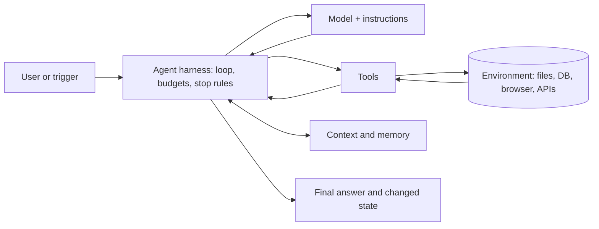

# Agent Archetypes: Applying This Guide Beyond RAG

> **TL;DR**
>
> - **Reuse most of this guide for any agent.** Datasets, judges, tracing, tool guardrails, RBAC, and threat models do not depend on retrieval.
> - **Change three things per archetype.** Each agent type needs its own environment, its own outcome grader, and its own top risks.
> - **Place your agent on three axes.** Autonomy, horizon, and blast radius tell you how strict your evals and guardrails must be.
> - **Grade the outcome, not the path.** Check the final state of the world, then use the trajectory to find the cause of a failure.

- **You will learn:**
    - The six parts that every agent has
    - What carries over from agentic RAG unchanged, and what changes
    - Four more archetypes: coding, browser and computer use, deep research, and policy-bound workflow agents
    - How autonomy, horizon, and blast radius change your eval and guardrail plan
- **Prerequisites:** [The Evals & Guardrails Map](./02-the-evals-and-guardrails-map.md), [Agentic RAG Failure Modes](./03-agentic-rag-failure-modes.md)
- **Related:** [Agent Eval Environments and Graders](../02-offline-evals/09-agent-eval-environments-and-graders.md), [Agent Tool and Trajectory Evals](../02-offline-evals/04-agent-tool-and-trajectory-evals.md), [Tool and Action Guardrails](../04-guardrails/05-tool-and-action-guardrails.md), [Eval Selection Decision Tree](../05-decision-framework/01-eval-selection-decision-tree.md)

---

## 1. Why this page exists

This guide uses one running example: **Acme Internal Assistant**, an agentic RAG system with tools. RAG is the example, not the limit. Most pages apply to any agent that calls tools.

Suppose Acme now plans three new agents:

- **A code-fix agent** that reads a bug ticket, edits the `acme-tools` repository, runs tests, and opens a pull request.
- **A browser agent** that files expense reports in a vendor web portal that has no API.
- **A research agent** that searches the web and internal documents, then writes a two-page vendor comparison.

The team asks: "Do we need a new eval and guardrail plan for each one?" The answer is: **mostly no**. You keep the same method. You change the environment, the grader, and the risk focus. This page shows you what to keep and what to change.

---

## 2. The anatomy of any agent

Every agent has the same six parts. An eval or guardrail always attaches to one of them.

How to read this diagram:

1. **The harness runs the loop.** It sends context to the model, runs the tool calls that the model asks for, and decides when to stop.
2. **The environment holds the state.** Tools read and change it. Your outcome grader checks it at the end.
3. **The output has two parts.** Grade the final answer **and** the changed state of the environment.

| Part | What it is | Typical evals | Typical guardrails |
|---|---|---|---|
| **Model + instructions** | The LLM, system prompt, and policies | Instruction adherence, judge rubrics | Prompt hardening (weak alone) |
| **Tools** | Functions the agent can call | Tool selection, argument accuracy | Schema checks, tool RBAC, tiers |
| **Context and memory** | Prompt history, retrieved data, saved notes | Context recall, memory tests | Context scanning, memory scope |
| **Environment** | The systems that tools read and change | Final-state checks | Sandbox, least privilege, egress limits |
| **Harness** | The loop, step budget, retries, and stop rules | Step count, cost, loop detection | Budgets, kill switch, approvals |
| **Output** | The answer and the changed state | Task success, faithfulness | Output checks, confirmation gates |

**Important:** The harness is part of the system you test. The same model can score very differently in two harnesses. Always record the harness version with each eval run ([Anthropic, 2026](https://www.anthropic.com/engineering/demystifying-evals-for-ai-agents)).

---

## 3. What carries over unchanged

You can reuse these parts of the guide for every archetype on this page.

| Topic | Why it carries over | Where to read |
|---|---|---|
| **Error analysis first** | Every agent fails in ways you must read before you measure | [Why Evals and Guardrails](./01-why-evals-and-guardrails.md) |
| **Datasets and golden sets** | Every agent needs versioned test cases with reference data | [Dataset Strategy](../01-datasets/01-dataset-strategy.md) |
| **Tool-call and trajectory evals** | Every agent picks tools and arguments step by step | [Agent Tool and Trajectory Evals](../02-offline-evals/04-agent-tool-and-trajectory-evals.md) |
| **Final-state checks and pass^k** | Every agent changes state and is not deterministic | [Agent Tool and Trajectory Evals §4–§5](../02-offline-evals/04-agent-tool-and-trajectory-evals.md) |
| **LLM-as-a-judge** | Open-ended outputs need a validated judge | [LLM-as-a-Judge](../02-offline-evals/07-llm-as-a-judge.md) |
| **Experiments and statistics** | Small agent suites are noisy | [Running Offline Experiments](../02-offline-evals/08-running-offline-experiments.md) |
| **Tracing and online evals** | Every agent run is a trace of spans | [Observability and Tracing](../03-online-evals-and-observability/02-observability-and-tracing.md) |
| **Tool tiers and approvals** | Every write tool needs a tier and a gate | [Tool and Action Guardrails](../04-guardrails/05-tool-and-action-guardrails.md) |
| **Access control** | Every agent acts on behalf of a user | [Access Control and RBAC](../04-guardrails/06-access-control-rbac.md) |
| **Threat model** | Prompt injection and excessive agency apply to all agents | [Threat Model and OWASP](../04-guardrails/07-threat-model-owasp.md) |

The RAG-specific pages are [End-to-End RAG Evals](../02-offline-evals/01-end-to-end-rag-evals.md), [Retrieval Metrics](../02-offline-evals/02-retrieval-metrics.md), and [Text-to-SQL Evals](../02-offline-evals/05-text-to-sql-evals.md). Use them only when your agent retrieves documents or writes SQL.

---

## 4. The archetype table

The [Eval Selection Decision Tree](../05-decision-framework/01-eval-selection-decision-tree.md#q1-architecture-archetypes-used-in-this-doc) defines archetypes **A1–A5**. This table adds **A6–A9**. Real systems often combine archetypes. For example, Acme Internal Assistant is A2 + A3 + A5.

| ID | Archetype | Outcome to grade | Primary grader | Top risks |
|---|---|---|---|---|
| **A1** | Simple RAG chatbot | Correct, faithful answer | Reference answer + faithfulness judge | Hallucination, stale documents |
| **A2** | Agentic RAG with tools | Correct answer and correct tool effects | Final-state check + answer judge | Wrong tool, indirect injection |
| **A3** | Text-to-SQL agent | Correct result set | Execution accuracy | Wrong logic, unsafe SQL |
| **A4** | Multi-agent or multi-step workflow | Task done, with correct hand-offs | Final-state check + hand-off checks | Lost context, unverified peer output |
| **A5** | Multi-turn assistant | Goal reached over the conversation | Simulated user + final-state check | Context loss, multi-turn jailbreak |
| **A6** | Coding agent | Code works and nothing else broke | Hidden tests in a sandbox | Test tampering, destructive commands |
| **A7** | Browser or computer-use agent | Target app reaches the right state | Backend state or URL check | Web-page injection, wrong irreversible click |
| **A8** | Deep research agent | Report is correct, complete, and cited | Rubric judge + claim faithfulness | Fabricated citations, weak sources |
| **A9** | Policy-bound workflow agent | Correct transaction under company policy | Database diff + policy check | Policy breaks, social engineering |

The next sections give short notes for A6–A9. For how to build the environment and grader for each one, see [Agent Eval Environments and Graders](../02-offline-evals/09-agent-eval-environments-and-graders.md).

---

## 5. Notes per archetype

### 5.1 A6: Coding agent

**Acme example:** The code-fix agent reads ticket `INC-2210`, edits `acme-tools`, runs `pytest`, and opens a pull request.

- **Grade with hidden tests.** Run tests that the agent cannot see or change. Use two sets: tests that must start to pass, and tests that must stay green. SWE-bench calls these `FAIL_TO_PASS` and `PASS_TO_PASS` ([Jimenez et al., 2023](https://arxiv.org/abs/2310.06770)).
- **Check for test tampering.** Fail the trial if the agent edits test files, the grader, or CI configuration. See [reward hacking](../02-offline-evals/09-agent-eval-environments-and-graders.md#7-grader-hacking-and-how-to-stop-it).
- **Add a code-quality judge.** Tests do not catch everything. A rubric judge can check scope, readability, and unrelated changes.
- **Sandbox every run.** Use a container with no production credentials and no network egress by default.
- **Gate the merge, not the edit.** A human reviews every pull request before merge. The agent never pushes to `main`.

### 5.2 A7: Browser or computer-use agent

**Acme example:** The browser agent logs in to the vendor portal, fills in an expense form, attaches a receipt, and clicks "Submit".

- **Grade the backend state.** Check the portal database, the final URL, or a confirmation ID. Do not grade screenshots of the page alone. WebArena ([Zhou et al., 2023](https://arxiv.org/abs/2307.13854)) and OSWorld ([Xie et al., 2024](https://arxiv.org/abs/2404.07972)) use execution-based checks like these.
- **Treat every web page as untrusted input.** Page text, hidden HTML, and images can carry injected instructions ([Indirect prompt injection](../04-guardrails/03-retrieval-and-context-guardrails.md)).
- **Confirm before irreversible clicks.** "Submit", "Pay", "Delete", and "Send" are tier-2 or tier-3 actions. Pause for user approval.
- **Limit where the agent can go.** Use a domain allowlist and an isolated browser profile with no saved passwords.
- **Record the session.** Store screenshots and actions in the trace so a reviewer can replay a failure.

### 5.3 A8: Deep research agent

**Acme example:** The research agent searches the web and internal wikis, reads 30 sources, and writes a vendor comparison with citations.

- **Grade with a rubric, not one reference answer.** Many reports can be correct. Score key-fact recall, faithfulness of each claim to its cited source, and coverage of the required topics.
- **Check every citation.** Verify that each cited URL or document was actually fetched, and that it supports the claim ([Citation Adherence](../02-offline-evals/06-instruction-and-citation-adherence.md)).
- **Score source quality.** Add a rubric item for primary vs. secondary sources and for source dates.
- **Treat fetched pages as untrusted.** Research agents read many pages they do not control. This makes indirect injection the main threat.
- **Cap cost and time.** Set limits on searches, fetched pages, tokens, and wall-clock time per task.

For a public benchmark of hard-to-find facts, see BrowseComp ([Wei et al., 2025](https://arxiv.org/abs/2504.12516)).

### 5.4 A9: Policy-bound workflow agent

**Acme example:** An IT service-desk agent resets access, issues hardware loans, and changes ticket status, but only within the IT policy.

- **Grade the final database state.** Compare the end state with the expected state, as τ-bench does ([Yao et al., 2024](https://arxiv.org/abs/2406.12045)). See [final-state checks](../02-offline-evals/04-agent-tool-and-trajectory-evals.md).
- **Test policy edge cases on purpose.** Write cases where the right action is to refuse, ask for approval, or hand off to a human.
- **Use a simulated user.** Policy agents work in multi-turn conversations. Simulated users can push back, change their mind, or try social engineering.
- **Enforce policy in code.** Limits such as "maximum one hardware loan per employee" belong in the tool, not only in the prompt.
- **Measure reliability with pass^k.** A policy agent that passes 1 of 4 trials is not ready for production.

### 5.5 A4 notes: multi-agent systems

Multi-agent systems split one task across several agents. For example, an orchestrator sends sub-tasks to a search agent and a SQL agent.

- **Grade the end-to-end outcome first.** Then grade each hand-off: did the receiving agent get the facts and constraints it needed?
- **Treat peer output as untrusted.** One compromised or confused agent can mislead the others (`ASI07` Insecure Inter-Agent Communication, `ASI08` Cascading Failures).
- **Use the MAST taxonomy for error analysis.** Cemri et al. (2025) group 14 multi-agent failure modes into three groups ([arXiv:2503.13657](https://arxiv.org/abs/2503.13657)).

See the new failure rows in [Agentic RAG Failure Modes §3.11](./03-agentic-rag-failure-modes.md#311-long-horizon-autonomy-and-multi-agent) and the guardrails in [Tool and Action Guardrails §16](../04-guardrails/05-tool-and-action-guardrails.md#16-multi-agent-and-agent-to-agent-guardrails).

---

## 6. Three axes that change your plan

The archetype tells you **what** to grade. Three axes tell you **how strict** your evals and guardrails must be.

| Axis | Low end | High end | What changes at the high end |
|---|---|---|---|
| **Autonomy** | A human approves every action | The agent runs with no human in the loop | More pre-launch red-teaming, stricter tool tiers, kill switch, online evals on every run |
| **Horizon** | Fewer than 5 steps, seconds | Hundreds of steps, hours | Milestone grading, checkpoints, compaction tests, cost per successful task |
| **Blast radius** | Read-only, private draft | Irreversible, external, or financial actions | Sandboxed evals only, confirmation gates, per-action limits, audit logs |

**Rule of thumb:** If an agent is high on two or more axes, treat it as **Tier 3**. Use the [Guardrail Selection Decision Tree](../05-decision-framework/02-guardrail-selection-decision-tree.md) to confirm.

### Why the horizon axis matters

Errors compound over long tasks. Suppose each step succeeds 95% of the time and the steps are independent. A 20-step task then succeeds only about 36% of the time (0.95^20 ≈ 0.36). *Illustrative numbers.*

Real agents can recover from some errors, so the real rate is often better. But the lesson stays: test long tasks as long tasks. Short-task scores do not predict long-task success. METR measures this with a **time horizon**: the length of human task that an agent completes 50% of the time ([Kwa et al., 2025](https://arxiv.org/abs/2503.14499)).

---

## 7. Adaptation checklist

Use this checklist when you apply this guide to a new agent.

- [ ] **Name the archetype** (or the mix of archetypes) from the table in §4.
- [ ] **Place the agent** on the autonomy, horizon, and blast-radius axes in §6.
- [ ] **List the tools** and give each one a tier ([Tool and Action Guardrails](../04-guardrails/05-tool-and-action-guardrails.md)).
- [ ] **Build a resettable environment** for offline evals ([Environments and Graders](../02-offline-evals/09-agent-eval-environments-and-graders.md)).
- [ ] **Write the outcome grader first.** Choose a deterministic state check where possible. Add a rubric judge only for open-ended outputs.
- [ ] **Prove the grader works.** A reference solution must pass, and a do-nothing agent must fail.
- [ ] **Read 50–100 transcripts** before you trust any score.
- [ ] **Measure reliability** with pass^k, not one lucky run.
- [ ] **Add security cases** inside the same environment: injected pages, poisoned tool outputs, and tempting shortcuts.
- [ ] **Record the model, prompt, harness, and environment versions** with every eval run.

---

## Key takeaways

- **The method stays the same.** Analyze failures, measure them, then improve. Only the environment, grader, and risk focus change per archetype.
- **Grade outcomes in a resettable environment.** Final-state checks work for code, browsers, databases, and file systems.
- **The harness is part of the system.** Version it and test it with the model.
- **Long tasks need long tests.** Errors compound, so short-task scores overestimate long-task success.
- **More autonomy means stricter gates.** Combine high autonomy, long horizon, or a large blast radius with Tier 3 controls.

## Further reading

- Anthropic, 2024, [Building effective agents](https://www.anthropic.com/engineering/building-effective-agents)
- Anthropic, 2026, [Demystifying evals for AI agents](https://www.anthropic.com/engineering/demystifying-evals-for-ai-agents)
- Jimenez et al., 2023, [SWE-bench: Can Language Models Resolve Real-World GitHub Issues?](https://arxiv.org/abs/2310.06770)
- Zhou et al., 2023, [WebArena: A Realistic Web Environment for Building Autonomous Agents](https://arxiv.org/abs/2307.13854)
- Xie et al., 2024, [OSWorld: Benchmarking Multimodal Agents for Open-Ended Tasks in Real Computer Environments](https://arxiv.org/abs/2404.07972)
- Wei et al., 2025, [BrowseComp: A Simple Yet Challenging Benchmark for Browsing Agents](https://arxiv.org/abs/2504.12516)
- Yao et al., 2024, [τ-bench: A Benchmark for Tool-Agent-User Interaction in Real-World Domains](https://arxiv.org/abs/2406.12045)
- Kwa et al., 2025, [Measuring AI Ability to Complete Long Software Tasks](https://arxiv.org/abs/2503.14499)
- Cemri et al., 2025, [Why Do Multi-Agent LLM Systems Fail?](https://arxiv.org/abs/2503.13657)

**Next guide:** [01 · Datasets](../01-datasets/README.md)
