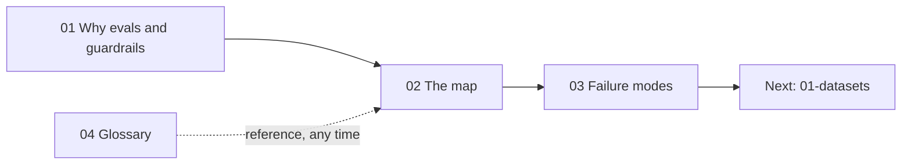

# 00 · Foundations

> **TL;DR**
>
> - **Start here.** This section builds the core mental model for the entire guide.
> - **Separate measurement from enforcement.** Learn why demos fail in production and how evals and guardrails share the same checks.
> - **Classify every check on 5 axes.** If you only read one page, read [The Evals & Guardrails Map](./02-the-evals-and-guardrails-map.md).
> - **Debug systematically.** Use the failure taxonomy and glossary to diagnose errors at any step of an agentic RAG pipeline.

---

## Guides in this section

| Guide | What you will learn | Read this when… |
|---|---|---|
| [01 · Why Evals and Guardrails](./01-why-evals-and-guardrails.md) | Why demos fail in production, how evals and guardrails share the same checks, and how to run the **Analyze → Measure → Improve** loop. | You are new to evals, or you need to convince your team to invest in them. |
| [02 · The Evals & Guardrails Map](./02-the-evals-and-guardrails-map.md) | The five axes that classify every check, a master lookup table, and how one check works offline, online, and at runtime. | You want the big picture, or you need to pick the right guide for a specific task. |
| [03 · Agentic RAG Failure Modes](./03-agentic-rag-failure-modes.md) | Every common failure across queries, routing, retrieval, generation, citations, tools, SQL, and security, plus how to detect and fix each one. | You are debugging bad answers, reviewing traces, or deciding what to measure first. |
| [04 · Glossary](./04-glossary.md) | Clear, plain-English definitions for ~90 terms used across this guide, with links to deeper pages. | You see an unfamiliar term anywhere in the repository. |

---

## Suggested reading order

1. **Read [01 · Why Evals and Guardrails](./01-why-evals-and-guardrails.md)** to understand the core problem and the **Analyze → Measure → Improve** workflow.
2. **Read [02 · The Evals & Guardrails Map](./02-the-evals-and-guardrails-map.md)** to see how every piece fits together.
3. **Skim [03 · Agentic RAG Failure Modes](./03-agentic-rag-failure-modes.md)** to learn what breaks in real systems and how to spot it.
4. **Bookmark [04 · Glossary](./04-glossary.md)** as a quick reference while you read the rest of the guide.

When you finish this section, continue to [01 · Datasets](../01-datasets/README.md). If you need to choose metrics or guardrails for a live project today, jump straight to [05 · Decision Framework](../05-decision-framework/README.md).

---

## The running example

Every guide in this repository uses the same concrete system: **Acme Internal Assistant**.

Acme Internal Assistant is an enterprise agent that does four things:

1. **Answers document questions** over company policies and wikis using vector search and reranking.
2. **Answers data questions** by generating SQL and querying a data warehouse (text-to-SQL).
3. **Takes actions** by calling tools such as `create_ticket` and `lookup_employee`.
4. **Enforces role-based access control (RBAC)** for Employees, Managers, HR, Finance, and Admins.

We introduce the full architecture in [01 · Why Evals and Guardrails](./01-why-evals-and-guardrails.md#1-the-running-example).
