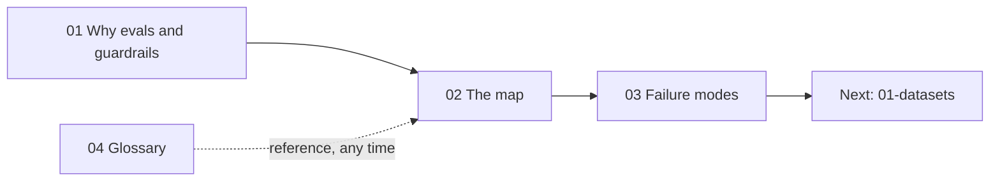

# 00 · Foundations

Start here. This section builds the mental model the rest of the repo relies on: why agentic RAG applications are hard to make reliable, how every kind of eval and guardrail fits on one map, what actually breaks in these systems, and the vocabulary used everywhere else.

If you only read one file in the whole repo, read [The evals & guardrails map](./02-the-evals-and-guardrails-map.md).

## Files

| File | What it covers | Read when… |
|---|---|---|
| [01 · Why evals and guardrails](./01-why-evals-and-guardrails.md) | Why reliability is the hard part; non-determinism and compounding error; evals (measure) vs guardrails (enforce) and how they share checks; the eval-driven development loop with error analysis (open/axial coding); what "reliable" means across quality, safety, security, cost, latency, trust; roles | You're new to the topic, or need to convince your team to invest in evals |
| [02 · The evals & guardrails map](./02-the-evals-and-guardrails-map.md) | The master mental model: five axes (when, scope, method, ground truth, guardrail mode), a big matrix placing every eval and guardrail with links, dataset shapes, the production flywheel, and one check deployed three ways | You want the big picture or need to find where a specific eval/guardrail lives |
| [03 · Agentic RAG failure modes](./03-agentic-rag-failure-modes.md) | Stage-by-stage taxonomy (query, routing, retrieval, generation, citations, tools, text-to-SQL, security, multi-turn) incl. Barnett et al.'s seven failure points — each with symptom, root cause, detecting eval, mitigating guardrail | You're debugging bad outputs, doing error analysis, or deciding what to measure |
| [04 · Glossary](./04-glossary.md) | ~90 alphabetical terms with short definitions and links to deep dives | You hit an unfamiliar term anywhere in the repo |

## Suggested reading order

1. **[01 · Why evals and guardrails](./01-why-evals-and-guardrails.md)** — motivation and the analyze → measure → improve loop.
2. **[02 · The evals & guardrails map](./02-the-evals-and-guardrails-map.md)** — the framework every other section plugs into.
3. **[03 · Agentic RAG failure modes](./03-agentic-rag-failure-modes.md)** — what you're actually trying to catch and prevent.
4. **[04 · Glossary](./04-glossary.md)** — keep open as a reference.

Then continue to [01 · Datasets](../01-datasets/README.md), or jump straight to the [decision framework](../05-decision-framework/README.md) if you need to make choices for a system today.

## Running example

All sections use the same running example: an **internal enterprise assistant** that answers questions over company docs (vector search + reranking), queries a data warehouse via text-to-SQL, calls tools (e.g. `create_ticket`), and serves users in different roles under RBAC. It's introduced in [01 · Why evals and guardrails](./01-why-evals-and-guardrails.md#1-the-running-example).
