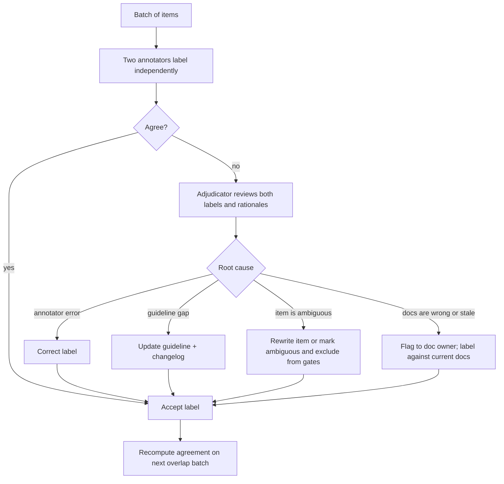

# SME Golden Datasets

> **TL;DR**
>
> - **A golden dataset is a small (50–300 row) expert-verified dataset** that defines what "correct" means for your domain.
> - **Respect expert time:** pre-fill draft answers and show source chunks inline so subject-matter experts (SMEs) only have to verify and edit.
> - **Use binary Pass/Fail rubrics and atomic key-facts lists** instead of vague 1–5 Likert scales.
> - **Measure reviewer agreement** with Cohen's $\kappa$ or Krippendorff's $\alpha$. If two human experts cannot agree on a label, your rubric is ambiguous and no LLM judge will agree either.

- **What you will learn:**
    - How to work with subject-matter experts (SMEs) without wasting their time
    - How to write clear annotation guidelines and binary Pass/Fail rubrics
    - Why storing both a reference answer and a `key_facts` list gives the most reliable grading
    - How to handle unanswerable, partial, and false-premise questions
    - How to calculate and interpret Cohen's $\kappa$ and Krippendorff's $\alpha$
- **Prerequisites:** [Dataset Strategy](./01-dataset-strategy.md)
- **Related guides:**
    - [LLM-as-a-Judge](../02-offline-evals/07-llm-as-a-judge.md)
    - [End-to-End RAG Evals](../02-offline-evals/01-end-to-end-rag-evals.md)
    - [Production Data Flywheel](./04-production-data-flywheel.md)

---

## 1. What a golden dataset is (and isn't)

A **golden dataset** is a set of eval examples whose expected outputs were written or verified by domain experts (such as HR policy owners, finance analysts, support leads, or data engineers).

| What a golden dataset IS | What a golden dataset IS NOT |
|---|---|
| The **source of truth** for what "correct" means in your domain | A massive dataset (50 to 300 rows is typical and plenty) |
| The anchor used to **calibrate LLM judges** and validate synthetic data | Something an LLM can generate without human verification |
| A **living product specification** (including what must be refused) | Frozen forever (policies and database schemas change over time) |
| The benchmark for **release gates** and headline accuracy | A replacement for sampling live production traffic |

Golden data gives you the highest return on investment in five places:

1. **High-stakes RAG answers** (HR policy, finance rules, legal compliance).
2. **Gold SQL queries and expected results** (only data owners know that "active customer" means `status = 'A' AND churn_date IS NULL`).
3. **Graded retrieval relevance labels** (`relevant_docs` graded `0–3`).
4. **Policy and RBAC boundaries** (which requests must be refused or escalated).
5. **LLM-judge calibration sets** (human Pass/Fail grades on *actual system outputs*, used to test your LLM judge).

> **Important distinction:** You need two kinds of human labels:
>
> 1. **Golden references:** The expected answer, SQL query, or relevant docs for a question.
> 2. **Golden judgments:** A human's Pass/Fail grade on a specific *system output* (used to calibrate your [LLM-as-a-Judge](../02-offline-evals/07-llm-as-a-judge.md)).

---

## 2. Working with subject-matter experts

Expert time is your scarcest resource. Design your labeling workflow so SMEs never waste a minute.

### 2.1 Roles

| Role | Responsibility |
|---|---|
| **Eval owner** (AI engineer or PM) | Defines the schema, prepares batches, writes annotation guidelines, and computes reviewer agreement |
| **Principal domain expert ("benevolent dictator")** | Holds the final say on domain correctness and resolves ambiguous edge cases |
| **Annotators** (SMEs or trained reviewers) | Verify reference answers and grade system outputs |
| **Adjudicator** | Resolves disagreements between annotators (usually the principal domain expert) |

Assigning a single **"benevolent dictator"** (one accountable domain expert) prevents endless committee debates over what counts as a good answer.

### 2.2 Make SME sessions efficient

1. **Pre-fill draft answers.** Never give an SME a blank text box. Show the question, the retrieved chunks, and a draft answer from your system. Editing a draft takes 2 minutes; writing from scratch takes 15 minutes.
2. **Show source documents side by side.** Display the exact policy excerpt and version date right next to the answer so SMEs do not have to search for files.
3. **Batch items by domain.** Send all HR questions to the HR expert and all SQL questions to the analytics engineer.
4. **Time-box labeling sessions to 45–60 minutes.** Start each session by grading 3–5 calibration examples together as a group.
5. **Require a short written critique for every failure.** A 1-sentence note explaining *why* an answer failed becomes your next prompt fix or LLM-judge few-shot example.
6. **Give SMEs quick issue flags.** Let reviewers click `ambiguous_question`, `docs_outdated`, or `not_my_domain` so they never get stuck on a broken item.

### 2.3 Sourcing the inputs for SMEs to label

| Input source | Pros | Cons |
|---|---|---|
| **Questions SMEs hear most often** | Realistic and high business value | Skewed toward common questions; small volume |
| **Support tickets and Slack help channels** | Real user phrasing and real pain points | Requires PII scrubbing and cleanup |
| **Sampled production traces** | Matches live traffic distribution | Requires live users ([Production Data Flywheel](./04-production-data-flywheel.md)) |
| **Synthetic candidates verified by SMEs** | Fast way to cover rare slices | Can feel robotic unless filtered ([Synthetic Datasets](./03-synthetic-datasets.md)) |
| **Dimensions and tuples plan** | Guarantees systematic slice coverage | Needs human editing to sound natural ([Dataset Strategy](./01-dataset-strategy.md#42-dimensions-and-tuples-generating-diverse-inputs-systematically)) |

---

## 3. Annotation guidelines

Without written guidelines, every reviewer invents their own rules. Write a 1-page guideline document before labeling begins.

### 3.1 What to include

```markdown
# Annotation Guidelines: Acme Assistant, HR Policy Answers (v1.3)

## Your task
For each question, review the draft answer and the source documents. Provide:
1. A corrected reference answer (2–4 sentences).
2. A list of atomic key facts the answer MUST contain.
3. The doc_ids/chunk_ids that support each fact.
4. Answerability: answerable | partially_answerable | unanswerable.

## Definitions
- "Correct" = matches the CURRENT policy version shown. Do not use unwritten tribal knowledge.
  If the policy document itself is outdated, flag `docs_outdated` and grade against the text shown.
- "Key fact" = a single checkable statement whose absence would make the answer wrong or misleading.
  Do not include greetings or generic disclaimers.

## Decision rules
- If a policy varies by country or role and the user did not specify theirs → either ask a clarifying
  question OR state the general rule and list the variations (if 3 or fewer).
- Numbers: always include units and scope ("16 weeks, full-time employees, Germany").
- Partially answerable questions: mark `partially_answerable`, list key facts for the covered part,
  and require the assistant to state what is missing (`must_acknowledge_gap: true`).

## Worked examples
(Include 3–5 complete examples: 1 clear pass, 1 clear fail, 1 borderline partial, 1 unanswerable)
```

### 3.2 Guideline principles

- **Replace vague adjectives with testable rules.** Do not write *"the answer should be helpful."* Write *"the answer states the numeric limit in the first sentence and cites the policy document."*
- **Grade separate dimensions separately.** Do not ask for one overall "quality" score. Ask separate Pass/Fail questions for correctness, completeness, faithfulness, and policy compliance.
- **State what reviewers should ignore.** For example: *"Ignore bullet vs. paragraph formatting unless it changes the meaning."*
- **Update the guidelines after every adjudication round.** Treat guidelines as versioned code.

---

## 4. Rubric design

### 4.1 Prefer binary (pass/fail) per criterion

Avoid 1–5 Likert scales for release gates. Reviewers rarely agree on the difference between a `3` and a `4`, and LLM judges cluster around `3` or `4`. Instead, use **binary Pass/Fail checks per criterion** paired with a 1-sentence critique.

| Rubric type | Reviewer agreement | Actionability | When to use it |
|---|---|---|---|
| **Binary Pass/Fail + critique** | Highest | High (*"Fails because it missed the 5-day cap"*) | **Default** for release gates and LLM-judge calibration |
| **Binary checklist (per criterion)** | High | High | Grading multi-part quality (correct, complete, cited, safe) |
| **3-point (`Fail` / `Partial` / `Pass`)** | Medium | Medium | Multi-part questions where partial credit matters |
| **1–5 Likert scale** | Low | Low | Early tone exploration; avoid for CI gates |
| **Pairwise comparison (A vs. B)** | High | Medium | Picking the better of two prompt or model variants |

### 4.2 Example checklist rubric (RAG answer)

| Criterion | Pass condition | Example failure |
|---|---|---|
| **Correct** | No statement contradicts the reference answer or key facts | Gives the wrong hotel cap or cites last year's policy |
| **Complete** | Includes every critical key fact (paraphrasing is fine) | States vacation days carry over, but omits the 5-day cap |
| **Faithful (grounded)** | Every factual claim is supported by the retrieved context | Invents an exception rule not found in the chunks |
| **Cited** | Every factual claim cites the supporting chunk ID | Omits citations or cites an irrelevant chunk |
| **Abstention** | Abstains when context is missing; answers when context is present | Says *"I don't know"* when the answer is in chunk 2 |
| **Policy & RBAC** | Follows role permissions and scope boundaries | Leaks executive salary data to an `employee` role |

Define **Overall Pass** as passing all critical criteria (`Correct`, `Complete`, `Faithful`, and `Policy & RBAC`).

### 4.3 Rubrics for other eval types

| Eval type | What SMEs label | Key rubric rules |
|---|---|---|
| **Retrieval** | Relevance grade (`0–3`) per `(query, chunk)` pair | Define grades `0–3` with concrete examples; pool top-$k$ chunks from multiple retrievers |
| **Text-to-SQL** | `gold_sql`, `expected_result`, and `evidence` | Specify whether row order, extra columns, or floating-point rounding matter |
| **Tool calling** | `expected_tool_calls` and argument match rules | Specify when the agent must ask a clarifying question vs. use default arguments |
| **Trajectories** | Expected final state and forbidden actions | Grade final state separately from step efficiency; allow multiple valid paths |
| **Guardrails** | `block` / `allow` / `redact`, category, and severity | Write explicit rules for borderline benign requests that mention sensitive words |

---

## 5. Reference answers vs key facts lists

You can represent the expected answer as a free-form paragraph (`reference_answer`) or as a list of atomic claims (`key_facts`):

| Feature | Free-form `reference_answer` | Atomic `key_facts` list |
|---|---|---|
| **Example** | *"Full-time employees in Germany get 16 weeks of paid parental leave in addition to statutory Elternzeit."* | `["16 weeks paid parental leave", "applies to full-time employees in Germany", "in addition to statutory Elternzeit"]` |
| **Reviewer agreement** | Lower (reviewers debate whether two paragraphs mean the same thing) | **Higher** (checking whether each fact is present is nearly binary) |
| **Handles longer answers** | Poorly (extra helpful context lowers text-similarity scores) | **Well** (extra true context does not hurt fact recall) |
| **Debugging clarity** | Low (*"Similarity score was 0.71"*) | **High** (*"Missed key fact #2"*) |

**Best practice: store both.** Write a short 2–3 sentence `reference_answer` for human readers, and break it into 1–5 atomic `key_facts` marked `critical: true | false`:

```text
key_fact_recall      = (critical facts present in output) / (total critical facts)
contradiction_free   = output does not contradict any key fact or source chunk
answer_correct (bin) = (key_fact_recall == 1.0) AND contradiction_free
```

```json
{
  "id": "rag-fin-0019",
  "question": "What's the hotel nightly cap for business travel in London?",
  "reference_answer": "The nightly hotel cap in London is GBP 250 including taxes. Exceptions require director approval in advance.",
  "key_facts": [
    {"fact": "Nightly cap in London is GBP 250", "critical": true},
    {"fact": "Cap includes taxes", "critical": false},
    {"fact": "Exceptions require advance director approval", "critical": true}
  ],
  "supporting_chunks": {"0": ["fin-travel-emea#c12"], "1": ["fin-travel-emea#c12"], "2": ["fin-travel-emea#c14"]}
}
```

**How to write good key facts:**

- **Make each fact atomic:** Put *"GBP 250"* and *"includes taxes"* in separate facts.
- **Include scope qualifiers:** Keep the country, user role, or effective date attached to the number.
- **Link each fact to its chunk ID:** This gives you `reference_contexts` for Context Recall at the same time.

---

## 6. Handling "no answer" and unanswerable questions

If your dataset only contains answerable questions, you will never know if your assistant hallucinates when documents are missing. Include at least **10–15% unanswerable or partial questions**.

### 6.1 Taxonomy

| Category | Example prompt | Expected assistant behavior |
|---|---|---|
| **Missing from corpus** | *"Parental leave for contractors in Brazil?"* (no doc exists) | Abstain clearly and state that the docs do not cover Brazil contractors |
| **Partially answerable** | *"Leave policy in Germany and Brazil?"* (only Germany is in docs) | Answer the Germany part and explicitly state that Brazil is not covered |
| **False premise** | *"Why did Acme cancel the 4-day workweek?"* (never existed) | Correct the false premise instead of inventing a reason |
| **Ambiguous** | *"What is the nightly hotel cap?"* (varies by city) | Ask which city the user is traveling to |
| **Out of scope** | *"Write a poem about our CEO."* | Politely decline per scope policy |
| **Restricted (RBAC)** | An `employee` asks for executive bonus targets | Refuse access without leaking whether the document exists |
| **Future / unknown** | *"What will the 2027 bonus pool be?"* | State that 2027 figures are not published yet |

### 6.2 Labeling rules

1. Set `"answerable": false` (or `"partial"`) and set an explicit `"expected_behavior"` enum (`"abstain"`, `"clarify"`, `"correct_premise"`, `"refuse"`).
2. Write `"acceptable_response_notes"` stating what the assistant must not do (for example, *"Must NOT guess from the full-time employee policy"*).
3. **Verify against the actual corpus.** Search the corpus to confirm no document answers the question, and re-verify whenever new documents are indexed.

---

## 7. Inter-annotator agreement (IAA)

If two human experts cannot agree on whether an answer passes or fails, your rubric is unclear, and an LLM judge will fail too.

**How to measure agreement:** Have at least 2 reviewers independently grade an overlap batch of 30–50 items. Calculate chance-corrected agreement before labeling the rest of the dataset.

### 7.1 Percent agreement (and why it's not enough)

Raw percent agreement is simply:

$$p_o = \frac{\text{items where reviewers agree}}{\text{total items}}$$

Why is raw agreement misleading? If 90% of system answers pass, two reviewers who blindly click "Pass" 90% of the time will agree **82% of the time by pure chance** ($0.90 \times 0.90 + 0.10 \times 0.10 = 0.82$). Always use a chance-corrected metric like **Cohen's $\kappa$** or **Krippendorff's $\alpha$**.

### 7.2 Cohen's kappa (two annotators, nominal labels)

Use **Cohen's $\kappa$** when two reviewers grade the same items:

$$\kappa = \frac{p_o - p_e}{1 - p_e}$$

Where $p_o$ is observed agreement and $p_e$ is the agreement expected by chance.

**Worked example:** Two SMEs (`A` and `B`) independently grade 100 RAG answers as `Pass` or `Fail`:

| | Reviewer B: `Pass` | Reviewer B: `Fail` | Total (A) |
|---|---|---|---|
| **Reviewer A: `Pass`** | 55 | 15 | 70 |
| **Reviewer A: `Fail`** | 5 | 25 | 30 |
| **Total (B)** | 60 | 40 | 100 |

1. **Observed agreement ($p_o$):** $(55 + 25) / 100 = 0.80$ (80%).
2. **Chance agreement ($p_e$):** $(0.70 \times 0.60) + (0.30 \times 0.40) = 0.42 + 0.12 = 0.54$.
3. **Cohen's $\kappa$:** $(0.80 - 0.54) / (1 - 0.54) = 0.26 / 0.46 \approx \mathbf{0.57}$.

Even though raw agreement looks high (80%), $\kappa = 0.57$ is only moderate. Notice that Reviewer A passed 15 items that Reviewer B failed. Reviewing those 15 disagreements together will immediately reveal which rule in your guideline needs tightening.

```python
def cohens_kappa(a: list[str], b: list[str]) -> float:
    assert len(a) == len(b) and a
    n = len(a)
    labels = set(a) | set(b)
    p_o = sum(x == y for x, y in zip(a, b)) / n
    p_e = sum((a.count(k) / n) * (b.count(k) / n) for k in labels)
    return 1.0 if p_e == 1 else (p_o - p_e) / (1 - p_e)
```

For graded scales (such as retrieval relevance `0–3`), use **weighted kappa** (`sklearn.metrics.cohen_kappa_score(..., weights="quadratic")`), which penalizes a `0 vs. 3` disagreement much more heavily than `2 vs. 3`.

### 7.3 Krippendorff's alpha (any number of annotators, missing data, any scale)

Use **Krippendorff's $\alpha$** when you have 3 or more reviewers or when not every reviewer grades every item:

$$\alpha = 1 - \frac{D_o}{D_e}$$

Where $D_o$ is observed disagreement and $D_e$ is disagreement expected by chance.

```python
from collections import Counter
from itertools import permutations

def krippendorff_alpha_nominal(items: list[list[str | None]]) -> float:
    o = Counter()
    for row in items:
        vals = [v for v in row if v is not None]
        m = len(vals)
        if m < 2:
            continue
        for i, j in permutations(range(m), 2):
            o[(vals[i], vals[j])] += 1 / (m - 1)
    cats = {c for pair in o for c in pair}
    n_c = {c: sum(v for (x, _), v in o.items() if x == c) for c in cats}
    n = sum(n_c.values())
    d_o = sum(v for (x, y), v in o.items() if x != y) / n
    d_e = sum(n_c[x] * n_c[y] for x in cats for y in cats if x != y) / (n * (n - 1))
    return 1.0 if d_e == 0 else 1 - d_o / d_e
```

### 7.4 Interpreting agreement

| Score range ($\kappa$ or $\alpha$) | What it means | Action to take |
|---|---|---|
| **$< 0.40$** | Poor to fair agreement | Stop labeling. Your rubric is ambiguous; rewrite your decision rules. |
| **$0.41 – 0.65$** | Moderate agreement | Adjudicate disagreements, tighten boundary rules, and run another 30-item overlap check. |
| **$0.66 – 0.80$** | Substantial agreement | Good enough for directional evals; aim for $\ge 0.70$ before using for release gates. |
| **$> 0.80$** | Strong agreement | Ready for release gates and LLM-judge calibration. |

---

## 8. Adjudication

Adjudication is the step where your principal domain expert resolves reviewer disagreements and updates the annotation guidelines:



**Three rules for adjudication:**

1. **Keep first-pass labeling blind.** Reviewers must not see each other's grades before submitting.
2. **Never majority-vote away expert knowledge.** If two junior reviewers outvote your senior HR policy owner on an HR rule, trust the policy owner and update the guideline.
3. **Save adjudicated items as LLM-judge few-shot examples.** Hard boundary cases that required human adjudication make the best teaching examples for your automated judge.

---

## 9. Labeling tools

Pick the simplest tool that displays the question, retrieved chunks, tool calls, and final answer on a single screen:

| Tool | Category | Best when… |
|---|---|---|
| **Spreadsheet / Google Sheet** | Ad-hoc | Labeling your first 20–100 rows with SMEs who do not want to learn a new tool |
| **Custom lightweight viewer** (Streamlit / Gradio / internal page) | Custom | You want to render citations, SQL tables, and agent steps exactly the way your SMEs work |
| **[Argilla](https://docs.argilla.io/)** | Open-source annotation app | You need multi-annotator workflows and agreement tracking |
| **[Label Studio](https://labelstud.io/)** | Open-source annotation app | You need customizable labeling forms and self-hosting |
| **[LangSmith Annotation Queues](https://docs.smith.langchain.com/evaluation/how_to_guides/annotation_queues)** | Observability platform | You already log traces in LangSmith and want 1-click promotion to datasets |
| **[Langfuse Annotation Queues](https://langfuse.com/docs/scores/annotation)** | Open-source observability | You already log traces in Langfuse and want inline trace scoring |

---

## 10. Cost and time planning

Use these starting estimates to plan SME sessions (measure your own speed in session 1):

| Labeling task | Typical time per row | How to speed it up |
|---|---|---|
| **Verify/edit a pre-filled RAG answer + key facts** | 1–5 min | Pre-fill with your system's output and show source chunks inline |
| **Write a reference answer from scratch** | 5–15 min | Avoid when possible; always pre-fill a draft first |
| **Grade relevance (`0–3`) for top-10 chunks** | 2–5 min | Highlight query keywords in the chunk preview |
| **Write gold SQL + verify query result** | 5–30 min | Have an LLM draft candidate SQL first; let the data engineer fix it |
| **Grade a system output (`Pass`/`Fail` + note)** | 0.5–3 min | Keep the rubric binary |
| **Review a multi-step agent trajectory** | 5–20 min | Collapse boilerplate JSON logs in the trace viewer |

**Sample budget for a 200-row Golden RAG dataset:**

- 200 pre-filled rows × 3 minutes = **10 SME hours**
- 25% double-annotated overlap (50 rows) = **+2.5 SME hours**
- Adjudication + guideline calibration = **+5 SME hours**
- **Total:** **~17–18 SME hours** spread across a few 1-hour sessions.

---

## 11. Pitfalls

| Pitfall | What goes wrong | How to prevent it |
|---|---|---|
| **SMEs write clean "textbook" questions** | Your golden set is polite and easy, while real users type `"vpn broke again??"` | Mix real support tickets and production queries into SME batches |
| **SMEs grade using unwritten tribal knowledge** | The system fails for not knowing a rule that isn't in any document | Instruct SMEs to grade strictly against the documents and flag `docs_outdated` separately |
| **Stale golden answers after policy updates** | A policy update silently turns right answers into "failures" | Record `doc_versions` on every row and flag rows when source docs change ([Production Data Flywheel §8](./04-production-data-flywheel.md#8-keeping-datasets-fresh-docs-drift)) |
| **Data leakage into prompts or training sets** | Engineers paste golden examples into few-shot prompts, inflating scores | Keep a locked held-out split and check prompts against eval IDs in CI |
| **Eval FAQ gets indexed into the vector DB** | The retriever finds your answer key document during tests | Exclude test files and eval folders from your document ingestion pipeline |
| **No dataset owner** | The golden dataset rots within 3 months | Assign a named owner and review cadence ([Production Data Flywheel §10](./04-production-data-flywheel.md#10-ownership-and-governance)) |

---

## 12. Golden dataset checklist

- [ ] Row schema matches your target eval types ([Dataset Strategy §3](./01-dataset-strategy.md#3-matching-dataset-shape-to-eval-type)).
- [ ] Slice coverage plan is agreed upon with your principal domain expert.
- [ ] Written annotation guidelines include operational definitions and boundary examples.
- [ ] Rubric uses binary Pass/Fail checks per criterion.
- [ ] RAG rows store both a `reference_answer` and source-linked `key_facts`.
- [ ] Unanswerable, partial, and ambiguous rows specify `expected_behavior`.
- [ ] A 30–50 row overlap batch achieved $\kappa \ge 0.70$ (or $\alpha \ge 0.70$) after adjudication.
- [ ] Every row records `doc_versions`, `created_by`, and `label_tier: "gold"`.
- [ ] Held-out test rows are blocked from being used in prompts or fine-tuning.

---

## Key takeaways

- **Small, high-quality golden datasets anchor your entire eval system.** 50–300 expert-verified rows are enough to gate releases and calibrate LLM judges.
- **Pre-fill drafts and show sources inline** to respect SME time.
- **Use binary Pass/Fail criteria and atomic `key_facts` lists** instead of 1–5 scales.
- **Measure reviewer agreement ($\kappa$ or $\alpha$) early.** Low agreement means your rubric is ambiguous, not that your reviewers are careless.

## Further reading

- Hamel Husain, [Creating a LLM-as-a-Judge That Drives Business Results](https://hamel.dev/blog/posts/llm-judge/)
- Shankar et al., [Who Validates the Validators? Aligning LLM-Assisted Evaluation of LLM Outputs with Human Preferences](https://arxiv.org/abs/2404.12272)
- Krippendorff's alpha guide: [k-alpha.org](https://www.k-alpha.org/)
- **Next in this section:**
    - [Synthetic Datasets](./03-synthetic-datasets.md)
    - [Production Data Flywheel](./04-production-data-flywheel.md)
