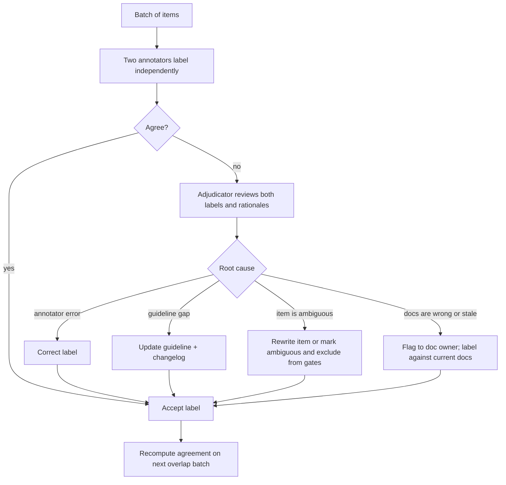

# SME Golden Datasets

> **TL;DR** — Golden datasets are small, expert-labeled sets that define "correct" for your domain and anchor everything else (release gates, judge calibration, synthetic-data validation). Their value comes from process: clear annotation guidelines, binary or narrow rubrics, measured inter-annotator agreement, adjudication, key-facts-style references, explicit handling of unanswerable questions, and maintenance as documents change.

**You'll learn:** how to work with SMEs efficiently · writing annotation guidelines and rubrics · labeling tools · Cohen's kappa and Krippendorff's alpha with worked examples · adjudication · reference answers vs key-facts lists · unanswerables · cost/time planning · common pitfalls  ·  **Prerequisites:** [Dataset strategy](./01-dataset-strategy.md)  ·  **Related:** [LLM-as-a-judge](../02-offline-evals/07-llm-as-a-judge.md), [E2E RAG evals](../02-offline-evals/01-end-to-end-rag-evals.md), [Production data flywheel](./04-production-data-flywheel.md), [Synthetic datasets](./03-synthetic-datasets.md)

---

## 1. What a golden dataset is (and isn't)

A **golden dataset** is a set of eval examples whose expected outputs were written or verified by people qualified to judge correctness — usually subject-matter experts (SMEs) such as HR policy owners, finance analysts, support leads, or data engineers who own the warehouse schema.

| It is | It is not |
|---|---|
| The **source of truth** for "correct" in your domain | A large dataset — 50–300 rows is typical and fine |
| The anchor used to **calibrate LLM judges** and validate synthetic data | Something an LLM can produce alone |
| A **product spec** expressed as examples (including what must be refused) | Frozen forever — documents and policies change |
| Used for **release gates** and headline metrics | A replacement for production sampling |

Where golden data pays off most in an agentic RAG application:

1. **Answer correctness** for high-stakes intents (HR policy, finance numbers, compliance).
2. **Gold SQL + expected results** for text-to-SQL — only people who know the warehouse know that "active customer" means `status = 'A' AND churn_date IS NULL`.
3. **Relevance judgments** for retrieval (graded `relevant_docs`).
4. **Policy decisions**: should-refuse rows, RBAC expectations, escalation rules.
5. **Judge calibration sets**: human pass/fail labels on *system outputs*, used to measure judge agreement (see [LLM-as-a-judge](../02-offline-evals/07-llm-as-a-judge.md)).

> Note the two different golden artifacts: **(a) golden references** (expected answer/SQL/docs for an input) and **(b) golden judgments** (a human's pass/fail on a specific system output). You need (a) for reference-based metrics and (b) to trust any LLM judge.

---

## 2. Working with subject-matter experts

SME time is the scarcest resource in eval work. Design the process around it.

### 2.1 Roles

| Role | Responsibility |
|---|---|
| **Eval owner** (AI engineer / PM) | Defines schema, coverage plan, guidelines; prepares batches; computes agreement; runs adjudication |
| **Principal domain expert** | Final say on correctness and policy; owns the rubric's meaning ("benevolent dictator" — one person who resolves ambiguity) |
| **Annotators** (SMEs or trained non-experts) | Write/verify references; label outputs |
| **Adjudicator** | Resolves disagreements; usually the principal expert |

Hamel Husain's recommendation of a single "benevolent dictator" for quality judgments is a useful default for small teams: one accountable expert avoids endless committee debate over what "good" means.

### 2.2 Make SME sessions efficient

- [ ] **Pre-fill, don't ask for blank-page writing.** Show the question, retrieved sources, and a draft answer (from the system or an LLM); ask the SME to *correct and approve*. Verifying is much faster than authoring.
- [ ] **Show the source documents inline** with links and versions; SMEs shouldn't hunt for context.
- [ ] **Batch by domain** (all HR questions to HR, all finance SQL to the data team).
- [ ] **Time-box sessions** (e.g. 45–60 min) and start each with 3–5 calibration items everyone labels together.
- [ ] **Capture rationale** in a free-text field — the "why" becomes guideline updates and judge few-shot examples.
- [ ] **Let SMEs flag** "bad question", "ambiguous", "docs are wrong/outdated", "not my domain" — these flags are valuable outputs, not noise.
- [ ] **Collect questions from SMEs too**: ask "what do people ask you most often?" and "what do people usually get wrong?" — this produces realistic, high-value inputs.

### 2.3 Sourcing the inputs for SMEs to label

| Source | Pros | Cons |
|---|---|---|
| SMEs' own recall ("top questions we get") | Realistic, high-value | Biased toward common/easy; small |
| Support tickets, Slack/Teams help channels, search logs | Real phrasing, real distribution | Needs PII scrubbing; noisy |
| Production traces (after launch) | Best distribution match | Requires traffic; see [Production data flywheel](./04-production-data-flywheel.md) |
| Synthetic candidates, SME-verified | Fast coverage of rare slices | Can feel artificial; must filter (see [Synthetic datasets](./03-synthetic-datasets.md)) |
| Dimensions/tuples plan | Systematic coverage | Needs a human to make inputs realistic (see [Dataset strategy](./01-dataset-strategy.md#42-dimensions-and-tuples-generating-diverse-inputs-systematically)) |

---

## 3. Annotation guidelines

Guidelines turn "I know it when I see it" into consistent labels. Without them, agreement is low and the dataset encodes individual annotators' preferences.

### 3.1 What to include

```markdown
# Annotation guidelines — Enterprise assistant, HR policy answers (v1.3)

## Task
For each question, review the draft answer and the source documents. Produce:
1. A corrected reference answer (2–4 sentences).
2. A list of key facts the answer MUST contain.
3. The doc_ids/chunk_ids that support each fact.
4. Answerability: answerable | partially_answerable | unanswerable.

## Definitions
- "Correct" = consistent with the CURRENT policy version shown. Do not use personal knowledge
  of unwritten practice. If the docs are wrong, flag `docs_issue` and still label against docs.
- "Key fact" = an atomic statement whose absence would make the answer wrong or misleading
  for the asker. Not: greetings, generic disclaimers, restating the question.

## Decision rules
- If the policy differs by country/role and the question doesn't specify → answer is
  "ask a clarifying question" OR state the general rule + note variations (prefer the latter
  if ≤ 3 variations).
- Numbers: include units and scope ("16 weeks, full-time employees, Germany").
- If only part of the question is answerable → partially_answerable; key facts cover the
  answerable part; add `must_acknowledge_gap: true`.

## Examples
(3–5 fully worked examples, including one borderline and one unanswerable)

## Flags
ambiguous_question | docs_issue | outdated_doc | out_of_my_domain | sensitive_content

## Changelog
v1.3 — clarified partial answers; added country-variation rule after adjudication round 2.
```

### 3.2 Guideline principles

- **Operational definitions over adjectives.** "Helpful" is not a guideline; "answers the question in the first sentence and includes all key facts" is.
- **Decision rules for recurring edge cases** — discovered during adjudication and added back (guidelines are living documents; version them).
- **Examples near the boundary** teach more than obvious ones.
- **Separate dimensions.** Don't ask for one overall "quality" label; ask separately for correctness, completeness, groundedness, tone, policy compliance.
- **Say what to ignore.** E.g., "ignore formatting unless it changes meaning" prevents annotators from penalizing style.

---

## 4. Rubric design

### 4.1 Prefer binary (pass/fail) per criterion

Likert scales (1–5) look richer but tend to produce lower agreement, unclear thresholds ("is 3 acceptable?"), and judges that cluster in the middle. Practitioners such as Hamel Husain recommend **binary pass/fail with a written critique** as a default; you can still aggregate multiple binary criteria into a score.

| Rubric style | Agreement | Actionability | Use when |
|---|---|---|---|
| **Binary pass/fail + critique** | Highest | High ("fails because X") | Default for gating and judge calibration |
| **Binary per criterion (checklist)** | High | High | Multi-aspect quality (correct, complete, cited, on-policy) |
| **3-point (fail / partial / pass)** | Medium | Medium | Partial answers matter (e.g. multi-part questions) |
| **Likert 1–5** | Lower | Low | Preference/tone research; ranking variants; avoid for gates |
| **Pairwise preference (A vs B)** | Often high | Medium | Comparing two system variants; no absolute threshold |

### 4.2 Example checklist rubric (RAG answer)

| Criterion | Pass if… | Fail examples |
|---|---|---|
| **Correct** | No statement contradicts the reference/key facts | Wrong number, wrong country, outdated policy |
| **Complete** | All key facts present (paraphrase OK) | Omits the cap on carry-over days |
| **Grounded** | Every factual claim is supported by retrieved sources | Adds a plausible but unsourced exception |
| **Cited** | Each factual sentence cites a supporting source id | Missing citations; citing an irrelevant source |
| **Appropriate abstention** | Unanswerable → says so and redirects; answerable → doesn't abstain | "I don't know" when the answer is in the docs |
| **Policy & role** | Respects RBAC and scope rules | Reveals restricted information |

Overall pass = all *critical* criteria pass (decide which are critical; e.g. Correct, Grounded, Policy are critical; Cited may be non-critical early on).

### 4.3 Rubrics for other eval types

| Eval type | Golden labels SMEs provide | Rubric notes |
|---|---|---|
| Retrieval | Graded relevance 0–3 per (query, chunk) | Define each grade with examples; label top-k pooled from several retrievers |
| Text-to-SQL | Gold SQL, expected result, business definitions (`evidence`) | Acceptable alternatives; whether row order/extra columns matter; rounding |
| Tool calls | Expected call(s), args, match rule per arg | When to ask clarifying questions vs call with defaults |
| Trajectories | Expected end state, forbidden actions | Accept multiple valid paths; label "efficiency" separately from "success" |
| Guardrails | block/allow/redact, category, severity | Hardest part: borderline allow cases — write explicit decision rules |
| Citations | Claim → supporting source ids | Whether "general knowledge" claims need citations |

---

## 5. Reference answers vs key facts lists

Two ways to encode the expected answer, with different trade-offs:

| | Free-form reference answer | Key facts (claims) list |
|---|---|---|
| Example | "Full-time employees in Germany get 16 weeks of paid parental leave in addition to statutory Elternzeit." | `["16 weeks paid parental leave", "applies to full-time employees in Germany", "in addition to statutory Elternzeit"]` |
| Effort for SME | Low–medium | Medium (requires decomposition) |
| Metric style | Semantic similarity, LLM "is equivalent?" judge, or claim extraction from the reference | Fact recall ("which facts are present?"), contradiction check |
| Objectivity | Lower — judges disagree on "equivalent" | Higher — each fact is a near-binary check |
| Handles verbose answers | Poorly (similarity drops with extra content) | Well (extra correct content doesn't hurt recall; check contradictions separately) |
| Diagnostic value | Low ("not similar enough") | High ("missed fact #2") |

**Recommendation:** store both. Write a short reference answer (useful as a judge reference and for humans) **plus** 1–5 key facts, each marked `critical: true/false`. Score:

```text
key_fact_recall      = (# critical facts present) / (# critical facts)
contradiction_free   = no statement in the answer contradicts any key fact or source
answer_correct (bin) = key_fact_recall == 1.0 AND contradiction_free
```

```json
{
  "id": "rag-fin-0019",
  "question": "What's the hotel nightly cap for business travel in London?",
  "reference_answer": "The nightly hotel cap in London is GBP 250 including taxes. Exceptions require director approval in advance.",
  "key_facts": [
    {"fact": "Nightly cap in London is GBP 250", "critical": true},
    {"fact": "Cap includes taxes", "critical": false},
    {"fact": "Exceptions require advance director approval", "critical": true}
  ],
  "supporting_chunks": {"0": ["fin-travel-emea#c12"], "1": ["fin-travel-emea#c12"], "2": ["fin-travel-emea#c14"]}
}
```

Writing good key facts:

- **Atomic**: one checkable claim per fact ("GBP 250" and "includes taxes" are separate).
- **Scoped**: include qualifiers that change correctness (country, role, date range).
- **Necessary, not exhaustive**: a fact is "critical" only if omitting it would mislead the user.
- **Source-linked**: each fact maps to chunk ids — this simultaneously gives you `reference_contexts` for context recall.

This mirrors the claim-decomposition idea used by several RAG metrics (e.g. RAGAS factual correctness and context recall decompose text into claims); see [E2E RAG evals](../02-offline-evals/01-end-to-end-rag-evals.md).

---

## 6. Handling "no answer" and unanswerable questions

Unanswerable rows are the main defense against measuring a system that "always answers". Treat them as first-class.

### 6.1 Taxonomy

| Category | Example (enterprise assistant) | Expected behavior |
|---|---|---|
| **Not in corpus** | "Parental leave for contractors in Brazil?" (no doc covers it) | Abstain; say the docs don't cover it; suggest owner/channel |
| **Partially answerable** | "Leave policy in Germany and Brazil?" (only Germany documented) | Answer the covered part; explicitly state the gap |
| **False premise** | "Why was the 4-day week cancelled?" (there was never one) | Correct the premise; don't invent a reason |
| **Ambiguous** | "What's the limit?" | Ask a clarifying question (or answer the most likely reading + state assumption) |
| **Out of scope** | "Write a poem about our CEO" | Decline per scope policy |
| **Restricted (RBAC)** | Employee asks about exec compensation | Refuse without confirming the document exists |
| **Time-sensitive / not yet known** | "What will the 2027 bonus pool be?" | State it's not determined/published |

### 6.2 Labeling rules

- Mark `answerable: false | partial` and an `expected_behavior` enum rather than a free-form reference answer.
- Add `acceptable_response_notes` with must/must-not constraints ("must NOT infer from the employee policy").
- **Verify unanswerability against the corpus**, not memory: the SME (or a search tool) must confirm no document answers it. Re-verify when the corpus changes — today's unanswerable becomes tomorrow's answerable after a new policy is published.
- Aim for a meaningful share (heuristic: 10–15%+) of unanswerable/partial/ambiguous rows in E2E sets; more if hallucination risk is high.

Metrics on these rows: **abstention accuracy** (abstained when it should), **false abstention rate** (abstained on answerable rows — compute on the answerable subset), and **premise correction rate**.

---

## 7. Inter-annotator agreement (IAA)

If two qualified experts can't agree on a label, neither can your LLM judge — and the "ground truth" is partly noise. Measure agreement on an overlap sample before trusting a golden set.

**Process:** have ≥2 annotators independently label the same subset (heuristic: 20–30% of the set, or at least 50 items), compute agreement, review disagreements, update guidelines, repeat until agreement is acceptable.

### 7.1 Percent agreement (and why it's not enough)

```text
p_o = (# items where annotators agree) / (# items)
```

If 90% of outputs pass, two annotators who label "pass" at random 90% of the time agree ~82% of the time by chance. Chance-corrected statistics fix this.

### 7.2 Cohen's kappa (two annotators, nominal labels)

```text
κ = (p_o − p_e) / (1 − p_e)

p_o = observed agreement
p_e = expected chance agreement = Σ_k  P(A = k) · P(B = k)
```

**Worked example.** Two SMEs label 100 RAG answers pass/fail:

| | B: pass | B: fail | Total A |
|---|---|---|---|
| **A: pass** | 55 | 15 | 70 |
| **A: fail** | 5 | 25 | 30 |
| **Total B** | 60 | 40 | 100 |

```text
p_o = (55 + 25) / 100 = 0.80
p_e = P(A=pass)·P(B=pass) + P(A=fail)·P(B=fail)
    = 0.70·0.60 + 0.30·0.40 = 0.42 + 0.12 = 0.54
κ   = (0.80 − 0.54) / (1 − 0.54) = 0.26 / 0.46 ≈ 0.57
```

80% raw agreement becomes κ ≈ 0.57 — "moderate". The 15 items A passed but B failed are the ones to review: A is more lenient. That's a guideline problem, not just noise.

```python
def cohens_kappa(a: list[str], b: list[str]) -> float:
    assert len(a) == len(b) and a
    n = len(a)
    labels = set(a) | set(b)
    p_o = sum(x == y for x, y in zip(a, b)) / n
    p_e = sum((a.count(k) / n) * (b.count(k) / n) for k in labels)
    return 1.0 if p_e == 1 else (p_o - p_e) / (1 - p_e)
```

For **ordinal** labels (e.g. relevance 0–3), use **weighted kappa** (linear or quadratic weights), which penalizes a 0-vs-3 disagreement more than 2-vs-3. `sklearn.metrics.cohen_kappa_score` supports `weights="linear"` / `"quadratic"`.

For **more than two annotators** with complete data, Fleiss' kappa is common; Krippendorff's alpha (below) is more general.

### 7.3 Krippendorff's alpha (any number of annotators, missing data, any scale)

```text
α = 1 − D_o / D_e

D_o = observed disagreement among values assigned to the same item
D_e = disagreement expected if values were assigned at random
      (from the pooled distribution of all values)
```

It handles multiple annotators, missing labels, and nominal/ordinal/interval/ratio data via a distance function. For nominal data, disagreement is 1 if two values differ and 0 otherwise.

**Worked example (nominal, 3 annotators, one missing label).**

| Item | A | B | C |
|---|---|---|---|
| 1 | pass | pass | pass |
| 2 | pass | fail | pass |
| 3 | fail | fail | fail |
| 4 | pass | pass | — |
| 5 | fail | pass | fail |
| 6 | pass | pass | pass |

Using the coincidence-matrix method, each item with `m` labels contributes `m(m−1)` ordered pairs, each weighted `1/(m−1)`:

```text
Coincidences (ordered pairs, weighted):
  pass–pass = 9,  fail–fail = 4,  pass–fail = 2,  fail–pass = 2
Pairable values n = 17     (5 items × 3 labels + 1 item × 2 labels)
Marginals: n_pass = 11, n_fail = 6

D_o = (2 + 2) / 17                         = 0.235
D_e = (n_pass·n_fail + n_fail·n_pass) / (n(n−1))
    = (2 · 11 · 6) / (17 · 16) = 132 / 272 = 0.485
α   = 1 − 0.235 / 0.485                    ≈ 0.52
```

```python
from collections import Counter
from itertools import permutations

def krippendorff_alpha_nominal(items: list[list[str | None]]) -> float:
    o = Counter()
    for row in items:
        vals = [v for v in row if v is not None]
        m = len(vals)
        if m < 2:
            continue
        for i, j in permutations(range(m), 2):
            o[(vals[i], vals[j])] += 1 / (m - 1)
    cats = {c for pair in o for c in pair}
    n_c = {c: sum(v for (x, _), v in o.items() if x == c) for c in cats}
    n = sum(n_c.values())
    d_o = sum(v for (x, y), v in o.items() if x != y) / n
    d_e = sum(n_c[x] * n_c[y] for x in cats for y in cats if x != y) / (n * (n - 1))
    return 1.0 if d_e == 0 else 1 - d_o / d_e
```

For production use, the `krippendorff` package on PyPI implements nominal/ordinal/interval levels.

### 7.4 Interpreting agreement

| Statistic | Common interpretation (conventions, not laws) |
|---|---|
| Cohen's κ | Landis & Koch (1977): < 0 poor · 0–0.20 slight · 0.21–0.40 fair · 0.41–0.60 moderate · 0.61–0.80 substantial · 0.81–1.0 almost perfect |
| Krippendorff's α | Krippendorff suggests α ≥ 0.80 for reliable data; 0.667 ≤ α < 0.80 only for tentative conclusions |

Practical heuristics:

- **Gate-worthy golden labels:** aim for κ/α ≳ 0.7 on critical criteria before trusting them for release decisions. If you can't get there, the criterion is ill-defined — split or redefine it.
- **Kappa paradox:** with highly skewed labels (e.g. 95% pass), κ can be low despite high raw agreement. Report raw agreement, κ, and the label distribution together; consider reporting agreement on the minority class (e.g. positive/negative agreement).
- **Low agreement is information.** It tells you the rubric or the question is ambiguous. Fix the guidelines, or drop/rewrite the item — don't average away the disagreement.
- Measure **human–judge agreement** the same way when validating an LLM judge (see [LLM-as-a-judge](../02-offline-evals/07-llm-as-a-judge.md)). A judge can't be expected to beat human–human agreement on a criterion.

---

## 8. Adjudication

Adjudication turns disagreements into final labels **and** better guidelines.



Adjudication tips:

- **Blind first pass**: annotators must not see each other's labels before submitting.
- **Record the reason category** for each disagreement (error / guideline gap / ambiguous item / doc issue). Trends tell you where to invest.
- **Don't majority-vote critical items** without review — two non-experts outvoting one expert is wrong.
- **Keep disagreement metadata** on the row (`adjudicated: true`, `original_labels`). Items that needed adjudication are often the best judge few-shot examples and the most informative eval items.

---

## 9. Labeling tools

Pick the simplest tool that shows annotators everything they need (question, retrieved sources, answer, trace) in one view.

| Tool | Type | Good for | Notes |
|---|---|---|---|
| **Spreadsheet / shared doc** | Ad hoc | First 20–100 items; SMEs who won't learn a new tool | Version control and agreement tracking are manual |
| **Custom lightweight app** (e.g. Streamlit/Gradio/internal web page) | Custom | Showing traces, sources, and domain-specific context exactly as experts need | Hamel Husain strongly advocates building a simple custom data viewer; often the highest-leverage option |
| **[Argilla](https://docs.argilla.io/)** | Open-source annotation platform | Text classification, rating, ranking, free-text feedback on LLM outputs; multi-annotator | Integrates with Hugging Face datasets |
| **[Label Studio](https://labelstud.io/)** | Open-source annotation platform | Configurable labeling UIs (text, ranking, pairwise, spans) | Broad data types; self-hostable |
| **[LangSmith annotation queues](https://docs.smith.langchain.com/evaluation/how_to_guides/annotation_queues)** | LLM observability platform feature | Reviewing traces/runs, adding feedback, promoting to datasets | Best if you already trace with LangSmith |
| **[Langfuse annotation queues](https://langfuse.com/docs/scores/annotation)** | LLM observability platform feature (open source) | Human scoring of traces; linking scores to traces and datasets | Best if you already trace with Langfuse |

Must-have features for agentic RAG labeling:

- [ ] Render **retrieved chunks with doc ids and versions** next to the answer.
- [ ] Render **tool calls and SQL** (with results) for agent traces.
- [ ] Support **multiple annotators per item** and blind labeling.
- [ ] Capture **free-text rationale** and **flags**.
- [ ] **Export** to your dataset format with stable ids.

More on tools: [Eval & observability tools](../06-tooling-landscape/01-eval-and-observability-tools.md).

---

## 10. Cost and time planning

These are planning heuristics from typical practice — measure your own throughput in the first session and re-plan.

| Activity | Rough time per item (heuristic) | Notes |
|---|---|---|
| Verify/correct a pre-drafted RAG answer + key facts | 1–5 min | Fastest when sources are shown inline |
| Write a reference answer from scratch | 5–15 min | Includes finding the source |
| Graded relevance for top-10 chunks | 2–5 min | Faster with chunk previews |
| Write gold SQL + verify result | 5–30 min | Depends heavily on schema complexity |
| Pass/fail + critique on a system output | 0.5–3 min | After guidelines are stable |
| Multi-step agent trajectory review | 5–20 min | Trace UX matters a lot |

Budget example: 200 RAG rows, pre-drafted, 3 min each = 10 h of SME time; plus 25% double-annotated overlap = +2.5 h; plus adjudication ~2 h; plus guideline writing/calibration ~3 h → **~17–18 SME hours**, spread over several sessions. Budget an equivalent amount of eval-owner time for preparation and analysis.

Ways to reduce cost without reducing quality:

- Pre-draft with the system or an LLM; SMEs edit.
- Use non-expert annotators for easy criteria (format, citation presence); reserve SMEs for correctness and policy.
- Use active selection: send SMEs the items where LLM judges disagree with each other or have low confidence.
- Stop double-annotating once agreement is stable; spot-check 10% thereafter (heuristic).

---

## 11. Pitfalls

| Pitfall | What happens | Mitigation |
|---|---|---|
| **SME bias toward "textbook" questions** | Golden set is clean, well-phrased, easy; real users type "vpn broke again??" | Mix in production/support-ticket inputs; include typos, terse and verbose styles |
| **SME knowledge beyond the docs** | Reference includes unwritten practice; system "fails" for not knowing it | Rule: label against the documents; flag `docs_issue` separately |
| **Stale golden answers when docs change** | A policy update silently turns correct answers into "failures" (or vice versa) | Store `doc_versions` per row; on doc change, auto-flag affected rows for re-review (see [Production data flywheel](./04-production-data-flywheel.md#8-keeping-datasets-fresh-docs-drift)) |
| **Leakage into prompts / few-shots / fine-tuning** | Golden examples copied into the system prompt or training data → inflated scores | Keep a held-out split; track where examples are used; hash-check prompts and training data against eval ids |
| **Leakage into the corpus** | The eval Q&A doc itself gets indexed (e.g. a "FAQ for testing" page) | Exclude eval artifacts from ingestion; check retrieved doc ids against eval sources |
| **Single-annotator labels on critical rows** | Undetected individual errors and preferences | Double-annotate gate rows; measure IAA |
| **Overly long/stylistic references** | Similarity metrics punish correct but differently phrased answers | Key facts lists; equivalence-based judges |
| **Ambiguous items kept in gates** | Noisy gates, flaky CI | Mark `ambiguous: true` and exclude from gating metrics |
| **Annotator fatigue/drift** | Labels get more lenient over a long session | Short sessions; repeat a few calibration items; monitor per-annotator pass rates |
| **Golden set = only past failures** | Score tracks bug fixes, not overall quality | Keep regression set separate from the representative set |
| **No owner** | Dataset rots within a quarter | Named owner per dataset; review cadence (see [Production data flywheel](./04-production-data-flywheel.md#10-ownership-and-governance)) |

---

## 12. Golden dataset checklist

- [ ] Schema defined per eval type ([Dataset strategy](./01-dataset-strategy.md#3-matching-dataset-shape-to-eval-type)).
- [ ] Coverage plan (dimensions/slices) agreed with the principal expert.
- [ ] Annotation guidelines v1 with definitions, decision rules, and boundary examples.
- [ ] Rubric: binary per criterion; critical criteria identified.
- [ ] Reference answers **and** key facts with source chunk ids.
- [ ] Unanswerable/partial/ambiguous rows with `expected_behavior`.
- [ ] Overlap sample double-annotated; κ or α computed; disagreements adjudicated; guidelines updated.
- [ ] Rows carry `doc_versions`, `created_by`, `label_tier: gold`, `adjudicated`.
- [ ] Held-out split defined and protected from prompt/few-shot/training use.
- [ ] Owner and re-review cadence set.

---

## Key takeaways

- Golden data is small but load-bearing: it defines correctness, gates releases, and calibrates LLM judges.
- Respect SME time: pre-draft, show sources inline, batch by domain, capture rationale and flags.
- Prefer binary, per-criterion rubrics with operational definitions; store both a short reference answer and an atomic, source-linked key-facts list.
- Treat unanswerable, partial, ambiguous, false-premise, and restricted questions as first-class rows with explicit expected behavior.
- Measure inter-annotator agreement (Cohen's κ for two raters, Krippendorff's α for many raters/missing data); low agreement means the rubric or item needs fixing.
- Adjudication improves both labels and guidelines; version the guidelines.
- Biggest long-term risks: stale answers after doc changes, leakage into prompts/training/corpus, and lack of ownership.

## Further reading

- Hamel Husain — [Creating a LLM-as-a-Judge That Drives Business Results](https://hamel.dev/blog/posts/llm-judge/) (principal domain expert, binary pass/fail with critiques)
- Hamel Husain — [A Field Guide to Rapidly Improving AI Products](https://hamel.dev/blog/posts/field-guide/) (custom data viewers, error analysis)
- Hamel Husain & Shreya Shankar — [LLM Evals FAQ](https://hamel.dev/blog/posts/evals-faq/)
- Shankar et al. — [Who Validates the Validators? Aligning LLM-Assisted Evaluation of LLM Outputs with Human Preferences](https://arxiv.org/abs/2404.12272) (criteria drift: criteria evolve as people grade outputs)
- Krippendorff's alpha resources — [k-alpha.org](https://www.k-alpha.org/)
- Cohen, J. (1960), *A coefficient of agreement for nominal scales*; Landis, J. R. & Koch, G. G. (1977), *The measurement of observer agreement for categorical data* (classic references for κ and its interpretation)
- Tools: [Argilla](https://docs.argilla.io/) · [Label Studio](https://labelstud.io/) · [LangSmith annotation queues](https://docs.smith.langchain.com/evaluation/how_to_guides/annotation_queues) · [Langfuse annotation](https://langfuse.com/docs/scores/annotation)
- Within this repo: [Dataset strategy](./01-dataset-strategy.md) · [LLM-as-a-judge](../02-offline-evals/07-llm-as-a-judge.md) · [Text-to-SQL evals](../02-offline-evals/05-text-to-sql-evals.md) · [Production data flywheel](./04-production-data-flywheel.md)
