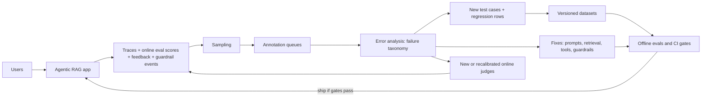
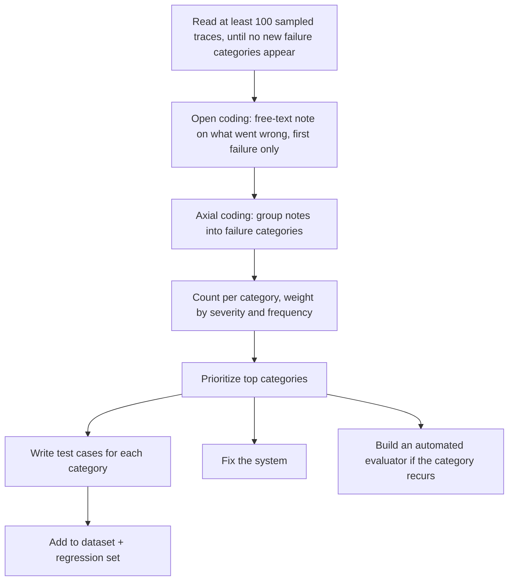
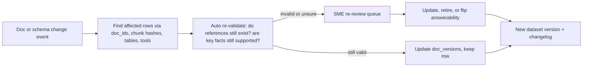

# The Production Data Flywheel

> **TL;DR**
>
> - **Use production traces as your primary data source.** After launch, real user traffic provides your highest-value evaluation cases.
> - **Separate measurement from discovery.** Use random sampling to measure true failure rates. Use targeted sampling (thumbs-down, low scores, errors) to find bugs.
> - **Turn failures into regression tests.** Route sampled traces into annotation queues, categorize failures via error analysis, and add fixed bugs to a regression suite.
> - **Estimate rates only from measurement samples.** Store each trace's inclusion probability, re-weight stratified labels, and correct judge-labelled rates for judge error.
> - **Protect privacy and fight drift.** Pseudonymize PII and strip secrets in every field before saving rows, version every dataset immutably, and re-validate rows whenever source documents change.

- **You will learn:**
    - How traces become eval rows
    - Sampling strategies, budget allocation, and re-weighted rate estimates
    - Annotation queue design
    - Error analysis to test cases
    - Regression set growth
    - Dataset versioning
    - PII scrubbing, secrets, quasi-identifiers, and consent
    - Keeping datasets fresh as docs change
    - Contamination risks
    - Ownership
- **Prerequisites:** [Dataset strategy](./01-dataset-strategy.md), [Tracing & OpenTelemetry](../03-online-evals-and-observability/02-observability-and-tracing.md)
- **Related:** [Online eval pipelines](../03-online-evals-and-observability/01-online-evals.md), [User feedback & implicit signals](../03-online-evals-and-observability/03-user-feedback-and-implicit-signals.md), [Monitoring, alerting & drift](../03-online-evals-and-observability/04-monitoring-alerting-and-drift.md), [SME golden datasets](./02-sme-golden-datasets.md), [Implementation playbook](../05-decision-framework/04-implementation-playbook.md)

---

## 1. The data flywheel



Each turn of the flywheel improves three assets:

1. **The product:** You fix prompts, retrieval, tools, and guardrails.
2. **The offline datasets:** You add real-world rows that reflect actual user behavior.
3. **The online monitors:** You deploy new judges for newly discovered failure modes.

If you skip this loop, your evaluation suite only tests the product you imagined before launch.

### 1.1 Prerequisite: traces rich enough to become test cases

A production trace can only become an evaluation row if it logs all required inputs and context. Log at least these fields:

| Field | Needed for |
|---|---|
| User input (all turns), timestamp, session ID | Inputs for every eval type |
| **User role / permissions snapshot** | RBAC tests; reproducing access decisions |
| Retrieved chunk IDs **+ doc versions** + scores | Retrieval rows; freezing context; drift detection |
| Tool calls (name, args, results, errors) | Tool-call and trajectory rows |
| Generated SQL, execution result/row count, errors, DB snapshot/version | Text-to-SQL rows |
| Final answer + citations | Output-based labels |
| Guardrail decisions (which check, score, block/allow) | Guardrail eval rows (TP/FP review) |
| Online eval scores (judges, deterministic checks) | Uncertainty / low-score sampling |
| User feedback (explicit + implicit) | Negative-feedback sampling |
| App version (prompt, model, index, config hashes) | Attribution; comparing before/after |

See [Tracing & OpenTelemetry](../03-online-evals-and-observability/02-observability-and-tracing.md) for instrumentation details.

---

## 2. Sampling strategies

You cannot label every production trace. Your sampling strategy determines what you learn.

| Strategy | Selects | Good for | Bias / caveat |
|---|---|---|---|
| **Uniform random** | Any trace with equal probability | **Unbiased** estimates of quality and failure prevalence; discovering unknown unknowns | Rare slices barely appear; most samples are "fine" |
| **Stratified** | Random within strata (intent, role, language, pipeline: RAG/SQL/tool) with per-stratum quotas | Coverage of rare-but-important slices; per-slice estimates | Must re-weight to estimate global rates |
| **Uncertainty / low-score** | Low online judge scores, judge disagreement, low retrieval similarity, borderline guardrail scores | Finding failures efficiently | Over-represents hard cases; depends on judge quality |
| **Negative feedback** | Thumbs-down, "regenerate", rephrased follow-ups, escalation to human, abandoned sessions | High failure yield; user-validated problems | Feedback is sparse and skewed (some users never click); see [User feedback](../03-online-evals-and-observability/03-user-feedback-and-implicit-signals.md) |
| **Guardrail triggers** | Blocked/flagged inputs and outputs | Reviewing false positives (blocked legit work) and true positives (attack examples) | Doesn't show false negatives (misses); combine with random sampling of *allowed* traffic |
| **Error / anomaly signals** | Tool errors, SQL errors, empty results, timeouts, retries, max-step hits, very long trajectories | Agent and SQL failures | Biased toward loud failures; silent wrong answers are missed |
| **Novelty / clustering** | Queries far from existing dataset clusters; new topic clusters | Detecting new intents and drift | Needs embedding/cluster infra |
| **Diff-based** | Traces where a new candidate version would answer differently (shadow/replay) | Pre-release risk review | Requires replay infra |

### 2.1 The most important caveat

> **Only random (or properly re-weighted stratified) samples estimate how often something happens.** Targeted samples (low-score, negative feedback, guardrail triggers) help you *find* failures, not *measure* their rate. Never report "35% of answers are wrong" from a thumbs-down sample.

Maintain two separate sampling pools:

- **Measurement pool:** Use random or stratified sampling with known weights to track true quality over time.
- **Discovery pool:** Use targeted sampling to feed error analysis and create new test cases.

### 2.2 Example weekly budget allocation

For an annotation budget of ~200 traces per week (heuristic split; tune to your failure yield):

| Pool | Share | Count | Notes |
|---|---|---|---|
| Uniform random | 30% | 60 | Measurement; keep the method fixed across weeks |
| Stratified quotas | 20% | 40 | Measurement; equal split across strata (e.g., pipeline × language × role), hard cap of 40; log inclusion probabilities |
| Negative feedback | 20% | 40 | All, if fewer |
| Low online-eval score / judge disagreement | 15% | 30 | High-yield failure discovery |
| Guardrail triggers | 10% | 20 | Half blocks (FP review), half near-threshold allows (FN hunting) |
| Errors / anomalies | 5% | 10 | Tool/SQL errors, max-steps |

These are **human-annotation** budgets. Automated checks run on far more traffic: deterministic checks and the injection classifier on 100% of traces, and online LLM judges on 1–5% of traces plus 100% of flagged traces (see [Online eval pipelines](../03-online-evals-and-observability/01-online-evals.md)).

The sampler below keeps the two measurement pools usable for estimates. It excludes opted-out users, fills each measurement pool to its exact quota, and stores the inclusion probability of every measurement trace. Discovery pools are labelled as such.

The two measurement pools are drawn independently, so one trace can land in both. Review that trace once, but keep both selection records. Each estimate then uses every member of its own pool. If you drop the overlap from one pool instead, its stored probabilities no longer describe how its rows were chosen.

```python
import math
import random
from collections import defaultdict

def allocate(sizes: dict, quota: int) -> dict:
    """Split `quota` across strata as equally as possible; small strata give their unused share to others."""
    alloc, remaining = {}, quota
    keys = sorted(sizes, key=lambda k: (sizes[k], str(k)))       # smallest first, deterministic
    for i, key in enumerate(keys):
        share = remaining // (len(keys) - i)     # equal share of what is left; unused shares roll forward
        alloc[key] = min(sizes[key], share)
        remaining -= alloc[key]
    return alloc

def weekly_sample(traces, budget=200, seed=None, random_share=0.30, strat_share=0.20):
    rng = random.Random(seed)
    eligible = [t for t in traces if not t.opted_out]             # consent: exclude at sampling time
    queue = {}   # trace id -> one review row; a trace picked by two pools is labelled once

    def add(t, pool, reason, **weights):
        row = queue.setdefault(t.id, {"trace": t, "selections": []})
        row["selections"].append({"pool": pool, "reason": reason, **weights})

    # 1. Measurement pool A: simple random sample. Every eligible trace has the same inclusion probability.
    n_rand = min(int(random_share * budget), len(eligible))
    for t in rng.sample(eligible, n_rand):
        add(t, "measurement", "random", inclusion_prob=n_rand / len(eligible))

    # 2. Measurement pool B: stratified sample, hard-capped at its quota.
    by_stratum = defaultdict(list)
    for t in eligible:
        by_stratum[(t.pipeline, t.language, t.user_role)].append(t)
    sizes = {k: len(v) for k, v in by_stratum.items()}
    for key, k in allocate(sizes, int(strat_share * budget)).items():
        for t in rng.sample(by_stratum[key], k):   # keep overlaps with pool A: both records stay valid
            add(t, "measurement", f"stratified:{key}", stratum=key,
                stratum_size=sizes[key], inclusion_prob=k / sizes[key])

    # 3. Discovery pools: targeted. Never use these labels to estimate rates.
    def take(pool, k, reason):
        pool = [t for t in pool if t.id not in queue]
        for t in rng.sample(pool, min(k, len(pool))):
            add(t, "discovery", reason)

    take([t for t in eligible if t.feedback == "negative" or t.escalated], int(0.20 * budget), "neg_feedback")
    take([t for t in eligible if t.online_score is not None and t.online_score < 0.5], int(0.15 * budget), "low_score")
    take([t for t in eligible if t.guardrail_events], int(0.10 * budget), "guardrail")
    take([t for t in eligible if t.tool_errors or t.sql_error or t.hit_max_steps], int(0.05 * budget), "error")
    return list(queue.values())   # store every selection record with the label

def stratified_rate(labels, stratum_sizes):
    """Population failure rate from stratified labels: sum over strata of W_h * p_h.
    labels: list of (stratum, failed: bool). stratum_sizes: traffic count per stratum (N_h)."""
    by = defaultdict(list)
    for stratum, failed in labels:
        by[stratum].append(failed)
    missing = set(stratum_sizes) - set(by)
    if missing:
        raise ValueError(f"No labels for {len(missing)} strata; the estimate would be biased")
    total = sum(stratum_sizes.values())
    rate, var = 0.0, 0.0
    for stratum, size in stratum_sizes.items():
        w, ys = size / total, by[stratum]
        p = sum(ys) / len(ys)
        rate += w * p
        var += w**2 * p * (1 - p) / len(ys)    # ignores finite-population correction (conservative)
    return rate, math.sqrt(var)


# Small traffic: 10 traces, one stratum, so the two measurement pools overlap.
from types import SimpleNamespace
traces = [SimpleNamespace(id=i, opted_out=False, pipeline="rag", language="en", user_role="employee",
                          feedback=None, escalated=False, online_score=None, guardrail_events=[],
                          tool_errors=[], sql_error=None, hit_max_steps=False) for i in range(10)]
rows = weekly_sample(traces, budget=10, seed=1)
picks = [s for r in rows for s in r["selections"]]
assert sum(s["reason"] == "random" for s in picks) == 3                     # pool A quota: 30% of 10
strat = [s for s in picks if s["reason"].startswith("stratified")]
assert len(strat) == 2 and all(s["inclusion_prob"] == 0.2 for s in strat)    # pool B quota and k / N_h
assert len({r["trace"].id for r in rows}) == len(rows)                     # each trace is reviewed once
```

*Tested with 20,000 synthetic traces in 60 strata (3 pipelines × 4 languages × 5 roles): the sampler returned exactly 60 random and 40 stratified picks and no opted-out users. The assertions above cover small traffic, where the two pools overlap. The review queue then holds fewer rows than the budget.*

#### 2.2.1 Estimating rates from the measurement pools

- **Random pool:** The failure rate is the plain proportion of failed labels. Report a Wilson interval (see [Dataset strategy](./01-dataset-strategy.md#52-confidence-intervals-for-pass-rates)).
- **Stratified pool:** Do not average the labels directly. Small strata are over-sampled, so a plain average over-weights them. Weight each stratum by its share of traffic, $W_h = N_h / N$, and use $\hat p = \sum_h W_h \hat p_h$ (`stratified_rate` above). This is the standard stratified estimator. It is the same as weighting each label by $1/\text{inclusion\_prob}$ ([Horvitz & Thompson, 1952](https://doi.org/10.1080/01621459.1952.10483446)).
- **Too many strata:** With 60 strata and a quota of 40, some strata get no rows. `stratified_rate` then raises an error, because the estimate would be biased. For a global estimate, use coarser strata (for example, pipeline only) or the random pool. Use fine strata to find failures in rare slices.
- **Judge-labelled rates:** If an online LLM judge produces the labels instead of humans, the measured rate inherits the judge's errors. Correct it with the judge's TPR and TNR (the Rogan–Gladen correction), or combine a small human-labelled sample with the judge labels (prediction-powered inference, [Angelopoulos et al., 2023](https://arxiv.org/abs/2301.09633)). The human-labelled sample must be random, not a FAIL-oversampled calibration set. See [LLM-as-a-judge §8](../02-offline-evals/07-llm-as-a-judge.md#8-correcting-pass-rate-estimates-for-judge-error) for Rogan–Gladen and [§8.1](../02-offline-evals/07-llm-as-a-judge.md#81-prediction-powered-inference-ppi) for the canonical PPI explanation.

### 2.3 Sampling conversations and agent runs

- **Sample full sessions, not single turns.** Multi-turn issues like context loss or repeated clarifications only appear across a full session.
- **Sample whole trajectories for agents.** Annotators need every step (tool calls and intermediate results) to find the first point of failure.
- **Do not deduplicate before measurement sampling.** Popular questions are part of real traffic. If you drop repeats, the rate describes distinct queries, not what users experience.
- **Group near-identical queries in discovery pools.** Reviewers then do not read the same question many times. Keep query frequency as metadata so you can prioritize high-volume issues.

---

## 3. Annotation queues

An **annotation queue** routes sampled traces to the right reviewers with a consistent labeling form. Observability platforms provide built-in queues (such as [LangSmith annotation queues](https://docs.langchain.com/langsmith/annotation-queues) and [Langfuse annotation queues](https://langfuse.com/docs/evaluation/evaluation-methods/annotation-queues)). A spreadsheet or small custom app also works well (see [SME golden datasets](./02-sme-golden-datasets.md#9-labeling-tools)).

### 3.1 Queue design

| Queue | Routed traces | Reviewer | Labels captured |
|---|---|---|---|
| **General quality** | Random + stratified | Product/eval team, trained annotators | Pass/fail per criterion, failure category, free-text note |
| **Domain correctness** | HR/finance/legal answers flagged as risky or low-score | Domain SMEs | Correct? Corrected answer, key facts, supporting docs |
| **SQL** | Text-to-SQL traces with errors, empty results, low score | Data team | Correct SQL? Gold SQL, result validity |
| **Agent actions** | Tool-using trajectories, especially write actions | Eng/ops owners | Success? First failing step, policy violations |
| **Safety & guardrails** | Guardrail blocks/near-threshold allows, reported abuse | Security/trust & safety | TP/FP/FN, attack category, severity |
| **Access control** | Traces involving restricted resources | Security + data owners | Correct decision? Leaked info? |

### 3.2 Labeling form (minimal and fast)

```json
{
  "trace_id": "tr_9f2c...",
  "queue": "general_quality",
  "selections": [{"pool": "measurement", "reason": "random", "inclusion_prob": 0.003}],
  "labels": {
    "overall": "fail",
    "criteria": {"correct": "fail", "grounded": "pass", "complete": "fail", "cited": "pass", "policy": "pass"},
    "failure_category": "retrieval_missed_relevant_doc",
    "first_failing_step": "retrieve",
    "note": "Answered with US policy; user is in Germany and EMEA doc exists (fin-travel-emea#c12)."
  },
  "actions": {"add_to_dataset": "rag_qa_v7", "propose_reference": "...", "needs_sme": false},
  "annotator": "ann-04",
  "labeled_at": "2026-10-12T09:31:00Z"
}
```

### 3.3 Queue hygiene

- [ ] Attach `pool` and `sample_reason` (and, for measurement items, the inclusion probability) to every item to separate measurement from discovery.
- [ ] Show reviewers the **full trace**: input, retrieved chunks (with doc versions), tool calls, SQL + results, final answer, and guardrail events.
- [ ] Provide a one-click **"add to dataset"** action with the corrected expected output.
- [ ] Overlap a small share of items between annotators to monitor agreement (see [SME golden datasets](./02-sme-golden-datasets.md#7-inter-annotator-agreement-iaa)).
- [ ] Set an SLA for high-severity items (for example, review data leakage reports within one business day).
- [ ] Cap queue size. A queue that grows forever is a queue nobody reads.

---

## 4. Error analysis → new test cases

Error analysis is the highest-leverage activity in the flywheel. Read traces, name the failures, count them, fix the biggest ones, and freeze examples as tests. Follow this qualitative coding workflow (popularized for LLMs by Hamel Husain and Shreya Shankar). Read at least 100 traces, and continue until new traces stop showing new failure categories ([Husain & Shankar, evals FAQ](https://hamel.dev/blog/posts/evals-faq/)):



### 4.1 Example failure taxonomy (enterprise assistant, one week)

| Failure category | Count (of 120 failing traces) | Severity | Action |
|---|---|---|---|
| Retrieved wrong region's policy | 31 | High | Add region metadata filter; add 15 region-specific rows |
| Aggregation question answered by RAG instead of SQL | 18 | Medium | Router fix; add 10 routing rows |
| SQL used wrong revenue definition | 12 | High | Add glossary to prompt; add 8 SQL rows with `evidence` |
| Didn't abstain on uncovered question | 11 | High | Prompt fix; add 10 unanswerable rows |
| Ticket created with wrong priority | 9 | Low | Arg description fix; add 5 tool rows |
| Over-blocked legitimate security question | 6 | Medium | Guardrail threshold; add 6 should-allow rows |

*(Illustrative numbers for the running example, not measured data.)*

### 4.2 Converting a trace into a test case

Choose which fields to freeze based on the component you want to test:

| You want to test… | Freeze | Leave live |
|---|---|---|
| Full E2E behavior | Input, user role, expected output/behavior | Retrieval, generation, tools |
| Generation only (isolate from retrieval) | Input + the retrieved contexts from the trace (or corrected contexts) | Generation |
| Retrieval only | Query + labeled relevant chunk IDs | Retriever |
| A specific agent step | Conversation + tool results up to that step | Next decision |
| SQL | Question + DB snapshot ID + gold SQL/result | SQL generation |

```python
from scrub import RowScrubber

def trace_to_rag_row(trace, label, dataset_version):
    scrub = RowScrubber()          # one scrubber per row: "Jane Doe" is <PERSON_1> in every field
    lang = trace.language
    return {
        "id": f"prod-{trace.id}",
        "question": scrub(trace.user_input, lang),                              # §7
        "user_role": trace.user_role,
        "reference_answer": scrub(label.corrected_answer, lang),
        "key_facts": [scrub(f, lang) for f in label.key_facts],
        "reference_contexts": [c.chunk_id for c in label.supporting_chunks],   # IDs only; rehydrate text (§7.3)
        "answerable": label.answerable,
        "expected_behavior": label.expected_behavior,           # e.g. "answer", "abstain", "refuse"
        "metadata": {
            "source": "production",
            "pool": label.pool,                                  # "measurement" or "discovery" (§2.1)
            "sample_reason": label.sample_reason,
            "failure_category": label.failure_category,
            "note": scrub(label.note, lang),
            "label_tier": "gold" if label.by_sme else "silver",
            "doc_versions": {c.doc_id: c.doc_version for c in label.supporting_chunks},   # the docs the label depends on
            "retrieved_doc_versions": {c.doc_id: c.doc_version for c in trace.retrieved},  # what the app saw
            "app_version_at_capture": trace.app_version,
            "added_in": dataset_version,
        },
    }
```

`RowScrubber` is the per-row pseudonymizer from §7.2. Use one instance per row, so each name gets the same placeholder in the question, reference answer, key facts, and annotator note. `doc_versions` comes from the chunks that support the **label**, because those are the documents that make the reference answer true. The retrieved chunks are kept separately as `retrieved_doc_versions`.

**Generalize, do not just copy.** One production failure usually signals a broader class of failures. Add the real trace **plus** 3 to 5 variants (paraphrases, other regions, or other roles). Use synthetic generation to scale these variants (see [Synthetic datasets](./03-synthetic-datasets.md#6-query-evolution-and-edge-case-generation)).

---

## 5. Growing the regression set

A **regression set** contains examples of bugs you have already fixed. It answers one question: *Did we break something that used to work?*

Follow these rules to maintain your regression set:

- [ ] **Add at least one row for every fixed bug.** Include the original trace plus a few variants before merging the fix. Verify that the test fails before your fix and passes after.
- [ ] **Link each row to its incident or issue ID** and failure category.
- [ ] **Require a ~100% pass rate.** Any regression failure should block the release or require an explicit waiver.
- [ ] **Keep the regression set separate from your measurement dataset.** Mixing them skews headline metrics toward past bugs.
- [ ] **Prefer deterministic checks** (exact tool call, SQL result match, must-contain fact, must-refuse) so the suite runs fast and avoids flakiness.
- [ ] **Control non-determinism.** Run flaky rows $k$ times and require a pass rate (such as $\ge 2/3$), or quarantine flaky rows rather than ignoring red builds.
- [ ] **Prune regularly.** Deduplicate redundant rows, retire rows for removed features, and re-validate rows after document updates (§8).

Regression sets grow rapidly right after launch and then slow down. If your regression set keeps growing linearly, find out why. Growth from recurring failure categories means you must fix root causes or add online monitors. Growth from new features or new surface area is expected.

---

## 6. Dataset versioning

Evaluation scores are only comparable when run on the exact same dataset version. Version your datasets like code.

### 6.1 Options

| Approach | How | Good for | Watch-outs |
|---|---|---|---|
| **Git (JSONL/CSV/Parquet in repo)** | Datasets next to the eval code; PR review for changes | Small/medium text datasets; review workflow; diffs | Repo bloat for large files; sensitive data in git history is hard to remove |
| **[DVC](https://dvc.org/)** or similar data-versioning tools | Git tracks pointers; data in object storage | Large datasets, DB snapshots, binary files | Extra tooling |
| **Eval/observability platform datasets** (e.g., [LangSmith datasets](https://docs.langchain.com/langsmith/evaluation-concepts), [Langfuse datasets](https://langfuse.com/docs/evaluation/experiments/datasets), Arize Phoenix, Braintrust) | Datasets live in the platform; traces added from UI/API; experiments linked to dataset versions | Tight trace → dataset → experiment loop; non-engineers can contribute | Export regularly to your own storage; check platform versioning semantics; data residency |
| **Data warehouse tables** | Versioned tables/snapshots | Very large production-derived sets; SQL-based slicing | Needs discipline around immutability |

**Recommended hybrid approach:** Use platform datasets for your daily annotation loop, and export periodic immutable snapshots to Git or DVC with version tags for CI.

### 6.2 Versioning conventions

```text
datasets/
  rag_qa/
    v7/               # immutable once tagged
      data.jsonl
      CHANGELOG.md    # what changed and why
      manifest.json   # counts per slice/source/tier, schema version, doc snapshot, hash
  regression/
    v23/data.jsonl
```

```json
{
  "dataset": "rag_qa",
  "version": "v7",
  "schema_version": "2",
  "created_at": "2026-10-13",
  "row_count": 412,
  "by_source": {"sme": 120, "production": 190, "synthetic": 82, "adversarial": 20},
  "by_tier": {"gold": 210, "silver": 202},
  "corpus_snapshot": "kb-2026-10-10",
  "db_snapshot": "warehouse_finance_v12",
  "sha256": "<content hash>",
  "parent": "v6",
  "changes": {"added": 46, "removed": 9, "relabeled": 14}
}
```

- **Use immutable version tags:** Bump the version whenever you add, remove, or relabel rows. Never edit a tagged version in place. The one exception is a legal deletion request (see §7.3): publish a new version without the rows, purge them from old artifacts, and record the purge in the changelog.
- **Log the dataset version with every experiment:** When the dataset changes, re-run your baseline on the new version before comparing scores.
- **Keep row IDs stable across versions:** Stable IDs let you track history per row (for example, "this row has failed since v5").
- **Maintain a changelog:** Record why rows were added (incident number, failure category) or removed (retired document, ambiguous prompt).

---

## 7. PII scrubbing, consent, and compliance

Production traces contain personal data, confidential business records, and restricted content. Moving traces into evaluation datasets creates a new data processing purpose. Handle privacy and compliance deliberately.

> **Note:** This section provides engineering guidance, not legal advice. Consult your privacy, security, and legal teams before using production data for evaluations.

### 7.1 Checklist

- [ ] **Verify legal basis and consent:** Confirm that terms of use, employee notices, or customer contracts allow using interaction data for evaluation. Exclude opted-out users at sampling time.
- [ ] **Minimize data:** Copy only the fields required for the evaluation. Replace raw user IDs with stable pseudonyms if you need session grouping.
- [ ] **Scrub PII across all fields:** Run PII detection on user inputs, retrieved contexts, tool results, SQL results, and model outputs. Use tools like [Presidio](https://presidio.dataprivacystack.org/) plus custom recognizers for internal IDs. Configure a model for every language in your traffic (§7.2).
- [ ] **Pseudonymize consistently:** Replace "Jane Doe" with the same placeholder (`<PERSON_1>`) throughout a multi-turn row so pronouns and references remain coherent.
- [ ] **Preserve test semantics:** Scrubbing can break a test case (for example, a question about "Jane's manager" becomes unanswerable). Replace sensitive entities with realistic synthetic values when the entity value matters.
- [ ] **Enforce dataset access control:** Evaluation datasets inherit the sensitivity of their source data. Restrict datasets built from `hr_partner` traces just like the underlying HR system (see [Access control & RBAC](../04-guardrails/06-access-control-rbac.md)).
- [ ] **Check annotator authorization:** Route restricted traces only to reviewers authorized to view that data.
- [ ] **Support retention and deletion:** Define retention limits for evaluation datasets and support user deletion requests, including rows already copied into tagged versions (§7.3).
- [ ] **Verify data residency and retention:** Check where your evaluation platform and LLM judges process data, and how long the vendor keeps prompts and outputs (§7.3).
- [ ] **Scan for secrets:** Strip API keys, passwords, or tokens that users pasted into prompts. Use a dedicated secrets scanner such as [detect-secrets](https://github.com/Yelp/detect-secrets) or [gitleaks](https://github.com/gitleaks/gitleaks) in addition to PII detection, because PII models do not detect most secret formats.

### 7.2 Consistent pseudonymization with Presidio (illustrative)

Presidio's default anonymizer replaces every name with the same generic tag (`<PERSON>`). It does not detect most API keys or passwords, and its default configuration supports English only ([Presidio language support](https://presidio.dataprivacystack.org/analyzer/languages/)). The sketch below adds three things:

- **Numbered placeholders per row:** A custom operator, adapted from the [Presidio pseudonymization sample](https://presidio.dataprivacystack.org/samples/python/pseudonymization/), maps each distinct value to `<PERSON_1>`, `<PERSON_2>`, and so on.
- **A secrets recognizer:** Regex patterns catch common key formats and "password: …" phrases.
- **More than one language:** English and German spaCy models. Rows in other languages go to manual review.

```python
# Illustrative: one layer of defense; detection is never complete. Check the current Presidio API.
from presidio_analyzer import AnalyzerEngine, Pattern, PatternRecognizer
from presidio_analyzer.nlp_engine import NlpEngineProvider
from presidio_anonymizer import AnonymizerEngine, OperatorConfig
from presidio_anonymizer.operators import Operator, OperatorType

NLP_CONFIG = {
    "nlp_engine_name": "spacy",
    "models": [
        {"lang_code": "en", "model_name": "en_core_web_lg"},
        {"lang_code": "de", "model_name": "de_core_news_md"},
    ],
}
LANGUAGES = [m["lang_code"] for m in NLP_CONFIG["models"]]

SECRET_PATTERNS = [  # extend with your own token formats; also run a dedicated secrets scanner
    Pattern("openai_key", r"\bsk-[A-Za-z0-9_-]{20,}", 0.9),
    Pattern("aws_access_key", r"\bAKIA[0-9A-Z]{16}\b", 0.9),
    Pattern("github_token", r"\bgh[pousr]_[A-Za-z0-9]{36,}\b", 0.9),
    Pattern("password_assignment", r"(?i)\b(?:password|passwort|passwd|pwd)\b(?:\s+(?:is|ist)\b)?\s*[:=]?\s*\S+", 0.7),
]

def build_analyzer() -> AnalyzerEngine:
    nlp_engine = NlpEngineProvider(nlp_configuration=NLP_CONFIG).create_engine()
    analyzer = AnalyzerEngine(nlp_engine=nlp_engine, supported_languages=LANGUAGES)
    for lang in LANGUAGES:
        analyzer.registry.add_recognizer(PatternRecognizer(
            supported_entity="SECRET", patterns=SECRET_PATTERNS, supported_language=lang))
    return analyzer

class NumberedPlaceholder(Operator):
    """Replace each distinct value with <TYPE_n>, reusing n for repeats of the same value."""
    def operate(self, text: str, params: dict) -> str:
        per_type = params["mapping"].setdefault(params["entity_type"], {})
        suffix = "'s" if text.endswith("'s") else ""   # "John Smith's" and "John Smith" share one placeholder
        key = text[: len(text) - len(suffix)]
        if key not in per_type:
            per_type[key] = f"<{params['entity_type']}_{len(per_type) + 1}>"
        return per_type[key] + suffix
    def validate(self, params: dict) -> None:
        if "mapping" not in params:
            raise ValueError("`mapping` is required")
    def operator_name(self) -> str:
        return "numbered_placeholder"
    def operator_type(self) -> OperatorType:
        return OperatorType.Anonymize

analyzer = build_analyzer()
anonymizer = AnonymizerEngine()
anonymizer.add_anonymizer(NumberedPlaceholder)

class RowScrubber:
    """Use ONE instance per eval row so a name maps to the same placeholder in every field and turn."""
    def __init__(self, score_threshold: float = 0.5):
        self.mapping: dict[str, dict[str, str]] = {}   # raw PII -> placeholder: never store it with the dataset
        self.score_threshold = score_threshold

    def __call__(self, text: str | None, language: str = "en") -> str | None:
        if not text:
            return text
        if language not in LANGUAGES:
            raise ValueError(f"No PII model for language '{language}'; route the row to manual review")
        results = analyzer.analyze(text=text, language=language, score_threshold=self.score_threshold)
        ops = {"DEFAULT": OperatorConfig("numbered_placeholder", {"mapping": self.mapping})}
        return anonymizer.anonymize(text=text, analyzer_results=results, operators=ops).text
```

*Tested with Presidio 2.2, `en_core_web_lg`, and `de_core_news_md`. Test inputs: two names (one possessive), an email address, a phone number, OpenAI-, AWS-, and GitHub-style keys, "password is …", and a German sentence with a name, a city, and "Passwort ist …". All were replaced. The test also showed false positives: words such as "Email" and "API" were tagged as PERSON or ORGANIZATION. Over-redaction is the safer error, but it can damage test semantics.*

This is one layer, not a guarantee. Presidio's own documentation states that there is no guarantee that it will find all sensitive information. Add these controls:

- Run a dedicated secrets scanner (see the checklist).
- Use custom recognizers for internal IDs (employee numbers, ticket IDs).
- Spot-check scrubbed rows by hand before you share a dataset outside the core team.
- Keep the `mapping` (raw value → placeholder) out of the dataset. If you must keep it for re-identification, store it with the access controls of the source system.

Automated PII scrubbers miss unusual name formats and contextual identifiers (such as "the only VP in the Lisbon office").

### 7.3 Risks that scrubbing does not remove

| Risk | Example | Mitigation |
|---|---|---|
| **Quasi-identifiers** | No name remains, but "HR partner, Lisbon office, joined March 2026, on parental leave" identifies one person | Generalize or remove combinations of attributes until each one matches several people. This is the idea of k-anonymity ([Sweeney, 2002](https://doi.org/10.1142/S0218488502001648)). Be most careful with small teams, offices, and rare roles. |
| **Scrubbed contexts break tests** | Scrubbed chunk text no longer matches the indexed corpus, so text-matching `reference_contexts` checks and faithfulness checks fail | Store chunk IDs and doc versions in the row, not chunk text. At eval time, load the text again from a governed store with the same access controls as the source. |
| **Judge vendor retention** | Every LLM-judge call sends the row to a third-party API | Check the vendor's data-retention and training terms. Use zero-data-retention options where your contract allows them, or a self-hosted judge for restricted data. |
| **Deletion vs. immutable versions** | A user asks for deletion, but their trace is in `rag_qa/v5`, `v6`, and `v7` | Keep a row-ID → user-pseudonym index. Publish a new version without the rows, purge the rows from old versions and caches, and record the purge (not the content) in the changelog. Scores from before and after the purge are not directly comparable. |

---

## 8. Keeping datasets fresh (docs drift)

In RAG systems, ground truth lives in changing documents. A golden answer written in March can become wrong by October, causing your evaluation to penalize a correct system.

### 8.1 Types of drift that break datasets

| Drift | Example | Effect on dataset |
|---|---|---|
| **Content drift** | Hotel cap raised from GBP 250 to 275 | Reference answers and key facts become wrong |
| **Structural drift** | Docs re-chunked, re-parsed, or moved | `reference_contexts` / `relevant_doc_ids` point to non-existent chunks |
| **Coverage drift** | New policy published for contractors | "Unanswerable" rows become answerable |
| **Schema drift** | Warehouse column renamed, table split | Gold SQL fails; expected results change |
| **Data drift** | Warehouse data refreshed nightly | `expected_result` no longer matches live DB |
| **Tool drift** | Tool API adds/renames parameters | Expected tool calls invalid |
| **Query drift** | Users start asking about a new product | Dataset no longer represents traffic (see [Monitoring & drift](../03-online-evals-and-observability/04-monitoring-alerting-and-drift.md)) |
| **Policy drift** | New role gets access to finance data | RBAC expectations wrong |

### 8.2 Mechanisms



- **Store provenance per row:** Record `doc_versions`, chunk content hashes, `db_snapshot`, and tool schema versions on every row.
- **Hook into document ingestion:** When a document changes, find all rows linked to that `doc_id`. Also run retrieval against existing "unanswerable" questions to see if the new document answers them.
- **Run automated re-validation:** Prompt an LLM to check whether the updated document text still supports each row's `key_facts` (`supported`, `contradicted`, or `missing`). Route contradicted or missing items to SMEs.
- **Use stable chunk identities:** Reference contexts by `doc_id` plus content hash or character offsets rather than positional chunk index. That way, re-chunking does not break every retrieval label.
- **Freeze SQL environments:** Evaluate SQL against versioned database snapshots, and run all gold SQL queries nightly to catch schema drift early.
- **Anchor time-sensitive questions:** Use explicit dates ("in Q2 2026") instead of relative phrases ("last quarter"), or evaluate relative time against a fixed `as_of` timestamp.
- **Retire obsolete rows:** When features or documents are removed, retire their test rows with a changelog note rather than letting them fail indefinitely.
- **Refresh the measurement sample:** Re-sample production traffic quarterly so your measurement set reflects current user intents.

---

## 9. Contamination and overfitting to the eval set

When evaluation data leaks into your prompts, indexes, or training sets, evaluation scores rise while real product quality stays flat.

| Contamination path | Example | Mitigation |
|---|---|---|
| **Few-shot / prompt leakage** | Golden Q&A pasted into the system prompt as examples | Keep few-shot pools and eval sets disjoint; check prompts for eval IDs/hashes in CI |
| **Fine-tuning on production traces** | Traces labeled for eval also go into a fine-tuning or embedding-tuning set | Deduplicate (exact + near-duplicate) between training and eval data; split at sampling time |
| **Index leakage** | An "eval answers" doc or Q&A wiki page derived from the eval set gets indexed | Exclude eval artifacts from ingestion; monitor retrieved doc IDs during evals |
| **Router/classifier training** | Intent classifier trained on the same queries used to evaluate routing | Maintain strict train/test splits |
| **Judge leakage** | Judge few-shot examples drawn from the test split | Use a separate judge-calibration split |
| **Developer overfitting** | Prompt tuned for weeks against the same 50 dev rows | Hold out a test split that runs rarely; rotate in fresh production samples |
| **Foundation-model contamination** | Public benchmarks (e.g., Spider) appear in pretraining data | Use private, domain-specific data for product decisions |

Follow these safeguards to prevent contamination:

- [ ] **Assign traces to `train`, `dev`, or `test` at sampling time.** Group by session or user so near-duplicates do not cross splits.
- [ ] **Build time-based test sets.** Traffic captured after a cutoff date cannot have leaked into earlier tuning work.
- [ ] **Embed canary strings** in dataset files to detect accidental indexing or training ingestion.
- [ ] **Run overlap checks in CI** using n-gram or embedding similarity between evaluation inputs and prompt/training files.
- [ ] **Monitor the dev–test score gap.** If `dev` scores climb while `test` scores stagnate, you are overfitting to `dev`.

---

## 10. Ownership and governance

Unowned datasets quickly go stale. Assign explicit owners for each dataset asset.

| Asset | Owner (typical) | Responsibilities |
|---|---|---|
| Eval dataset program overall | AI/ML engineering lead or eval owner | Schemas, tooling, versioning, CI integration, budgets |
| Domain golden sets (HR, finance, IT) | Domain SME lead per area | Correctness of references; re-review after policy changes |
| SQL datasets & DB snapshots | Data/analytics engineering | Gold SQL, business definitions, snapshot refresh |
| Guardrail & red-team sets | Security / trust & safety | Attack coverage, severity labels, refresh with new techniques |
| RBAC test matrix | Security + data owners | Role × resource expectations match the actual policy |
| Production sampling & annotation queues | Product + eval owner | Sampling plan, queue health, annotator guidelines |
| Privacy controls | Privacy/legal + platform | Consent, scrubbing, retention, access |

Governance checklist:

- [ ] **Include a README in every dataset folder:** Document purpose, schema, sources, slices, label tiers, owner, update cadence, known gaps, and privacy handling. [Datasheets for Datasets](https://arxiv.org/abs/1803.09010) (Gebru et al.) and [Data Cards](https://arxiv.org/abs/2204.01075) (Pushkarna et al.) give question lists you can adapt as the template.
- [ ] **Require peer review for dataset edits:** Treat relabeling a gold row as a product decision reviewed via PR.
- [ ] **Follow a regular cadence:** Run weekly sampling and error analysis, monthly dataset releases, and quarterly coverage reviews.
- [ ] **Track dataset health metrics:** Monitor rows per slice, stale row percentage, gold-to-silver ratio, regression pass rate, and annotation backlog.
- [ ] **Link postmortems to datasets:** In every incident review, ask *"Which eval row would have caught this?"* and add it.

---

## 11. Putting it together: a weekly cadence

| Day | Activity | Output |
|---|---|---|
| Mon | Run sampling job (§2); populate queues | ~200 traces in queues |
| Tue–Wed | Annotation; SME queues for domain items | Labels, corrected references |
| Thu | Error analysis session (60–90 min) on failures | Updated failure taxonomy with counts |
| Thu | Convert top categories to test cases; regression rows for fixed bugs | Dataset PR |
| Fri | Merge dataset PR → new version; re-run baseline; update dashboards | Comparable scores; next week's priorities |
| Continuous | Doc-change hooks flag affected rows; nightly gold-SQL validation | Freshness queue |

Start small (for example, 50 traces every two weeks) and scale with traffic. Consistency matters more than volume.

---

## Key takeaways

- **Log complete trace context.** Capture user role, retrieved chunk IDs and versions, tool calls, SQL queries, guardrail events, and app version so traces can become test rows.
- **Keep measurement and discovery pools separate.** Use random/stratified samples to measure quality rates, and targeted samples to find bugs. Log inclusion probabilities and re-weight stratified labels by traffic share.
- **Use annotation queues** with a concise labeling form and one-click dataset export.
- **Run regular error analysis** (read ≥100 traces; open coding → failure categories → counts → priorities) to turn production failures into fixes, test cases, and online judges.
- **Add every fixed bug to a separate regression suite** with deterministic checks where possible.
- **Version datasets immutably** with manifests and changelogs, and record the dataset version on every experiment run.
- **Scrub PII across all trace fields** with one pseudonymizer per row, scan for secrets, watch for quasi-identifiers, respect user consent and deletion requests, and match dataset access controls to source sensitivity.
- **Automate drift detection** by tracking document provenance per row and routing invalidated rows to SMEs.
- **Prevent eval contamination** and assign a named owner to every dataset.

## Further reading

- Hamel Husain, [A Field Guide to Rapidly Improving AI Products](https://hamel.dev/blog/posts/field-guide/) and [Your AI Product Needs Evals](https://hamel.dev/blog/posts/evals/) (error analysis, data viewers, looking at your data)
- Hamel Husain & Shreya Shankar, [LLM Evals FAQ](https://hamel.dev/blog/posts/evals-faq/) (open/axial coding, sampling traces)
- Shankar et al., [Who Validates the Validators?](https://arxiv.org/abs/2404.12272) (criteria drift as you review outputs)
- Jason Liu, [Systematically Improving Your RAG](https://jxnl.co/writing/2024/05/22/systematically-improving-your-rag/) (segmenting queries, using feedback and synthetic data to improve retrieval)
- Eugene Yan, [Task-Specific LLM Evals that Do & Don't Work](https://eugeneyan.com/writing/evals/)
- **Platform docs:**
    - [LangSmith evaluation concepts & datasets](https://docs.langchain.com/langsmith/evaluation-concepts)
    - [LangSmith annotation queues](https://docs.langchain.com/langsmith/annotation-queues)
    - [Langfuse datasets](https://langfuse.com/docs/evaluation/experiments/datasets)
    - [Langfuse annotation queues](https://langfuse.com/docs/evaluation/evaluation-methods/annotation-queues)
- [DVC](https://dvc.org/): data versioning
- [Presidio](https://presidio.dataprivacystack.org/): PII detection and anonymization (originally Microsoft; the docs moved from microsoft.github.io/presidio)
- [detect-secrets](https://github.com/Yelp/detect-secrets) and [gitleaks](https://github.com/gitleaks/gitleaks): secret scanners
- Sweeney, [k-Anonymity: A Model for Protecting Privacy](https://doi.org/10.1142/S0218488502001648) (2002): quasi-identifiers and re-identification
- Angelopoulos et al., [Prediction-Powered Inference](https://arxiv.org/abs/2301.09633) (2023): combine a small human-labelled sample with many judge labels
- Gebru et al., [Datasheets for Datasets](https://arxiv.org/abs/1803.09010); Pushkarna et al., [Data Cards](https://arxiv.org/abs/2204.01075): dataset documentation templates
- **Within this repo:**
    - [Online eval pipelines](../03-online-evals-and-observability/01-online-evals.md)
    - [Tracing & OpenTelemetry](../03-online-evals-and-observability/02-observability-and-tracing.md)
    - [User feedback](../03-online-evals-and-observability/03-user-feedback-and-implicit-signals.md)
    - [Monitoring & drift](../03-online-evals-and-observability/04-monitoring-alerting-and-drift.md)
    - [Running offline experiments](../02-offline-evals/08-running-offline-experiments.md)
    - [LLM-as-a-judge](../02-offline-evals/07-llm-as-a-judge.md) (judge error correction)
    - [Input guardrails](../04-guardrails/02-input-guardrails.md) (PII and secret detection at runtime)
    - [Maturity model](../05-decision-framework/05-maturity-model.md)
