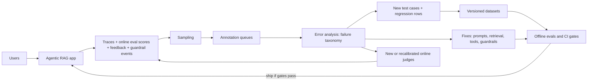
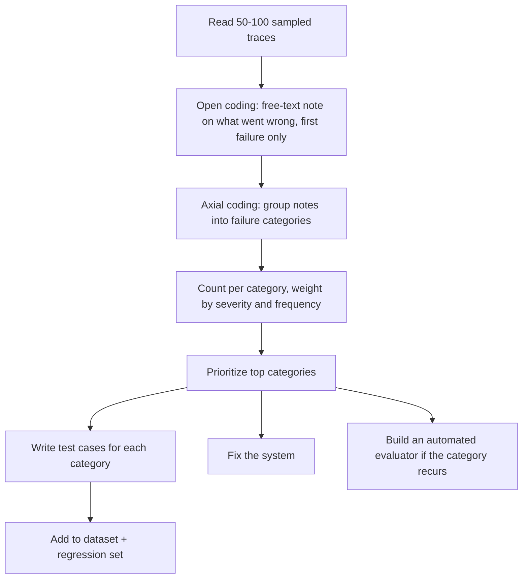
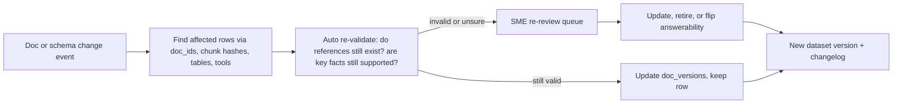

# The Production Data Flywheel

> **TL;DR** — After launch, your best eval data comes from your own traffic. Sample production traces deliberately (random for unbiased estimates; targeted for finding failures), route them through annotation queues, run error analysis to turn failures into new test cases and regression rows, and version everything. Do it safely (PII scrubbing, consent, access control) and keep it healthy (refresh on document drift, guard against contamination, assign owners).

**You'll learn:** how traces become eval rows · sampling strategies and budget allocation · annotation queue design · error analysis → test cases · regression set growth · dataset versioning · PII scrubbing and consent · keeping datasets fresh as docs change · contamination risks · ownership  ·  **Prerequisites:** [Dataset strategy](./01-dataset-strategy.md), [Observability & tracing](../03-online-evals-and-observability/02-observability-and-tracing.md)  ·  **Related:** [Online evals](../03-online-evals-and-observability/01-online-evals.md), [User feedback & implicit signals](../03-online-evals-and-observability/03-user-feedback-and-implicit-signals.md), [Monitoring, alerting & drift](../03-online-evals-and-observability/04-monitoring-alerting-and-drift.md), [SME golden datasets](./02-sme-golden-datasets.md), [Implementation playbook](../05-decision-framework/04-implementation-playbook.md)

---

## 1. The data flywheel



Each turn of the loop makes three things better: the **product** (fixes), the **offline datasets** (new rows that reflect reality), and the **online monitors** (judges for newly discovered failure modes). Teams that skip the loop end up with an eval suite that measures the product as it was imagined before launch.

### 1.1 Prerequisite: traces rich enough to become test cases

A trace can only become an eval row if it captured what the row needs. Log at least:

| Field | Needed for |
|---|---|
| User input (all turns), timestamp, session id | Inputs for every eval type |
| **User role / permissions snapshot** | RBAC tests; reproducing access decisions |
| Retrieved chunk ids **+ doc versions** + scores | Retrieval rows; freezing context; drift detection |
| Tool calls (name, args, results, errors) | Tool-call and trajectory rows |
| Generated SQL, execution result/row count, errors, DB snapshot/version | Text-to-SQL rows |
| Final answer + citations | Output-based labels |
| Guardrail decisions (which check, score, block/allow) | Guardrail eval rows (TP/FP review) |
| Online eval scores (judges, deterministic checks) | Uncertainty / low-score sampling |
| User feedback (explicit + implicit) | Negative-feedback sampling |
| App version (prompt, model, index, config hashes) | Attribution; comparing before/after |

See [Observability & tracing](../03-online-evals-and-observability/02-observability-and-tracing.md) for instrumentation details.

---

## 2. Sampling strategies

You can't label everything. **How** you sample determines what you learn.

| Strategy | Selects | Good for | Bias / caveat |
|---|---|---|---|
| **Uniform random** | Any trace with equal probability | **Unbiased** estimates of quality and failure prevalence; discovering unknown unknowns | Rare slices barely appear; most samples are "fine" |
| **Stratified** | Random within strata (intent, role, language, pipeline: RAG/SQL/tool) with per-stratum quotas | Coverage of rare-but-important slices; per-slice estimates | Must re-weight to estimate global rates |
| **Uncertainty / low-score** | Low online judge scores, judge disagreement, low retrieval similarity, borderline guardrail scores | Finding failures efficiently | Over-represents hard cases; depends on judge quality |
| **Negative feedback** | Thumbs-down, "regenerate", rephrased follow-ups, escalation to human, abandoned sessions | High failure yield; user-validated problems | Feedback is sparse and skewed (some users never click) — see [User feedback](../03-online-evals-and-observability/03-user-feedback-and-implicit-signals.md) |
| **Guardrail triggers** | Blocked/flagged inputs and outputs | Reviewing false positives (blocked legit work) and true positives (attack examples) | Doesn't show false negatives (misses) — combine with random sampling of *allowed* traffic |
| **Error / anomaly signals** | Tool errors, SQL errors, empty results, timeouts, retries, max-step hits, very long trajectories | Agent and SQL failures | Biased toward loud failures; silent wrong answers are missed |
| **Novelty / clustering** | Queries far from existing dataset clusters; new topic clusters | Detecting new intents and drift | Needs embedding/cluster infra |
| **Diff-based** | Traces where a new candidate version would answer differently (shadow/replay) | Pre-release risk review | Requires replay infra |

### 2.1 The most important caveat

> **Only random (or properly re-weighted stratified) samples estimate how often something happens.** Targeted samples (low-score, negative feedback, guardrail triggers) are for *finding* failures, not *measuring* their rate. Never report "35% of answers are wrong" from a thumbs-down sample.

Keep two pools:

- **Measurement pool** — random/stratified with known weights → tracks true quality over time.
- **Discovery pool** — targeted → feeds error analysis and new test cases.

### 2.2 Example weekly budget allocation

For an annotation budget of ~200 traces/week (heuristic split; tune to your failure yield):

| Pool | Share | Count | Notes |
|---|---|---|---|
| Uniform random | 30% | 60 | Measurement; keep the method fixed across weeks |
| Stratified quotas | 20% | 40 | E.g. ≥5 per language, ≥10 SQL, ≥10 tool actions, ≥5 privileged roles |
| Negative feedback | 20% | 40 | All, if fewer |
| Low online-eval score / judge disagreement | 15% | 30 | |
| Guardrail triggers | 10% | 20 | Half blocks (FP review), half near-threshold allows (FN hunting) |
| Errors / anomalies | 5% | 10 | Tool/SQL errors, max-steps |

```python
import random
from collections import defaultdict

def weekly_sample(traces, budget=200, seed=None):
    rng = random.Random(seed)
    picked, seen = [], set()

    def take(pool, k, reason):
        pool = [t for t in pool if t.id not in seen]
        for t in rng.sample(pool, min(k, len(pool))):
            seen.add(t.id)
            picked.append((t, reason))

    take(traces, int(0.30 * budget), "random")
    by_stratum = defaultdict(list)
    for t in traces:
        by_stratum[(t.pipeline, t.language, t.user_role)].append(t)
    per = max(1, int(0.20 * budget) // max(1, len(by_stratum)))
    for key, pool in by_stratum.items():
        take(pool, per, f"stratified:{key}")
    take([t for t in traces if t.feedback == "negative" or t.escalated], int(0.20 * budget), "neg_feedback")
    take([t for t in traces if t.online_score is not None and t.online_score < 0.5], int(0.15 * budget), "low_score")
    take([t for t in traces if t.guardrail_events], int(0.10 * budget), "guardrail")
    take([t for t in traces if t.tool_errors or t.sql_error or t.hit_max_steps], int(0.05 * budget), "error")
    return picked   # keep `reason` — it determines whether a label can be used for measurement
```

### 2.3 Sampling conversations and agent runs

- Sample **sessions**, not just single turns, for multi-turn issues (context loss, repeated clarifications).
- For agents, sample **whole trajectories**; annotators need every step (tool calls, intermediate results) to find the first point of failure.
- Deduplicate near-identical queries before sampling (popular questions otherwise dominate random samples) — but keep their frequency as metadata; frequency matters for prioritization.

---

## 3. Annotation queues

An **annotation queue** is a work list of traces routed to the right reviewers with a consistent labeling form. Several observability platforms provide them natively (e.g. [LangSmith annotation queues](https://docs.smith.langchain.com/evaluation/how_to_guides/annotation_queues), [Langfuse annotation queues](https://langfuse.com/docs/scores/annotation)); a spreadsheet or a small custom app also works (see [SME golden datasets](./02-sme-golden-datasets.md#9-labeling-tools)).

### 3.1 Queue design

| Queue | Routed traces | Reviewer | Labels captured |
|---|---|---|---|
| **General quality** | Random + stratified | Product/eval team, trained annotators | Pass/fail per criterion, failure category, free-text note |
| **Domain correctness** | HR/finance/legal answers flagged as risky or low-score | Domain SMEs | Correct? corrected answer, key facts, supporting docs |
| **SQL** | Text-to-SQL traces with errors, empty results, low score | Data team | Correct SQL? gold SQL, result validity |
| **Agent actions** | Tool-using trajectories, especially write actions | Eng/ops owners | Success? first failing step, policy violations |
| **Safety & guardrails** | Guardrail blocks/near-threshold allows, reported abuse | Security/trust & safety | TP/FP/FN, attack category, severity |
| **Access control** | Traces involving restricted resources | Security + data owners | Correct decision? leaked info? |

### 3.2 Labeling form (minimal and fast)

```json
{
  "trace_id": "tr_9f2c...",
  "queue": "general_quality",
  "sample_reason": "random",
  "labels": {
    "overall": "fail",
    "criteria": {"correct": "fail", "grounded": "pass", "complete": "fail", "cited": "pass", "policy": "pass"},
    "failure_category": "retrieval_missed_relevant_doc",
    "first_failing_step": "retrieve",
    "note": "Answered with US policy; user is in Germany and EMEA doc exists (fin-travel-emea#c12)."
  },
  "actions": {"add_to_dataset": "rag_qa_v7", "propose_reference": "...", "needs_sme": false},
  "annotator": "ann-04",
  "labeled_at": "2026-10-12T09:31:00Z"
}
```

### 3.3 Queue hygiene

- [ ] Every item carries `sample_reason` (measurement vs discovery).
- [ ] Reviewers see the **full trace**: input, retrieved chunks (with doc versions), tool calls, SQL + results, final answer, guardrail events.
- [ ] One-click **"add to dataset"** with the corrected expected output.
- [ ] Overlap a small share between annotators to monitor agreement (see [SME golden datasets](./02-sme-golden-datasets.md#7-inter-annotator-agreement-iaa)).
- [ ] SLA for high-severity items (e.g. data leakage reports reviewed within one business day).
- [ ] Queue size bounded — a queue that grows forever is a queue nobody reads.

---

## 4. Error analysis → new test cases

Error analysis is the highest-leverage activity in the flywheel: read traces, name the failures, count them, fix the biggest, and freeze examples as tests. The approach advocated by Hamel Husain and Shreya Shankar borrows from qualitative research:



### 4.1 Example failure taxonomy (enterprise assistant, one week)

| Failure category | Count (of 120 failing traces) | Severity | Action |
|---|---|---|---|
| Retrieved wrong region's policy | 31 | High | Add region metadata filter; add 15 region-specific rows |
| Aggregation question answered by RAG instead of SQL | 18 | Medium | Router fix; add 10 routing rows |
| SQL used wrong revenue definition | 12 | High | Add glossary to prompt; add 8 SQL rows with `evidence` |
| Didn't abstain on uncovered question | 11 | High | Prompt fix; add 10 unanswerable rows |
| Ticket created with wrong priority | 9 | Low | Arg description fix; add 5 tool rows |
| Over-blocked legitimate security question | 6 | Medium | Guardrail threshold; add 6 should-allow rows |

*(Illustrative numbers for the running example, not measured data.)*

### 4.2 Converting a trace into a test case

What to freeze depends on what you want to test:

| You want to test… | Freeze | Leave live |
|---|---|---|
| Full E2E behavior | Input, user role, expected output/behavior | Retrieval, generation, tools |
| Generation only (isolate from retrieval) | Input + the retrieved contexts from the trace (or corrected contexts) | Generation |
| Retrieval only | Query + labeled relevant chunk ids | Retriever |
| A specific agent step | Conversation + tool results up to that step | Next decision |
| SQL | Question + DB snapshot id + gold SQL/result | SQL generation |

```python
def trace_to_rag_row(trace, label, dataset_version):
    return {
        "id": f"prod-{trace.id}",
        "question": scrub_pii(trace.user_input),                 # §7
        "user_role": trace.user_role,
        "reference_answer": label.corrected_answer,
        "key_facts": label.key_facts,
        "reference_contexts": label.supporting_chunk_ids or [],
        "answerable": label.answerable,
        "expected_behavior": label.expected_behavior,           # e.g. "answer", "abstain", "refuse"
        "metadata": {
            "source": "production",
            "sample_reason": label.sample_reason,
            "failure_category": label.failure_category,
            "label_tier": "gold" if label.by_sme else "silver",
            "doc_versions": {c.doc_id: c.doc_version for c in trace.retrieved},
            "app_version_at_capture": trace.app_version,
            "added_in": dataset_version,
        },
    }
```

**Generalize, don't just copy.** One production failure usually indicates a class of failures. For each category, add the real trace **plus** a few variants (paraphrases, other regions/roles/languages) — synthetic generation helps here (see [Synthetic datasets](./03-synthetic-datasets.md#6-query-evolution-and-edge-case-generation)).

---

## 5. Growing the regression set

A **regression set** contains examples of bugs you've fixed. It answers one question: *did we re-break something?*

Rules of thumb:

- [ ] **Every fixed bug adds at least one row** (the original trace) and ideally a few variants — before the fix is merged, so the test fails first and passes after.
- [ ] Rows have a link to the issue/incident and the failure category.
- [ ] Regression rows are **expected to pass ~100%**; any failure blocks the release or requires an explicit waiver.
- [ ] Keep it **separate** from the representative/measurement dataset. Mixing them skews headline metrics toward past failures.
- [ ] Use **deterministic checks** where possible (exact tool call, SQL result match, must-contain fact, must-refuse) so the suite is fast and non-flaky.
- [ ] **Handle non-determinism**: run flaky rows k times and require a pass rate (e.g. ≥ 2/3) or fix the source of variance; quarantine flaky rows rather than ignoring red builds.
- [ ] **Prune**: dedupe rows that test the same thing; retire rows whose feature was removed; re-validate rows after doc changes (§8).

Growth pattern: regression sets grow fastest right after launch and then slow down. If yours keeps growing linearly, that's a signal the same categories keep recurring — fix root causes or add online monitors.

---

## 6. Dataset versioning

Scores are only comparable on the same dataset version. Treat datasets like code.

### 6.1 Options

| Approach | How | Good for | Watch-outs |
|---|---|---|---|
| **Git (JSONL/CSV/Parquet in repo)** | Datasets next to the eval code; PR review for changes | Small/medium text datasets; review workflow; diffs | Repo bloat for large files; sensitive data in git history is hard to remove |
| **[DVC](https://dvc.org/)** or similar data-versioning tools | Git tracks pointers; data in object storage | Large datasets, DB snapshots, binary files | Extra tooling |
| **Eval/observability platform datasets** (e.g. [LangSmith datasets](https://docs.smith.langchain.com/evaluation/concepts), [Langfuse datasets](https://langfuse.com/docs/datasets/overview), Arize Phoenix, Braintrust) | Datasets live in the platform; traces added from UI/API; experiments linked to dataset versions | Tight trace → dataset → experiment loop; non-engineers can contribute | Export regularly to your own storage; check platform versioning semantics; data residency |
| **Data warehouse tables** | Versioned tables/snapshots | Very large production-derived sets; SQL-based slicing | Needs discipline around immutability |

A pragmatic combination: **platform datasets for the working loop** (annotation → dataset), **periodic immutable exports to git/DVC** with a version tag used by CI.

### 6.2 Versioning conventions

```text
datasets/
  rag_qa/
    v7/               # immutable once tagged
      data.jsonl
      CHANGELOG.md    # what changed and why
      manifest.json   # counts per slice/source/tier, schema version, doc snapshot, hash
  regression/
    v23/data.jsonl
```

```json
{
  "dataset": "rag_qa",
  "version": "v7",
  "schema_version": "2",
  "created_at": "2026-10-13",
  "row_count": 412,
  "by_source": {"sme": 120, "production": 190, "synthetic": 82, "adversarial": 20},
  "by_tier": {"gold": 210, "silver": 202},
  "corpus_snapshot": "kb-2026-10-10",
  "db_snapshot": "warehouse_finance_v12",
  "sha256": "<content hash>",
  "parent": "v6",
  "changes": {"added": 46, "removed": 9, "relabeled": 14}
}
```

- **Semantic-ish versioning**: bump when rows are added/removed/relabeled; never edit a tagged version in place.
- **Record the dataset version with every experiment result**; when the dataset changes, re-run the baseline on the new version before comparing.
- **Stable row ids** across versions so you can track per-row history ("this row has failed since v5").
- **Changelog**: why rows were added (incident #, failure category) or removed (doc retired, ambiguous).

---

## 7. PII scrubbing, consent, and compliance

Production traces contain personal data, confidential business data, and sometimes content the annotator isn't authorized to see. Moving them into eval datasets is a new data processing purpose — handle it deliberately.

> This section is engineering guidance, not legal advice. Involve your privacy, security, and legal teams before using production data for evals.

### 7.1 Checklist

- [ ] **Legal basis / consent**: confirm that terms of use, employee notices, or customer contracts allow using interaction data for quality evaluation; honor opt-outs (exclude opted-out users at sampling time).
- [ ] **Data minimization**: copy only fields the eval needs; drop raw identifiers (user ids → stable pseudonyms if needed for session grouping).
- [ ] **PII detection and scrubbing** on user inputs, retrieved contexts, tool results, SQL results, and outputs — not just the user message. Tools like [Microsoft Presidio](https://microsoft.github.io/presidio/) detect and anonymize common entity types; add custom recognizers for internal ids (employee numbers, ticket ids if sensitive).
- [ ] **Consistent pseudonymization**: replace "Jane Doe" with the same placeholder throughout a row (`<PERSON_1>`) so coreference and multi-turn context still make sense.
- [ ] **Preserve test semantics**: scrubbing can break the test (e.g. a question about "Jane's manager" becomes unanswerable). Review scrubbed rows; replace with realistic synthetic values instead of tags where the value matters.
- [ ] **Access control on datasets**: eval datasets inherit the sensitivity of their sources. A dataset built from `hr_admin` traces contains compensation data — restrict it like the source (see [Access control & RBAC](../04-guardrails/06-access-control-rbac.md)).
- [ ] **Annotator authorization**: route restricted-content traces only to reviewers allowed to see them.
- [ ] **Retention and deletion**: define retention for eval data; support deletion requests (row ids traceable back to source users/sessions through a protected mapping, or full anonymization so no mapping exists).
- [ ] **Data residency**: check where your eval platform and LLM judges process data.
- [ ] **No secrets in datasets**: scan for API keys/tokens that users pasted into prompts.

```python
# illustrative — check current Presidio API
from presidio_analyzer import AnalyzerEngine
from presidio_anonymizer import AnonymizerEngine

analyzer, anonymizer = AnalyzerEngine(), AnonymizerEngine()

def scrub_pii(text: str) -> str:
    results = analyzer.analyze(text=text, language="en")
    return anonymizer.anonymize(text=text, analyzer_results=results).text
```

Automatic scrubbing misses things (names in unusual formats, context-identifying details like "the only VP in the Lisbon office"). Spot-check scrubbed rows, especially before sharing datasets beyond the core team.

---

## 8. Keeping datasets fresh (docs drift)

In RAG, the ground truth lives in documents that change. A golden answer that was right in March can be wrong in October — and your eval will then penalize the correct system or reward the stale one.

### 8.1 Types of drift that break datasets

| Drift | Example | Effect on dataset |
|---|---|---|
| **Content drift** | Hotel cap raised from GBP 250 to 275 | Reference answers and key facts become wrong |
| **Structural drift** | Docs re-chunked, re-parsed, or moved | `reference_contexts` / `relevant_doc_ids` point to non-existent chunks |
| **Coverage drift** | New policy published for contractors | "Unanswerable" rows become answerable |
| **Schema drift** | Warehouse column renamed, table split | Gold SQL fails; expected results change |
| **Data drift** | Warehouse data refreshed nightly | `expected_result` no longer matches live DB |
| **Tool drift** | Tool API adds/renames parameters | Expected tool calls invalid |
| **Query drift** | Users start asking about a new product | Dataset no longer represents traffic (see [Monitoring & drift](../03-online-evals-and-observability/04-monitoring-alerting-and-drift.md)) |
| **Policy drift** | New role gets access to finance data | RBAC expectations wrong |

### 8.2 Mechanisms



- **Store provenance per row**: `doc_versions`, chunk content hashes, `db_snapshot`, tool schema version.
- **Hook into ingestion**: when a document is added/updated/deleted, compute the set of affected rows (by doc id and by retrieval of the new content against existing questions — new docs may answer old "unanswerable" rows).
- **Auto re-validation** (LLM check): "Given the new document text, are these key facts still supported? Answer per fact: supported / contradicted / missing." Route contradicted/missing to SMEs.
- **Stable chunk identity**: key reference contexts by doc id + content hash or char offsets, not by positional chunk index, so re-chunking doesn't invalidate everything. For retrieval metrics, map labels from old to new chunks by overlap.
- **Freeze SQL environments**: evaluate against versioned DB snapshots; refresh snapshot and `expected_result` together; run all gold SQL nightly to detect schema drift early.
- **Time-anchored questions**: phrase rows with explicit dates where possible ("in Q2 2026") instead of relative time ("last quarter") unless relative time is what you're testing — then compute expected results relative to a fixed `as_of` date.
- **Retire deliberately**: removed features and deleted docs → retire rows with a changelog entry rather than letting them fail forever.
- **Refresh the representative sample**: periodically (e.g. quarterly, heuristic) re-sample production to keep the measurement set aligned with current traffic; keep older sets for longitudinal comparison.

---

## 9. Contamination and overfitting to the eval set

If information from the eval set leaks into the system, scores go up without the product getting better.

| Contamination path | Example | Mitigation |
|---|---|---|
| **Few-shot / prompt leakage** | Golden Q&A pasted into the system prompt as examples | Few-shot pool and eval set are disjoint by construction; check prompts for eval ids/text hashes in CI |
| **Fine-tuning on production traces** | Traces labeled for eval also go into a fine-tuning or embedding-tuning set | Hash-based dedup (exact + near-duplicate) between training and eval data; assign each trace to train *or* eval at sampling time |
| **Index leakage** | An "eval answers" doc or a Q&A wiki page derived from the eval set gets indexed | Exclude eval artifacts from ingestion; monitor retrieved doc ids during evals |
| **Router/classifier training** | Intent classifier trained on the same queries used to evaluate routing | Separate splits |
| **Judge leakage** | Judge few-shot examples drawn from the test split | Separate judge-calibration split |
| **Developer overfitting** | Prompt tuned for weeks against the same 50 dev rows | Held-out test split run rarely; rotate in fresh production samples |
| **Foundation-model contamination** | Public benchmarks (e.g. Spider) likely appear in pretraining data | Don't rely on public benchmarks for decisions about your app; use private, recent data |

Practical safeguards:

- [ ] **Split at sampling time** (train / dev / test), grouped by session or user so near-duplicates don't straddle splits.
- [ ] **Time-based test sets**: a test set built from traffic after a cutoff date is naturally free of anything that existed when the system was tuned.
- [ ] **Canary markers**: include a unique canary string in eval dataset files so you can detect if they show up in training data or indexes.
- [ ] **Overlap checks in CI**: n-gram/embedding similarity between eval inputs and prompt/few-shot/training files.
- [ ] **Watch for dev–test gaps**: if dev keeps improving and test doesn't, you're overfitting the dev set.

---

## 10. Ownership and governance

Datasets without owners rot. Assign responsibility explicitly.

| Asset | Owner (typical) | Responsibilities |
|---|---|---|
| Eval dataset program overall | AI/ML engineering lead or eval owner | Schemas, tooling, versioning, CI integration, budgets |
| Domain golden sets (HR, finance, IT) | Domain SME lead per area | Correctness of references; re-review after policy changes |
| SQL datasets & DB snapshots | Data/analytics engineering | Gold SQL, business definitions, snapshot refresh |
| Guardrail & red-team sets | Security / trust & safety | Attack coverage, severity labels, refresh with new techniques |
| RBAC test matrix | Security + data owners | Role × resource expectations match the actual policy |
| Production sampling & annotation queues | Product + eval owner | Sampling plan, queue health, annotator guidelines |
| Privacy controls | Privacy/legal + platform | Consent, scrubbing, retention, access |

Governance practices:

- [ ] **Dataset README per dataset**: purpose, schema, sources, slices, label tiers, owner, update cadence, known limitations.
- [ ] **Change review**: dataset changes go through PR (or platform review) — relabeling a gold row is a product decision.
- [ ] **Cadence**: weekly sampling + error analysis; monthly dataset release; quarterly coverage review against traffic (heuristics — adjust to traffic volume and risk).
- [ ] **Health metrics**: rows per slice, share of stale rows (doc versions older than current), share of gold vs silver, age distribution, regression pass rate, annotation backlog.
- [ ] **Link to incidents**: every production incident review asks "which eval row would have caught this?" — and adds it.

---

## 11. Putting it together: a weekly cadence

| Day | Activity | Output |
|---|---|---|
| Mon | Run sampling job (§2); populate queues | ~200 traces in queues |
| Tue–Wed | Annotation; SME queues for domain items | Labels, corrected references |
| Thu | Error analysis session (60–90 min) on failures | Updated failure taxonomy with counts |
| Thu | Convert top categories to test cases; regression rows for fixed bugs | Dataset PR |
| Fri | Merge dataset PR → new version; re-run baseline; update dashboards | Comparable scores; next week's priorities |
| Continuous | Doc-change hooks flag affected rows; nightly gold-SQL validation | Freshness queue |

Start lighter (e.g. 50 traces every two weeks) and scale with traffic and team capacity — consistency matters more than volume.

---

## Key takeaways

- Production traces are the best source of realistic eval data — but only if traces capture role, retrieved chunk ids + versions, tool calls, SQL, guardrail events, and app version.
- Keep two pools: random/stratified samples to **measure** quality, targeted samples (low scores, negative feedback, guardrail triggers, errors) to **discover** failures. Don't estimate rates from targeted samples.
- Annotation queues route traces to the right reviewers with a minimal, consistent form and one-click "add to dataset".
- Error analysis (open coding → categories → counts → priorities) turns failures into fixes, new test cases, and new online judges; generalize each failure into a few variants.
- Every fixed bug becomes a regression row; keep regression sets separate, deterministic where possible, and pruned.
- Version datasets immutably with manifests and changelogs; record dataset version with every experiment.
- Scrub PII across inputs, contexts, tool/SQL results, and outputs; respect consent; restrict dataset access to match source sensitivity.
- Documents, schemas, and tools drift — store provenance per row, hook into ingestion, auto re-validate, and route to SMEs.
- Prevent contamination (prompts, fine-tuning, index, judges, dev-set overfitting) and give every dataset a named owner.

## Further reading

- Hamel Husain — [A Field Guide to Rapidly Improving AI Products](https://hamel.dev/blog/posts/field-guide/) and [Your AI Product Needs Evals](https://hamel.dev/blog/posts/evals/) (error analysis, data viewers, looking at your data)
- Hamel Husain & Shreya Shankar — [LLM Evals FAQ](https://hamel.dev/blog/posts/evals-faq/) (open/axial coding, sampling traces)
- Shankar et al. — [Who Validates the Validators?](https://arxiv.org/abs/2404.12272) (criteria drift as you review outputs)
- Jason Liu — [Systematically Improving Your RAG](https://jxnl.co/writing/2024/05/22/systematically-improving-your-rag/) (segmenting queries, using feedback and synthetic data to improve retrieval)
- Eugene Yan — [Task-Specific LLM Evals that Do & Don't Work](https://eugeneyan.com/writing/evals/)
- Platform docs — [LangSmith evaluation concepts & datasets](https://docs.smith.langchain.com/evaluation/concepts) · [LangSmith annotation queues](https://docs.smith.langchain.com/evaluation/how_to_guides/annotation_queues) · [Langfuse datasets](https://langfuse.com/docs/datasets/overview) · [Langfuse annotation](https://langfuse.com/docs/scores/annotation)
- [DVC](https://dvc.org/) — data versioning
- [Microsoft Presidio](https://microsoft.github.io/presidio/) — PII detection and anonymization
- Within this repo: [Online evals](../03-online-evals-and-observability/01-online-evals.md) · [Observability & tracing](../03-online-evals-and-observability/02-observability-and-tracing.md) · [User feedback](../03-online-evals-and-observability/03-user-feedback-and-implicit-signals.md) · [Monitoring & drift](../03-online-evals-and-observability/04-monitoring-alerting-and-drift.md) · [Running offline experiments](../02-offline-evals/08-running-offline-experiments.md) · [Maturity model](../05-decision-framework/05-maturity-model.md)
