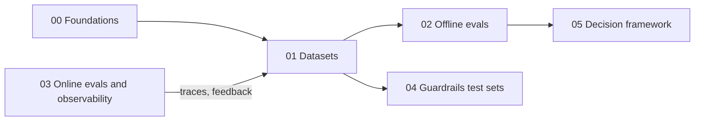

# 01 · Datasets

> **TL;DR**
> - **Design your dataset before your metrics.** Offline evals are only as trustworthy as the inputs and reference labels they run on.
> - **Anchor with SME golden data.** Build 20–50 human-verified examples for release gates and LLM-judge calibration.
> - **Scale with filtered synthetic rows.** Generate synthetic queries, multi-hop chains, and red-team attacks, then filter out low-quality rows.
> - **Close the loop from production.** Feed real production failures and user feedback back into your dataset every week.

---

## Guides in this section

| Guide | What you will learn | Read this when… |
|---|---|---|
| [01 · Dataset Strategy](./01-dataset-strategy.md) | Why datasets come first, the five dataset sources, JSON schemas for all 8 eval types, slice coverage, and sample-size math | You are starting an eval project, choosing what fields to store, or deciding how many examples you need |
| [02 · SME Golden Datasets](./02-sme-golden-datasets.md) | Working with domain experts, writing binary rubrics, reference answers vs. key facts, unanswerable questions, and Cohen's κ / Krippendorff's α | You need trustworthy reference data for release gates or LLM-judge calibration |
| [03 · Synthetic Datasets](./03-synthetic-datasets.md) | Generating QA pairs, multi-hop questions, tool calls, SQL queries, and red-team attacks—plus automatic quality filters | You have no live traffic yet, need to fill rare slices, or need volume for guardrail tests |
| [04 · Production Data Flywheel](./04-production-data-flywheel.md) | Sampling live traces, running annotation queues, turning errors into regression tests, scrubbing PII, and handling document drift | Your system has live users and you want your datasets to reflect real traffic |

---

## Recommended reading order

1. **Read [01 · Dataset Strategy](./01-dataset-strategy.md) first.** It defines the JSON schemas, slice dimensions, and sample-size rules used across the repository.
2. **Read [02 · SME Golden Datasets](./02-sme-golden-datasets.md) second.** Build a small, trusted anchor set of 20–50 rows before scaling up.
3. **Read [03 · Synthetic Datasets](./03-synthetic-datasets.md) third.** Expand coverage across rare slices and validate synthetic rows against your golden set.
4. **Read [04 · Production Data Flywheel](./04-production-data-flywheel.md) fourth.** Once you launch, feed real production failures back into your dataset every week.

### Quick shortcuts by goal

- **"I need a working eval dataset by Friday."** Read [Dataset Strategy §3](./01-dataset-strategy.md#3-matching-dataset-shape-to-eval-type) for the JSON schemas and [§6](./01-dataset-strategy.md#6-what-to-do-first) for the day-one checklist. Then follow [Synthetic Datasets §2–4](./03-synthetic-datasets.md#2-a-practical-generation-pipeline).
- **"I am testing guardrails and RBAC."** Read [Dataset Strategy §3.8](./01-dataset-strategy.md#38-guardrail-test-sets), then [Synthetic Datasets §8](./03-synthetic-datasets.md#8-synthetic-guardrail-and-red-team-test-cases).
- **"Our offline scores look great, but users still complain."** Read [Production Data Flywheel §2](./04-production-data-flywheel.md#2-sampling-strategies) and [§4](./04-production-data-flywheel.md#4-error-analysis--new-test-cases), then check [Synthetic Datasets §11](./03-synthetic-datasets.md#11-risks).

---

## How this section connects to the rest of the repo

- **Metrics that run on these datasets:** [02 · Offline Evals](../02-offline-evals/README.md)
- **Live traces and feedback that feed these datasets:** [03 · Online Evals & Observability](../03-online-evals-and-observability/README.md)
- **Guardrails tested by these datasets:** [04 · Guardrails](../04-guardrails/README.md)
- **Step-by-step rollout plan:** [Implementation Playbook](../05-decision-framework/04-implementation-playbook.md)
- **Annotation and synthesis tools:** [06 · Tooling Landscape](../06-tooling-landscape/README.md)
