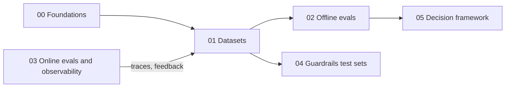

# 01 · Datasets

Offline evals run on datasets, and the dataset decides what an eval can see: which inputs are tested, what "correct" means, which metrics you can compute, and how far you can trust a score. This section covers how to design, build, label, grow, and maintain eval datasets for agentic RAG applications (RAG chatbots, tool-calling agents, text-to-SQL agents, multi-step agents), plus test sets for guardrails such as RBAC and prompt-injection checks.

The running example is an internal enterprise assistant. It answers questions over company documents, queries a data warehouse through text-to-SQL, can call tools (for example, to create a ticket), and serves users who have different roles.

## Files in this section

| File | What it covers | Read when… |
|---|---|---|
| [01 · Dataset strategy](./01-dataset-strategy.md) | Why datasets come first; the five dataset sources (SME/golden, synthetic, production, adversarial, regression); **JSON schemas per eval type** (RAG QA, retrieval, tool call, trajectory, text-to-SQL, multi-turn, guardrail/RBAC, citation); coverage design with slices and dimensions/tuples; sizing, confidence intervals, and paired significance tests | You're starting an eval effort, choosing what fields to collect, or deciding how many examples you need |
| [02 · SME golden datasets](./02-sme-golden-datasets.md) | Working with subject-matter experts; annotation guidelines; binary rubrics; reference answers vs key-facts lists; unanswerable questions; inter-annotator agreement (Cohen's κ, Krippendorff's α, worked examples); adjudication; labeling tools; cost/time; pitfalls | You need trustworthy ground truth for release gates or to calibrate LLM judges |
| [03 · Synthetic datasets](./03-synthetic-datasets.md) | Generation pipeline; dimensions → tuples → scenarios → queries; QA from chunks; knowledge-graph generation (RAGAS); query evolution (Evol-Instruct, DeepEval Synthesizer); edge cases; tool-call and text-to-SQL synthesis (back-translation, execution validation); guardrail/red-team variants; multi-turn persona simulation; quality filters; risks | You have no data yet, need to fill rare slices, or need volume for guardrail tests |
| [04 · Production data flywheel](./04-production-data-flywheel.md) | Turning traces into eval data: sampling strategies (measurement vs discovery), annotation queues, error analysis → test cases, regression sets, dataset versioning, PII scrubbing and consent, keeping datasets fresh under document/schema drift, contamination, ownership | Your app has users and you want evals that match real traffic and improve every week |

## Suggested reading order

1. **[Dataset strategy](./01-dataset-strategy.md)**: read this first. It gives you the vocabulary, the schemas, and the sizing rules that the other files rely on.
2. **[SME golden datasets](./02-sme-golden-datasets.md)**: build a small, high-quality anchor set of 20–50 rows, then grow it to a few hundred.
3. **[Synthetic datasets](./03-synthetic-datasets.md)**: expand coverage cheaply and validate the synthetic rows against the golden set.
4. **[Production data flywheel](./04-production-data-flywheel.md)**: after launch, let real traffic drive dataset growth.

**Shortcut paths:**

- *"I need an eval set by Friday."* Read [Dataset strategy §3](./01-dataset-strategy.md#3-matching-dataset-shape-to-eval-type) for the schemas and [§6](./01-dataset-strategy.md#6-what-to-do-first) for the checklist, then [Synthetic datasets §2–4](./03-synthetic-datasets.md#2-a-practical-generation-pipeline).
- *"I'm testing guardrails and RBAC."* Read [Dataset strategy §3.8](./01-dataset-strategy.md#38-guardrail-test-sets), then [Synthetic datasets §8](./03-synthetic-datasets.md#8-synthetic-guardrail-and-red-team-test-cases).
- *"Our scores look great but users complain."* Read [Production data flywheel §2](./04-production-data-flywheel.md#2-sampling-strategies) and [§4](./04-production-data-flywheel.md#4-error-analysis--new-test-cases), then [Synthetic datasets §11](./03-synthetic-datasets.md#11-risks).

## How this section connects to the rest

- Metrics that consume these datasets: [02 · Offline evals](../02-offline-evals/README.md)
- Production traces and feedback that feed these datasets: [03 · Online evals & observability](../03-online-evals-and-observability/README.md)
- Guardrails these test sets validate: [04 · Guardrails](../04-guardrails/README.md)
- Which datasets to build first: [Implementation playbook](../05-decision-framework/04-implementation-playbook.md)
- Tools for datasets, annotation, and synthesis: [06 · Tooling landscape](../06-tooling-landscape/README.md)
