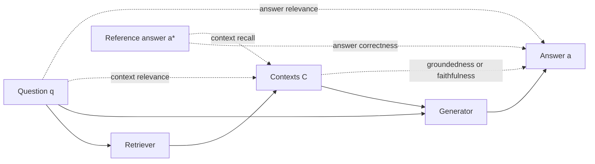
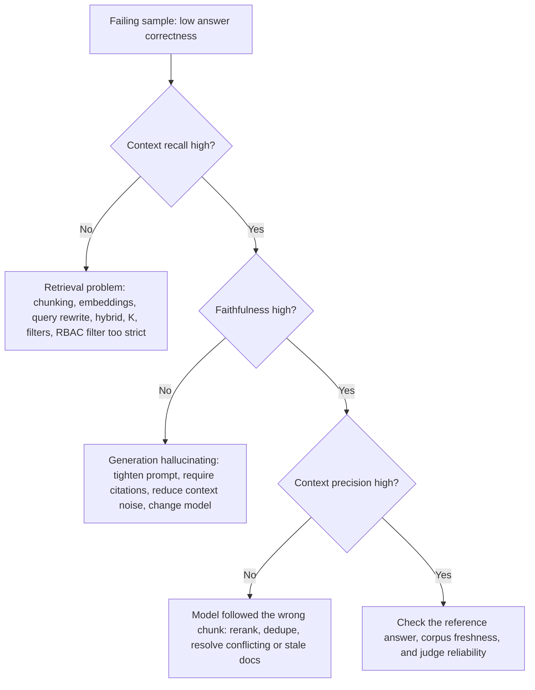

# End-to-End RAG Evals

> **TL;DR**
> - **Start with the RAG triad.** Measure context relevance, groundedness, and answer relevance without any ground-truth labels.
> - **Add reference-based metrics for truth.** Use answer correctness and context recall on a golden dataset to verify factual accuracy.
> - **Evaluate abstention on unanswerable queries.** Measure both missed abstentions and false refusals on out-of-scope or restricted questions.
> - **Diagnose failures with the 2×2 matrix.** Cross-reference context recall and faithfulness to isolate retrieval bugs from generation bugs.

**You will learn:** The RAG triad and RAGAS-style metrics · Abstention evaluation · Scorecard design · Retrieval × generation 2×2 diagnosis  
**Prerequisites:** [Why evals and guardrails](../00-foundations/01-why-evals-and-guardrails.md), [Agentic RAG failure modes](../00-foundations/03-agentic-rag-failure-modes.md), [Dataset strategy](../01-datasets/01-dataset-strategy.md)  
**Related:** [Retrieval metrics](./02-retrieval-metrics.md), [LLM-as-a-judge](./07-llm-as-a-judge.md), [Citation adherence](./06-instruction-and-citation-adherence.md)

---

## 1. The anatomy of a RAG sample

Every E2E RAG metric uses a subset of five core artefacts:

| Symbol | Name (RAGAS field name) | Produced by | Needed for |
|---|---|---|---|
| `q` | Question (`user_input`) | Dataset | All metrics |
| `C` | Retrieved contexts (`retrieved_contexts`) — ordered list of chunks | Your system | Faithfulness, context precision/relevance, context recall, noise sensitivity |
| `a` | Generated answer (`response`) | Your system | Faithfulness, answer relevancy, answer correctness |
| `a*` | Reference answer (`reference`) | Dataset (SME or synthetic) | Answer correctness, semantic similarity, context recall, context precision (with reference) |
| `C*` | Reference contexts / relevant chunk IDs | Dataset | Classic retrieval metrics ([02](./02-retrieval-metrics.md)), context entities recall |



### Reference-based vs reference-free

| Dimension | Reference-free | Reference-based |
|---|---|---|
| **Inputs needed** | `q`, `C`, `a` only | Also `a*` and/or `C*` |
| **Metrics** | Faithfulness/groundedness, answer relevancy, context relevance, context precision *without* reference / context utilization | Answer correctness, semantic similarity, context recall, context precision *with* reference, context entities recall, noise sensitivity, completeness |
| **Pros** | Runs on any traffic, including production samples, with zero labeling cost | Measures factual *correctness*, not just internal consistency |
| **Cons** | A fluent, grounded, on-topic answer can still be **wrong** if the retrieved doc is wrong, stale, or incomplete | Requires a golden or synthetic dataset, and references can grow stale |
| **Typical home** | Online evals and offline smoke tests | Offline regression suites and release gates |

**Recommendation:** Reference-free metrics are necessary, but they are not sufficient on their own. A faithfulness score of 1.0 only proves that the answer agrees with the retrieved context. Build a reference-based set of 50–100 SME questions to verify that your answers are factually right (see [SME golden datasets](../01-datasets/02-sme-golden-datasets.md)).

---

## 2. The RAG triad (TruLens)

TruLens introduced the **RAG triad**: three reference-free checks that cover each edge of the `q → C → a` triangle. When all three checks pass, your pipeline blocks the main hallucination paths.

| Edge | Metric | Question asked | Failure it catches |
|---|---|---|---|
| q → C | **Context relevance** | Is each retrieved chunk relevant to the question? | Retriever pulling noise that the LLM might weave into the answer |
| C → a | **Groundedness** | Does the context support every claim in the answer? | Hallucination or extrapolation beyond source documents |
| q → a | **Answer relevance** | Does the answer directly address the user's question? | Evasive, off-topic, or partial answers |

Framework terminology mapping:

| Concept | TruLens | RAGAS | DeepEval |
|---|---|---|---|
| q → C | Context relevance | Context precision (without reference) / Context relevance (Nvidia metrics) | Contextual relevancy |
| C → a | Groundedness | Faithfulness | Faithfulness |
| q → a | Answer relevance | Answer (response) relevancy | Answer relevancy |

Start with the RAG triad because it requires no ground-truth labels. Add reference-based metrics as soon as you build a golden dataset.

---

## 3. Metric cards

### 3.1 Faithfulness / groundedness

- **What it measures:** The fraction of claims in the answer that the retrieved context supports. This metric measures *support*, not factual truth.
- **Inputs required:** `q`, `a`, `C`. No ground truth required.
- **How to compute it:**
  1. **Decompose claims:** Prompt an LLM to split `a` into atomic, self-contained statements. Resolve all pronouns (for example, turn "It was founded in 2010" into "Acme was founded in 2010").
  2. **Verify claims:** Check whether `C` entails each claim. Use an LLM judge or a specialized NLI model such as a cross-encoder or Vectara's HHEM.
  3. **Aggregate the score:**
  ```text
  faithfulness = |claims supported by C| / |claims in a|
  ```
- **Score range & interpretation:** 0 to 1, where higher is better. A score of 1.0 means every claim traces back to the retrieved context.
- **Worked example:**
  - `q`: "How many days of parental leave do employees in India get?"
  - `C`: `["Employees in India are entitled to 26 weeks of paid maternity leave.", "Paternity leave in India is 10 working days."]`
  - `a`: "Mothers get 26 weeks of paid leave, fathers get 10 working days, and both can extend by 4 weeks unpaid."
  - Claims: (1) mothers get 26 weeks paid ✅, (2) fathers get 10 working days ✅, (3) both can extend 4 weeks unpaid ❌.
  - Result: **faithfulness = 2/3 ≈ 0.67**.
- **Pitfalls and gotchas:**
  - **Grounded does not mean correct.** If the retriever returns a superseded 2021 policy, a faithful answer is still factually wrong.
  - **Claim decomposition quality drives the score.** Long answers generate more claims and increase judge variance. Very short answers like "Yes." may produce zero claims. Track zero-claim answers separately as `None` rather than inflating your mean score.
  - **Common-knowledge claims may fail verification.** A strict judge marks "Paris is in France" as unsupported if the context omits it. Decide upfront whether your enterprise assistant may use parametric knowledge.
  - **Paraphrases and rounding confuse judges.** Expressions like "~26 weeks" or "six months" can trigger false negatives under strict entailment. Spot-check judge disagreements regularly.
- **When to use it:** Run faithfulness on every RAG answer as your primary reference-free hallucination check. If the answer uses tool outputs, include those tool outputs in `C` before scoring.
- **Implemented in:** RAGAS (`Faithfulness`), TruLens (groundedness), DeepEval (`FaithfulnessMetric`), Phoenix (hallucination eval), promptfoo (`context-faithfulness`).

```python
def faithfulness(claim_verdicts: list[bool]) -> float | None:
    """claim_verdicts[i] = True if claim i is entailed by the retrieved context."""
    if not claim_verdicts:
        return None  # track "no claims" separately rather than inflating the score
    return sum(claim_verdicts) / len(claim_verdicts)
```

Judge prompt sketch (verification step):

```text
You are given CONTEXT and a list of STATEMENTS.
For each statement, answer "yes" only if it can be directly inferred from CONTEXT
without outside knowledge. Otherwise answer "no". Give a one-sentence reason first.
Return JSON: [{"statement": ..., "reason": ..., "verdict": "yes"|"no"}]
```

---

### 3.2 Answer relevancy (response relevancy)

- **What it measures:** How directly the answer addresses the question. It penalizes incomplete, evasive, or padded answers, but it does **not** measure factual correctness.
- **Inputs required:** `q`, `a` (some RAGAS versions also use `C`). Requires an embedding model, but no ground truth.
- **How to compute it (RAGAS reverse-question method):**
  1. Prompt an LLM to generate `N` questions that the answer `a` would directly answer (typically `N = 3`).
  2. Embed each generated question `g_i` and the original question `q`.
  3. Compute the mean cosine similarity:
  ```text
  answer_relevancy = (1/N) * Σ_i cos( E(g_i), E(q) )
  ```
  RAGAS also checks whether the answer is **noncommittal** (such as "I'm not sure" or "It depends") and assigns a score of 0.
- **Alternative (TruLens / DeepEval method):** Prompt an LLM judge to rate relevance directly from `q` and `a`. DeepEval splits the answer into statements and computes the fraction of statements relevant to the question.
- **Score range & interpretation:** Roughly 0 to 1. Because embedding cosine similarities rarely reach 0 or 1, absolute values depend on your embedding model. Compare **relative** scores across variants instead of setting a universal threshold.
- **Worked example:** Suppose `q` is "What is the VPN client for macOS?" and `a` is "Use GlobalProtect. Install it from Self Service." The generated questions ("Which VPN client should Mac users install?", "Where do I get the macOS VPN client?") match `q` and score high. If `a` says "IT Security reviews VPN policies annually", the generated questions drift and produce a lower score.
- **Pitfalls and gotchas:**
  - **Confidently wrong answers can score high.** The metric rewards answers that restate the question, even when the facts are wrong.
  - **Noncommittal rules penalize valid abstentions.** An honest "I don't have information about that" receives a 0 score. **Exclude unanswerable questions** from this metric and evaluate them with [abstention correctness](#311-abstention-correctness-i-dont-know).
  - **Scores shift across embedding models.** Pin your embedding model version.
- **When to use it:** Use it as a fast triad check to catch topic drift and verbosity. Never use it as a proxy for factual correctness.
- **Implemented in:** RAGAS (`ResponseRelevancy`/`AnswerRelevancy`), TruLens (answer relevance), DeepEval (`AnswerRelevancyMetric`), promptfoo (`answer-relevance`).

---

### 3.3 Answer correctness

- **What it measures:** How closely the generated answer agrees with the reference answer. This metric directly measures whether the answer is factually right.
- **Inputs required:** `q`, `a`, `a*`. **Requires ground truth.**
- **How to compute it (RAGAS method):** Combine **factual correctness** and **semantic similarity** using a weighted average:
  1. Decompose both `a` and `a*` into atomic claims.
  2. Classify each claim into one of three buckets:
     - **TP:** A claim in `a` that `a*` supports.
     - **FP:** A claim in `a` that `a*` does not support (extra or incorrect information).
     - **FN:** A claim in `a*` that is missing from `a`.
  3. Compute the factual F1 score:
  ```text
  F1_factual = TP / (TP + 0.5 * (FP + FN))
  ```
  4. Compute semantic similarity `S = cos(E(a), E(a*))` (see section 3.4).
  5. Combine both scores (RAGAS defaults to 0.75 factual and 0.25 semantic):
  ```text
  answer_correctness = w_f * F1_factual + w_s * S       # w_f + w_s = 1
  ```
- **Score range & interpretation:** 0 to 1. The factual F1 score drives the result, while semantic similarity smooths over valid paraphrases.
- **Worked example:**
  - `a*`: "Expense reports must be submitted within 30 days. Receipts are required for amounts over $25."
  - `a`: "Submit expense reports within 30 days. Receipts are needed for any amount. Approval is by your manager."
  - Classification: TP = 1 ("within 30 days"), FP = 2 ("any amount" contradicts the reference, "manager approval" is absent from the reference), FN = 1 ("receipts over $25").
  - `F1_factual = 1 / (1 + 0.5 * (2 + 1)) = 1 / 2.5 = 0.40`.
  - With `S = 0.88`, `answer_correctness = 0.75 * 0.40 + 0.25 * 0.88 = 0.30 + 0.22 = 0.52`.
- **Pitfalls and gotchas:**
  - **Extra true facts count as false positives** if the reference omits them. Write comprehensive references, or configure `FactualCorrectness` to use **precision-only** or **recall-only** mode.
  - **Reference answers grow stale** when company policies change. Version your golden dataset alongside your document corpus.
  - **LLM judges are overkill for short factoids.** Use normalized exact match or numeric tolerance for single numbers, dates, or names.
- **When to use it:** Use answer correctness as the primary metric for offline regression suites with golden datasets. You cannot run it on unlabeled production traffic.
- **Implemented in:** RAGAS (`AnswerCorrectness`, `FactualCorrectness`), Phoenix (QA correctness eval), promptfoo (`factuality`), DeepEval (`GEval` with a correctness rubric).

```python
def factual_f1(tp: int, fp: int, fn: int) -> float:
    denom = tp + 0.5 * (fp + fn)
    return tp / denom if denom else 0.0

def answer_correctness(tp: int, fp: int, fn: int, sem_sim: float,
                       w_factual: float = 0.75) -> float:
    return w_factual * factual_f1(tp, fp, fn) + (1 - w_factual) * sem_sim

print(answer_correctness(tp=1, fp=2, fn=1, sem_sim=0.88))  # 0.52
```

---

### 3.4 Answer semantic similarity

- **What it measures:** Meaning-level similarity between `a` and `a*`.
- **Inputs required:** `a`, `a*`. **Requires ground truth** plus an embedding model or cross-encoder.
- **How to compute it:**
  ```text
  semantic_similarity = cos( E(a), E(a*) ) = (E(a) · E(a*)) / (‖E(a)‖ ‖E(a*)‖)
  ```
  You can optionally apply a threshold to convert the score into a binary pass/fail result. Cross-encoder models score `(a, a*)` jointly and usually outperform bi-encoder cosine similarity. For token-level matching, see BERTScore in [03 — Generation quality and safety evals](./03-generation-quality-and-safety-evals.md#reference-based-text-metrics-bleu-rouge-bertscore).
- **Score range & interpretation:** Modern embedding models compress most pairs into a narrow high band (such as 0.70 to 0.95). Small score changes matter, and absolute thresholds do not transfer across embedding models.
- **Worked example:** "Refunds take 5–7 business days" vs "Expect your refund within a week" produces high similarity. However, "Refunds take 5–7 business days" vs "Refunds take 50–70 business days" **also produces high similarity**.
- **Pitfalls and gotchas:** Embeddings often miss negations, number changes, and entity swaps. Never use semantic similarity as your sole correctness metric.
- **When to use it:** Use it as a smoothing term inside answer correctness or as a cheap pre-filter.
- **Implemented in:** RAGAS (`SemanticSimilarity`), promptfoo (`similar`), DeepEval (custom metrics).

---

### 3.5 Context precision

- **What it measures:** Whether your retriever ranks *relevant* chunks *above* irrelevant chunks. It acts as a rank-aware signal-to-noise ratio for the context window.
- **Inputs required:** `q`, ordered `C`, and either `a*` (**with reference**) or `a` (**without reference**, which RAGAS calls *context utilization*). Ground truth is optional.
- **How to compute it:**
  1. For each chunk at rank `k`, prompt an LLM judge to score relevance `v_k ∈ {0,1}`. Ask *"Was this chunk useful in arriving at the reference answer?"* (or *"...the given answer?"* without a reference).
  2. Compute rank-weighted average precision over the retrieved list:
  ```text
  precision@k = (Σ_{i=1..k} v_i) / k

  context_precision@K = Σ_{k=1..K} ( precision@k × v_k ) / (number of relevant chunks in top K)
  ```
- **Score range & interpretation:** 0 to 1. A score of 1.0 means all relevant chunks appear at the top of the list. Placing the same chunks lower in the ranking reduces the score.
- **Worked example:** Suppose `K = 4` and the relevance vector is `[1, 0, 1, 0]`.
  - `precision@1 = 1/1 = 1.0` (`v₁ = 1`) → contributes `1.0`
  - `precision@3 = 2/3 ≈ 0.667` (`v₃ = 1`) → contributes `0.667`
  - Sum = `1.667` across `2` relevant chunks → **0.83**.
  - Reordering the list to `[0, 0, 1, 1]` yields `(1/3 + 2/4) / 2 ≈` **0.42**.
- **Pitfalls and gotchas:**
  - **The reference-free variant anchors on `a`.** If the generated answer is wrong, the judge evaluates chunk usefulness against a wrong target.
  - **The denominator only counts retrieved relevant chunks.** It ignores relevant chunks that your retriever missed completely. Always pair context precision with context recall.
  - **Judge calls scale with `K`.** Scoring 500 questions at `K = 10` requires 5,000 judge calls. Cache judgments by `(q, chunk_id)`.
- **When to use it:** Use it when tuning rerankers, chunk sizes, or cutoff `K`. If you already have labeled chunk IDs, use deterministic retrieval metrics from [02 — Retrieval metrics](./02-retrieval-metrics.md) instead.
- **Implemented in:** RAGAS (`ContextPrecision`, `ContextUtilization`, LLM and non-LLM variants), DeepEval (`ContextualPrecisionMetric`).

```python
def context_precision(relevance: list[int]) -> float:
    hits, total = 0, 0.0
    for k, v in enumerate(relevance, start=1):
        if v:
            hits += 1
            total += hits / k
    return total / hits if hits else 0.0

assert round(context_precision([1, 0, 1, 0]), 2) == 0.83
assert round(context_precision([0, 0, 1, 1]), 2) == 0.42
```

---

### 3.6 Context relevance

- **What it measures:** The fraction of retrieved content that is relevant to the question, ignoring chunk rank and reference answers.
- **Inputs required:** `q`, `C`. No ground truth required.
- **How to compute it:** Prompt an LLM judge to score each chunk for relevance to `q` (binary or 0–3 scale), then average across chunks. DeepEval extracts individual statements from each chunk and computes `relevant statements / total statements`.
  ```text
  context_relevance = (1/|C|) * Σ_c relevance(q, c)
  ```
- **Score range & interpretation:** 0 to 1. Low scores indicate a noisy context window that increases distraction and hallucination risk.
- **Pitfalls and gotchas:** Long chunks with a single relevant sentence receive inconsistent scores. Define clearly in your rubric whether a chunk must *contain* relevant info or *mostly consist* of relevant info.
- **When to use it:** Use it for online monitoring as the retrieval leg of the RAG triad. Prefer context precision whenever chunk rank matters.
- **Implemented in:** TruLens (context relevance), DeepEval (`ContextualRelevancyMetric`), RAGAS (Nvidia `ContextRelevance`), Phoenix (retrieval relevance eval).

---

### 3.7 Context recall

- **What it measures:** Whether the retrieved context contains all the facts needed to produce the reference answer.
- **Inputs required:** `q`, `C`, `a*`. **Requires ground truth** (a reference answer, not labeled chunk IDs).
- **How to compute it:**
  1. Decompose `a*` into atomic claims.
  2. Judge whether `C` supports each reference claim:
  ```text
  context_recall = |reference claims attributable to C| / |reference claims|
  ```
  If you have labeled relevant chunk IDs, use deterministic [recall@k](./02-retrieval-metrics.md#recallk) instead.
- **Score range & interpretation:** 0 to 1. Low context recall caps your maximum achievable answer correctness because the generator cannot use missing facts.
- **Worked example:** Suppose `a*` states: "Laptops are refreshed every 3 years. Engineers may request a refresh at 2 years. Requests go through the IT portal." If `C` includes the 3-year rule and portal steps but omits the engineer exception, **context recall = 2/3 ≈ 0.67**.
- **Pitfalls and gotchas:**
  - **Unindexed facts cap recall below 1.0.** If an SME writes a reference answer from memory using facts absent from the corpus, no retriever can achieve 1.0.
  - **Recall ignores noise.** Retrieving 50 chunks inflates recall, so always pair it with context precision.
- **When to use it:** Use context recall as your primary retrieval metric when you have reference answers but lack chunk-level labels.
- **Implemented in:** RAGAS (`ContextRecall`, LLM and non-LLM variants), DeepEval (`ContextualRecallMetric`), promptfoo (`context-recall`).

---

### 3.8 Context entities recall

- **What it measures:** The fraction of named entities (people, products, dates, IDs, amounts) in the reference answer that appear in the retrieved context.
- **Inputs required:** `C`, `a*` (or `C*`). **Requires ground truth.**
- **How to compute it:**
  ```text
  GE = entities extracted from reference
  CE = entities extracted from retrieved contexts
  context_entities_recall = |CE ∩ GE| / |GE|
  ```
  Extract entities with an LLM or NER model, and normalize aliases (such as "Q3 FY24" vs "third quarter of fiscal 2024").
- **Score range & interpretation:** 0 to 1. Once you extract entities, this check is cheaper and more deterministic than claim-level recall.
- **Worked example:** The reference contains `{"GlobalProtect", "macOS 14", "Self Service"}`. The retrieved context mentions `GlobalProtect` and `Self Service`, giving a score of **2/3**.
- **Pitfalls and gotchas:** Finding an entity in a chunk does not guarantee the chunk states the right fact about that entity. Alias normalization requires careful tuning.
- **When to use it:** Use it for fact-dense domains like product catalogs, HR policies, finance, and incident tickets. Skip it for conceptual how-to questions.
- **Implemented in:** RAGAS (`ContextEntityRecall`).

---

### 3.9 Noise sensitivity

- **What it measures:** How often the generator produces **incorrect claims** because irrelevant or confusing chunks distracted it. **Lower is better.**
- **Inputs required:** `q`, `C`, `a`, `a*`. **Requires ground truth.**
- **How to compute it:** Decompose `a` into claims. Check whether each claim agrees with `a*` and trace which retrieved chunks entailed it:
  ```text
  noise_sensitivity = |incorrect claims in a| / |claims in a|
  ```
  RAGAS provides two modes. The `relevant` mode counts incorrect claims drawn from relevant chunks (misreading good context). The `irrelevant` mode counts incorrect claims drawn from irrelevant chunks (distraction from noise).
- **Score range & interpretation:** 0 to 1, where lower is better.
- **Pitfalls and gotchas:** Claim-to-chunk attribution relies on an LLM judge. Validate judge attribution accuracy on a manual sample.
- **When to use it:** Run noise sensitivity when you increase `K` or add noisy data sources like team wikis. You can also inject known-irrelevant chunks to stress-test generator robustness.
- **Implemented in:** RAGAS (`NoiseSensitivity`).

---

### 3.10 Response completeness

- **What it measures:** Whether the answer covers every required key point in the reference answer.
- **Inputs required:** `q`, `a`, `a*` (or an explicit SME checklist of key facts). **Requires ground truth.**
- **How to compute it:** Have SMEs list the must-have key points for each question. Prompt an LLM judge to check which key points appear in `a`:
  ```text
  completeness = |required key points covered by a| / |required key points|
  ```
  This metric isolates the false-negative (`FN`) side of answer correctness. RAGAS `FactualCorrectness` in `recall` mode computes a close equivalent.
- **Score range & interpretation:** 0 to 1. Track completeness alongside a conciseness metric ([03 — Generation quality and safety evals](./03-generation-quality-and-safety-evals.md)) so the model does not game recall by writing walls of text.
- **Worked example:** Suppose `q` is "How do I access the finance warehouse?" Required points: (1) use access portal, (2) manager approval, and (3) data-handling training. An answer that mentions only 1 and 2 scores **0.67**.
- **Pitfalls and gotchas:** Key-point checklists take SME time to write. Keep each list short (3–5 must-have items).
- **When to use it:** Use completeness for multi-part, procedural, and policy questions. Skip it for simple single-fact lookups.
- **Implemented in:** RAGAS (`FactualCorrectness` in recall mode), DeepEval (`GEval` with a completeness rubric), custom judges.

---

### 3.11 Abstention correctness ("I don't know")

- **What it measures:** Whether the system **declines to answer** when it should (unanswerable, out-of-scope, or restricted by RBAC) and **answers** when it can.
- **Inputs required:** `q`, `a`, and a dataset label `answerable ∈ {yes, no}` per question. **Requires ground-truth labels.** Include 10–20% unanswerable questions covering missing corpus facts, external companies, future events, and RBAC-restricted documents.
- **How to compute it:** Classify each response as *abstained* or *answered* using a regex or lightweight LLM classifier. Build a 2×2 confusion matrix:

  | Ground truth \ System action | System answered | System abstained |
  |---|---|---|
  | **Answerable** | Answered (score correctness next) | **False abstention** (over-refusal) |
  | **Unanswerable** | **Hallucinated answer** (worst case) | Correct abstention |

  ```text
  abstention_recall     = correct abstentions / unanswerable questions      # did we decline when we should?
  abstention_precision  = correct abstentions / all abstentions             # when we declined, was it right?
  false_abstention_rate = false abstentions / answerable questions
  ```
- **Score range & interpretation:** 0 to 1 for each metric. Always report both recall and false-abstention rate. Optimizing abstention recall alone creates an unhelpful bot that refuses every question.
- **Worked example:** Your dataset has 80 answerable and 20 unanswerable questions. The system abstains on 15 unanswerable and 6 answerable questions. Here, `abstention_recall = 15/20 = 0.75`, `abstention_precision = 15/21 ≈ 0.71`, and `false_abstention_rate = 6/80 = 0.075`.
- **Pitfalls and gotchas:**
  - **Exclude unanswerable questions from standard answer relevancy.** Reference-free relevancy penalizes valid refusals.
  - **Test RBAC boundaries explicitly.** The assistant must refuse "What is the CFO's salary?" for unauthorized roles even when the document exists in the corpus. Enforce access control at the retrieval layer (see [access control](../04-guardrails/06-access-control-rbac.md)), and verify the user-facing refusal here.
  - **Define rules for partial abstentions.** Decide how your rubric grades responses like "I couldn't find X, but here is Y."
- **When to use it:** Include an unanswerable slice (10–20% of samples) in every enterprise RAG evaluation suite. See [synthetic datasets](../01-datasets/03-synthetic-datasets.md) for ways to generate unanswerable questions.
- **Implemented in:** Custom evaluators, or DeepEval `GEval` and promptfoo `llm-rubric` assertions.

```python
def abstention_metrics(rows: list[dict]) -> dict:
    """rows: [{"answerable": bool, "abstained": bool}, ...]"""
    unans = [r for r in rows if not r["answerable"]]
    ans = [r for r in rows if r["answerable"]]
    abst = [r for r in rows if r["abstained"]]
    correct_abst = sum(1 for r in unans if r["abstained"])
    return {
        "abstention_recall": correct_abst / len(unans) if unans else None,
        "abstention_precision": correct_abst / len(abst) if abst else None,
        "false_abstention_rate": sum(r["abstained"] for r in ans) / len(ans) if ans else None,
        "hallucination_on_unanswerable": (len(unans) - correct_abst) / len(unans) if unans else None,
    }
```

---

### 3.12 Latency and cost as E2E metrics

Always evaluate quality metrics alongside latency and cost budgets. A variant that adds 2 points of correctness by doubling p95 latency often degrades the user experience.

- **What it measures:** Time-to-first-token (TTFT), end-to-end latency, input/output token counts, LLM/tool call counts, and dollar cost per request.
- **Inputs required:** Execution traces from the evaluation run. No ground truth required.
- **How to compute it:** Record per-request timings and token counts from your tracing layer (see [tracing and OpenTelemetry](../03-online-evals-and-observability/02-observability-and-tracing.md)). Report **p50, p95, and p99**, not just means. Sum `tokens × price_per_token` across models plus tool and infrastructure costs.
- **Score range & interpretation:** Measured in seconds and dollars. Set explicit budgets per use case (for example, TTFT under 1–2 s and full answer p95 under 10 s for interactive chat).
- **Pitfalls and gotchas:** Offline latency differs from production latency because of cold caches, rate limits, and concurrency. Use offline timings for relative comparisons between variants, and exclude LLM-judge costs from your application cost total.
- **When to use it:** Include latency and cost on every scorecard. Gate releases on relative regressions (such as failing the build if p95 latency increases by more than 20%).
- **Implemented in:** Langfuse, LangSmith, Phoenix, Braintrust, and promptfoo (`latency` and `cost` assertions).

---

## 4. Other E2E evaluation frameworks worth knowing

- **RAGAS** (Es et al., 2023) introduced reference-free LLM metrics for faithfulness, answer relevance, and context relevance. It popularized the claim-decomposition and reverse-question recipes covered in section 3.
- **ARES** (Saad-Falcon et al., 2023) evaluates context relevance, answer faithfulness, and answer relevance by **fine-tuning lightweight judge models** on synthetic data. It then uses **prediction-powered inference (PPI)** with a small human-labeled sample to compute confidence intervals. Even if you do not use ARES directly, follow its core principle: *calibrate automated judges against human labels and report confidence intervals* (see [LLM-as-a-judge](./07-llm-as-a-judge.md)).
- **TruLens** packages the RAG triad into reusable feedback functions that run directly on application traces.

---

## 5. Building a scorecard

Do not collapse all metrics into a single composite number too early. Build a scorecard table where each metric has a clear direction, a release gate, and a slice breakdown.

### 5.1 Recommended default scorecard

| Metric | Type | Ground truth? | Starting gate (heuristic) | Why it belongs on the scorecard |
|---|---|---|---|---|
| Answer correctness | Quality | Yes | ≥ baseline − 2 pts (set target with SMEs) | Primary user outcome |
| Faithfulness | Hallucination | No | ≥ 0.90 mean, and track % of answers < 0.7 | Primary hallucination safety signal |
| Answer relevancy | Quality | No | No regression vs baseline | Catches topic drift and verbosity |
| Context recall | Retrieval | Yes | ≥ 0.85 | Caps maximum achievable correctness |
| Context precision | Retrieval | Optional | No regression vs baseline | Measures noise in the context window |
| Abstention recall / false-abstention rate | Behaviour | Label | ≥ 0.80 / ≤ 0.10 | Balances unanswerable hallucinations against over-refusal |
| Citation precision | Attribution | No | ≥ 0.90 | Verifies source attribution ([06](./06-instruction-and-citation-adherence.md)) |
| p95 latency, $ / query | Budget | No | ≤ baseline + 20% | Tracks cost and speed trade-offs |

Treat these thresholds as starting heuristics rather than fixed standards. Have SMEs label 50–100 outputs as acceptable or unacceptable, then pick thresholds that best separate the two groups.

### 5.2 Aggregation rules

- **Report failure rates alongside means.** A mean faithfulness of 0.93 can hide 5% of answers scoring below 0.30. Track the percentage of samples that fall below an acceptable floor.
- **Break down scores by slice.** Group results by question type (factoid, procedural, comparison, multi-hop), source system, user role, language, and answerability. Most regressions happen inside a single slice.
- **Gate releases on per-sample pass rates.** Define a clear pass rule such as `pass = correctness >= 0.7 AND faithfulness >= 0.8 AND not hallucinated_on_unanswerable`. Stakeholders understand pass rates much better than weighted averages.
- **Keep raw metrics visible** even if leadership requests a single weighted composite score.
- **Report statistical uncertainty.** On a 200-sample dataset, a 2-point difference is often random noise. See [running offline experiments](./08-running-offline-experiments.md) for significance testing.

```python
def per_sample_pass(s: dict) -> bool:
    if not s["answerable"]:
        return s["abstained"]
    return (not s["abstained"]
            and s["answer_correctness"] >= 0.7
            and (s["faithfulness"] is None or s["faithfulness"] >= 0.8))

def pass_rate(samples: list[dict], slice_key: str | None = None) -> dict:
    groups: dict[str, list[bool]] = {}
    for s in samples:
        key = s.get(slice_key, "all") if slice_key else "all"
        groups.setdefault(key, []).append(per_sample_pass(s))
    return {k: sum(v) / len(v) for k, v in groups.items()}
```

---

## 6. Diagnosing failures with the retrieval × generation 2×2

Read retrieval metrics (context recall, context precision, or [recall@k](./02-retrieval-metrics.md)) together with generation metrics (faithfulness and answer correctness). Place each **failing sample** into one of four diagnostic buckets:

| Retrieval \ Generation | **Generation good** (faithful, uses context well) | **Generation bad** (unfaithful, misreads, or ignores context) |
|---|---|---|
| **Retrieval good** (high context recall) | ✅ **System working.** If correctness is still low, check for a stale **reference answer** or conflicting **corpus documents**. | 🔧 **Fix generation.** Tune the prompt, model, context ordering ("lost in the middle"), context length, or output format constraints. |
| **Retrieval bad** (low context recall) | ⚠️ **Lucky parametric answer** or valid abstention. Fix retrieval before the model hallucinates, and check that the answer is grounded. | 🔧 **Fix retrieval first.** Tune chunking, embeddings, query rewriting, hybrid search, metadata filters, `K`, or reranking before touching generation. |



**Diagnostic workflow:**

- [ ] Run your evaluation scorecard and sort samples by answer correctness ascending.
- [ ] Bucket the bottom 20–50 failing samples into the 2×2 matrix using context recall and faithfulness thresholds.
- [ ] Inspect the full traces in the largest failure bucket manually (see [production data flywheel](../01-datasets/04-production-data-flywheel.md)).
- [ ] Record a concrete failure taxonomy (such as "table data split across chunks" or "outdated policy ranked first").
- [ ] Build a targeted component eval for the top failure mode, iterate on that component, and re-run the E2E suite.

---

## 7. Practical setup checklist

- [ ] Build a dataset with `q`, `a*`, an `answerable` label, slice tags, and relevant chunk IDs ([dataset strategy](../01-datasets/01-dataset-strategy.md)).
- [ ] Pin the judge model, judge temperature (`0`), judge prompts, and embedding model version.
- [ ] Log `C` with chunk IDs and ranks on every run so you can recompute retrieval metrics offline.
- [ ] Validate every LLM-judged metric against 50–100 human labels before gating releases ([LLM-as-a-judge](./07-llm-as-a-judge.md)).
- [ ] Cache judge responses by `(metric_version, q, a, C_hash)` to cut evaluation cost and latency.
- [ ] Gate releases on per-sample pass rates and slice-level regression checks ([running offline experiments](./08-running-offline-experiments.md)).
- [ ] Promote reference-free metrics (faithfulness, answer relevancy, context relevance) to [online eval pipelines](../03-online-evals-and-observability/01-online-evals.md).

---

## Key takeaways

- **Start with the RAG triad.** Measure context relevance, groundedness, and answer relevance without ground truth, then add reference-based **answer correctness** and **context recall**.
- **Remember that faithful does not mean correct.** Reference-free metrics only verify consistency with retrieved chunks, not factual truth.
- **Invest in claim decomposition and verification.** Judge quality directly determines the reliability of faithfulness, correctness, context recall, and noise sensitivity.
- **Include an unanswerable slice.** Measure both missed abstentions and false refusals on out-of-scope and RBAC-restricted queries.
- **Use the retrieval × generation 2×2 matrix.** Combine context recall and faithfulness to decide whether to fix retrieval or generation first.
- **Track distributions, slices, latency, and cost.** Gate releases on per-sample pass rates rather than aggregate means alone.

## Further reading

- Es et al., *RAGAS: Automated Evaluation of Retrieval Augmented Generation* — [arXiv:2309.15217](https://arxiv.org/abs/2309.15217)
- Saad-Falcon et al., *ARES: An Automated Evaluation Framework for Retrieval-Augmented Generation Systems* — [arXiv:2311.09476](https://arxiv.org/abs/2311.09476)
- TruLens — [The RAG Triad](https://www.trulens.org/getting_started/core_concepts/rag_triad/)
- RAGAS docs — [List of available metrics](https://docs.ragas.io/en/stable/concepts/metrics/available_metrics/)
- DeepEval — [Metrics introduction](https://deepeval.com/docs/metrics-introduction)
- Hamel Husain — [Your AI Product Needs Evals](https://hamel.dev/blog/posts/evals/)
- Within this repo: [Retrieval metrics](./02-retrieval-metrics.md) · [LLM-as-a-judge](./07-llm-as-a-judge.md) · [Instruction & citation adherence](./06-instruction-and-citation-adherence.md) · [Metric cheatsheet](../05-decision-framework/03-metric-cheatsheet.md)
