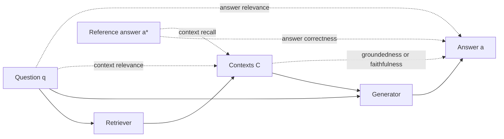
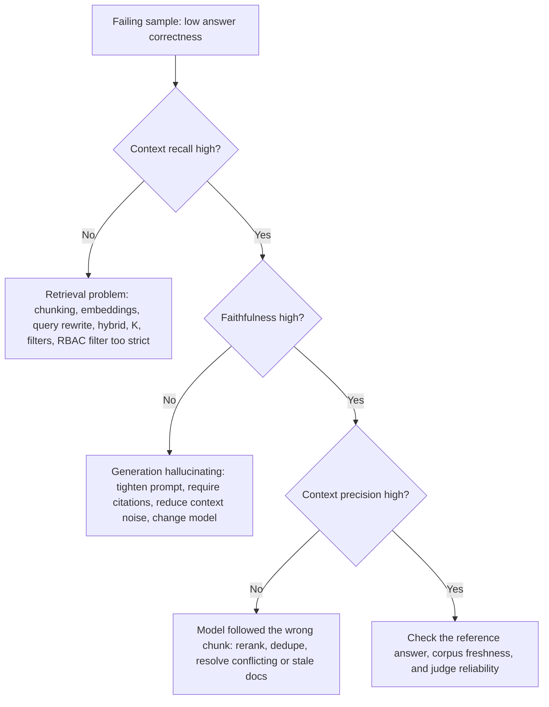

# End-to-End RAG Evals

> **TL;DR** — End-to-end RAG evals score the *final answer* together with the context that produced it. The core set is the **RAG triad** (context relevance, groundedness, answer relevance) plus reference-based metrics like **answer correctness** and **context recall**. Combine them into a scorecard and read them together: the pattern across metrics tells you whether retrieval or generation is at fault.

**You'll learn:** the RAG triad and RAGAS-style metrics, how each is computed, which need ground truth, how to evaluate abstention on unanswerable questions, how to build a scorecard, and how to diagnose failures with a retrieval × generation 2×2  ·  **Prerequisites:** [Why evals and guardrails](../00-foundations/01-why-evals-and-guardrails.md), [Agentic RAG failure modes](../00-foundations/03-agentic-rag-failure-modes.md), [Dataset strategy](../01-datasets/01-dataset-strategy.md)  ·  **Related:** [Retrieval metrics](./02-retrieval-metrics.md), [LLM-as-a-judge](./07-llm-as-a-judge.md), [Citation adherence](./06-instruction-and-citation-adherence.md)

---

## 1. The anatomy of a RAG sample

Every E2E RAG metric is a function of some subset of five artefacts:

| Symbol | Name (RAGAS field name) | Produced by | Needed for |
|---|---|---|---|
| `q` | Question (`user_input`) | Dataset | All metrics |
| `C` | Retrieved contexts (`retrieved_contexts`) — ordered list of chunks | Your system | Faithfulness, context precision/relevance, context recall, noise sensitivity |
| `a` | Generated answer (`response`) | Your system | Faithfulness, answer relevancy, answer correctness |
| `a*` | Reference answer (`reference`) | Dataset (SME or synthetic) | Answer correctness, semantic similarity, context recall, context precision (with reference) |
| `C*` | Reference contexts / relevant chunk IDs | Dataset | Classic retrieval metrics ([02](./02-retrieval-metrics.md)), context entities recall |



### Reference-based vs reference-free

| | Reference-free | Reference-based |
|---|---|---|
| **Needs** | `q`, `C`, `a` only | Also `a*` and/or `C*` |
| **Metrics** | Faithfulness/groundedness, answer relevancy, context relevance, context precision *without* reference / context utilization | Answer correctness, semantic similarity, context recall, context precision *with* reference, context entities recall, noise sensitivity, completeness |
| **Pros** | Runs on any traffic, including production samples; no labeling cost | Measures *correctness*, not just internal consistency |
| **Cons** | A fluent, grounded, on-topic answer can still be **wrong** (grounded in the wrong doc, stale doc, or missing key facts) | Requires a golden or synthetic dataset; references go stale |
| **Typical home** | Online evals and offline smoke tests | Offline regression suites and release gates |

**Opinion:** reference-free metrics are necessary but not sufficient. Faithfulness of 1.0 only says "the answer agrees with what was retrieved". You need at least a small reference-based set (start with 50–100 SME questions; see [SME golden datasets](../01-datasets/02-sme-golden-datasets.md)) to know whether answers are actually right.

---

## 2. The RAG triad (TruLens)

TruLens popularised the **RAG triad**: three reference-free checks, one per edge of the q → C → a triangle. If all three pass, the main hallucination paths are covered.

| Edge | Metric | Question asked | Failure it catches |
|---|---|---|---|
| q → C | **Context relevance** | Is each retrieved chunk relevant to the question? | Retriever pulling noise that the LLM may weave into the answer |
| C → a | **Groundedness** | Is every claim in the answer supported by the context? | Hallucination / extrapolation beyond sources |
| q → a | **Answer relevance** | Does the answer address the question asked? | Evasive, off-topic, or partial answers |

Mapping to other frameworks' names:

| Concept | TruLens | RAGAS | DeepEval |
|---|---|---|---|
| q → C | Context relevance | Context precision (without reference) / Context relevance (Nvidia metrics) | Contextual relevancy |
| C → a | Groundedness | Faithfulness | Faithfulness |
| q → a | Answer relevance | Answer (response) relevancy | Answer relevancy |

The triad is the right **first** suite because it needs no ground truth. Add reference-based metrics once you have a dataset.

---

## 3. Metric cards

### 3.1 Faithfulness / groundedness

- **What it measures:** The fraction of claims in the answer that are supported by the retrieved context. Not truth — *support*.
- **Inputs required:** `q`, `a`, `C`. No ground truth.
- **How it's computed:**
  1. **Claim decomposition:** an LLM splits `a` into atomic, self-contained statements (resolve pronouns: "It was founded in 2010" → "Acme was founded in 2010").
  2. **Verification:** for each claim, decide whether `C` entails it. This is an NLI-style judgment — done with an LLM judge or a dedicated NLI/hallucination model (e.g. a cross-encoder NLI model, or a trained detector such as Vectara's HHEM).
  3. Aggregate:
  ```text
  faithfulness = |claims supported by C| / |claims in a|
  ```
- **Score range & interpretation:** 0–1, higher is better. 1.0 = every claim traceable to context.
- **Worked example:**
  - `q`: "How many days of parental leave do employees in India get?"
  - `C`: ["Employees in India are entitled to 26 weeks of paid maternity leave.", "Paternity leave in India is 10 working days."]
  - `a`: "Mothers get 26 weeks of paid leave, fathers get 10 working days, and both can extend by 4 weeks unpaid."
  - Claims: (1) mothers get 26 weeks paid ✅, (2) fathers get 10 working days ✅, (3) both can extend 4 weeks unpaid ❌ → **faithfulness = 2/3 ≈ 0.67**.
- **Pitfalls / gotchas:**
  - **Grounded ≠ correct.** If the retriever surfaces a 2021 policy that was superseded, a faithful answer is still wrong.
  - Claim decomposition quality dominates the score. Long answers → many claims → more judge variance; very short answers ("Yes.") may produce 0 claims (decide how to handle: skip, or score 1, or score as NaN and track separately).
  - Common-knowledge claims ("Paris is in France") may be marked unsupported. Decide whether your app *should* use parametric knowledge; for enterprise assistants, usually no.
  - Strict vs lenient entailment: paraphrases and numeric rounding ("~26 weeks", "six months") confuse judges. Spot-check disagreements.
- **When to use / when not to:** Always, for any RAG answer. It's the single best reference-free hallucination signal. Not useful for answers intentionally drawing on tool outputs unless you include those tool outputs in `C`.
- **Implemented in:** RAGAS (`Faithfulness`), TruLens (groundedness), DeepEval (`FaithfulnessMetric`), Phoenix (hallucination eval), promptfoo (`context-faithfulness`).

```python
def faithfulness(claim_verdicts: list[bool]) -> float | None:
    """claim_verdicts[i] = True if claim i is entailed by the retrieved context."""
    if not claim_verdicts:
        return None  # track "no claims" separately rather than inflating the score
    return sum(claim_verdicts) / len(claim_verdicts)
```

Judge prompt sketch (verification step):

```text
You are given CONTEXT and a list of STATEMENTS.
For each statement, answer "yes" only if it can be directly inferred from CONTEXT
without outside knowledge. Otherwise answer "no". Give a one-sentence reason first.
Return JSON: [{"statement": ..., "reason": ..., "verdict": "yes"|"no"}]
```

---

### 3.2 Answer relevancy (response relevancy)

- **What it measures:** How directly the answer addresses the question — penalising incomplete, evasive or padded answers. It does **not** measure correctness.
- **Inputs required:** `q`, `a` (RAGAS also uses `C` for context in some versions). No ground truth. Needs an embedding model.
- **How it's computed (RAGAS "reverse question" method):**
  1. An LLM generates `N` questions that the answer `a` would be a good answer to (RAGAS default is a small N, e.g. 3).
  2. Embed each generated question `g_i` and the original question `q`.
  3. Average cosine similarity:
  ```text
  answer_relevancy = (1/N) * Σ_i cos( E(g_i), E(q) )
  ```
  RAGAS also asks the LLM whether the answer is **noncommittal** ("I'm not sure", "It depends") and scores such answers 0.
- **Alternative (TruLens/DeepEval style):** an LLM judge reads `q` and `a` and rates relevance directly (DeepEval splits the answer into statements and computes the fraction relevant to the question).
- **Score range & interpretation:** Roughly 0–1. Because cosine similarity of embeddings rarely hits 0 or 1, absolute values are embedding-model dependent — compare **relative** values across variants, not against a universal threshold.
- **Worked example:** `q` = "What is the VPN client for macOS?"; `a` = "Use GlobalProtect; install it from Self Service." Generated questions: "Which VPN client should Mac users install?", "Where do I get the macOS VPN client?", "What VPN app is used on Macs?" — all close to `q` → high score. If `a` = "VPN policies are managed by IT Security and reviewed annually", reverse questions drift ("Who manages VPN policy?") → lower score.
- **Pitfalls / gotchas:**
  - Rewards answers that restate the question; a confidently wrong answer can score high.
  - Correct abstentions ("I don't have information about that") are scored 0 by the noncommittal rule — so **exclude unanswerable questions** from this metric and evaluate them with [abstention correctness](#311-abstention-correctness-i-dont-know).
  - Sensitive to embedding model choice; pin it.
- **When to use / when not to:** Use as a cheap triad component and to catch verbosity/topic drift. Do not use as a proxy for correctness.
- **Implemented in:** RAGAS (`ResponseRelevancy`/`AnswerRelevancy`), TruLens (answer relevance), DeepEval (`AnswerRelevancyMetric`), promptfoo (`answer-relevance`).

---

### 3.3 Answer correctness

- **What it measures:** Whether the answer agrees with the reference answer — the closest thing to "is it right?".
- **Inputs required:** `q`, `a`, `a*`. **Ground truth required.**
- **How it's computed (RAGAS style):** a weighted blend of **factual correctness** and **semantic similarity**:
  1. Decompose both `a` and `a*` into claims.
  2. Classify claims:
     - **TP** — claim in `a` that is supported by `a*`
     - **FP** — claim in `a` not supported by `a*` (extra/incorrect)
     - **FN** — claim in `a*` missing from `a`
  3. Factual F1:
  ```text
  F1_factual = TP / (TP + 0.5 * (FP + FN))
  ```
  4. Semantic similarity `S = cos(E(a), E(a*))` (see 3.4).
  5. Combine (RAGAS default weights are 0.75 factual / 0.25 semantic — tune for your domain):
  ```text
  answer_correctness = w_f * F1_factual + w_s * S       # w_f + w_s = 1
  ```
- **Score range & interpretation:** 0–1. The factual component dominates; semantic similarity smooths over paraphrase.
- **Worked example:**
  - `a*`: "Expense reports must be submitted within 30 days. Receipts are required for amounts over $25."
  - `a`: "Submit expense reports within 30 days. Receipts are needed for any amount. Approval is by your manager."
  - TP = 1 ("within 30 days"); FP = 2 ("any amount" contradicts, "manager approval" not in reference); FN = 1 ("receipts over $25").
  - `F1_factual = 1 / (1 + 0.5 * (2 + 1)) = 1 / 2.5 = 0.40`.
  - Suppose `S = 0.88`. `answer_correctness = 0.75 * 0.40 + 0.25 * 0.88 = 0.30 + 0.22 = 0.52`.
- **Pitfalls / gotchas:**
  - FP counts *extra true* facts as errors when they're not in the reference. Either write richer references or use **precision-only** / **recall-only** modes (RAGAS `FactualCorrectness` supports precision, recall, f1 modes) depending on whether verbosity is a problem.
  - Reference answers go stale when policies change. Version your dataset alongside your corpus.
  - For short factoid answers (a number, a name), use deterministic checks (normalised exact match, numeric tolerance) instead — they're cheaper and more reliable.
- **When to use / when not to:** The primary metric for offline regression suites with golden data. Not usable on production traffic without references.
- **Implemented in:** RAGAS (`AnswerCorrectness`, `FactualCorrectness`), Phoenix (QA correctness eval, judge-based), promptfoo (`factuality`), DeepEval (via `GEval` with a correctness rubric).

```python
def factual_f1(tp: int, fp: int, fn: int) -> float:
    denom = tp + 0.5 * (fp + fn)
    return tp / denom if denom else 0.0

def answer_correctness(tp: int, fp: int, fn: int, sem_sim: float,
                       w_factual: float = 0.75) -> float:
    return w_factual * factual_f1(tp, fp, fn) + (1 - w_factual) * sem_sim

print(answer_correctness(tp=1, fp=2, fn=1, sem_sim=0.88))  # 0.52
```

---

### 3.4 Answer semantic similarity

- **What it measures:** Meaning-level closeness between `a` and `a*`.
- **Inputs required:** `a`, `a*`. **Ground truth required.** Embedding model or cross-encoder.
- **How it's computed:**
  ```text
  semantic_similarity = cos( E(a), E(a*) ) = (E(a) · E(a*)) / (‖E(a)‖ ‖E(a*)‖)
  ```
  Optionally threshold it to a binary pass/fail. A cross-encoder (scoring the pair jointly) is usually more accurate than bi-encoder cosine. BERTScore is a token-level alternative (see [03](./03-generation-quality-and-safety-evals.md#reference-based-text-metrics-bleu-rouge-bertscore)).
- **Score range & interpretation:** Typically compressed into a narrow high band (e.g. most pairs between 0.7 and 0.95 for modern embedding models), so small differences matter and absolute thresholds don't transfer across models.
- **Worked example:** "Refunds take 5–7 business days" vs "Expect your refund within a week" → high similarity. "Refunds take 5–7 business days" vs "Refunds take 50–70 business days" → **also high**. That's the core weakness.
- **Pitfalls / gotchas:** Insensitive to negation, numbers and entity swaps — exactly the errors that matter in enterprise Q&A. Never use alone.
- **When to use / when not to:** As a smoothing component inside answer correctness, or as a cheap first filter. Not as a standalone correctness metric.
- **Implemented in:** RAGAS (`SemanticSimilarity`), promptfoo (`similar`), DeepEval (via custom metrics).

---

### 3.5 Context precision

- **What it measures:** Whether the *relevant* retrieved chunks are ranked *above* irrelevant ones — a rank-aware signal-to-noise ratio of the context window.
- **Inputs required:** `q`, `C` (ordered), and either `a*` (**with reference**) or `a` (**without reference** — RAGAS calls this *context utilization*). Ground truth optional.
- **How it's computed:**
  1. For each chunk at rank k, an LLM judges relevance `v_k ∈ {0,1}`: *"Was this chunk useful in arriving at the reference answer?"* (with reference) or *"...at the given answer?"* (without).
  2. Rank-weighted precision (this is average precision over the retrieved list):
  ```text
  precision@k = (Σ_{i=1..k} v_i) / k

  context_precision@K = Σ_{k=1..K} ( precision@k × v_k ) / (number of relevant chunks in top K)
  ```
- **Score range & interpretation:** 0–1. 1.0 = all relevant chunks are at the top. Same set of chunks in a worse order → lower score.
- **Worked example:** K = 4, relevance `[1, 0, 1, 0]`.
  - precision@1 = 1/1 = 1.0 (v₁=1) → contributes 1.0
  - precision@3 = 2/3 ≈ 0.667 (v₃=1) → contributes 0.667
  - Sum = 1.667; relevant count = 2 → **0.83**.
  - Reorder to `[0, 0, 1, 1]`: (1/3 + 2/4) / 2 = (0.333 + 0.5)/2 ≈ **0.42**.
- **Pitfalls / gotchas:**
  - The "without reference" variant judges usefulness w.r.t. the *generated* answer — if the answer is wrong, the judgment is anchored on a wrong target.
  - Denominator is relevant items *in the retrieved list*, so it says nothing about relevant chunks you **failed** to retrieve — pair with context recall.
  - LLM relevance judgments cost one call per chunk; with K=10 and 500 questions that's 5,000 calls. Cache by `(q, chunk_id)`.
- **When to use / when not to:** Use when tuning reranking, K, or chunk size (more noise in the context window degrades generation). If you have labeled relevant chunk IDs, prefer deterministic retrieval metrics from [02](./02-retrieval-metrics.md) — cheaper and reproducible.
- **Implemented in:** RAGAS (`ContextPrecision`, `ContextUtilization`, LLM and non-LLM variants), DeepEval (`ContextualPrecisionMetric`).

```python
def context_precision(relevance: list[int]) -> float:
    hits, total = 0, 0.0
    for k, v in enumerate(relevance, start=1):
        if v:
            hits += 1
            total += hits / k
    return total / hits if hits else 0.0

assert round(context_precision([1, 0, 1, 0]), 2) == 0.83
assert round(context_precision([0, 0, 1, 1]), 2) == 0.42
```

---

### 3.6 Context relevance

- **What it measures:** The proportion of retrieved content that is relevant to the question — no ranking, no reference.
- **Inputs required:** `q`, `C`. No ground truth.
- **How it's computed:** LLM judge scores each chunk (binary or 0–3 scale) for relevance to `q`; average across chunks. DeepEval's variant extracts statements from the context and computes `relevant statements / total statements`.
  ```text
  context_relevance = (1/|C|) * Σ_c relevance(q, c)
  ```
- **Score range & interpretation:** 0–1. Low values mean a noisy context window → higher risk of distraction and hallucination.
- **Pitfalls / gotchas:** Large chunks containing one relevant sentence among many irrelevant ones get ambiguous scores; decide whether your rubric is "contains relevant info" or "is mostly relevant".
- **When to use / when not to:** The triad's retrieval leg; useful online. Prefer context precision when order matters (it usually does).
- **Implemented in:** TruLens (context relevance), DeepEval (`ContextualRelevancyMetric`), RAGAS (Nvidia `ContextRelevance`), Phoenix (retrieval relevance eval).

---

### 3.7 Context recall

- **What it measures:** Whether the retrieved context contains everything needed to produce the reference answer.
- **Inputs required:** `q`, `C`, `a*`. **Ground truth required** (reference answer, *not* reference chunk IDs).
- **How it's computed:**
  1. Decompose `a*` into claims.
  2. For each claim, judge whether it can be **attributed** to `C`.
  ```text
  context_recall = |reference claims attributable to C| / |reference claims|
  ```
  (If you have labeled relevant chunk IDs, use classic recall@k instead — [02](./02-retrieval-metrics.md#recallk).)
- **Score range & interpretation:** 0–1. Low recall caps answer correctness: the generator can't use what it never saw.
- **Worked example:** `a*` = "Laptops are refreshed every 3 years. Engineers may request a refresh at 2 years. Requests go through the IT portal." `C` contains the 3-year policy and the IT-portal process but not the engineer exception → **2/3 ≈ 0.67**.
- **Pitfalls / gotchas:**
  - The reference answer must be grounded in your corpus — if the SME wrote it from memory and it includes facts not in any document, recall is capped below 1 for every system.
  - Doesn't penalise noise; pair with context precision.
- **When to use / when not to:** The most important *retrieval* metric when you have reference answers but no chunk labels. Use it to tune K, chunking, query rewriting, hybrid weights.
- **Implemented in:** RAGAS (`ContextRecall`, LLM and non-LLM variants), DeepEval (`ContextualRecallMetric`), promptfoo (`context-recall`).

---

### 3.8 Context entities recall

- **What it measures:** The fraction of entities (people, products, dates, IDs, amounts) in the reference that also appear in the retrieved context. Useful for fact-dense domains.
- **Inputs required:** `C`, `a*` (or `C*`). **Ground truth required.**
- **How it's computed:**
  ```text
  GE = entities extracted from reference
  CE = entities extracted from retrieved contexts
  context_entities_recall = |CE ∩ GE| / |GE|
  ```
  Entity extraction can be LLM-based or NER-based; normalise aliases ("Q3 FY24" vs "third quarter of fiscal 2024").
- **Score range & interpretation:** 0–1. Cheaper and more deterministic than claim-level recall once entities are extracted.
- **Worked example:** Reference entities {"GlobalProtect", "macOS 14", "Self Service"}; context mentions GlobalProtect and Self Service → 2/3.
- **Pitfalls / gotchas:** Entity presence ≠ the right fact about that entity. Alias normalisation is most of the work.
- **When to use / when not to:** Product catalogs, financial/HR policy, incident tickets — anywhere answers hinge on specific named things. Not for conceptual or how-to questions.
- **Implemented in:** RAGAS (`ContextEntityRecall`).

---

### 3.9 Noise sensitivity

- **What it measures:** How often the system produces **incorrect claims** because of the context it was given — i.e. how easily it's misled by irrelevant or partially relevant chunks. **Lower is better.**
- **Inputs required:** `q`, `C`, `a`, `a*`. **Ground truth required.**
- **How it's computed:** Decompose `a` into claims; for each claim, determine whether it is correct per `a*` and whether it is attributable to relevant or irrelevant chunks.
  ```text
  noise_sensitivity = |incorrect claims in a| / |claims in a|
  ```
  RAGAS offers a `relevant` mode (incorrect claims coming from relevant chunks — the model mis-read good context) and an `irrelevant` mode (incorrect claims coming from irrelevant chunks — the model was distracted by noise).
- **Score range & interpretation:** 0–1, lower is better.
- **Pitfalls / gotchas:** Requires reliable claim-to-chunk attribution, which is itself a judge task; validate on a sample.
- **When to use / when not to:** When you are increasing K or adding sources (e.g. adding a wiki to a policy corpus) and want to know if the generator gets distracted. Also a good robustness test: inject known-irrelevant chunks and measure the change.
- **Implemented in:** RAGAS (`NoiseSensitivity`).

---

### 3.10 Response completeness

- **What it measures:** Whether the answer covers all key points the user needed — recall of the answer with respect to the reference.
- **Inputs required:** `q`, `a`, `a*` (or an SME-written list of required key points). **Ground truth required.**
- **How it's computed:** Use **key-point recall**: SMEs (or an LLM, reviewed by SMEs) list must-have points per question; a judge checks which ones appear in `a`.
  ```text
  completeness = |required key points covered by a| / |required key points|
  ```
  This is the `FN` side of answer correctness, isolated. RAGAS `FactualCorrectness` in recall mode is a close proxy.
- **Score range & interpretation:** 0–1. Track alongside a conciseness/verbosity check ([03](./03-generation-quality-and-safety-evals.md)) — it's easy to buy completeness with padding.
- **Worked example:** "How do I get access to the finance warehouse?" Key points: (1) request via access portal, (2) manager approval, (3) complete data-handling training. Answer mentions 1 and 2 → 0.67.
- **Pitfalls / gotchas:** Key-point lists are the most valuable and most expensive part of a golden dataset; keep them short (3–5 points) and *must-have* only.
- **When to use / when not to:** Procedural, multi-part, and policy questions. Overkill for factoid lookups.
- **Implemented in:** RAGAS (`FactualCorrectness` recall mode), DeepEval (`GEval` with a completeness rubric), or a custom judge.

---

### 3.11 Abstention correctness ("I don't know")

- **What it measures:** Whether the system **declines** when it should (unanswerable, out-of-scope, or not permitted for this user's role) and **answers** when it can.
- **Inputs required:** `q`, `a`, plus a dataset label `answerable ∈ {yes, no}` per question. **Ground truth required** (the label, not a reference answer). Include a slice of deliberately unanswerable questions: facts absent from the corpus, questions about other companies, future events, and docs the user's role cannot access.
- **How it's computed:** First classify each answer as *abstained* or *answered* (regex for your canonical refusal string, or a cheap LLM classifier). Then build a confusion matrix:

  | | System answered | System abstained |
  |---|---|---|
  | **Answerable** | Answered (then score correctness) | **False abstention** (over-refusal) |
  | **Unanswerable** | **Hallucinated answer** (worst case) | Correct abstention |

  ```text
  abstention_recall    = correct abstentions / unanswerable questions      # did we decline when we should?
  abstention_precision = correct abstentions / all abstentions             # when we declined, was it right?
  false_abstention_rate = false abstentions / answerable questions
  ```
- **Score range & interpretation:** 0–1 each. Report both sides; optimising only abstention recall produces a useless "I don't know" bot.
- **Worked example:** 100 questions: 80 answerable, 20 unanswerable. System abstains on 15 unanswerable and 6 answerable. abstention_recall = 15/20 = 0.75; abstention_precision = 15/21 ≈ 0.71; false_abstention_rate = 6/80 = 0.075.
- **Pitfalls / gotchas:**
  - Answer relevancy and faithfulness can be misleading on unanswerable questions; route them only to this metric.
  - RBAC cases matter: "What's the CFO's salary?" should be declined for most roles **even if** the document exists. That's an access-control decision, ideally enforced at retrieval (see [access control](../04-guardrails/06-access-control-rbac.md)), but you still eval the user-facing behaviour here.
  - Partial abstention ("I couldn't find X, but Y is...") needs a rubric decision.
- **When to use / when not to:** Every enterprise RAG eval set should have a 10–20% unanswerable slice (heuristic). See [synthetic datasets](../01-datasets/03-synthetic-datasets.md) for generating them.
- **Implemented in:** Generally custom; easy to express as a `GEval`/`llm-rubric` judge in DeepEval or promptfoo.

```python
def abstention_metrics(rows: list[dict]) -> dict:
    """rows: [{"answerable": bool, "abstained": bool}, ...]"""
    unans = [r for r in rows if not r["answerable"]]
    ans = [r for r in rows if r["answerable"]]
    abst = [r for r in rows if r["abstained"]]
    correct_abst = sum(1 for r in unans if r["abstained"])
    return {
        "abstention_recall": correct_abst / len(unans) if unans else None,
        "abstention_precision": correct_abst / len(abst) if abst else None,
        "false_abstention_rate": sum(r["abstained"] for r in ans) / len(ans) if ans else None,
        "hallucination_on_unanswerable": (len(unans) - correct_abst) / len(unans) if unans else None,
    }
```

---

### 3.12 Latency and cost as E2E metrics

Quality metrics are meaningless without the budget they were bought with. A variant that gains +2 points of correctness by doubling p95 latency may be a regression for users.

- **What it measures:** Time-to-first-token (TTFT), end-to-end latency, tokens in/out, number of LLM/tool calls, and $ per request.
- **Inputs required:** Traces from the run. No ground truth.
- **How it's computed:** Record per-request timings and token counts from your tracing layer ([observability & tracing](../03-online-evals-and-observability/02-observability-and-tracing.md)); report **p50/p95/p99**, not means. Cost = Σ(tokens × price per token) per model + tool/infra costs.
- **Score range & interpretation:** Absolute units. Set budgets per use case (heuristic starting points for a chat assistant: TTFT under ~1–2 s, full answer p95 under ~10 s; agentic multi-step flows can tolerate more if progress is streamed).
- **Pitfalls / gotchas:** Offline latency differs from production (cold caches, rate limits, concurrency). Treat offline numbers as relative comparisons between variants. Exclude eval-judge cost from system cost.
- **When to use / when not to:** Always include in the scorecard. Gate on regressions (e.g. p95 +20% fails the build) rather than absolute values.
- **Implemented in:** Most tracing/eval platforms record these (Langfuse, LangSmith, Phoenix, Braintrust); promptfoo has `latency` and `cost` assertions.

---

## 4. Other E2E evaluation frameworks worth knowing

- **RAGAS** (Es et al., 2023) introduced reference-free LLM-based metrics for faithfulness, answer relevance and context relevance, and has since grown into a broad metric library. The paper is the origin of the claim-decomposition faithfulness and reverse-question answer-relevancy recipes above.
- **ARES** (Saad-Falcon et al., 2023) evaluates the same three dimensions (context relevance, answer faithfulness, answer relevance) but, instead of prompting a large judge, **fine-tunes lightweight judge models** on synthetic data, and uses **prediction-powered inference (PPI)** with a small human-labeled set to produce confidence intervals on the scores. The key lesson even if you don't use ARES: *calibrate automated judges against a few hundred human labels and report uncertainty.* See [LLM-as-a-judge](./07-llm-as-a-judge.md).
- **TruLens** packages the RAG triad as feedback functions that run on traces.

---

## 5. Building a scorecard

Don't collapse everything into one number too early. A scorecard is a small table of metrics, each with a direction, a gate, and a slice breakdown.

### 5.1 Recommended default scorecard

| Metric | Type | Ground truth? | Starting gate (heuristic) | Why it's on the card |
|---|---|---|---|---|
| Answer correctness | Quality | Yes | ≥ baseline − 2 pts; absolute target set with SMEs | Primary outcome |
| Faithfulness | Hallucination | No | ≥ 0.90 mean; track % of answers < 0.7 | Primary safety signal |
| Answer relevancy | Quality | No | No regression vs baseline | Catches drift/verbosity |
| Context recall | Retrieval | Yes | ≥ 0.85 | Caps achievable correctness |
| Context precision | Retrieval | Optional | No regression vs baseline | Noise in context window |
| Abstention recall / false-abstention rate | Behaviour | Label | ≥ 0.8 / ≤ 0.1 | Hallucination on unanswerables vs over-refusal |
| Citation precision | Attribution | No | ≥ 0.9 | See [06](./06-instruction-and-citation-adherence.md) |
| p95 latency, $ / query | Budget | No | ≤ baseline + 20% | Quality at what cost |

All thresholds are heuristics to start a conversation, not standards. Calibrate them by having SMEs label 50–100 outputs as acceptable/unacceptable and choosing thresholds that best separate the two groups.

### 5.2 Aggregation rules

- **Report distributions, not just means.** "Mean faithfulness 0.93" can hide 5% of answers at 0.3. Report the % of samples below a floor (a "failure rate") — it's usually what stakeholders care about.
- **Slice everything:** by question type (factoid, procedural, comparison, multi-hop), source system, user role, language, answerable vs unanswerable. Most regressions are slice-local.
- **Prefer per-sample pass/fail for gates.** Define `pass = correctness ≥ 0.7 AND faithfulness ≥ 0.8 AND not hallucinated_on_unanswerable`, then gate on pass rate. Composite pass rates are easier to explain than weighted averages.
- **If you must use one number,** use a weighted pass rate with weights agreed with product/SMEs and keep the underlying metrics visible.
- **Report uncertainty:** with 200 samples a 2-point difference is often noise. See [running offline experiments](./08-running-offline-experiments.md).

```python
def per_sample_pass(s: dict) -> bool:
    if not s["answerable"]:
        return s["abstained"]
    return (not s["abstained"]
            and s["answer_correctness"] >= 0.7
            and (s["faithfulness"] is None or s["faithfulness"] >= 0.8))

def pass_rate(samples: list[dict], slice_key: str | None = None) -> dict:
    groups: dict[str, list[bool]] = {}
    for s in samples:
        key = s.get(slice_key, "all") if slice_key else "all"
        groups.setdefault(key, []).append(per_sample_pass(s))
    return {k: sum(v) / len(v) for k, v in groups.items()}
```

---

## 6. Diagnosing failures with the retrieval × generation 2×2

Read retrieval metrics (context recall/precision, or recall@k from [02](./02-retrieval-metrics.md)) together with generation metrics (faithfulness, correctness). Bucket each **failing sample**:

| | **Generation good** (faithful, uses context well) | **Generation bad** (unfaithful, misreads, ignores context) |
|---|---|---|
| **Retrieval good** (high context recall) | ✅ Working. If correctness is still low, suspect the **reference** or the **corpus** (stale/conflicting docs). | 🔧 **Fix generation:** prompt, model, context ordering ("lost in the middle"), too much context, conflicting chunks, output format constraints. |
| **Retrieval bad** (low context recall) | ⚠️ "Lucky" or **parametric** answers (model knew it anyway), or correct abstention. Fragile — fix retrieval before it bites. Check that the answer isn't ungrounded. | 🔧 **Fix retrieval first:** chunking, embeddings, query rewriting, hybrid search, metadata filters, K, reranker. Generation tuning is wasted until this is fixed. |



**Practical procedure:**

- [ ] Run the scorecard; sort samples by correctness ascending.
- [ ] Bucket the bottom 20–50 samples into the 2×2 using recall and faithfulness thresholds.
- [ ] Read the traces in the largest bucket (this is [error analysis](../01-datasets/04-production-data-flywheel.md) — do it by hand first; no metric replaces reading).
- [ ] Write down a failure taxonomy (e.g. "table data not chunked", "acronym not expanded", "outdated policy ranked first").
- [ ] Add targeted component evals for the top failure mode, iterate, then re-run the E2E suite.

---

## 7. Practical setup checklist

- [ ] Dataset includes `q`, `a*`, answerable label, slice tags, and (if possible) relevant chunk/doc IDs. See [dataset strategy](../01-datasets/01-dataset-strategy.md).
- [ ] Pin the judge model, temperature (0), prompts, and embedding model; version them with the results.
- [ ] Store `C` with chunk IDs and ranks for every run so retrieval metrics can be recomputed without re-running the system.
- [ ] Validate each LLM-judged metric against ~50–100 human labels before trusting it ([LLM-as-a-judge](./07-llm-as-a-judge.md)).
- [ ] Cache judge calls keyed by `(metric_version, q, a, C_hash)`.
- [ ] Gate releases on a per-sample pass rate plus no-regression checks on key slices ([running offline experiments](./08-running-offline-experiments.md)).
- [ ] Promote the reference-free subset (faithfulness, answer relevancy, context relevance) to [online evals](../03-online-evals-and-observability/01-online-evals.md) on sampled traffic.

---

## Key takeaways

- Start with the **RAG triad** (context relevance, groundedness, answer relevance) — it needs no ground truth — then add reference-based **answer correctness** and **context recall** as soon as you have a golden set.
- **Faithful is not correct.** Reference-free metrics measure consistency with retrieved context, not truth.
- Claim decomposition + verification is the workhorse behind faithfulness, answer correctness, context recall and noise sensitivity — judge quality determines metric quality.
- Always include an **unanswerable slice** and score abstention on both sides (missed abstentions vs over-refusals).
- Read metrics **together** using the retrieval × generation 2×2 to decide whether to fix retrieval or generation.
- Report distributions, slices, latency and cost alongside quality; gate on per-sample pass rates.

## Further reading

- Es et al., *RAGAS: Automated Evaluation of Retrieval Augmented Generation* — [arXiv:2309.15217](https://arxiv.org/abs/2309.15217)
- Saad-Falcon et al., *ARES: An Automated Evaluation Framework for Retrieval-Augmented Generation Systems* — [arXiv:2311.09476](https://arxiv.org/abs/2311.09476)
- TruLens — [The RAG Triad](https://www.trulens.org/getting_started/core_concepts/rag_triad/)
- RAGAS docs — [List of available metrics](https://docs.ragas.io/en/stable/concepts/metrics/available_metrics/)
- DeepEval — [docs](https://deepeval.com/docs/metrics-introduction)
- Hamel Husain — [Your AI Product Needs Evals](https://hamel.dev/blog/posts/evals/)
- Within this repo: [Retrieval metrics](./02-retrieval-metrics.md) · [LLM-as-a-judge](./07-llm-as-a-judge.md) · [Instruction & citation adherence](./06-instruction-and-citation-adherence.md) · [Metric cheatsheet](../05-decision-framework/03-metric-cheatsheet.md)
