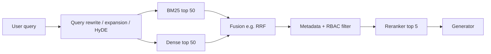

# Retrieval Metrics

> **TL;DR**
> - **Measure recall@k first.** Verify that your retriever passes all required evidence chunks to the generator LLM.
> - **Use nDCG@k and MRR for ranking.** Evaluate whether your pipeline ranks the most relevant chunks near the top.
> - **Label at stable span granularity.** Anchor relevance labels to document character spans so re-chunking does not break your evals.
> - **Evaluate every retrieval stage separately.** Measure query rewriting, hybrid search, RBAC filters, and rerankers on the same queries.

**You will learn:** Hit rate, precision/recall/F1@k, MRR, MAP, nDCG, and R-precision · Relevance labeling and pooling · Chunk vs document matching · Per-stage retrieval evals  
**Prerequisites:** [End-to-end RAG evals](./01-end-to-end-rag-evals.md), [Dataset strategy](../01-datasets/01-dataset-strategy.md)  
**Related:** [Synthetic datasets](../01-datasets/03-synthetic-datasets.md), [LLM-as-a-judge](./07-llm-as-a-judge.md), [Retrieval and context guardrails](../04-guardrails/03-retrieval-and-context-guardrails.md)

---

## 1. Setup and notation

For each query `q` in your evaluation dataset, collect three inputs:

- **Ranked results** `[d_1, d_2, ..., d_n]`: The ordered list of chunk or document IDs that your retriever returned.
- **Relevance judgments**: Either a set of relevant IDs `R` (**binary**) or a grade map `rel(d) ∈ {0,1,2,3}` (**graded**).
- **A cutoff `k`**: Set `k` to the chunk count you pass to the LLM (such as 5 or 10). Also track a larger cutoff (such as 50) for the candidate pool before reranking.

Dataset row shape:

```json
{"query_id": "q_017",
 "query": "What is the laptop refresh policy for engineers?",
 "relevant": {"d1": 3, "d3": 2, "d5": 2, "d4": 1},
 "tags": {"type": "policy", "source": "it-handbook"}}
```

Compute every metric **per query** first, then average the scores across all queries (**macro-average**). Always inspect the per-query distribution alongside the mean. A mean recall of 0.80 can hide 20% of queries scoring 0.0.

### The running worked example

Query: *"What is the laptop refresh policy for engineers?"*

- Graded relevance labels: `d1 = 3` (exact policy section), `d3 = 2` (engineering exception), `d5 = 2` (request process), `d4 = 1` (tangential mention). All other chunks have grade `0`. Thus `R = {d1, d3, d4, d5}` and `|R| = 4`.
- The retriever returns top 5: `[d7, d3, d1, d9, d4]`. Notice that the retriever missed `d5`.

| Rank | Doc | Graded rel | Binary rel | Hits so far | precision@rank |
|---|---|---|---|---|---|
| 1 | d7 | 0 | 0 | 0 | 0/1 = 0.00 |
| 2 | d3 | 2 | 1 | 1 | 1/2 = 0.50 |
| 3 | d1 | 3 | 1 | 2 | 2/3 = 0.67 |
| 4 | d9 | 0 | 0 | 2 | 2/4 = 0.50 |
| 5 | d4 | 1 | 1 | 3 | 3/5 = 0.60 |

We will compute every metric below using this ranked list.

---

## 2. Metric cards

### Hit rate@k

- **What it measures:** Whether **at least one** relevant item appears in the top `k` results (also called *success@k* or *top-k accuracy*).
- **Inputs required:** Ranked IDs and the relevant set `R`. Requires ground-truth relevance labels.
- **How to compute it:**
  ```text
  hit@k = 1 if |top_k ∩ R| > 0 else 0
  hit_rate@k = mean over queries of hit@k
  ```
- **Score range & interpretation:** 0 to 1. It represents the fraction of queries where the LLM sees at least one relevant chunk.
- **Worked example:** `hit@1 = 0` (`d7` is irrelevant), `hit@3 = 1`, and `hit@5 = 1`.
- **Pitfalls and gotchas:** Hit rate ignores how many relevant chunks the retriever found. It can mislead you on multi-hop or multi-part questions that require several chunks.
- **When to use it:** Use hit rate when each question needs only one source chunk (such as single-chunk synthetic datasets). Do not rely on it alone for multi-chunk questions.
- **Implemented in:** LlamaIndex (`hit_rate`), `ranx`, `pytrec_eval` (`success@k`), or custom Python.

### Precision@k

- **What it measures:** The fraction of the top `k` results that are relevant. It measures the signal-to-noise ratio of your context window.
- **Inputs required:** Ranked IDs and the relevant set `R`.
- **How to compute it:**
  ```text
  precision@k = |top_k ∩ R| / k
  ```
- **Score range & interpretation:** 0 to 1. Note that `|R| / k` caps the maximum possible score. If a query has only 1 relevant chunk, `precision@5` can never exceed `0.20`.
- **Worked example:** `precision@1 = 0`, `precision@3 = 2/3 ≈ 0.67`, and `precision@5 = 3/5 = 0.60`.
- **Pitfalls and gotchas:** Precision@k ignores chunk order inside the top `k` and penalizes queries with few relevant items. Never compare `precision@k` across datasets with different `|R|` distributions.
- **When to use it:** Use it to choose prompt cutoff `k` and control context noise. Pair it with `recall@k` to check evidence coverage.
- **Implemented in:** `ranx`, `pytrec_eval`, LlamaIndex, RAGAS (non-LLM context precision).

### Recall@k

- **What it measures:** The fraction of all relevant items that appear in the top `k` results. It answers: *"Did the LLM receive everything it needed?"*
- **Inputs required:** Ranked IDs and a **complete** relevant set `R`.
- **How to compute it:**
  ```text
  recall@k = |top_k ∩ R| / |R|
  ```
- **Score range & interpretation:** 0 to 1. Recall@k is the **most important retrieval metric for RAG** because the generator cannot recover missing evidence.
- **Worked example:** `recall@1 = 0/4 = 0`, `recall@3 = 2/4 = 0.50`, and `recall@5 = 3/4 = 0.75` (`d5` is missing).
- **Pitfalls and gotchas:** Recall accuracy depends on the completeness of `R`. If labelers mark only one relevant chunk when three exist, your evaluation penalizes retrievers that find the other valid chunks.
- **When to use it:** Report `recall@k` at your prompt cutoff `k` and at your pre-rerank candidate cutoff (such as `recall@50`, which caps reranker performance).
- **Implemented in:** `ranx`, `pytrec_eval`, LlamaIndex, RAGAS (non-LLM context recall), DeepEval (contextual recall).

### F1@k

- **What it measures:** The harmonic mean of `precision@k` and `recall@k`.
- **How to compute it:**
  ```text
  F1@k = 2 · P@k · R@k / (P@k + R@k)
  ```
- **Worked example:** `F1@5 = 2 · 0.60 · 0.75 / 1.35 ≈ 0.67`.
- **Pitfalls and gotchas:** F1@k hides whether a change helped precision or recall, and it ignores chunk order.
- **When to use it:** Use F1@k when tuning a dynamic `k` or similarity threshold that trades precision against recall. Otherwise, report precision and recall separately.
- **Implemented in:** Standard IR libraries or custom Python.

### MRR (Mean Reciprocal Rank)

- **What it measures:** How high the **first** relevant item appears in the ranked list.
- **How to compute it:**
  ```text
  RR(q)  = 1 / rank of first relevant item   (0 if none in top k)
  MRR@k  = mean over queries of RR(q)
  ```
- **Score range & interpretation:** 0 to 1. An MRR of `0.50` means the first relevant result typically appears around rank 2.
- **Worked example:** The first relevant chunk is `d3` at rank 2, so `RR = 0.50`. Across three queries with `RR` values of `0.50`, `1.0`, and `0`, `MRR = 0.50`.
- **Pitfalls and gotchas:** MRR ignores every relevant chunk after the first hit.
- **When to use it:** Use MRR for single-fact lookups, navigational queries, and top-1 citation checks. Do not use it as the sole metric for multi-chunk questions.
- **Implemented in:** `ranx`, `pytrec_eval`, LlamaIndex (`mrr`).

### MAP (Mean Average Precision)

- **What it measures:** Precision averaged across the ranks of all relevant items. It rewards retrievers that rank *all* relevant items *near the top*.
- **How to compute it:**
  ```text
  AP(q) = (1 / |R|) · Σ_{k=1..n} precision@k · rel_k        # rel_k ∈ {0,1}
  MAP   = mean over queries of AP(q)
  ```
  Some libraries (such as RAGAS context precision) divide by the number of **retrieved** relevant items instead of `|R|`. Check which denominator your library uses, because dividing by retrieved hits ignores missed items.
- **Score range & interpretation:** 0 to 1.
- **Worked example:** Relevant items appear at ranks 2, 3, and 5 with precisions `0.50`, `0.67`, and `0.60` (sum = `1.767`).
  - Standard AP (dividing by `|R| = 4`): **0.44**
  - Retrieved-only variant (dividing by `3`): **0.59**
- **Pitfalls and gotchas:** MAP works only on binary labels and is harder to explain to non-technical stakeholders than recall or nDCG.
- **When to use it:** Use MAP to compare rankers when queries have multiple relevant chunks and binary relevance labels.
- **Implemented in:** `ranx`, `pytrec_eval`, `trec_eval`.

### nDCG@k (normalised Discounted Cumulative Gain)

- **What it measures:** Ranking quality under **graded** relevance. It rewards placing highly relevant chunks at the top and discounts lower ranks logarithmically.
- **How to compute it:**
  ```text
  DCG@k  = Σ_{i=1..k} gain(rel_i) / log2(i + 1)

  gain(rel) = 2^rel − 1      # "exponential" gain — emphasises highly relevant items (common default)
  gain(rel) = rel            # "linear" gain — also common

  IDCG@k = DCG@k of the ideal ordering (all labeled items sorted by rel, descending)
  nDCG@k = DCG@k / IDCG@k     (define as 0 if IDCG@k = 0)
  ```
- **Score range & interpretation:** 0 to 1, where 1.0 indicates a perfect ranking of all labeled relevant items.
- **Worked example (exponential gain):**
  - Grades by rank: `[0, 2, 3, 0, 1]` → gains `[0, 3, 7, 0, 1]`
  - Discounts `log2(i+1)`: `[1, 1.585, 2, 2.322, 2.585]`
  - `DCG@5 = 0 + 3/1.585 + 7/2 + 0 + 1/2.585 = 1.893 + 3.5 + 0.387 =` **5.780**
  - Ideal grades `[3, 2, 2, 1, 0]` → gains `[7, 3, 3, 1, 0]` → `IDCG@5 = 7 + 1.893 + 1.5 + 0.431 =` **10.823**
  - `nDCG@5 = 5.780 / 10.823 ≈` **0.53** (or **0.55** with linear gain)
- **Pitfalls and gotchas:**
  - **Exponential and linear gain produce different scores.** Document and pin your gain formula.
  - **Compute IDCG over all labeled items in `R`**, not just the retrieved subset. Computing IDCG over retrieved items hides missed chunks like `d5`.
  - **Binary labels flatten nDCG's main advantage.**
- **When to use it:** Use `nDCG@k` as your primary ranking metric when you have graded labels (`0–3` scores) or tune a reranker. BEIR and MTEB use `nDCG@10` as their headline retrieval metric.
- **Implemented in:** `ranx`, `pytrec_eval`, `scikit-learn` (`ndcg_score`), BEIR/MTEB evaluators.

### R-precision

- **What it measures:** Precision at `k = |R|`. It measures the relevant fraction when you retrieve exactly `|R|` items.
- **How to compute it:**
  ```text
  R-precision = |top_|R| ∩ R| / |R|
  ```
  At cutoff `k = |R|`, precision and recall are equal.
- **Worked example:** Because `|R| = 4`, the top 4 results `[d7, d3, d1, d9]` contain 2 relevant items, giving **0.50**.
- **Pitfalls and gotchas:** R-precision requires complete `R` sets and collapses to `hit@1` whenever `|R| = 1`.
- **When to use it:** Use it to compare retrievers across queries that have widely varying numbers of relevant chunks.
- **Implemented in:** `trec_eval`, `pytrec_eval`, `ranx`.

### Summary of the worked example

| Metric | Value |
|---|---|
| hit@1 / hit@3 / hit@5 | 0 / 1 / 1 |
| precision@3 / precision@5 | 0.67 / 0.60 |
| recall@3 / recall@5 | 0.50 / 0.75 |
| F1@5 | 0.67 |
| Reciprocal rank | 0.50 |
| Average precision (÷ \|R\|) | 0.44 |
| nDCG@5 (exp. gain / linear gain) | 0.53 / 0.55 |
| R-precision | 0.50 |

---

## 3. Pure-Python implementation

Use this dependency-free implementation as a reference and sanity check for third-party libraries.

```python
import math
from statistics import mean

def hit_at_k(ranked: list[str], relevant: set[str], k: int) -> float:
    return 1.0 if any(d in relevant for d in ranked[:k]) else 0.0

def precision_at_k(ranked: list[str], relevant: set[str], k: int) -> float:
    return sum(d in relevant for d in ranked[:k]) / k

def recall_at_k(ranked: list[str], relevant: set[str], k: int) -> float:
    if not relevant:
        return float("nan")  # undefined; exclude such queries (e.g. unanswerables)
    return sum(d in relevant for d in ranked[:k]) / len(relevant)

def f1_at_k(ranked: list[str], relevant: set[str], k: int) -> float:
    p, r = precision_at_k(ranked, relevant, k), recall_at_k(ranked, relevant, k)
    return 2 * p * r / (p + r) if (p + r) else 0.0

def reciprocal_rank(ranked: list[str], relevant: set[str], k: int | None = None) -> float:
    for i, d in enumerate(ranked[:k], start=1):
        if d in relevant:
            return 1.0 / i
    return 0.0

def average_precision(ranked: list[str], relevant: set[str], k: int | None = None) -> float:
    hits, total = 0, 0.0
    for i, d in enumerate(ranked[:k], start=1):
        if d in relevant:
            hits += 1
            total += hits / i
    return total / len(relevant) if relevant else 0.0

def r_precision(ranked: list[str], relevant: set[str]) -> float:
    r = len(relevant)
    return sum(d in relevant for d in ranked[:r]) / r if r else 0.0

def dcg(gains: list[float]) -> float:
    return sum(g / math.log2(i + 2) for i, g in enumerate(gains))

def ndcg_at_k(ranked: list[str], grades: dict[str, int], k: int,
              exponential: bool = True) -> float:
    gain = (lambda g: 2 ** g - 1) if exponential else (lambda g: g)
    actual = [gain(grades.get(d, 0)) for d in ranked[:k]]
    ideal = [gain(g) for g in sorted(grades.values(), reverse=True)[:k]]
    idcg = dcg(ideal)
    return dcg(actual) / idcg if idcg else 0.0


# --- worked example ---
ranked = ["d7", "d3", "d1", "d9", "d4"]
grades = {"d1": 3, "d3": 2, "d5": 2, "d4": 1}
relevant = {d for d, g in grades.items() if g > 0}

assert hit_at_k(ranked, relevant, 1) == 0.0
assert round(precision_at_k(ranked, relevant, 5), 2) == 0.60
assert round(recall_at_k(ranked, relevant, 5), 2) == 0.75
assert round(f1_at_k(ranked, relevant, 5), 2) == 0.67
assert reciprocal_rank(ranked, relevant) == 0.5
assert round(average_precision(ranked, relevant), 2) == 0.44
assert r_precision(ranked, relevant) == 0.5
assert round(ndcg_at_k(ranked, grades, 5), 2) == 0.53
assert round(ndcg_at_k(ranked, grades, 5, exponential=False), 2) == 0.55


def evaluate(run: dict[str, list[str]], qrels: dict[str, dict[str, int]],
             ks=(1, 3, 5, 10)) -> dict[str, float]:
    """run: query_id -> ranked IDs; qrels: query_id -> {doc_id: grade}. Macro-averaged."""
    rows = []
    for qid, grades in qrels.items():
        rel = {d for d, g in grades.items() if g > 0}
        if not rel:
            continue  # unanswerable queries are evaluated elsewhere (abstention)
        ranked = run.get(qid, [])
        row = {"mrr": reciprocal_rank(ranked, rel), "map": average_precision(ranked, rel)}
        for k in ks:
            row[f"hit@{k}"] = hit_at_k(ranked, rel, k)
            row[f"recall@{k}"] = recall_at_k(ranked, rel, k)
            row[f"precision@{k}"] = precision_at_k(ranked, rel, k)
            row[f"ndcg@{k}"] = ndcg_at_k(ranked, grades, k)
        rows.append(row)
    return {m: mean(r[m] for r in rows) for m in rows[0]} if rows else {}
```

For production pipelines, use established libraries like [ranx](https://github.com/AmenRa/ranx) or [pytrec_eval](https://github.com/cvangysel/pytrec_eval), which also provide built-in statistical significance tests.

---

## 4. Choosing concepts: binary vs graded, rank-aware vs rank-unaware

| Relevance type | Rank-unaware | Rank-aware |
|---|---|---|
| **Binary relevance** | hit@k, precision@k, recall@k, F1@k, R-precision | MRR, MAP / AP |
| **Graded relevance** | Graded recall variants (rarely used) | **nDCG@k** |

- **Start with binary labels.** Binary relevance is cheaper to collect and produces higher agreement between human labelers.
- **Upgrade to graded labels for rerankers.** A 0–3 scale (`0` = irrelevant, `1` = tangential, `2` = partial, `3` = complete) separates direct answers from keyword-only matches.
- **Track chunk rank even when the LLM reads all `k` chunks.** Rank determines which chunks survive token truncation, which facts the model attends to ("lost in the middle"), and which source gets cited first. Use `recall@k` as your primary metric and `nDCG@k` or `MRR` as your secondary metric.

### Which metric when

| Situation | Primary metric | Secondary | Why |
|---|---|---|---|
| Checking if evidence reaches the LLM | **recall@k** (`k` = prompt chunk count) | hit@k | The generator cannot recover missing evidence |
| Single-chunk synthetic dataset | **hit@k**, MRR | recall@k (equals hit@k here) | Each query has only one known relevant chunk |
| Tuning a reranker | **nDCG@k** (`k` = post-rerank count) | MRR, recall@k | Reranking optimizes chunk ordering |
| Choosing `k` or a similarity cutoff | precision@k and recall@k curves | F1@k | Shows the exact noise-versus-coverage trade-off |
| Multi-hop or multi-part questions | **recall@k** | MAP | The generator needs every supporting piece |
| Navigational or single-answer lookups | **MRR** | hit@1 | The top-ranked result matters most |
| Comparing against BEIR or MTEB | **nDCG@10** | recall@100 | Matches standard public benchmark metrics |
| Evaluating candidate generation before reranking | **recall@50** or **recall@100** | — | Sets the upper bound on reranker performance |
| Reference answers available, no chunk labels | LLM-based context recall / precision ([01](./01-end-to-end-rag-evals.md)) | — | Evaluates retrieval without chunk ID labels |

---

## 5. Getting relevance labels

Retrieval metrics require `qrels` (a mapping from each query to its relevant chunk IDs). Combine three labeling sources to build reliable `qrels`:

| Source | How it works | Cost | Quality | Main risk |
|---|---|---|---|---|
| **SME labels** | Domain experts grade candidate chunks from a **pooled** list across multiple retrievers | High | Highest | Incomplete `R` if labelers inspect output from only one retriever |
| **LLM-judged relevance** | An LLM judge grades `(query, chunk)` pairs on a 0–3 rubric, calibrated against human labels | Medium | High when calibrated | Judge bias toward keyword overlap or long chunks |
| **Synthetic from source chunk** | An LLM generates a question from a source chunk, making that chunk the label ([synthetic datasets](../01-datasets/03-synthetic-datasets.md)) | Low | Partial | Other valid chunks count as false misses, and verbatim phrasing inflates BM25 scores |

**Recommended labeling workflow:**

- [ ] Generate synthetic questions per chunk to get a fast initial `hit@k` and `MRR` baseline.
- [ ] Pool top 20 chunks from 2–3 retrievers (BM25, dense, hybrid) per query. Grade the pool on a 0–3 scale with an LLM judge.
- [ ] Have SMEs label 100 `(query, chunk)` pairs and compute Cohen's κ against the LLM judge ([LLM-as-a-judge](./07-llm-as-a-judge.md)). Refine the rubric until agreement is strong.
- [ ] Re-pool and grade newly surfaced chunks whenever you test a new retriever. This prevents unlabeled relevant chunks from counting as misses.
- [ ] Rewrite synthetic questions to remove verbatim source phrases so your eval does not artificially favor BM25.

LLM relevance prompt sketch:

```text
Query: {query}
Passage: {chunk_text}

Grade how well the passage helps answer the query:
3 = directly and fully answers it
2 = answers part of it or provides essential supporting info
1 = on-topic but does not help answer
0 = irrelevant
Reply with JSON: {"reason": "...", "grade": 0|1|2|3}
```

---

## 6. Chunk-level vs document-level matching pitfalls

When your relevance labels and your retriever use different granularities, naive ID matching silently corrupts your metrics.

| Pitfall | Symptom | Fix |
|---|---|---|
| **Re-chunking breaks chunk IDs** | Changing chunk size from 512 to 256 tokens drops recall near zero because all chunk IDs changed | Label `(doc_id, start_char, end_char)` spans and match retrieved chunks by **character overlap** at eval time |
| **Doc-level labels vs chunk-level retrieval** | Retrieving an irrelevant section of the right document still counts as a hit | Report both doc-level and span-level metrics, and deduplicate chunks to document IDs before scoring doc-level rank |
| **Duplicate or near-duplicate chunks** | Boilerplate or copied policy text appears in multiple documents, so retrieving the duplicate counts as a miss | Deduplicate your corpus or group identical chunks into equivalence classes |
| **Multiple valid sources** | Synthetic generation marks one chunk as relevant, while another chunk answers the query equally well | Pool candidates and grade with an LLM judge (section 5), or check whether the chunk entails the reference claims |
| **Stale document versions** | An outdated policy matches the query text and inflates recall | Include version metadata in labels and grade superseded documents as `0` |
| **Overlapping sliding-window chunks** | Adjacent overlapping chunks both match the gold span and inflate precision@k | Merge overlapping chunks or measure total character-span coverage |

Span-overlap matching sketch:

```python
def chunk_is_relevant(chunk: dict, gold_spans: list[dict], min_overlap: float = 0.5) -> bool:
    """chunk / gold span: {"doc_id": str, "start": int, "end": int} in character offsets."""
    for g in gold_spans:
        if chunk["doc_id"] != g["doc_id"]:
            continue
        overlap = max(0, min(chunk["end"], g["end"]) - max(chunk["start"], g["start"]))
        if overlap / (g["end"] - g["start"]) >= min_overlap:
            return True
    return False
```

---

## 7. Evaluating each retrieval stage

Modern retrieval pipelines chain multiple stages. Compute the **same metrics at the output of every stage** on the same query set to isolate where quality gains or losses happen.



| Stage | What to compare | Metric | Notes |
|---|---|---|---|
| **Query rewriting** (expansion, decomposition, HyDE, multi-turn rewrite) | Original query vs rewritten query on the same retriever | recall@k, MRR | Evaluate multi-turn rewrites ("what about contractors?") to ensure they resolve coreferences without adding latency spikes |
| **Lexical search (BM25)** | BM25 baseline | recall@50 | Excels on exact IDs, error codes, product names, and acronyms |
| **Dense search** | Embedding model A vs model B | recall@50, nDCG@10 | Excels on paraphrases and conceptual queries |
| **Hybrid fusion** | BM25 alone vs dense alone vs fused (such as RRF) | recall@50, nDCG@10 per **query slice** | Reciprocal Rank Fusion (RRF) is a strong zero-tuning baseline |
| **Metadata and RBAC filters** | Filtered vs unfiltered retrieval per user role | recall@k, unauthorized leak rate | Overly strict filters hurt recall, while leaky filters violate security. Target **0** restricted docs (see [access control](../04-guardrails/06-access-control-rbac.md)) |
| **Reranker** | Fused top-`N` before vs after reranking | nDCG@5, MRR, recall@5 | **Reranker lift** = `metric(after) - metric(before)`. Candidate pool `recall@N` caps maximum reranker recall |
| **Final prompt context** (post-dedup and truncation) | Post-rerank list vs final prompt chunks | recall@k at prompt | Measures what the generator LLM actually receives |

**Reranker lift example:** Suppose fused candidate pool `recall@50` is `0.92`, pre-rerank `recall@5` is `0.61`, and post-rerank `recall@5` is `0.79`. The reranker closed `(0.79 - 0.61) / (0.92 - 0.61) ≈ 58%` of the recoverable gap. If candidate pool `recall@50` were only `0.65`, no reranker could push `recall@5` above `0.65`. Fix candidate generation first when pool recall is low.

```python
def stage_report(stages: dict[str, dict[str, list[str]]], qrels, ks=(5, 10, 50)):
    """stages: stage_name -> run (query_id -> ranked ids). Prints recall/nDCG per stage."""
    for name, run in stages.items():
        m = evaluate(run, qrels, ks=ks)
        print(f"{name:12s} " + "  ".join(f"{k}={v:.3f}" for k, v in m.items()
                                          if k.startswith(("recall", "ndcg"))))
```

**Break down results by query slice.** Hybrid search and query rewriting often produce large gains on specific slices (like acronym-heavy queries) even when the overall mean shifts by 1–2 points.

---

## 8. Embedding model choice: MTEB and BEIR as references

- **[BEIR](https://github.com/beir-cellar/beir)** (Thakur et al., 2021) benchmarks zero-shot retrieval across diverse domains. It showed that BM25 is a tough out-of-domain baseline and that dense embeddings often degrade on unfamiliar domains.
- **[MTEB](https://huggingface.co/spaces/mteb/leaderboard)** (Muennighoff et al., 2022) benchmarks text embeddings across many tasks, including BEIR retrieval datasets.

Use public leaderboards to **shortlist** candidates, never to make your final production choice:

- [ ] Shortlist 3–4 embedding models from MTEB's **Retrieval** tab. Filter by language, context length, vector dimension, license, and hosting constraints.
- [ ] Benchmark each candidate on **your own labeled queries** using `recall@k` and `nDCG@10`, both standalone and fused with BM25.
- [ ] Inspect domain-specific slices such as internal acronyms, code snippets, markdown tables, and non-English queries.
- [ ] Account for the operational cost of re-embedding and re-indexing your corpus when switching models.
- [ ] Watch out for benchmark contamination, as public leaderboard winners frequently underperform on private enterprise corpora.

---

## 9. Retrieval latency and cost

Every extra retrieval stage adds latency and compute cost (query rewriting adds an LLM call, and reranking runs a cross-encoder over `N` candidates).

| Component | What to measure | Notes |
|---|---|---|
| Query rewrite | p50/p95 latency, token cost | Often the slowest step in retrieval if it calls an LLM |
| Vector search | p50/p95 latency vs index size, ANN recall vs exact search | Approximate nearest neighbor (ANN) indexes trade recall for speed. Benchmark ANN recall against exact brute-force search |
| Reranker | Latency vs candidate count `N` | Latency scales linearly with `N`. Pick the smallest `N` where the `recall@N` curve flattens |
| End-to-end retrieval | Share of total p95 latency budget | Keep total retrieval latency to a small fraction of your overall chat response budget |

Plot `recall@k` or `nDCG@k` against p95 latency for each pipeline configuration. Select configurations on the **Pareto frontier**, and avoid expensive stages that add negligible quality gains.

---

## 10. Checklist

- [ ] Anchor relevance labels to document character spans (`doc_id`, `start`, `end`) so labels survive re-chunking.
- [ ] Pool top candidates across multiple retrievers before labeling to avoid single-retriever bias.
- [ ] Exclude unanswerable queries from `recall@k` and `MRR`, and evaluate them with [abstention metrics](./01-end-to-end-rag-evals.md#311-abstention-correctness-i-dont-know).
- [ ] Report `recall@k` at your prompt cutoff, `recall@N` at your candidate pool cutoff, `nDCG@k` after reranking, and `MRR`.
- [ ] Evaluate every stage on the same queries to measure hybrid lift and reranker lift per slice.
- [ ] Verify RBAC filters across roles to ensure zero leakage of restricted chunks.
- [ ] Track p95 retrieval latency alongside retrieval quality metrics.
- [ ] Re-run your retrieval suite whenever you change chunking, embeddings, index parameters, or corpus documents.

---

## Key takeaways

- **Prioritize recall@k.** The generator cannot use evidence that never enters the prompt. Pair `recall@k` with `nDCG@k` or `MRR` to evaluate ranking order.
- **Build complete relevance sets.** Pool candidates across diverse retrievers, calibrate LLM relevance judges against SMEs, and re-pool when testing new retrievers.
- **Label character spans instead of chunk IDs.** Span-based labels let you tune chunk sizes and overlap without invalidating your dataset.
- **Measure every retrieval stage.** Compare query rewriting, BM25, dense search, fusion, filters, and reranking on the same queries.
- **Validate embeddings on your own data.** Use MTEB and BEIR only to shortlist candidates.
- **Balance quality against latency.** Pick retrieval configurations from the quality-versus-latency Pareto frontier.

## Further reading

- Thakur et al., *BEIR: A Heterogenous Benchmark for Zero-shot Evaluation of Information Retrieval Models* — [arXiv:2104.08663](https://arxiv.org/abs/2104.08663)
- Muennighoff et al., *MTEB: Massive Text Embedding Benchmark* — [arXiv:2210.07316](https://arxiv.org/abs/2210.07316) · [Leaderboard](https://huggingface.co/spaces/mteb/leaderboard)
- Liu et al., *Lost in the Middle: How Language Models Use Long Contexts* — [arXiv:2307.03172](https://arxiv.org/abs/2307.03172)
- Cormack, Clarke & Büttcher, *Reciprocal Rank Fusion outperforms Condorcet and individual Rank Learning Methods* (SIGIR 2009)
- Manning, Raghavan & Schütze, *Introduction to Information Retrieval*, ch. 8 "Evaluation in information retrieval" — [online book](https://nlp.stanford.edu/IR-book/)
- [ranx](https://github.com/AmenRa/ranx) · [pytrec_eval](https://github.com/cvangysel/pytrec_eval)
- Within this repo: [End-to-end RAG evals](./01-end-to-end-rag-evals.md) · [Synthetic datasets](../01-datasets/03-synthetic-datasets.md) · [Retrieval and context guardrails](../04-guardrails/03-retrieval-and-context-guardrails.md) · [Metric cheatsheet](../05-decision-framework/03-metric-cheatsheet.md)
