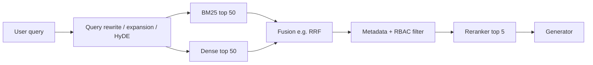

# Retrieval Metrics

> **TL;DR** — Retrieval is the most common root cause of bad RAG answers, and it is the cheapest stage to evaluate: once you have labeled relevant chunks, every metric is deterministic arithmetic over a ranked list. Use **recall@k** to know whether the right evidence reaches the LLM, **nDCG@k / MRR** to know whether it's ranked near the top, and evaluate each stage (query rewrite, hybrid search, reranker) separately to find where lift comes from.

**You'll learn:** hit rate, precision/recall/F1@k, MRR, MAP, nDCG, R-precision — formulas, a single worked example, and pure-Python code; binary vs graded relevance; how to get relevance labels; chunk- vs document-level matching pitfalls; per-stage evaluation of rewriting, hybrid search and reranking; embedding model selection; retrieval latency  ·  **Prerequisites:** [End-to-end RAG evals](./01-end-to-end-rag-evals.md), [Dataset strategy](../01-datasets/01-dataset-strategy.md)  ·  **Related:** [Synthetic datasets](../01-datasets/03-synthetic-datasets.md), [LLM-as-a-judge](./07-llm-as-a-judge.md), [Retrieval and context guardrails](../04-guardrails/03-retrieval-and-context-guardrails.md)

---

## 1. Setup and notation

For each query `q` in the eval set you need:

- **Ranked results** `[d_1, d_2, ..., d_n]` — chunk or document IDs your retriever returned, in order.
- **Relevance judgments** — either a set of relevant IDs `R` (**binary**) or a map `rel(d) ∈ {0,1,2,3}` (**graded**).
- A cut-off `k` — usually the number of chunks you actually pass to the LLM (e.g. 5 or 10), plus a larger `k` (e.g. 50) for the candidate pool before reranking.

Dataset row shape:

```json
{"query_id": "q_017",
 "query": "What is the laptop refresh policy for engineers?",
 "relevant": {"d1": 3, "d3": 2, "d5": 2, "d4": 1},
 "tags": {"type": "policy", "source": "it-handbook"}}
```

Every metric below is computed **per query**, then **averaged across queries** (macro-average). Always also look at the per-query distribution; a mean recall of 0.8 may be 80% of queries at 1.0 and 20% at 0.0.

### The running worked example

Query: *"What is the laptop refresh policy for engineers?"*

- Graded relevance labels: `d1 = 3` (the exact policy section), `d3 = 2` (engineering exception), `d5 = 2` (request process), `d4 = 1` (tangential mention). Everything else is 0. So `R = {d1, d3, d4, d5}`, `|R| = 4`.
- Retriever returns top 5: `[d7, d3, d1, d9, d4]`. Note `d5` was **not** retrieved.

| Rank | Doc | Graded rel | Binary rel | Hits so far | precision@rank |
|---|---|---|---|---|---|
| 1 | d7 | 0 | 0 | 0 | 0/1 = 0.00 |
| 2 | d3 | 2 | 1 | 1 | 1/2 = 0.50 |
| 3 | d1 | 3 | 1 | 2 | 2/3 = 0.67 |
| 4 | d9 | 0 | 0 | 2 | 2/4 = 0.50 |
| 5 | d4 | 1 | 1 | 3 | 3/5 = 0.60 |

We'll compute every metric on this one list.

---

## 2. Metric cards

### Hit rate@k

- **What it measures:** Whether **at least one** relevant item appears in the top k. Also called *success@k* or *top-k accuracy*.
- **Inputs required:** Ranked IDs, relevant set. Ground truth required (relevance labels).
- **How it's computed:**
  ```text
  hit@k = 1 if |top_k ∩ R| > 0 else 0
  hit_rate@k = mean over queries of hit@k
  ```
- **Score range & interpretation:** 0–1. "Fraction of queries where the LLM saw at least some relevant evidence."
- **Worked example:** hit@1 = 0 (d7 irrelevant); hit@3 = 1; hit@5 = 1.
- **Pitfalls / gotchas:** Ignores how many relevant items were found — misleading for multi-hop or multi-part questions that need several chunks.
- **When to use / when not to:** Great headline metric when most questions have a single answer-bearing chunk (typical of synthetic "generate a question from this chunk" datasets). Not sufficient for multi-chunk answers.
- **Implemented in:** LlamaIndex retrieval evaluator (`hit_rate`), ranx, pytrec_eval-style tooling (as success@k), or trivially by hand.

### Precision@k

- **What it measures:** The fraction of the top k that is relevant — how much of the context window is signal.
- **Inputs required:** Ranked IDs, relevant set.
- **How it's computed:**
  ```text
  precision@k = |top_k ∩ R| / k
  ```
- **Score range & interpretation:** 0–1. Upper-bounded by `|R|/k` — if a query has only 1 relevant chunk, precision@5 can never exceed 0.2.
- **Worked example:** precision@1 = 0; precision@3 = 2/3 ≈ 0.67; precision@5 = 3/5 = 0.60.
- **Pitfalls / gotchas:** Rank-unaware within the top k; penalises queries with few relevant items. Comparing precision@k across datasets with different `|R|` distributions is meaningless.
- **When to use / when not to:** Choosing k (how many chunks to stuff into the prompt) and measuring noise. For the "is the evidence there at all" question, use recall.
- **Implemented in:** ranx, pytrec_eval, LlamaIndex, RAGAS (non-LLM context precision variants), most IR libraries.

### Recall@k

- **What it measures:** The fraction of all relevant items that made it into the top k — *"did the LLM get everything it needed?"*
- **Inputs required:** Ranked IDs, relevant set (must be as **complete** as possible).
- **How it's computed:**
  ```text
  recall@k = |top_k ∩ R| / |R|
  ```
- **Score range & interpretation:** 0–1. For RAG, this is usually the **most important retrieval metric**: missing evidence cannot be recovered by the generator.
- **Worked example:** recall@1 = 0/4 = 0; recall@3 = 2/4 = 0.50; recall@5 = 3/4 = 0.75 (d5 missing).
- **Pitfalls / gotchas:** Only as good as the completeness of `R`. If labelers only marked one relevant chunk but three exist, you'll underestimate recall for systems that find the others — and may "regress" when you actually improved.
- **When to use / when not to:** Always. Report at the k you pass to the LLM, and at the candidate-pool k before reranking (recall@50 bounds what a reranker can achieve).
- **Implemented in:** ranx, pytrec_eval, LlamaIndex, RAGAS (non-LLM context recall), DeepEval (LLM-based contextual recall is the reference-answer analogue).

### F1@k

- **What it measures:** Harmonic mean of precision@k and recall@k.
- **How it's computed:**
  ```text
  F1@k = 2 · P@k · R@k / (P@k + R@k)
  ```
- **Worked example:** F1@5 = 2 · 0.60 · 0.75 / 1.35 ≈ 0.67.
- **Pitfalls / gotchas:** Blends two things you usually want to see separately; rank-unaware.
- **When to use / when not to:** Choosing a dynamic k or a similarity-score cut-off, where you trade precision against recall. Otherwise report P and R separately.
- **Implemented in:** Trivial to compute; several IR libraries.

### MRR (Mean Reciprocal Rank)

- **What it measures:** How high the **first** relevant result appears.
- **How it's computed:**
  ```text
  RR(q)  = 1 / rank of first relevant item   (0 if none in top k)
  MRR@k  = mean over queries of RR(q)
  ```
- **Score range & interpretation:** 0–1. MRR = 0.5 ≈ "first relevant result is typically at rank 2".
- **Worked example:** First relevant is d3 at rank 2 → RR = 0.5. Across three queries with RR = 0.5, 1.0 and 0 (nothing relevant retrieved) → MRR = 0.5.
- **Pitfalls / gotchas:** Ignores everything after the first hit; dominated by top-1 behaviour.
- **When to use / when not to:** Single-answer lookups, navigational queries, and evaluating "top-1 citation" behaviour. Not for multi-chunk answers.
- **Implemented in:** ranx, pytrec_eval, LlamaIndex (`mrr`), most IR libraries.

### MAP (Mean Average Precision)

- **What it measures:** Precision averaged over the positions of all relevant items — rewards getting *all* relevant items *early*.
- **How it's computed:**
  ```text
  AP(q) = (1 / |R|) · Σ_{k=1..n} precision@k · rel_k        # rel_k ∈ {0,1}
  MAP   = mean over queries of AP(q)
  ```
  Some implementations (including RAGAS context precision) divide by the number of relevant items **retrieved** instead of `|R|`; that variant ignores missed items. Know which one your library uses.
- **Score range & interpretation:** 0–1.
- **Worked example:** Relevant at ranks 2, 3, 5 with precision 0.50, 0.67, 0.60. Sum = 1.767.
  - Standard AP (÷ |R| = 4): **0.44**
  - "Retrieved-relevant" variant (÷ 3): **0.59**
- **Pitfalls / gotchas:** Hard to explain to stakeholders; binary only.
- **When to use / when not to:** Comparing rankers when queries have multiple relevant items and you lack graded labels.
- **Implemented in:** ranx, pytrec_eval, trec_eval.

### nDCG@k (normalised Discounted Cumulative Gain)

- **What it measures:** Ranking quality with **graded** relevance: highly relevant items should come first, and the gain from an item is discounted logarithmically by its rank.
- **How it's computed:**
  ```text
  DCG@k  = Σ_{i=1..k} gain(rel_i) / log2(i + 1)

  gain(rel) = 2^rel − 1      # "exponential" gain — emphasises highly relevant items (common default)
  gain(rel) = rel            # "linear" gain — also common

  IDCG@k = DCG@k of the ideal ordering (all labeled items sorted by rel, descending)
  nDCG@k = DCG@k / IDCG@k     (define as 0 if IDCG@k = 0)
  ```
- **Score range & interpretation:** 0–1; 1 = perfect ordering of the labeled relevant items.
- **Worked example (exponential gain):**
  - Grades by rank: `[0, 2, 3, 0, 1]` → gains `[0, 3, 7, 0, 1]`
  - Discounts `log2(i+1)`: `[1, 1.585, 2, 2.322, 2.585]`
  - DCG@5 = 0 + 3/1.585 + 7/2 + 0 + 1/2.585 = 1.893 + 3.5 + 0.387 = **5.780**
  - Ideal grades `[3, 2, 2, 1, 0]` → gains `[7, 3, 3, 1, 0]` → IDCG@5 = 7 + 1.893 + 1.5 + 0.431 = **10.823**
  - nDCG@5 = 5.780 / 10.823 ≈ **0.53** (with linear gain: ≈ 0.55)
- **Pitfalls / gotchas:**
  - Exponential vs linear gain gives different numbers — pin it.
  - IDCG must be computed from **all** labeled relevant items, not just the retrieved ones, otherwise missing `d5` would be invisible.
  - nDCG on binary labels works but loses its main advantage.
- **When to use / when not to:** The default ranking metric when you have graded labels (e.g. from an LLM judge on a 0–3 scale) and when evaluating rerankers. It's the primary metric on BEIR and MTEB retrieval tasks (nDCG@10).
- **Implemented in:** ranx, pytrec_eval, scikit-learn (`ndcg_score`), BEIR/MTEB evaluators.

### R-precision

- **What it measures:** Precision at `k = |R|` — i.e. "if I retrieve exactly as many items as there are relevant ones, what fraction is relevant?"
- **How it's computed:**
  ```text
  R-precision = |top_|R| ∩ R| / |R|
  ```
  At this cut-off, precision equals recall.
- **Worked example:** |R| = 4 → top 4 = `[d7, d3, d1, d9]` contains 2 relevant → **0.50**.
- **Pitfalls / gotchas:** Requires knowing |R| reliably; uninformative when |R| = 1 (becomes hit@1).
- **When to use / when not to:** Comparing systems across queries with very different numbers of relevant items. Less common in RAG practice.
- **Implemented in:** trec_eval, pytrec_eval, ranx.

### Summary of the worked example

| Metric | Value |
|---|---|
| hit@1 / hit@3 / hit@5 | 0 / 1 / 1 |
| precision@3 / precision@5 | 0.67 / 0.60 |
| recall@3 / recall@5 | 0.50 / 0.75 |
| F1@5 | 0.67 |
| Reciprocal rank | 0.50 |
| Average precision (÷ \|R\|) | 0.44 |
| nDCG@5 (exp. gain / linear gain) | 0.53 / 0.55 |
| R-precision | 0.50 |

---

## 3. Pure-Python implementation

Framework-agnostic, no dependencies. Use it as a reference implementation and to sanity-check library outputs.

```python
import math
from statistics import mean

def hit_at_k(ranked: list[str], relevant: set[str], k: int) -> float:
    return 1.0 if any(d in relevant for d in ranked[:k]) else 0.0

def precision_at_k(ranked: list[str], relevant: set[str], k: int) -> float:
    return sum(d in relevant for d in ranked[:k]) / k

def recall_at_k(ranked: list[str], relevant: set[str], k: int) -> float:
    if not relevant:
        return float("nan")  # undefined; exclude such queries (e.g. unanswerables)
    return sum(d in relevant for d in ranked[:k]) / len(relevant)

def f1_at_k(ranked: list[str], relevant: set[str], k: int) -> float:
    p, r = precision_at_k(ranked, relevant, k), recall_at_k(ranked, relevant, k)
    return 2 * p * r / (p + r) if (p + r) else 0.0

def reciprocal_rank(ranked: list[str], relevant: set[str], k: int | None = None) -> float:
    for i, d in enumerate(ranked[:k], start=1):
        if d in relevant:
            return 1.0 / i
    return 0.0

def average_precision(ranked: list[str], relevant: set[str], k: int | None = None) -> float:
    hits, total = 0, 0.0
    for i, d in enumerate(ranked[:k], start=1):
        if d in relevant:
            hits += 1
            total += hits / i
    return total / len(relevant) if relevant else 0.0

def r_precision(ranked: list[str], relevant: set[str]) -> float:
    r = len(relevant)
    return sum(d in relevant for d in ranked[:r]) / r if r else 0.0

def dcg(gains: list[float]) -> float:
    return sum(g / math.log2(i + 2) for i, g in enumerate(gains))

def ndcg_at_k(ranked: list[str], grades: dict[str, int], k: int,
              exponential: bool = True) -> float:
    gain = (lambda g: 2 ** g - 1) if exponential else (lambda g: g)
    actual = [gain(grades.get(d, 0)) for d in ranked[:k]]
    ideal = [gain(g) for g in sorted(grades.values(), reverse=True)[:k]]
    idcg = dcg(ideal)
    return dcg(actual) / idcg if idcg else 0.0


# --- worked example ---
ranked = ["d7", "d3", "d1", "d9", "d4"]
grades = {"d1": 3, "d3": 2, "d5": 2, "d4": 1}
relevant = {d for d, g in grades.items() if g > 0}

assert hit_at_k(ranked, relevant, 1) == 0.0
assert round(precision_at_k(ranked, relevant, 5), 2) == 0.60
assert round(recall_at_k(ranked, relevant, 5), 2) == 0.75
assert round(f1_at_k(ranked, relevant, 5), 2) == 0.67
assert reciprocal_rank(ranked, relevant) == 0.5
assert round(average_precision(ranked, relevant), 2) == 0.44
assert r_precision(ranked, relevant) == 0.5
assert round(ndcg_at_k(ranked, grades, 5), 2) == 0.53
assert round(ndcg_at_k(ranked, grades, 5, exponential=False), 2) == 0.55


def evaluate(run: dict[str, list[str]], qrels: dict[str, dict[str, int]],
             ks=(1, 3, 5, 10)) -> dict[str, float]:
    """run: query_id -> ranked IDs; qrels: query_id -> {doc_id: grade}. Macro-averaged."""
    rows = []
    for qid, grades in qrels.items():
        rel = {d for d, g in grades.items() if g > 0}
        if not rel:
            continue  # unanswerable queries are evaluated elsewhere (abstention)
        ranked = run.get(qid, [])
        row = {"mrr": reciprocal_rank(ranked, rel), "map": average_precision(ranked, rel)}
        for k in ks:
            row[f"hit@{k}"] = hit_at_k(ranked, rel, k)
            row[f"recall@{k}"] = recall_at_k(ranked, rel, k)
            row[f"precision@{k}"] = precision_at_k(ranked, rel, k)
            row[f"ndcg@{k}"] = ndcg_at_k(ranked, grades, k)
        rows.append(row)
    return {m: mean(r[m] for r in rows) for m in rows[0]} if rows else {}
```

For production use, established libraries such as [ranx](https://github.com/AmenRa/ranx) or [pytrec_eval](https://github.com/cvangysel/pytrec_eval) (a Python wrapper around the TREC evaluation tool) compute these with standard definitions and support significance tests.

---

## 4. Choosing concepts: binary vs graded, rank-aware vs rank-unaware

| | Rank-unaware | Rank-aware |
|---|---|---|
| **Binary relevance** | hit@k, precision@k, recall@k, F1@k, R-precision | MRR, MAP / AP |
| **Graded relevance** | (graded recall variants, rarely used) | **nDCG@k** |

- **Binary** labels are cheaper and more consistent between labelers. Start here.
- **Graded** labels (e.g. 0 = irrelevant, 1 = tangential, 2 = partially answers, 3 = fully answers) capture "this chunk answers it vs. merely mentions it" and are worth it once you're tuning rerankers.
- **Does rank matter for RAG?** Less than for web search — the LLM sees all k chunks — but it still matters: rank affects what survives truncation, what the model attends to (long-context models are known to under-use information in the middle of the context), and which chunk gets cited first. Use recall@k as the primary metric and nDCG@k / MRR as secondary.

### Which metric when

| Situation | Primary metric | Secondary | Why |
|---|---|---|---|
| "Is the evidence reaching the LLM at all?" | **recall@k** (k = chunks in prompt) | hit@k | Missing evidence is unrecoverable downstream |
| Synthetic dataset, one source chunk per question | **hit@k**, MRR | recall@k (= hit@k here) | Only one relevant item is known |
| Tuning a reranker | **nDCG@k** (k = post-rerank count) | MRR, recall@k | Reranking is about order |
| Choosing k / similarity cut-off | precision@k, recall@k curves | F1@k | Explicit noise vs coverage trade-off |
| Multi-hop / multi-part questions | recall@k | MAP | Need *all* pieces |
| Navigational / single-answer lookups ("Where is the VPN guide?") | MRR | hit@1 | Top-1 is what matters |
| Comparing to public benchmarks (BEIR, MTEB) | nDCG@10 | recall@100 | Their headline metrics |
| Candidate generation before reranking | recall@50/100 | — | Upper bound on what the reranker can do |
| No chunk labels, only reference answers | LLM-based context recall / precision ([01](./01-end-to-end-rag-evals.md)) | — | Labels unavailable |

---

## 5. Getting relevance labels

Retrieval metrics need `qrels` (query → relevant IDs). Three sources, usually combined:

| Source | How | Cost | Quality | Main risk |
|---|---|---|---|---|
| **SME labels** | Experts mark relevant chunks/docs for each query, ideally from a **pooled** candidate list (union of top-k from several retrievers) | High | Highest | Incomplete `R` if labelers only look at one system's results |
| **LLM-judged relevance** | An LLM grades `(query, chunk)` pairs on a 0–3 rubric; validate on a human-labeled sample | Medium | Good if calibrated | Judge bias toward lexical overlap or verbose chunks; cost scales with pool size |
| **Synthetic from source chunk** | Generate a question from a chunk; that chunk is the relevant item ([synthetic datasets](../01-datasets/03-synthetic-datasets.md)) | Low | Partial | `R` has exactly one item, but other chunks may also answer → false "misses"; questions overly lexically similar to the chunk inflate BM25 |

**Recommended approach (heuristic):**

- [ ] Start with synthetic questions per chunk for a fast hit@k / MRR baseline.
- [ ] **Pool** the top-20 from 2–3 different retrievers (BM25, dense, hybrid) for each query; have an LLM judge grade each pooled chunk 0–3.
- [ ] Have SMEs review a sample (e.g. 100 pairs) to measure judge–human agreement (Cohen's κ; see [LLM-as-a-judge](./07-llm-as-a-judge.md)). Fix the rubric if agreement is poor.
- [ ] Re-pool whenever you add a new retriever — unlabeled-but-relevant chunks from the new system are otherwise counted as misses.
- [ ] Rewrite synthetic questions to remove verbatim phrases from the source chunk, or the eval will favour lexical search.

LLM relevance prompt sketch:

```text
Query: {query}
Passage: {chunk_text}

Grade how well the passage helps answer the query:
3 = directly and fully answers it
2 = answers part of it or provides essential supporting info
1 = on-topic but does not help answer
0 = irrelevant
Reply with JSON: {"reason": "...", "grade": 0|1|2|3}
```

---

## 6. Chunk-level vs document-level matching pitfalls

Your labels and your retriever often disagree on **granularity**, and naive ID matching silently produces wrong numbers.

| Pitfall | Symptom | Fix |
|---|---|---|
| **Re-chunking breaks labels** | You change chunk size from 512 to 256 tokens and recall "drops" to near zero — chunk IDs changed | Label at a stable granularity: (doc_id, character span) or answer-bearing text; map to chunks at eval time by **overlap** |
| **Labels at doc level, retrieval at chunk level** | Any chunk from the right doc counts as a hit, even if it's the wrong section | Report both doc-level and span-level metrics; for doc-level, dedupe chunks to docs before computing rank metrics |
| **Duplicate / near-duplicate chunks** | Same text in multiple docs (copied policies, versions); retrieving the "other" copy counts as a miss | Deduplicate the corpus or define equivalence classes of chunk IDs |
| **Multiple valid sources** | Synthetic data marks one chunk relevant; another chunk answers equally well | Pool + judge (section 5), or use an answer-based criterion (does the chunk contain the answer string/claims?) |
| **Stale versions** | Old policy version is "relevant" by text but wrong by date | Include version/effective-date in labels; treat superseded docs as grade 0 or a separate "stale" label |
| **Overlapping chunks (sliding window)** | Neighbouring chunks both contain the answer; counting both inflates precision | Merge overlapping hits or match by span coverage |

Span-overlap matching sketch:

```python
def chunk_is_relevant(chunk: dict, gold_spans: list[dict], min_overlap: float = 0.5) -> bool:
    """chunk / gold span: {"doc_id": str, "start": int, "end": int} in character offsets."""
    for g in gold_spans:
        if chunk["doc_id"] != g["doc_id"]:
            continue
        overlap = max(0, min(chunk["end"], g["end"]) - max(chunk["start"], g["start"]))
        if overlap / (g["end"] - g["start"]) >= min_overlap:
            return True
    return False
```

---

## 7. Evaluating each retrieval stage

A modern retrieval pipeline has several stages. Measure the **same metrics at the output of each stage** on the same queries, so you can attribute lift.



| Stage | What to compare | Metric | Notes |
|---|---|---|---|
| **Query rewriting** (expansion, decomposition, HyDE, conversational rewrite) | Retrieval with original query vs rewritten query, same retriever | recall@k, MRR | Also eval the rewrite itself on multi-turn data: does "what about for contractors?" become a standalone query? An LLM judge can grade rewrite faithfulness. Watch latency. |
| **Lexical (BM25)** | — | recall@50 | Strong on IDs, error codes, product names, acronyms |
| **Dense** | Embedding model A vs B | recall@50, nDCG@10 | Strong on paraphrase / semantic queries |
| **Hybrid fusion** | BM25 alone, dense alone, fused | recall@50, nDCG@10 per **query slice** | Reciprocal Rank Fusion (RRF) is a robust default; tune weights only with enough data. Hybrid usually wins on mixed query sets — verify on yours. |
| **Filters (metadata, RBAC)** | With vs without filter | recall@k for each role | A filter that's too strict looks like a retrieval failure. Test that restricted docs are **never** returned for unauthorised roles (should be 0, not "low") — see [access control](../04-guardrails/06-access-control-rbac.md). |
| **Reranker** | Fused top-N in original order vs reranked | nDCG@5, MRR, recall@5 | **Reranker lift** = metric(after) − metric(before). The ceiling is recall@N of the candidate pool. |
| **Final context** (after dedup/truncation) | — | recall@k at the prompt | What the LLM actually saw |

**Reranker lift example (illustrative):** if recall@50 of the fused pool is 0.92, recall@5 before reranking is 0.61 and after reranking 0.79, the reranker recovered (0.79 − 0.61) / (0.92 − 0.61) ≈ 58% of the recoverable gap. If recall@50 were 0.65, no reranker could fix it — work on candidate generation instead.

```python
def stage_report(stages: dict[str, dict[str, list[str]]], qrels, ks=(5, 10, 50)):
    """stages: stage_name -> run (query_id -> ranked ids). Prints recall/nDCG per stage."""
    for name, run in stages.items():
        m = evaluate(run, qrels, ks=ks)
        print(f"{name:12s} " + "  ".join(f"{k}={v:.3f}" for k, v in m.items()
                                          if k.startswith(("recall", "ndcg"))))
```

**Slice the results.** Hybrid and rewriting gains typically concentrate in specific query types (exact identifiers, acronyms, conversational follow-ups). An aggregate +1 point may be +10 on one slice and −2 on another.

---

## 8. Embedding model choice: MTEB and BEIR as references

- **[BEIR](https://github.com/beir-cellar/beir)** (Thakur et al., 2021) is a heterogeneous zero-shot retrieval benchmark across many domains; its main finding was that BM25 is a surprisingly strong baseline out-of-domain and that dense models don't automatically generalise.
- **[MTEB](https://huggingface.co/spaces/mteb/leaderboard)** (Muennighoff et al., 2022) is a broad embedding benchmark that includes BEIR-style retrieval tasks; its leaderboard is the usual starting point for shortlisting embedding models.

Use them to **shortlist**, never to decide:

- [ ] Shortlist 3–4 embedding models from MTEB's *retrieval* tasks (not the overall average), filtered by your constraints: language coverage, max input length, dimension/storage cost, license, hosting (API vs self-hosted), latency.
- [ ] Evaluate each on **your** labeled queries with recall@k and nDCG@10, alone and in hybrid with BM25.
- [ ] Check domain-specific slices: internal jargon, acronyms, code, tables, non-English queries.
- [ ] Factor in the cost of re-embedding the corpus when switching models later.
- [ ] Be wary of leaderboard overfitting and benchmark contamination; rankings on public benchmarks often don't hold on enterprise data.

---

## 9. Retrieval latency and cost

Retrieval quality improvements often add latency (rewriting = an extra LLM call; reranker = a cross-encoder pass over N candidates).

| Component | What to measure | Notes |
|---|---|---|
| Query rewrite | p50/p95 latency, tokens | Often the most expensive retrieval step if it's an LLM call |
| Vector search | p50/p95 latency vs index size, recall vs exact search | ANN index parameters trade recall for speed; measure ANN recall against brute-force on a sample |
| Reranker | latency vs number of candidates N | Roughly linear in N; tune N with the recall@N curve |
| End-to-end retrieval | p95 latency budget share | Heuristic: keep retrieval to a minority of the total latency budget for chat UX |

Plot quality vs latency for each configuration and pick from the **Pareto frontier** — don't pick the top-quality configuration if a cheaper one is within noise.

---

## 10. Checklist

- [ ] Every query has labels at a granularity that survives re-chunking (doc + span).
- [ ] Labels come from pooled candidates across multiple retrievers.
- [ ] Unanswerable queries are excluded from recall/MRR and evaluated via abstention ([01](./01-end-to-end-rag-evals.md#311-abstention-correctness-i-dont-know)).
- [ ] Report recall@k at the prompt k, recall@N at the candidate pool, nDCG@k after reranking, and MRR.
- [ ] Measure each stage on the same queries; report reranker lift and hybrid lift per slice.
- [ ] Test RBAC filters: zero leakage of restricted docs per role.
- [ ] Track retrieval latency p95 alongside quality.
- [ ] Re-run retrieval evals whenever chunking, embeddings, index parameters or the corpus change significantly.

---

## Key takeaways

- **Recall@k is the primary RAG retrieval metric** — the generator cannot use evidence it never saw. Add nDCG@k / MRR for ordering.
- Metrics are only as good as the **completeness of relevance labels**: pool candidates, use calibrated LLM judges, and re-pool when adding systems.
- **Label at a stable granularity** (doc + span), or chunking changes will silently break your metrics.
- Evaluate **every stage** (rewrite, BM25, dense, fusion, filters, reranker) on the same queries to attribute lift; the candidate pool's recall bounds the reranker.
- Use MTEB/BEIR to shortlist embedding models, then decide on **your** data.
- Track latency alongside quality and choose from the quality–latency Pareto frontier.

## Further reading

- Thakur et al., *BEIR: A Heterogenous Benchmark for Zero-shot Evaluation of Information Retrieval Models* — [arXiv:2104.08663](https://arxiv.org/abs/2104.08663)
- Muennighoff et al., *MTEB: Massive Text Embedding Benchmark* — [arXiv:2210.07316](https://arxiv.org/abs/2210.07316) · [Leaderboard](https://huggingface.co/spaces/mteb/leaderboard)
- Liu et al., *Lost in the Middle: How Language Models Use Long Contexts* — [arXiv:2307.03172](https://arxiv.org/abs/2307.03172)
- Cormack, Clarke & Büttcher, *Reciprocal Rank Fusion outperforms Condorcet and individual Rank Learning Methods* (SIGIR 2009)
- Manning, Raghavan & Schütze, *Introduction to Information Retrieval*, ch. 8 "Evaluation in information retrieval" — [online book](https://nlp.stanford.edu/IR-book/)
- [ranx](https://github.com/AmenRa/ranx) · [pytrec_eval](https://github.com/cvangysel/pytrec_eval)
- Within this repo: [End-to-end RAG evals](./01-end-to-end-rag-evals.md) · [Synthetic datasets](../01-datasets/03-synthetic-datasets.md) · [Retrieval and context guardrails](../04-guardrails/03-retrieval-and-context-guardrails.md) · [Metric cheatsheet](../05-decision-framework/03-metric-cheatsheet.md)
