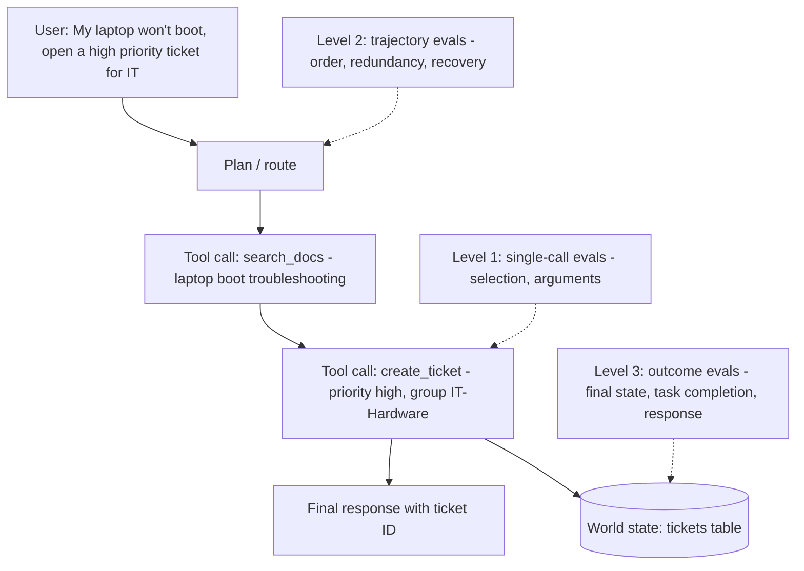
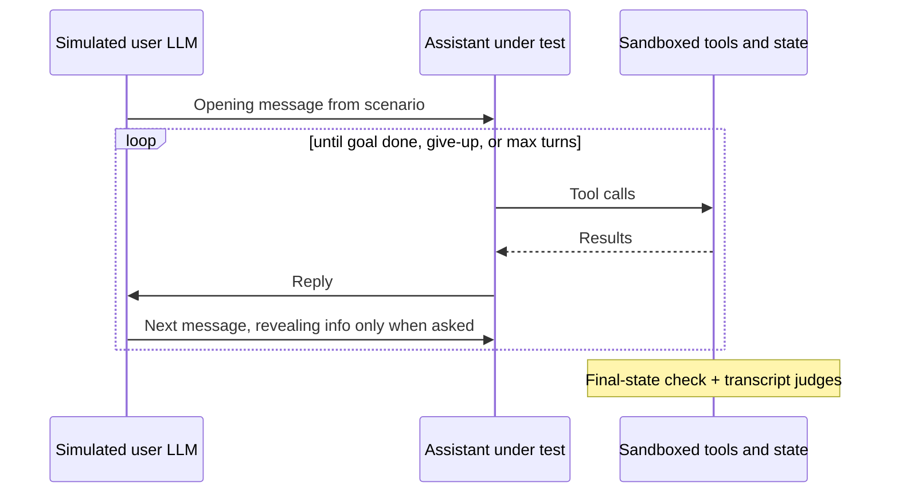

# Agent Tool and Trajectory Evals

> **TL;DR** — Agents fail in ways a final-answer metric can't localise: wrong tool, wrong arguments, wrong order, redundant calls, no recovery from errors, or a correct-sounding answer while the world state is wrong. Evaluate at three levels: **single tool calls** (selection + arguments), the **trajectory** (sequence of steps), and the **outcome** (final state / task completion) — plus efficiency, routing, and multi-turn behaviour with simulated users.

**You'll learn:** tool selection and argument accuracy, tool-call precision/recall/F1, ordering and unnecessary-call metrics, error-recovery tests, trajectory match modes (exact, in-order, any-order, superset/subset) and LLM-judged trajectories, final-state checks (τ-bench style) and pass^k, efficiency metrics, planning quality, routing confusion matrices, multi-turn and simulated-user evals — with pure-Python matching code  ·  **Prerequisites:** [Agentic RAG failure modes](../00-foundations/03-agentic-rag-failure-modes.md), [Dataset strategy](../01-datasets/01-dataset-strategy.md)  ·  **Related:** [Text-to-SQL evals](./05-text-to-sql-evals.md), [LLM-as-a-judge](./07-llm-as-a-judge.md), [Tool and action guardrails](../04-guardrails/05-tool-and-action-guardrails.md), [Observability & tracing](../03-online-evals-and-observability/02-observability-and-tracing.md)

---

## 1. What you're evaluating

Running example: the enterprise assistant has tools such as

```text
search_docs(query: str, top_k: int = 5)
run_sql(sql: str)                         # read-only warehouse
get_user_profile(user_id: str)
create_ticket(title: str, description: str, priority: "low"|"medium"|"high", assignee_group: str)
update_ticket(ticket_id: str, status: "open"|"in_progress"|"closed")
```

An agent run produces a **trace**: a sequence of steps, each an LLM decision followed by zero or more tool calls and their results, ending in a final response (and possibly a changed world state).



| Level | Question | Needs | Cost | Brittleness |
|---|---|---|---|---|
| **1. Single call** | Did it pick the right tool with the right arguments at this step? | Input (+ history) → expected call(s) | Low | Low — great for unit tests |
| **2. Trajectory** | Was the sequence of steps reasonable? | Input → reference trajectory, or a judge rubric | Medium | **High** — many valid paths exist |
| **3. Outcome** | Is the world in the right state and was the user told the right thing? | Input + initial state → expected final state / success criteria | Medium–high (needs sandbox) | Low — path-independent |

**Opinion:** anchor on **outcome** evals (they're path-independent and reflect what users care about), use **single-call** evals as fast unit tests for tool descriptions and schemas, and use **trajectory** evals mainly for diagnosis, efficiency, and safety-critical orderings — not as a strict gate.

### Dataset row shape

```json
{
  "id": "agent_042",
  "input": "My laptop won't boot. Open a high-priority ticket for IT.",
  "user": {"id": "u_381", "role": "engineer"},
  "initial_state": "fixtures/tickets_empty.sql",
  "expected_calls": [
    {"name": "create_ticket",
     "args": {"priority": "high", "assignee_group": "IT-Hardware"},
     "match": {"title": "semantic", "description": "semantic"}}
  ],
  "optional_calls": ["search_docs", "get_user_profile"],
  "forbidden_calls": ["update_ticket"],
  "expected_final_state": {"tickets": [{"priority": "high", "assignee_group": "IT-Hardware", "requester": "u_381"}]},
  "response_must_include": ["ticket ID"]
}
```

Note `optional_calls` and `forbidden_calls`: strict reference trajectories punish valid alternatives, so encode what's **required**, what's **allowed**, and what's **forbidden**. See [SME golden datasets](../01-datasets/02-sme-golden-datasets.md) for how to author these.

---

## 2. Single tool-call metrics

### 2.1 Tool selection accuracy

- **What it measures:** Whether the agent chose the correct tool (or correctly chose **no** tool) at a decision point.
- **Inputs required:** Input + conversation state; expected tool name(s). Ground truth required.
- **How it's computed:**
  ```text
  tool_selection_accuracy = |cases where predicted tool set == expected tool set| / |cases|
  ```
  Include **no-tool** cases ("Thanks!", "What can you do?") and **ambiguous** cases where the right move is a clarifying question.
- **Score range & interpretation:** 0–1. Break down by tool with a confusion matrix (section 6) — errors concentrate between tools with overlapping descriptions (e.g. `search_docs` vs `run_sql` for "how many open tickets?").
- **Pitfalls / gotchas:** With many tools (dozens+), selection accuracy degrades; measure as you add tools. Tool **descriptions** are prompts — version them and re-run this eval on every edit.
- **When to use / when not to:** Always; it's the cheapest agent eval (one LLM call per case, no tool execution needed).
- **Implemented in:** DeepEval (`ToolCorrectnessMetric`), RAGAS (`ToolCallAccuracy`), promptfoo (`is-valid-openai-tools-call`, `javascript`/`python` assertions on tool calls), LangChain `agentevals`.

### 2.2 Tool argument correctness

Arguments are where most tool-call bugs live. Use the right matcher **per argument**:

| Matcher | Use for | Example |
|---|---|---|
| **Schema validity** | Every call — gate before anything else | `priority` ∈ enum; required fields present; types correct |
| **Exact match** (after normalisation) | IDs, enums, booleans, numbers | `ticket_id == "INC-1042"`, `priority == "high"` |
| **Normalised match** | Dates, case-insensitive strings, whitespace, units | `"2026-10-15"` vs `"15 Oct 2026"` |
| **Numeric tolerance** | Floats, amounts | `abs(a - b) <= 0.01` |
| **Set/unordered match** | List arguments where order doesn't matter | `cc=["a","b"] == ["b","a"]` |
| **Semantic match** | Free text: titles, descriptions, search queries | Embedding similarity ≥ τ, or an LLM judge: "does this title describe a laptop boot failure?" |
| **Execution-based match** | Code/SQL arguments | Run both and compare results — see [text-to-SQL evals](./05-text-to-sql-evals.md) |
| **Don't care** | Arguments with many valid values | `top_k` |

- **What it measures:** Whether the arguments of the correct tool call are valid and correct.
- **Inputs required:** Predicted call, expected call with per-argument matchers, JSON schema of the tool.
- **How it's computed:**
  ```text
  schema_validity_rate = |calls passing JSON-schema validation| / |calls|
  arg_accuracy(call)   = |expected args matched| / |expected args|
  call_exact_correct   = tool name matches AND all required args matched
  ```
  BFCL popularised **AST-based** matching: parse the call and compare function name, required parameters, and parameter values against a set of acceptable values per parameter — a structured version of the table above.
- **Score range & interpretation:** 0–1. Schema validity should be ~100% with modern structured-output/function-calling APIs; if not, fix that first (it's an integration bug, not a model-quality issue).
- **Pitfalls / gotchas:**
  - **Hallucinated arguments:** the model invents a `user_id` or `ticket_id` that wasn't in context. Check that ID-like arguments appear in the conversation or prior tool results (a **provenance check**).
  - **Over-specified arguments:** the model fills optional fields with guesses. Decide whether extra optional args are errors.
  - Semantic-match thresholds need calibration on human-labeled pairs.
- **When to use / when not to:** Always, for every tool with side effects. For read-only search tools, prefer judging *outcome* (did retrieval succeed — see [retrieval metrics](./02-retrieval-metrics.md)) over exact query strings.
- **Implemented in:** DeepEval (`ToolCorrectnessMetric` can compare input parameters), RAGAS (`ToolCallAccuracy` with argument comparison), BFCL (AST evaluation), promptfoo (custom assertions), custom.

### 2.3 Tool-call precision, recall and F1

When a task needs **several** calls, treat the expected calls as a set and compute precision/recall over matched calls.

- **What it measures:** Coverage of required calls (recall) and avoidance of wrong/unnecessary calls (precision).
- **Inputs required:** Predicted calls (from the trace), expected calls, matchers. Ground truth required.
- **How it's computed:**
  ```text
  matched = one-to-one matching between predicted and expected calls (name + args)
  precision = |matched| / |predicted calls|            (excluding allowed optional calls)
  recall    = |matched| / |expected calls|
  F1        = 2PR / (P + R)
  ```
- **Worked example:** Expected `{create_ticket(high, IT-Hardware)}`, optional `{search_docs}`. Predicted: `search_docs(...)`, `get_user_profile(u_381)`, `create_ticket(medium, IT-Hardware)`, `create_ticket(high, IT-Hardware)`.
  - `search_docs` is optional → ignored. `get_user_profile` — if listed as optional, ignored; otherwise unnecessary.
  - `create_ticket(medium, ...)` doesn't match (wrong priority) → FP; `create_ticket(high, ...)` matches → TP.
  - With `get_user_profile` optional: P = 1/2, R = 1/1 → F1 = 0.67. And a **duplicate ticket was created** — the outcome check should also fail.
- **Pitfalls / gotchas:** Matching must be **one-to-one** (one predicted call can't satisfy two expected calls). Retries after an error are not "unnecessary" — handle them via error-recovery evals.
- **When to use / when not to:** Multi-call tasks where order is irrelevant. For order-sensitive tasks add the ordering metric below.
- **Implemented in:** RAGAS (`ToolCallF1`), DeepEval (`ToolCorrectnessMetric`), Vertex AI Gen AI evaluation service (trajectory precision/recall), custom.

### 2.4 Ordering and dependencies

- **What it measures:** Whether calls that must happen in sequence did (e.g. `get_user_profile` before `create_ticket` that needs the user's location; **confirmation before** a destructive action).
- **How it's computed:** Specify ordering **constraints** rather than a full order: `A before B`. Then:
  ```text
  ordering_accuracy = |satisfied precedence constraints| / |precedence constraints|
  ```
  Or use the in-order trajectory match (section 3).
- **Pitfalls / gotchas:** Over-constraining order makes evals brittle when the agent parallelises independent calls. Only encode true dependencies.
- **Implemented in:** LangChain `agentevals` (trajectory match modes), Vertex AI (in-order match), custom.

### 2.5 Unnecessary and forbidden calls

- **What it measures:** Wasted or dangerous actions — redundant searches, repeated identical calls, calls to tools not needed for the task, or calls the user's role must not trigger.
- **How it's computed:**
  ```text
  unnecessary_call_rate = |calls not matched to expected and not in optional| / |calls|
  duplicate_call_rate   = |calls identical (name+args) to an earlier call in the same run| / |calls|
  forbidden_call_rate   = |runs with ≥1 forbidden call| / |runs|          # target 0
  ```
- **Pitfalls / gotchas:** A forbidden call that the **tool layer** correctly rejected (permission denied) is still an agent-behaviour bug worth counting — but it's also proof your [tool guardrail](../04-guardrails/05-tool-and-action-guardrails.md) works. Track both.
- **When to use / when not to:** Always count duplicates and forbidden calls; they're cheap and catch loops and policy breaches.
- **Implemented in:** Custom (trivial over traces); LLM-judged trajectory rubrics can flag them qualitatively.

### 2.6 Error recovery

- **What it measures:** Whether the agent handles tool failures gracefully: retries sensibly, fixes bad arguments after a validation error, falls back to an alternative, or tells the user — rather than looping, hallucinating a result, or claiming success.
- **Inputs required:** Test cases with **injected faults** (mocked tools that time out, return 500, return a validation error, return empty results, or return a permission error).
- **How it's computed:** Per fault type, label the desired behaviour and check it:
  ```text
  recovery_rate          = |fault runs ending in correct recovery behaviour| / |fault runs|
  false_success_rate     = |fault runs where the agent claims success| / |fault runs|     # worst failure
  max_retries_exceeded   = |runs exceeding retry budget|
  ```
- **Worked example:** `create_ticket` returns `{"error": "assignee_group 'IT Hardware' not found; valid: IT-Hardware, IT-Software"}`. Good: one retry with `IT-Hardware`. Bad: telling the user "Ticket created!" (false success), or retrying the same invalid value five times.
- **Pitfalls / gotchas:** Mock faults must look like your real tool errors. Don't forget **partial** failures (one of three calls fails).
- **When to use / when not to:** Every agent with side-effecting tools. False-success rate is one of the highest-value agent metrics.
- **Implemented in:** Mostly custom (fault-injection mocks + assertions); judges can grade the final message.

```python
import random

def flaky(tool_fn, fail_rate: float = 1.0, error: dict | None = None):
    """Wrap a mocked tool to inject faults in offline runs."""
    error = error or {"error": "503 Service Unavailable"}
    def wrapped(**kwargs):
        if random.random() < fail_rate:
            return error
        return tool_fn(**kwargs)
    return wrapped
```

---

## 3. Trajectory evaluation

A trajectory is the ordered list of tool calls (optionally with intermediate reasoning and results). Compare the predicted trajectory `P` with a reference trajectory `E`.

### 3.1 Match modes

| Mode | Passes when | Use for |
|---|---|---|
| **Exact (strict)** | `P == E` element-wise (same calls, same order, same length) | Deterministic workflows, regression tests of a fixed pipeline |
| **In-order** | All of `E` appear in `P` in the same relative order; extra calls allowed | Required sequences with tolerated detours |
| **Any-order (unordered)** | `P` and `E` contain the same calls, any order | Independent calls (parallel lookups) |
| **Superset** | `P ⊇ E` — all expected calls present, extras allowed | "Must at least do X and Y" |
| **Subset** | `P ⊆ E` — no calls outside the reference | "Must not do anything else" (safety, cost) |
| **Precision / recall** | Fractional scores rather than pass/fail | Dashboards and trend lines |

Names vary by tool: LangChain's `agentevals` offers `strict`, `unordered`, `subset`, `superset` modes; Vertex AI's evaluation service names them exact match, in-order match, any-order match, plus trajectory precision/recall. Always state how **arguments** are compared inside each mode (name-only, exact args, or per-argument matchers).

### 3.2 Pure-Python tool-call and trajectory matching

```python
import json
from collections import Counter
from typing import Callable

Call = dict  # {"name": str, "args": dict}
Matcher = Callable[[object, object], bool]

def exact(a, b) -> bool:
    return a == b

def norm_str(a, b) -> bool:
    return str(a).strip().lower() == str(b).strip().lower()

def unordered_list(a, b) -> bool:
    return Counter(map(json.dumps, a)) == Counter(map(json.dumps, b))

def numeric(tol: float = 1e-6) -> Matcher:
    return lambda a, b: abs(float(a) - float(b)) <= tol

def call_matches(pred: Call, exp: Call, matchers: dict[str, Matcher] | None = None,
                 ignore_extra_args: bool = True) -> bool:
    """Name must match; each expected arg must match with its matcher (default: exact)."""
    if pred["name"] != exp["name"]:
        return False
    matchers = matchers or {}
    for key, exp_val in exp.get("args", {}).items():
        if key not in pred.get("args", {}):
            return False
        if not matchers.get(key, exact)(pred["args"][key], exp_val):
            return False
    if not ignore_extra_args and set(pred.get("args", {})) - set(exp.get("args", {})):
        return False
    return True

def match_calls(pred: list[Call], exp: list[Call], **kw) -> list[tuple[int, int]]:
    """Greedy one-to-one matching; returns (pred_idx, exp_idx) pairs."""
    used, pairs = set(), []
    for j, e in enumerate(exp):
        for i, p in enumerate(pred):
            if i not in used and call_matches(p, e, **kw):
                used.add(i)
                pairs.append((i, j))
                break
    return pairs

def tool_call_prf(pred: list[Call], exp: list[Call], optional: set[str] = frozenset(), **kw) -> dict:
    pairs = match_calls(pred, exp, **kw)
    matched_pred = {i for i, _ in pairs}
    counted_pred = [i for i, p in enumerate(pred) if i in matched_pred or p["name"] not in optional]
    p = len(pairs) / len(counted_pred) if counted_pred else (1.0 if not exp else 0.0)
    r = len(pairs) / len(exp) if exp else 1.0
    f1 = 2 * p * r / (p + r) if (p + r) else 0.0
    return {"precision": p, "recall": r, "f1": f1}

def trajectory_match(pred: list[Call], exp: list[Call], mode: str = "in_order", **kw) -> bool:
    if mode == "exact":
        return len(pred) == len(exp) and all(call_matches(p, e, **kw) for p, e in zip(pred, exp))
    if mode == "in_order":                       # exp is a subsequence of pred
        j = 0
        for p in pred:
            if j < len(exp) and call_matches(p, exp[j], **kw):
                j += 1
        return j == len(exp)
    pairs = match_calls(pred, exp, **kw)
    if mode == "any_order":
        return len(pairs) == len(exp) == len(pred)
    if mode == "superset":                       # every expected call is present
        return len(pairs) == len(exp)
    if mode == "subset":                         # every predicted call is expected
        return len(pairs) == len(pred)
    raise ValueError(mode)


# --- worked example from 2.3 ---
pred = [
    {"name": "search_docs", "args": {"query": "laptop won't boot"}},
    {"name": "get_user_profile", "args": {"user_id": "u_381"}},
    {"name": "create_ticket", "args": {"priority": "medium", "assignee_group": "IT-Hardware", "title": "Laptop boot failure"}},
    {"name": "create_ticket", "args": {"priority": "high", "assignee_group": "IT-Hardware", "title": "Laptop won't boot"}},
]
exp = [{"name": "create_ticket", "args": {"priority": "high", "assignee_group": "IT-Hardware"}}]
m = {"priority": norm_str, "assignee_group": norm_str}

print(tool_call_prf(pred, exp, optional={"search_docs", "get_user_profile"}, matchers=m))
# {'precision': 0.5, 'recall': 1.0, 'f1': 0.666...}
assert trajectory_match(pred, exp, "in_order", matchers=m)
assert trajectory_match(pred, exp, "superset", matchers=m)
assert not trajectory_match(pred, exp, "subset", matchers=m)
assert not trajectory_match(pred, exp, "exact", matchers=m)
```

Schema validation (use the same JSON Schema you give the model):

```python
from jsonschema import Draft202012Validator  # pip install jsonschema

def schema_errors(call: Call, schemas: dict[str, dict]) -> list[str]:
    if call["name"] not in schemas:
        return [f"unknown tool {call['name']}"]
    v = Draft202012Validator(schemas[call["name"]])
    return [e.message for e in v.iter_errors(call.get("args", {}))]
```

For free-text arguments, plug in a semantic matcher (embedding similarity with a calibrated threshold, or an LLM judge call) as an entry in `matchers`.

### 3.3 LLM-judged trajectory

When many trajectories are valid, a reference-free judge is more robust than matching.

- **What it measures:** Whether the sequence of steps was reasonable, efficient, safe and consistent with the tools' results.
- **Inputs required:** Full trace (input, each tool call + result, final response), tool descriptions, optionally a reference trajectory "for guidance".
- **How it's computed:** Judge with a rubric of **binary** checks, not a single 1–10 score:
  ```text
  Given the USER REQUEST, the AVAILABLE TOOLS, and the AGENT TRACE, answer each:
  1. Did the agent use tool results correctly (no ignoring or misreading results)?   yes/no
  2. Were any calls clearly unnecessary or repeated without reason?                  yes/no
  3. Did the agent take any action the user did not ask for or that needed confirmation? yes/no
  4. If a tool failed, did the agent respond appropriately?                         yes/no/n.a.
  5. Does the final response accurately reflect what actually happened?              yes/no
  Give a one-line reason per item. Output JSON.
  ```
- **Score range & interpretation:** Per-check pass rates. Check 5 ("final response matches what happened") catches false-success claims and is especially valuable.
- **Pitfalls / gotchas:** Long traces exceed judge attention; truncate tool results sensibly but keep error messages. Judges are lenient about inefficiency. Validate against human-labeled traces ([LLM-as-a-judge](./07-llm-as-a-judge.md)).
- **When to use / when not to:** Open-ended agents, research-style multi-step tasks, and online sampling where references don't exist.
- **Implemented in:** LangChain `agentevals` (LLM-as-judge trajectory evaluator), DeepEval (`TaskCompletionMetric` is judge-based over the trace), Vertex AI evaluation, Phoenix (agent/tool-calling eval templates), custom.

---

## 4. Outcome evaluation: final state and task completion

### 4.1 Final-state checks (τ-bench style)

- **What it measures:** Whether the environment ends up in the correct state — the strongest, path-independent signal for side-effecting agents.
- **Inputs required:** Initial state fixture, sandboxed tools that mutate a real (test) store, expected final state (or assertions on it). Ground truth required.
- **How it's computed:** Run the agent against a fresh copy of the state; afterwards query the state and compare to the expected state or assertions. **τ-bench** (Yao et al., 2024) does exactly this: tasks in simulated retail/airline domains with a database, an LLM-simulated user, and domain policies; success means the final database state matches the annotated goal state (plus required information conveyed to the user).
  ```text
  task_success = final_state satisfies all assertions AND response contains required info
  success_rate = mean(task_success)
  ```
- **Worked example:** After the laptop request, assert: exactly one new ticket; `priority == "high"`; `assignee_group == "IT-Hardware"`; `requester == "u_381"`; no other tables changed. The duplicate-ticket run from 2.3 **fails** ("exactly one new ticket") even though tool-call recall was 1.0.
- **Pitfalls / gotchas:**
  - Compare only relevant fields; ignore generated IDs and timestamps.
  - Assert on **absence** of side effects too (no extra tickets, no updates to other records).
  - Requires investment in sandboxes/fixtures — worth it for any agent that writes.
- **When to use / when not to:** Any agent with write actions. For read-only Q&A agents, the "state" is the answer — use [answer correctness](./01-end-to-end-rag-evals.md#33-answer-correctness).
- **Implemented in:** τ-bench (benchmark harness), custom harnesses; most eval platforms let you write a custom scorer that queries state.

```python
def state_diff(before: dict[str, list[dict]], after: dict[str, list[dict]],
               ignore: set[str] = frozenset({"id", "created_at", "updated_at"})) -> dict:
    """Return rows added per table (ignoring volatile fields). Simple illustrative diff."""
    def key(row):
        return json.dumps({k: v for k, v in row.items() if k not in ignore}, sort_keys=True)
    diff = {}
    for table in after:
        b = Counter(key(r) for r in before.get(table, []))
        a = Counter(key(r) for r in after[table])
        added = list((a - b).elements())
        removed = list((b - a).elements())
        if added or removed:
            diff[table] = {"added": [json.loads(x) for x in added],
                           "removed": [json.loads(x) for x in removed]}
    return diff

def assert_one_ticket(diff: dict, **expected) -> bool:
    added = diff.get("tickets", {}).get("added", [])
    other_tables_changed = set(diff) - {"tickets"}
    return (len(added) == 1 and not other_tables_changed
            and all(added[0].get(k) == v for k, v in expected.items()))
```

### 4.2 Task completion (judge-based)

When there's no checkable state (e.g. "find and summarise the three most relevant policies"), use a judge with explicit success criteria per task:

```text
TASK: {input}
SUCCESS CRITERIA: {criteria list from dataset}
TRACE: {trace}
For each criterion: met / not met + evidence from the trace. Then: task_completed = all met.
```

DeepEval (`TaskCompletionMetric`) and RAGAS (`AgentGoalAccuracy`, with or without reference) implement variants. Prefer dataset-specific criteria over a generic "was the task completed?".

### 4.3 Reliability across trials: pass^k

Agents are stochastic; one successful run doesn't mean the task is reliably solved. τ-bench introduced **pass^k**: the probability that **all k** independent trials of a task succeed (contrast with pass@k, where *any* success counts).

```text
For a task with n trials and c successes:
  pass^k (task) = C(c, k) / C(n, k)          # unbiased estimate, k ≤ n
pass^k = mean over tasks
```

```python
from math import comb

def pass_hat_k(successes_per_task: list[tuple[int, int]], k: int) -> float:
    """successes_per_task: [(c, n), ...] with n trials and c successes per task."""
    return sum(comb(c, k) / comb(n, k) for c, n in successes_per_task) / len(successes_per_task)

print(pass_hat_k([(4, 4), (3, 4), (2, 4)], k=1))  # 0.75 (= average success rate)
print(pass_hat_k([(4, 4), (3, 4), (2, 4)], k=4))  # 0.333...
```

**Use it** for any agent that acts on behalf of users: a task that succeeds 75% of the time fails users regularly. Heuristic: run each task 3–5 times for important suites and report pass^1 and pass^k.

---

## 5. Efficiency and planning

### 5.1 Step efficiency

- **What it measures:** Cost of getting to the outcome: steps (LLM turns), tool calls, tokens, latency, $.
- **Inputs required:** Traces. Optional reference "optimal" step count.
- **How it's computed:**
  ```text
  steps_per_task, tool_calls_per_task, tokens_per_task, cost_per_task, latency p50/p95
  step_efficiency = optimal_steps / actual_steps        (cap at 1; only for tasks with known optimum)
  cost_per_successful_task = total cost / successful tasks
  ```
- **Pitfalls / gotchas:** Only compare efficiency among **successful** runs, or a variant that gives up early looks efficient. Watch the tail: runaway loops show up in p99 steps, not the mean.
- **When to use / when not to:** Always report alongside success rate; gate on regressions (e.g. +25% tokens per success).
- **Implemented in:** Tracing platforms (Langfuse, LangSmith, Phoenix, Braintrust) capture token/latency; step metrics are easy to compute from traces.

### 5.2 Planning quality

- **What it measures:** For plan-then-execute agents: is the plan complete, correctly ordered, feasible with available tools, and minimal? Does execution follow the plan, and is the plan revised when results invalidate it?
- **How it's computed:** LLM judge with binary checks on the **plan artefact** (coverage of the user's sub-goals, feasibility per step, unnecessary steps), plus a plan-adherence check comparing plan steps to executed steps.
  ```text
  plan_coverage  = |user sub-goals addressed by plan| / |user sub-goals|
  plan_adherence = |plan steps executed (or explicitly revised)| / |plan steps|
  ```
- **Pitfalls / gotchas:** Good plans with bad execution and lucky execution with bad plans both exist; evaluate plan and outcome separately.
- **Implemented in:** DeepEval (plan quality and plan adherence agentic metrics — check current docs for API), custom judges.

---

## 6. Routing and intent classification

The assistant first routes: *docs Q&A* vs *data question (text-to-SQL)* vs *action (ticket)* vs *chit-chat* vs *out-of-scope*. Routing is a **classification** problem — evaluate it like one, deterministically.

- **What it measures:** Whether each input reaches the right handler/agent/tool family.
- **Inputs required:** Input → expected route label. Ground truth required (cheap to label; SMEs or production samples).
- **How it's computed:** Confusion matrix, per-class precision/recall/F1, macro-F1, and overall accuracy.
  ```text
  precision_c = TP_c / (TP_c + FP_c)      recall_c = TP_c / (TP_c + FN_c)
  macro_F1 = mean_c F1_c                   accuracy = Σ TP_c / N
  ```
- **Worked example (illustrative counts, 100 inputs):**

  | true \ predicted | docs | sql | action | out_of_scope |
  |---|---|---|---|---|
  | **docs** | 38 | 4 | 0 | 0 |
  | **sql** | 6 | 24 | 0 | 0 |
  | **action** | 1 | 0 | 17 | 0 |
  | **out_of_scope** | 3 | 0 | 0 | 7 |

  Accuracy = 86/100. `out_of_scope` recall = 7/10 = 0.70 — three out-of-scope questions were sent to docs Q&A (risking hallucinated answers). `sql` recall = 24/30 = 0.80 — "how many..." questions misrouted to docs. The matrix tells you exactly which descriptions/examples to fix.
- **Pitfalls / gotchas:**
  - Accuracy hides minority-class failures; use macro-F1 and per-class recall.
  - Misroutes have **asymmetric costs** (routing an action request to docs is annoying; routing a docs question to an action is dangerous). Weight accordingly.
  - Multi-intent inputs ("what's the refund policy and open a ticket") need multi-label evaluation.
- **When to use / when not to:** Any multi-agent or multi-skill system. It's cheap, deterministic, and catches a large share of E2E failures early.
- **Implemented in:** scikit-learn (`confusion_matrix`, `classification_report`), or the pure-Python version below.

```python
from collections import defaultdict

def confusion_and_report(y_true: list[str], y_pred: list[str]) -> dict:
    labels = sorted(set(y_true) | set(y_pred))
    cm = {t: {p: 0 for p in labels} for t in labels}
    for t, p in zip(y_true, y_pred):
        cm[t][p] += 1
    report = {}
    for c in labels:
        tp = cm[c][c]
        fp = sum(cm[t][c] for t in labels if t != c)
        fn = sum(cm[c][p] for p in labels if p != c)
        prec = tp / (tp + fp) if tp + fp else 0.0
        rec = tp / (tp + fn) if tp + fn else 0.0
        report[c] = {"precision": prec, "recall": rec,
                     "f1": 2 * prec * rec / (prec + rec) if prec + rec else 0.0,
                     "support": tp + fn}
    accuracy = sum(cm[c][c] for c in labels) / len(y_true)
    macro_f1 = sum(r["f1"] for r in report.values()) / len(labels)
    return {"confusion": cm, "per_class": report, "accuracy": accuracy, "macro_f1": macro_f1}
```

---

## 7. Multi-turn conversation evals

Single-turn evals miss failures that only appear over a conversation: forgetting earlier facts, drifting out of role, or never actually finishing the user's goal.

| Metric | What it measures | How | Implemented in |
|---|---|---|---|
| **Goal / conversation completion** | Did the user's goal get satisfied by the end of the conversation? | Judge over the full transcript against per-scenario success criteria; or final-state check | DeepEval (`ConversationCompletenessMetric`), RAGAS (`AgentGoalAccuracy`), τ-bench (state-based) |
| **Knowledge retention** | Does the assistant remember facts the user stated earlier (e.g. "I'm in the Pune office", "I'm a contractor")? | Judge checks later turns for contradictions with / re-asking of earlier user-provided facts | DeepEval (`KnowledgeRetentionMetric`) |
| **Role adherence** | Does it stay in its defined persona and scope across turns, including under pressure? | Judge per assistant turn against the role description | DeepEval (`RoleAdherenceMetric`) |
| **Topic adherence** | Does it stay within allowed domains? | Judge classifies each turn's topic vs allowed list | RAGAS (`TopicAdherenceScore`) |
| **Turn relevancy** | Is each turn relevant to the recent context? | Sliding-window judge | DeepEval (`TurnRelevancyMetric`; formerly conversation relevancy) |
| **Clarification behaviour** | Asks clarifying questions when needed, not otherwise | Labeled ambiguous vs clear scenarios; judge or classifier | Custom |
| **Context carry-over in retrieval** | Follow-ups ("what about contractors?") retrieve correctly | Query-rewrite eval + recall@k on rewritten queries ([02](./02-retrieval-metrics.md)) | Custom |

### 7.1 Simulated users

Static multi-turn transcripts go stale the moment your assistant replies differently from the recorded turn. **Simulated users** — an LLM playing a user with a hidden goal and persona — let you evaluate live conversations at scale.



Scenario spec:

```json
{"persona": "Contractor in Pune, terse, not technical",
 "goal": "Get VPN access approved; you don't know which form to use",
 "hidden_facts": {"employee_type": "contractor", "manager": "a.rao"},
 "rules": ["Only reveal manager if asked", "If asked for a password, refuse"],
 "success": ["access request ticket created with manager a.rao", "user told expected SLA"],
 "max_turns": 10}
```

**Pitfalls:** simulators are too cooperative and articulate compared with real users; they may leak the goal or drift from the persona; and simulator randomness adds variance (run multiple seeds). Validate a sample of simulated conversations by hand, and seed personas from real production conversations ([production data flywheel](../01-datasets/04-production-data-flywheel.md)). τ-bench uses an LLM-simulated user; DeepEval provides a conversation simulator (check current API).

---

## 8. Public benchmarks — context only

Public agent benchmarks are useful for **model selection** and for borrowing **methodology**. They don't replace evals on your tools, data and policies.

| Benchmark | What it tests | Methodology worth borrowing |
|---|---|---|
| **[τ-bench](https://github.com/sierra-research/tau-bench)** (Yao et al., 2024) | Tool-agent-user interaction in retail/airline domains with policies | Simulated users, database final-state checks, pass^k reliability |
| **[BFCL](https://gorilla.cs.berkeley.edu/leaderboard.html)** (Berkeley Function Calling Leaderboard) | Function-calling accuracy: simple, multiple, parallel calls, relevance detection (when *not* to call), multi-turn, and agentic tasks in later versions | AST-based argument matching, executable evaluation, irrelevance detection |
| **[AgentBench](https://github.com/THUDM/AgentBench)** (Liu et al., 2023) | LLMs as agents across environments (OS, database, knowledge graph, games, web) | Multi-environment, interactive evaluation |
| **[GAIA](https://huggingface.co/gaia-benchmark)** (Mialon et al., 2023) | General assistant questions requiring reasoning, browsing, tool use | Short unambiguous final answers enable exact-match scoring of complex tasks |
| **[SWE-bench](https://www.swebench.com/)** (Jimenez et al., 2023) | Resolving real GitHub issues in Python repos | Outcome verified by executing tests — the archetype of final-state evaluation |

Takeaways to copy: verify **outcomes** by execution or state, design tasks with **unambiguous success criteria**, include **"should not call a tool"** cases, and measure **reliability** across repeated trials.

---

## 9. Putting it together

### 9.1 Agent eval suite layout

| Suite | Size (heuristic start) | Runs | Gate |
|---|---|---|---|
| Routing (classification) | 200–500 labeled inputs | Every PR (fast, no tools executed) | macro-F1 no regression; per-class recall floors |
| Single-call tool selection + args | 100–300 cases incl. no-tool and ambiguous | Every PR (mock tools) | schema validity ≈ 100%; selection/args no regression |
| Fault-injection | 30–100 cases across fault types | Every PR | false-success rate ≈ 0 |
| Outcome (sandboxed, final-state) | 50–200 tasks × 3 trials | Nightly / pre-release | success rate and pass^k no regression |
| Multi-turn simulated | 30–100 scenarios × seeds | Nightly / pre-release | goal completion, retention, role adherence |
| Efficiency | From the above traces | Always | tokens/cost per success ≤ baseline + 25% |

### 9.2 Checklist

- [ ] Encode **required, optional and forbidden** calls per case — not just one reference path.
- [ ] Choose a matcher **per argument** (exact, normalised, numeric, set, semantic, execution).
- [ ] Validate every call against the tool's JSON Schema; add provenance checks for ID arguments.
- [ ] Build sandboxed tools + fixtures and assert on final state, including absence of side effects.
- [ ] Inject faults; track false-success rate.
- [ ] Run outcome suites multiple times; report pass^k.
- [ ] Evaluate routing with a confusion matrix; weight asymmetric misroute costs.
- [ ] Add multi-turn scenarios with simulated users seeded from real conversations.
- [ ] Report efficiency only among successful runs; watch p99 steps for loops.
- [ ] Re-run selection evals every time a tool description or the tool set changes.
- [ ] Cross-check that blocked/forbidden actions are also enforced by [tool guardrails](../04-guardrails/05-tool-and-action-guardrails.md) and [RBAC](../04-guardrails/06-access-control-rbac.md).

---

## Key takeaways

- Evaluate agents at three levels: **single calls** (fast unit tests), **trajectories** (diagnosis, efficiency, safety ordering), and **outcomes** (path-independent, what users care about).
- Prefer **final-state checks** in a sandbox for any agent that writes; assert on what *shouldn't* have changed too.
- Use **per-argument matchers** and **one-to-one matching** for tool-call precision/recall/F1; strict trajectory matching is brittle.
- **False success** after tool errors is one of the most damaging failures — test it with fault injection.
- Agents are stochastic: measure **pass^k**, not just single-run success.
- Treat **routing** as classification with a confusion matrix, and test **multi-turn** behaviour with simulated users.

## Further reading

- Yao et al., *τ-bench: A Benchmark for Tool-Agent-User Interaction in Real-World Domains* — [arXiv:2406.12045](https://arxiv.org/abs/2406.12045) · [code](https://github.com/sierra-research/tau-bench)
- [Berkeley Function Calling Leaderboard (BFCL)](https://gorilla.cs.berkeley.edu/leaderboard.html) · [Gorilla repo](https://github.com/ShishirPatil/gorilla)
- Liu et al., *AgentBench: Evaluating LLMs as Agents* — [arXiv:2308.03688](https://arxiv.org/abs/2308.03688)
- Mialon et al., *GAIA: a benchmark for General AI Assistants* — [arXiv:2311.12983](https://arxiv.org/abs/2311.12983)
- Jimenez et al., *SWE-bench: Can Language Models Resolve Real-World GitHub Issues?* — [arXiv:2310.06770](https://arxiv.org/abs/2310.06770)
- RAGAS — [Agent / tool-use metrics](https://docs.ragas.io/en/stable/concepts/metrics/available_metrics/agents/)
- LangChain — [agentevals](https://github.com/langchain-ai/agentevals)
- Anthropic — [Building effective agents](https://www.anthropic.com/engineering/building-effective-agents)
- Within this repo: [Text-to-SQL evals](./05-text-to-sql-evals.md) · [Tool and action guardrails](../04-guardrails/05-tool-and-action-guardrails.md) · [Running offline experiments](./08-running-offline-experiments.md)
