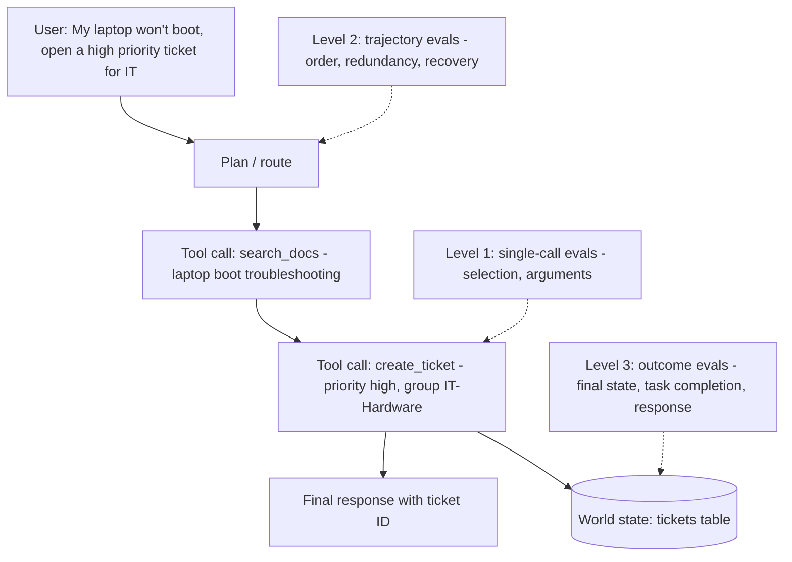
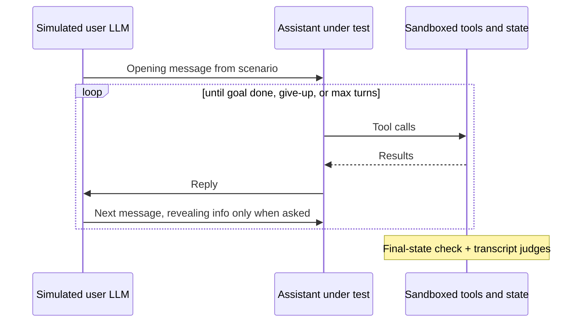
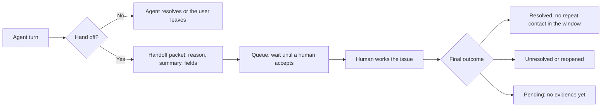

# Agent Tool and Trajectory Evals

> **TL;DR**
>
> - **Evaluate agents at three levels.** Test single tool calls for unit accuracy, full trajectories for step efficiency, and final environment states for task outcomes.
> - **Anchor release gates on final-state checks.** Verify that sandboxed databases and external systems end up in the exact expected state without unwanted side effects.
> - **Match tool arguments by type and test error recovery.** Apply schema, exact, semantic, or execution matchers per argument, and inject tool faults to catch false-success claims.
> - **Measure multi-trial reliability with pass^k.** Run stochastic agents across multiple trials and use simulated users to test multi-turn conversations. Do not confuse pass^k (all `k` trials pass) with pass@k (at least one passes).

- **You will learn:**
    - Tool selection and argument accuracy
    - Trajectory matching and judge rubrics
    - Sandboxed final-state checks, pass^k, and the unbiased pass@k estimator
    - Routing confusion matrices and simulated users
    - How to evaluate a handoff to a human, through to final resolution
- **Prerequisites:** [Agentic RAG failure modes](../00-foundations/03-agentic-rag-failure-modes.md), [Dataset strategy](../01-datasets/01-dataset-strategy.md)
- **Related:** [Agent eval environments & graders](./09-agent-eval-environments-and-graders.md), [Text-to-SQL evals](./05-text-to-sql-evals.md), [LLM-as-a-judge](./07-llm-as-a-judge.md), [Tool and action guardrails](../04-guardrails/05-tool-and-action-guardrails.md), [Tracing & OpenTelemetry](../03-online-evals-and-observability/02-observability-and-tracing.md)

---

## 1. What you're evaluating

This page uses five of the nine tools from the [running example](../04-guardrails/05-tool-and-action-guardrails.md#running-example):

```text
search_docs(query: str, top_k: int = 5)
run_sql(sql: str)                         # read-only warehouse
get_ticket(ticket_id: str)                # read-only: reads a ticket by ID
create_ticket(title: str, description: str, priority: "low"|"medium"|"high", assignee_group: str)
update_ticket(ticket_id: str, status: "open"|"in_progress"|"closed")
```

`create_ticket` is a tier-1 write: in production the app shows an inline preview and the user confirms with one click (see [tool and action guardrails](../04-guardrails/05-tool-and-action-guardrails.md)). In offline evals, **stub the confirmation step**. Auto-approve in most cases, and add cases that auto-decline to check that the agent does not claim the ticket exists.

Each agent run produces a **trace**. At each step, the LLM makes a decision, invokes zero or more tools, observes tool outputs, and produces a response (often mutating world state).



| Level | Question answered | Required inputs | Cost | Brittleness |
|---|---|---|---|---|
| **1. Single call** | Did the agent pick the right tool and arguments at this step? | Prompt (+ history) → expected tool call(s) | Low | Low (ideal for fast unit tests) |
| **2. Trajectory** | Did the agent take a reasonable sequence of steps? | Prompt → reference trajectory or judge rubric | Medium | **High** (many valid paths exist) |
| **3. Outcome** | Did the environment reach the right final state and did the user get the right answer? | Prompt + initial state fixture → expected final state | Medium to high (requires sandbox) | Low (completely path-independent) |

**Recommendation:** Gate releases on **outcome** evals because they are path-independent and measure real user impact. Use **single-call** evals as fast unit tests when editing tool schemas or descriptions. Use **trajectory** evals for debugging, cost efficiency, and safety-critical ordering rules rather than strict exact-path gates.

### Dataset row shape

```json
{
  "id": "agent_042",
  "input": "My laptop still won't boot after INC-1042 was closed. Open a new high-priority ticket for IT.",
  "user": {"id": "u_381", "role": "employee"},
  "initial_state": "fixtures/tickets_empty.sql",
  "expected_calls": [
    {"name": "create_ticket",
     "args": {"priority": "high", "assignee_group": "IT-Hardware"},
     "match": {"title": "semantic", "description": "semantic"}}
  ],
  "optional_calls": ["search_docs", "get_ticket"],
  "forbidden_calls": ["update_ticket"],
  "expected_final_state": {"tickets": [{"priority": "high", "assignee_group": "IT-Hardware", "requester": "u_381"}]},
  "response_must_include": ["ticket ID"]
}
```

Include `optional_calls` and `forbidden_calls` in every test case. Strict reference trajectories penalize valid alternative paths, so explicitly separate **required**, **allowed**, and **forbidden** tool calls (see [SME golden datasets](../01-datasets/02-sme-golden-datasets.md)).

---

## 2. Single tool-call metrics

### 2.1 Tool selection accuracy

- **What it measures:** Whether the agent selects the right tool (or correctly chooses **no tool**) at a single decision step.
- **Inputs required:** User input, conversation state, and expected tool name(s). Requires ground truth.
- **How to compute it:**

    ```text
    tool_selection_accuracy = |cases where predicted tool set == expected tool set| / |cases|
    ```

    Include **no-tool** inputs ("Thanks!", "What can you help with?") and **ambiguous** inputs where the agent should ask a clarifying question first.

- **Score range & interpretation:** 0 to 1. Inspect a tool confusion matrix (section 6). Selection errors usually cluster between tools with overlapping descriptions (like `search_docs` vs `run_sql` on "how many open tickets?").
- **Pitfalls and gotchas:** Selection accuracy usually drops as the tool catalog grows and as tool descriptions overlap. There is no fixed limit, so measure it on your own catalog when you add tools (a common rule of thumb is to review the design beyond about 15–20 tools). Treat tool **names and descriptions** as system prompts: version them and re-run selection evals whenever you edit a schema.
- **When to use it:** Run tool selection evals on every pull request. They require only a single LLM call per test case and no live tool execution.
- **Implemented in:** DeepEval (`ToolCorrectnessMetric`), RAGAS (`ToolCallAccuracy`, see the note in 2.2), promptfoo (`is-valid-openai-tools-call`, `trajectory:tool-used`), LangChain `agentevals`.

### 2.2 Tool argument correctness

Most tool-calling bugs happen inside the arguments. Select the appropriate matcher **for each argument**:

| Matcher | Best used for | Example |
|---|---|---|
| **Schema validity** | Every tool call (run before all other checks) | `priority` ∈ enum, required keys present, valid parameter types |
| **Exact match** (normalized) | IDs, enums, booleans, exact integers | `ticket_id == "INC-1042"`, `priority == "high"` |
| **Normalised string match** | Dates, case-insensitive strings, whitespace, units | `"2026-10-15"` vs `"15 Oct 2026"` |
| **Numeric tolerance** | Floating-point values and currency amounts | `abs(a - b) <= 0.01` |
| **Set / unordered match** | List arguments where element order does not matter | `cc=["a","b"] == ["b","a"]` |
| **Semantic match** | Free-text fields such as ticket titles, descriptions, or search queries | Embedding similarity ≥ `τ` or an LLM judge checking *"Does this title describe a laptop boot failure?"* |
| **Execution-based match** | Code or SQL query strings | Execute both queries and compare result sets ([text-to-SQL evals](./05-text-to-sql-evals.md)) |
| **Don't care** | Tuning parameters with multiple acceptable values | `top_k` |

- **What it measures:** Whether the arguments passed to a selected tool are schema-valid and match expected values.
- **Inputs required:** Predicted call, expected call with per-argument matchers, and the tool's JSON Schema.
- **How to compute it:**

    ```text
    schema_validity_rate = |calls passing JSON-schema validation| / |calls|
    arg_accuracy(call)   = |expected args matched| / |expected args|
    call_exact_correct   = tool name matches AND all required args matched
    ```

    The Berkeley Function Calling Leaderboard (BFCL) uses **AST-based matching**. It parses each call into an abstract syntax tree and validates the function name, required keys, and allowed parameter values.

- **Score range & interpretation:** 0 to 1. With constrained structured outputs, `schema_validity_rate` should stay near 100%. Any schema failure indicates an integration bug that you should fix immediately.
- **Pitfalls and gotchas:**
    - **Check argument provenance to catch hallucinated IDs.** Verify that any `user_id` or `ticket_id` argument actually appeared in the user prompt or a prior tool response.
    - **Decide how to score guessed optional arguments.** Specify whether filling optional fields with unrequested guesses counts as an error.
    - **Validate semantic argument matchers** against human labels before gating releases.
- **When to use it:** Validate arguments on every side-effecting tool call. For read-only search queries, evaluate retrieval outcome ([retrieval metrics](./02-retrieval-metrics.md)) rather than matching exact query strings.
- **Implemented in:** DeepEval (`ToolCorrectnessMetric`), RAGAS (`ToolCallAccuracy`), BFCL (AST evaluation), promptfoo (`trajectory:tool-args-match`).
- **Note on RAGAS `ToolCallAccuracy`:** The score is the mean argument match multiplied by a sequence-alignment flag. By default (`strict_order=True`) the predicted tool-name list must equal the reference list exactly, so **one extra optional call (such as `search_docs`) scores 0**. `strict_order=False` compares the sorted name lists, which still fails on extra calls. Use `ToolCallF1` when calls are order-independent or optional calls are allowed.

### 2.3 Tool-call precision, recall and F1

When a task requires **multiple** tool calls, compare the predicted calls against the expected call set using one-to-one matching.

- **What it measures:** Coverage of required tool calls (recall) and avoidance of wrong or redundant calls (precision).
- **Inputs required:** Predicted calls from the trace, expected calls, allowed optional tools, and argument matchers.
- **How to compute it:**

    ```text
    matched   = one-to-one matching between predicted and expected calls (name + args)
    precision = |matched| / |predicted calls|            (excluding allowed optional calls)
    recall    = |matched| / |expected calls|
    F1        = 2PR / (P + R)
    ```

- **Worked example:** Suppose `expected = {create_ticket(high, IT-Hardware)}` and `optional = {search_docs, get_ticket}`. The agent calls `search_docs(...)`, `get_ticket(INC-1042)`, `create_ticket(medium, IT-Hardware)`, and `create_ticket(high, IT-Hardware)`.
    - Ignore the allowed optional calls `search_docs` and `get_ticket`.
    - Score `create_ticket(medium, ...)` as a false positive (wrong priority) and `create_ticket(high, ...)` as a true positive.
    - Result: `precision = 1/2 = 0.50`, `recall = 1/1 = 1.0`, and `F1 = 0.67`. Note that the agent **created a duplicate ticket**, so the final-state outcome check in section 4.1 must also fail.
- **Pitfalls and gotchas:** Enforce strict **one-to-one** matching so a single predicted call cannot satisfy two expected calls. Use a **maximum** matching, not a greedy one. With loose matchers (substring or semantic), greedy matching can pair a predicted call with the wrong expected call and under-count recall (see the test in 3.2). Exclude valid error-recovery retries from false-positive counts and evaluate retries separately in section 2.6.
- **When to use it:** Use tool-call F1 for multi-call tasks where execution order does not matter. Add precedence constraints (section 2.4) when order matters.
- **Implemented in:** RAGAS (`ToolCallF1`), promptfoo (`tool-call-f1`), DeepEval (`ToolCorrectnessMetric`), Vertex AI Gen AI evaluation service (`trajectory_precision` and `trajectory_recall`; compute F1 yourself).

### 2.4 Ordering and dependencies

- **What it measures:** Whether dependent tool calls execute in the required sequence (like calling `get_ticket` to read a ticket before `update_ticket` changes it, or getting user confirmation before a write).
- **How to compute it:** Define pairwise precedence constraints (`A before B`) instead of locking the entire sequence:

    ```text
    ordering_accuracy = |satisfied precedence constraints| / |precedence constraints|
    ```

    You can also use the `in_order` subsequence match mode described in section 3.1.

- **Pitfalls and gotchas:** Encoding a rigid total order breaks evaluations whenever the agent runs independent lookups in parallel. Encode only true data or safety dependencies.
- **Implemented in:** Vertex AI evaluation (`trajectory_in_order_match`), promptfoo (`trajectory:tool-sequence`), custom assertions. LangChain `agentevals` has only whole-trajectory modes (`strict` checks the full order), so write a custom evaluator for pairwise precedence rules.

### 2.5 Unnecessary and forbidden calls

- **What it measures:** Wasted or unsafe tool invocations, including repeated identical calls, irrelevant lookups, and unauthorized tool calls.
- **How to compute it:**

    ```text
    unnecessary_call_rate = |calls not matched to expected and not in optional| / |calls|
    duplicate_call_rate   = |calls identical (name+args) to an earlier call in the same run| / |calls|
    forbidden_call_rate   = |runs with ≥1 forbidden call| / |runs|          # target 0
    ```

- **Pitfalls and gotchas:** Even when a runtime [tool guardrail](../04-guardrails/05-tool-and-action-guardrails.md) blocks a forbidden call, count the attempt as an agent failure in offline evals.
- **When to use it:** Track duplicate and forbidden call rates on every agent run to catch retry loops and policy violations cheaply.
- **Implemented in:** Custom trace assertions and LLM-judged trajectory rubrics.

### 2.6 Error recovery

- **What it measures:** How gracefully the agent handles tool failures. Check whether it fixes invalid arguments, retries transient errors within budget, uses a fallback tool, or reports the failure honestly.
- **Inputs required:** Fault-injection test cases where mocked tools return HTTP 500 timeouts, schema validation errors, empty results, or permission-denied errors.
- **How to compute it:** Label the expected recovery behavior for each injected fault and compute:

    ```text
    recovery_rate        = |fault runs ending in correct recovery behaviour| / |fault runs|
    false_success_rate   = |fault runs where the agent claims success| / |fault runs|     # worst failure
    max_retries_exceeded = |runs exceeding retry budget|
    ```

- **Worked example:** Suppose `create_ticket` returns `{"error": "assignee_group 'IT Hardware' not found. Valid: IT-Hardware, IT-Software"}`. A good agent retries once with `IT-Hardware`. A failing agent tells the user "I created your ticket!" (**false success**) or retries the broken argument five times in a loop.
- **Pitfalls and gotchas:** Match mocked error payloads to your real production error strings. Also test **partial failures** where one tool succeeds and a second tool fails.
- **When to use it:** Run fault-injection tests on every agent with write tools. Target a **false-success rate of 0**. Zero failures in `n` cases does not prove a zero rate: the 95% upper bound is about `3/n` (rule of three). Zero in 100 cases still allows up to about 3%. To show a rate below 1%, you need at least 300 clean cases.
- **Implemented in:** Custom fault-injection wrappers plus final-response LLM judges.

```python
import random

def flaky(tool_fn, fail_rate: float = 1.0, error: dict | None = None, seed: int | None = None):
    """Wrap a mocked tool to inject faults in offline runs. Pass a seed for reproducible runs."""
    error = error or {"error": "503 Service Unavailable"}
    rng = random.Random(seed)
    def wrapped(**kwargs):
        if rng.random() < fail_rate:
            return error
        return tool_fn(**kwargs)
    return wrapped


create_ticket = flaky(lambda **kw: {"ticket_id": "INC-2001"}, fail_rate=1.0)  # stubbed tool
assert create_ticket(title="Laptop won't boot", priority="high") == {"error": "503 Service Unavailable"}
```

---

## 3. Trajectory evaluation

A trajectory is the ordered sequence of tool calls (and optionally reasoning steps and tool outputs) in a run. Compare the predicted trajectory `P` against an expected reference trajectory `E`.

### 3.1 Match modes

| Mode | Passes when | Best used for |
|---|---|---|
| **Exact (strict)** | `P == E` element-by-element (same calls, same order, same length) | Deterministic workflows and fixed-pipeline regression tests |
| **In-order** | All calls in `E` appear in `P` in the same relative order (extra calls allowed) | Required multi-step sequences that tolerate optional lookups |
| **Unordered** | `P` and `E` contain the same multiset of calls, in any order (no extra calls) | Independent parallel tool calls |
| **Superset** | `P ⊇ E`: every expected call appears in `P` (extra calls allowed) | Verifying that required actions happened at least once |
| **Subset** | `P ⊆ E`: every predicted call is in the allowed reference set | Enforcing strict safety or cost ceilings |
| **Precision / recall** | Computes fractional overlap scores instead of binary pass/fail | Tracking aggregate trends across experiments |

Framework naming varies, and the same name can mean different things:

- LangChain `agentevals`: `strict`, `unordered`, `subset`, and `superset`. Its `unordered` is the **Unordered** row above.
- Vertex AI: `trajectory_exact_match`, `trajectory_in_order_match`, `trajectory_any_order_match`, `trajectory_precision`, and `trajectory_recall`. Vertex "any order" allows extra calls, so it behaves like **Superset**, not like agentevals `unordered`.
- promptfoo: `trajectory:tool-used`, `trajectory:tool-sequence`, `trajectory:tool-args-match`, and `tool-call-f1`.

Always specify how your chosen mode compares **arguments** (tool-name only, exact arguments, or per-argument matchers).

### 3.2 Pure-Python tool-call and trajectory matching

```python
import json
from collections import Counter
from typing import Callable

Call = dict  # {"name": str, "args": dict}
Matcher = Callable[[object, object], bool]

def exact(a, b) -> bool:
    return a == b

def norm_str(a, b) -> bool:
    return str(a).strip().lower() == str(b).strip().lower()

def unordered_list(a, b) -> bool:
    return Counter(map(json.dumps, a)) == Counter(map(json.dumps, b))

def numeric(tol: float = 1e-6) -> Matcher:
    return lambda a, b: abs(float(a) - float(b)) <= tol

def call_matches(pred: Call, exp: Call, matchers: dict[str, Matcher] | None = None,
                 ignore_extra_args: bool = True) -> bool:
    """Name must match; each expected arg must match with its matcher (default: exact)."""
    if pred["name"] != exp["name"]:
        return False
    matchers = matchers or {}
    for key, exp_val in exp.get("args", {}).items():
        if key not in pred.get("args", {}):
            return False
        if not matchers.get(key, exact)(pred["args"][key], exp_val):
            return False
    if not ignore_extra_args and set(pred.get("args", {})) - set(exp.get("args", {})):
        return False
    return True

def match_calls(pred: list[Call], exp: list[Call], **kw) -> list[tuple[int, int]]:
    """Maximum one-to-one matching (augmenting paths); returns (pred_idx, exp_idx) pairs.
    Greedy matching can under-count when one predicted call matches several expected calls."""
    ok = [[call_matches(p, e, **kw) for e in exp] for p in pred]
    owner: dict[int, int] = {}  # exp_idx -> pred_idx

    def assign(i: int, seen: set[int]) -> bool:
        for j in range(len(exp)):
            if ok[i][j] and j not in seen:
                seen.add(j)
                if j not in owner or assign(owner[j], seen):
                    owner[j] = i
                    return True
        return False

    for i in range(len(pred)):
        assign(i, set())
    return sorted((i, j) for j, i in owner.items())

def tool_call_prf(pred: list[Call], exp: list[Call], optional: set[str] = frozenset(), **kw) -> dict:
    pairs = match_calls(pred, exp, **kw)
    matched_pred = {i for i, _ in pairs}
    counted_pred = [i for i, p in enumerate(pred) if i in matched_pred or p["name"] not in optional]
    p = len(pairs) / len(counted_pred) if counted_pred else (1.0 if not exp else 0.0)
    r = len(pairs) / len(exp) if exp else 1.0
    f1 = 2 * p * r / (p + r) if (p + r) else 0.0
    return {"precision": p, "recall": r, "f1": f1}

def trajectory_match(pred: list[Call], exp: list[Call], mode: str = "in_order", **kw) -> bool:
    if mode == "exact":
        return len(pred) == len(exp) and all(call_matches(p, e, **kw) for p, e in zip(pred, exp))
    if mode == "in_order":                       # exp is a subsequence of pred
        j = 0
        for p in pred:
            if j < len(exp) and call_matches(p, exp[j], **kw):
                j += 1
        return j == len(exp)
    pairs = match_calls(pred, exp, **kw)
    if mode == "unordered":                      # same multiset, no extra calls
        return len(pairs) == len(exp) == len(pred)
    if mode == "superset":                       # every expected call is present
        return len(pairs) == len(exp)
    if mode == "subset":                         # every predicted call is expected
        return len(pairs) == len(pred)
    raise ValueError(mode)


# --- worked example from 2.3 ---
pred = [
    {"name": "search_docs", "args": {"query": "laptop won't boot"}},
    {"name": "get_ticket", "args": {"ticket_id": "INC-1042"}},
    {"name": "create_ticket", "args": {"priority": "medium", "assignee_group": "IT-Hardware", "title": "Laptop boot failure"}},
    {"name": "create_ticket", "args": {"priority": "high", "assignee_group": "IT-Hardware", "title": "Laptop won't boot"}},
]
exp = [{"name": "create_ticket", "args": {"priority": "high", "assignee_group": "IT-Hardware"}}]
m = {"priority": norm_str, "assignee_group": norm_str}

print(tool_call_prf(pred, exp, optional={"search_docs", "get_ticket"}, matchers=m))
# {'precision': 0.5, 'recall': 1.0, 'f1': 0.666...}
assert trajectory_match(pred, exp, "in_order", matchers=m)
assert trajectory_match(pred, exp, "superset", matchers=m)
assert not trajectory_match(pred, exp, "subset", matchers=m)
assert not trajectory_match(pred, exp, "exact", matchers=m)

# --- why maximum matching: a loose matcher where greedy matching fails ---
contains = {"query": lambda a, b: b in a}          # expected text must appear in predicted
pred2 = [{"name": "search_docs", "args": {"query": "vpn mac"}},
         {"name": "search_docs", "args": {"query": "vpn"}}]
exp2 = [{"name": "search_docs", "args": {"query": "vpn"}},
        {"name": "search_docs", "args": {"query": "vpn mac"}}]
assert tool_call_prf(pred2, exp2, matchers=contains)["recall"] == 1.0   # greedy gives 0.5
assert trajectory_match(pred2, exp2, "unordered", matchers=contains)
```

Validate tool arguments against the same JSON Schema you pass to the model:

<!-- snippet: continue -->
```python
from jsonschema import Draft202012Validator  # pip install jsonschema

def schema_errors(call: Call, schemas: dict[str, dict]) -> list[str]:
    if call["name"] not in schemas:
        return [f"unknown tool {call['name']}"]
    v = Draft202012Validator(schemas[call["name"]])
    return [e.message for e in v.iter_errors(call.get("args", {}))]
```

For free-text arguments, pass an embedding-similarity function or LLM-judge callable inside the `matchers` dictionary.

### 3.3 LLM-judged trajectory

When a task admits many valid tool sequences, use a rubric-based LLM judge instead of rigid trajectory matching.

- **What it measures:** Whether the agent's step sequence was logical, efficient, safe, and faithful to the returned tool outputs.
- **Inputs required:** The full execution trace (user prompt, each tool call and result, and final answer), tool schemas, and optionally a reference trajectory for guidance.
- **How to compute it:** Prompt an LLM judge with a checklist of **binary** questions rather than a single 1–10 rating:

    ```text
    Given the USER REQUEST, the AVAILABLE TOOLS, and the AGENT TRACE, answer each:
    1. Did the agent use tool results correctly (no ignoring or misreading results)?   yes/no
    2. Were any calls clearly unnecessary or repeated without reason?                  yes/no
    3. Did the agent take any action the user did not ask for or that needed confirmation? yes/no
    4. If a tool failed, did the agent respond appropriately?                         yes/no/n.a.
    5. Does the final response accurately reflect what actually happened?              yes/no
    Give a one-line reason per item. Output JSON.
    ```

- **Score range & interpretation:** Report the pass rate for each binary check. Check 5 (*"Does the final response accurately reflect what actually happened?"*) directly catches false-success hallucinations.
- **Pitfalls and gotchas:** Long tool outputs can overflow or distract the judge. Truncate large read payloads while keeping all error messages intact, and validate judge verdicts against human-reviewed traces ([LLM-as-a-judge](./07-llm-as-a-judge.md)).
- **When to use it:** Use LLM trajectory judges for open-ended research agents and sampled online production traces where no reference trajectory exists.
- **Implemented in:** LangChain `agentevals` (trajectory LLM judge), DeepEval (`TaskCompletionMetric`), Vertex AI evaluation, Phoenix agent eval templates.

---

## 4. Outcome evaluation: final state and task completion

### 4.1 Final-state checks (τ-bench style)

- **What it measures:** Whether the external environment reaches the exact expected state at the end of the run. This is the strongest, most path-independent metric for action-taking agents.
- **Inputs required:** Initial state fixture, sandboxed tools connected to an isolated test database, and state assertions. Requires ground truth.
- **How to compute it:** Reset the sandbox to the initial fixture, run the agent, and run assertions against the resulting database state. **τ-bench** (Yao et al., 2024) popularized this pattern. A run succeeds only when the final database state matches the goal state and the response includes required user details:

    ```text
    task_success = final_state satisfies all assertions AND response contains required info
    success_rate = mean(task_success)
    ```

- **Worked example:** After the laptop ticket request, assert that `tickets` has one new row (`priority == "high"`, `assignee_group == "IT-Hardware"`, `requester == "u_381"`) and no other tables changed. The duplicate-ticket run from section 2.3 **fails** this assertion even though its tool-call recall was `1.0`.
- **Pitfalls and gotchas:**
    - **Ignore volatile fields** such as auto-generated UUIDs and timestamps when diffing database state.
    - **Assert the absence of unintended side effects** (verify that no extra tickets were created and no unrelated rows were modified).
    - **Invest in deterministic sandboxes.** Sandboxed state fixtures take engineering effort to build, but they pay for themselves on every write-capable agent.
    - **Protect the grader from the agent.** Keep tests and assertions outside the agent's write access. See [Agent eval environments & graders](./09-agent-eval-environments-and-graders.md#7-grader-hacking-and-how-to-stop-it).
- **When to use it:** Use final-state checks for every agent that mutates external state. For read-only Q&A agents, evaluate the final response with [answer correctness](./01-end-to-end-rag-evals.md#33-answer-correctness).
- **Implemented in:** τ-bench and custom sandbox assertions in promptfoo, Braintrust, LangSmith, or pytest.

```python
import json
from collections import Counter

def state_diff(before: dict[str, list[dict]], after: dict[str, list[dict]],
               ignore: set[str] = frozenset({"id", "created_at", "updated_at"})) -> dict:
    """Return rows added and removed per table (ignoring volatile fields).
    A changed row shows as one removed and one added row."""
    def key(row):
        return json.dumps({k: v for k, v in row.items() if k not in ignore}, sort_keys=True)
    diff = {}
    for table in sorted(before.keys() | after.keys()):   # include tables dropped or emptied
        b = Counter(key(r) for r in before.get(table, []))
        a = Counter(key(r) for r in after.get(table, []))
        added = list((a - b).elements())
        removed = list((b - a).elements())
        if added or removed:
            diff[table] = {"added": [json.loads(x) for x in added],
                           "removed": [json.loads(x) for x in removed]}
    return diff

def assert_one_ticket(diff: dict, **expected) -> bool:
    added = diff.get("tickets", {}).get("added", [])
    other_tables_changed = set(diff) - {"tickets"}
    removed = diff.get("tickets", {}).get("removed", [])
    return (len(added) == 1 and not removed and not other_tables_changed
            and all(added[0].get(k) == v for k, v in expected.items()))


before = {"tickets": [{"id": 1, "priority": "low", "requester": "u_100"}],
          "audit_log": [{"id": 9, "event": "login"}]}
after = {"tickets": [{"id": 1, "priority": "low", "requester": "u_100"},
                     {"id": 2, "priority": "high", "assignee_group": "IT-Hardware", "requester": "u_381"}]}
d = state_diff(before, after)
assert d["audit_log"]["removed"] == [{"event": "login"}]     # a table missing from `after` is caught
assert not assert_one_ticket(d, priority="high", requester="u_381")
after["audit_log"] = before["audit_log"]
assert assert_one_ticket(state_diff(before, after), priority="high", requester="u_381")
```

### 4.2 Task completion (judge-based)

When a task has no database state to diff (like *"Summarize the top three travel policies"*), grade the trace with an LLM judge against task-specific criteria:

```text
TASK: {input}
SUCCESS CRITERIA: {criteria list from dataset}
TRACE: {trace}
For each criterion: met / not met + evidence from the trace. Then: task_completed = all met.
```

DeepEval (`TaskCompletionMetric`) and RAGAS (`AgentGoalAccuracyWithReference` and `AgentGoalAccuracyWithoutReference`) provide built-in implementations. Always supply explicit per-sample success criteria from your dataset rather than asking a generic *"Was the task completed?"* prompt.

### 4.3 Reliability across trials: pass^k

Because agent runs are stochastic, passing a test once does not guarantee reliable production behavior. τ-bench introduced **pass^k**: the probability that **all `k`** independent trials succeed (unlike `pass@k` in code generation, where *at least one* success out of `k` counts).

```text
For a task with n trials and c successes:
  pass^k (task) = C(c, k) / C(n, k)          # unbiased estimate, k ≤ n
pass^k = mean over tasks
```

For `pass@k`, do not compute `1 − (1 − p)^k` from the mean success rate, and do not use "any success in the first `k` trials". Use the unbiased estimator from Chen et al. (2021): run `n ≥ k` trials per task and count `c` successes.

```text
pass@k (task) = 1 − C(n − c, k) / C(n, k)     # probability that at least one of k sampled trials passes
```

```python
import random
from math import comb

def pass_hat_k(successes_per_task: list[tuple[int, int]], k: int) -> float:
    """pass^k: all k trials pass. successes_per_task: [(c, n), ...], c successes in n >= k trials."""
    assert all(n >= k for _, n in successes_per_task), "need n >= k trials per task"
    return sum(comb(c, k) / comb(n, k) for c, n in successes_per_task) / len(successes_per_task)

def pass_at_k(successes_per_task: list[tuple[int, int]], k: int) -> float:
    """pass@k: at least one of k trials passes (unbiased estimator, Chen et al. 2021)."""
    assert all(n >= k for _, n in successes_per_task), "need n >= k trials per task"
    return sum(1 - comb(n - c, k) / comb(n, k) for c, n in successes_per_task) / len(successes_per_task)

def bootstrap_ci(per_task: list[float], n_resamples: int = 10_000, alpha: float = 0.05,
                 seed: int = 0) -> tuple[float, float]:
    """Percentile bootstrap CI over tasks (tasks, not trials, are the unit of sampling)."""
    rng = random.Random(seed)
    means = sorted(sum(rng.choices(per_task, k=len(per_task))) / len(per_task)
                   for _ in range(n_resamples))
    return means[int(alpha / 2 * n_resamples)], means[int((1 - alpha / 2) * n_resamples) - 1]


tasks = [(4, 4), (3, 4), (2, 4)]
print(pass_hat_k(tasks, k=1))   # 0.75 (= average success rate)
print(pass_hat_k(tasks, k=4))   # 0.333...
print(pass_at_k(tasks, k=2))    # 0.944...: (1 + 1 + 5/6) / 3
assert pass_hat_k(tasks, 1) == pass_at_k(tasks, 1) == 0.75
assert abs(pass_at_k([(2, 4)], k=2) - (1 - 1 / 6)) < 1e-12
lo, hi = bootstrap_ci([comb(c, 2) / comb(n, 2) for c, n in tasks])
assert lo <= pass_hat_k(tasks, 2) <= hi
```

**When to use it:** Track `pass^k` for any agent that executes actions for users. An agent with a 75% single-run success rate (`pass^1 = 0.75`) might succeed on all 4 trials only 33% of the time (`pass^4 = 0.33`). Run critical test suites 3–5 times and report both `pass^1` and `pass^k`. Use `pass@k` only where a retry or a human pick among `k` attempts is part of the product (for example, offline research agents).

**Sample size and uncertainty:**

- Use `n ≥ k` trials per task, and prefer `n` well above `k` for a stable estimate. With `n = k`, each task contributes only 0 or 1 to `pass^k`.
- Tasks, not trials, are the independent unit. Report a confidence interval with a bootstrap over tasks (above), or a Wilson interval when you report a plain per-run pass rate.
- To compare two agent versions, re-run the baseline on the same tasks and use a paired test. See [Running offline experiments](./08-running-offline-experiments.md).

---

## 5. Efficiency and planning

### 5.1 Step efficiency

- **What it measures:** The resource cost required to complete a task: LLM turns, tool calls, total tokens, p50/p95 latency, and dollar cost.
- **Inputs required:** Execution traces, plus an optional optimal step count per task.
- **How to compute it:**

    ```text
    steps_per_task, tool_calls_per_task, tokens_per_task, cost_per_task, latency p50/p95
    step_efficiency = optimal_steps / actual_steps        (cap at 1; only for tasks with known optimum)
    cost_per_successful_task = total cost / successful tasks
    ```

- **Pitfalls and gotchas:** Compute step and token efficiency **only across successful runs**. Otherwise, a broken agent that aborts on turn 1 looks artificially cheap. Monitor **p99 step counts** to catch runaway retry loops.
- **When to use it:** Report efficiency metrics alongside task success on every scorecard. Gate releases on cost regressions (such as >25% more tokens per successful task).
- **Implemented in:** Langfuse, LangSmith, Phoenix, Braintrust, and custom trace aggregators.

### 5.2 Planning quality

- **What it measures:** For plan-then-execute agents, whether the explicit plan covers all sub-goals, orders steps validly, uses real tools, and adapts when tool outputs change.
- **How to compute it:** Prompt an LLM judge with binary checks on the **generated plan artefact** and compare the planned steps against executed steps:

    ```text
    plan_coverage  = |user sub-goals addressed by plan| / |user sub-goals|
    plan_adherence = |plan steps executed (or explicitly revised)| / |plan steps|
    ```

- **Pitfalls and gotchas:** A good plan can still fail during execution, and an agent can recover from a bad initial plan. Evaluate plan quality and final task outcome separately.
- **Implemented in:** DeepEval (`PlanQualityMetric`, `PlanAdherenceMetric`) and custom judges.

---

## 6. Routing and intent classification

Most enterprise assistants start with a router that dispatches the user prompt to *docs Q&A*, *text-to-SQL*, *ticket actions*, *chit-chat*, or *out-of-scope*. Treat routing as a **multi-class classification** problem and evaluate it deterministically.

- **What it measures:** Whether each user input reaches the right sub-agent, skill, or tool family.
- **Inputs required:** User input and expected route label. Ground-truth labels are fast and cheap for SMEs to create.
- **How to compute it:** Compute the confusion matrix, per-class precision/recall/F1, macro-F1, and overall accuracy:

    ```text
    precision_c = TP_c / (TP_c + FP_c)      recall_c = TP_c / (TP_c + FN_c)
    macro_F1 = mean_c F1_c                   accuracy = Σ TP_c / N
    ```

- **Worked example (100 labeled queries):**

    | True \ Predicted | docs | sql | action | out_of_scope |
    |---|---|---|---|---|
    | **docs** | 38 | 4 | 0 | 0 |
    | **sql** | 6 | 24 | 0 | 0 |
    | **action** | 1 | 0 | 17 | 0 |
    | **out_of_scope** | 3 | 0 | 0 | 7 |

    Overall accuracy is `86/100 = 0.86`. However, `out_of_scope` recall is only `7/10 = 0.70` (3 out-of-scope queries went to `docs`, risking hallucinations), and `sql` recall is `24/30 = 0.80` (6 data queries went to `docs`). The confusion matrix pinpoints exactly which route descriptions need clearer boundaries.

- **Pitfalls and gotchas:**
    - **Overall accuracy hides minority-class failures.** Gate on macro-F1 and per-class recall floors instead.
    - **Misroutes carry asymmetric business costs.** Sending a policy question to an action tool is far riskier than sending an action request to docs search. Weight your gates by risk.
    - **Use multi-label metrics for compound prompts** like *"What is the refund policy, and open a support ticket for me."*
- **When to use it:** Run routing evals on every multi-agent or multi-skill system. They execute in seconds and prevent downstream E2E failures.
- **Implemented in:** `scikit-learn` (`confusion_matrix`, `classification_report`) or the pure-Python function below.

```python
from collections import defaultdict

def confusion_and_report(y_true: list[str], y_pred: list[str]) -> dict:
    labels = sorted(set(y_true) | set(y_pred))
    cm = {t: {p: 0 for p in labels} for t in labels}
    for t, p in zip(y_true, y_pred):
        cm[t][p] += 1
    report = {}
    for c in labels:
        tp = cm[c][c]
        fp = sum(cm[t][c] for t in labels if t != c)
        fn = sum(cm[c][p] for p in labels if p != c)
        prec = tp / (tp + fp) if tp + fp else 0.0
        rec = tp / (tp + fn) if tp + fn else 0.0
        report[c] = {"precision": prec, "recall": rec,
                     "f1": 2 * prec * rec / (prec + rec) if prec + rec else 0.0,
                     "support": tp + fn}
    accuracy = sum(cm[c][c] for c in labels) / len(y_true)
    macro_f1 = sum(r["f1"] for r in report.values()) / len(labels)
    return {"confusion": cm, "per_class": report, "accuracy": accuracy, "macro_f1": macro_f1}
```

---

## 7. Multi-turn conversation evals

Single-turn evals miss multi-turn failures such as forgetting user constraints from turn 1, drifting out of persona, or failing to close out a multi-step workflow.

| Metric | What it measures | How to compute it | Implemented in |
|---|---|---|---|
| **Goal / conversation completion** | Whether the assistant satisfied the user's overall goal by the end of the dialogue | Run an LLM judge over the full transcript with scenario criteria, or check final sandbox state | DeepEval (`ConversationCompletenessMetric`), RAGAS (`AgentGoalAccuracyWithReference` / `WithoutReference`), τ-bench, τ²-bench |
| **Knowledge retention** | Whether the assistant remembers facts the user stated in earlier turns ("I work in Pune", "I joined last week") | Prompt a judge to flag later turns that contradict or re-ask facts already provided | DeepEval (`KnowledgeRetentionMetric`) |
| **Role adherence** | Whether the assistant stays within its assigned persona and scope across turns | Score each assistant turn against the system role description | DeepEval (`RoleAdherenceMetric`) |
| **Topic adherence** | Whether the conversation stays inside approved business domains | Classify each turn's topic against your allowed topic list | RAGAS (`TopicAdherence`; legacy name `TopicAdherenceScore`) |
| **Turn relevancy** | Whether each assistant reply addresses the immediate conversation context | Run a sliding-window relevance judge across turns | DeepEval (`TurnRelevancyMetric`) |
| **Clarification behaviour** | Whether the agent asks clarifying questions on ambiguous prompts and acts directly on clear prompts | Test labeled ambiguous vs clear prompts with a classifier or judge | Custom |
| **Context carry-over in retrieval** | Whether follow-up turns ("what about contractors?") retrieve the right chunks | Measure query-rewrite quality and `recall@k` on rewritten follow-up queries ([02](./02-retrieval-metrics.md)) | Custom |

### 7.1 Simulated users

Static multi-turn test transcripts break as soon as your assistant phrases a reply differently on turn 2. **Simulated users** use an LLM with a persona, hidden facts, and a goal to converse dynamically with your agent in a sandbox.



Scenario specification:

```json
{"persona": "New employee in Pune, terse, not technical",
 "goal": "Get VPN access approved; you don't know which form to use",
 "hidden_facts": {"role": "employee", "start_date": "last week", "manager": "a.rao"},
 "rules": ["Only reveal manager if asked", "If asked for a password, refuse"],
 "success": ["access request ticket created with manager a.rao", "user told expected SLA"],
 "max_turns": 10}
```

**Pitfalls and gotchas:** LLM user simulators are often more polite and articulate than real users, and they sometimes leak `hidden_facts` unprompted. Run multiple random seeds per scenario, inspect a sample of transcripts manually, and seed user personas from real production logs ([production data flywheel](../01-datasets/04-production-data-flywheel.md)). Both τ-bench and DeepEval (`ConversationSimulator`) support simulated-user evaluations.

### 7.2 Human handoff

An employee tells Acme Assistant that last month's payroll is wrong. The assistant cannot change payroll, so it hands off to HR with the summary "user has a payroll question". The HR partner asks the employee to explain everything again. HR fixes the issue three days later.

Your logs record one word for this session: "escalated".

That word hides four questions:

- Was the handoff needed?
- Did it happen at the right time?
- Did the human get enough context?
- Did anyone finally resolve the issue?

Husain and Shankar state the rule plainly. "The trace continues until the user's need is resolved or the session ends, not when AI hands off to a human" ([Evals FAQ](https://hamel.dev/blog/posts/evals-faq/how-do-i-evaluate-sessions-with-human-handoffs.html)).



1. **Score the decision at `Hand off?`.** Compare it with what the policy required.
2. **Score the packet and the wait.** These decide whether the human can act without asking again.
3. **Score the final outcome last.** It often arrives days after the session closes.

**Log these fields for every handoff.** The FAQ lists the decision and its reason, the context transferred, wait time, human actions, final resolution, and whether the human had enough context.

| Field | Example | Why you need it |
|---|---|---|
| `reason` | `user_requested`, `policy_required`, `agent_stuck` | Separates correct handoffs from failures |
| `packet` | Summary, employee ID, pay period, amount in dispute | Lets you score context completeness |
| `requested_at`, `accepted_at` | Timestamps | Gives wait time, and finds handoffs nobody accepted |
| `human_actions` | Edited the summary, or asked the user to repeat details | Shows where the packet fell short |
| `resolved_at`, `reopened_at` | Timestamps, or `null` | Gives the final outcome after the handoff |

Microsoft Copilot Studio uses a similar reason split: "system intended", "system unintended", and "user requested" ([analytics docs](https://learn.microsoft.com/en-us/microsoft-copilot-studio/analytics-improve-agent-effectiveness)). An intended handoff follows a business rule. An unintended one usually means the user is stuck.

**Report four results separately.** Do not merge them into one score.

| Result | How to compute it | Notes |
|---|---|---|
| **Handoff decision** | Confusion matrix of *should hand off* vs *did hand off* | Report missed handoffs and unnecessary handoffs as two rates. "User asked for a human" is a hard rule. |
| **Timing** | Turn of the handoff vs the earliest turn where policy required it | Allow a tolerance window. [Liu et al., 2021](https://arxiv.org/abs/2012.07610) score transfers "within tolerance" of the ideal turn. |
| **Packet quality** | Required fields present, and summary claims supported by the trace | Use a faithfulness-style judge on the summary. Edits to the summary by the receiving person are a useful signal. Airbnb found this for human agents' case notes ([Wu et al., 2025](https://arxiv.org/abs/2510.06677)). |
| **Final outcome** | Resolved, unresolved, or pending after the handoff | Count a reopen inside the window as unresolved. Keep the label `pending` until evidence arrives. |

The description of τ-bench's `transfer_to_human_agents` tool gives a good default rule ([tool source](https://github.com/sierra-research/tau-bench/blob/main/tau_bench/envs/airline/tools/transfer_to_human_agents.py)). It says: "Only transfer if the user explicitly asks for a human agent". The second condition is when the issue "cannot be resolved by the agent with the available tools". Write your own rule per issue type, then label `should_hand_off` for every test case.

The snippet below scores the decision, the packet, and the outcome. A handoff request alone never counts as resolution. A missing resolution stays `pending`.

```python
from datetime import datetime, timedelta

REOPEN_WINDOW = {"payroll": timedelta(days=30), "it_access": timedelta(days=5)}  # set per issue type
DEFAULT_WINDOW = timedelta(days=30)
ACCEPT_DEADLINE = timedelta(hours=4)       # after this, an unaccepted handoff has failed
REQUIRED_FIELDS = {"payroll": {"employee_id", "pay_period", "amount_in_dispute"}}

def handoff_decision(should: bool, did: bool) -> str:
    if should == did:
        return "correct"
    return "missed" if should else "unnecessary"

def missing_fields(packet: dict, issue_type: str) -> set[str]:
    return {f for f in REQUIRED_FIELDS.get(issue_type, set()) if not packet.get(f)}

def outcome_after_handoff(h: dict, issue_type: str, now: datetime) -> str:
    """Final outcome of a handed-off session. Never infer resolution from the handoff itself."""
    if h.get("accepted_at") is None:
        if now - h["requested_at"] < ACCEPT_DEADLINE:
            return "pending"                      # still inside the acceptance deadline
        return "not_accepted"                     # requested, but no human picked it up in time
    if h.get("resolved_at") is None:
        return "pending"                          # no evidence yet
    window = REOPEN_WINDOW.get(issue_type, DEFAULT_WINDOW)
    reopened = h.get("reopened_at")
    if reopened and reopened - h["resolved_at"] <= window:
        return "unresolved"                       # the user came back with the same issue
    if now - h["resolved_at"] < window:
        return "resolved_provisional"             # the reopen window is still open
    return "resolved"


now = datetime(2026, 10, 19)
day = timedelta(days=1)
assert handoff_decision(should=True, did=False) == "missed"
assert handoff_decision(should=False, did=True) == "unnecessary"
assert missing_fields({"employee_id": "E123", "pay_period": "2026-09"}, "payroll") == {"amount_in_dispute"}
assert outcome_after_handoff({"requested_at": now - day, "accepted_at": None}, "payroll", now) == "not_accepted"
assert outcome_after_handoff({"requested_at": now, "accepted_at": None}, "payroll", now) == "pending"
assert outcome_after_handoff({"accepted_at": now - 3 * day}, "payroll", now) == "pending"
assert outcome_after_handoff({"accepted_at": now - 3 * day, "resolved_at": now - 2 * day},
                             "payroll", now) == "resolved_provisional"
assert outcome_after_handoff({"accepted_at": now - 50 * day, "resolved_at": now - 40 * day,
                              "reopened_at": now - 35 * day}, "payroll", now) == "unresolved"
assert outcome_after_handoff({"accepted_at": now - 50 * day, "resolved_at": now - 40 * day},
                             "payroll", now) == "resolved"
```

Choose the reopen window per issue type. SQM Group's example uses 5 days for a status inquiry and 30 days for an issue that needs investigation ([SQM Group](https://www.sqmgroup.com/resources/library/blog/calculate-first-call-resolution-rate)).

**Avoid these traps.**

| Trap | What goes wrong | Instead |
|---|---|---|
| **Measurement stops at the transfer** | Copilot Studio ends the analytics session at the handoff, "whether the conversation transfers to a live agent or not" | Join the agent trace to the ticket or CRM record |
| **Silence counts as resolution** | Intercom counts an exit "without requesting further assistance" as an assumed resolution ([Fin outcomes](https://www.intercom.com/help/en/articles/8205718-fin-ai-agent-outcomes)) | Keep the label provisional until the reopen window closes |
| **Containment alone rewards trapping users** | Users get stuck in "doom loops" without an offramp to a human ([CFPB, 2023](https://www.consumerfinance.gov/data-research/research-reports/chatbots-in-consumer-finance/chatbots-in-consumer-finance/)) | Pair containment with abandonment, repeat contact, and missed handoffs |
| **A benchmark pass proves nothing about handoffs** | A τ²-bench issue reports 23 airline refusal or handoff tasks scored on inaction only. In some retail tasks, declining to help scores the same as a correct handoff ([#384](https://github.com/sierra-research/tau2-bench/issues/384), open as of October 2026) | Assert that the transfer happened when the policy required it |
| **One rate mixes good and bad handoffs** | Intended handoffs and stuck users raise the same escalation rate | Report the rate per `reason` |

Vendor definitions of "resolved" differ, and some drive billing. Do not compare resolution rates across products. Sometimes the best fix removes the handoff: the FAQ notes that "the best improvement reduces handoffs entirely rather than improving handoff execution".

---

## 8. Public benchmarks (context only)

Use public agent benchmarks to **shortlist base models** and borrow **evaluation patterns**, never as a substitute for evaluating your own tools and policies.

| Benchmark | What it tests | Methodology worth borrowing |
|---|---|---|
| **[τ-bench](https://github.com/sierra-research/tau-bench)** (Yao et al., 2024) | Tool-agent-user interaction in retail and airline domains under policy rules | Simulated users, database final-state diffs, and `pass^k` reliability across trials |
| **[τ²-bench](https://github.com/sierra-research/tau2-bench)** (Barres et al., 2025) | Dual-control environments (adds a telecom domain) where both the agent and the simulated user act on a shared state with tools | Tests whether the agent can guide a user who must take actions themselves, not only act alone |
| **[BFCL](https://gorilla.cs.berkeley.edu/leaderboard.html)** (Patil et al., 2025) | Function calling across simple, parallel, and irrelevance (no-tool) cases; V3 adds multi-turn and multi-step tasks; V4 adds agentic tasks (web search, memory, format sensitivity) | AST-based argument matching, executable validation, explicit no-tool abstention tests, and per-turn **state-based** plus **response-based** checks in multi-turn tasks |
| **[AgentBench](https://github.com/THUDM/AgentBench)** (Liu et al., 2023) | LLMs acting across OS, database, knowledge graph, game, and web environments | Interactive multi-environment sandbox harnesses |
| **[GAIA](https://huggingface.co/gaia-benchmark)** (Mialon et al., 2023) | Multi-step reasoning, web browsing, and tool use | Complex multi-step tasks designed with short, unambiguous final answers for exact-match grading |
| **[SWE-bench](https://www.swebench.com/)** (Jimenez et al., 2023) | Resolving real GitHub issues in Python repositories | Verifying outcomes by running unit tests against the modified codebase |

Adopt four habits from these benchmarks. Verify **outcomes** via state or execution, write **unambiguous success criteria**, include **no-tool** test cases, and measure **multi-trial reliability (`pass^k`)**.

---

## 9. Putting it together

### 9.1 Agent eval suite layout

| Suite | Starting size (heuristic) | When to run | Release gate |
|---|---|---|---|
| Routing (classification) | 200–500 labeled prompts | Every PR (fast, no tool execution) | Macro-F1 no regression and per-class recall floors |
| Single-call selection + arguments | 100–300 cases (including no-tool and ambiguous) | Every PR (mocked tools) | Schema validity ≈ 100% and selection/arg accuracy no regression |
| Fault injection | 30–100 cases across error types (≥ 300 to support a < 1% claim) | Every PR | False-success rate = 0 (zero in `n` gives a 95% upper bound of about `3/n`) |
| Outcome (sandboxed final state) | 50–200 tasks × 3–5 trials | Nightly and pre-release | Task success rate and `pass^k` no regression |
| Multi-turn simulated users | 30–100 scenarios × multiple seeds | Nightly and pre-release | Goal completion, knowledge retention, and role adherence |
| Human handoff | Cases labeled `should_hand_off`, including user requests for a human | Every PR for decisions, weekly for outcomes | Zero missed handoffs on policy-required cases (zero in `n` bounds the rate at about `3/n`) |
| Step efficiency | Computed from all suite traces above | Every run | Tokens and dollar cost per successful task ≤ baseline + 25% |

### 9.2 Checklist

- [ ] Specify **required, optional, and forbidden** tool calls for every test case rather than a single rigid path.
- [ ] Assign an explicit matcher **per argument** (schema, exact, normalized, numeric tolerance, set, semantic, or execution).
- [ ] Validate every tool call against its JSON Schema and check provenance on ID arguments to catch hallucinated IDs.
- [ ] Build sandboxed tools with database fixtures and assert both expected state changes and zero unintended side effects.
- [ ] Inject tool timeouts, validation errors, and 500s to verify that the agent's false-success rate stays at zero.
- [ ] Run outcome suites across 3–5 trials per task and report `pass^k` with a confidence interval over tasks.
- [ ] Evaluate intent routing with a confusion matrix and weight misroutes by business risk.
- [ ] Test multi-turn conversations with simulated users seeded from real production personas.
- [ ] Trace every handoff to its final outcome, and report decision, timing, packet quality, and resolution separately.
- [ ] Compute token and step efficiency only over successful runs, and monitor p99 step counts for infinite loops.
- [ ] Re-run tool-selection evals whenever you edit a tool description or add a new tool.
- [ ] Verify that forbidden actions are also blocked at runtime by [tool guardrails](../04-guardrails/05-tool-and-action-guardrails.md) and [RBAC](../04-guardrails/06-access-control-rbac.md).

---

## Key takeaways

- **Evaluate agents at three complementary levels.** Run single-call unit tests for speed, trajectory checks for step efficiency and safety orderings, and final-state checks for true user outcomes.
- **Anchor release gates on sandboxed final-state diffs.** Verify both that required writes succeeded and that no other records changed.
- **Match arguments by type and one-to-one pairing.** Combine schema validation, exact matchers, and semantic matchers instead of brittle string equality.
- **Test error recovery with fault injection.** Never ship an agent that hallucinates success when a tool call fails.
- **Measure reliability across trials with `pass^k`.** Single-run pass rates hide stochastic flakiness on action-taking agents. If you report `pass@k`, use the unbiased estimator.
- **Check what a framework's match mode really means.** "Any order" in one tool can mean "superset" in another, and RAGAS `ToolCallAccuracy` fails runs with extra optional calls.
- **Evaluate routing with confusion matrices and multi-turn flows with simulated users.**
- **Trace a handoff to the final outcome.** A handoff request is not a resolution. Keep the outcome `pending` until evidence arrives.

## Further reading

- Yao et al., *τ-bench: A Benchmark for Tool-Agent-User Interaction in Real-World Domains*, [arXiv:2406.12045](https://arxiv.org/abs/2406.12045) · [code](https://github.com/sierra-research/tau-bench)
- Barres et al., *τ²-Bench: Evaluating Conversational Agents in a Dual-Control Environment*, [arXiv:2506.07982](https://arxiv.org/abs/2506.07982) · [code](https://github.com/sierra-research/tau2-bench)
- Chen et al., *Evaluating Large Language Models Trained on Code* (unbiased pass@k estimator), [arXiv:2107.03374](https://arxiv.org/abs/2107.03374)
- Patil et al., *The Berkeley Function Calling Leaderboard (BFCL): From Tool Use to Agentic Evaluation of Large Language Models*, ICML 2025 · [Leaderboard](https://gorilla.cs.berkeley.edu/leaderboard.html) · [V3 multi-turn blog](https://gorilla.cs.berkeley.edu/blogs/13_bfcl_v3_multi_turn.html) · [V4 agentic blog](https://gorilla.cs.berkeley.edu/blogs/15_bfcl_v4_web_search.html) · [Gorilla repo](https://github.com/ShishirPatil/gorilla)
- Liu et al., *AgentBench: Evaluating LLMs as Agents*, [arXiv:2308.03688](https://arxiv.org/abs/2308.03688)
- Mialon et al., *GAIA: a benchmark for General AI Assistants*, [arXiv:2311.12983](https://arxiv.org/abs/2311.12983)
- Jimenez et al., *SWE-bench: Can Language Models Resolve Real-World GitHub Issues?*, [arXiv:2310.06770](https://arxiv.org/abs/2310.06770)
- Hamel Husain & Shreya Shankar, [How do I evaluate sessions with human handoffs?](https://hamel.dev/blog/posts/evals-faq/how-do-i-evaluate-sessions-with-human-handoffs.html) (Evals FAQ)
- Liu et al., *Time to Transfer: Predicting and Evaluating Machine-Human Chatting Handoff*, AAAI 2021, [arXiv:2012.07610](https://arxiv.org/abs/2012.07610)
- Wu et al. (Airbnb), *Incremental Summarization for Customer Support via Progressive Note-Taking and Agent Feedback*, EMNLP 2025 Industry, [arXiv:2510.06677](https://arxiv.org/abs/2510.06677)
- Microsoft, [Copilot Studio: analyze agent effectiveness](https://learn.microsoft.com/en-us/microsoft-copilot-studio/analytics-improve-agent-effectiveness) (session outcomes and escalation reasons)
- CFPB, [Chatbots in consumer finance](https://www.consumerfinance.gov/data-research/research-reports/chatbots-in-consumer-finance/chatbots-in-consumer-finance/) (2023, "doom loops")
- RAGAS, [Agent / tool-use metrics](https://docs.ragas.io/en/stable/concepts/metrics/available_metrics/agents/)
- LangChain, [agentevals](https://github.com/langchain-ai/agentevals)
- Google Cloud, [Evaluate Gen AI agents (Vertex AI)](https://cloud.google.com/vertex-ai/generative-ai/docs/models/evaluation-agents)
- Anthropic, [Building effective agents](https://www.anthropic.com/engineering/building-effective-agents)
- **Within this repo:**
    - [Text-to-SQL evals](./05-text-to-sql-evals.md)
    - [Tool and action guardrails](../04-guardrails/05-tool-and-action-guardrails.md)
    - [Running offline experiments](./08-running-offline-experiments.md)
