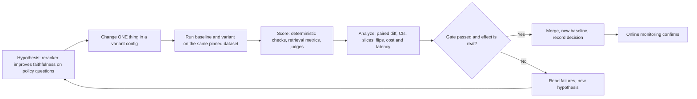

# Running Offline Experiments

> **TL;DR** — An eval only becomes useful when it drives decisions, and decisions need experiments: a pinned dataset, a recorded config, a baseline, a paired comparison with uncertainty, and a pre-agreed gate. Treat every prompt, retriever, model or tool change as an experiment; run cheap deterministic checks and a smoke eval on every PR, the full suite nightly or before release; compare variants **per item** with paired statistics, break results down by slice, and keep a held-out set you don't tune on.

**You'll learn:** what to record for every eval run · how to compare a variant against a baseline (paired, per-item, with flips) · handling non-determinism (repeats, temperature, pass@k vs pass^k) · confidence intervals, paired bootstrap and McNemar's test · slice analysis · cost/latency budgets · ablations and sweeps for RAG knobs · avoiding overfitting to the eval set · CI/CD eval gates with an illustrative GitHub Actions workflow and pytest eval tests · reporting
 ·  **Prerequisites:** [Dataset strategy](../01-datasets/01-dataset-strategy.md), [End-to-end RAG evals](./01-end-to-end-rag-evals.md), [LLM-as-a-judge](./07-llm-as-a-judge.md)
 ·  **Related:** [Retrieval metrics](./02-retrieval-metrics.md), [Text-to-SQL evals](./05-text-to-sql-evals.md), [Agent tool & trajectory evals](./04-agent-tool-and-trajectory-evals.md), [Implementation playbook](../05-decision-framework/04-implementation-playbook.md), [Monitoring, alerting & drift](../03-online-evals-and-observability/04-monitoring-alerting-and-drift.md)

---

## 1. The experiment loop



The key word is **paired**: baseline and variant run on *the same items*, under the same judge versions, at the same time. Comparing today's variant to a number in last month's slide deck is not an experiment.

In our running example — an enterprise assistant over company docs, a warehouse (text-to-SQL), and a ticketing tool, with RBAC — typical experiments are: "switch embedding model", "top-k 5 → 8", "add a reranker", "new system prompt", "upgrade the generator model", "add schema retrieval for SQL".

---

## 2. What to record for every run

If you can't reproduce a run, you can't trust a comparison with it.

| Category | Record | Why |
|---|---|---|
| **Code** | git SHA, dirty flag | Reproducibility |
| **Config** | model + snapshot, temperature/top-p, max tokens, prompt template IDs/versions, retriever (embedding model, chunk size/overlap, top-k, hybrid weights, reranker + top-n), tools enabled, agent max steps | Know what changed |
| **Data** | dataset name + version/hash, split (dev/test), item IDs, index/corpus snapshot version, DB snapshot for SQL | Same items, same world |
| **Evaluators** | metric implementations + versions, **judge name@version** (prompt, model, params) | Metrics change when judges change |
| **Per-item outputs** | final answer, retrieved doc IDs + scores, tool calls, generated SQL, full trace link | Enables per-item diffs and failure review |
| **Per-item scores** | every metric, judge rationales, errors/timeouts | Paired analysis, slicing |
| **Operational** | latency (end-to-end and per step), tokens in/out, cost, retries, tool-call counts | Budgets and trade-offs |
| **Run meta** | seed(s), repeat index, timestamp, who/what triggered it (PR, nightly) | Non-determinism and audit |

**Tooling:** most eval platforms have first-class "experiments" over datasets (e.g. LangSmith, Braintrust, Arize Phoenix, W&B Weave, MLflow's GenAI evaluation, promptfoo's eval viewer). A spreadsheet + JSONL files + a git-tracked config also works for a first version. See [Eval & observability tools](../06-tooling-landscape/01-eval-and-observability-tools.md). Whatever you pick, store **per-item** results, not just aggregates.

**Cache aggressively** to cut cost and noise: when testing a generation-only change, reuse cached retrieval results from the baseline; when testing a retrieval change, you can score retrieval metrics first (cheap) and only run generation + judges if retrieval looks promising.

---

## 3. Comparing baseline vs variant

### 3.1 Look at flips, not just averages

Two variants can both score 82% while failing completely different items. Build the **paired contingency table** for each binary metric:

|  | Variant PASS | Variant FAIL |
|---|---|---|
| **Baseline PASS** | both pass (a) | **regressions** (b) |
| **Baseline FAIL** | **fixes** (c) | both fail (d) |

- Net change = (c − b) / N.
- **Read every regression** (b) before merging — regressions on previously passing items are where users notice.
- High b *and* high c with small net change = the variant is *different*, not better. Often a sign of noise (see §4) or of a trade-off between slices (see §6).

### 3.2 A comparison report

```text
Experiment: rerank-v1 vs baseline (main@a1b2c3)     Dataset: enterprise-qa v12 (test, n=400)
Judges: faithfulness@v7 (pinned), answer_correctness@v4 (pinned)       Repeats: 3

Metric                         Baseline        Variant         Δ (paired, 95% CI)       Gate
answer_correctness (pass)      0.780           0.815           +0.035 [+0.008, +0.062]   ✅ ≥ baseline − 0.01
faithfulness (pass)            0.880           0.905           +0.025 [+0.004, +0.046]   ✅ ≥ 0.85
context_recall@5               0.740           0.810           +0.070 [+0.045, +0.095]   —
citation_valid_id_rate         1.000           1.000           0                          ✅ = 1.0 (critical)
RBAC must-pass (n=40)          40/40           40/40           —                          ✅ 100% (critical)
p95 latency                    3.1 s           3.9 s           +0.8 s                     ✅ ≤ 5 s
cost / query                   $0.0041         $0.0048         +17%                       ✅ ≤ $0.006
Flips (correctness)            regressions 9 · fixes 23
Worst slice                    sql/finance: 0.70 → 0.68 (n=50, CI overlaps 0)
Decision                       Ship. Investigate 9 regressions (6 are SQL questions routed after rerank change).
```

(Numbers are illustrative.)

---

## 4. Handling non-determinism

### 4.1 Sources of variance

| Source | Example | Mitigation |
|---|---|---|
| Generator sampling | Temperature > 0 | Evaluate at the production temperature; repeat runs |
| Provider-side nondeterminism | Outputs differ even at temperature 0 | Repeat runs; don't assume temp 0 = deterministic |
| Judge noise | Same output graded differently across calls | Pin judge, temp 0, measure judge self-consistency; repeat judging on borderline items |
| Retrieval ties / ANN index | Approximate nearest-neighbour results vary with index build | Pin index snapshot; fix seeds where possible |
| Agent/tool environment | APIs, time, DB state change | Mock or snapshot tools; freeze "now"; pinned DB snapshot |
| Item sampling | Small eval set | More items; CIs; stratify |

**Evaluate at the temperature you ship.** Evaluating at 0 and shipping at 0.7 measures a different system.

### 4.2 Repeated runs

Run each item **k times** (heuristic: 3–5 for PR-level decisions on small sets, more for agentic tasks with long trajectories). Then report per-item pass *rate* and aggregate. Repeats shrink noise from sampling but **do not** substitute for more items: they reduce within-item variance, not item-sampling variance.

### 4.3 pass@k vs pass^k

These answer opposite questions:

| Metric | Question | Definition (from n trials with c successes) | Use for |
|---|---|---|---|
| **pass@k** | "Does *at least one* of k attempts succeed?" | `1 − C(n−c, k) / C(n, k)` — the unbiased estimator from [Chen et al., 2021 (Codex)](https://arxiv.org/abs/2107.03374) | Settings with a verifier/selector or user retries (e.g. code + tests, best-of-k with a checker) |
| **pass^k** | "Do *all* k attempts succeed?" — consistency/reliability | `C(c, k) / C(n, k)`, introduced in [τ-bench (Yao et al., 2024)](https://arxiv.org/abs/2406.12045) | User-facing agents: each user gets one attempt, and many users ask similar things |

pass@k rises with k; pass^k falls with k. For an enterprise agent that must behave reliably every time, **pass^k is the more honest metric** — an agent with 80% per-trial success has pass^8 well below 80% unless its successes are concentrated on the same items.

```python
from math import comb

def pass_at_k(n: int, c: int, k: int) -> float:
    if n - c < k:
        return 1.0
    return 1.0 - comb(n - c, k) / comb(n, k)

def pass_hat_k(n: int, c: int, k: int) -> float:
    return comb(c, k) / comb(n, k) if c >= k else 0.0

def dataset_metric(per_item: list[tuple[int, int]], k: int, fn) -> float:
    """per_item: [(n_trials, n_successes)] for each task; returns mean over tasks."""
    return sum(fn(n, c, k) for n, c in per_item) / len(per_item)

items = [(8, 8), (8, 6), (8, 2), (8, 0)]           # 4 tasks, 8 trials each
dataset_metric(items, 1, pass_at_k)                  # 0.50  (= mean per-trial success)
dataset_metric(items, 4, pass_at_k)                  # ≈ 0.70
dataset_metric(items, 4, pass_hat_k)                 # ≈ 0.30
```

---

## 5. Statistical significance

Eval sets are small, LLM outputs are noisy, and differences are often a few points. Without uncertainty estimates, teams ship noise. A good primer is Evan Miller's [Adding Error Bars to Evals](https://arxiv.org/abs/2411.00640) (2024), which recommends standard errors/CIs on eval scores, **paired** comparisons between models on the same questions, **clustered** standard errors when questions are grouped (e.g. several questions about the same document), and power analysis.

### 5.1 How big must the eval set be?

Approximate 95% CI half-width for a single pass rate near p (normal approximation, `1.96·sqrt(p(1−p)/n)`):

| n | p = 0.8 | p = 0.95 |
|---|---|---|
| 50 | ± 0.11 | ± 0.06 |
| 100 | ± 0.08 | ± 0.04 |
| 200 | ± 0.055 | ± 0.03 |
| 500 | ± 0.035 | ± 0.02 |
| 1000 | ± 0.025 | ± 0.014 |

Paired comparisons are much tighter than this (shared item difficulty cancels out), which is why you should always compare on the same items. Still, as a heuristic: **with ~100 items, don't expect to reliably detect differences smaller than ~5 points**; for ~2–3 point effects you need several hundred items and paired tests. (For small n or p near 0/1, prefer Wilson intervals or the bootstrap over the normal approximation.)

### 5.2 Paired bootstrap for the difference

```python
import random

def paired_bootstrap(base: list[float], var: list[float], n_boot: int = 10_000, seed: int = 0,
                     clusters: list[str] | None = None) -> dict:
    """base/var: per-item scores (0/1 or continuous) aligned by item. clusters: optional group id per item."""
    rng = random.Random(seed)
    diffs = [v - b for b, v in zip(base, var)]
    if clusters is None:
        groups = [[d] for d in diffs]
    else:  # resample whole clusters (e.g. all questions about one doc) — wider, more honest CIs
        by = {}
        for d, g in zip(diffs, clusters):
            by.setdefault(g, []).append(d)
        groups = list(by.values())
    stats = []
    for _ in range(n_boot):
        sample = [d for _ in groups for d in rng.choice(groups)]
        stats.append(sum(sample) / len(sample))
    stats.sort()
    point = sum(diffs) / len(diffs)
    lo, hi = stats[int(0.025 * n_boot)], stats[int(0.975 * n_boot) - 1]
    return {"delta": point, "ci95": (lo, hi), "p_le_0": sum(s <= 0 for s in stats) / n_boot}
```

### 5.3 McNemar's test for paired pass/fail

For binary metrics on the same items, McNemar's test uses only the **discordant** pairs: b (baseline pass → variant fail) and c (fail → pass). The exact version is a binomial test of whether regressions and fixes are equally likely:

```python
from math import comb

def mcnemar_exact(base: list[bool], var: list[bool]) -> dict:
    b = sum(x and not y for x, y in zip(base, var))      # regressions
    c = sum((not x) and y for x, y in zip(base, var))    # fixes
    n = b + c
    if n == 0:
        return {"regressions": 0, "fixes": 0, "p_value": 1.0}
    k = min(b, c)
    p = 2 * sum(comb(n, i) for i in range(k + 1)) / 2 ** n
    return {"regressions": b, "fixes": c, "p_value": min(1.0, p)}

# 400 items: 9 regressions, 23 fixes
base = [True] * 300 + [True] * 9 + [False] * 23 + [False] * 68
var  = [True] * 300 + [False] * 9 + [True] * 23 + [False] * 68
mcnemar_exact(base, var)    # {'regressions': 9, 'fixes': 23, 'p_value': ≈0.02}
```

If you use `scipy`, `scipy.stats.binomtest(min(b, c), b + c, 0.5)` gives the same exact test.

### 5.4 Practical rules

- [ ] Report **CIs**, not just point estimates. Put them in the PR comment.
- [ ] Use **paired** tests (paired bootstrap, McNemar) for baseline vs variant.
- [ ] Use **clustered** resampling when items share a source document, conversation, or template.
- [ ] Beware **multiple comparisons**: testing 20 metrics × 10 slices will produce "significant" noise. Pre-declare the 1–3 primary metrics that decide shipping; treat the rest as diagnostics.
- [ ] Statistical significance ≠ practical significance. Pre-agree on a **minimum effect worth shipping** (e.g. "+2 points correctness, or any reduction in critical failures").
- [ ] Judge noise adds variance and judge *bias* adds error that significance tests don't see — validate judges first (see [LLM-as-a-judge](./07-llm-as-a-judge.md)).

---

## 6. Slice-level analysis

Aggregates hide regressions. Tag every dataset item (see [Dataset strategy](../01-datasets/01-dataset-strategy.md)) and report each primary metric per slice.

| Slice dimension | Example values (running example) |
|---|---|
| Route / capability | docs-QA, text-to-SQL, ticket tool, multi-step |
| User role | employee, manager, finance, HR, contractor |
| Difficulty | single-hop, multi-hop, aggregation, comparison |
| Source / domain | HR policies, IT runbooks, finance tables |
| Language | en, de, fr, ja |
| Question type | answerable, unanswerable, ambiguous, should-refuse |
| Freshness | old docs vs recently updated docs |
| Data origin | SME-gold, synthetic, mined from production |

```text
                        n     baseline   variant   Δ
docs-QA / HR           120     0.86       0.91    +0.05
docs-QA / IT           110     0.81       0.87    +0.06
text-to-SQL / finance   50     0.70       0.68    −0.02   ← flat or slightly worse
ticket tool             40     0.95       0.95     0.00
should-refuse (RBAC)    40     1.00       1.00     0.00   ← critical slice, must stay 1.00
unanswerable            40     0.60       0.70    +0.10
```

- Small slices have wide CIs — show n and CIs; don't panic over a 2-point move on 50 items, but **do** read the regressed items.
- Watch for **Simpson's paradox**: overall improvement driven by the biggest slice while smaller slices regress.
- Some slices are **critical** (RBAC, safety, should-refuse): use zero-tolerance gates on them regardless of the aggregate.

---

## 7. Cost and latency budgets

Quality improvements that double cost or latency are not free. Track operational metrics in the same experiment:

| Metric | Granularity | Typical budget form (heuristic) |
|---|---|---|
| End-to-end latency | p50, p95 per route | p95 ≤ X s for chat; tighter for autocomplete-like UX |
| Time to first token | p50, p95 | Matters for streaming UIs |
| Cost per query | mean, p95 per route | ≤ $Y; alert on +Z% vs baseline |
| Tokens in/out | mean per step | Watch prompt growth from more retrieved chunks |
| Tool calls / LLM calls per task | mean, max | Agent loops are where costs explode |
| SQL bytes scanned | per query | Warehouse cost (see [Text-to-SQL evals](./05-text-to-sql-evals.md)) |

Plot **quality vs cost** (and quality vs latency) for all candidate configs and pick from the **Pareto frontier** — configs that aren't beaten on both axes by another config. Make budgets explicit gates, not afterthoughts.

Note that offline latency is only indicative (different load, caches, regions); confirm with online monitoring.

---

## 8. Ablations and sweeps for agentic RAG

### 8.1 Ablations: change one thing at a time

| Knob | Primary metrics to watch | Secondary / side effects |
|---|---|---|
| Chunk size / overlap | Context recall, context precision, hit rate@k | Faithfulness (too-small chunks lose context), tokens/cost |
| Top-k retrieved | Context recall@k (↑), context precision (↓) | Faithfulness, latency, cost, "lost in the middle" effects |
| Embedding model | Recall@k, MRR, nDCG | Index rebuild cost, latency, multilingual slices |
| Hybrid search weights (BM25 vs dense) | Recall on keyword-heavy/ID queries | Recall on paraphrased queries |
| Reranker on/off, top-n | Precision@n, nDCG, faithfulness | Latency (+), cost |
| Query rewriting / HyDE / decomposition | Recall on multi-hop and vague queries | Latency, drift from user intent |
| System prompt variant | Instruction adherence, refusal rates, citation metrics | Answer correctness, length |
| Generator model | Correctness, faithfulness, adherence | Cost, latency, refusal behaviour |
| Schema retrieval for SQL (k tables) | Schema-linking recall, execution accuracy | Prompt length, hallucinated columns |
| Agent max steps / tool set | Task success, pass^k | Cost, latency, loops |

Use **component-level metrics** to localize the effect (see [Retrieval metrics](./02-retrieval-metrics.md)) and **end-to-end** metrics to confirm users would notice (see [End-to-end RAG evals](./01-end-to-end-rag-evals.md)). A retrieval improvement that doesn't move E2E correctness usually means generation or the dataset is the bottleneck.

### 8.2 Sweeps

- **Grid** for 1–2 knobs with few values (top-k ∈ {3, 5, 8, 12} × reranker ∈ {off, on}).
- **Random or Bayesian search** when there are many knobs; still keep the number of configs modest relative to your dataset size — every extra config is another chance to overfit (§9).
- Run sweeps with **cheap metrics first** (retrieval metrics need no generation or judges), then run full E2E evals on the top 2–3 configs.
- Optimize on **dev**, confirm the winner once on **held-out test**.

```python
import itertools

GRID = {"top_k": [3, 5, 8], "reranker": [None, "cross-encoder"], "chunk_size": [256, 512]}

def sweep(run_retrieval_eval, dev_items):
    """run_retrieval_eval(config, items) -> {"recall@k": float, "p95_latency_s": float} — your code."""
    results = []
    for values in itertools.product(*GRID.values()):
        cfg = dict(zip(GRID.keys(), values))
        results.append({**cfg, **run_retrieval_eval(cfg, dev_items)})
    feasible = [r for r in results if r["p95_latency_s"] <= 1.5]           # budget first
    return sorted(feasible, key=lambda r: r["recall@k"], reverse=True)[:3]  # shortlist for full E2E eval
```

---

## 9. Avoiding overfitting to the eval set

Every time you look at eval results and adjust a prompt, the eval set leaks a little into the system. After enough iterations, the dev score measures how well you've memorized the dev set.

- [ ] **Split** golden data into **dev** (iterate freely, read failures) and **test** (held out; run only to confirm candidates — e.g. before release). Stratify both by slice.
- [ ] **Never** put eval items (or close paraphrases) into few-shot examples, system prompts, or fine-tuning data. Deduplicate with near-duplicate detection.
- [ ] **Refresh** regularly: add newly mined production cases (see [Production data flywheel](../01-datasets/04-production-data-flywheel.md)); retire stale items; version the dataset.
- [ ] Keep a **"fresh sample"** set — a new random sample of recent production traffic labelled each cycle — as an out-of-sample check.
- [ ] Watch for **Goodhart's law**: optimizing a judge metric can produce outputs that please the judge (longer, more hedged, more citations) rather than users. Spot-check with humans and online signals.
- [ ] Be wary of large dev→test gaps; they mean you've overfit or the splits differ in distribution.
- [ ] For public benchmarks, assume possible **training-data contamination**; rely on private, recent data for decisions.

---

## 10. Regression testing in CI/CD

### 10.1 Tiers

| Tier | Trigger | Contents | Runtime target (heuristic) | Gate type |
|---|---|---|---|---|
| **0. Unit / deterministic** | Every commit | Parsers, schema validators, citation-ID checker, SQL safety checker, prompt templates render | Seconds | Hard fail |
| **1. Smoke eval** | Every PR touching prompts, retrieval, tools, model config | 20–50 representative items + all **must-pass critical** items (RBAC, safety, injection); deterministic checks + 1–2 validated judges | < 10 min | Hard fail on critical items; soft/hard on thresholds |
| **2. Full offline suite** | Nightly, pre-release, or on label (e.g. `run-full-evals`) | Full dev set (and test set pre-release), repeats, all judges, slices, cost/latency | 30–120 min | Non-regression vs baseline with CIs; human sign-off on flips |
| **3. Online** | After deploy | Canary/shadow, sampled online judges, user feedback | Continuous | Alerts, rollback (see [Online evals](../03-online-evals-and-observability/01-online-evals.md)) |

### 10.2 Designing gates

Three kinds of gate, combined:

1. **Critical (zero-tolerance) gates** — any failure blocks: RBAC leakage tests, SQL write/DDL attempts, fabricated citation IDs, prompt-injection must-refuse items, schema-invalid tool calls.
2. **Absolute thresholds** — floor values: "faithfulness pass rate ≥ 0.85", "execution accuracy ≥ 0.75", "p95 latency ≤ 5 s". Set floors slightly below current performance so they catch real breakage, not noise.
3. **Relative non-regression** — compared to the baseline run on the same items: "Δ correctness ≥ −0.02" or "upper bound of the 95% CI on the drop must be < 3 points". Set tolerance from measured noise: run the baseline against itself a few times and look at the spread.

Practical tips: prefer **failing on critical items + warning on soft thresholds** at the smoke tier (small n makes thresholds noisy); enforce soft thresholds strictly only in the full suite. Post a results table to the PR. Keep the eval budget explicit (max $ per CI run) and cache baseline results keyed by config hash.

### 10.3 Illustrative GitHub Actions workflow

```yaml
# .github/workflows/evals.yml — illustrative; adapt paths, secrets and commands to your repo.
name: llm-evals

on:
  pull_request:
    paths:
      - "app/prompts/**"
      - "app/rag/**"
      - "app/agent/**"
      - "config/models.yaml"
      - "evals/**"
  schedule:
    - cron: "0 2 * * *"          # nightly full suite
  workflow_dispatch: {}

concurrency:
  group: evals-${{ github.ref }}
  cancel-in-progress: true

jobs:
  smoke:
    if: github.event_name == 'pull_request'
    runs-on: ubuntu-latest
    timeout-minutes: 20
    permissions:
      contents: read
      pull-requests: write
    steps:
      - uses: actions/checkout@v4
      - uses: actions/setup-python@v5
        with:
          python-version: "3.11"
          cache: pip
      - run: pip install -r requirements.txt -r evals/requirements.txt
      - name: Deterministic tests
        run: pytest tests/unit -q
      - name: Smoke eval (critical + representative items)
        env:
          LLM_API_KEY: ${{ secrets.LLM_API_KEY }}
          EVAL_DATASET: evals/data/smoke_v12.jsonl
          EVAL_BASELINE: evals/baselines/main.json
          EVAL_MAX_COST_USD: "3"
        run: pytest evals -m "smoke" -q --junitxml=eval-results.xml
      - name: Post summary to PR
        if: always()
        env:
          GH_TOKEN: ${{ github.token }}
        run: |
          python evals/report.py --format markdown > eval-summary.md
          gh pr comment ${{ github.event.pull_request.number }} --body-file eval-summary.md
      - uses: actions/upload-artifact@v4
        if: always()
        with:
          name: smoke-eval-results
          path: |
            eval-results.xml
            evals/out/

  full:
    if: github.event_name != 'pull_request'
    runs-on: ubuntu-latest
    timeout-minutes: 180
    steps:
      - uses: actions/checkout@v4
      - uses: actions/setup-python@v5
        with:
          python-version: "3.11"
          cache: pip
      - run: pip install -r requirements.txt -r evals/requirements.txt
      - name: Full eval suite with repeats
        env:
          LLM_API_KEY: ${{ secrets.LLM_API_KEY }}
          EVAL_DATASET: evals/data/dev_v12.jsonl
          EVAL_REPEATS: "3"
        run: pytest evals -m "smoke or full" -q
      - uses: actions/upload-artifact@v4
        if: always()
        with:
          name: full-eval-results
          path: evals/out/
```

If you use promptfoo, it also ships a GitHub Action for running evals on PRs ([promptfoo-action](https://github.com/promptfoo/promptfoo-action)); most eval platforms provide CI integrations too.

### 10.4 pytest-style eval tests

Use pytest as the runner: per-item tests for **critical** items (each failure is individually visible), and aggregate tests for **thresholds** and **non-regression**.

```python
# evals/test_agent_evals.py — illustrative; `my_app.run_agent` and the dataset format are yours.
import json
import os
from functools import lru_cache
from pathlib import Path

import pytest

from my_app import run_agent                      # returns {"answer", "citations", "sql", "doc_ids", ...}
from evals.checks import citation_checks, safety_violations, judge_faithfulness

DATASET = Path(os.environ.get("EVAL_DATASET", "evals/data/smoke_v12.jsonl"))
BASELINE = json.loads(Path(os.environ.get("EVAL_BASELINE", "evals/baselines/main.json")).read_text())
ITEMS = [json.loads(line) for line in DATASET.read_text().splitlines() if line.strip()]
CRITICAL = [i for i in ITEMS if i.get("critical")]

@lru_cache(maxsize=None)
def output_for(item_id: str) -> dict:
    item = next(i for i in ITEMS if i["id"] == item_id)
    return run_agent(item["question"], role=item["role"], as_of=item.get("as_of_date"))

# ---- Critical, zero-tolerance checks: one test per item -------------------------------------------
@pytest.mark.smoke
@pytest.mark.parametrize("item", CRITICAL, ids=lambda i: i["id"])
def test_critical_item(item):
    out = output_for(item["id"])
    if item["expected_behavior"] == "refuse":
        assert out["refused"], f"should refuse for role={item['role']}: {out['answer'][:200]}"
        assert not out.get("doc_ids_outside_role"), "retrieved documents outside the user's role"
    if out.get("sql"):
        assert safety_violations(out["sql"]) == [], out["sql"]
    assert citation_checks(out["answer"], out["sources"])["invalid_ids"] == []

# ---- Aggregate thresholds and non-regression --------------------------------------------------------
@pytest.fixture(scope="session")
def faithfulness_results():
    return [judge_faithfulness(output_for(i["id"])) for i in ITEMS if i["expected_behavior"] == "answer"]

@pytest.mark.smoke
def test_faithfulness_floor(faithfulness_results):
    rate = sum(r == "PASS" for r in faithfulness_results) / len(faithfulness_results)
    assert rate >= 0.85, f"faithfulness pass rate {rate:.3f} below floor 0.85"

@pytest.mark.full
def test_faithfulness_non_regression(faithfulness_results):
    rate = sum(r == "PASS" for r in faithfulness_results) / len(faithfulness_results)
    assert rate >= BASELINE["faithfulness"] - 0.02, (
        f"faithfulness {rate:.3f} regressed vs baseline {BASELINE['faithfulness']:.3f} (tolerance 0.02)")
```

Register the markers in `pytest.ini` / `pyproject.toml` (`markers = smoke: ..., full: ...`). Frameworks such as DeepEval also offer pytest integration with their metrics; the structure above works with any metric implementation.

---

## 11. Reporting and dashboards

Who reads what:

| Audience | Wants | Format |
|---|---|---|
| Engineer on a PR | Did I break anything? Which items regressed and why? | PR comment: gates, deltas with CIs, list of regressed items with trace links |
| Team lead / weekly review | Trend over time, biggest failure modes, slice health | Dashboard: primary metrics per release, per slice, failure-mode counts |
| Stakeholders / launch review | Is it good enough and safe? | One page: headline pass rates with CIs, critical-slice results, known limitations, cost |

Dashboard essentials:

- Primary metrics **over time**, per release, with CIs — and annotations when **dataset or judge versions change** (otherwise you'll misread a step change).
- **Slice heatmap** (slice × metric).
- **Failure-mode taxonomy counts** from error analysis (e.g. "wrong fiscal quarter", "missed carry-over rule", "fabricated citation").
- **Cost and latency** next to quality.
- Links from every number to the underlying items and traces. A metric you can't click into is a metric nobody will trust.

---

## 12. Checklist: running a good offline experiment

- [ ] Write the hypothesis and the **primary metric(s)** and minimum effect before running.
- [ ] Change **one thing**; record the full config, dataset version, judge versions, git SHA.
- [ ] Run baseline and variant on the **same items** at the same time (cache where safe).
- [ ] Use the **production temperature**; repeat runs if outputs are stochastic; consider pass^k for agents.
- [ ] Compute **paired** deltas with **CIs** (bootstrap; clustered if items are grouped); McNemar for binary.
- [ ] Read the **regressions** (pass → fail) and a sample of fixes.
- [ ] Check **slices**, especially critical ones (RBAC, safety, should-refuse).
- [ ] Check **cost and latency** budgets.
- [ ] Decide on **dev**; confirm once on **held-out test** before release.
- [ ] Record the decision and update the baseline; refresh the dataset with new failure cases.

---

## Key takeaways

- Treat every change as an **experiment**: pinned dataset, recorded config, same-item baseline, pre-declared primary metric, explicit gate.
- Compare **per item**: paired deltas, flips (regressions vs fixes), paired bootstrap CIs, McNemar's test.
- LLM systems are **non-deterministic**: evaluate at production temperature, repeat runs, and use **pass^k** for reliability — pass@k answers a different question.
- With ~100 items you can't reliably see small differences; size datasets for the effect you care about and report CIs.
- **Slice** everything; give critical slices (RBAC, safety) zero-tolerance gates.
- Ablate **one knob at a time**, use cheap component metrics first, then confirm end-to-end; pick from the quality–cost Pareto frontier.
- Protect a **held-out test set** and refresh data from production to avoid overfitting your evals.
- In CI: deterministic tests on every commit, a **smoke eval** with must-pass items on PRs, the **full suite** nightly/pre-release, then online monitoring.

## Further reading

- Evan Miller, 2024 — [Adding Error Bars to Evals: A Statistical Approach to Language Model Evaluations](https://arxiv.org/abs/2411.00640)
- Chen et al., 2021 — [Evaluating Large Language Models Trained on Code (pass@k)](https://arxiv.org/abs/2107.03374)
- Yao et al., 2024 — [τ-bench: A Benchmark for Tool-Agent-User Interaction in Real-World Domains (pass^k)](https://arxiv.org/abs/2406.12045)
- Hamel Husain — [Your AI Product Needs Evals](https://hamel.dev/blog/posts/evals/) · [A Field Guide to Rapidly Improving AI Products](https://hamel.dev/blog/posts/field-guide/)
- Eugene Yan — [Evaluating the Effectiveness of LLM-Evaluators](https://eugeneyan.com/writing/llm-evaluators/)
- [promptfoo GitHub Action](https://github.com/promptfoo/promptfoo-action)
- In this repo: [Eval & observability tools](../06-tooling-landscape/01-eval-and-observability-tools.md) · [Implementation playbook](../05-decision-framework/04-implementation-playbook.md) · [Maturity model](../05-decision-framework/05-maturity-model.md) · [Online evals](../03-online-evals-and-observability/01-online-evals.md)
