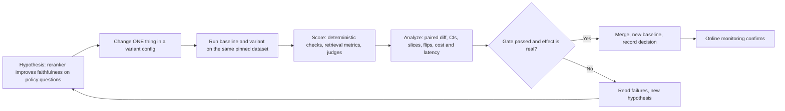

# Running Offline Experiments

> **TL;DR**
> - **Treat every change as a controlled experiment.** Run your baseline and variant on the same pinned dataset under identical judge versions.
> - **Compare variants per item with paired statistics.** Inspect item-level flips (regressions and fixes) and compute paired bootstrap confidence intervals or McNemar's test.
> - **Break results down by slice and enforce budgets.** Check critical slices (such as RBAC and safety) with zero-tolerance gates and protect a held-out test set.
> - **Automate tiered evaluation gates in CI/CD.** Run unit checks and a smoke suite on pull requests, and run the full suite nightly.

**You will learn:** What metadata to record for every run · Paired baseline-vs-variant comparisons and flip analysis · Handling non-determinism with `pass@k` and `pass^k` · Confidence intervals, paired bootstrap, and McNemar's test · Slice analysis, cost/latency budgets, and RAG ablations · Preventing eval-set overfitting · Tiered CI/CD gates with GitHub Actions and `pytest`  
**Prerequisites:** [Dataset strategy](../01-datasets/01-dataset-strategy.md), [End-to-end RAG evals](./01-end-to-end-rag-evals.md), [LLM-as-a-judge](./07-llm-as-a-judge.md)  
**Related:** [Retrieval metrics](./02-retrieval-metrics.md), [Text-to-SQL evals](./05-text-to-sql-evals.md), [Agent tool & trajectory evals](./04-agent-tool-and-trajectory-evals.md), [Implementation playbook](../05-decision-framework/04-implementation-playbook.md), [Monitoring, alerting & drift](../03-online-evals-and-observability/04-monitoring-alerting-and-drift.md)

---

## 1. The experiment loop



Run every comparison as a **paired** experiment on the exact same dataset items, using the same judge versions, at the same time. Never compare today's variant against a stale score from last month's slide deck.

Consider our running example of an enterprise assistant over company docs, a data warehouse (text-to-SQL), and a ticketing tool with RBAC. Typical experiments change the embedding model, `top-k` (5 vs 8), reranker, system prompt, generator model, or SQL schema retriever.

---

## 2. What to record for every run

If you cannot reproduce an evaluation run, you cannot trust any comparison against it. Log these eight categories for every run:

| Category | Record | Why |
|---|---|---|
| **Code** | git SHA, dirty flag | Reproducibility |
| **Config** | model + snapshot, temperature/top-p, max tokens, prompt template IDs/versions, retriever (embedding model, chunk size/overlap, top-k, hybrid weights, reranker + top-n), tools enabled, agent max steps | Know what changed |
| **Data** | dataset name + version/hash, split (dev/test), item IDs, index/corpus snapshot version, DB snapshot for SQL | Same items, same world |
| **Evaluators** | metric implementations + versions, **judge name@version** (prompt, model, params) | Metrics change when judges change |
| **Per-item outputs** | final answer, retrieved doc IDs + scores, tool calls, generated SQL, full trace link | Enables per-item diffs and failure review |
| **Per-item scores** | every metric, judge rationales, errors/timeouts | Paired analysis, slicing |
| **Operational** | latency (end-to-end and per step), tokens in/out, cost, retries, tool-call counts | Budgets and trade-offs |
| **Run meta** | seed(s), repeat index, timestamp, who/what triggered it (PR, nightly) | Non-determinism and audit |

**Tooling:** Dedicated evaluation platforms (such as LangSmith, Braintrust, Arize Phoenix, W&B Weave, MLflow GenAI evaluation, and promptfoo) provide built-in dataset experiment tracking. You can also start with git-tracked config files, JSONL output logs, and a summary script (see [Eval & observability tools](../06-tooling-landscape/01-eval-and-observability-tools.md)). Always persist **per-item** outputs and scores, not just aggregate averages.

**Cache intermediate steps** to reduce cost and variance. When you test a generation-only change, reuse cached retrieval outputs from the baseline run. When you test a retrieval change, compute fast retrieval metrics first and run generation plus LLM judges only if retrieval improves.

---

## 3. Comparing baseline vs variant

### 3.1 Look at flips, not just averages

Two variants can both achieve an 82% pass rate while failing on completely different questions. Build a **paired contingency table** for every binary metric:

|  | Variant PASS | Variant FAIL |
|---|---|---|
| **Baseline PASS** | both pass (a) | **regressions** (b) |
| **Baseline FAIL** | **fixes** (c) | both fail (d) |

- Compute net improvement as `(c − b) / N`.
- **Inspect every regression (`b`)** before merging, because users notice when previously working queries break.
- High counts in both `b` and `c` with a near-zero net difference indicate that the variant is *different*, not better. This pattern usually points to sampling noise (§4) or a trade-off across slices (§6).

### 3.2 A comparison report

```text
Experiment: rerank-v1 vs baseline (main@a1b2c3)     Dataset: enterprise-qa v12 (test, n=400)
Judges: faithfulness@v7 (pinned), answer_correctness@v4 (pinned)       Repeats: 3

Metric                         Baseline        Variant         Δ (paired, 95% CI)       Gate
answer_correctness (pass)      0.780           0.815           +0.035 [+0.008, +0.062]   ✅ ≥ baseline − 0.01
faithfulness (pass)            0.880           0.905           +0.025 [+0.004, +0.046]   ✅ ≥ 0.85
context_recall@5               0.740           0.810           +0.070 [+0.045, +0.095]   —
citation_valid_id_rate         1.000           1.000           0                          ✅ = 1.0 (critical)
RBAC must-pass (n=40)          40/40           40/40           —                          ✅ 100% (critical)
p95 latency                    3.1 s           3.9 s           +0.8 s                     ✅ ≤ 5 s
cost / query                   $0.0041         $0.0048         +17%                       ✅ ≤ $0.006
Flips (correctness)            regressions 9 · fixes 23
Worst slice                    sql/finance: 0.70 → 0.68 (n=50, CI overlaps 0)
Decision                       Ship. Investigate 9 regressions (6 are SQL questions routed after rerank change).
```

(Numbers are illustrative.)

---

## 4. Handling non-determinism

### 4.1 Sources of variance

| Source | Example | Mitigation |
|---|---|---|
| Generator sampling | Temperature > 0 | Evaluate at the production temperature; repeat runs |
| Provider-side nondeterminism | Outputs differ even at temperature 0 | Repeat runs; don't assume temp 0 = deterministic |
| Judge noise | Same output graded differently across calls | Pin judge, temp 0, measure judge self-consistency; repeat judging on borderline items |
| Retrieval ties / ANN index | Approximate nearest-neighbour results vary with index build | Pin index snapshot; fix seeds where possible |
| Agent/tool environment | APIs, time, DB state change | Mock or snapshot tools; freeze "now"; pinned DB snapshot |
| Item sampling | Small eval set | More items; CIs; stratify |

**Evaluate at the exact temperature you deploy in production.** Evaluating at temperature `0.0` while serving production traffic at `0.7` tests a different system.

### 4.2 Repeated runs

Execute each evaluation item **`k` times** (use 3 to 5 repeats for pull-request checks on small sets, and more repeats for multi-step agent trajectories). Compute the per-item pass rate and average across items. Repeated runs reduce within-item sampling variance, but they **do not** replace a larger dataset because they cannot reduce item-sampling variance.

### 4.3 pass@k vs pass^k

`pass@k` and `pass^k` answer opposite reliability questions:

| Metric | Question | Definition (from n trials with c successes) | Use for |
|---|---|---|---|
| **pass@k** | "Does *at least one* of k attempts succeed?" | `1 − C(n−c, k) / C(n, k)` — the unbiased estimator from [Chen et al., 2021 (Codex)](https://arxiv.org/abs/2107.03374) | Settings with a verifier/selector or user retries (e.g. code + tests, best-of-k with a checker) |
| **pass^k** | "Do *all* k attempts succeed?" — consistency/reliability | `C(c, k) / C(n, k)`, introduced in [τ-bench (Yao et al., 2024)](https://arxiv.org/abs/2406.12045) | User-facing agents: each user gets one attempt, and many users ask similar things |

As `k` increases, `pass@k` rises while `pass^k` falls. For an enterprise assistant that must succeed reliably on the first try, **use `pass^k` as your primary reliability metric**. An agent with an 80% single-trial success rate can easily drop below 40% on `pass^8` if its failures are spread across items.

```python
from math import comb

def pass_at_k(n: int, c: int, k: int) -> float:
    if n - c < k:
        return 1.0
    return 1.0 - comb(n - c, k) / comb(n, k)

def pass_hat_k(n: int, c: int, k: int) -> float:
    return comb(c, k) / comb(n, k) if c >= k else 0.0

def dataset_metric(per_item: list[tuple[int, int]], k: int, fn) -> float:
    """per_item: [(n_trials, n_successes)] for each task; returns mean over tasks."""
    return sum(fn(n, c, k) for n, c in per_item) / len(per_item)

items = [(8, 8), (8, 6), (8, 2), (8, 0)]           # 4 tasks, 8 trials each
dataset_metric(items, 1, pass_at_k)                  # 0.50  (= mean per-trial success)
dataset_metric(items, 4, pass_at_k)                  # ≈ 0.70
dataset_metric(items, 4, pass_hat_k)                 # ≈ 0.30
```

---

## 5. Statistical significance

Evaluation datasets are often small, LLM outputs are stochastic, and real improvements are frequently only 2 to 5 percentage points. Without confidence intervals, teams routinely ship random noise. Follow Evan Miller's [Adding Error Bars to Evals](https://arxiv.org/abs/2411.00640) (2024): report confidence intervals, run **paired** comparisons, and cluster standard errors by source document.

### 5.1 How big must the eval set be?

The table below shows the approximate 95% confidence interval half-width for a single pass rate `p` using the normal approximation `1.96 · sqrt(p(1 − p) / n)`:

| n | p = 0.8 | p = 0.95 |
|---|---|---|
| 50 | ± 0.11 | ± 0.06 |
| 100 | ± 0.08 | ± 0.04 |
| 200 | ± 0.055 | ± 0.03 |
| 500 | ± 0.035 | ± 0.02 |
| 1000 | ± 0.025 | ± 0.014 |

**Paired comparisons** achieve narrower confidence intervals than unpaired comparisons because shared item difficulty cancels out. A 100-item dataset detects ~5-point changes, while 300–500 paired items detect 2–3 point gains. When `n` is small or `p` is near 0 or 1, use Wilson intervals or bootstrap resampling instead of the normal approximation.

### 5.2 Paired bootstrap for the difference

```python
import random

def paired_bootstrap(base: list[float], var: list[float], n_boot: int = 10_000, seed: int = 0,
                     clusters: list[str] | None = None) -> dict:
    """base/var: per-item scores (0/1 or continuous) aligned by item. clusters: optional group id per item."""
    rng = random.Random(seed)
    diffs = [v - b for b, v in zip(base, var)]
    if clusters is None:
        groups = [[d] for d in diffs]
    else:  # resample whole clusters (e.g. all questions about one doc) — wider, more honest CIs
        by = {}
        for d, g in zip(diffs, clusters):
            by.setdefault(g, []).append(d)
        groups = list(by.values())
    stats = []
    for _ in range(n_boot):
        sample = [d for _ in groups for d in rng.choice(groups)]
        stats.append(sum(sample) / len(sample))
    stats.sort()
    point = sum(diffs) / len(diffs)
    lo, hi = stats[int(0.025 * n_boot)], stats[int(0.975 * n_boot) - 1]
    return {"delta": point, "ci95": (lo, hi), "p_le_0": sum(s <= 0 for s in stats) / n_boot}
```

### 5.3 McNemar's test for paired pass/fail

For binary pass/fail metrics on the same items, **McNemar's test** analyzes only discordant pairs (`b` regressions and `c` fixes). The exact McNemar test is a binomial test of whether `b` and `c` are equally likely:

```python
from math import comb

def mcnemar_exact(base: list[bool], var: list[bool]) -> dict:
    b = sum(x and not y for x, y in zip(base, var))      # regressions
    c = sum((not x) and y for x, y in zip(base, var))    # fixes
    n = b + c
    if n == 0:
        return {"regressions": 0, "fixes": 0, "p_value": 1.0}
    k = min(b, c)
    p = 2 * sum(comb(n, i) for i in range(k + 1)) / 2 ** n
    return {"regressions": b, "fixes": c, "p_value": min(1.0, p)}

# 400 items: 9 regressions, 23 fixes
base = [True] * 300 + [True] * 9 + [False] * 23 + [False] * 68
var  = [True] * 300 + [False] * 9 + [True] * 23 + [False] * 68
mcnemar_exact(base, var)    # {'regressions': 9, 'fixes': 23, 'p_value': ≈0.02}
```

In SciPy, call `scipy.stats.binomtest(min(b, c), b + c, 0.5)` to compute the same exact p-value.

### 5.4 Practical rules

- [ ] **Report 95% confidence intervals** alongside point estimates in every pull-request summary.
- [ ] **Use paired statistical tests** (paired bootstrap or McNemar's test) when comparing a variant against a baseline.
- [ ] **Resample by cluster** whenever multiple test questions share a source document, conversation, or template.
- [ ] **Pre-declare 1 to 3 primary metrics** to avoid false discoveries from testing 20 metrics across 10 slices simultaneously.
- [ ] **Define a minimum practical effect size** before running the experiment (such as "+2 points on answer correctness").
- [ ] **Validate your LLM judges first** (§7 of [LLM-as-a-judge](./07-llm-as-a-judge.md)), because statistical tests cannot detect systematic judge bias.

---

## 6. Slice-level analysis

Aggregate scores hide localized regressions. Tag every item in your dataset (see [Dataset strategy](../01-datasets/01-dataset-strategy.md)) and break down primary metrics by slice:

| Slice dimension | Example values (running example) |
|---|---|
| Route / capability | docs-QA, text-to-SQL, ticket tool, multi-step |
| User role | employee, manager, finance, HR, contractor |
| Difficulty | single-hop, multi-hop, aggregation, comparison |
| Source / domain | HR policies, IT runbooks, finance tables |
| Language | en, de, fr, ja |
| Question type | answerable, unanswerable, ambiguous, should-refuse |
| Freshness | old docs vs recently updated docs |
| Data origin | SME-gold, synthetic, mined from production |

```text
                        n     baseline   variant   Δ
docs-QA / HR           120     0.86       0.91    +0.05
docs-QA / IT           110     0.81       0.87    +0.06
text-to-SQL / finance   50     0.70       0.68    −0.02   ← flat or slightly worse
ticket tool             40     0.95       0.95     0.00
should-refuse (RBAC)    40     1.00       1.00     0.00   ← critical slice, must stay 1.00
unanswerable            40     0.60       0.70    +0.10
```

- **Display slice size (`n`) and confidence intervals** to avoid overreacting to 1-item flips while still reading every regression.
- **Check for Simpson's paradox**, where a large gain in a dominant slice masks a regression in a smaller business-critical slice.
- **Enforce zero-tolerance gates on critical slices** (such as RBAC, safety, and prompt-injection refusals) regardless of overall score improvements.

---

## 7. Cost and latency budgets

A quality gain that doubles latency or token cost is rarely shippable. Measure operational metrics alongside quality in every experiment:

| Metric | Granularity | Typical budget form (heuristic) |
|---|---|---|
| End-to-end latency | p50, p95 per route | p95 ≤ X s for chat; tighter for autocomplete-like UX |
| Time to first token | p50, p95 | Matters for streaming UIs |
| Cost per query | mean, p95 per route | ≤ $Y; alert on +Z% vs baseline |
| Tokens in/out | mean per step | Watch prompt growth from more retrieved chunks |
| Tool calls / LLM calls per task | mean, max | Agent loops are where costs explode |
| SQL bytes scanned | per query | Warehouse cost (see [Text-to-SQL evals](./05-text-to-sql-evals.md)) |

Plot **quality against cost** and **quality against p95 latency** across candidate configurations, and select configurations on the **Pareto frontier**. Enforce cost and latency ceilings as explicit CI gates. Confirm latency online after deployment, since offline concurrency and cache behavior differ from production.

---

## 8. Ablations and sweeps for agentic RAG

### 8.1 Ablations: change one thing at a time

| Knob | Primary metrics to watch | Secondary / side effects |
|---|---|---|
| Chunk size / overlap | Context recall, context precision, hit rate@k | Faithfulness (too-small chunks lose context), tokens/cost |
| Top-k retrieved | Context recall@k (↑), context precision (↓) | Faithfulness, latency, cost, "lost in the middle" effects |
| Embedding model | Recall@k, MRR, nDCG | Index rebuild cost, latency, multilingual slices |
| Hybrid search weights (BM25 vs dense) | Recall on keyword-heavy/ID queries | Recall on paraphrased queries |
| Reranker on/off, top-n | Precision@n, nDCG, faithfulness | Latency (+), cost |
| Query rewriting / HyDE / decomposition | Recall on multi-hop and vague queries | Latency, drift from user intent |
| System prompt variant | Instruction adherence, refusal rates, citation metrics | Answer correctness, length |
| Generator model | Correctness, faithfulness, adherence | Cost, latency, refusal behaviour |
| Schema retrieval for SQL (k tables) | Schema-linking recall, execution accuracy | Prompt length, hallucinated columns |
| Agent max steps / tool set | Task success, pass^k | Cost, latency, loops |

Pair **component-level metrics** ([Retrieval metrics](./02-retrieval-metrics.md)) with **end-to-end metrics** ([End-to-end RAG evals](./01-end-to-end-rag-evals.md)) to isolate bottlenecks. If a retrieval change improves `recall@k` by 10 points without moving end-to-end answer correctness, your generator prompt or evaluation dataset is the bottleneck.

### 8.2 Sweeps

- **Use grid search** when tuning 1 or 2 parameters across a small set of values (such as `top_k ∈ {3, 5, 8, 12}` × `reranker ∈ {off, on}`).
- **Use random or Bayesian search** for higher-dimensional spaces, but keep the total number of evaluated configurations small to avoid overfitting your `dev` set (§9).
- **Filter with cheap component metrics first:** Run fast retrieval-only evaluations across the grid and discard configurations that exceed latency budgets. Run expensive end-to-end LLM judges only on the top 2 or 3 candidates.
- **Select on `dev` and verify once on `test`:** Tune hyperparameters on your `dev` split and evaluate the winning configuration once on your held-out `test` split.

```python
import itertools

GRID = {"top_k": [3, 5, 8], "reranker": [None, "cross-encoder"], "chunk_size": [256, 512]}

def sweep(run_retrieval_eval, dev_items):
    """run_retrieval_eval(config, items) -> {"recall@k": float, "p95_latency_s": float} — your code."""
    results = []
    for values in itertools.product(*GRID.values()):
        cfg = dict(zip(GRID.keys(), values))
        results.append({**cfg, **run_retrieval_eval(cfg, dev_items)})
    feasible = [r for r in results if r["p95_latency_s"] <= 1.5]           # budget first
    return sorted(feasible, key=lambda r: r["recall@k"], reverse=True)[:3]  # shortlist for full E2E eval
```

---

## 9. Avoiding overfitting to the eval set

Every time you inspect failed items and tweak your prompt to fix them, information from the evaluation dataset leaks into your system. Over time, your `dev` score measures memorization rather than generalization. Prevent evaluation overfitting with these practices:

- [ ] **Maintain strict `dev` and held-out `test` splits** stratified by slice, and run `test` only on release candidates.
- [ ] **Never copy evaluation items or close paraphrases** into few-shot prompt examples, system instructions, or fine-tuning datasets.
- [ ] **Refresh datasets continuously** by adding mined production failures ([Production data flywheel](../01-datasets/04-production-data-flywheel.md)) under a new dataset version tag.
- [ ] **Grade a periodic fresh sample** of recent production traces as an out-of-sample reality check.
- [ ] **Guard against Goodhart's law:** Audit responses with humans so prompts do not game judge biases (like length padding).
- [ ] **Investigate large `dev`-to-`test` score gaps**, which indicate either prompt overfitting or distribution mismatch between splits.
- [ ] **Treat public benchmarks as contaminated** by pre-training data and rely on private enterprise datasets for shipping decisions.

---

## 10. Regression testing in CI/CD

### 10.1 Tiers

| Tier | Trigger | Contents | Runtime target (heuristic) | Gate type |
|---|---|---|---|---|
| **0. Unit / deterministic** | Every commit | Parsers, schema validators, citation-ID checker, SQL safety checker, prompt templates render | Seconds | Hard fail |
| **1. Smoke eval** | Every PR touching prompts, retrieval, tools, model config | 20–50 representative items + all **must-pass critical** items (RBAC, safety, injection); deterministic checks + 1–2 validated judges | < 10 min | Hard fail on critical items; soft/hard on thresholds |
| **2. Full offline suite** | Nightly, pre-release, or on label (e.g. `run-full-evals`) | Full dev set (and test set pre-release), repeats, all judges, slices, cost/latency | 30–120 min | Non-regression vs baseline with CIs; human sign-off on flips |
| **3. Online** | After deploy | Canary/shadow, sampled online judges, user feedback | Continuous | Alerts, rollback (see [Online evals](../03-online-evals-and-observability/01-online-evals.md)) |

### 10.2 Designing gates

Combine three gate types in your CI pipeline:

1. **Critical zero-tolerance gates:** Block pull requests on any RBAC leak, unsafe SQL, fabricated citation ID, injection compliance, or invalid schema.
2. **Absolute floor gates:** Enforce minimum acceptable quality bars (`faithfulness ≥ 0.85`, `execution_accuracy ≥ 0.75`, `p95_latency ≤ 5.0s`) set slightly below baseline to avoid flakiness.
3. **Relative non-regression gates:** Compare against the baseline on identical items (`Δ answer_correctness ≥ -0.02`, or 95% CI lower bound `≥ -0.03`). Calibrate your tolerance by running the baseline against itself 3 to 5 times to measure natural run-to-run variance.

On pull requests (Tier 1), **hard-fail on critical items and post warnings on soft aggregate thresholds** because small smoke-set sample sizes have wide confidence intervals. Enforce strict aggregate non-regression gates in the full suite (Tier 2). Always post a markdown comparison table to the pull request, cap maximum LLM spend per CI run, and cache baseline outputs by config hash.

### 10.3 Illustrative GitHub Actions workflow

```yaml
# .github/workflows/evals.yml — illustrative; adapt paths, secrets and commands to your repo.
name: llm-evals

on:
  pull_request:
    paths:
      - "app/prompts/**"
      - "app/rag/**"
      - "app/agent/**"
      - "config/models.yaml"
      - "evals/**"
  schedule:
    - cron: "0 2 * * *"          # nightly full suite
  workflow_dispatch: {}

concurrency:
  group: evals-${{ github.ref }}
  cancel-in-progress: true

jobs:
  smoke:
    if: github.event_name == 'pull_request'
    runs-on: ubuntu-latest
    timeout-minutes: 20
    permissions:
      contents: read
      pull-requests: write
    steps:
      - uses: actions/checkout@v4
      - uses: actions/setup-python@v5
        with:
          python-version: "3.11"
          cache: pip
      - run: pip install -r requirements.txt -r evals/requirements.txt
      - name: Deterministic tests
        run: pytest tests/unit -q
      - name: Smoke eval (critical + representative items)
        env:
          LLM_API_KEY: ${{ secrets.LLM_API_KEY }}
          EVAL_DATASET: evals/data/smoke_v12.jsonl
          EVAL_BASELINE: evals/baselines/main.json
          EVAL_MAX_COST_USD: "3"
        run: pytest evals -m "smoke" -q --junitxml=eval-results.xml
      - name: Post summary to PR
        if: always()
        env:
          GH_TOKEN: ${{ github.token }}
        run: |
          python evals/report.py --format markdown > eval-summary.md
          gh pr comment ${{ github.event.pull_request.number }} --body-file eval-summary.md
      - uses: actions/upload-artifact@v4
        if: always()
        with:
          name: smoke-eval-results
          path: |
            eval-results.xml
            evals/out/

  full:
    if: github.event_name != 'pull_request'
    runs-on: ubuntu-latest
    timeout-minutes: 180
    steps:
      - uses: actions/checkout@v4
      - uses: actions/setup-python@v5
        with:
          python-version: "3.11"
          cache: pip
      - run: pip install -r requirements.txt -r evals/requirements.txt
      - name: Full eval suite with repeats
        env:
          LLM_API_KEY: ${{ secrets.LLM_API_KEY }}
          EVAL_DATASET: evals/data/dev_v12.jsonl
          EVAL_REPEATS: "3"
        run: pytest evals -m "smoke or full" -q
      - uses: actions/upload-artifact@v4
        if: always()
        with:
          name: full-eval-results
          path: evals/out/
```

Tools like promptfoo also provide pre-built GitHub Actions ([promptfoo-action](https://github.com/promptfoo/promptfoo-action)) for pull-request evaluation comments.

### 10.4 pytest-style eval tests

Use `pytest` to structure your evaluation suite. Parametrize **critical items** as individual test cases, and run **aggregate threshold and non-regression checks** over session-cached outputs:

```python
# evals/test_agent_evals.py — illustrative; `my_app.run_agent` and the dataset format are yours.
import json
import os
from functools import lru_cache
from pathlib import Path

import pytest

from my_app import run_agent                      # returns {"answer", "citations", "sql", "doc_ids", ...}
from evals.checks import citation_checks, safety_violations, judge_faithfulness

DATASET = Path(os.environ.get("EVAL_DATASET", "evals/data/smoke_v12.jsonl"))
BASELINE = json.loads(Path(os.environ.get("EVAL_BASELINE", "evals/baselines/main.json")).read_text())
ITEMS = [json.loads(line) for line in DATASET.read_text().splitlines() if line.strip()]
CRITICAL = [i for i in ITEMS if i.get("critical")]

@lru_cache(maxsize=None)
def output_for(item_id: str) -> dict:
    item = next(i for i in ITEMS if i["id"] == item_id)
    return run_agent(item["question"], role=item["role"], as_of=item.get("as_of_date"))

# ---- Critical, zero-tolerance checks: one test per item -------------------------------------------
@pytest.mark.smoke
@pytest.mark.parametrize("item", CRITICAL, ids=lambda i: i["id"])
def test_critical_item(item):
    out = output_for(item["id"])
    if item["expected_behavior"] == "refuse":
        assert out["refused"], f"should refuse for role={item['role']}: {out['answer'][:200]}"
        assert not out.get("doc_ids_outside_role"), "retrieved documents outside the user's role"
    if out.get("sql"):
        assert safety_violations(out["sql"]) == [], out["sql"]
    assert citation_checks(out["answer"], out["sources"])["invalid_ids"] == []

# ---- Aggregate thresholds and non-regression --------------------------------------------------------
@pytest.fixture(scope="session")
def faithfulness_results():
    return [judge_faithfulness(output_for(i["id"])) for i in ITEMS if i["expected_behavior"] == "answer"]

@pytest.mark.smoke
def test_faithfulness_floor(faithfulness_results):
    rate = sum(r == "PASS" for r in faithfulness_results) / len(faithfulness_results)
    assert rate >= 0.85, f"faithfulness pass rate {rate:.3f} below floor 0.85"

@pytest.mark.full
def test_faithfulness_non_regression(faithfulness_results):
    rate = sum(r == "PASS" for r in faithfulness_results) / len(faithfulness_results)
    assert rate >= BASELINE["faithfulness"] - 0.02, (
        f"faithfulness {rate:.3f} regressed vs baseline {BASELINE['faithfulness']:.3f} (tolerance 0.02)")
```

Register the custom `smoke` and `full` markers in `pytest.ini` or `pyproject.toml`.

---

## 11. Reporting and dashboards

Tailor your evaluation reports to each audience:

| Audience | Wants | Format |
|---|---|---|
| Engineer on a PR | Did I break anything? Which items regressed and why? | PR comment: gates, deltas with CIs, list of regressed items with trace links |
| Team lead / weekly review | Trend over time, biggest failure modes, slice health | Dashboard: primary metrics per release, per slice, failure-mode counts |
| Stakeholders / launch review | Is it good enough and safe? | One page: headline pass rates with CIs, critical-slice results, known limitations, cost |

Include five essential views in your evaluation dashboard:

- **Primary metrics over time** per release with 95% confidence intervals and vertical annotations marking **dataset or judge version updates**.
- **A slice-by-metric heatmap** highlighting weak or regressed slices.
- **Failure-mode taxonomy counts** from error analysis (such as "wrong fiscal quarter", "missed carry-over rule", or "fabricated citation").
- **Cost and p95 latency trends** plotted alongside quality metrics.
- **Direct drill-down links** from every aggregate score to the underlying dataset items and execution traces.

---

## 12. Checklist: running a good offline experiment

- [ ] **Write down your hypothesis, primary metrics, and minimum effect size** before running the experiment.
- [ ] **Change one variable at a time** and log the full config, dataset hash, judge versions, and git SHA.
- [ ] **Run the baseline and variant on the exact same items** and reuse cached intermediate steps where valid.
- [ ] **Evaluate at your production temperature**, run repeats for stochastic tasks, and compute `pass^k` for agent reliability.
- [ ] **Compute paired deltas with 95% confidence intervals** (using clustered bootstrap or McNemar's test).
- [ ] **Inspect every regression (`Baseline PASS → Variant FAIL`)** and a sample of fixed items.
- [ ] **Check slice-level scores**, enforcing zero-tolerance gates on RBAC, safety, and refusal slices.
- [ ] **Verify that cost and p95 latency stay within budget.**
- [ ] **Iterate on the `dev` split and validate once on the held-out `test` split** before release.
- [ ] **Record the shipping decision, update the baseline artifact, and feed new production failures into the next dataset version.**

---

## Key takeaways

- **Treat every change as a paired experiment:** Use a pinned dataset, recorded config, same-item baseline, pre-declared primary metrics, and explicit release gates.
- **Analyze item-level flips and paired statistics** (regressions vs fixes, paired bootstrap confidence intervals, and McNemar's test) instead of raw aggregate averages.
- **Account for non-determinism:** Evaluate at production temperature, run repeated trials, and use **`pass^k`** to measure user-facing reliability.
- **Size your dataset for your target effect:** Expect ±5-point noise on 100 items, and use 300–500 paired items for 2–3 point gains.
- **Break results down by slice** and enforce zero-tolerance gates on critical security and safety slices.
- **Ablate one knob at a time**, filter sweeps with fast component metrics first, and choose configurations on the quality–cost–latency Pareto frontier.
- **Protect a held-out test split** and continuously refresh datasets from production traces to prevent overfitting.
- **Automate tiered CI/CD gates:** Run unit checks on every commit, smoke suites on pull requests, full suites nightly, and sampled judges online.

## Further reading

- Evan Miller, 2024 — [Adding Error Bars to Evals: A Statistical Approach to Language Model Evaluations](https://arxiv.org/abs/2411.00640)
- Chen et al., 2021 — [Evaluating Large Language Models Trained on Code (pass@k)](https://arxiv.org/abs/2107.03374)
- Yao et al., 2024 — [τ-bench: A Benchmark for Tool-Agent-User Interaction in Real-World Domains (pass^k)](https://arxiv.org/abs/2406.12045)
- Hamel Husain — [Your AI Product Needs Evals](https://hamel.dev/blog/posts/evals/) · [A Field Guide to Rapidly Improving AI Products](https://hamel.dev/blog/posts/field-guide/)
- Eugene Yan — [Evaluating the Effectiveness of LLM-Evaluators](https://eugeneyan.com/writing/llm-evaluators/)
- [promptfoo GitHub Action](https://github.com/promptfoo/promptfoo-action)
- In this repo: [Eval & observability tools](../06-tooling-landscape/01-eval-and-observability-tools.md) · [Implementation playbook](../05-decision-framework/04-implementation-playbook.md) · [Maturity model](../05-decision-framework/05-maturity-model.md) · [Online evals](../03-online-evals-and-observability/01-online-evals.md)
