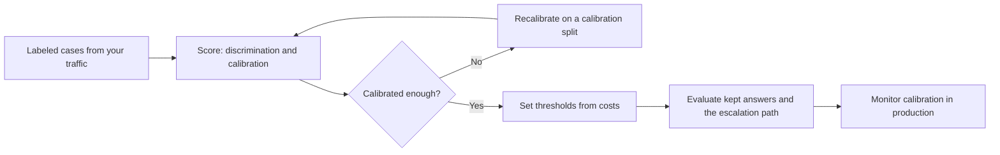

# Decision Model Evals (Experimental)

> **TL;DR**
>
> - **Measure calibration yourself.** Decision-model vendors say "calibrated", but none publish a calibration metric. The first cross-vendor benchmark found the decision models it tested overconfident.
> - **Score probabilities with proper scoring rules.** Report Brier score or log loss with a reliability diagram. Report discrimination separately.
> - **Set thresholds from costs on your own labels.** Then evaluate the escalation path: how accurate the kept answers are, and where the rest go.
> - **Pin the model version and re-check often.** Version changes, distribution shift, and adversarial inputs all move calibration.

!!! warning "Experimental: state of the field on October 19, 2026"
    Decision models became a recognizable product category in September and October 2026. Shared benchmarks are weeks old, and vendors publish few evaluation details. Treat this page as a snapshot. Re-check vendor docs and the sources below before you rely on any specific claim.

- **You will learn:**
    - What a decision model returns, and which products exist today
    - Calibration, discrimination, and selective-prediction metrics
    - How to set thresholds from costs and evaluate an escalation path
    - What is still unknown about this category
- **Prerequisites:** [LLM-as-a-judge](./07-llm-as-a-judge.md), [Running offline experiments](./08-running-offline-experiments.md)
- **Related:** [Guardrails architecture: cascades](../04-guardrails/01-guardrails-architecture.md#53-short-circuit-cheap-to-expensive-cascades), [Eval selection](../05-decision-framework/01-eval-selection-decision-tree.md), [Guardrail tools](../06-tooling-landscape/02-guardrail-tools.md)

---

## 1. What a decision model is

Acme routes 40,000 support requests a day. Today an LLM prompt reads each request and writes a queue name, which code then parses. The team tries a **decision model** instead. It asks three typed questions about each request:

- **Which queue?** One of six options, with a probability for each.
- **Does it ask for access to someone else's data?** A probability that the condition holds.
- **How urgent is it?** A probability spread over four described levels.

Code owns the policy. If the data-access probability is above a threshold, the request goes to the security queue. If the queue answer is uncertain, a human triages it.

The model never writes text, so there is nothing to parse. There is also no text to read when it is wrong.

A decision model returns **typed answers with probabilities** instead of generated text. The table lists products in this category as of October 2026. It is not an endorsement. Check each vendor's current docs.

| Product | Answer types | What the vendor says about uncertainty |
|---|---|---|
| **TypeSafe Jev** ("System One") | Choice, Noul (yes/no), Score | "Trained for calibrated decisions". Calibration "does not guarantee that an individual answer is correct" ([docs](https://docs.typesafe.ai/concepts/system-one.md)) |
| **OpenAI Decisions API** (public beta) | Predicate, choice, score | No calibration claim. "Use labeled examples from your application to set thresholds" ([docs](https://developers.openai.com/api/docs/guides/decisions)) |
| **Liquid AI d1** | Choice, Noul, Score (called through the TypeSafe SDK) | "Calibrated probabilities for every answer" ([docs](https://docs.liquid.ai/guides/decision-model-guide)) |

Older tools share the same output shape. Guard models such as [Granite Guardian](https://arxiv.org/abs/2412.07724) and ShieldGemma turn yes/no token probabilities into a risk probability. Verifiers such as HHEM and MiniCheck return a support score.

Routers such as [RouteLLM](https://arxiv.org/abs/2406.18665) return the probability that a stronger model would win. The evaluation methods on this page apply to all of them.

**Read the vendor's definition of `confidence`.** It is usually a formula over the returned probabilities, not a separate calibrated number. TypeSafe says its `confidence` "is a statistic computed from the probability distribution" ([docs](https://docs.typesafe.ai/confidence.md)).

OpenAI's choice answers also return "a probabilities array for the options and a confidence field". Decide on your own data which number predicts correctness best.

---

## 2. What we know today

**Vendor claims and independent evidence disagree.**

- **Independent benchmark.** The Artificial Analysis Decision Index (October 13, 2026) tested decision models on knowledge, reasoning, tool-calling, and safety tasks. It found that "across almost all probability levels, accuracy falls below that probability for all decision models". Calibration was poor on knowledge and reasoning tasks. Most decision models were relatively well calibrated on tool-calling and safety tasks ([Artificial Analysis](https://artificialanalysis.ai/articles/artificial-analysis-decision-index)).
- **Academic case study (no vendor authors).** A 2026 preprint coded police crash narratives with Jev and audited them against 2,416 blinded human judgments ([Rafe & Das, 2026](https://arxiv.org/abs/2609.24052)). Jev reached F1 = 0.908. One frontier LLM did better (F1 = 0.967), and the other was indistinguishable from Jev.
- **Calibration direction varies.** In that study, Jev was *underconfident*: its calibration slope was 1.63, and the authors say its probabilities "are not extreme enough". They conclude that "calibration varies by model rather than by paradigm, so each model must be audited". Recalibration cut calibration error by a factor of 3.3.
- **Neighboring evidence from guard models.** LLM-based guard models "produce overconfident predictions" and show "significant miscalibration when subjected to jailbreak attacks" ([Liu et al., ICLR 2025](https://arxiv.org/abs/2410.10414)). A 2026 study found several of five guards "nearly calibrated on clean inputs". Adversarial attacks then degraded their calibration "by an order of magnitude" ([Hong et al., 2026](https://arxiv.org/abs/2609.36477)).

Treat "calibrated" as a measurement that you run, not as a product feature.

---

## 3. What to measure



1. **Label cases from your own traffic** for every question the model answers.
2. **Separate discrimination from calibration.** A model can rank cases well and still state the wrong probabilities.
3. **Choose thresholds last**, on probabilities that you have checked.

| Property | Metric | Question it answers |
|---|---|---|
| **Discrimination** | AUROC, AUPRC, or recall at a fixed false-positive rate | Does the model rank true cases above false ones? |
| **Calibration** | Brier score, log loss, reliability diagram | When the model says 0.8, does the event happen 80% of the time? |
| **Selective prediction** | Accuracy at a chosen coverage, and the risk–coverage curve | If we defer the least confident cases, how good are the rest? |
| **Cascade quality** | Cost and quality of the whole path, and the deferral rate | Does "decision model first, escalate the rest" beat one model? |
| **Ordered levels** | Ranked probability score | Is probability spread over the right Score levels? |
| **Robustness** | All of the above on reordered options, paraphrases, distractor text, and attacks | Does calibration hold outside clean test cases? |

**Lead with proper scoring rules.** Brier score and log loss reward both accuracy and honest probabilities. Use the reliability diagram to see where the model is over- or underconfident.

If you report expected calibration error (ECE), use equal-count bins and give a confidence interval. ECE "has numerous flaws" ([Nixon et al., 2019](https://arxiv.org/abs/1904.01685)), and common recalibration methods are "less calibrated than reported" ([Kumar et al., 2019](https://arxiv.org/abs/1909.10155)).

The snippet below scores one yes/no question: "Does this request ask for someone else's data?"

```python
import math

def brier(p: list[float], y: list[int]) -> float:
    return sum((pi - yi) ** 2 for pi, yi in zip(p, y)) / len(p)

def reliability(p: list[float], y: list[int], bins: int = 5) -> list[tuple[float, float, int]]:
    """Equal-count bins: (mean predicted probability, observed rate, n)."""
    order = sorted(range(len(p)), key=lambda i: p[i])
    size = math.ceil(len(p) / bins)
    rows = []
    for start in range(0, len(p), size):
        idx = order[start:start + size]
        rows.append((sum(p[i] for i in idx) / len(idx), sum(y[i] for i in idx) / len(idx), len(idx)))
    return rows

def ece(p: list[float], y: list[int], bins: int = 5) -> float:
    return sum(n * abs(mean_p - rate) for mean_p, rate, n in reliability(p, y, bins)) / len(p)

def best_threshold(p: list[float], y: list[int], cost_fp: float, cost_fn: float) -> float:
    """Act when p >= t. Pick the t with the lowest total cost on labeled data (ties go to the lower t)."""
    def cost(t: float) -> float:
        return sum(cost_fp if pi >= t and not yi else cost_fn if pi < t and yi else 0
                   for pi, yi in zip(p, y))
    return min(sorted(set(p)) + [1.01], key=lambda t: (cost(t), t))

def accuracy_at_coverage(p: list[float], y: list[int], coverage: float) -> float:
    """Answer only the most confident share of cases; defer the rest."""
    ranked = sorted(zip(p, y), key=lambda py: -abs(py[0] - 0.5))
    kept = ranked[:max(1, round(coverage * len(ranked)))]
    return sum((pi >= 0.5) == bool(yi) for pi, yi in kept) / len(kept)


# Five groups of six cases. Each group fills one bin, so the order of tied cases cannot change results.
p = [0.97] * 6 + [0.9] * 6 + [0.6] * 6 + [0.2] * 6 + [0.03] * 6       # model probabilities
y = [1] * 4 + [0] * 2 + [1] * 4 + [0] * 2 + [1] * 3 + [0] * 3 + [1] + [0] * 5 + [0] * 6
top_mean_p, top_rate, _ = reliability(p, y)[-1]
assert (round(top_mean_p, 2), round(top_rate, 2)) == (0.97, 0.67)   # says 97%, true 67%: overconfident
assert round(ece(p, y), 2) == 0.14
assert brier(p, y) < brier([sum(y) / len(y)] * len(y), y)          # still beats a constant guess
# Demo only: in practice, pick thresholds on a calibration split and report them on a test split.
assert best_threshold(p, y, cost_fp=1, cost_fn=2) == 0.6
assert best_threshold(p, y, cost_fp=1, cost_fn=10) == 0.2           # costly misses lower the bar
assert round(accuracy_at_coverage(p, y, 1.0), 2) == 0.73
assert round(accuracy_at_coverage(p, y, 0.4), 2) == 0.83            # keep the 40% most confident
```

This model ranks cases usefully, so its Brier score beats a constant guess. Its high probabilities still overstate how often it is right. Recalibrate it, or set thresholds on observed accuracy instead of on the stated probability.

---

## 4. Procedure

- [ ] **Build a labeled set per question** from real traffic. Every vendor in §1 tells you to validate on your own data.
- [ ] **Pin the model version.** TypeSafe warns: "If you have tuned confidence thresholds against one version, send that version's ID instead of the alias" ([models](https://docs.typesafe.ai/models.md)).
- [ ] **Score discrimination and calibration per question and per slice.** The Decision Index found calibration differs sharply between task types.
- [ ] **Recalibrate if needed** on a separate calibration split. Temperature scaling is "surprisingly effective" on many datasets ([Guo et al., 2017](https://arxiv.org/abs/1706.04599)). Report the final numbers on a held-out test split ([judge splits](./07-llm-as-a-judge.md#11-judge-validation-workflow-checklist) work the same way).
- [ ] **Set thresholds from the cost of each error.** Write down what a false positive and a false negative cost, then pick the threshold on labeled data.
- [ ] **Evaluate the escalation path.** Report accuracy on kept cases, the deferral rate, and the quality and cost of whatever handles deferred cases ([selective classification](https://arxiv.org/abs/1705.08500), [cascades](../04-guardrails/01-guardrails-architecture.md#53-short-circuit-cheap-to-expensive-cascades)).
- [ ] **Stress-test known weak spots.** Reorder Choice options: TypeSafe notes that `jev-1.13` "leans toward the option that comes first" ([jaggedness notes](https://docs.typesafe.ai/model-jaggedness/jev-1.13.md)). Add paraphrases, irrelevant context, and adversarial inputs.
- [ ] **Evaluate composed decisions end to end.** When code combines several answers, score the final action, not only each answer.
- [ ] **Monitor calibration in production.** Label a small random sample each week. Alert when the reliability diagram drifts ([monitoring and drift](../03-online-evals-and-observability/04-monitoring-alerting-and-drift.md)).

**Use a decision model as a check with the same care as a judge.** A yes/no decision model can serve as an eval check or a guardrail, for example "Is every claim supported by the cited passage?". Validate it like an [LLM judge](./07-llm-as-a-judge.md): TPR, TNR, and κ against human labels. Add the calibration checks above, because your thresholds depend on its probabilities.

---

## 5. Pitfalls

| Pitfall | What goes wrong | Instead |
|---|---|---|
| **"Calibrated" as a product feature** | You skip measurement and trust stated probabilities | Measure calibration on your labels |
| **Accuracy mistaken for calibration** | A high-accuracy model still overstates its confidence | Report Brier score and a reliability diagram |
| **A moving model alias** | Thresholds tuned on one version silently break | Pin the version ID and re-validate on upgrade |
| **Calibration measured only on clean data** | Shift and attacks degrade calibration ([Ovadia et al., 2019](https://arxiv.org/abs/1906.02530)) | Re-measure on shifted and adversarial slices |
| **Option-order effects** | The answer changes when you reorder the options | Reorder the options and check that answers stay the same |
| **Reading Score levels as a number** | TypeSafe notes that `jev-1.13`'s score levels "are weak in numerical calibration" | Compare levels, and do not interpolate exact values |
| **Composed answers treated as calibrated** | Combining calibrated parts does not give a calibrated whole | Evaluate the final decision end to end |

---

## 6. What is still unknown

- **Shared benchmarks are new.** The Decision Index launched on October 13, 2026, and parts of its data are private. Its calibration comparison with language models was still marked "coming soon".
- **Vendors publish no calibration metrics.** None of the vendors in §1 publish Brier score, ECE, or reliability diagrams with their data.
- **Composed judgments have no standard method.** We found no published method for checking calibration after code combines several answers.
- **The product list is moving.** The Decision Index also scores models that this page does not review, such as Microsoft-Decision-1 and Celeris-1 Decision. Check each one's documentation before you rely on it.

Re-check this page against vendor docs and new independent studies at least once a quarter.

---

## Key takeaways

- **Treat calibration as a measurement.** Vendor claims are not evidence for your data.
- **Lead with Brier score or log loss.** Use reliability diagrams to see the shape of the error.
- **Set thresholds from error costs,** on probabilities that you have checked.
- **Evaluate the whole escalation path,** not only the decision model.
- **Pin versions and re-test** after upgrades, shift, and attacks.

## Further reading

- Artificial Analysis, [Decision Index](https://artificialanalysis.ai/articles/artificial-analysis-decision-index) (October 2026)
- Rafe & Das, *Calibrated Decisions at Scale: Converting Police Crash Narratives into Probabilistic Crash Variables with a System One Model (Jev)*, [arXiv:2609.24052](https://arxiv.org/abs/2609.24052) (preprint)
- TypeSafe, [System One](https://docs.typesafe.ai/concepts/system-one.md) · [Confidence](https://docs.typesafe.ai/confidence.md) · [Jev 1.13 jaggedness notes](https://docs.typesafe.ai/model-jaggedness/jev-1.13.md)
- OpenAI, [Decisions API guide](https://developers.openai.com/api/docs/guides/decisions) · Liquid AI, [Decision model guide](https://docs.liquid.ai/guides/decision-model-guide)
- Liu et al., *On Calibration of LLM-based Guard Models for Reliable Content Moderation*, ICLR 2025, [arXiv:2410.10414](https://arxiv.org/abs/2410.10414) · Hong et al., [arXiv:2609.36477](https://arxiv.org/abs/2609.36477)
- Guo et al., *On Calibration of Modern Neural Networks*, ICML 2017, [arXiv:1706.04599](https://arxiv.org/abs/1706.04599)
- Nixon et al., *Measuring Calibration in Deep Learning*, [arXiv:1904.01685](https://arxiv.org/abs/1904.01685) · Kumar, Liang & Ma, *Verified Uncertainty Calibration*, NeurIPS 2019, [arXiv:1909.10155](https://arxiv.org/abs/1909.10155)
- Geifman & El-Yaniv, *Selective Classification for Deep Neural Networks*, NeurIPS 2017, [arXiv:1705.08500](https://arxiv.org/abs/1705.08500)
- Ovadia et al., *Can You Trust Your Model's Uncertainty?*, NeurIPS 2019, [arXiv:1906.02530](https://arxiv.org/abs/1906.02530)
- Ong et al., *RouteLLM: Learning to Route LLMs with Preference Data*, [arXiv:2406.18665](https://arxiv.org/abs/2406.18665)
- Padhi et al., *Granite Guardian*, [arXiv:2412.07724](https://arxiv.org/abs/2412.07724)
- **Within this repo:**
    - [LLM-as-a-judge](./07-llm-as-a-judge.md)
    - [Guardrails architecture](../04-guardrails/01-guardrails-architecture.md)
    - [Running offline experiments](./08-running-offline-experiments.md)
