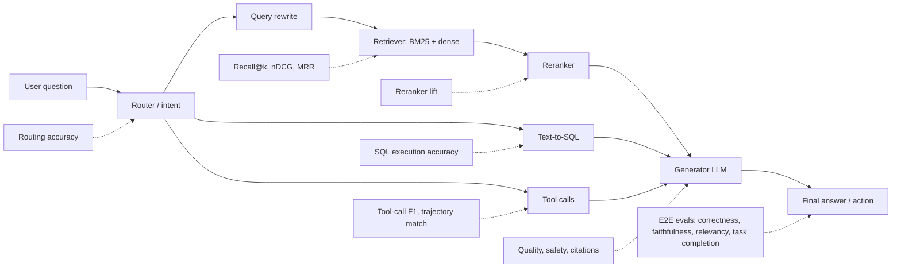

# 02 — Offline Evals

Offline evals run your application (or one of its components) against a **fixed dataset** before a change ships. They answer one question: *"Is version B better than version A, and did anything break?"* They are your regression suite, your experiment harness, and the main way you learn which part of an agentic RAG pipeline is failing.

This section covers **what to measure** and **how to compute it**: every major metric family for RAG chatbots, retrieval, generation quality and safety, tool-calling agents, text-to-SQL, instruction/citation adherence, and the LLM-as-a-judge technique that powers many of them. It closes with how to run offline experiments rigorously.

> Running example used throughout: an **internal enterprise assistant** that answers questions over company docs (vector search), queries a data warehouse via text-to-SQL, can call tools (e.g. `create_ticket`), and serves users in different roles (RBAC).

## End-to-end vs component evals

Offline evals come in two scopes. You need both.

| | **End-to-end (E2E)** | **Component-level** |
|---|---|---|
| **Unit under test** | The whole pipeline: user input → final answer/action | One stage: retriever, reranker, router, tool-caller, SQL generator, judge, guardrail |
| **Question answered** | "Does the user get a good outcome?" | "Which stage is responsible, and did my change to *this* stage help?" |
| **Typical metrics** | Answer correctness, faithfulness, answer relevancy, task completion, abstention correctness, latency/cost | Recall@k, nDCG, MRR, tool-call F1, argument accuracy, SQL execution accuracy, routing accuracy, citation precision |
| **Dataset shape** | Question (+ reference answer, + optional reference contexts) | Stage-specific: query → relevant chunk IDs; prompt → expected tool calls; question → gold SQL; etc. |
| **Strength** | Measures what users actually experience | Fast, cheap, precise attribution; enables targeted iteration |
| **Weakness** | Hard to attribute failures; noisy; often needs an LLM judge | A perfect component can still produce a bad overall outcome |

**Rule of thumb:** start with a small E2E suite to know *whether* you are good enough, then add component suites where E2E failures cluster, so you can iterate on that stage cheaply. See [the evals and guardrails map](../00-foundations/02-the-evals-and-guardrails-map.md) for how offline evals relate to online evals and guardrails.

## Files in this section

| File | What it covers | Read when... |
|---|---|---|
| [01-end-to-end-rag-evals.md](./01-end-to-end-rag-evals.md) | RAG triad, RAGAS-style metrics (answer correctness, faithfulness, answer relevancy, context precision/recall, noise sensitivity, abstention), scorecards, the retrieval × generation 2×2 diagnosis | You need to know whether your RAG chatbot gives correct, grounded answers |
| [02-retrieval-metrics.md](./02-retrieval-metrics.md) | Hit rate, precision/recall/F1@k, MRR, MAP, nDCG, R-precision with formulas, worked examples and pure-Python code; labeling; per-stage retrieval evals | You are tuning chunking, embeddings, hybrid search, or a reranker |
| [03-generation-quality-and-safety-evals.md](./03-generation-quality-and-safety-evals.md) | Coherence, conciseness, tone, helpfulness; toxicity, profanity, bias, PII leakage, harmful advice, reference-free hallucination detection, over/under-refusal | You need to check answer quality and safety beyond "is it correct" |
| [04-agent-tool-and-trajectory-evals.md](./04-agent-tool-and-trajectory-evals.md) | Tool selection and argument accuracy, tool-call F1, trajectory matching, final-state checks, efficiency, routing confusion matrices, multi-turn and simulated-user evals | Your app calls tools, routes between skills, or runs multi-step plans |
| [05-text-to-sql-evals.md](./05-text-to-sql-evals.md) | SQL generation evals: exact/structural match, SQL similarity, execution accuracy, result-set comparison, safety of generated SQL | Your agent queries a database or warehouse |
| [06-instruction-and-citation-adherence.md](./06-instruction-and-citation-adherence.md) | Instruction-following / format adherence and citation correctness (citation precision/recall, attribution) | You have system-prompt rules, output formats, or must cite sources |
| [07-llm-as-a-judge.md](./07-llm-as-a-judge.md) | Designing, calibrating and validating LLM judges; biases; rubrics; agreement with humans | You use (or plan to use) an LLM to grade outputs — i.e. almost always |
| [08-running-offline-experiments.md](./08-running-offline-experiments.md) | Experiment design, baselines, sample sizes, variance, CI integration, regression gates, reporting | You are ready to compare variants and gate releases on eval results |

## Suggested reading order

1. **[01 — End-to-end RAG evals](./01-end-to-end-rag-evals.md)** — get the big picture of what "good" means for a RAG answer.
2. **[07 — LLM-as-a-judge](./07-llm-as-a-judge.md)** — most E2E and quality metrics depend on judges; learn to trust (and distrust) them early.
3. **[02 — Retrieval metrics](./02-retrieval-metrics.md)** — retrieval is the most common root cause of bad RAG answers.
4. **[04 — Agent tool & trajectory evals](./04-agent-tool-and-trajectory-evals.md)** and **[05 — Text-to-SQL evals](./05-text-to-sql-evals.md)** — if your app acts or queries data.
5. **[03 — Generation quality & safety](./03-generation-quality-and-safety-evals.md)** and **[06 — Instruction & citation adherence](./06-instruction-and-citation-adherence.md)** — polish and policy.
6. **[08 — Running offline experiments](./08-running-offline-experiments.md)** — turn all of the above into a repeatable release process.

**Prerequisites:** a dataset whose shape matches the eval you want to run. See [Datasets](../01-datasets/README.md), especially [dataset strategy](../01-datasets/01-dataset-strategy.md).

**Next:** [Online evals & observability](../03-online-evals-and-observability/README.md) — many offline metrics become sampled online checks. For a quick metric lookup, see the [metric cheatsheet](../05-decision-framework/03-metric-cheatsheet.md).
