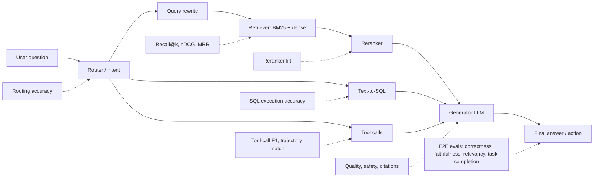

# 02 · Offline Evals

> **TL;DR**
>
> - **Run offline evals before shipping.** Test your system against a fixed dataset to verify improvements and catch regressions.
> - **Combine end-to-end and component metrics.** Measure overall user outcomes first, then isolate failures to specific pipeline stages.
> - **Validate your LLM judges.** Check automated evaluators against human labels before you trust them for release gates.
> - **Gate releases on statistical experiments.** Compare variants across slices, latency, and cost before deploying to production.

- **You will learn:**
    - End-to-end vs component evals
    - Metric families for RAG, SQL, and agents
    - Suggested reading order
- **Prerequisites:** [Why evals and guardrails](../00-foundations/01-why-evals-and-guardrails.md), [Datasets](../01-datasets/README.md)
- **Related:** [Online evals & observability](../03-online-evals-and-observability/README.md), [Metric cheatsheet](../05-decision-framework/03-metric-cheatsheet.md)

---

Offline evals run your application or one of its components against a **fixed dataset** before a change ships. They answer one core question: *"Is version B better than version A, and did anything break?"* Use them for regression gates, A/B experiments, and root-cause diagnostics across agentic RAG pipelines.

This section covers **what to measure** and **how to compute each metric**. You will find metric families for RAG chatbots, retrieval, generation quality, safety, tool-calling agents, text-to-SQL, and instruction adherence. You will also learn how to design LLM-as-a-judge evaluators and run offline experiments rigorously.

> **Running example:** An **internal enterprise assistant** answers questions over company documents with vector search and queries a data warehouse via text-to-SQL. It also calls tools like `create_ticket` and enforces role-based access control (RBAC).

## End-to-end vs component evals

Offline evals operate at two scopes. You need both scopes to build a reliable pipeline.

| Dimension | **End-to-end (E2E)** | **Component-level** |
|---|---|---|
| **Unit under test** | The whole pipeline: user input → final answer or action | One stage: retriever, reranker, router, tool-caller, SQL generator, judge, or guardrail |
| **Question answered** | "Does the user get a good outcome?" | "Which stage failed, and did my change to *this* stage help?" |
| **Typical metrics** | Answer correctness, faithfulness, answer relevancy, task completion, abstention correctness, latency, cost | Recall@k, nDCG, MRR, tool-call F1, argument accuracy, SQL execution accuracy, routing accuracy, citation precision |
| **Dataset shape** | Question + reference answer + optional reference contexts | Stage-specific pairs: query → relevant chunk IDs, prompt → expected tool calls, or question → gold SQL |
| **Strength** | Measures what users actually experience | Runs fast and cheap, isolates root causes, and enables targeted iteration |
| **Weakness** | Obscures failure root causes, adds noise, and often requires an LLM judge | A high-scoring component can still produce a bad overall user outcome |

**Rule of thumb:** Start with a small E2E suite to measure overall system quality. Add component suites where E2E failures cluster so you can iterate on those stages cheaply. See [the evals and guardrails map](../00-foundations/02-the-evals-and-guardrails-map.md) to learn how offline evals connect to online evals and guardrails.

## Files in this section

| File | What it covers | Read when... |
|---|---|---|
| [01-end-to-end-rag-evals.md](./01-end-to-end-rag-evals.md) | RAG triad, RAGAS-style metrics (answer correctness, faithfulness, answer relevancy, context precision/recall, noise sensitivity, abstention), RAGAS v0.4 metric names, faithfulness over tool outputs, scorecards with confidence intervals, retrieval × generation 2×2 diagnosis | You need to verify that your RAG chatbot gives correct, grounded answers |
| [02-retrieval-metrics.md](./02-retrieval-metrics.md) | Hit rate, precision/recall/F1@k, MRR, MAP, nDCG (linear and exponential gain), ERR, RBP, R-precision with formulas, worked examples, pure-Python code, paired significance tests, labeling and pooling bias, per-stage and agentic multi-hop retrieval evals | You are tuning chunking, embeddings, hybrid search, or a reranker |
| [03-generation-quality-and-safety-evals.md](./03-generation-quality-and-safety-evals.md) | Coherence, conciseness, tone, helpfulness, toxicity, profanity, bias, PII leakage, harmful advice, reference-free hallucination detection, over/under-refusal, indirect prompt injection (attack success rate, utility under attack) | You need to evaluate answer quality and safety beyond factual correctness |
| [04-agent-tool-and-trajectory-evals.md](./04-agent-tool-and-trajectory-evals.md) | Tool selection and argument accuracy, tool-call F1, trajectory matching, final-state checks, efficiency, pass@k vs pass^k, routing confusion matrices, multi-turn and simulated-user evals, agent benchmarks (τ²-bench, BFCL) | Your application calls tools, routes between skills, or runs multi-step plans |
| [05-text-to-sql-evals.md](./05-text-to-sql-evals.md) | SQL generation evals: exact/structural match, SQL similarity, execution accuracy, result-set comparison, safety of generated SQL | Your agent queries a database or data warehouse |
| [06-instruction-and-citation-adherence.md](./06-instruction-and-citation-adherence.md) | Instruction-following, format adherence, and citation correctness (citation precision/recall, attribution) | You enforce system-prompt rules, output formats, or source citations |
| [07-llm-as-a-judge.md](./07-llm-as-a-judge.md) | Designing LLM judges and validating them against human labels, handling judge biases, writing rubrics, measuring human agreement | You use or plan to use an LLM to grade outputs |
| [08-running-offline-experiments.md](./08-running-offline-experiments.md) | Experiment design, baselines, sample sizes, variance, CI integration, regression gates, reporting | You are ready to compare variants and gate releases on eval results |
| [09-agent-eval-environments-and-graders.md](./09-agent-eval-environments-and-graders.md) | Resettable eval environments, outcome graders per agent archetype, task validity checks (reference solution passes, do-nothing agent fails), grader hacking, long-horizon milestones, and a minimal harness | You evaluate an agent that changes state, or you build your own agent benchmark |

## Suggested reading order

1. **Read [01 · End-to-end RAG evals](./01-end-to-end-rag-evals.md)** to understand what good quality means for a RAG answer.
2. **Read [07 · LLM-as-a-judge](./07-llm-as-a-judge.md)** because most E2E and quality metrics rely on LLM judges. Learn how to validate them early.
3. **Read [02 · Retrieval metrics](./02-retrieval-metrics.md)** to diagnose retrieval, which is the most common root cause of bad RAG answers.
4. **Read [04 · Agent tool & trajectory evals](./04-agent-tool-and-trajectory-evals.md)** and **[05 · Text-to-SQL evals](./05-text-to-sql-evals.md)** if your system takes actions or queries structured data.
5. **Read [03 · Generation quality & safety](./03-generation-quality-and-safety-evals.md)** and **[06 · Instruction & citation adherence](./06-instruction-and-citation-adherence.md)** to enforce style, policy, and source attribution.
6. **Read [08 · Running offline experiments](./08-running-offline-experiments.md)** to turn these metrics into a repeatable release process.
7. **Read [09 · Agent eval environments & graders](./09-agent-eval-environments-and-graders.md)** if your agent changes state in other systems and you need a resettable environment and outcome graders.

**Prerequisites:** Prepare a dataset that matches the shape of your target evaluation. See [Datasets](../01-datasets/README.md) and [dataset strategy](../01-datasets/01-dataset-strategy.md).

**Next:** Continue to [Online evals & observability](../03-online-evals-and-observability/README.md) to run offline metrics on sampled production traffic. For a quick reference, see the [metric cheatsheet](../05-decision-framework/03-metric-cheatsheet.md).
