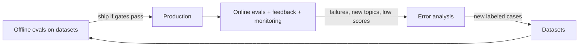
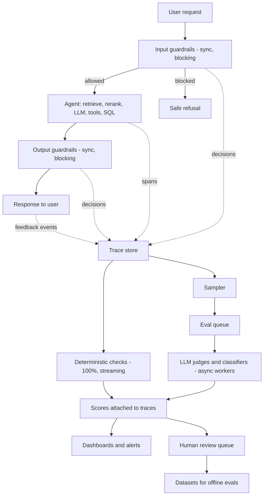
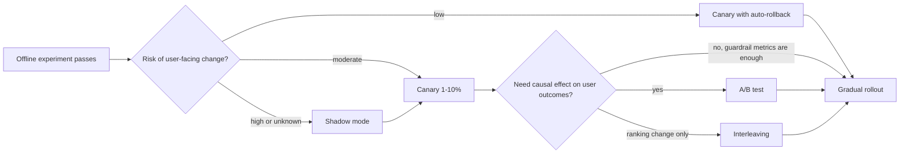
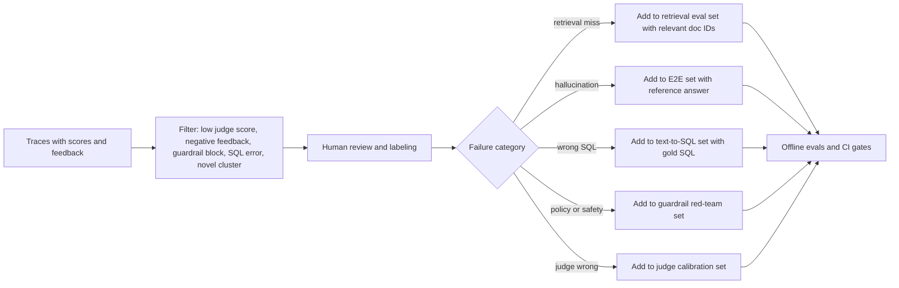

# Online Evals: Scoring Production Traffic

> **TL;DR**
>
> - **Check every request deterministically.** Validate schema compliance, citation resolution, SQL syntax, retrieval counts, and latency budgets on 100% of traffic.
> - **Run LLM judges asynchronously on samples.** Evaluate reference-free faithfulness, answer relevance, and SQL alignment off the critical user path. The exception is the HR/finance groundedness check, which runs synchronously and blocks.
> - **Separate reporting samples from triage samples.** Use uniform random samples for dashboard KPIs and risk-triggered samples for bug hunting. Size samples for the question (level vs change) and correct judged rates for judge error.
> - **Validate rollouts and feed datasets.** Confirm offline wins through shadow runs, canaries, or A/B tests with proper statistical tests, and turn failures into regression cases.

- **You will learn:**
    - Offline vs online differences
    - 100% deterministic checks vs sampled LLM judges
    - Sync vs async architecture, fail modes, and judge hardening
    - Sampling, sample sizes, Wilson intervals, and judge-error correction
    - Shadow mode, canaries, A/B tests (sequential testing, CUPED, delta method), and interleaving
    - Offline-to-online metric mapping and dataset flywheels
- **Prerequisites:** [The evals & guardrails map](../00-foundations/02-the-evals-and-guardrails-map.md), [End-to-end RAG evals](../02-offline-evals/01-end-to-end-rag-evals.md), [LLM-as-a-judge](../02-offline-evals/07-llm-as-a-judge.md)
- **Related:** [Observability & tracing](./02-observability-and-tracing.md), [User feedback](./03-user-feedback-and-implicit-signals.md), [Monitoring & drift](./04-monitoring-alerting-and-drift.md), [Guardrails architecture](../04-guardrails/01-guardrails-architecture.md), [Production data flywheel](../01-datasets/04-production-data-flywheel.md)

---

## 1. What online evals are

An **online eval** grades live or recently live production interactions using automated checks, LLM judges, or human reviewers. You compute online evals from traces while or after the system serves a real user.

The running example in this section is an **internal enterprise assistant** that performs four core tasks:

- Answers questions over company documents using vector search, a reranker, and an LLM generator with citations.
- Queries a data warehouse through **text-to-SQL**.
- Calls tools such as `create_ticket`. `create_ticket` is a T1 (reversible write) tool: the assistant shows an inline preview and the user confirms with one click before submit. See [Tool & action guardrails](../04-guardrails/05-tool-and-action-guardrails.md) for the full tool inventory and tiers.
- Enforces role-based access control (RBAC) across roles such as `employee`, `finance`, and `hr_partner`.

Offline evals ask: *"Does version B beat version A on our golden dataset?"* Online evals ask: *"Does the shipped system work as expected for real users today?"*

### 1.1 Offline vs online at a glance

| Dimension | Offline evals | Online evals |
|---|---|---|
| Data | Curated datasets (golden, synthetic, replayed); see [Dataset strategy](../01-datasets/01-dataset-strategy.md) | Live traffic, real users, real query distribution |
| Ground truth | Usually available (reference answers, relevant doc IDs, gold SQL) | Usually **absent** (requires reference-free metrics, proxies, and feedback) |
| When | Before release (CI gates and experiments) | During and after release, continuously |
| Coverage | Only scenarios you anticipated and added | Everything users actually ask, including the long tail |
| Repeatability | High (fixed inputs and pinned versions) | Low (inputs, corpus, and provider behavior change) |
| Cost model | Bounded per test run | Scales with traffic (requires sampling) |
| Latency constraints | None | Sync checks add user latency, while async checks do not |
| Main purpose | Compare variants and prevent regressions | Detect live issues, validate offline gains, and discover new failure modes |
| Typical failure | Dataset does not represent production reality | Metric is noisy, biased, or too sparse for action |

Offline and online evals complement each other. Use both in a continuous loop:



### 1.2 The core constraint: no ground truth

In production, you rarely have a reference answer, relevant document IDs, or gold SQL. Online evals therefore rely on four signal sources:

1. **Reference-free metrics.** Evaluate the output against inputs already in the trace: the query, retrieved context, tool outputs, and system policy. Examples include faithfulness (answer vs. retrieved context), answer relevance (answer vs. query), and context relevance (context vs. query).
2. **Deterministic invariants.** Check rules that every valid response must satisfy. Examples include valid JSON schemas, resolving citations, and read-only SQL on allowed tables.
3. **Behavioral proxies.** Track explicit user feedback and implicit signals such as retries, escalations, and copy events (see [User feedback & implicit signals](./03-user-feedback-and-implicit-signals.md)).
4. **Delayed ground truth.** Join downstream outcomes back onto traces when they arrive later. Examples include resolved tickets, SME audit reviews, or disputed SQL numbers.

> **Rule of thumb:** Run reference-based metrics offline. Online, use a reference-free proxy or collect human reference labels on a small sample.

---

## 2. Types of online evals

Group online evals into three families based on cost and latency.

| Family | Runs on | Latency budget | Cost per eval | Examples |
|---|---|---|---|---|
| **A. Deterministic checks** | 100% of requests | Microseconds to milliseconds | ~0 | Schema validity, citation resolution, SQL parsing, latency/cost bounds, empty retrieval, refusal regex, language ID |
| **B. Model-based evals (LLM judges, classifiers)** | Sample (async), or 100% for cheap classifiers | Seconds, off the critical path | $–$$ | Faithfulness, answer relevance, context relevance, toxicity, tone, instruction adherence |
| **C. Guardrail outcomes as signals** | 100% (already running) | Already paid in request path | ~0 extra | Prompt-injection blocks, PII redactions, RBAC denials, output blocks |

Human review sits above all three families. Use sampled human review to calibrate Family B judges and label new dataset rows (see [SME golden datasets](../01-datasets/02-sme-golden-datasets.md)).

### 2.1 Family A: deterministic checks on every request

Deterministic checks are fast, cheap, and unambiguous. Run them on **every** request because they do not depend on a model or suffer from judge drift.

#### Card: Structured-output / schema validity

- **What it measures:** Whether the model response or tool-call payload matches the required schema.
- **Inputs required:** Raw model output and a JSON Schema or Pydantic model. **No ground truth required.**
- **How to compute it:** Run `valid = schema.validate(output)` and report `invalid_rate = invalid / total`.
- **Score range & interpretation:** Binary flag per request and failure rate over time. On a constrained-decoding (structured-output) endpoint, a sustained non-zero rate has three usual causes: a bug, output truncation at `max_tokens`, or a provider refusal. Break the rate down by cause (`finish_reason`, refusal field). See the [OpenAI structured outputs guide](https://developers.openai.com/api/docs/guides/structured-outputs) for refusals and incomplete responses.
- **Pitfalls:** Automatic retries can hide schema failures. Log the first attempt and retry count, not just the final outcome.
- **When to use:** Every structured output or tool call.
- **Implemented in:** Pydantic or `jsonschema` in application code, or validator libraries such as Guardrails AI.

#### Card: Citation resolution

- **What it measures:** Whether every citation in the answer points to a retrieved document that the user has permission to read.
- **Inputs required:** Answer text (parsed citations), retrieved document IDs, and the user's ACL. **No ground truth required.**
- **How to compute it:**

    ```text
    cited      = set(citations parsed from answer)
    retrieved  = set(doc_ids in context window)
    allowed    = set(doc_ids user may read)
    dangling   = cited - retrieved          # hallucinated or stale citation
    leaked     = cited - allowed            # RBAC violation (should be impossible)
    citation_resolves = (len(dangling) == 0)
    has_citation      = (len(cited) > 0)    # for answers that require citations
    ```

- **Score range & interpretation:** Binary flag per request. Treat `leaked > 0` as a **sev-1 incident** and page on-call immediately.
- **Pitfalls:** Citation formats drift when prompts change. Match citation markers permissively, then validate each ID strictly. Count markers that do not parse as `citation_parse_errors`, alert on them, and treat them as failures for the leak check. A strict regex that silently skips an unusual ID (for example `fin.plan-fy26`) also skips the RBAC check for that citation. A resolving citation does not prove the chunk supports the claim; use a Family B citation-support judge to verify factual support.
- **When to use:** Every RAG answer that includes citations. See [Instruction & citation adherence](../02-offline-evals/06-instruction-and-citation-adherence.md).
- **Implemented in:** Custom parser matching your citation format.

#### Card: SQL validity and safety

- **What it measures:** Whether generated SQL parses, remains read-only, queries only allowed tables/columns, and executes within limits.
- **Inputs required:** Generated SQL, SQL dialect, user's allowed schema list, and execution status or error. **No ground truth required.**
- **How to compute it:** Parse the query with `sqlglot` and inspect the AST for statement type and referenced tables. Compare tables against the allow-list, and log execution status, row count, and duration.
- **Signals to emit:** `sql_parse_ok`, `sql_readonly`, `sql_tables_allowed`, `sql_exec_ok`, `sql_exec_error_class` (syntax / permission / timeout / unknown column), `sql_row_count`, `sql_empty_result`, `sql_duration_ms`.
- **Score range & interpretation:** Binary flags tracked as rates over time. A spike in `unknown column` errors usually signals **schema drift** (see [Monitoring & drift](./04-monitoring-alerting-and-drift.md)).
- **Pitfalls:** Successful execution does not guarantee query correctness because a wrong join still executes cleanly. Empty results are also ambiguous because zero rows can be the right answer.
- **When to use:** Every text-to-SQL request. Enforce parsing and allow-list checks synchronously as **blocking guardrails** (see [Tool & action guardrails](../04-guardrails/05-tool-and-action-guardrails.md)), and log the results as online eval metrics.
- **Implemented in:** Custom validator using `sqlglot`. See [Text-to-SQL evals](../02-offline-evals/05-text-to-sql-evals.md) for offline counterparts.

#### Card: Empty / weak retrieval

- **What it measures:** Whether the retriever returned zero documents or only low-similarity chunks.
- **Inputs required:** Retrieved document IDs and scores before and after reranking. **No ground truth required.**
- **How to compute it:**

    ```text
    empty_retrieval = (len(docs_after_filters) == 0)
    weak_retrieval  = (max(rerank_scores) < τ)   # τ calibrated offline, heuristic start: inspect the score distribution, pick ~p10 of known-good queries
    ```

- **Score range & interpretation:** Track rates over time and per slice (role, topic, data source). A rising weak-retrieval rate is an early warning of **query drift** or index corruption.
- **Pitfalls:** Raw cosine similarity is not comparable across embedding models, so recalibrate $\tau$ whenever you change the embedder or reranker. Log document counts before and after ACL filtering separately so permission blocks do not look like retriever failures.
- **When to use:** Every retrieval call.
- **Implemented in:** Application code and trace span attributes.

#### Card: Refusal / non-answer detection

- **What it measures:** Whether the assistant declined to answer, deflected ("I don't have information about…"), or asked for clarification.
- **Inputs required:** Answer text. **No ground truth required.**
- **How to compute it:** Start with regex patterns tuned to your prompt's refusal phrasing. Upgrade to a lightweight classifier or cheap LLM judge when regexes miss new refusal phrasing.
- **Score range & interpretation:** Track as a rate over time because **both directions matter**. A rising rate can indicate over-blocking guardrails or broken retrieval, while a falling rate on out-of-scope queries can indicate hallucination.
- **Pitfalls:** Many refusals are valid, such as RBAC denials or out-of-scope requests. Break down the refusal rate by reason (`no_context`, `policy`, `rbac`, `out_of_scope`) rather than treating all refusals as errors.
- **When to use:** Every assistant response.

#### Card: Operational thresholds (latency, tokens, cost, loop length)

- **What it measures:** Whether the turn stayed within latency, token, cost, and step-count budgets.
- **Inputs required:** Trace timing, token counts, model price table, and agent step/tool call counts.
- **How to compute it:** Check `latency_ms > SLO`, `cost_usd > budget`, `n_llm_calls > max_steps`, and `n_tool_calls_same_args > 2` (loop detection).
- **Score range & interpretation:** Binary breach flags plus p50, p95, and p99 distributions. See [Monitoring & drift](./04-monitoring-alerting-and-drift.md) for SLO targets.
- **Pitfalls:** Averages hide tail latency and runaway loops. Monitor high percentiles and cost outliers to catch agent loops early.

#### Card: Language / format match

- **What it measures:** Whether the answer matches the user's language and requested output format (such as a Markdown table or word limit).
- **Inputs required:** User query and assistant answer.
- **How to compute it:** Run language detection (`fastText` LID or `langdetect`) on both texts, and run length and regex checks for format rules.
- **Pitfalls:** Language detectors fail on very short strings, code blocks, and SQL queries. Skip language checks on short or code-heavy outputs to avoid false positives.

#### Other cheap invariants worth logging

- [ ] Validate tool-call arguments against the tool schema and verify non-error tool responses.
- [ ] Verify that the agent called no disallowed tools for the user's role (tool RBAC).
- [ ] Check that the answer contains no leaked system-prompt fragments or canary strings.
- [ ] Check that the answer does not copy a single chunk verbatim beyond $N$ tokens.
- [ ] Verify that generation finished normally (`finish_reason != "length"`).
- [ ] Scan outputs for unauthorized PII patterns using regexes or Presidio detectors.
- [ ] Flag sessions where the user asks a near-duplicate question within 60 seconds (see [User feedback](./03-user-feedback-and-implicit-signals.md)).

Use this framework-agnostic Python function to compute deterministic checks on a trace. It needs Python 3.10 or later.

> **Illustrative only.** This code **detects** leaks after the fact. It does not prevent them. The real control is the document ACL filter that the retrieval platform enforces before any chunk reaches the model (see [Retrieval & context guardrails](../04-guardrails/03-retrieval-and-context-guardrails.md)). The `can_read` callback must query that same ACL service. Do not pass a cached allow-list from the request.

```python
import re
from typing import Callable

# Heuristic budgets: starting rules of thumb, calibrate on your data.
LATENCY_SLO_MS = 6000    # matches the doc Q&A latency SLO in Monitoring & drift
COST_BUDGET_USD = 0.05

_APOSTROPHES = str.maketrans({"\u2019": "'", "\u2018": "'", "\u02bc": "'"})
REFUSAL_PATTERNS = re.compile(
    r"\b(I (can't|cannot|am unable to|am not able to)|I'm (unable|not able) to"
    r"|I don't have (access|information)|not able to help)\b",
    re.I,
)
# Match every citation marker permissively, then validate each ID strictly.
CITATION_OPEN_RE = re.compile(r"\[doc:", re.I)
CITATION_MARKER_RE = re.compile(r"\[doc:([^\]\[]*)\]", re.I)
DOC_ID_RE = re.compile(r"[A-Za-z0-9][A-Za-z0-9_.\-]{0,127}")


def parse_citations(answer: str) -> tuple[set[str], int]:
    """Return (valid doc IDs, number of citation markers that did not parse)."""
    raw_ids = CITATION_MARKER_RE.findall(answer)
    ids = {r.strip() for r in raw_ids if DOC_ID_RE.fullmatch(r.strip())}
    bad_ids = sum(1 for r in raw_ids if not DOC_ID_RE.fullmatch(r.strip()))
    unclosed = len(CITATION_OPEN_RE.findall(answer)) - len(raw_ids)
    return ids, bad_ids + unclosed


def deterministic_checks(trace: dict, can_read: Callable[[dict, str], bool]) -> dict:
    answer = trace["output"]["text"].translate(_APOSTROPHES)
    retrieved = {d["id"] for d in trace.get("retrieval", {}).get("docs", [])}
    cited, parse_errors = parse_citations(answer)

    leaked, acl_errors = [], 0
    for doc_id in sorted(cited):
        try:
            if not can_read(trace["user"], doc_id):
                leaked.append(doc_id)
        except Exception:          # fail closed: an ACL lookup error counts as a leak
            leaked.append(doc_id)
            acl_errors += 1

    checks = {
        "empty_retrieval": len(retrieved) == 0,
        "has_citation": len(cited) > 0,
        "citation_parse_errors": parse_errors,           # alert when > 0
        "dangling_citations": sorted(cited - retrieved),
        "leaked_citations": leaked,                      # sev-1 when non-empty
        "acl_check_errors": acl_errors,
        # The leak check passes only if every marker parsed and every ID was checked.
        "leak_check_passed": not leaked and parse_errors == 0,
        "refusal": bool(REFUSAL_PATTERNS.search(answer)),
        "truncated": trace["llm"]["finish_reason"] == "length",
        "latency_breach": trace["latency_ms"] > LATENCY_SLO_MS,
        "cost_breach": trace["cost_usd"] > COST_BUDGET_USD,
    }
    if "sql" in trace:
        sql = trace["sql"]
        checks["sql_exec_ok"] = sql.get("error") is None
        row_count = sql.get("row_count")
        # None means "unknown" (for example, the query failed). Do not count it as empty.
        checks["sql_empty_result"] = (
            row_count == 0 if checks["sql_exec_ok"] and row_count is not None else None
        )
    return checks
```

Test the bypass cases before you trust the check. For example, a citation `[doc:fin.plan-fy26]` must appear in `leaked_citations` for a user who cannot read it, and `[doc:policy.pdf#p3]` must raise `citation_parse_errors` and fail `leak_check_passed`. A refusal written with a curly apostrophe ("I can’t") must still count as a refusal.

Attach these check results to the trace as scores or attributes so you can filter and aggregate them in dashboards (see [Observability & tracing](./02-observability-and-tracing.md)).

### 2.2 Family B: sampled, asynchronous model-based evals

Model-based online evals are the reference-free counterparts of offline RAG metrics. Because LLM judges add cost and latency, run them **asynchronously** on a **sample** of production traffic.

| Online judge | Inputs (from trace) | Question it answers | Offline sibling |
|---|---|---|---|
| **Faithfulness / groundedness** | Answer, retrieved contexts, tool/SQL results | Does the context support every claim in the answer? | Faithfulness in [E2E RAG evals](../02-offline-evals/01-end-to-end-rag-evals.md) |
| **Answer relevance** | Query, answer | Does the answer directly address the user's question? | Answer relevancy |
| **Context relevance** | Query, retrieved contexts | Are the retrieved chunks on-topic for the query? | Context precision |
| **Citation support** | Answer sentences, cited chunks | Does each cited chunk support its specific sentence? | Citation adherence in [Instruction & citation adherence](../02-offline-evals/06-instruction-and-citation-adherence.md) |
| **Instruction / policy adherence** | System policy, query, answer | Did the answer follow style, format, and policy rules? | Instruction adherence |
| **Toxicity / bias / profanity** | Answer and query | Is the content safe and professional? | [Generation quality & safety](../02-offline-evals/03-generation-quality-and-safety-evals.md) |
| **Tool-use appropriateness** | Query, tool calls, tool results, answer | Did the agent choose the right tool and sensible arguments? | [Agent tool & trajectory evals](../02-offline-evals/04-agent-tool-and-trajectory-evals.md) |
| **SQL-question alignment** | Query, schema snippet, SQL, result sample | Does the SQL query match the question's filters, grouping, and time range? | Execution accuracy in [Text-to-SQL evals](../02-offline-evals/05-text-to-sql-evals.md) |
| **Conversation-level outcome** | Full session transcript | Did the assistant resolve the user's overall goal? | Multi-turn task success |

- **Use small classifiers when possible.** Run dedicated toxicity, PII, language, and prompt-injection classifiers on 100% of traffic, and reserve LLM judges for semantic criteria like faithfulness and SQL alignment.
- **Use the same judge offline and online.** Version the judge prompt and model. Before you trust online scores, validate the judge against SME labels with the canonical bar: at least 100 human-labelled items with at least 30–50 FAIL examples, TPR ≥ 0.85, TNR ≥ 0.85, and Cohen's κ ≥ 0.60 on a held-out split (≥ 0.90 for high-risk slices such as HR, finance, and text-to-SQL). Re-validate after every judge prompt or model change. See [LLM-as-a-judge](../02-offline-evals/07-llm-as-a-judge.md) for the procedure.
- **Prefer binary or three-class verdicts.** Labels like `supported / partially_supported / unsupported` with a one-sentence rationale are much easier to monitor than noisy 1–10 scales.

Use this illustrative prompt sketch for an online faithfulness judge:

```text
You are auditing an enterprise assistant. Decide whether the ANSWER is fully supported
by the CONTEXT. Treat tool outputs and SQL results in CONTEXT as evidence.

Return JSON: {"verdict": "supported" | "partially_supported" | "unsupported",
              "unsupported_claims": [<short quotes>], "rationale": "<one sentence>"}

Rules:
- A claim is supported only if CONTEXT states or directly implies it.
- General knowledge that is not in CONTEXT counts as unsupported.
- Ignore style; judge factual support only.

QUESTION: {question}
CONTEXT: {contexts}
ANSWER: {answer}
```

This sketch judges factual support only. A missing citation is a separate failure: the **citation support** judge in the table above catches it.

#### Harden online judges against prompt injection

Online judges read untrusted text: the user query, retrieved documents, and tool outputs. An attacker can put instructions in that text to steer the judge toward `supported` (prompt injection, [`LLM01:2026`](../04-guardrails/07-threat-model-owasp.md)). Research shows that optimized injected text can flip LLM-judge verdicts ([JudgeDeceiver, Shi et al., 2024](https://arxiv.org/abs/2403.17710); [Raina et al., 2024](https://arxiv.org/abs/2402.14016)). Apply these controls:

- **Delimit untrusted inputs.** Wrap the query, context, and answer in clear data delimiters. Tell the judge to treat everything inside them as data, never as instructions.
- **Constrain the output.** Require a fixed JSON schema with an enum verdict. Treat a parse failure as `judge_error`, not as `supported`.
- **Scan judge inputs.** Run the same prompt-injection classifier that guards the request path on the judge inputs. Route flagged traces to human review instead of trusting the verdict.
- **Monitor verdict anomalies.** Alert on sudden jumps in the `supported` rate for one slice, user, or document. Sample judged-`supported` traces into the human audit queue, not only failures.
- **Give the judge no tools.** A judge needs no tool access or network access. Do not give it any.

### 2.3 Family C: guardrail outcomes as online signals

Every guardrail decision is also an online measurement. Log each check as a structured event (`{guardrail, stage, decision, score, reason, latency_ms}`) and track four aggregates:

- **Trigger rate** per guardrail (input injection, PII redaction, topic filter, RBAC deny, SQL write-block, output toxicity).
- **Action mix:** Share of `allow`, `redact`, `block`, and `escalate` outcomes.
- **Override rate:** How often a human or appeal flow reverses a block. This is a **lower bound** on the false-positive rate, not an estimate of it, because most blocked users never appeal. It also says nothing about false negatives (attacks that you allowed).
- **Guardrail latency:** P50/p95 latency added to the critical request path. Compare it with the latency budgets in [Guardrails architecture](../04-guardrails/01-guardrails-architecture.md).

To measure guardrail precision and recall, run a **sampled human audit** of both outcomes. Each week, label a uniform sample of **blocked** traffic (to estimate precision) and a uniform sample of **allowed** traffic, oversampled on risky slices (to estimate the miss rate). Allowed traffic has a low failure rate, so you need a large sample to see misses. If you find zero misses in $n$ audited items, the 95% upper bound on the miss rate is about $3/n$ (the rule of three).

Sudden spikes in guardrail trigger rates often signal an attack campaign, a new user cohort, a product change, or a broken detector. Monitor guardrail rates alongside quality metrics (see [Guardrails architecture](../04-guardrails/01-guardrails-architecture.md) and [Monitoring & drift](./04-monitoring-alerting-and-drift.md)).

> Blocking guardrails and online evals often run **the same check**. A guardrail **acts** on the request (blocks, redacts, or reroutes), whereas an online eval **observes** and records a score. Roll out each new guardrail in three stages: `shadow` (log only, no user effect) → `flag` (annotate the trace and notify reviewers, no block) → `block` (enforce). Move to the next stage only after the sampled audit confirms precision.

---

## 3. Sync vs async evaluation architecture



| Aspect | Synchronous (in request path) | Asynchronous (after response) |
|---|---|---|
| Purpose | **Prevent** bad outputs (guardrail) | **Evaluate** quality (online eval) |
| Latency impact | Adds directly to user-facing latency | Zero impact on user latency |
| Coverage | Must run on 100% of the guarded path | Can run on a traffic sample |
| Model choice | Fast regexes, small classifiers, or tiny LLMs | Larger, higher-accuracy LLM judges |
| Failure mode | False positives block users, and timeouts require fail-open or fail-closed logic | Detection lag and worker queue backlogs |
| Examples | Injection detection, RBAC, SQL write-block, PII redaction | Faithfulness, relevance, SQL-question alignment, session outcome |

Follow these architectural rules when splitting sync and async checks:

- **Choose fail-open vs. fail-closed per check.** Fail closed for tool-enabled turns, Tier 3 intents (HR policy, finance, security procedures), and access-control checks. Fail open and flag the trace only for read-only, low-risk Q&A. If the injection classifier times out on a tool-enabled turn, fail closed or route the turn to a no-tools mode. See [Guardrails architecture](../04-guardrails/01-guardrails-architecture.md) and the [guardrail selection decision tree](../05-decision-framework/02-guardrail-selection-decision-tree.md) for risk tiers.
- **Run the HR/finance groundedness check synchronously.** This is the main exception to "judges run async". For HR and finance intents, run a blocking groundedness check before the answer reaches the user. On failure, regenerate once. If the second answer also fails, abstain and show the sources. Keep the sampled async faithfulness judge as well, to measure quality across all traffic.
- **Balance streaming latency against safety.** Synchronous output checks either buffer the full response (adding latency) or scan chunk by chunk (adding complexity). Run fast checks while streaming and heavy judges asynchronously, paired with a UI retraction flag for rare post-hoc failures.
- **Decouple async judges with a durable queue.** Push sampled trace IDs to a queue so judge outages never drop evaluations and workers can backfill later.
- **Store scores as first-class trace records.** Write every evaluation back to the trace store with `trace_id`, `span_id`, `eval_name`, `eval_version`, `score`, `label`, `rationale`, `judge_model`, and `timestamp`. If you export scores through OpenTelemetry, use the `gen_ai.evaluation.result` event (see [Observability & tracing](./02-observability-and-tracing.md)).
- **Make judge runs idempotent.** Re-running the same `eval_version` on a `trace_id` must overwrite the existing score rather than creating duplicates.

---

## 4. Sampling strategies and cost control

Running an LLM judge on 100% of production traffic is rarely necessary or cost-effective. To track a quality rate, sample just enough traces to bound your confidence interval.

### 4.1 How many samples do you need?

For a binary rate metric (such as `unsupported` answer rate) estimated from $n$ independent samples, the normal approximation gives a quick size estimate:

```text
standard_error ≈ sqrt(p * (1 - p) / n)
95% CI ≈ p ± 1.96 * standard_error
```

Suppose your true unsupported rate is around 5% and you want a $\pm 2$ percentage point margin of error at 95% confidence:

```text
n ≈ 1.96² * 0.05 * 0.95 / 0.02² ≈ 456 samples per reporting window
```

Use these numbers as starting rules of thumb and calibrate them on your data. Keep three distinctions clear:

- **Level vs change.** About 500 judged traces per window bound the **level** of a 5% rate to about ±2 points (±40% relative). That is not enough to **detect a change**. To detect a shift from 5% to 7% at α = 0.05 with 80% power, you need about **2,200 traces per period or per arm**. At 500 traces per day, compare weekly windows instead of single days.
- **Total vs per slice.** The default plan below is about 500 traces per day **in total**. If you need the same precision for each critical slice (for example, `finance` SQL turns), give that slice its own quota with stratified sampling.
- **Sampling error vs judge error.** The interval above covers sampling noise only. A judge with imperfect TPR and TNR also biases the observed rate.

Report the **Wilson interval** rather than the normal approximation. The normal interval is poor for small rates and small $n$. If a slice has zero failures in $n$ samples, the 95% upper bound is about $3/n$ (the rule of three).

To correct a judged rate for judge error, use the Rogan–Gladen estimator with the judge's TPR and TNR from its validation set. Use the same convention as [LLM-as-a-judge §7.3](../02-offline-evals/07-llm-as-a-judge.md#73-agreement-metrics): `PASS` (supported) is the positive class. TPR is the share of supported answers that the judge passes. TNR is the share of unsupported answers that the judge fails. Correct the pass rate, then convert it back to an unsupported rate. When you have a small, random human-labelled sample from the same traffic, prediction-powered inference (PPI) gives a corrected rate with a valid confidence interval. See [LLM-as-a-judge §8](../02-offline-evals/07-llm-as-a-judge.md#8-correcting-pass-rate-estimates-for-judge-error) for Rogan–Gladen and [§8.1](../02-offline-evals/07-llm-as-a-judge.md#81-prediction-powered-inference-ppi) for PPI (the canonical explanation), and see [Dataset strategy](../01-datasets/01-dataset-strategy.md) and [Running offline experiments](../02-offline-evals/08-running-offline-experiments.md) for sample-size and power math.

This helper computes the Wilson interval and the Rogan–Gladen correction. It uses only the standard library.

```python
from math import sqrt


def wilson_interval(failures: int, n: int, z: float = 1.96) -> tuple[float, float]:
    """Wilson score interval for a binomial rate."""
    if n == 0:
        return (0.0, 1.0)
    p = failures / n
    denom = 1 + z**2 / n
    centre = (p + z**2 / (2 * n)) / denom
    half = z * sqrt(p * (1 - p) / n + z**2 / (4 * n**2)) / denom
    return (max(0.0, centre - half), min(1.0, centre + half))


def rogan_gladen(observed_pass_rate: float, tpr: float, tnr: float) -> float:
    """Correct an observed judge pass rate for judge error (PASS = positive). Clip to [0, 1]."""
    if tpr + tnr <= 1:
        raise ValueError("Judge is no better than chance (TPR + TNR <= 1).")
    return min(1.0, max(0.0, (observed_pass_rate + tnr - 1) / (tpr + tnr - 1)))


lo, hi = wilson_interval(30, 500)            # judge says 30/500 = 6.0% unsupported
print(f"observed 6.0%, Wilson 95% CI {lo:.1%}-{hi:.1%}")      # 4.2%-8.4%
# Judge validation: passes 95% of supported answers (TPR), fails 90% of unsupported ones (TNR).
corrected_pass = rogan_gladen(1 - 0.06, tpr=0.95, tnr=0.90)
print(f"corrected unsupported rate {1 - corrected_pass:.1%}")  # 1.2%
```

In this example, the judge wrongly fails 5% of supported answers (TPR = 0.95). That error explains most of the observed 6%. The corrected rate is about 1.2%. A small difference in TPR changes the result a lot when the true unsupported rate is low. Validate the judge on traffic that looks like production before you trust the corrected number. The Rogan–Gladen point estimate does not include the uncertainty in TPR and TNR; PPI or a bootstrap over the validation set does.

### 4.2 Sampling strategies

| Strategy | How it works | Best use case | Watch out for |
|---|---|---|---|
| **Uniform random** | Stable hash of the trace ID, for example `int(trace_id[-16:], 16) % 1000 < k` | Unbiased population metrics for dashboards | Rare slices receive too few samples. Do not use Python's built-in `hash()` on strings: it is salted per process, so workers disagree |
| **Stratified** | Fixed quota per slice (role, intent, data source, language) | Comparing slices and covering small critical groups | Must **re-weight** slices to compute overall population metrics |
| **Risk-/signal-triggered** | Sample whenever a cheap signal fires (weak retrieval, refusal, thumbs-down, retry, high cost) | Finding failures quickly and feeding error analysis | **Heavily biased** (never report triggered samples as overall quality) |
| **Novelty-based** | Sample queries far from known embedding cluster centroids | Discovering new topics and query drift | Requires embedding cluster infrastructure |
| **Version-aware** | Oversample new prompt or model versions during rollout | Getting fast confidence intervals on a canary | Re-weight when combining with control traffic |
| **Session-level** | Sample complete conversations instead of single turns | Evaluating multi-turn task completion | Higher token cost per sample |

Use this recommended default sampling plan:

- [ ] **Run on 100% of traffic:** Deterministic checks and cheap classifiers (toxicity, PII, language, prompt injection).
- [ ] **Sample 1–5% uniformly (or ~500 traces/day in total):** Run LLM judges for faithfulness, relevance, and SQL alignment to power unbiased dashboard KPIs. Add per-slice quotas for critical slices (Section 4.1).
- [ ] **Sample 100% of suspicious traces:** Run LLM judges and route to human review whenever negative feedback, retries, weak retrieval, SQL errors, or guardrail blocks occur.
- [ ] **Oversample canaries:** Increase the judge sampling rate on new releases until the confidence interval narrows enough for a rollout decision.
- [ ] **Tag every sample with `sample_reason`:** Record `uniform`, `triggered`, or `canary` so analysts never mix biased triage samples into population metrics.

### 4.3 Cost-control levers

- **Cascade cheap and expensive judges.** Use a small, fast judge to screen traffic and invoke a frontier judge or human reviewer only on flagged traces.
- **Truncate context to cited or top-ranked chunks.** Pass only the chunks actually injected into the prompt or cited, not all 50 retrieved candidates.
- **Use batch APIs.** Group asynchronous judge calls and submit them through provider batch endpoints. At the time of writing, [OpenAI](https://developers.openai.com/api/docs/guides/batch) and [Anthropic](https://platform.claude.com/docs/en/build-with-claude/batch-processing) price batch requests at about 50% of the standard rate, with results within 24 hours. Check current vendor pricing.
- **Cache judge results.** Deduplicate identical `(question, context, answer)` triples, which occur frequently on common FAQ queries.
- **Set budget alerts on the eval pipeline.** Track evaluation token spend as its own line item alongside production inference cost.
- **Add a kill switch per judge.** Allow operators to disable a misbehaving judge via runtime configuration without redeploying the application.

---

## 5. Validating changes online: shadow, canary, A/B, interleaving

Treat offline improvements as hypotheses until live production traffic confirms them. Choose the lightest online validation method that answers your rollout question.



### 5.1 Shadow mode (dark launch)

In shadow mode, you run the candidate version in parallel on live requests and log its outputs **without showing them to users**.

- **Best for:** Model or provider migrations, new retrievers, new guardrails (to measure block rates before enforcement), and text-to-SQL changes (to compare result sets against production SQL).
- **What to compare:** Deterministic check rates, LLM judge scores, latency, token cost, and pairwise judge preferences between the live and shadow outputs.
- **Pitfalls to avoid:**
    - **Side effects:** Never allow a shadow agent to execute write tools like `create_ticket`. Stub write tools or route them to a sandbox.
    - **Doubled inference cost:** Shadow a percentage of traffic rather than 100% during the test window.
    - **Zero user feedback:** Shadow mode measures output quality and system performance, not user behavior.
    - **Privacy compliance:** Apply the same PII redaction and retention rules to shadow traces as production traces.

### 5.2 Canary releases

Route a small percentage of live traffic (such as 1% → 5% → 25% → 100%) to the new version and define **automatic rollback thresholds** beforehand.

- **Define non-regression guardrail metrics:** Track error rate, p95 latency, SQL failure rate, guardrail block rate, unsupported-answer rate, and thumbs-down rate.
- **Compare against concurrent control traffic:** Never compare a canary against last week's baseline because query mix shifts daily.
- **Oversample canary traces for LLM judges:** Increase the judge sampling rate on the canary arm so confidence intervals converge quickly (Section 4.2).
- **Use a real statistical test for rollback rules.** A rule such as "canary SQL failure rate exceeds control by more than 2 points" is mostly noise at small $n$: at a 3% baseline with 300 turns per arm, a 2-point gap is only about 1.4 standard errors. Use a two-proportion test on the difference with $n$ from a power analysis. You check a canary repeatedly while it runs, so use a sequential method (always-valid p-values or a group-sequential design, see Section 5.3) instead of a fixed-$n$ test. Keep hard, zero-tolerance rollback rules for safety events such as any RBAC leak.
- **Control versions via runtime flags:** Store prompt and model versions in dynamic configuration so rollback takes a flag flip, not a code deploy (see [Monitoring & drift](./04-monitoring-alerting-and-drift.md)).

### 5.3 A/B tests with online metrics

Run an A/B test when you need to prove a **causal impact on user behavior**, such as reducing human support escalations.

Organize your experiment metrics into three tiers:

| Tier | Example metrics | Role |
|---|---|---|
| **Primary (decision) metric** | Session resolution without escalation, thumbs-up rate, ticket deflection rate | The target outcome you want to improve |
| **Secondary / diagnostic** | Judge faithfulness rate, citation click-through, retry rate, answer length | Explains *why* the primary metric moved |
| **Guardrail (must not regress)** | Latency p95, cost per session, safety block rate, RBAC leaks (must be 0), SQL error rate | Stops the experiment if breached |

Follow these statistical rules for LLM A/B tests:

- **Randomize by user or session, never by request.** Per-request randomization mixes variants inside a multi-turn conversation and contaminates user behavior.
- **Match the unit of analysis to the unit of randomization.** When you randomize by user, aggregate metrics at the user level or use cluster-robust standard errors.
- **Run a power analysis before launching.** Explicit thumbs feedback is usually sparse; in many products it is in the low single-digit percent of sessions. Measure your own rate. Sparse metrics need very large traffic volumes. Prefer denser primary metrics such as retry rate, escalation rate, or sampled judge faithfulness. For power math, see [Running offline experiments](../02-offline-evals/08-running-offline-experiments.md).
- **Avoid peeking and early stopping** unless you use a sequential testing method. Repeated significance checks inflate false-positive rates (see Evan Miller's ["How Not To Run an A/B Test"](https://www.evanmiller.org/how-not-to-run-an-ab-test.html)). Two common sequential methods are group-sequential designs with alpha spending and always-valid p-values based on the mixture sequential probability ratio test (mSPRT) ([Johari, Pekelis & Walsh](https://arxiv.org/abs/1512.04922)).
- **Control for multiple comparisons.** Pre-register one primary decision metric and treat secondary metrics as diagnostic. When you test many metrics or slices, control the false discovery rate with the Benjamini–Hochberg procedure.
- **Run for at least one full weekly cycle.** User behavior varies by day of week. **Novelty effects** (users try a new feature more at first) and **primacy effects** (users resist a change at first) both fade over days. Plot the treatment effect by day since first exposure to see them.
- **Keep LLM judges blind to the variant.** Use the exact same judge prompt and model on equal-sized samples from both arms.
- **Check for sample ratio mismatch (SRM).** Verify that observed traffic matches the configured split to catch routing or logging bugs early.
- **Prevent cache interference.** Partition semantic or response caches by variant so Variant A answers never serve Variant B users.
- **Reduce variance with CUPED.** Use each user's pre-experiment value of the metric (for example, last month's retry rate) as a covariate. CUPED cuts the variance of the estimate when the pre-period metric correlates with the outcome. The original paper reports about 50% variance reduction on some Bing metrics, which halves the users you need ([Deng et al., 2013](https://exp-platform.com/Documents/2013-02-CUPED-ImprovingSensitivityOfControlledExperiments.pdf)).
- **Use the delta method for ratio metrics.** Metrics such as "thumbs-down per session" or "retries per turn" divide two random sums when you randomize by user. A naive per-turn standard error is too small. Use the delta method or a user-level bootstrap ([Deng, Knoblich & Lu, 2018](https://arxiv.org/abs/1803.06336)).
- **Expect extra within-arm variance from the LLM.** Hosted LLMs are not fully deterministic, even at temperature 0, because of batching and floating-point effects ([Atil et al., 2024](https://arxiv.org/abs/2408.04667); [Thinking Machines, 2025](https://thinkingmachines.ai/blog/defeating-nondeterminism-in-llm-inference/)). The same query can get different answers in the same arm. Do not treat one replayed answer as the arm's answer.

**Worked minimum detectable effect (MDE).** Suppose the primary metric is "session escalated to a human", with a 10% baseline. To detect an absolute drop of 1 point (10% → 9%) at α = 0.05 (two-sided) and 80% power, you need about 13,500 users per arm. To detect a 2-point drop, you need about 3,200 users per arm. If you have fewer users, choose a denser metric, use CUPED, or accept a larger MDE.

For a comprehensive guide, see Kohavi, Tang & Xu, *Trustworthy Online Controlled Experiments* ([experimentguide.com](https://experimentguide.com/)).

### 5.4 Interleaving for retrieval and ranking changes

When you only change **ranking** (a new reranker, hybrid search weights, or embedding model), interleaving requires far fewer samples than an A/B test. Interleaving blends results from Ranker A and Ranker B into a single list using **team-draft interleaving**. Each click is credited to the ranker ("team") that contributed the clicked item. The ranker that gets more credited clicks wins that impression.

Apply interleaving to agentic RAG carefully:

- **Require a visible ranked list with clicks.** Interleaving works on search panels, source lists, or clickable citation cards.
- **Use shadow pairwise judging when rankings are hidden.** If the LLM consumes retrieved chunks without showing a list, compare final answers in shadow mode or score top-$k$ context relevance per ranker.
- **Treat citation clicks as relative signals only.** Users click the first citation far more often due to position bias, so only compare click rates inside an interleaved list.

For background, see Chapelle et al., ["Large-scale validation and analysis of interleaved search evaluation"](https://www.cs.cornell.edu/people/tj/publications/chapelle_etal_12a.pdf), and the Netflix Tech Blog post ["Innovating Faster on Personalization Algorithms at Netflix Using Interleaving"](https://netflixtechblog.com/interleaving-in-online-experiments-at-netflix-a04ee392ec55).

---

## 6. Mapping offline metrics to online counterparts

| Offline metric | Needs ground truth offline? | Online counterpart | Feasible online? | Notes |
|---|---|---|---|---|
| **Answer correctness** (vs reference) | Yes | Delayed SME review on a sample, user corrections, negative follow-ups, and judged faithfulness as a partial proxy | **Partially** | True correctness requires human review or delayed outcomes. Faithful answers over stale docs are still wrong |
| **Faithfulness / groundedness** | No (reference-free) | Same LLM judge run asynchronously on a sample | **Yes** | Highest-value online judge for RAG systems |
| **Answer relevancy** | No | Same LLM judge on a sample, plus rephrase/retry rates | **Yes** | Inexpensive and correlates with retry signals |
| **Context precision** | Usually yes (or judge-based) | LLM-judged context relevance per retrieved chunk | **Yes (judge variant)** | Reference-based precision is not feasible online |
| **Context recall** | Yes (reference answer / contexts) | Proxies only: weak/empty retrieval rate, `no_context` refusals, unsupported-claim rate | **No (proxies only)** | You cannot measure missed documents without ground truth; sample traces for SME labeling |
| **precision@k, MAP, nDCG** | Yes (relevance labels) | Judge-labeled relevance of top-$k$ chunks on a sample, or interleaving click data | **Partially** | Judge labels approximate relevance, while clicks carry position bias |
| **recall@k, hit rate** | Yes | Delayed SME labeling on a sample | **No** | Cannot know total relevant documents in corpus at request time |
| **MRR** | Yes | Rank of first clicked or cited source (biased proxy) | **Partially** | Heavy position bias |
| **Tool-call correctness** (vs expected call) | Yes | Schema validity, tool error rate, RBAC denials, and LLM judge for tool appropriateness | **Partially** | Schema validity is deterministic, while appropriateness requires a judge |
| **Trajectory match** | Yes (reference trajectory) | Step count, loop detection, redundant call checks, and trajectory judge | **Partially** | Reference trajectories do not exist in live traffic |
| **SQL exact / component match** | Yes (gold SQL) | Not feasible | **No** | No gold SQL exists in production |
| **SQL execution accuracy** | Yes (gold result) | Parse/exec success, empty-result rate, SQL-alignment judge, and user number disputes | **Partially** | Executable SQL can still return wrong business numbers |
| **Instruction adherence** | No (rubric) | Deterministic format checks and instruction-adherence LLM judge | **Yes** | Check formatting rules deterministically first |
| **Citation adherence / support** | No (reference-free variant) | Deterministic citation resolution (100%) + citation-support judge (sampled) | **Yes** | Run resolution on every turn and support judge on a sample |
| **Toxicity / profanity / bias** | No | Fast classifiers on 100% of traffic + LLM judge on a sample for subtle bias | **Yes** | Typically paired with an output guardrail |
| **PII leakage** | No | Deterministic and NER detectors on 100% of traffic | **Yes** | Typically enforced as a synchronous guardrail |
| **Refusal correctness** (should/shouldn't refuse) | Yes (labels) | Refusal rate by reason + sampled LLM judge ("was refusal warranted?") | **Partially** | Track both over-refusal and under-refusal |
| **Latency / cost** | No | Direct trace measurements (p50/p95/p99 and token cost) | **Yes** | More accurate online than in offline tests |
| **Pairwise preference** (A vs B) | No (judge) | Shadow-mode pairwise judging and live A/B user metrics | **Yes** | Keep the pairwise judge blind to variant order |

**Key rule:** Every **reference-free** offline metric works online with sampling. Every **reference-based** metric requires behavioral proxies or delayed human labeling.

---

## 7. Online vs offline metric agreement

Improvements on your offline benchmark should produce matching gains in production. Verify offline-to-online agreement explicitly rather than assuming it holds.

### 7.1 Why they diverge

- **Distribution shift:** Your offline golden set over-represents easy or outdated queries (see [Dataset strategy](../01-datasets/01-dataset-strategy.md)).
- **Corpus differences:** Offline evals run against a static snapshot, while production retrieves from a changing index with live ACL filters.
- **Judge configuration drift:** The online pipeline uses a different judge model, prompt template, or context truncation limit than the offline suite.
- **Multi-turn context:** Offline datasets mostly test single turns, while production users hold multi-turn conversations.
- **Sampling bias:** Risk-triggered online samples intentionally select worse traces than the overall population.
- **User adaptation:** Real users change how they phrase prompts after a release.

### 7.2 How to measure agreement

- [ ] **Replay a production sample offline.** Run a stratified sample of recent production traces through both versions offline and compare the delta against online scores.
- [ ] **Track per-release metric deltas.** Record `Δ offline metric` and `Δ online metric` for every release to verify that directions and magnitudes correlate.
- [ ] **Audit judge–human agreement weekly.** Have SMEs label a random sample of judged production traces each week. Compute TPR, TNR, and Cohen's $\kappa$, and check them against the validation bar in [LLM-as-a-judge](../02-offline-evals/07-llm-as-a-judge.md) (see also [Monitoring & drift](./04-monitoring-alerting-and-drift.md)).
- [ ] **Correlate judge scores with user signals.** Verify that `unsupported` traces receive higher thumbs-down and retry rates than `supported` traces.

If offline gains repeatedly fail to appear online, **fix your offline dataset before optimizing the agent further** by importing recent production failures (Section 8).

---

## 8. Feeding online results back into datasets

Online evals deliver long-term value when production failures become **offline regression tests**. Read [Production data flywheel](../01-datasets/04-production-data-flywheel.md) for the complete workflow.



Follow this checklist when promoting traces to datasets:

- [ ] Preserve a stable `trace_id` on every exported dataset row for provenance tracking.
- [ ] Label each failure with a specific **failure category** from your taxonomy (see [Agentic RAG failure modes](../00-foundations/03-agentic-rag-failure-modes.md)).
- [ ] Redact all PII or rewrite sensitive inputs before saving traces to a permanent dataset.
- [ ] Add at least one offline regression test case for every resolved production incident.
- [ ] Monitor dataset slice balance over time so a single failure mode does not dominate your benchmark.

---

## 9. What to do first

1. **Instrument full tracing first.** You cannot evaluate what you do not log (see [Observability & tracing](./02-observability-and-tracing.md)).
2. **Enable 100% deterministic checks.** Log empty retrieval, citation resolution, SQL parse/exec status, refusals, latency/cost breaches, truncation, and guardrail decisions.
3. **Deploy one faithfulness LLM judge.** Validate it first against the canonical bar: at least 100 human-labelled examples with at least 30–50 FAIL cases, TPR and TNR ≥ 0.85, and κ ≥ 0.60 on a held-out split (see [LLM-as-a-judge](../02-offline-evals/07-llm-as-a-judge.md)). Then run it on a uniform sample of ~500 traces per day.
4. **Collect explicit and implicit user signals.** Link thumbs, reasons, retries, and escalations directly to `trace_id` (see [User feedback](./03-user-feedback-and-implicit-signals.md)).
5. **Run a weekly error-analysis review.** Inspect triggered traces, categorize root causes, and promote failure cases into your offline datasets.
6. **Build segmented dashboards and alerts.** Track core quality, safety, latency, and cost rates across roles and versions (see [Monitoring & drift](./04-monitoring-alerting-and-drift.md)).
7. **Add advanced experimentation last.** Invest in shadow pipelines, A/B testing, interleaving, and secondary judges only after steps 1–6 run reliably.

---

## Key takeaways

- Evaluate live traffic without ground truth by combining **deterministic invariants, reference-free LLM judges, guardrail outcomes, and user signals**.
- Run **deterministic checks and fast classifiers on 100%** of requests, and run **LLM judges asynchronously on a statistically sized sample**. The exception is the HR/finance groundedness check, which runs synchronously and blocks.
- Size samples for the question you ask: ~500 judged traces bound a 5% rate to about ±2 points, but detecting a 2-point change needs about 2,200 per period. Report Wilson intervals and correct judged rates for judge error.
- Keep **uniform random samples** for dashboard reporting strictly separate from **risk-triggered samples** used for bug discovery.
- Use **shadow mode** for high-risk changes, **canaries** with automated rollback for every deploy, **A/B tests** for user-outcome questions, and **interleaving** for visible ranking updates. Use sequential tests when you watch a canary or A/B test continuously.
- Treat online judges as an attack surface: delimit untrusted inputs and monitor for verdict anomalies.
- Approximate reference-based metrics (such as context recall and gold-SQL accuracy) online using retrieval proxies and delayed SME labeling.
- Verify offline-to-online metric agreement after every release and feed production failures back into your offline datasets.

## Further reading

- Hamel Husain, [Your AI Product Needs Evals](https://hamel.dev/blog/posts/evals/) and [A Field Guide to Rapidly Improving AI Products](https://hamel.dev/blog/posts/field-guide/)
- Hamel Husain, [Using LLM-as-a-Judge For Evaluation: A Complete Guide](https://hamel.dev/blog/posts/llm-judge/)
- Eugene Yan, [Task-Specific LLM Evals that Do & Don't Work](https://eugeneyan.com/writing/evals/) and [Evaluating the Effectiveness of LLM-Evaluators](https://eugeneyan.com/writing/llm-evaluators/)
- Shreya Shankar et al., [Who Validates the Validators? Aligning LLM-Assisted Evaluation of LLM Outputs with Human Preferences](https://arxiv.org/abs/2404.12272)
- Shreya Shankar, [Data Flywheels for LLM Applications](https://www.sh-reya.com/blog/ai-engineering-flywheel/)
- Kohavi, Tang & Xu, [Trustworthy Online Controlled Experiments](https://experimentguide.com/)
- Deng, Xu, Kohavi & Walker, [Improving the Sensitivity of Online Controlled Experiments by Utilizing Pre-Experiment Data (CUPED)](https://exp-platform.com/Documents/2013-02-CUPED-ImprovingSensitivityOfControlledExperiments.pdf), WSDM 2013
- Johari, Pekelis & Walsh, [Always Valid Inference: Bringing Sequential Analysis to A/B Testing](https://arxiv.org/abs/1512.04922)
- Deng, Knoblich & Lu, [Applying the Delta Method in Metric Analytics: A Practical Guide with Novel Ideas](https://arxiv.org/abs/1803.06336)
- Angelopoulos, Bates, Fannjiang, Jordan & Zrnic, [Prediction-Powered Inference](https://arxiv.org/abs/2301.09633)
- Shi et al., [Optimization-based Prompt Injection Attack to LLM-as-a-Judge](https://arxiv.org/abs/2403.17710), and Raina et al., [Is LLM-as-a-Judge Robust? Investigating Universal Adversarial Attacks on Zero-shot LLM Assessment](https://arxiv.org/abs/2402.14016)
- Evan Miller, [How Not To Run an A/B Test](https://www.evanmiller.org/how-not-to-run-an-ab-test.html) and [Sample Size Calculator](https://www.evanmiller.org/ab-testing/sample-size.html)
- Chapelle, Joachims, Radlinski, Yue, [Large-scale validation and analysis of interleaved search evaluation](https://www.cs.cornell.edu/people/tj/publications/chapelle_etal_12a.pdf)
- Netflix Tech Blog, [Innovating Faster on Personalization Algorithms at Netflix Using Interleaving](https://netflixtechblog.com/interleaving-in-online-experiments-at-netflix-a04ee392ec55)
- Applied LLMs, [What We've Learned From A Year of Building with LLMs](https://applied-llms.org/)
- Within this repo: [Production data flywheel](../01-datasets/04-production-data-flywheel.md), [LLM-as-a-judge](../02-offline-evals/07-llm-as-a-judge.md), [Tooling landscape](../06-tooling-landscape/01-eval-and-observability-tools.md)
