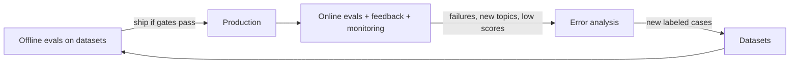
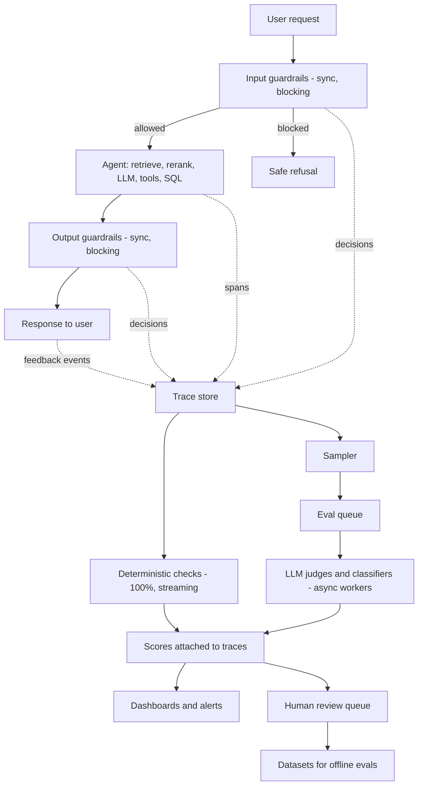
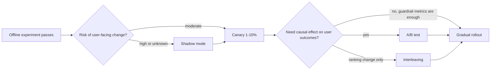
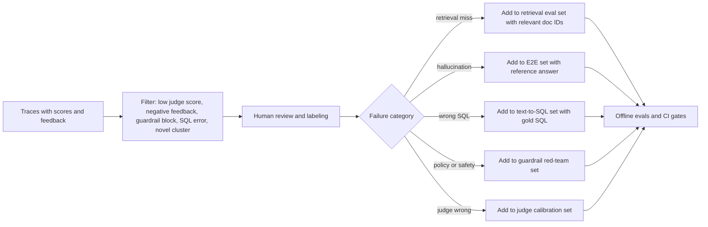

# Online Evals: Scoring Production Traffic

> **TL;DR** — Online evals score real production interactions, usually without a reference answer, so they rely on deterministic checks that run on every request plus reference-free LLM judges that run asynchronously on a sample. They don't replace offline evals. They catch what your datasets missed, check that offline gains hold up with real users, and feed new failure cases back into your datasets.

**You'll learn:** how online evals differ from offline evals · which checks to run on every request and which to sample · sync vs async evaluation architecture · sampling and cost control · shadow mode, canaries, A/B tests and interleaving · how to map offline metrics to online counterparts · how to close the loop into datasets
 ·  **Prerequisites:** [The evals & guardrails map](../00-foundations/02-the-evals-and-guardrails-map.md), [End-to-end RAG evals](../02-offline-evals/01-end-to-end-rag-evals.md), [LLM-as-a-judge](../02-offline-evals/07-llm-as-a-judge.md)
 ·  **Related:** [Observability & tracing](./02-observability-and-tracing.md), [User feedback](./03-user-feedback-and-implicit-signals.md), [Monitoring & drift](./04-monitoring-alerting-and-drift.md), [Guardrails architecture](../04-guardrails/01-guardrails-architecture.md), [Production data flywheel](../01-datasets/04-production-data-flywheel.md)

---

## 1. What online evals are

An **online eval** is any automated or human judgment applied to **live (or recently live) production interactions**. You compute it from traces after, or while, the system serves a real user.

The running example in this section is an **internal enterprise assistant** that:

- answers questions over company docs (vector search + reranker → LLM answer with citations),
- queries a data warehouse via **text-to-SQL**,
- can call tools such as `create_ticket`,
- serves users in different roles (RBAC: `employee`, `finance_analyst`, `hr_admin`, …).

Offline you ask: *"Is version B better than version A on my golden dataset?"* Online you ask: *"Is the system I shipped doing what I think it's doing for the people actually using it, today?"*

### 1.1 Offline vs online at a glance

| Dimension | Offline evals | Online evals |
|---|---|---|
| Data | Curated datasets (golden, synthetic, replayed) — see [Dataset strategy](../01-datasets/01-dataset-strategy.md) | Live traffic, real users, real distribution |
| Ground truth | Usually available (reference answers, relevant doc IDs, gold SQL) | Usually **absent** → reference-free metrics, proxies, feedback |
| When | Before release (CI, experiments) | During and after release, continuously |
| Coverage | Only what you thought to include | Everything users actually do, including the long tail |
| Repeatability | High (same inputs, pinned versions) | Low (inputs change, corpus changes, provider changes) |
| Cost model | Bounded per run | Scales with traffic → needs sampling |
| Latency constraints | None | Sync checks add user-facing latency; async ones do not |
| Main purpose | Compare variants, prevent regressions | Detect issues, validate offline gains, discover new failure modes |
| Typical failure | Dataset doesn't represent reality | Metric is noisy, biased, or too sparse to act on |

Neither replaces the other. The usual loop:



### 1.2 The core constraint: no ground truth

In production you almost never have a reference answer, the set of relevant documents, or gold SQL. Online evals therefore rely on:

1. **Reference-free metrics.** Judge the output against the inputs the system already had: the question, retrieved contexts, tool results, and the policy. Examples: faithfulness/groundedness (answer vs. retrieved context), answer relevance (answer vs. question), context relevance (contexts vs. question).
2. **Deterministic invariants.** Properties every good response must satisfy: valid JSON, citations that resolve, SQL that parses and only touches allowed tables.
3. **Behavioral proxies.** User feedback and implicit signals such as retries, escalations, and copy events (see [User feedback & implicit signals](./03-user-feedback-and-implicit-signals.md)).
4. **Delayed ground truth.** Sometimes truth shows up later. A ticket gets resolved, an SME reviews an answer, or a SQL result gets disputed. Join those back onto traces when they arrive.

> **Rule of thumb:** if a metric needs a reference answer, it belongs offline. Online, you either find a reference-free stand-in or you collect references for a small sample through human review.

---

## 2. Types of online evals

Group online evals into three families by cost and latency.

| Family | Runs on | Latency budget | Cost per eval | Examples |
|---|---|---|---|---|
| **A. Deterministic checks** | 100% of requests | microseconds–milliseconds | ~0 | schema valid, citations resolve, SQL parses, latency/cost thresholds, empty retrieval, refusal regex, language ID |
| **B. Model-based evals (LLM judges, classifiers)** | Sample (async), or 100% if cheap classifier | seconds, off the critical path | $–$$ | faithfulness, answer relevance, context relevance, toxicity, tone, instruction adherence |
| **C. Guardrail outcomes as signals** | 100% (they already run) | already paid | ~0 extra | prompt-injection detector fired, PII redacted, RBAC deny, output blocked |

Human review sits on top. It's a sampled, expensive, high-trust eval used to calibrate B and to label data (see [SME golden datasets](../01-datasets/02-sme-golden-datasets.md)).

### 2.1 Family A — deterministic checks on every request

These are cheap, unambiguous, and should run on **every** request. They don't depend on a model, so they don't drift the way a model-based judge can.

#### Card: Structured-output / schema validity

- **What it measures:** whether the response (or a tool-call argument payload) conforms to the expected schema.
- **Inputs required:** raw model output and a JSON Schema / Pydantic model. **No ground truth.**
- **How it's computed:** `valid = schema.validate(output)`. Report `invalid_rate = invalid / total`.
- **Score range & interpretation:** binary per request; a rate over time. Any sustained non-zero rate on a constrained-decoding endpoint is a bug.
- **Pitfalls:** retries can hide failures. Log the first attempt and the number of retries, not just the final result.
- **When to use:** always, for any structured output or tool call.
- **Implemented in:** Pydantic / `jsonschema` in your own code. Guardrails AI and similar libraries provide validators.

#### Card: Citation resolution

- **What it measures:** whether every citation in the answer points to a document that was actually retrieved **and** that the user is allowed to see.
- **Inputs required:** answer (parsed citations), retrieved doc IDs, user's ACL. **No ground truth.**
- **How it's computed:**

  ```text
  cited      = set(citations parsed from answer)
  retrieved  = set(doc_ids in context window)
  allowed    = set(doc_ids user may read)
  dangling   = cited - retrieved          # hallucinated or stale citation
  leaked     = cited - allowed            # RBAC violation (should be impossible)
  citation_resolves = (len(dangling) == 0)
  has_citation      = (len(cited) > 0)    # for answers that require citations
  ```

- **Score range & interpretation:** binary per request. `leaked > 0` is a **sev-1**: page someone.
- **Pitfalls:** citation formats drift when prompts change. Make the parser strict and alert on parse failures. A citation that resolves isn't the same as one that supports the claim; you need faithfulness/citation-support judges (family B) for that.
- **When to use:** any RAG answer with citations. See [Instruction & citation adherence](../02-offline-evals/06-instruction-and-citation-adherence.md).
- **Implemented in:** custom code (it depends on your citation format).

#### Card: SQL validity and safety

- **What it measures:** whether generated SQL parses, is read-only, touches only allowed schemas/tables/columns, and executes without error within limits.
- **Inputs required:** generated SQL, dialect, the user's allowed schema list, the execution result/error. **No ground truth.**
- **How it's computed:** parse with a SQL parser (e.g. `sqlglot`), walk the AST for statement type and referenced tables, compare against the allow-list, then record the execution status, row count, and duration.
- **Signals to emit:** `sql_parse_ok`, `sql_readonly`, `sql_tables_allowed`, `sql_exec_ok`, `sql_exec_error_class` (syntax / permission / timeout / unknown column), `sql_row_count`, `sql_empty_result`, `sql_duration_ms`.
- **Score range & interpretation:** binary flags; track rates. A spike in `unknown column` errors usually means **schema drift** (see [Monitoring & drift](./04-monitoring-alerting-and-drift.md)).
- **Pitfalls:** "executes OK" isn't "correct". A wrong join executes fine. Empty results are ambiguous: sometimes the right answer is zero rows.
- **When to use:** every text-to-SQL request. Also enforce these checks as **blocking guardrails** (see [Tool & action guardrails](../04-guardrails/05-tool-and-action-guardrails.md)). The online eval is the same check, logged as a metric.
- **Implemented in:** custom code with a parser such as `sqlglot`. See [Text-to-SQL evals](../02-offline-evals/05-text-to-sql-evals.md) for the offline counterparts.

#### Card: Empty / weak retrieval

- **What it measures:** whether retrieval returned nothing, or only low-similarity results.
- **Inputs required:** retrieved doc IDs and scores (pre- and post-rerank). **No ground truth.**
- **How it's computed:**

  ```text
  empty_retrieval = (len(docs_after_filters) == 0)
  weak_retrieval  = (max(rerank_scores) < τ)   # τ calibrated offline, heuristic start: inspect the score distribution, pick ~p10 of known-good queries
  ```

- **Score range & interpretation:** rates over time and per segment (role, topic, data source). A rising weak-retrieval rate is one of the best early indicators of **query drift** or a broken index.
- **Pitfalls:** raw cosine similarity isn't comparable across embedding models. Recalibrate τ when you change the embedder or reranker. Filters applied **after** retrieval (e.g. ACL filtering) can produce empty results that look like retrieval failures, so log the counts before and after filtering separately.
- **When to use:** every retrieval call.
- **Implemented in:** custom code; most tracing tools let you filter on span attributes such as document scores.

#### Card: Refusal / non-answer detection

- **What it measures:** whether the assistant declined, deflected ("I don't have information about…"), or asked for clarification.
- **Inputs required:** answer text. **No ground truth.**
- **How it's computed:** start with a pattern list tuned to your prompt's refusal phrasing, then graduate to a small classifier or a cheap LLM judge once the patterns stop covering the variants.
- **Score range & interpretation:** a rate. **Both directions matter.** A rising refusal rate can mean over-blocking guardrails, retrieval regressions, or a prompt change. A falling rate on out-of-scope topics can mean the model has started to hallucinate instead.
- **Pitfalls:** some refusals are correct, such as an RBAC denial or an out-of-scope question. Break the rate down by reason (`no_context`, `policy`, `rbac`, `out_of_scope`) instead of treating all refusals as bad.
- **When to use:** always.

#### Card: Operational thresholds — latency, tokens, cost, loop length

- **What it measures:** whether the request stayed within budget.
- **Inputs required:** trace timing, token counts, price table, number of agent steps/tool calls.
- **How it's computed:** `latency_ms > SLO`, `cost_usd > budget`, `n_llm_calls > max_steps`, `n_tool_calls_same_args > 2` (loop detection).
- **Score range & interpretation:** binary flags plus distributions (p50/p95/p99). See [Monitoring & drift](./04-monitoring-alerting-and-drift.md) for SLOs.
- **Pitfalls:** averages hide tail problems; always look at percentiles. Agent loops often show up as cost outliers before anyone reports them.

#### Card: Language / format match

- **What it measures:** whether the answer is in the user's language (or the required language), and in the expected format (markdown table when asked, length bounds).
- **Inputs required:** question, answer.
- **How it's computed:** language ID on both texts (e.g. `fastText` LID, `langdetect`); length and regex checks for format.
- **Pitfalls:** language ID is unreliable on very short texts and on code/SQL. Skip those cases instead of counting them as failures.

#### Other cheap invariants worth logging

- [ ] Tool-call arguments validate against the tool's schema; tool returned non-error.
- [ ] No disallowed tool was called for this role (RBAC on tools).
- [ ] Answer doesn't contain raw system-prompt fragments (canary string check).
- [ ] Answer isn't a verbatim copy of a single chunk beyond N tokens (possible copyright / over-quoting).
- [ ] Response not truncated (`finish_reason != "length"`).
- [ ] No obvious PII patterns in output for roles that shouldn't see them (regex / Presidio-style detectors).
- [ ] Session-level: the same user asked a near-duplicate question within 60s, an implicit failure signal (see [User feedback](./03-user-feedback-and-implicit-signals.md)).

A minimal, framework-agnostic sketch:

```python
import re, json, time

REFUSAL_PATTERNS = re.compile(
    r"\b(I (can't|cannot|am unable to)|I don't have (access|information)|not able to help)\b", re.I
)
CITATION_RE = re.compile(r"\[doc:([A-Za-z0-9_\-]+)\]")

def deterministic_checks(trace: dict) -> dict:
    answer = trace["output"]["text"]
    retrieved = {d["id"] for d in trace.get("retrieval", {}).get("docs", [])}
    allowed = set(trace["user"]["allowed_doc_ids"]) if "allowed_doc_ids" in trace["user"] else None
    cited = set(CITATION_RE.findall(answer))

    checks = {
        "empty_retrieval": len(retrieved) == 0,
        "has_citation": len(cited) > 0,
        "dangling_citations": sorted(cited - retrieved),
        "refusal": bool(REFUSAL_PATTERNS.search(answer)),
        "truncated": trace["llm"]["finish_reason"] == "length",
        "latency_breach": trace["latency_ms"] > 8000,   # heuristic SLO, tune per product
        "cost_breach": trace["cost_usd"] > 0.05,        # heuristic budget, tune per product
    }
    if allowed is not None:
        checks["leaked_citations"] = sorted(cited - allowed)  # should always be empty
    if "sql" in trace:
        checks["sql_exec_ok"] = trace["sql"]["error"] is None
        checks["sql_empty_result"] = trace["sql"].get("row_count", 0) == 0
    return checks
```

Attach the result to the trace as scores/attributes so you can filter and aggregate on it (see [Observability & tracing](./02-observability-and-tracing.md)).

### 2.2 Family B — sampled, asynchronous model-based evals

These are the reference-free counterparts of the offline RAG metrics. They cost money and add latency, so you usually run them **asynchronously** on a **sample** of traffic.

| Online judge | Inputs (from trace) | Question it answers | Offline sibling |
|---|---|---|---|
| **Faithfulness / groundedness** | answer, retrieved contexts (+ tool/SQL results) | Is every claim supported by the context the model saw? | Faithfulness in [E2E RAG evals](../02-offline-evals/01-end-to-end-rag-evals.md) |
| **Answer relevance** | question, answer | Does the answer address what was asked? | Answer relevancy |
| **Context relevance** | question, retrieved contexts | Was the retrieved context on-topic? (a proxy for context precision) | Context precision |
| **Citation support** | answer sentences, cited chunks | Does each cited chunk actually support its sentence? | Citation adherence in [Instruction & citation adherence](../02-offline-evals/06-instruction-and-citation-adherence.md) |
| **Instruction / policy adherence** | system policy, question, answer | Did the answer follow style/format/policy rules? | Instruction adherence |
| **Toxicity / bias / profanity** | answer (and question) | Is the content safe and professional? | [Generation quality & safety](../02-offline-evals/03-generation-quality-and-safety-evals.md) |
| **Tool-use appropriateness** | question, tool calls, tool results, answer | Was calling (or not calling) the tool reasonable? Were args sensible? | [Agent tool & trajectory evals](../02-offline-evals/04-agent-tool-and-trajectory-evals.md) |
| **SQL-question alignment** | question, schema snippet, SQL, result sample | Does the SQL plausibly answer the question (filters, grouping, time range)? | Execution accuracy (needs gold) in [Text-to-SQL evals](../02-offline-evals/05-text-to-sql-evals.md) |
| **Conversation-level outcome** | full session | Did the user's goal appear to be met? | Multi-turn task success |

**Use classifiers where you can.** Toxicity, PII, language, and prompt injection have small dedicated models that are cheap enough to run on 100% of traffic. Save LLM judges for the semantic criteria (faithfulness, relevance, SQL alignment).

**Use the same judge offline and online.** Version the judge prompt and model, and validate it against human labels before trusting its online numbers (see [LLM-as-a-judge](../02-offline-evals/07-llm-as-a-judge.md)). An online faithfulness score of 0.82 means nothing until you know how often the judge agrees with your SMEs.

**Prefer binary or few-class outputs.** For example: `supported / partially_supported / unsupported`, plus a one-sentence rationale. Rates of a binary label are much easier to monitor than drifting 1–10 averages.

Judge prompt sketch for online faithfulness (illustrative):

```text
You are auditing an enterprise assistant. Decide whether the ANSWER is fully supported
by the CONTEXT. Treat tool outputs and SQL results in CONTEXT as evidence.

Return JSON: {"verdict": "supported" | "partially_supported" | "unsupported",
              "unsupported_claims": [<short quotes>], "rationale": "<one sentence>"}

Rules:
- A claim is supported only if CONTEXT states or directly implies it.
- General knowledge that is not in CONTEXT counts as unsupported.
- Ignore style; judge factual support only.

QUESTION: {question}
CONTEXT: {contexts}
ANSWER: {answer}
```

### 2.3 Family C — guardrail outcomes as online signals

Every guardrail decision is also a measurement. Log each one as a structured event, `{guardrail, stage, decision, score, reason, latency_ms}`, and aggregate:

- **Trigger rate** per guardrail (input injection, PII, topic filter, RBAC deny, SQL write-blocked, output toxicity block).
- **Action mix:** `allow / redact / block / escalate`.
- **Override rate:** how often a human or appeal flow reversed a block, which is a proxy for false positives.
- **Guardrail latency:** guardrails sit on the critical path.

Sudden changes in trigger rates often mean an attack campaign, a new user population, a product change, or a broken detector. Treat them like any other online metric. See [Guardrails architecture](../04-guardrails/01-guardrails-architecture.md) and [Monitoring & drift](./04-monitoring-alerting-and-drift.md).

> Blocking guardrails and online evals often run **the same check**. The difference is what happens next. A guardrail **acts** (blocks, redacts, reroutes). An online eval **observes** and records a score. Many teams start a new check as a non-blocking online eval (shadow guardrail), measure its precision, and only then promote it to blocking.

---

## 3. Sync vs async evaluation architecture



| Aspect | Synchronous (in request path) | Asynchronous (after response) |
|---|---|---|
| Purpose | **Prevent** bad outputs (guardrail) | **Measure** quality (eval) |
| Latency impact | Adds to user latency | None for the user |
| Coverage | Must be 100% of the guarded path | Can be sampled |
| Model choice | Small/fast (classifier, regex, small LLM) | Can use a larger, slower judge |
| Failure mode | False positives annoy users; timeouts must fail open or closed deliberately | Lag in detection; queue backlogs |
| Examples | Injection detection, RBAC, SQL write-block, PII redaction | Faithfulness, relevance, SQL-question alignment, session outcome |

Practical guidance:

- **Decide fail-open vs fail-closed per check.** If the injection classifier times out, an internal read-only Q&A might fail open and log the miss. A `create_ticket` action in a regulated workflow should fail closed.
- **Streaming responses:** sync output checks either buffer the response (more latency) or check incrementally per chunk/sentence (more complexity). Many teams run lightweight checks while streaming and heavier ones async, with a "retract/flag" UX for rare post-hoc failures.
- **Decouple via a queue.** Async judges should read from a durable queue keyed by trace ID, so judge outages don't lose evals and you can backfill.
- **Make scores first-class trace data.** Write them back to the trace or a joined table with `trace_id`, `eval_name`, `eval_version`, `score`, `label`, `rationale`, `judge_model`, `timestamp`.
- **Idempotency.** Re-running a judge version on the same trace should overwrite, not duplicate.

---

## 4. Sampling strategies and cost control

Running an LLM judge on 100% of traffic is usually unnecessary and expensive. For a rate metric you need enough samples for a useful confidence interval, not every request.

### 4.1 How many samples do you need?

For a binary metric (e.g. `unsupported` rate) estimated from `n` independent samples:

```text
standard_error ≈ sqrt(p * (1 - p) / n)
95% CI ≈ p ± 1.96 * standard_error
```

Worked example: if the true unsupported rate is about 5% and you want roughly ±2 percentage points at 95%:

```text
n ≈ 1.96² * 0.05 * 0.95 / 0.02² ≈ 456 samples per reporting window
```

So ~500 judged traces per day (per segment you care about) gives a usable daily estimate. More doesn't help much unless you need finer segments or need to detect smaller shifts. This is standard binomial math. Treat the target precision as your own product decision.

### 4.2 Sampling strategies

| Strategy | How | Use for | Watch out for |
|---|---|---|---|
| **Uniform random** | `hash(trace_id) % 1000 < k` | Unbiased population estimates for dashboards | Rare segments get few samples |
| **Stratified** | Fixed quota per segment (role, intent, data source, language) | Comparing segments; guaranteeing coverage of small but important groups | Must **re-weight** to get population-level numbers |
| **Risk-/signal-triggered** | Always judge if a cheap check fires: weak retrieval, refusal, thumbs-down, retry, long session, high cost, guardrail near-threshold | Finding failures efficiently; feeding error analysis | **Biased.** Never report these as the overall quality rate |
| **Novelty-based** | Judge queries far from known clusters in embedding space | Discovering new topics / query drift | Requires clustering infra |
| **Version-aware** | Oversample new prompt/model versions during rollout | Fast confidence on a canary | Re-weight when mixing |
| **Session-level** | Sample whole sessions, not single turns | Multi-turn outcome evals | Higher per-sample cost |

Recommended default (heuristic):

- [ ] **100%**: deterministic checks + cheap classifiers (toxicity, PII, language, injection).
- [ ] **Uniform 1–5% (or a fixed daily count)**: LLM judges for faithfulness, relevance, and SQL alignment. Use this for reported metrics.
- [ ] **100% of "suspicious" traces** (negative feedback, retry, weak retrieval, SQL error, guardrail block): judges + routing to the human review queue. Use this for **finding** failures, not for reporting rates.
- [ ] **Oversample** canary/new versions until their CI is tight enough to decide.
- [ ] Keep the **sampled population tagged** (`sample_reason=uniform|triggered|canary`) so analysis can separate biased from unbiased samples.

### 4.3 Cost-control levers

- **Cheaper judges for screening, expensive judges for confirmation.** A small model flags candidates and a larger model or human confirms.
- **Truncate context sensibly.** Judge against only the chunks actually used or cited, not the full top-50.
- **Batch** judge calls and use provider batch APIs where latency tolerance allows.
- **Cache** judgments for duplicate (question, context, answer) triples, which is common for FAQ-like traffic.
- **Budget alarms on the eval pipeline itself.** Eval cost is a line item; track it next to inference cost.
- **Kill-switch per judge.** If a judge misbehaves (e.g. its provider changes behavior), disable it without redeploying.

---

## 5. Validating changes online: shadow, canary, A/B, interleaving

Offline wins are hypotheses until production confirms them. Pick the lightest method that answers your question.



### 5.1 Shadow mode (dark launch)

Run the candidate (new prompt, model, retriever, or guardrail) **in parallel** on real requests. Log its output and **don't show it** to users.

- **Good for:** model/provider swaps, new retrievers, new guardrails (measure would-have-blocked rate and precision), text-to-SQL rewrites (compare result sets between old and new SQL).
- **What to compare:** deterministic check rates, judge scores, latency, cost, and **pairwise judge preference** (old vs new) on the same input.
- **Pitfalls:**
  - **Side effects.** Never let the shadow agent execute write tools (`create_ticket`). Stub them or run against a sandbox.
  - **Doubled cost** during the shadow period. Shadow a sample, not everything.
  - **No user signal.** You learn nothing about user behavior, only about outputs.
  - **Privacy.** Shadow outputs are new data and need the same retention/redaction policies.

### 5.2 Canary releases

Route a small slice of traffic (e.g. 1% → 5% → 25% → 100%) to the new version, with **automatic rollback** criteria defined in advance.

- Define **guardrail metrics** that must not regress: error rate, latency p95, SQL failure rate, guardrail block rate, unsupported-answer rate, negative-feedback rate.
- Compare canary to the concurrent control, not to last week. Traffic mix changes daily.
- Oversample canary traffic for LLM judges (section 4.2).
- Make prompt and model versions **runtime config**, so rollback is a flag flip, not a deploy (see [Incident response in Monitoring & drift](./04-monitoring-alerting-and-drift.md)).

### 5.3 A/B tests with online metrics

Use an A/B test when you need the **causal effect on user outcomes**, e.g. "does the new answer style reduce escalations to human support?"

Metric hierarchy for an AI feature:

| Tier | Example metrics | Role |
|---|---|---|
| **Primary (decision) metric** | task success proxy (session resolved without escalation), thumbs-up rate, ticket deflection | What you're trying to move |
| **Secondary / diagnostic** | judge faithfulness rate, citation click-through, retry rate, answer length | Explain *why* the primary moved |
| **Guardrail (must not regress)** | latency p95, cost/session, safety block rate, RBAC violations (must be 0), SQL error rate | Stop the test if breached |

Statistical considerations specific to LLM features:

- **Randomize by user (or session), not by request.** Users have multi-turn conversations, so per-request randomization mixes variants within a conversation and contaminates the result.
- **Unit of analysis = unit of randomization.** If you randomize by user but compute per-request rates, the requests aren't independent. Use user-level aggregates, or a delta method / cluster-robust standard errors.
- **Power analysis up front.** Feedback is sparse: if only ~1–3% of sessions leave explicit feedback (a typical order of magnitude; measure your own), a thumbs-up-rate test needs far more traffic than you expect. Prefer denser proxies (retry rate, escalation rate, judged faithfulness on a sample) as primary metrics when feedback is too sparse.
- **Don't peek and stop early** without a sequential testing method. Repeated significance checks inflate false positives (see Evan Miller's ["How Not To Run an A/B Test"](https://www.evanmiller.org/how-not-to-run-an-ab-test.html)).
- **Multiple comparisons.** You'll look at dozens of metrics. Pre-register the primary metric and treat the rest as exploratory, or correct for multiplicity.
- **Novelty and learning effects.** Users react to a new answer style for a while; run long enough to cover at least one full weekly cycle.
- **LLM-judge metrics in A/B tests:** the judge must be **blind to the variant** and identical across arms, and its noise adds variance. Judge both arms on equal-sized samples.
- **Sample ratio mismatch (SRM).** Check that the traffic split matches the configured split. Mismatches usually indicate a bug in assignment or logging.
- **Interference.** Shared caches or shared rate limits can couple variants; a cached answer from variant A served to variant B users breaks the test.

The standard reference on these topics is Kohavi, Tang & Xu, *Trustworthy Online Controlled Experiments* ([experimentguide.com](https://experimentguide.com/)).

### 5.4 Interleaving for retrieval and ranking changes

When the change is **only to ranking** (a new reranker, hybrid weights, a new embedding model), interleaving is usually far more sample-efficient than A/B testing. You blend results from rankers A and B into **one** list shown to the same user, then attribute clicks to whichever ranker contributed the clicked item. The most common scheme is **team-draft interleaving**.

How it maps to agentic RAG:

- Interleaving needs a **user-visible ranked list with clicks**, such as a "sources" panel, search results, or citation links.
- If users never see the ranking because the LLM consumes it, interleaving doesn't apply directly. Use **shadow + LLM-judge pairwise preference** on the final answers, or judge context relevance for each ranker's top-k.
- Citation click-through is a weak and biased signal (position bias, trust in the first citation). Use it comparatively within an interleaved list, not as an absolute quality measure.

Background: Chapelle et al., ["Large-scale validation and analysis of interleaved search evaluation"](https://www.cs.cornell.edu/people/tj/publications/chapelle_etal_12a.pdf), and Netflix's ["Innovating Faster on Personalization Algorithms at Netflix Using Interleaving"](https://netflixtechblog.com/interleaving-in-online-experiments-at-netflix-a04ee392ec55).

---

## 6. Mapping offline metrics to online counterparts

| Offline metric | Needs ground truth offline? | Online counterpart | Feasible online? | Notes |
|---|---|---|---|---|
| **Answer correctness** (vs reference) | Yes | Delayed SME review on a sample; user corrections; "that's wrong" follow-ups; judged faithfulness as a partial proxy | **Partially** | Correctness against truth requires a human or a delayed outcome. Faithfulness ≠ correctness: a faithful answer over a stale doc is still wrong |
| **Faithfulness / groundedness** | No (reference-free) | Same LLM judge, sampled async | **Yes** | Highest-value online judge for RAG |
| **Answer relevancy** | No | Same judge, sampled | **Yes** | Cheap; also detectable via rephrase/retry signals |
| **Context precision** | Usually yes (or judge-based) | LLM-judged context relevance per chunk | **Yes (judge variant)** | The reference-based variant isn't feasible |
| **Context recall** | Yes (reference answer / contexts) | No reliable direct counterpart. Proxies: weak/empty retrieval rate, "no answer found" refusals, unsupported-claim rate | **No (proxies only)** | You can't know what you didn't retrieve without a reference. Sample cases for SME labeling |
| **precision@k, MAP, nDCG** | Yes (relevance labels) | Judge-labeled relevance of top-k on a sample; interleaving with click data | **Partially** | Judge labels approximate relevance; clicks are biased |
| **recall@k, hit rate** | Yes | Not feasible directly; delayed labeling on sample | **No** | Same reason as context recall |
| **MRR** | Yes | Rank of first clicked/cited source (biased proxy) | **Partially** | Position bias dominates |
| **Tool-call correctness** (vs expected call) | Yes | Schema validity, tool error rate, judge "was this tool call appropriate", RBAC tool denials | **Partially** | Validity is deterministic; appropriateness needs a judge |
| **Trajectory match** | Yes (reference trajectory) | Step count, loops, redundant calls, judge on trajectory reasonableness | **Partially** | Reference trajectories don't exist online |
| **SQL exact / component match** | Yes (gold SQL) | Not feasible | **No** | No gold SQL in production |
| **SQL execution accuracy** | Yes (gold result) | Parse/exec success, empty-result rate, judge SQL-question alignment, user disputes of numbers | **Partially** | "Executes" ≠ "correct" |
| **Instruction adherence** | No (rubric) | Same judge or deterministic format checks | **Yes** | Many format rules are deterministic |
| **Citation adherence / support** | No (reference-free variant) | Citation resolution (deterministic) + citation-support judge | **Yes** | Resolution on 100%, support on sample |
| **Toxicity / profanity / bias** | No | Classifiers on 100%; judge on sample for nuanced bias | **Yes** | Also typically an output guardrail |
| **PII leakage** | No | Detectors on 100% | **Yes** | Also a guardrail |
| **Refusal correctness** (should/shouldn't refuse) | Yes (labels) | Refusal rate by reason; judge "was refusal warranted" on sample | **Partially** | |
| **Latency / cost** | No | Directly measured | **Yes** | Measured better online than offline |
| **Pairwise preference** (A vs B) | No (judge) | Shadow-mode pairwise judging; A/B user metrics | **Yes** | |

Takeaway: everything **reference-free** transfers online with sampling. Everything **reference-based** either becomes a proxy or has to wait for delayed human labeling.

---

## 7. Online vs offline metric agreement

If your offline evals are any good, offline improvements should show up online. Check this explicitly. Don't assume it.

### 7.1 Why they diverge

- **Distribution shift.** The golden set over-represents easy or old questions (see [Dataset strategy](../01-datasets/01-dataset-strategy.md)).
- **Corpus differences.** Offline runs against a snapshot; production retrieves from a living index with ACL filters.
- **Judge differences.** The online judge uses a different prompt, model, or context truncation than offline.
- **Multi-turn context.** Offline datasets are often single-turn; production is conversational.
- **Selection bias.** Online "triggered" samples are worse than average by design.
- **Users adapt.** People learn to phrase questions differently after a release.

### 7.2 How to measure agreement

- [ ] **Replay a production sample offline.** Take a stratified sample of recent production inputs, run them through both versions offline, and score them with the same judges. Compare to what you saw online.
- [ ] **Track per-release deltas.** For each release, record `Δ offline metric` and `Δ online metric` (same definition). Over several releases, check whether the directions agree and whether magnitudes correlate. Even a simple table builds intuition.
- [ ] **Judge–human agreement online.** Every week, have SMEs label a small random sample of judged traces and compute agreement (e.g. Cohen's κ or simple accuracy against the human label). Alert if agreement drops (**judge drift** — see [Monitoring & drift](./04-monitoring-alerting-and-drift.md)).
- [ ] **Feedback correlation.** Check whether judge-`unsupported` traces get more thumbs-down/retries than judge-`supported` traces. If not, either the judge or the feedback signal is broken.

If offline gains repeatedly fail to show up online, **fix the dataset before you optimize further**. Pull recent production failures into it (section 8).

---

## 8. Feeding online results back into datasets

Online evals pay off when their findings become **regression tests** and **training/eval data**. That loop is covered in depth in [Production data flywheel](../01-datasets/04-production-data-flywheel.md). The online side of it:



Checklist:

- [ ] Every trace has a stable `trace_id` that survives export into a dataset row (provenance).
- [ ] Reviewers label a **failure category** (use an evolving taxonomy, see [Agentic RAG failure modes](../00-foundations/03-agentic-rag-failure-modes.md)), not just pass/fail.
- [ ] PII is redacted or the case is rewritten before it enters a long-lived dataset.
- [ ] Each fixed incident adds at least one regression case.
- [ ] Track dataset composition over time so the dataset doesn't fill up with one type of failure.

---

## 9. What to do first

1. **Tracing first.** You can't evaluate what you don't capture (see [Observability & tracing](./02-observability-and-tracing.md)).
2. **Turn on deterministic checks at 100%:** empty retrieval, citation resolution, SQL parse/exec, refusal, latency/cost, truncation, guardrail outcomes.
3. **Add one LLM judge, faithfulness,** on a uniform sample of a few hundred traces/day, after validating it against ~100 human-labeled examples.
4. **Collect explicit and implicit feedback** and link it to traces (see [User feedback](./03-user-feedback-and-implicit-signals.md)).
5. **Build a weekly review ritual:** look at triggered samples, categorize failures, add cases to datasets.
6. **Add dashboards and alerts** on the handful of rates above (see [Monitoring & drift](./04-monitoring-alerting-and-drift.md)).
7. **Only then** invest in A/B infrastructure, interleaving, and more judges.

---

## Key takeaways

- Online evals measure production behavior without ground truth. Rely on **reference-free judges, deterministic invariants, guardrail outcomes, and user signals**.
- Run **deterministic checks and cheap classifiers on 100%** of traffic; run **LLM judges asynchronously on a sample** sized for the confidence you need.
- Keep **unbiased (uniform) samples** for reported metrics separate from **triggered samples** used for finding failures.
- Use **shadow mode** for risky swaps, **canaries** with pre-defined rollback criteria for every release, **A/B tests** for causal user-outcome questions, and **interleaving** for ranking changes with visible results.
- Reference-based offline metrics such as context recall, gold-SQL match, and recall@k **have no direct online counterpart**. Use proxies and delayed human labels.
- Verify offline–online agreement explicitly, and route online failures back into datasets as regression tests.

## Further reading

- Hamel Husain — [Your AI Product Needs Evals](https://hamel.dev/blog/posts/evals/) and [A Field Guide to Rapidly Improving AI Products](https://hamel.dev/blog/posts/field-guide/)
- Hamel Husain — [Creating a LLM-as-a-Judge That Drives Business Results](https://hamel.dev/blog/posts/llm-judge/)
- Eugene Yan — [Task-Specific LLM Evals that Do & Don't Work](https://eugeneyan.com/writing/evals/) and [Evaluating the Effectiveness of LLM-Evaluators](https://eugeneyan.com/writing/llm-evaluators/)
- Shreya Shankar et al. — [Who Validates the Validators? Aligning LLM-Assisted Evaluation of LLM Outputs with Human Preferences](https://arxiv.org/abs/2404.12272)
- Shreya Shankar — [Data Flywheels for LLM Applications](https://www.sh-reya.com/blog/ai-engineering-flywheel/)
- Kohavi, Tang & Xu — [Trustworthy Online Controlled Experiments](https://experimentguide.com/)
- Evan Miller — [How Not To Run an A/B Test](https://www.evanmiller.org/how-not-to-run-an-ab-test.html) and [Sample Size Calculator](https://www.evanmiller.org/ab-testing/sample-size.html)
- Chapelle, Joachims, Radlinski, Yue — [Large-scale validation and analysis of interleaved search evaluation](https://www.cs.cornell.edu/people/tj/publications/chapelle_etal_12a.pdf)
- Netflix Tech Blog — [Innovating Faster on Personalization Algorithms at Netflix Using Interleaving](https://netflixtechblog.com/interleaving-in-online-experiments-at-netflix-a04ee392ec55)
- Applied LLMs — [What We've Learned From A Year of Building with LLMs](https://applied-llms.org/)
- Within this repo: [Production data flywheel](../01-datasets/04-production-data-flywheel.md), [LLM-as-a-judge](../02-offline-evals/07-llm-as-a-judge.md), [Tooling landscape](../06-tooling-landscape/01-eval-and-observability-tools.md)
