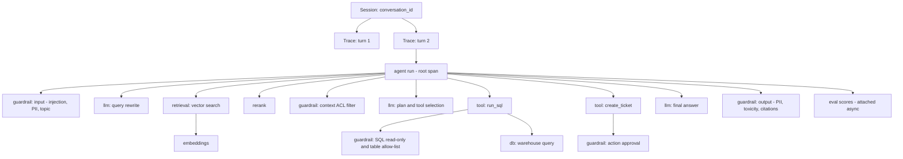

# Observability & Tracing for Agentic RAG

> **TL;DR**
>
> - **Emit one complete trace per user turn.** Record every retrieval, rerank, LLM call, tool execution, SQL query, and guardrail check with child spans.
> - **Tag every version and group into sessions.** Log prompt, model, index, and config versions plus `session_id` to isolate regressions fast.
> - **Adopt OpenTelemetry conventions.** Use OTel GenAI semantic conventions or OpenInference and add application attributes under `app.*`.
> - **Scrub PII before export and enforce ACLs.** Redact sensitive payloads at the source, restrict trace viewing by document permissions, and tier retention.

- **You will learn:**
    - Agentic RAG span hierarchy
    - Per-span logging specifications
    - OTel GenAI and OpenInference standards
    - Session grouping, version tagging, PII redaction, and tool selection
- **Prerequisites:** [Agentic RAG failure modes](../00-foundations/03-agentic-rag-failure-modes.md), [Online evals](./01-online-evals.md)
- **Related:** [User feedback](./03-user-feedback-and-implicit-signals.md), [Monitoring & drift](./04-monitoring-alerting-and-drift.md), [Guardrails architecture](../04-guardrails/01-guardrails-architecture.md), [Eval & observability tools](../06-tooling-landscape/01-eval-and-observability-tools.md)

---

## 1. Why tracing is the foundation

Standard application logs tell you *that* an event occurred. A **trace** shows *why* it occurred by recording the causal chain from user query to final answer, including query rewrites, retrieval, reranking, planning, SQL execution, tool calls, and guardrail decisions.

For agentic RAG, traces supply the raw data for every other practice in this guide:

| Engineering need | Required trace data |
|---|---|
| Debugging a bad answer | Retrieved doc IDs and scores, exact rendered prompt, model output, and tool results |
| [Online evals](./01-online-evals.md) | Query, retrieved contexts, answer, and tool/SQL results for reference-free judges |
| [User feedback](./03-user-feedback-and-implicit-signals.md) | A stable `trace_id` returned to the client so thumbs and corrections link back |
| [Monitoring](./04-monitoring-alerting-and-drift.md) | Latency, token counts, cost, error classes, and guardrail attributes for aggregation |
| [Datasets](../01-datasets/04-production-data-flywheel.md) | Real user inputs and provenance metadata for golden and regression sets |
| Security & audit | User identity, role permissions, accessed documents, and executed write actions |
| Cost attribution | Input, output, and cached token counts per model, feature, and team |

> **Default rule:** Instrument tracing **before** you build your first online eval or dashboard. Retrofitting trace context later costs far more effort.

---

## 2. The span model for an agentic RAG request

A **trace** is a tree of **spans**. Each span represents one timed operation with structured attributes, events, and a status code. A **session** (or conversation thread) groups multiple traces from a multi-turn user interaction.



### 2.1 Span types and what to log

Use these tables as your engineering logging specification. **Must** denotes essential fields, **Should** denotes high-value diagnostic fields, and **Could** denotes optional fields.

#### Root / agent span (one per user turn)

| Attribute | Priority | Why |
|---|---|---|
| `trace_id`, `session_id` / `conversation_id`, `turn_index` | Must | Groups multi-turn conversations and joins user feedback |
| `user_id` (pseudonymous), `user_role`, `tenant/org`, `department` | Must | Enables RBAC audits and slice analysis |
| `app_version`, `agent_version`, `prompt_bundle_version`, `config_hash` | Must | Attributes quality regressions to specific releases |
| `environment` (`prod`, `canary`, `shadow`), `experiment_id`, `variant` | Must | Powers A/B, canary, and shadow comparisons |
| Input: user message (redacted per policy) | Must | Required for debugging, online evals, and dataset creation |
| Output: final answer and parsed citations | Must | Required for debugging, online evals, and dataset creation |
| `status` (`ok`, `error`, `blocked`, `refused`, `timeout`), `refusal_reason` | Must | Drives reliability and refusal monitoring |
| Total latency and time-to-first-token (TTFT) | Must | Measures latency SLO compliance |
| Total tokens and **cost** (summed from child spans) | Must | Tracks per-turn and per-session cost |
| Number of LLM calls, tool calls, and agent steps | Should | Detects runaway loops and measures efficiency |
| Channel (web, Slack, API) and user locale | Could | Supports channel and language segmentation |

#### Retrieval span

| Attribute | Priority | Why |
|---|---|---|
| Query text sent to the retriever (after query rewrite) | Must | Exposes query-rewrite bugs quickly |
| Index/collection name and **index version / snapshot timestamp** | Must | Detects corpus drift and stale indexes |
| `top_k`, applied filters (metadata, ACL), and hybrid weights | Must | Ensures retrieval reproducibility |
| Returned **doc/chunk IDs, scores, ranks**, and source URIs | Must | Enables retrieval debugging and weak-retrieval checks |
| Document count before vs. after ACL filtering | Should | Separates empty retrieval from RBAC permission denials |
| Embedding model name and version | Should | Tracks embedding migrations and score recalibration |
| Chunk text (or external storage pointer) | Could | Saves span storage volume and reduces privacy exposure |

#### Rerank span

| Attribute | Priority |
|---|---|
| Reranker model name and version | Must |
| Input doc IDs (ranked) and output doc IDs with rerank scores | Must |
| Score cutoff threshold and number of dropped chunks | Should |

#### LLM call span (each call: rewrite, plan, answer, judge)

| Attribute | Priority | Why |
|---|---|---|
| Provider, requested model, and **response model** (exact snapshot string) | Must | Catches silent provider model updates (see [Monitoring & drift](./04-monitoring-alerting-and-drift.md)) |
| Prompt template ID, **version**, and template variables | Must | Isolates prompt regressions |
| Full input messages (system + user + context) or storage reference | Must (redacted) | Reconstructs exact model context during debugging |
| Output messages, `finish_reason`, and requested tool calls | Must | Detects output truncation and bad tool calls |
| Input and output tokens (including cached and reasoning tokens) | Must | Computes exact call cost |
| Call latency and streaming TTFT | Must | Identifies slow model calls |
| Generation parameters: temperature, max tokens, seed, response format | Should | Enables deterministic replay |
| Retry count and error class (rate limit, timeout, content filter) | Should | Tracks provider reliability |
| Call cost (calculated from a versioned price table) | Should | Attributes spend per prompt and feature |

#### Tool call span

| Attribute | Priority |
|---|---|
| Tool name, tool version, and `tool_call_id` (links to parent LLM span) | Must |
| Validated/redacted arguments and schema-validation status | Must |
| Result summary, execution status, error class, and latency | Must |
| **Side-effect flag** (`read` vs `write`), approval status, and approver ID | Must for write tools |
| External resource IDs created (such as `ticket_id`) | Should |

#### SQL execution span

| Attribute | Priority |
|---|---|
| Generated SQL query (normalized) and SQL dialect | Must |
| Parse status, statement type, and referenced tables/columns | Must |
| Executing database principal or least-privilege role | Must |
| Row count, truncation flag, execution duration, and error class | Must |
| Redacted result sample (first $N$ rows) or result hash | Should |
| Warehouse schema version or catalog snapshot ID | Should |

Reuse OpenTelemetry's [database semantic conventions](https://opentelemetry.io/docs/specs/semconv/database/database-spans/) (`db.system.name`, `db.query.text`, `db.operation.name`) for SQL spans rather than inventing custom attribute names.

#### Guardrail span

| Attribute | Priority |
|---|---|
| Guardrail name, version, and stage (`input`, `context`, `tool`, `output`) | Must |
| Decision (`allow`, `block`, `redact`, `rewrite`, `escalate`) and blocking mode | Must |
| Detector score(s), threshold, matched policy ID, and short reason | Must |
| Latency, timeout status, and fail-open/fail-closed outcome | Must |
| Redacted entity types and counts (never log raw PII values) | Should |

#### Eval / score records (attached after the fact)

| Field | Priority |
|---|---|
| `trace_id` (plus optional `span_id`), `eval_name`, and `eval_version` | Must |
| Score, categorical label, rationale, and judge model + version | Must |
| `sample_reason` (`uniform`, `triggered`, `canary`) | Must |
| Score source (`llm_judge`, `heuristic`, `human`, `user_feedback`) | Must |

### 2.2 Version tagging: the most under-rated attributes

Most quality investigations boil down to one question: **what changed?** Tag every version on your spans so the trace alone answers that question.

- [ ] Store prompt templates in version control or a registry and log the immutable prompt version ID on every LLM span.
- [ ] Log both the **requested model** alias and the exact **response model** snapshot returned by the provider.
- [ ] Log the **index snapshot or ingestion run ID** on every retrieval span.
- [ ] Log the exact **guardrail and judge versions** (model, prompt, and threshold).
- [ ] Compute a single **config hash** covering all behavioral settings (prompts, models, `top_k`, thresholds, tools) and log it on the root span.
- [ ] Tag the **experiment variant** and **deployment ring** (`shadow`, `canary`, `prod`) on the root span.

### 2.3 Session / thread grouping

Group multi-turn conversations with a consistent session identifier:

- Attach `session_id` (or `conversation_id`) and `turn_index` to every trace in the conversation.
- Record a summary of prior turns or a pointer to earlier traces so multi-turn judges can verify context-dependent queries ("as I asked earlier, only for EMEA").
- Use `session_id` to compute session-level metrics: turns per session, rephrase rate, escalation rate, and overall goal completion.
- Propagate a **correlation ID** across async jobs and webhooks (using OTel context propagation or span links) when workflows span hours or days.

---

## 3. Standards: OpenTelemetry GenAI conventions and OpenInference

Adopt a standard telemetry schema so you can switch observability vendors, combine infrastructure and LLM traces, and use open-source auto-instrumentation.

### 3.1 OpenTelemetry GenAI semantic conventions

[OpenTelemetry](https://opentelemetry.io/) defines **semantic conventions** that standardize span and attribute names. The **GenAI** conventions cover LLM inference, embeddings, retrieval, tool calls, and agent workflows. These conventions are currently marked **Development** in [`open-telemetry/semantic-conventions-genai`](https://github.com/open-telemetry/semantic-conventions-genai), so pin the convention version your code emits.

Key GenAI convention elements include:

- **Operation names** (`gen_ai.operation.name`): Standard values include `chat`, `text_completion`, `generate_content`, `embeddings`, `retrieval`, `execute_tool`, `create_agent`, and `invoke_agent`. Span names follow patterns like `chat {model}` or `execute_tool {gen_ai.tool.name}`.
- **Model and provider attributes**: `gen_ai.provider.name`, `gen_ai.request.model`, `gen_ai.response.model`, request settings (`gen_ai.request.temperature`, `gen_ai.request.max_tokens`), `gen_ai.response.finish_reasons`, and `gen_ai.response.id`.
- **Token usage**: `gen_ai.usage.input_tokens` and `gen_ai.usage.output_tokens`, plus cached token counters.
- **Agent and conversation identifiers**: `gen_ai.agent.name`, `gen_ai.agent.id`, and `gen_ai.conversation.id`.
- **Tool execution**: `gen_ai.tool.name`, `gen_ai.tool.call.id`, `gen_ai.tool.type`, and opt-in `gen_ai.tool.call.arguments` and `gen_ai.tool.call.result`.
- **Retrieval**: `gen_ai.data_source.id` plus query and retrieved document attributes.
- **Opt-in content capture**: `gen_ai.input.messages`, `gen_ai.output.messages`, and `gen_ai.system_instructions` are disabled by default to protect sensitive data, or stored externally via URI references.
- **Standard metrics**: Histograms and counters like `gen_ai.client.operation.duration` and token usage metrics power dashboards without parsing raw spans.

Read the official specification at [opentelemetry.io/docs/specs/semconv/gen-ai](https://opentelemetry.io/docs/specs/semconv/gen-ai/).

### 3.2 OpenInference (Arize)

[OpenInference](https://github.com/Arize-ai/openinference) is an OpenTelemetry-based convention and auto-instrumentation suite maintained by Arize and used by [Arize Phoenix](https://github.com/Arize-ai/phoenix). It centers on an explicit **span kind** attribute, `openinference.span.kind`, with domain-specific values:

`LLM`, `EMBEDDING`, `CHAIN`, `RETRIEVER`, `RERANKER`, `TOOL`, `AGENT`, `GUARDRAIL`, `EVALUATOR`.

OpenInference also standardizes attributes such as `input.value`, `output.value`, `llm.model_name`, `llm.token_count.prompt|completion|total`, `llm.prompt_template.template|variables|version`, `retrieval.documents` (`document.id`, `document.score`, `document.content`), `tool.name`, `session.id`, `user.id`, `metadata`, and `tag.tags`.

Because `RERANKER` and `GUARDRAIL` are first-class span kinds, OpenInference maps directly onto the agentic RAG span tree in Section 2.

### 3.3 Which one?

| Situation | Recommended convention |
|---|---|
| Your organization already runs OTel Collectors and an enterprise APM | Emit OTel GenAI conventions and fan out to your APM plus an LLM observability backend |
| You want dedicated RAG views (retrieved chunks, rerankers, guardrails) out of the box | Use OpenInference auto-instrumentation with any compatible OTel backend |
| You build on an orchestration framework (LangChain, LangGraph, LlamaIndex) | Enable the framework's native OTel or backend integration and verify which schema it emits |
| You are unsure which backend you will keep long-term | Emit standard OTel spans and namespace custom business fields under `app.*` |

Regardless of which convention you pick, **log domain-specific attributes under your own `app.*` namespace** (such as `app.user.role`, `app.ticket_id`, and `app.config_hash`).

---

## 4. Example trace for the running example

In this scenario, a `finance_analyst` asks: *"What was EMEA revenue last quarter, and open a ticket if it's below plan?"* The assistant retrieves the revenue definition document, runs a SQL query, compares actuals against plan, opens a Jira ticket, and returns a cited answer.

The JSON below shows a flattened, vendor-neutral representation combining OTel GenAI attributes with custom `app.*` fields. Production OTLP exporters serialize these spans as Protobuf or JSON with nanosecond timestamps.

```json
{
  "trace_id": "4f1c9a7e2b3d4c5e8f60718293a4b5c6",
  "session_id": "conv_8812",
  "turn_index": 3,
  "start_time": "2026-10-15T09:12:03.120Z",
  "duration_ms": 6840,
  "attributes": {
    "app.user.id_hash": "u_7d2e…",
    "app.user.role": "finance_analyst",
    "app.tenant": "acme-corp",
    "app.env": "prod",
    "app.deployment_ring": "canary",
    "app.experiment": {"id": "exp_answer_style_v2", "variant": "B"},
    "app.agent_version": "2026.10.2",
    "app.config_hash": "cfg_a91b3f",
    "app.status": "ok",
    "app.cost_usd": 0.0183,
    "gen_ai.usage.input_tokens": 9120,
    "gen_ai.usage.output_tokens": 612,
    "app.llm_calls": 3,
    "app.tool_calls": 2
  },
  "input": {"text": "What was EMEA revenue last quarter, and open a ticket if it's below plan?"},
  "output": {
    "text": "EMEA revenue for Q3 FY26 was $41.2M, 6% below the $43.8M plan [doc:fin-defs-012]. I opened ticket FIN-4821 for the regional finance team.",
    "citations": ["fin-defs-012"]
  },
  "spans": [
    {
      "span_id": "s1", "parent": null, "name": "guardrail input", "kind": "GUARDRAIL", "duration_ms": 85,
      "attributes": {"app.guardrail.names": ["prompt_injection_v3", "pii_detector_v2", "topic_scope_v1"],
                     "app.guardrail.decision": "allow", "app.guardrail.injection_score": 0.02}
    },
    {
      "span_id": "s2", "parent": null, "name": "chat gpt-x-mini", "kind": "LLM", "duration_ms": 640,
      "attributes": {"gen_ai.operation.name": "chat", "gen_ai.provider.name": "example-provider",
                     "gen_ai.request.model": "gpt-x-mini", "gen_ai.response.model": "gpt-x-mini-2026-08-01",
                     "app.prompt.id": "plan_and_route", "app.prompt.version": "v14",
                     "gen_ai.usage.input_tokens": 1450, "gen_ai.usage.output_tokens": 96,
                     "gen_ai.response.finish_reasons": ["tool_calls"],
                     "app.tool_calls_requested": ["search_docs", "run_sql", "create_ticket"]}
    },
    {
      "span_id": "s3", "parent": null, "name": "retrieval finance-docs", "kind": "RETRIEVER", "duration_ms": 210,
      "attributes": {"gen_ai.operation.name": "retrieval", "gen_ai.data_source.id": "finance-docs",
                     "app.index.snapshot": "2026-10-14T02:00Z", "app.retrieval.query": "definition of regional revenue EMEA plan",
                     "app.retrieval.top_k": 20, "app.retrieval.filters": {"acl_role": "finance_analyst"},
                     "app.retrieval.count_before_acl": 20, "app.retrieval.count_after_acl": 17,
                     "app.embedding.model": "embed-v3"},
      "documents": [
        {"id": "fin-defs-012", "score": 0.83, "rank": 1},
        {"id": "fin-plan-fy26", "score": 0.79, "rank": 2},
        {"id": "emea-ops-faq", "score": 0.61, "rank": 3}
      ]
    },
    {
      "span_id": "s4", "parent": null, "name": "rerank", "kind": "RERANKER", "duration_ms": 120,
      "attributes": {"app.reranker.model": "rerank-v2", "app.rerank.top_n": 5, "app.rerank.min_score": 0.3},
      "documents": [
        {"id": "fin-defs-012", "score": 0.94, "rank": 1},
        {"id": "fin-plan-fy26", "score": 0.88, "rank": 2}
      ]
    },
    {
      "span_id": "s5", "parent": null, "name": "execute_tool run_sql", "kind": "TOOL", "duration_ms": 1730,
      "attributes": {"gen_ai.operation.name": "execute_tool", "gen_ai.tool.name": "run_sql",
                     "gen_ai.tool.call.id": "call_01", "app.tool.side_effect": "read"}
    },
    {
      "span_id": "s5a", "parent": "s5", "name": "guardrail sql", "kind": "GUARDRAIL", "duration_ms": 12,
      "attributes": {"app.sql.parse_ok": true, "app.sql.statement_type": "SELECT",
                     "app.sql.tables": ["fct_revenue", "dim_region", "fct_plan"],
                     "app.guardrail.decision": "allow", "app.guardrail.rule": "readonly+allowlist_finance"}
    },
    {
      "span_id": "s5b", "parent": "s5", "name": "SELECT analytics", "kind": "DB", "duration_ms": 1650,
      "attributes": {"db.system.name": "snowflake", "db.operation.name": "SELECT",
                     "db.query.text": "SELECT r.region, SUM(f.amount) … WHERE r.region = ? AND f.fiscal_quarter = ? …",
                     "app.db.role": "ro_finance_analyst", "app.sql.row_count": 1, "app.sql.error": null,
                     "app.schema.version": "dwh_2026_10_01"}
    },
    {
      "span_id": "s6", "parent": null, "name": "execute_tool create_ticket", "kind": "TOOL", "duration_ms": 900,
      "attributes": {"gen_ai.tool.name": "create_ticket", "gen_ai.tool.call.id": "call_02",
                     "app.tool.side_effect": "write", "app.tool.args_valid": true,
                     "app.approval.required": false, "app.approval.policy": "auto_for_finance_internal",
                     "app.tool.result.ticket_id": "FIN-4821", "app.tool.status": "ok"}
    },
    {
      "span_id": "s7", "parent": null, "name": "chat gpt-x", "kind": "LLM", "duration_ms": 2950,
      "attributes": {"gen_ai.operation.name": "chat", "gen_ai.request.model": "gpt-x",
                     "gen_ai.response.model": "gpt-x-2026-09-15",
                     "app.prompt.id": "answer_with_citations", "app.prompt.version": "v31",
                     "gen_ai.usage.input_tokens": 7300, "gen_ai.usage.output_tokens": 480,
                     "gen_ai.response.finish_reasons": ["stop"], "app.ttft_ms": 690}
    },
    {
      "span_id": "s8", "parent": null, "name": "guardrail output", "kind": "GUARDRAIL", "duration_ms": 70,
      "attributes": {"app.guardrail.names": ["pii_detector_v2", "toxicity_v1", "citation_resolver_v1"],
                     "app.guardrail.decision": "allow", "app.citations.dangling": [], "app.citations.leaked": []}
    }
  ],
  "scores": [
    {"name": "empty_retrieval", "source": "heuristic", "value": false},
    {"name": "citation_resolves", "source": "heuristic", "value": true},
    {"name": "faithfulness", "source": "llm_judge", "eval_version": "faith_v5", "judge_model": "judge-large-2026-07",
     "label": "partially_supported", "rationale": "Revenue figure comes from SQL result, plan figure supported by fin-plan-fy26 but that doc was not cited.",
     "sample_reason": "uniform"},
    {"name": "user_feedback", "source": "user", "value": "thumbs_up", "timestamp": "2026-10-15T09:13:40Z"}
  ]
}
```

Notice five diagnostic details in this trace:

- **The faithfulness judge caught a citation omission:** The plan number came from retrieved document `fin-plan-fy26`, which the answer failed to cite. You can diagnose this only because retrieved IDs, cited IDs, and SQL results live in the same trace.
- **Pre- and post-ACL counts isolate permission drops:** `count_before_acl: 20` vs `count_after_acl: 17` proves RBAC filtering removed 3 chunks.
- **Exact response model tracking:** `gen_ai.response.model` records the dated snapshot `gpt-x-2026-09-15` rather than just the alias `gpt-x`.
- **Write-tool audit trail:** Span `s6` records `side_effect: "write"`, the approval policy, and the created `ticket_id: "FIN-4821"`.
- **Placeholder model names:** Names such as `gpt-x` and `judge-large-2026-07` represent your configured models.

---

## 5. Privacy, security and retention

Production traces contain some of your most sensitive enterprise data: user questions, confidential documents, warehouse query results, and accidentally pasted secrets.

### 5.1 Redaction strategy

| Technique | Where it runs | Trade-off |
|---|---|---|
| **Drop content** (log metadata only) | SDK configuration | Maximizes privacy, but prevents debugging and reference-free judge evals |
| **Redact at the source** (before export) using PII/secret detectors | Application / SDK span processor | Best default balance, though detectors can miss rare patterns or over-redact |
| **Redact in the collector** (via an OTel Collector processor) | Telemetry pipeline | Centralizes redaction policy, but raw text still leaves the application process |
| **Store content by reference** (encrypted blob store with strict ACL and short TTL) | Storage layer | Separates hot metadata from sensitive payloads (supported by OTel GenAI external storage) |
| **Tokenize or pseudonymize** user IDs and named entities | Application | Preserves cross-trace joinability without exposing raw identities |
| **Field-level encryption** on sensitive attributes | Application / storage | Strong protection, but restricts full-text search in the trace UI |

Follow this privacy and security checklist:

- [ ] Classify every trace attribute into a data tier (`metadata`, `user_content`, `retrieved_content`, `tool_results`, `sql_results`) and enforce policy per tier.
- [ ] Scrub PII and secrets **before** export using tools like [Microsoft Presidio](https://github.com/microsoft/presidio) or your enterprise DLP service, logging only entity types and counts.
- [ ] Strip raw credentials, authorization headers, and database connection strings, and add a CI test that fails if secrets appear in spans.
- [ ] **Enforce source document ACLs in your trace UI.** Engineers who lack permission to read an HR document must not see its chunks inside a trace.
- [ ] Restrict who can **export traces into datasets** (see [Production data flywheel](../01-datasets/04-production-data-flywheel.md)) and run a second redaction pass on export.
- [ ] Key user data by a pseudonymous ID so you can purge traces upon **right-to-erasure deletion requests**.
- [ ] Deploy self-hosted or tenant-isolated observability backends when data-residency rules require it.

### 5.2 Retention tiers (heuristic starting point; confirm with legal/compliance)

| Tier | Contents | Typical retention |
|---|---|---|
| Hot | Full traces including redacted message and chunk content | Days to weeks (supports live debugging and async judges) |
| Warm | Span metadata, eval scores, and feedback, with content stored by reference | Weeks to months (supports trend and slice analysis) |
| Cold / dataset | Curated, re-redacted cases promoted into evaluation datasets | Retained under dataset governance for regression testing |
| Audit | Immutable logs of write-tool actions and access-control decisions | Retained per enterprise compliance and legal policy |
| Aggregates | Pre-aggregated time-series metrics without payload content | Long-term retention for historical reporting |

### 5.3 Trace sampling

Unlike online-eval sampling, **trace sampling** decides which traces you *store* in your observability backend.

- **Keep 100% of redacted traces in the hot tier** for most internal enterprise assistants, because debugging an incident without the trace is nearly impossible.
- **Use tail-based sampling at high traffic volumes.** Decide after the turn finishes: keep 100% of errors, guardrail blocks, negative feedback, and high-latency/high-cost traces, plus a uniform random sample of healthy traffic (see [OTel sampling concepts](https://opentelemetry.io/docs/concepts/sampling/)).
- **Buffer recent traces for delayed feedback.** Because users click thumbs-down or retry seconds after a response, buffer traces briefly so late signals can promote a trace to permanent storage.

---

## 6. Instrumentation patterns

The Python snippet below shows vendor-neutral instrumentation using the standard `opentelemetry-api` tracer, combining OTel GenAI attributes with custom `app.*` attributes:

```python
from opentelemetry import trace

tracer = trace.get_tracer("enterprise-assistant")

def retrieve(query: str, user):
    with tracer.start_as_current_span("retrieval finance-docs") as span:
        span.set_attribute("gen_ai.operation.name", "retrieval")
        span.set_attribute("gen_ai.data_source.id", "finance-docs")
        span.set_attribute("app.index.snapshot", INDEX_SNAPSHOT)
        span.set_attribute("app.retrieval.query", query)
        docs = vector_search(query, top_k=20)
        span.set_attribute("app.retrieval.count_before_acl", len(docs))
        docs = [d for d in docs if user.can_read(d.id)]
        span.set_attribute("app.retrieval.count_after_acl", len(docs))
        span.set_attribute("app.retrieval.doc_ids", [d.id for d in docs])
        span.set_attribute("app.retrieval.scores", [float(d.score) for d in docs])
        return docs

def guardrail(name: str, stage: str, fn, payload):
    with tracer.start_as_current_span(f"guardrail {name}") as span:
        span.set_attribute("app.guardrail.name", name)
        span.set_attribute("app.guardrail.stage", stage)
        result = fn(payload)                      # returns decision, score, reason
        span.set_attribute("app.guardrail.decision", result.decision)
        span.set_attribute("app.guardrail.score", result.score)
        span.set_attribute("app.guardrail.reason", result.reason)
        return result
```

Follow these instrumentation practices in production:

- **Combine auto-instrumentation with manual business spans.** Use OpenInference or SDK auto-instrumentors for LLM and framework calls, and wrap ACL filtering, guardrails, SQL validation, and approvals in manual spans.
- **Propagate trace context across service boundaries.** Pass W3C `traceparent` headers into async workers, tool microservices, and SQL gateways so all child spans attach to the root trace.
- **Return `trace_id` to the client UI.** Include `trace_id` in the response payload or header so the frontend can attach user feedback directly to the trace (see [User feedback](./03-user-feedback-and-implicit-signals.md)).
- **Export telemetry asynchronously.** Use batch span processors with bounded queues so a collector outage never blocks user requests or crashes the application.
- **Calculate token cost in one central module.** Look up prices in a versioned table keyed by `gen_ai.response.model`.

---

## 7. Tool landscape (observability-focused)

The platforms below provide LLM tracing and online evaluation capabilities. Check current vendor documentation for OTel ingestion, self-hosting, and pricing details, and see [Eval & observability tools](../06-tooling-landscape/01-eval-and-observability-tools.md) for a full comparison.

| Tool | Type | Notes (high level) |
|---|---|---|
| [Langfuse](https://langfuse.com/docs) | Open-source (self-hostable) + cloud | Traces, sessions, prompt registry, scores API, online LLM judges, datasets, and native OpenTelemetry ingestion |
| [LangSmith](https://docs.smith.langchain.com/) | Commercial (LangChain) | Deep LangChain/LangGraph support plus framework-agnostic SDK, online evaluators, annotation queues, and datasets |
| [Arize Phoenix](https://github.com/Arize-ai/phoenix) | Open-source (self-hostable) + Arize AX commercial platform | Built natively on OpenTelemetry and OpenInference with tracing, online evals, datasets, and experiments |
| [Braintrust](https://www.braintrust.dev/docs) | Commercial | Eval-first platform offering production logging/tracing, online scoring, datasets, and prompt playground |
| [Weights & Biases Weave](https://github.com/wandb/weave) | Open-source SDK + W&B platform | LLM application tracing, evaluation pipelines, and custom scorers |
| [MLflow Tracing](https://mlflow.org/docs/latest/genai/tracing/) | Open-source + managed cloud offerings | OpenTelemetry-compatible tracing and GenAI evaluation integrated into MLflow |
| [Datadog LLM Observability](https://docs.datadoghq.com/llm_observability/) | Commercial APM add-on | Combines LLM traces with enterprise APM/infrastructure monitoring, online evals, and security checks |

Evaluate observability tools against this checklist:

- [ ] Verify native **OpenTelemetry ingestion** to avoid vendor lock-in.
- [ ] Confirm **self-hosting or regional data residency** options that meet your compliance rules.
- [ ] Check for **session/thread views** and fast filtering on custom attributes (`role`, `tenant`, `config_hash`).
- [ ] Verify a flexible **Scores API** for attaching deterministic, judge, human, and feedback scores to traces.
- [ ] Check for built-in **online evaluators** with sampling controls or webhook export to your own eval workers.
- [ ] Look for **human annotation queues** and one-click **trace-to-dataset export**.
- [ ] Verify **role-based access control** on trace payloads (Section 5).
- [ ] Model total cost across spans, traces, and seats, since agentic runs emit many child spans per turn.

> Many teams route telemetry to **two** backends: their existing enterprise APM for latency, errors, and paging, plus a specialized LLM observability tool for prompt inspection, online judges, and dataset curation. OpenTelemetry lets you fan out to both from a single instrumentation layer.

---

## 8. Using traces day to day

- **Run weekly error-analysis reviews.** Filter traces by low judge scores, thumbs-down feedback, or guardrail blocks, inspect 30–100 traces, and categorize root causes (see [Hamel Husain's field guide](https://hamel.dev/blog/posts/field-guide/)).
- **Save filtered views per failure mode.** Create team bookmarks such as *"empty retrieval for finance_analyst"*, *"SQL errors by table"*, and *"create_ticket with approval overridden"*.
- **Diff traces across versions.** Compare span trees for the same query across two `config_hash` versions when investigating a regression.
- **Replay production traces offline.** Re-run captured queries and retrieved contexts against a candidate prompt or model offline to verify fixes before deployment (see [Running offline experiments](../02-offline-evals/08-running-offline-experiments.md)).

---

## Key takeaways

- Trace **every operation** in an agentic turn: retrieval, reranking, LLM calls, tool executions, SQL queries, and guardrail checks, grouped by `session_id`.
- Log essential diagnostic fields on every trace: inputs/outputs, **doc IDs and scores**, **prompt/model/index/guardrail versions**, requested vs. **response model**, tokens, latency, cost, user role, and tool side effects.
- Standardize on **OpenTelemetry** using **OTel GenAI conventions** or **OpenInference**, and add custom business attributes under `app.*`.
- Return `trace_id` to the client application so user feedback and asynchronous eval scores attach cleanly.
- Protect trace data: **redact PII before export**, enforce document ACLs in the trace viewer, tier storage retention, and support user deletion requests.
- Select observability platforms based on OTel compatibility, data residency, session grouping, score APIs, and payload access control.

## Further reading

- OpenTelemetry, [GenAI semantic conventions](https://opentelemetry.io/docs/specs/semconv/gen-ai/) (now maintained in [open-telemetry/semantic-conventions-genai](https://github.com/open-telemetry/semantic-conventions-genai))
- OpenTelemetry blog, [OpenTelemetry for Generative AI](https://opentelemetry.io/blog/2024/otel-generative-ai/)
- OpenTelemetry, [Database span conventions](https://opentelemetry.io/docs/specs/semconv/database/database-spans/) and [Sampling](https://opentelemetry.io/docs/concepts/sampling/)
- Arize, [OpenInference specification & instrumentation](https://github.com/Arize-ai/openinference), [Phoenix tracing docs](https://arize.com/docs/phoenix/tracing/llm-traces)
- [Langfuse docs](https://langfuse.com/docs/observability/overview) · [LangSmith observability](https://docs.smith.langchain.com/observability) · [Braintrust logs](https://www.braintrust.dev/docs/guides/logs) · [W&B Weave docs](https://weave-docs.wandb.ai/) · [MLflow Tracing](https://mlflow.org/docs/latest/genai/tracing/) · [Datadog LLM Observability](https://docs.datadoghq.com/llm_observability/)
- Microsoft, [Presidio](https://github.com/microsoft/presidio) (PII detection/anonymization)
- Chip Huyen, [Building A Generative AI Platform](https://huyenchip.com/2024/07/25/genai-platform.html) (observability and guardrails in the overall architecture)
- Hamel Husain, [A Field Guide to Rapidly Improving AI Products](https://hamel.dev/blog/posts/field-guide/)
- Within this repo: [Online evals](./01-online-evals.md), [Access control & RBAC](../04-guardrails/06-access-control-rbac.md), [Threat model / OWASP](../04-guardrails/07-threat-model-owasp.md)
