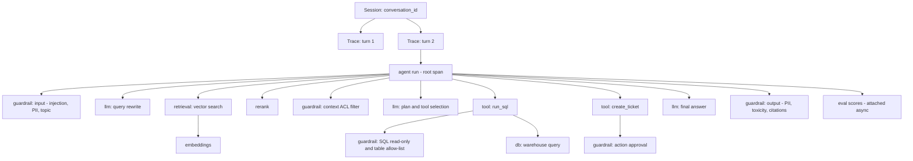

# Observability & Tracing for Agentic RAG

> **TL;DR** — A trace is the full record of one agent run: every retrieval, rerank, LLM call, tool call, SQL query and guardrail decision, with inputs, outputs, versions, tokens, latency and cost. Without traces you can't debug, run online evals, collect feedback, or build datasets from production. Instrument with OpenTelemetry-compatible conventions (OTel GenAI semantic conventions or OpenInference), group traces into sessions, tag every prompt/model version, and redact PII before it reaches long-term storage.

**You'll learn:** the span model for an agentic RAG request · exactly what to log per span type · OTel GenAI semantic conventions and OpenInference at a high level · session/thread grouping and version tagging · privacy, redaction and retention · the tool landscape · a full example trace for the running example
 ·  **Prerequisites:** [Agentic RAG failure modes](../00-foundations/03-agentic-rag-failure-modes.md), [Online evals](./01-online-evals.md)
 ·  **Related:** [User feedback](./03-user-feedback-and-implicit-signals.md), [Monitoring & drift](./04-monitoring-alerting-and-drift.md), [Guardrails architecture](../04-guardrails/01-guardrails-architecture.md), [Eval & observability tools](../06-tooling-landscape/01-eval-and-observability-tools.md)

---

## 1. Why tracing is the foundation

Logs say *that* something happened. A **trace** shows *why*: the causal chain from user question → query rewrite → retrieval → rerank → LLM plan → SQL → tool call → final answer, with the guardrail decisions interleaved.

For agentic RAG, traces are the raw material for almost everything else in this repo:

| Need | Needs from the trace |
|---|---|
| Debugging a bad answer | Retrieved doc IDs and scores, the exact prompt sent, model output, tool results |
| [Online evals](./01-online-evals.md) | Question, contexts, answer, tool/SQL results, so judges can run reference-free |
| [User feedback](./03-user-feedback-and-implicit-signals.md) | A `trace_id` to attach thumbs/corrections to |
| [Monitoring](./04-monitoring-alerting-and-drift.md) | Latency, tokens, cost, error and guardrail attributes to aggregate |
| [Datasets](../01-datasets/04-production-data-flywheel.md) | Real inputs plus provenance for golden/regression sets |
| Security & audit | Who asked what, which data they could access, which actions were taken |
| Cost attribution | Tokens per model per feature per team |

> **Default:** instrument tracing **before** you build your first online eval or dashboard. Retrofitting it later costs much more.

---

## 2. The span model for an agentic RAG request

A **trace** is a tree of **spans**. Each span is a timed operation with attributes, events, and a status. A **session** (or thread/conversation) groups multiple traces from the same multi-turn interaction.



### 2.1 Span types and what to log

Use this as a logging spec. "**Must**" means you'll regret not having it; "**Should**" means high value; "**Could**" means nice to have.

#### Root / agent span (one per user turn)

| Attribute | Priority | Why |
|---|---|---|
| `trace_id`, `session_id` / `conversation_id`, `turn_index` | Must | Grouping, joining feedback |
| `user_id` (pseudonymous), `user_role`, `tenant/org`, `department` | Must | RBAC analysis, segmentation |
| `app_version`, `agent_version`, `prompt_bundle_version`, `config_hash` | Must | Attribute regressions to changes |
| `environment` (`prod`, `canary`, `shadow`), `experiment_id`, `variant` | Must | A/B, canary, shadow comparisons |
| Input: user message (redacted per policy) | Must | Debugging, evals, datasets |
| Output: final answer, citations | Must | Same |
| `status` (`ok`, `error`, `blocked`, `refused`, `timeout`), `refusal_reason` | Must | Monitoring |
| Total latency, time-to-first-token | Must | SLOs |
| Total tokens and **cost** (rolled up from children) | Must | Cost monitoring |
| Number of LLM calls, tool calls, agent steps | Should | Loop detection, efficiency |
| Channel (web, Slack, API), locale | Could | Segmentation |

#### Retrieval span

| Attribute | Priority | Why |
|---|---|---|
| Query text sent to the retriever (after rewrite) | Must | Rewrite bugs are common |
| Index/collection name and **index version / snapshot timestamp** | Must | Corpus drift, stale index |
| `top_k`, filters applied (metadata, ACL), hybrid weights | Must | Reproducibility |
| Returned **doc/chunk IDs, scores, ranks**, source URIs | Must | Retrieval debugging, online metrics |
| Count before vs after ACL filtering | Should | Distinguish "nothing relevant" from "nothing permitted" |
| Embedding model name/version | Should | Drift and recalibration |
| Chunk text | Could (store by reference) | Volume and privacy; store IDs and resolve on demand |

#### Rerank span

| Attribute | Priority |
|---|---|
| Reranker model/version | Must |
| Input doc IDs (ranked) and output doc IDs with new scores | Must |
| Cutoff / threshold used, number dropped | Should |

#### LLM call span (each call: rewrite, plan, answer, judge)

| Attribute | Priority | Why |
|---|---|---|
| Provider, requested model, **response model** (exact version string returned) | Must | Silent provider updates (see [Monitoring & drift](./04-monitoring-alerting-and-drift.md)) |
| Prompt template ID + **version**, template variables | Must | Prompt regressions |
| Full input messages (system + user + context), or a reference to them | Must (redacted) | Debugging |
| Output messages, `finish_reason`, tool calls requested | Must | Truncation, tool-use analysis |
| Input/output tokens (incl. cached/reasoning tokens where reported) | Must | Cost |
| Latency, TTFT for streaming | Must | SLOs |
| Parameters: temperature, max tokens, seed, response format | Should | Reproducibility |
| Retry count, error class (rate limit, timeout, content filter) | Should | Reliability |
| Cost (computed from a versioned price table) | Should | Cost per feature |

#### Tool call span

| Attribute | Priority |
|---|---|
| Tool name, tool version, `tool_call_id` (links to LLM span that requested it) | Must |
| Arguments (validated / redacted), schema-validation result | Must |
| Result summary, status, error class, latency | Must |
| **Side-effect flag** (read vs write), approval required/granted, approver | Must for write tools |
| External IDs created (e.g. `ticket_id`) | Should |

#### SQL execution span

| Attribute | Priority |
|---|---|
| Generated SQL (normalized), dialect | Must |
| Parse OK, statement type, referenced tables/columns | Must |
| Executing principal / role (the DB role used, which should be least-privilege) | Must |
| Row count, truncated flag, execution time, error class | Must |
| Result sample (first N rows, redacted) or a hash | Should |
| Schema version / catalog snapshot | Should |

OpenTelemetry's [database semantic conventions](https://opentelemetry.io/docs/specs/semconv/database/database-spans/) cover generic DB spans (`db.system.name`, `db.query.text`, `db.operation.name`, …). Reuse them for the SQL span instead of inventing new names.

#### Guardrail span

| Attribute | Priority |
|---|---|
| Guardrail name + version, stage (`input`, `context`, `tool`, `output`) | Must |
| Decision (`allow`, `block`, `redact`, `rewrite`, `escalate`), blocking vs non-blocking | Must |
| Score(s) and threshold, matched policy/rule ID, short reason | Must |
| Latency, timeout → fail-open/closed outcome | Must |
| What was redacted (entity types, counts — not the values) | Should |

#### Eval / score records (attached after the fact)

| Field | Priority |
|---|---|
| `trace_id` (and optionally `span_id`), `eval_name`, `eval_version` | Must |
| Score / label, rationale, judge model + version | Must |
| `sample_reason` (`uniform`, `triggered`, `canary`) | Must |
| Source (`llm_judge`, `heuristic`, `human`, `user_feedback`) | Must |

### 2.2 Version tagging: the most under-rated attributes

Most "the bot got worse" investigations end at one question: **what changed?** Make it answerable from the trace alone.

- [ ] **Prompt templates** live in a registry or in version control with immutable version IDs. Log the ID on every LLM span.
- [ ] Log both **requested model** and **response model**. Providers may alias a model name to a new snapshot.
- [ ] Log **index snapshot / ingestion run ID** on retrieval spans.
- [ ] Log the **guardrail and judge versions** (model + prompt + threshold).
- [ ] Compute a **config hash** of everything that affects behavior (prompts, models, top-k, thresholds, tool list) and log it on the root span. Two traces with the same hash ran the same system.
- [ ] Tag **experiment/variant** and **deployment ring** (`shadow`, `canary`, `prod`).

### 2.3 Session / thread grouping

Multi-turn conversations need a stable grouping key:

- `session_id` / `conversation_id` on every trace in the conversation, plus `turn_index`.
- Store a **summary of prior turns** or a pointer to them. Single-turn judges miss errors that depend on earlier context ("as I said, only for EMEA").
- Session-level metrics need this grouping: turns per session, retry/rephrase detection, session-level outcome judges, escalation after N turns.
- For long-running or async agents (e.g. a ticket follow-up hours later), propagate a **correlation ID** across processes. OTel context propagation and span links handle this.

---

## 3. Standards: OpenTelemetry GenAI conventions and OpenInference

Use a standard schema. Then you can switch vendors, combine app and LLM telemetry, and use off-the-shelf auto-instrumentation.

### 3.1 OpenTelemetry GenAI semantic conventions

[OpenTelemetry](https://opentelemetry.io/) defines **semantic conventions**: standard attribute and span names for common operations. The **GenAI** conventions cover model inference, embeddings, retrieval, tool execution, and agent/workflow invocation. At the time of writing they're marked **Development** (not yet stable) and have moved to their own repository, [`open-telemetry/semantic-conventions-genai`](https://github.com/open-telemetry/semantic-conventions-genai). Expect attribute names to change and pin the version you implement.

At a high level:

- **Operation names** (`gen_ai.operation.name`) include values such as `chat`, `text_completion`, `generate_content`, `embeddings`, `retrieval`, `execute_tool`, `create_agent`, and `invoke_agent`. Span names follow patterns like `chat {model}` or `execute_tool {gen_ai.tool.name}`.
- **Model/provider attributes**: `gen_ai.provider.name`, `gen_ai.request.model`, `gen_ai.response.model`, request params (`gen_ai.request.temperature`, `gen_ai.request.max_tokens`, …), `gen_ai.response.finish_reasons`, `gen_ai.response.id`.
- **Usage**: `gen_ai.usage.input_tokens`, `gen_ai.usage.output_tokens` (with variants for cached tokens).
- **Agent / conversation**: `gen_ai.agent.name`, `gen_ai.agent.id`, `gen_ai.conversation.id`.
- **Tools**: `gen_ai.tool.name`, `gen_ai.tool.call.id`, `gen_ai.tool.type`, plus opt-in `gen_ai.tool.call.arguments` / `gen_ai.tool.call.result`.
- **Retrieval**: attributes such as `gen_ai.data_source.id` and retrieval query/document attributes.
- **Content capture** (`gen_ai.input.messages`, `gen_ai.output.messages`, `gen_ai.system_instructions`) is **opt-in** because it may contain sensitive data. The spec also describes uploading content to external storage and recording a reference instead.
- **Metrics** such as `gen_ai.client.operation.duration` and token-usage metrics let you build dashboards without parsing spans.

Start from the overview at [opentelemetry.io/docs/specs/semconv/gen-ai](https://opentelemetry.io/docs/specs/semconv/gen-ai/) and follow it to the current repository.

### 3.2 OpenInference (Arize)

[OpenInference](https://github.com/Arize-ai/openinference) is a set of conventions and auto-instrumentation plugins, built on OpenTelemetry, from Arize (used by [Arize Phoenix](https://github.com/Arize-ai/phoenix) and others). Its distinguishing idea is an explicit **span kind** attribute, `openinference.span.kind`, with values including:

`LLM`, `EMBEDDING`, `CHAIN`, `RETRIEVER`, `RERANKER`, `TOOL`, `AGENT`, `GUARDRAIL`, `EVALUATOR` (plus a few others in recent spec versions).

Other attributes include `input.value` / `output.value`, `llm.model_name`, `llm.token_count.prompt|completion|total`, `llm.prompt_template.template|variables|version`, `retrieval.documents` (with `document.id`, `document.score`, `document.content`), `tool.name`, `session.id`, `user.id`, `metadata`, and `tag.tags`.

`RERANKER` and `GUARDRAIL` are first-class span kinds, so OpenInference maps naturally onto the span model in section 2.

### 3.3 Which one?

| Situation | Suggested choice |
|---|---|
| Your org already runs OTel collectors / an APM | OTel GenAI conventions, and export to your APM plus an LLM-focused backend |
| You want rich RAG-specific views (retriever docs, rerankers, guardrails) out of the box | OpenInference instrumentation (works with any OTel-compatible backend that understands it) |
| You use a framework (LangChain/LangGraph, LlamaIndex, …) | Use the framework's integration with your chosen backend, then check which convention it emits |
| Unsure | Emit OTel spans; add custom attributes under your own namespace (e.g. `app.rbac.role`, `app.guardrail.decision`). Both conventions are OTel underneath |

Whatever you choose, **add your own app-specific attributes** under a namespace you control (`app.*`). Neither convention knows about your RBAC roles, ticket IDs, or business outcomes.

---

## 4. Example trace for the running example

Scenario: a `finance_analyst` asks, *"What was EMEA revenue last quarter, and open a ticket if it's below plan?"* The agent retrieves the revenue-definition doc, runs SQL, compares to plan, creates a ticket, and answers with citations.

The JSON below is **illustrative**. It's a flattened, vendor-neutral view that mixes OTel GenAI-style attribute names with app-specific `app.*` attributes. Real exporters encode spans differently, e.g. OTLP protobuf with nanosecond timestamps.

```json
{
  "trace_id": "4f1c9a7e2b3d4c5e8f60718293a4b5c6",
  "session_id": "conv_8812",
  "turn_index": 3,
  "start_time": "2026-10-15T09:12:03.120Z",
  "duration_ms": 6840,
  "attributes": {
    "app.user.id_hash": "u_7d2e…",
    "app.user.role": "finance_analyst",
    "app.tenant": "acme-corp",
    "app.env": "prod",
    "app.deployment_ring": "canary",
    "app.experiment": {"id": "exp_answer_style_v2", "variant": "B"},
    "app.agent_version": "2026.10.2",
    "app.config_hash": "cfg_a91b3f",
    "app.status": "ok",
    "app.cost_usd": 0.0183,
    "gen_ai.usage.input_tokens": 9120,
    "gen_ai.usage.output_tokens": 612,
    "app.llm_calls": 3,
    "app.tool_calls": 2
  },
  "input": {"text": "What was EMEA revenue last quarter, and open a ticket if it's below plan?"},
  "output": {
    "text": "EMEA revenue for Q3 FY26 was $41.2M, 6% below the $43.8M plan [doc:fin-defs-012]. I opened ticket FIN-4821 for the regional finance team.",
    "citations": ["fin-defs-012"]
  },
  "spans": [
    {
      "span_id": "s1", "parent": null, "name": "guardrail input", "kind": "GUARDRAIL", "duration_ms": 85,
      "attributes": {"app.guardrail.names": ["prompt_injection_v3", "pii_detector_v2", "topic_scope_v1"],
                     "app.guardrail.decision": "allow", "app.guardrail.injection_score": 0.02}
    },
    {
      "span_id": "s2", "parent": null, "name": "chat gpt-x-mini", "kind": "LLM", "duration_ms": 640,
      "attributes": {"gen_ai.operation.name": "chat", "gen_ai.provider.name": "example-provider",
                     "gen_ai.request.model": "gpt-x-mini", "gen_ai.response.model": "gpt-x-mini-2026-08-01",
                     "app.prompt.id": "plan_and_route", "app.prompt.version": "v14",
                     "gen_ai.usage.input_tokens": 1450, "gen_ai.usage.output_tokens": 96,
                     "gen_ai.response.finish_reasons": ["tool_calls"],
                     "app.tool_calls_requested": ["search_docs", "run_sql", "create_ticket"]}
    },
    {
      "span_id": "s3", "parent": null, "name": "retrieval finance-docs", "kind": "RETRIEVER", "duration_ms": 210,
      "attributes": {"gen_ai.operation.name": "retrieval", "gen_ai.data_source.id": "finance-docs",
                     "app.index.snapshot": "2026-10-14T02:00Z", "app.retrieval.query": "definition of regional revenue EMEA plan",
                     "app.retrieval.top_k": 20, "app.retrieval.filters": {"acl_role": "finance_analyst"},
                     "app.retrieval.count_before_acl": 20, "app.retrieval.count_after_acl": 17,
                     "app.embedding.model": "embed-v3"},
      "documents": [
        {"id": "fin-defs-012", "score": 0.83, "rank": 1},
        {"id": "fin-plan-fy26", "score": 0.79, "rank": 2},
        {"id": "emea-ops-faq", "score": 0.61, "rank": 3}
      ]
    },
    {
      "span_id": "s4", "parent": null, "name": "rerank", "kind": "RERANKER", "duration_ms": 120,
      "attributes": {"app.reranker.model": "rerank-v2", "app.rerank.top_n": 5, "app.rerank.min_score": 0.3},
      "documents": [
        {"id": "fin-defs-012", "score": 0.94, "rank": 1},
        {"id": "fin-plan-fy26", "score": 0.88, "rank": 2}
      ]
    },
    {
      "span_id": "s5", "parent": null, "name": "execute_tool run_sql", "kind": "TOOL", "duration_ms": 1730,
      "attributes": {"gen_ai.operation.name": "execute_tool", "gen_ai.tool.name": "run_sql",
                     "gen_ai.tool.call.id": "call_01", "app.tool.side_effect": "read"}
    },
    {
      "span_id": "s5a", "parent": "s5", "name": "guardrail sql", "kind": "GUARDRAIL", "duration_ms": 12,
      "attributes": {"app.sql.parse_ok": true, "app.sql.statement_type": "SELECT",
                     "app.sql.tables": ["fct_revenue", "dim_region", "fct_plan"],
                     "app.guardrail.decision": "allow", "app.guardrail.rule": "readonly+allowlist_finance"}
    },
    {
      "span_id": "s5b", "parent": "s5", "name": "SELECT analytics", "kind": "DB", "duration_ms": 1650,
      "attributes": {"db.system.name": "snowflake", "db.operation.name": "SELECT",
                     "db.query.text": "SELECT r.region, SUM(f.amount) … WHERE r.region = ? AND f.fiscal_quarter = ? …",
                     "app.db.role": "ro_finance_analyst", "app.sql.row_count": 1, "app.sql.error": null,
                     "app.schema.version": "dwh_2026_10_01"}
    },
    {
      "span_id": "s6", "parent": null, "name": "execute_tool create_ticket", "kind": "TOOL", "duration_ms": 900,
      "attributes": {"gen_ai.tool.name": "create_ticket", "gen_ai.tool.call.id": "call_02",
                     "app.tool.side_effect": "write", "app.tool.args_valid": true,
                     "app.approval.required": false, "app.approval.policy": "auto_for_finance_internal",
                     "app.tool.result.ticket_id": "FIN-4821", "app.tool.status": "ok"}
    },
    {
      "span_id": "s7", "parent": null, "name": "chat gpt-x", "kind": "LLM", "duration_ms": 2950,
      "attributes": {"gen_ai.operation.name": "chat", "gen_ai.request.model": "gpt-x",
                     "gen_ai.response.model": "gpt-x-2026-09-15",
                     "app.prompt.id": "answer_with_citations", "app.prompt.version": "v31",
                     "gen_ai.usage.input_tokens": 7300, "gen_ai.usage.output_tokens": 480,
                     "gen_ai.response.finish_reasons": ["stop"], "app.ttft_ms": 690}
    },
    {
      "span_id": "s8", "parent": null, "name": "guardrail output", "kind": "GUARDRAIL", "duration_ms": 70,
      "attributes": {"app.guardrail.names": ["pii_detector_v2", "toxicity_v1", "citation_resolver_v1"],
                     "app.guardrail.decision": "allow", "app.citations.dangling": [], "app.citations.leaked": []}
    }
  ],
  "scores": [
    {"name": "empty_retrieval", "source": "heuristic", "value": false},
    {"name": "citation_resolves", "source": "heuristic", "value": true},
    {"name": "faithfulness", "source": "llm_judge", "eval_version": "faith_v5", "judge_model": "judge-large-2026-07",
     "label": "partially_supported", "rationale": "Revenue figure comes from SQL result, plan figure supported by fin-plan-fy26 but that doc was not cited.",
     "sample_reason": "uniform"},
    {"name": "user_feedback", "source": "user", "value": "thumbs_up", "timestamp": "2026-10-15T09:13:40Z"}
  ]
}
```

Things to notice:

- The **faithfulness judge** found a real issue: the plan figure is supported by a retrieved doc that wasn't cited. You can only diagnose this because retrieved IDs, cited IDs, and the SQL result all live in one trace.
- `count_before_acl` vs `count_after_acl` shows RBAC filtering removed 3 docs. That matters when someone asks "why didn't it find X?".
- The **response model** differs from the requested alias. If behavior changes overnight, this is the first field to check.
- The write tool has explicit `side_effect`, `approval.*` and the created `ticket_id`, which you need for audit.
- Model names here (`gpt-x`, `judge-large-…`) are placeholders.

---

## 5. Privacy, security and retention

Traces are among the most sensitive data you hold. They contain user questions, retrieved internal documents, SQL results, and sometimes credentials pasted by users.

### 5.1 Redaction strategy

| Technique | Where | Trade-off |
|---|---|---|
| **Don't capture content** (metadata only) | SDK config | Safest; kills debugging and judge evals |
| **Redact at the source** (before export) with PII/secret detectors | App / SDK processor | Best default; detectors miss things and over-redact |
| **Redact in the collector** (e.g. an OTel Collector processor) | Pipeline | Centralized policy; raw data still leaves the app process |
| **Store content by reference** (blob store with stricter ACL + shorter TTL; span holds a pointer) | Storage | Separates hot metadata from sensitive payloads; supported by the OTel GenAI spec's "external storage" pattern |
| **Tokenize / pseudonymize** user IDs and entities (reversible only by a privileged service) | App | Keeps joinability without exposing identity |
| **Field-level encryption** for selected attributes | App / storage | Strong; complicates search |

Checklist:

- [ ] Classify trace fields: `metadata` (safe), `user_content`, `retrieved_content`, `tool_results`, `sql_results`. Apply policy per class.
- [ ] Run PII/secret detection (e.g. [Microsoft Presidio](https://github.com/microsoft/presidio) or your DLP service) **before** export. Log entity *types and counts*, not values.
- [ ] Never log raw credentials, auth headers, or connection strings. Add a test that fails if they appear.
- [ ] **Respect source ACLs in the trace UI.** If a trace contains an HR document, only people allowed to see that doc should see the trace content. Otherwise observability becomes a data-exfiltration path.
- [ ] Limit who can **export traces into datasets** (see [Production data flywheel](../01-datasets/04-production-data-flywheel.md)), and redact again at export time.
- [ ] Honor **deletion requests** (right to erasure) by keying content on a pseudonymous user ID that you can purge.
- [ ] Self-host or use a region/tenant-isolated deployment if your data-residency requirements demand it.

### 5.2 Retention tiers (heuristic starting point; confirm with legal/compliance)

| Tier | Contents | Typical retention |
|---|---|---|
| Hot | Full traces incl. redacted content | Days to weeks (debugging, async evals) |
| Warm | Metadata + scores + feedback, content by reference | Weeks to months (trend analysis) |
| Cold / dataset | Curated, re-redacted examples promoted to datasets | As long as the dataset lives, under dataset governance |
| Audit | Who-did-what for write tools and access decisions | Per compliance policy, often longest |
| Aggregates | Metrics/time series | Long; no content |

### 5.3 Trace sampling

Unlike online-eval sampling, **trace sampling** decides what you *store* at all.

- For most enterprise assistants, volume is low enough to **keep 100% of traces** (with redaction) for at least the hot tier. Debugging an incident without the trace is painful.
- At high volume, use **tail-based sampling**: decide after the trace completes, and keep all errors, guardrail blocks, negative feedback, and high-latency/high-cost traces, plus a uniform sample of the rest. See [OTel sampling concepts](https://opentelemetry.io/docs/concepts/sampling/).
- Feedback can arrive minutes after the trace. Either keep everything for a short window, or support late "promote this trace" decisions.

---

## 6. Instrumentation patterns

Framework-agnostic pseudo-instrumentation using the OpenTelemetry Python API. The `opentelemetry-api` tracer calls shown are standard; the attribute names follow the conventions above plus your own `app.*` namespace.

```python
from opentelemetry import trace

tracer = trace.get_tracer("enterprise-assistant")

def retrieve(query: str, user):
    with tracer.start_as_current_span("retrieval finance-docs") as span:
        span.set_attribute("gen_ai.operation.name", "retrieval")
        span.set_attribute("gen_ai.data_source.id", "finance-docs")
        span.set_attribute("app.index.snapshot", INDEX_SNAPSHOT)
        span.set_attribute("app.retrieval.query", query)
        docs = vector_search(query, top_k=20)
        span.set_attribute("app.retrieval.count_before_acl", len(docs))
        docs = [d for d in docs if user.can_read(d.id)]
        span.set_attribute("app.retrieval.count_after_acl", len(docs))
        span.set_attribute("app.retrieval.doc_ids", [d.id for d in docs])
        span.set_attribute("app.retrieval.scores", [float(d.score) for d in docs])
        return docs

def guardrail(name: str, stage: str, fn, payload):
    with tracer.start_as_current_span(f"guardrail {name}") as span:
        span.set_attribute("app.guardrail.name", name)
        span.set_attribute("app.guardrail.stage", stage)
        result = fn(payload)                      # returns decision, score, reason
        span.set_attribute("app.guardrail.decision", result.decision)
        span.set_attribute("app.guardrail.score", result.score)
        span.set_attribute("app.guardrail.reason", result.reason)
        return result
```

Practical tips:

- **Use auto-instrumentation** for LLM SDKs and frameworks (OpenInference, OpenLLMetry-style instrumentors, or vendor SDKs), and add **manual spans** for business logic they can't see: ACL filtering, guardrails, SQL validation, approvals.
- **Propagate context** into async workers, tool services, and the SQL gateway so their spans join the same trace.
- **Return the `trace_id` to the client** (e.g. in a response header or payload). Without it, the feedback widget can't link feedback to the trace (see [User feedback](./03-user-feedback-and-implicit-signals.md)).
- **Don't block the request on telemetry export.** Use batch span processors, and make sure an exporter outage doesn't take down the app.
- **Compute cost in one place**, using a versioned price table keyed by response model.

---

## 7. Tool landscape (observability-focused)

All of the following exist and offer LLM tracing. Feature sets change quickly, so check current docs for OTel ingestion, self-hosting, online evaluators, and pricing. For a broader comparison see [Eval & observability tools](../06-tooling-landscape/01-eval-and-observability-tools.md).

| Tool | Type | Notes (high level) |
|---|---|---|
| [Langfuse](https://langfuse.com/docs) | Open-source (self-hostable) + cloud | Traces/sessions, prompt management, scores, LLM-as-a-judge evaluators on production traces, datasets; accepts OpenTelemetry |
| [LangSmith](https://docs.smith.langchain.com/) | Commercial (LangChain) | Deep LangChain/LangGraph integration but framework-agnostic SDK; tracing, online evaluators, annotation queues, datasets |
| [Arize Phoenix](https://github.com/Arize-ai/phoenix) | Open-source (self-hostable); Arize AX is the commercial platform | Built on OpenTelemetry + OpenInference; tracing, evals, datasets/experiments |
| [Braintrust](https://www.braintrust.dev/docs) | Commercial | Eval-first platform with logging/tracing of production, online scoring, datasets, prompt playground |
| [Weights & Biases Weave](https://github.com/wandb/weave) | Open-source SDK + W&B platform | Tracing of LLM apps, evaluations, scorers |
| [MLflow Tracing](https://mlflow.org/docs/latest/genai/tracing/) | Open-source (also managed offerings) | OpenTelemetry-compatible tracing and GenAI evaluation within MLflow |
| [Datadog LLM Observability](https://docs.datadoghq.com/llm_observability/) | Commercial APM add-on | LLM traces alongside existing APM/infra monitoring; evaluations and security checks |

Selection criteria (checklist):

- [ ] Ingests **OpenTelemetry** (avoid lock-in) and/or supports your framework.
- [ ] **Self-hosting / data residency** options that match your data classification.
- [ ] **Session/thread views** and custom attributes/filters (role, tenant, prompt version).
- [ ] **Scores API**: attach heuristic, judge, human and user-feedback scores to traces.
- [ ] **Online evaluators** with sampling controls, or easy export to your own eval workers.
- [ ] **Annotation queues** for human review, and **trace → dataset** export.
- [ ] Fine-grained **access control** on trace content (section 5).
- [ ] Cost: priced per trace/span/seat? Agentic traces have many spans.

> Many teams run **two** destinations: their existing APM (for latency/errors/infra, with on-call alerting) and an LLM-focused tool (for content inspection, evals, datasets). OTel lets you fan out from one instrumentation.

---

## 8. Using traces day to day

- **Error analysis sessions.** Weekly, filter traces by low judge score / negative feedback / guardrail block, read 30–100 of them, and write failure notes. This is the highest-ROI activity in AI quality work (see [Hamel Husain's field guide](https://hamel.dev/blog/posts/field-guide/)).
- **Saved views** per failure mode: "empty retrieval for finance_analyst", "SQL errors by table", "create_ticket with approval overridden".
- **Diff two traces** (same question, different prompt version) when a regression is reported.
- **Replay**: re-run a production trace's inputs against a new version offline, then compare. This needs a full input capture, including retrieved contexts if you want to isolate the generator (see [Running offline experiments](../02-offline-evals/08-running-offline-experiments.md)).

---

## Key takeaways

- Trace **every step**: retrieval, rerank, each LLM call, each tool call, SQL execution, and every guardrail decision. Group traces into sessions.
- Logging spec essentials: inputs/outputs, **doc IDs + scores**, **prompt/model/index/guardrail versions**, requested vs **response model**, tokens, latency, cost, user role, guardrail decisions, side effects.
- Prefer **OpenTelemetry** and a semantic convention (**OTel GenAI** or **OpenInference**). Add app-specific attributes under your own namespace. The GenAI conventions are still evolving, so pin a version.
- Return the `trace_id` to the client so feedback and evals can attach to it.
- Treat traces as sensitive data: **redact before export**, enforce source ACLs in the trace UI, tier retention, and support deletion.
- Choose tools by OTel support, hosting/data-residency, session views, scores/online-eval support, and access control, not by feature lists.

## Further reading

- OpenTelemetry — [GenAI semantic conventions](https://opentelemetry.io/docs/specs/semconv/gen-ai/) (now maintained in [open-telemetry/semantic-conventions-genai](https://github.com/open-telemetry/semantic-conventions-genai))
- OpenTelemetry blog — [OpenTelemetry for Generative AI](https://opentelemetry.io/blog/2024/otel-generative-ai/)
- OpenTelemetry — [Database span conventions](https://opentelemetry.io/docs/specs/semconv/database/database-spans/) and [Sampling](https://opentelemetry.io/docs/concepts/sampling/)
- Arize — [OpenInference specification & instrumentation](https://github.com/Arize-ai/openinference), [Phoenix tracing docs](https://arize.com/docs/phoenix/tracing/llm-traces)
- [Langfuse docs](https://langfuse.com/docs/observability/overview) · [LangSmith observability](https://docs.smith.langchain.com/observability) · [Braintrust logs](https://www.braintrust.dev/docs/guides/logs) · [W&B Weave docs](https://weave-docs.wandb.ai/) · [MLflow Tracing](https://mlflow.org/docs/latest/genai/tracing/) · [Datadog LLM Observability](https://docs.datadoghq.com/llm_observability/)
- Microsoft — [Presidio](https://github.com/microsoft/presidio) (PII detection/anonymization)
- Chip Huyen — [Building A Generative AI Platform](https://huyenchip.com/2024/07/25/genai-platform.html) (observability and guardrails in the overall architecture)
- Hamel Husain — [A Field Guide to Rapidly Improving AI Products](https://hamel.dev/blog/posts/field-guide/)
- Within this repo: [Online evals](./01-online-evals.md), [Access control & RBAC](../04-guardrails/06-access-control-rbac.md), [Threat model / OWASP](../04-guardrails/07-threat-model-owasp.md)
