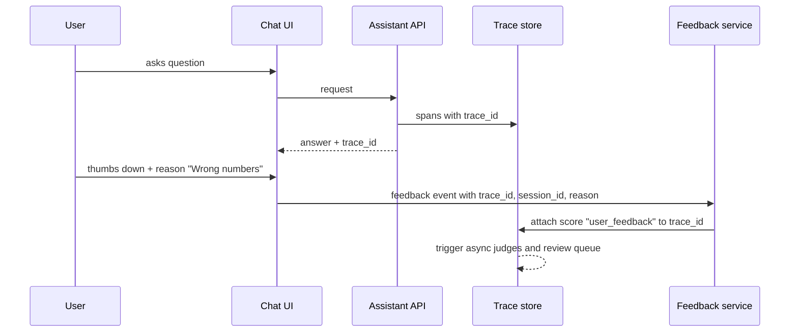
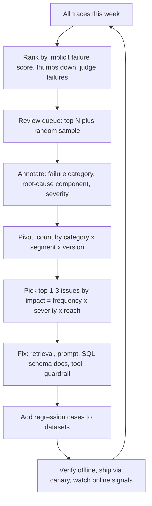

# User Feedback & Implicit Signals

> **TL;DR**
> - **Capture both explicit and implicit signals.** Log thumbs, reason chips, and inline corrections alongside behavioral signals like retries, regenerations, escalations, and copies.
> - **Link every feedback event to a `trace_id`.** Attach user signals directly to trace records so you can inspect the exact prompt, context, and SQL query.
> - **Treat user feedback as a triage signal, not a rate.** Use biased feedback to find failures, and rely on uniform-sample judges for unbiased quality rates.
> - **Promote feedback to dataset labels in stages.** Corroborate user signals with LLM judges and SME review before adding cases to golden datasets.

**You will learn:** Explicit and implicit signal catalog · Sparsity and bias corrections · Feedback UX design · Trace linking, label promotion, and weekly error analysis  
**Prerequisites:** [Observability & tracing](./02-observability-and-tracing.md), [Online evals](./01-online-evals.md)  
**Related:** [Production data flywheel](../01-datasets/04-production-data-flywheel.md), [SME golden datasets](../01-datasets/02-sme-golden-datasets.md), [Monitoring & drift](./04-monitoring-alerting-and-drift.md), [LLM-as-a-judge](../02-offline-evals/07-llm-as-a-judge.md)

---

## 1. Why feedback matters, and why it isn't enough

Online LLM judges evaluate whether an answer is *grounded* and *relevant*. Only real users know whether an answer is *useful* for their task, timeline, and level of detail. User feedback also provides your cheapest stream of **real production failure cases** for offline datasets.

However, raw user feedback has four major limitations:

- **Sparsity:** Most user sessions leave zero explicit ratings.
- **Selection bias:** Users who click feedback buttons do not represent your average user population.
- **Ambiguity:** A thumbs-down can mean wrong facts, high latency, bad formatting, a policy refusal, or frustration with company policy.
- **Latency lag:** Downstream signals (such as reopened tickets or disputed finance numbers) arrive hours or days after the conversation.

Use feedback to **surface and prioritize** candidate failures, and verify them with LLM judges and human reviewers before treating them as ground truth.

---

## 2. Explicit feedback

| Signal | Example UX | Information content | Typical volume | Notes |
|---|---|---|---|---|
| **Binary thumbs** | 👍 / 👎 on each assistant turn | Low per event, easy to aggregate | Low | Best default starting point |
| **Thumbs + reason** | 👎 opens reason chips: *Incorrect · Not relevant · Missing info · Outdated · Too long · Wrong data access · Other* | Medium — assigns a failure category | Lower than thumbs | Map chips directly to your failure taxonomy |
| **Rating scale** | 1–5 stars or end-of-session CSAT | Medium, noisy calibration across users | Low | Users anchor scales differently — prefer binary thumbs + reason chips |
| **Free-text comment** | "Tell us more" input box | High, unstructured detail | Very low | Classify comments with an LLM and read every comment early on |
| **Correction / edit** | User edits the output or supplies the right value ("It's $41.2M, not $42.1M") | **Very high** — close to a reference answer | Very low | High-value golden dataset candidates after SME verification |
| **Pairwise choice** | "Which response is better?" side-by-side card | High for preference tuning | Very low | Use sparingly because side-by-side comparison adds friction |
| **Source feedback** | "This source is not relevant" on a cited chunk | High for retriever evaluation | Very low | Provides direct relevance labels for retrieval benchmarks |
| **Report / flag** | "Report a problem" or "Exposes restricted data" | High severity | Rare | Route directly to a security or on-call queue, not just analytics |

### 2.1 Feedback UX design checklist

- [ ] **Collect feedback per assistant turn, not just per session.** Session-level CSAT cannot pinpoint which turn failed.
- [ ] **Make rating one click and elaboration optional.** Capture 👍 or 👎 immediately, then display optional reason chips.
- [ ] **Map reason chips directly to your failure taxonomy** (see [Agentic RAG failure modes](../00-foundations/03-agentic-rag-failure-modes.md)), such as *Wrong facts*, *Didn't find the doc*, *Wrong numbers/SQL*, *Did the wrong action*, *Refused unnecessarily*, and *Too slow*.
- [ ] **Enable inline user corrections** on structured outputs such as SQL queries, financial figures, or ticket fields.
- [ ] **Acknowledge submitted feedback immediately** and notify users when their reports lead to fixes.
- [ ] **Avoid dark patterns.** Never block workflow progress with pop-ups or hide the 👎 button.
- [ ] **Attach trace metadata automatically.** Log `trace_id`, version tags, and UI state without asking the user to re-explain their prompt.
- [ ] **Show a clear privacy notice.** Inform users that human reviewers may inspect flagged conversations.
- [ ] **Separate security and data-leak reporting** from general quality feedback and route security flags to an on-call queue with an SLA.

---

## 3. Implicit signals

Implicit signals come from natural user behavior. Every session generates implicit signals, but you must interpret them carefully for your product workflow.

| Signal | How to detect | Likely meaning | Direction | Confidence | Pitfalls |
|---|---|---|---|---|---|
| **Copy answer / copy SQL / copy table** | UI copy event on answer text or code block | Output was useful enough to reuse | + | Medium | Users sometimes copy text to fix or critique it elsewhere |
| **Regenerate** | User clicks "Regenerate" | User was dissatisfied with the initial answer | − | Medium–high | Some users click regenerate simply to explore alternatives |
| **Rephrase / retry** | Next user turn arrives within $N$ seconds with high embedding similarity ($> \tau$) | Previous answer missed the user's intent | − | Medium | Valid follow-up questions can look similar — calibrate $\tau$ on labeled pairs |
| **"That's wrong" follow-up** | Classifier or LLM detects contradiction, correction, or frustration in next turn | Explicit natural-language dissatisfaction | − | High | Regex misses sarcasm and multilingual phrasing — use a classifier |
| **Abandonment** | Session ends immediately after an answer or while tokens are still streaming | Could mean task completion or user frustration | ? | Low alone | Combine with other signals — mid-stream abandonment is usually negative |
| **Escalation to human** | User clicks "Talk to support" or opens a manual ticket on the same topic within $T$ minutes | Assistant failed to resolve the user's problem | − | High | Some policy flows require human escalation — segment by intent |
| **Ticket created via tool** | `create_ticket` tool call succeeded | Assistant completed the requested action | + / ? | Medium | Check downstream outcomes to see whether the ticket was reopened or rejected |
| **Ticket reopened / rejected** | Ticketing webhook reports reopen, rejection, or duplicate closure | Assistant created the wrong ticket or bad content | − | High (delayed) | Requires webhook integration with your ticketing system |
| **Citation click-through** | User clicks a cited document link | User wants to verify claims or read deeper | ? | Low–medium | Reflects either curiosity or distrust and suffers from strong position bias |
| **Dwell / read time** | Time spent viewing the answer and scroll depth | User engagement with the response | ? | Low | Long dwell time can indicate careful reading or confusion |
| **Follow-up depth** | Number of turns before session end | Multi-turn exploration or repeated struggle | ? | Low alone | Compare turn count against the baseline for that intent |
| **Downstream use** | User exports SQL, saves a query, or pastes the answer into a report | Strong task utility | + | High | Requires product instrumentation and user consent |
| **Feature disuse** | User stops returning to the assistant (cohort retention drop) | Product-level dissatisfaction | − | Low per user, high in aggregate | Confounded by seasonal workload and product changes |
| **Clarification acceptance** | User answers vs. ignores the assistant's clarifying question | Clarification question was helpful vs. annoying | ± | Medium | Track per intent category |

### 3.1 Turning raw events into signals

Convert raw clickstream events into structured **per-trace and per-session signal records** stored alongside your online eval scores:

```python
from dataclasses import dataclass

@dataclass
class TurnSignals:
    trace_id: str
    thumbs: int | None          # +1, -1, None
    reason: str | None          # chip value
    regenerated: bool
    rephrased_next: bool        # next turn semantically similar within 60s
    negative_followup: bool     # classifier on next user turn
    copied: bool
    escalated_within_30m: bool
    ticket_outcome: str | None  # "resolved", "reopened", "rejected", None

def implicit_failure_score(s: TurnSignals) -> float:
    """Heuristic triage score in [0, 1]; weights are starting points to calibrate, not truths."""
    score = 0.0
    score += 0.5 if s.thumbs == -1 else 0.0
    score += 0.3 if s.negative_followup else 0.0
    score += 0.25 if s.regenerated else 0.0
    score += 0.2 if s.rephrased_next else 0.0
    score += 0.3 if s.escalated_within_30m else 0.0
    score += 0.3 if s.ticket_outcome in {"reopened", "rejected"} else 0.0
    score -= 0.2 if s.copied else 0.0
    score -= 0.3 if s.thumbs == 1 else 0.0
    return max(0.0, min(1.0, score))
```

Calibrate these weights against human judgment. Hand-label ~200 traces as good or bad, fit a logistic regression model on the signal features, and recalibrate whenever UI layout changes alter button click rates.

### 3.2 Detecting rephrase and "that's wrong" follow-ups

- **Rephrase detection:** Embed consecutive user turns in the same session. Flag a rephrase when cosine similarity exceeds $\tau$ and the second turn arrives within 60 seconds. Calibrate $\tau$ on 200–300 labeled turn pairs so *"Show Q3 EMEA revenue"* → *"EMEA revenue for Q3 FY26 please"* triggers the flag, while *"Now break it down by country"* does not.
- **Negative follow-up detection:** Run a lightweight classifier or small LLM on the *next* user message to classify `correction`, `frustration`, `clarification`, `new_topic`, or `thanks`. This signal catches natural-language complaints across languages without requiring button clicks.

---

## 4. Biases and sparsity

### 4.1 Common biases

| Bias | What happens | How to mitigate it |
|---|---|---|
| **Self-selection / non-response** | Only very frustrated or very happy users click rating buttons | Never report raw 👎 rate as your true error rate — use uniform-sample judges instead |
| **Negativity bias** | Users report failures much more often than successes | Track 👍 and 👎 counts separately alongside overall feedback coverage |
| **Position / presentation bias** | First citations get the most clicks, and below-the-fold buttons get ignored | Compare click rates within the same rank position and keep feedback UI placement stable |
| **Power-user skew** | A small group of heavy users generates most feedback events | Cap per-user weight or stratify feedback metrics by user tenure |
| **Expectation / policy conflation** | Users click 👎 when they dislike a company policy the bot quoted accurately | Use reason chips and SME review to separate *incorrect answers* from *unwelcome policies* |
| **Latency conflation** | Users click 👎 because the response was slow rather than inaccurate | Join trace latency to feedback and include a *Too slow* reason chip |
| **Novelty / fatigue** | Feedback submission rates drop steadily after product launch | Normalize by feedback coverage and avoid comparing launch week to month three |
| **Survivorship** | Dissatisfied early users churn and stop generating feedback | Monitor cohort retention alongside feedback ratios |
| **Role/segment imbalance** | Finance analysts submit frequent feedback while HR users submit almost none | Stratify metrics by role and run targeted feedback sessions with quiet segments |
| **Gaming / adversarial feedback** | Coordinated 👎 attacks or prompt injections hidden inside free-text feedback | Rate-limit submissions, flag anomalies, and **never inject raw feedback text into prompts** |

As Joachims et al. demonstrated in ["Accurately Interpreting Clickthrough Data as Implicit Feedback"](https://www.cs.cornell.edu/people/tj/publications/joachims_etal_05a.pdf), click data works best as a **relative** preference signal due to strong position bias. Apply the same principle to citation clicks.

### 4.2 Dealing with sparsity

- **Report feedback coverage:** Compute `feedback_rate = traces_with_explicit_feedback / total_traces` and display it next to every feedback chart.
- **Aggregate over sufficient volume:** Compute 👎 rates over weekly or biweekly windows with confidence intervals rather than noisy daily slices.
- **Combine explicit and implicit signals:** Use the composite `implicit_failure_score` (Section 3.1) to rank all traces, not just the 1–3% with thumbs.
- **Avoid running A/B tests on thumbs alone** unless power calculations confirm sufficient sample size (see [Online evals §5.3](./01-online-evals.md)).
- **Solicit targeted feedback sparingly:** Prompt users for ratings slightly more often on canary versions or new intents, and tag those events `solicited = true`.

---

## 5. Linking feedback to traces

User feedback is useless for debugging unless you can join it back to the exact execution trace.



Follow this trace-linking checklist:

- [ ] Return `trace_id` and `session_id` with every API response and store them on the frontend message object.
- [ ] Include `trace_id`, `session_id`, `user_id_hash`, `timestamp`, `type` (`thumbs`, `rating`, `comment`, `correction`, `implicit:*`), `value`, `reason`, `ui_version`, and `solicited` on every feedback event.
- [ ] Log external correlation IDs (such as `ticket_id`) on tool spans so delayed webhooks can join back to the originating `trace_id`.
- [ ] Write feedback events both as **trace scores** in your observability platform and as rows in your analytics warehouse.
- [ ] Support feedback edits (such as changing 👎 to 👍) by updating the active score while preserving an audit log.
- [ ] Run free-text feedback comments through the **same PII redaction pipeline** used for traces.

---

## 6. Converting feedback into labels

Treat raw user feedback as a **weak signal** and promote it into trusted dataset labels through five stages:

| Stage | Example | Trust level | Best use |
|---|---|---|---|
| **0. Raw signal** | 👎 click or detected query rephrase | Low | Queue triage only |
| **1. Signal + reason** | 👎 + *Wrong numbers* chip | Low–medium | Routing to domain reviewers and tracking category trends |
| **2. Judge-corroborated** | 👎 + faithfulness judge returns `unsupported` | Medium | Prioritizing human review and flagging regression candidates |
| **3. Human-reviewed** | SME confirms SQL used calendar quarters instead of fiscal quarters | High | Regression tests, evaluation datasets, and judge calibration |
| **4. With reference** | SME writes the reference answer, gold SQL, or relevant doc IDs | Highest | Golden benchmark dataset (see [SME golden datasets](../01-datasets/02-sme-golden-datasets.md)) |

Follow these rules when promoting feedback into dataset rows:

- **Verify user corrections before trusting them.** User edits provide fast reference answers, but SMEs must confirm the user was not mistaken or viewing restricted outside data.
- **Harvest positive feedback too.** Verified 👍 traces provide essential *"must continue to pass"* test cases that prevent your dataset from containing only edge-case failures.
- **Never fine-tune or optimize prompts directly on raw thumbs.** De-bias and review feedback first so you do not reward sycophantic or confident-sounding hallucinations.
- **Feed judge disagreements into judge calibration.** When SMEs confirm a 👎 trace failed despite a `supported` judge verdict, add that trace to your judge calibration set (see [LLM-as-a-judge](../02-offline-evals/07-llm-as-a-judge.md)).
- **Log `label_source` and `confidence` on every dataset row** (`user`, `judge`, or `sme`).

---

## 7. Using feedback to prioritize error analysis

User feedback tells you **where to look**, while error analysis tells you **what to fix**. Run this weekly error-analysis loop:



Follow these practices during weekly review sessions:

- **Mix a 20% uniform random sample into your review queue.** Reviewing only feedback-ranked traces blinds you to silent failures where users trusted a confident hallucination.
- **Tag the failing component on every reviewed trace** (`query_rewrite`, `retrieval`, `rerank`, `generation`, `sql_generation`, `tool_selection`, `guardrail_false_positive`, `data_quality`, `policy_gap`) so the right engineering owner can fix it.
- **Start with open coding before locking your taxonomy.** Write short plain-text failure notes on your first 50–100 traces, then group recurring patterns into taxonomy categories (see Hamel Husain and Shreya Shankar in Further reading).
- **Rank fixes by `impact = frequency × severity × reach`.** Weight severity highest for data leaks and financial errors, and lowest for minor formatting issues.
- **Verify that shipped fixes move the target signal.** After deploying a fix, confirm that the specific reason chip and `implicit_failure_score` drop for the affected user slice.

### 7.1 Example: from feedback to fix

1. **Detect the spike:** The 👎 rate with the *Wrong numbers* reason chip doubles for `finance_analyst` users over seven days.
2. **Isolate the slice:** Filtering those traces reveals that all failing queries filter on `fiscal_quarter`, and the online SQL-alignment judge flags 40% of them.
3. **Diagnose root cause:** SME review shows the LLM generated calendar-quarter logic because the data engineering team renamed the fiscal calendar warehouse table without updating the SQL prompt schema description (see [Monitoring & drift](./04-monitoring-alerting-and-drift.md)).
4. **Ship the fix:** Update the SQL prompt's schema documentation and add a deterministic SQL check requiring the fiscal calendar table join whenever a query mentions quarters.
5. **Lock in regression coverage:** Add 25 SME-reviewed queries with gold SQL to the [text-to-SQL benchmark](../02-offline-evals/05-text-to-sql-evals.md), roll out via canary, and confirm the *Wrong numbers* chip rate returns to baseline.

---

## 8. Metrics to report from feedback

| Metric | Definition | Reporting caveat |
|---|---|---|
| **Feedback coverage** | % of assistant turns with any explicit feedback | Always display alongside feedback-derived rates |
| **👎 rate (given feedback)** | $\text{👎} / (\text{👍} + \text{👎})$ | Selection-biased — compare trends only across a stable UI |
| **👎 reasons mix** | Share of 👎 events per reason chip | Best signal for weekly backlog prioritization |
| **Rephrase/retry rate** | % of turns followed by a semantic rephrase within $N$ seconds | Recalibrate threshold $\tau$ when changing embedding models |
| **Negative follow-up rate** | % of turns followed by a user correction or frustration message | Depends on follow-up classifier accuracy |
| **Regenerate rate** | % of responses where the user clicked "Regenerate" | Sensitive to button placement in the UI |
| **Escalation rate** | % of sessions escalated to human support within $T$ minutes | Segment by intent because some policies require escalation |
| **Action success rate** | % of tool-created tickets not reopened or rejected within $X$ days | Delayed metric requiring ticketing webhook integration |
| **Copy / reuse rate** | % of answers or SQL blocks copied or saved by the user | Useful positive proxy, though UI-dependent |
| **Implicit failure score** | Weighted composite score across turn signals (Section 3.1) | Calibrate against SME labels and use for queue ranking |

Feed these metrics directly into the operational dashboards covered in [Monitoring & drift](./04-monitoring-alerting-and-drift.md).

---

## Key takeaways

- Capture both **explicit signals** (thumbs, reason chips, inline edits) and **implicit signals** (rephrases, regenerations, negative follow-ups, escalations, ticket outcomes, copies) linked to `trace_id`.
- Treat explicit feedback as **sparse and biased**. Use feedback to *discover* failures, and use uniform-sample LLM judges to *measure* population quality rates.
- Map feedback reason chips directly to your failure taxonomy with one-click submission.
- Promote raw feedback into dataset rows through **judge corroboration and SME review**, logging `label_source` and `confidence`.
- Include a **uniform random sample** in every human review queue so you catch silent hallucinations that users never report.
- Treat free-text feedback as untrusted user input: redact PII, rate-limit submissions, and never inject raw feedback into prompts.

## Further reading

- Hamel Husain — [A Field Guide to Rapidly Improving AI Products](https://hamel.dev/blog/posts/field-guide/) and [Your AI Product Needs Evals](https://hamel.dev/blog/posts/evals/)
- Shreya Shankar — [Data Flywheels for LLM Applications](https://www.sh-reya.com/blog/ai-engineering-flywheel/)
- Shankar et al. — [Who Validates the Validators?](https://arxiv.org/abs/2404.12272) (criteria drift, aligning evaluators with human judgment)
- Eugene Yan — [Patterns for Building LLM-based Systems & Products](https://eugeneyan.com/writing/llm-patterns/) (section on collecting user feedback)
- Joachims et al. — [Accurately Interpreting Clickthrough Data as Implicit Feedback](https://www.cs.cornell.edu/people/tj/publications/joachims_etal_05a.pdf)
- Radlinski, Kurup, Joachims — [How Does Clickthrough Data Reflect Retrieval Quality?](https://www.cs.cornell.edu/people/tj/publications/radlinski_etal_08b.pdf)
- Within this repo: [Production data flywheel](../01-datasets/04-production-data-flywheel.md), [Online evals](./01-online-evals.md), [Observability & tracing](./02-observability-and-tracing.md)
