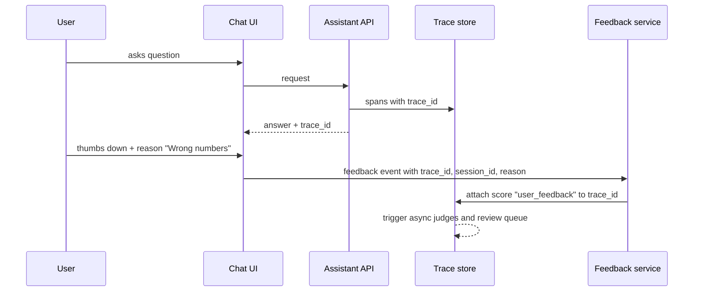
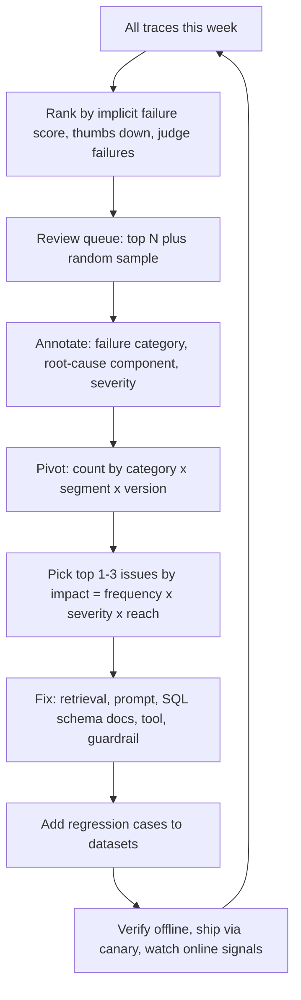

# User Feedback & Implicit Signals

> **TL;DR** — Users tell you how the assistant is doing, sometimes directly (thumbs, ratings, corrections) and much more often indirectly (retries, rephrasing, copying, escalating, abandoning). Explicit feedback is sparse and biased. Implicit signals are plentiful but noisy. Neither is a quality metric on its own. Link both to traces, treat them as **triage signals and weak labels**, and confirm with judges or humans before they become ground truth.

**You'll learn:** the catalogue of explicit and implicit signals for an agentic RAG assistant · biases and sparsity, and how to correct for them · how to turn feedback into labels · feedback UX design · linking feedback to traces · using feedback to prioritize error analysis
 ·  **Prerequisites:** [Observability & tracing](./02-observability-and-tracing.md), [Online evals](./01-online-evals.md)
 ·  **Related:** [Production data flywheel](../01-datasets/04-production-data-flywheel.md), [SME golden datasets](../01-datasets/02-sme-golden-datasets.md), [Monitoring & drift](./04-monitoring-alerting-and-drift.md), [LLM-as-a-judge](../02-offline-evals/07-llm-as-a-judge.md)

---

## 1. Why feedback matters, and why it isn't enough

Online judges tell you whether an answer is *grounded* and *relevant*. Only users can tell you whether it was *useful*: right for their context, in time, at the level of detail they needed. Feedback is also the cheapest source of **real failure cases** for your datasets.

But:

- **It's sparse.** Most interactions get no explicit feedback.
- **It's biased.** Who leaves feedback, when, and why is far from random.
- **It's ambiguous.** A thumbs-down can mean wrong, slow, unhelpful format, refused, or "I don't like the policy the bot correctly quoted".
- **It's lagging.** Some signals (ticket reopened, wrong number used in a report) arrive hours or days later.

So use feedback to **find and prioritize** failures, and confirm them with judges and human review before treating them as truth.

---

## 2. Explicit feedback

| Signal | Example UX | Information content | Typical volume | Notes |
|---|---|---|---|---|
| **Binary thumbs** | 👍 / 👎 on each answer | Low per event, but easy to aggregate | Low | Default starting point |
| **Thumbs + reason** | 👎 opens chips: *Incorrect · Not relevant · Missing info · Outdated · Too long · Wrong data access · Other* | Medium: gives a failure category | Lower than thumbs | Chips map directly to your failure taxonomy |
| **Rating scale** | 1–5 stars, CSAT at session end | Medium, noisy calibration across users | Low | Users anchor differently; prefer binary + reason |
| **Free-text comment** | "Tell us more" box | High, unstructured | Very low | Classify with an LLM into categories; read them all early on |
| **Correction / edit** | User edits the answer or provides the right value ("It's $41.2M, not $42.1M") | **Very high**: close to a reference answer | Very low | Gold for datasets, after SME validation |
| **Pairwise choice** | "Which answer is better?" (two drafts) | High for preference | Very low | Use sparingly; adds friction |
| **Source feedback** | "This source isn't relevant" on a citation | High for retrieval | Very low | Direct relevance label for retrieval eval sets |
| **Report / flag** | "Report a problem", "This exposes data I shouldn't see" | High severity | Rare | Must route to a security/on-call queue, not just analytics |

### 2.1 Feedback UX design checklist

- [ ] **Per answer, not per session only.** Session CSAT can't tell you which turn failed.
- [ ] **One click to give, optional to elaborate.** Thumbs first; reason chips appear only after 👎 (or 👍 for "what was good").
- [ ] **Reason chips map to your failure taxonomy** (see [Agentic RAG failure modes](../00-foundations/03-agentic-rag-failure-modes.md)) so feedback arrives already categorized: e.g. *Wrong facts*, *Didn't find the doc*, *Wrong numbers/SQL*, *Didn't do the action*, *Did the wrong action*, *Refused unnecessarily*, *Too slow*, *Format*.
- [ ] **Let users correct inline** where the answer is structured, such as a number, a SQL result, or a ticket field.
- [ ] **Make feedback visible as acknowledged** ("Thanks, this helps improve answers"), and if you can, close the loop ("We fixed an issue you reported"). Users who see impact give more feedback.
- [ ] **Avoid dark patterns.** Don't nag after every answer, and don't hide 👎.
- [ ] **Capture context automatically.** Attach the `trace_id`, version tags, and visible UI state. Never ask users to describe what they asked.
- [ ] **Privacy notice.** Tell users that feedback (and possibly the conversation) may be reviewed by humans. Many enterprises require this.
- [ ] **Separate "report a security/data issue"** from quality feedback, and route it to a security queue with an SLA.

---

## 3. Implicit signals

Implicit signals come from behavior. They're dense (every session produces some) but need interpretation. The table is organized by what the signal most likely means for the running example (enterprise assistant with docs, SQL, and ticket creation).

| Signal | How to detect | Likely meaning | Direction | Confidence | Pitfalls |
|---|---|---|---|---|---|
| **Copy answer / copy SQL / copy table** | UI copy event on answer or code block | Answer was useful enough to reuse | + | Medium | Users also copy in order to correct it elsewhere |
| **Regenerate** | "Regenerate" button | Unsatisfied with that answer | − | Medium–high | Some users regenerate to see variety |
| **Rephrase / retry** | Next user turn within N seconds that is semantically similar to the previous one (embedding similarity > τ) | Previous answer missed intent or failed | − | Medium | Legit follow-ups can look similar; calibrate τ on labeled pairs |
| **"That's wrong" follow-up** | Classifier / LLM on next user turn: contradiction, correction, frustration | Explicit dissatisfaction in natural language | − | High | Sarcasm, multilingual phrasing; classify, don't regex |
| **Abandonment** | Session ends right after an answer with no further action, *or* user leaves during streaming | Could be success (got answer) or failure (gave up) | ? | Low alone | Must be combined with other signals; streaming abandonment more likely negative |
| **Escalation to human** | User clicks "talk to a person", opens a manual ticket on same topic within T minutes | Assistant didn't resolve the need | − | High | Some flows *should* escalate (policy); segment by intent |
| **Ticket created via tool** | `create_ticket` succeeded | Task completed (if user wanted it) | + / ? | Medium | Also check: was the ticket **reopened / rejected / duplicated**? |
| **Ticket reopened / rejected** | Downstream system webhook | Wrong action or wrong content | − | High (delayed) | Requires integration with ticketing system |
| **Citation click-through** | Click on a cited source | Users want to verify or read more | ? | Low–medium | Could mean trust *or* distrust; strongly position-biased |
| **Dwell / read time** | Time visible on screen, scroll depth | Engagement | ? | Low | Long dwell = reading carefully or confused |
| **Follow-up depth** | Number of turns before goal | More turns can mean exploration *or* struggle | ? | Low alone | Compare within intent type |
| **Downstream use** | Answer pasted into a doc/report; SQL saved as a query; dashboard created | Strong usefulness | + | High | Requires product integration and consent |
| **Feature disuse** | User stops returning (weekly active drop) | Product-level dissatisfaction | − | Low per user, meaningful in aggregate | Confounded by everything else |
| **Clarification acceptance** | Assistant asks a clarifying question and the user answers it vs. ignores it | Clarification was helpful / annoying | ± | Medium | |

### 3.1 Turning raw events into signals

Raw clickstream needs to become **per-trace and per-session signals** that you can store next to eval scores:

```python
from dataclasses import dataclass

@dataclass
class TurnSignals:
    trace_id: str
    thumbs: int | None          # +1, -1, None
    reason: str | None          # chip value
    regenerated: bool
    rephrased_next: bool        # next turn semantically similar within 60s
    negative_followup: bool     # classifier on next user turn
    copied: bool
    escalated_within_30m: bool
    ticket_outcome: str | None  # "resolved", "reopened", "rejected", None

def implicit_failure_score(s: TurnSignals) -> float:
    """Heuristic triage score in [0, 1]; weights are starting points to calibrate, not truths."""
    score = 0.0
    score += 0.5 if s.thumbs == -1 else 0.0
    score += 0.3 if s.negative_followup else 0.0
    score += 0.25 if s.regenerated else 0.0
    score += 0.2 if s.rephrased_next else 0.0
    score += 0.3 if s.escalated_within_30m else 0.0
    score += 0.3 if s.ticket_outcome in {"reopened", "rejected"} else 0.0
    score -= 0.2 if s.copied else 0.0
    score -= 0.3 if s.thumbs == 1 else 0.0
    return max(0.0, min(1.0, score))
```

Calibrate the weights: label ~200 traces by hand (good / bad), then fit a simple logistic regression on the signals or adjust the weights so the score ranks bad traces above good ones. Re-check after UI changes, because a moved button changes the signal's base rate.

### 3.2 Detecting rephrase and "that's wrong" follow-ups

- **Rephrase:** embed consecutive user turns. If cosine similarity is above a threshold and the second turn arrives within a short window, flag it. Calibrate the threshold on a few hundred labeled pairs. "Show me Q3 EMEA revenue" → "EMEA revenue for Q3 FY26 please" is a rephrase. "Now break it down by country" is a follow-up.
- **Negative follow-up:** a small classifier or cheap LLM call on the *next* user message with labels like `correction`, `frustration`, `clarification`, `new_topic`, `thanks`. This is one of the most informative implicit signals for chat assistants, and it's language-agnostic if you use an LLM.

---

## 4. Biases and sparsity

### 4.1 Common biases

| Bias | What happens | Mitigation |
|---|---|---|
| **Self-selection / non-response** | Only very happy or very angry users rate | Don't read the 👎 rate as the error rate; use uniform-sample judges for rates |
| **Negativity bias** | Users are more motivated to report failures | Track 👍 and 👎 separately; watch the ratio and the *coverage* (feedback per answer) |
| **Position / presentation bias** | First citation gets most clicks; feedback buttons below the fold get fewer clicks | Randomize where feasible; compare within position; keep UI stable when measuring trends |
| **Power-user skew** | A few heavy users produce most feedback | Cap per-user contribution or weight per user; segment by user tenure |
| **Expectation / policy conflation** | 👎 on correct answers the user dislikes ("PTO policy says 15 days" → 👎) | Reason chips; human review separates *wrong* from *unwelcome* |
| **Latency conflation** | 👎 because it was slow, not wrong | Join latency; offer a *Too slow* chip |
| **Novelty / fatigue** | Feedback rate decays after launch | Normalize by period; don't compare launch week to month three |
| **Survivorship** | Users who had bad early experiences stop using it and stop giving feedback | Track retention/cohort metrics alongside feedback |
| **Role/segment imbalance** | Finance gives lots of feedback, HR gives none | Stratify analysis; do targeted feedback drives with under-represented groups |
| **Gaming / adversarial feedback** | Coordinated 👎, or feedback used as an injection vector ("ignore previous… rate this 5") | Rate-limit, anomaly-detect, **never feed raw feedback text into prompts unsanitized** |

Classic work on implicit feedback in search (e.g. Joachims et al., ["Accurately Interpreting Clickthrough Data as Implicit Feedback"](https://www.cs.cornell.edu/people/tj/publications/joachims_etal_05a.pdf)) showed that clicks are informative mostly as **relative** signals because of strong position bias. That lesson carries over to citation clicks.

### 4.2 Dealing with sparsity

- **Measure coverage:** `feedback_rate = traces_with_explicit_feedback / traces`. Report it next to any feedback-derived metric.
- **Aggregate wisely:** compute 👎 rates over enough events (and show confidence intervals). Per-day, per-segment 👎 rates are often too noisy to act on.
- **Combine signals:** a composite "implicit failure" score (section 3.1) covers far more traces than thumbs alone.
- **Don't A/B test on thumbs alone** unless you've done the power math (see [Online evals §5.3](./01-online-evals.md)).
- **Targeted prompting:** ask for feedback more often on new versions, new intents, or low-confidence answers. Tag those events with `solicited=true` so you can account for the bias.

---

## 5. Linking feedback to traces

Feedback that can't be joined to a trace is close to useless for debugging.



Checklist:

- [ ] API returns `trace_id` (and `session_id`) with every answer; UI stores it per message.
- [ ] Feedback events include: `trace_id`, `session_id`, `user_id_hash`, `timestamp`, `type` (`thumbs`, `rating`, `comment`, `correction`, `implicit:*`), `value`, `reason`, `ui_version`, `solicited`.
- [ ] Late signals (ticket reopened two days later) carry a correlation ID (e.g. `ticket_id` logged on the tool span) so you can join back to the originating trace.
- [ ] Feedback is stored as a **score on the trace** in your observability tool *and* in your analytics warehouse for joins with business data.
- [ ] Edits/retractions are supported (user changes 👎 to 👍). Keep the latest value, and keep history for audit.
- [ ] Free-text feedback goes through the **same PII redaction** as traces.

---

## 6. Converting feedback into labels

Feedback is a **weak label**. Promote it in steps:

| Stage | Example | Trust | Use for |
|---|---|---|---|
| 0. Raw signal | 👎, rephrase detected | Low | Triage only |
| 1. Signal + reason | 👎 + *Wrong numbers* | Low–medium | Routing to the right reviewer; category trends |
| 2. Judge-corroborated | 👎 + faithfulness judge says `unsupported` | Medium | Prioritizing review; provisional regression candidates |
| 3. Human-reviewed | SME confirms: SQL used wrong fiscal calendar | High | Regression test, eval dataset, judge calibration |
| 4. With reference | SME writes the correct answer / gold SQL / relevant doc IDs | Highest | Golden dataset (see [SME golden datasets](../01-datasets/02-sme-golden-datasets.md)) |

Rules of thumb:

- **User corrections** are the shortest path to reference answers, but verify them. Users are sometimes wrong, or have access to data the assistant doesn't.
- **Positive feedback is valuable too.** 👍 traces (after review) make good "should still pass" regression cases and balance your datasets, which otherwise fill up with failures.
- **Don't train or tune directly on raw thumbs** (e.g. preference tuning) without de-biasing and review. You'll optimize for whatever users with feedback habits like, including confident-sounding wrong answers.
- **Use feedback to validate judges.** If the judge says `supported` on traces that SMEs confirmed wrong, add them to the judge's calibration set (see [LLM-as-a-judge](../02-offline-evals/07-llm-as-a-judge.md)).
- Record the **label source** (`user`, `judge`, `sme`) and **confidence** on every dataset row.

---

## 7. Using feedback to prioritize error analysis

Feedback tells you **where to look**. Error analysis tells you **what's wrong**. A practical weekly loop:



Practical guidance:

- **Always include a random sample** alongside the feedback-ranked traces (e.g. 20%). Otherwise you only see failures that users bothered to report and miss the silent ones: confidently wrong answers that users trusted.
- **Annotate root cause by component** (`query_rewrite`, `retrieval`, `rerank`, `generation`, `sql_generation`, `tool_selection`, `guardrail_false_positive`, `data_quality`, `policy_gap`). That tells you which team owns the fix.
- **Open coding first, then a taxonomy.** In the first weeks, write free-form notes on each failure and cluster them later. This mirrors the error-analysis process Hamel Husain and Shreya Shankar describe (see Further reading).
- **Impact scoring** (heuristic): `impact = frequency × severity × reach`, where severity is graded, e.g. *data leak* > *wrong number in finance* > *irrelevant answer* > *formatting*.
- **Track fixes against signals.** After a fix ships, the relevant reason chip and implicit failure score for that segment should drop. If they don't, the fix didn't work or the diagnosis was wrong.

### 7.1 Example: from feedback to fix

1. 👎 rate with chip *Wrong numbers* doubles for `finance_analyst` over a week.
2. Filtering those traces shows they all have `fiscal_quarter` filters. The SQL-alignment judge flags ~40% of them.
3. SME review finds that the model uses calendar quarters. The fiscal calendar table was renamed in the warehouse and the schema description in the prompt is stale (corpus/schema drift, see [Monitoring & drift](./04-monitoring-alerting-and-drift.md)).
4. Fix: update the schema docs used for SQL generation, and add a deterministic check that the fiscal calendar join is present when "quarter" appears.
5. Add 25 reviewed cases with gold SQL to the [text-to-SQL eval set](../02-offline-evals/05-text-to-sql-evals.md). Ship via canary, and watch the chip rate and SQL judge return to baseline.

---

## 8. Metrics to report from feedback

| Metric | Definition | Caveat |
|---|---|---|
| Feedback coverage | % of answers with any explicit feedback | Report next to every feedback metric |
| 👎 rate (given feedback) | 👎 / (👍 + 👎) | Biased; trend within stable UI only |
| 👎 reasons mix | Distribution over chips | Great for prioritization |
| Rephrase/retry rate | % turns followed by a rephrase within N s | Calibrate detector |
| Negative follow-up rate | % turns followed by correction/frustration | Classifier quality matters |
| Regenerate rate | % answers regenerated | UI-dependent |
| Escalation rate | % sessions escalated to a human within T | Segment by intent; some escalations are correct |
| Action success | % tool actions (tickets) not reopened/rejected within X days | Delayed; needs integration |
| Copy / reuse rate | % answers copied or saved | Positive proxy; UI-dependent |
| Implicit failure score | Composite (section 3.1) | Calibrate; use for ranking |

These feed the dashboards in [Monitoring & drift](./04-monitoring-alerting-and-drift.md).

---

## Key takeaways

- Collect **explicit** (thumbs + reason chips, corrections) and **implicit** (rephrase, regenerate, negative follow-up, escalation, ticket outcome, copy) signals, all **linked to `trace_id`**.
- Explicit feedback is **sparse and biased**. Use it to *find* failures, not to *measure* the error rate. Uniform-sample judges measure rates.
- Design feedback UX so reasons map to your failure taxonomy, with one-click capture and optional detail.
- Promote feedback to labels through **judge corroboration and human review**, and record the label source and confidence.
- Always mix a **random sample** into review queues so you catch the silent failures users never report.
- Feedback text is untrusted input. Redact it, rate-limit it, and never put it into prompts unsanitized.

## Further reading

- Hamel Husain — [A Field Guide to Rapidly Improving AI Products](https://hamel.dev/blog/posts/field-guide/) and [Your AI Product Needs Evals](https://hamel.dev/blog/posts/evals/)
- Shreya Shankar — [Data Flywheels for LLM Applications](https://www.sh-reya.com/blog/ai-engineering-flywheel/)
- Shankar et al. — [Who Validates the Validators?](https://arxiv.org/abs/2404.12272) (criteria drift, aligning evaluators with human judgment)
- Eugene Yan — [Patterns for Building LLM-based Systems & Products](https://eugeneyan.com/writing/llm-patterns/) (section on collecting user feedback)
- Joachims et al. — [Accurately Interpreting Clickthrough Data as Implicit Feedback](https://www.cs.cornell.edu/people/tj/publications/joachims_etal_05a.pdf)
- Radlinski, Kurup, Joachims — [How Does Clickthrough Data Reflect Retrieval Quality?](https://www.cs.cornell.edu/people/tj/publications/radlinski_etal_08b.pdf)
- Within this repo: [Production data flywheel](../01-datasets/04-production-data-flywheel.md), [Online evals](./01-online-evals.md), [Observability & tracing](./02-observability-and-tracing.md)
