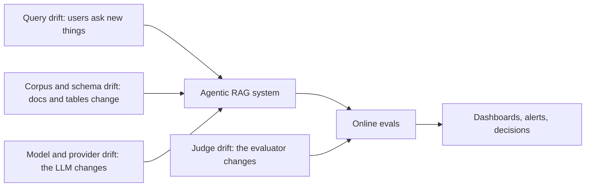
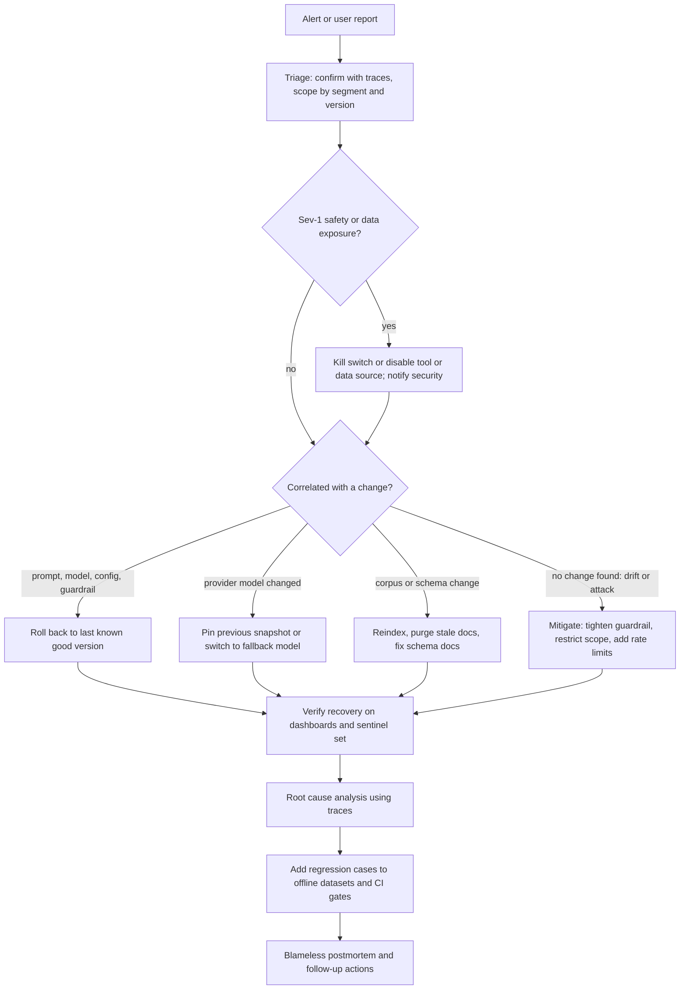

# Monitoring, Alerting & Drift

> **TL;DR**
>
> - **Segment KPIs by version, role, and intent.** Track quality, retrieval, safety, SQL, latency, and cost metrics with confidence intervals across slices.
> - **Set 4–7 user-facing SLOs and hard safety invariants.** Alert on sustained budget burn or hard invariant breaches rather than noisy single-point spikes.
> - **Monitor all four drift axes.** Detect shifts in user queries, corpus and warehouse schemas, hosted model snapshots, and LLM judge behavior.
> - **Prepare an AI incident runbook and kill switches.** Use runtime config rollbacks, tool kill switches, and mandatory regression tests for every incident.

- **You will learn:**
    - Segmented KPI catalog and dashboard design
    - AI SLOs and low-fatigue alerting
    - Query, corpus, model, and judge drift detection
    - Incident response runbooks, kill switches, and re-evaluation cadences
- **Prerequisites:** [Online evals](./01-online-evals.md), [Observability & tracing](./02-observability-and-tracing.md)
- **Related:** [User feedback](./03-user-feedback-and-implicit-signals.md), [Guardrails architecture](../04-guardrails/01-guardrails-architecture.md), [Running offline experiments](../02-offline-evals/08-running-offline-experiments.md), [Maturity model](../05-decision-framework/05-maturity-model.md), [Implementation playbook](../05-decision-framework/04-implementation-playbook.md)

---

## 1. What makes AI monitoring different

Traditional service monitoring tracks **availability, latency, errors, and saturation**. Agentic RAG systems need those metrics too, but an agent can return HTTP 200 in 800 ms while hallucinating financial numbers. AI monitoring differs from classic APM in three ways:

1. **Quality is a statistical metric, not an HTTP status code.** Quality signals come from [online evals](./01-online-evals.md), so they are sampled, asynchronous, and noisy.
2. **External dependencies shift silently.** Prompts, hosted models, document corpora, warehouse schemas, user queries, and LLM judges all change over time.
3. **Failures hide inside narrow slices.** A regression often hits only one user role, one data source, one language, or one intent cluster.

Always monitor metrics **by slice and by version**, and treat drift detection as a core operational responsibility.

---

## 2. KPIs and dashboards

### 2.1 KPI catalogue

| Category | KPI | Signal source | Granularity | Operational notes |
|---|---|---|---|---|
| **Quality** | Unsupported-answer rate (faithfulness judge) | Sampled LLM judge | Daily, by slice | Primary RAG quality KPI |
| | Answer-relevance failure rate | Sampled LLM judge | Daily | Catches off-topic or evasive responses |
| | Citation resolution failure rate | Deterministic, 100% | Hourly | Surfaces prompt or citation format regressions immediately |
| | SQL-question misalignment rate | Sampled LLM judge | Daily | Primary text-to-SQL semantic quality proxy |
| | 👎 rate, negative follow-up rate, rephrase rate | [User feedback](./03-user-feedback-and-implicit-signals.md) | Daily | Always display feedback coverage alongside rates |
| | Escalation-to-human rate | Product telemetry | Daily | Segment by user intent |
| **Retrieval** | Empty-retrieval rate (before and after ACL filter) | Deterministic, 100% | Hourly | Early indicator of index, ACL, or query drift |
| | Weak-retrieval rate ($\max(\text{rerank\_score}) < \tau$) | Deterministic, 100% | Hourly | Recalibrate $\tau$ whenever embedder or reranker changes |
| | Index freshness (age of newest doc and ingestion lag) | Ingestion pipeline | Hourly | Stale indexes cause silent factual errors |
| **Safety & security** | Guardrail trigger rate per guardrail and action | Guardrail spans | Hourly | Spikes indicate attacks, new user cohorts, or detector bugs |
| | Prompt-injection detection rate | Input guardrail | Hourly | Track blocked vs. shadow-flagged events |
| | PII detection and redaction rate in output | Output guardrail | Hourly | Verify zero unredacted leaks |
| | RBAC denials and **leaked citations** (must equal 0) | Deterministic, 100% | Real-time | Any non-zero citation leak is a **sev-1 incident** |
| | Toxicity and profanity flag rate | Classifier, 100% | Daily | Usually paired with an output guardrail |
| **Behavior** | Refusal rate by reason (`no_context`, `policy`, `rbac`, `out_of_scope`) | Classifier / regex | Hourly | Monitor **both** sudden spikes and sudden drops |
| | Average/p95 agent steps, tool calls per turn, and loop rate | Root and tool spans | Hourly | Catches runaway agent loops and cost spikes |
| **Tools & SQL** | Tool error rate per tool (validation, execution, timeout) | Tool spans | Hourly | Isolates broken downstream integrations |
| | SQL parse failure, execution failure (by error class), and empty-result rate | SQL spans | Hourly | Spikes in `unknown column` errors indicate schema drift |
| | Write-action volume and human approval/override rate | Tool spans | Daily | Alert on abnormal write-tool volume |
| **Latency** | End-to-end p50/p95/p99 and time-to-first-token (TTFT) | Root spans | Real-time | Monitor percentiles, never averages |
| | Per-component latency (retrieval, rerank, LLM, SQL, guardrails) | Child spans | Real-time | Pinpoints which stage caused a latency regression |
| **Cost** | Cost per request, per session, and per active user, plus tokens per turn | Traces + price table | Daily | Break down by model and product feature |
| | Online eval pipeline cost | Judge spans | Daily | Track judge spend alongside production inference spend |
| **Reliability** | Provider error rate (429s, 5xx, content-filter blocks), retry rate, and fallback rate | LLM spans | Real-time | Separates provider outages from application bugs |
| **Adoption** | Active users, sessions, turns per session, and cohort retention | Product analytics | Weekly | Provides usage context for quality and cost trends |

### 2.2 Dashboard layout (suggested)

Organize your monitoring workspace into seven focused views:

1. **Executive health overview:** Total traffic, p95 latency, error rate, daily cost, unsupported-answer rate, 👎 rate, and guardrail block rate with week-over-week deltas.
2. **Quality breakdown:** Sampled LLM judge rates with 95% confidence intervals, sliced by user role, intent cluster, data source, and `config_hash`.
3. **Retrieval & corpus health:** Empty and weak retrieval rates, index ingestion lag, top zero-result queries, and document age distributions.
4. **Text-to-SQL health:** Parse and execution failure rates by error class and warehouse table, empty-result rate, and judged SQL alignment.
5. **Safety & guardrails:** Trigger rates per guardrail and action (`allow`, `redact`, `block`), top blocked categories, and human override rates.
6. **Cost & efficiency:** Cost per session by model, input/output/cached token distributions, agent step counts, and semantic cache hit rates.
7. **Release comparison view:** All core KPIs split by `config_hash`, prompt version, and model snapshot to compare canary vs. control arms.

- **Segment every chart** by `config_hash`, user role, intent cluster, data source, and channel so aggregate averages do not hide slice regressions.
- **Plot confidence intervals on sampled metrics** (see [Online evals §4.1](./01-online-evals.md)) so engineers do not chase random sampling noise.

---

## 3. SLOs for AI features

A **Service Level Indicator (SLI)** measures a specific performance or quality rate, a **Service Level Objective (SLO)** sets the target threshold over a time window, and the **error budget** defines how much failure the system can tolerate before freezing feature releases (see the [Google SRE book on SLOs](https://sre.google/sre-book/service-level-objectives/)).

### 3.1 Example SLOs for the running example (heuristic starting points)

| SLI | Example SLO target | Window | Operational notes |
|---|---|---|---|
| **End-to-end latency (doc Q&A)** | 95% of turns $< 6\text{ s}$ and TTFT p95 $< 1.5\text{ s}$ | 28 days | Track a separate latency SLO for slower multi-step SQL/agent turns |
| **Availability (non-error responses)** | $\ge 99.5\%$ | 28 days | Count valid guardrail refusals as successful responses, not system errors |
| **Grounded answers** | $\ge 95\%$ of judged answers labeled `supported` | 7 days (rolling) | Requires a calibrated faithfulness judge and confidence intervals |
| **Citation integrity** | $\ge 99.9\%$ of cited answers resolve all citations | 7 days | Deterministic check on 100% of responses |
| **RBAC integrity** | **0** leaked citations or unauthorized tool executions | Always | Treat as a **hard invariant** with zero error budget |
| **SQL execution reliability** | $\ge 97\%$ of generated SQL queries execute without error | 7 days | Exclude expected user RBAC permission denials |
| **Session cost budget** | p95 cost per session $<$ target budget | 7 days | Protects against runaway agent loops |

Follow these rules when setting AI SLOs:

- **Limit SLOs to 4–7 user-facing indicators.** Keep component metrics as diagnostic indicators rather than paging SLOs.
- **Pin the judge version behind quality SLOs.** Upgrading a judge model changes the measurement scale, so re-baseline your SLO whenever you update a judge (Section 5.4).
- **Never assign error budgets to security invariants.** Treat RBAC leaks or unauthorized write actions as immediate incidents.
- **Enforce error budgets on release velocity.** When a rollout burns the weekly grounded-answer budget, freeze feature changes and prioritize quality fixes.

---

## 4. Alert design

### 4.1 Principles

- **Page on user-visible symptoms**, such as quality drops, high latency, or safety breaches, and use component metrics for root-cause diagnosis.
- **Attach a runbook link and pre-filtered trace query** to every alert notification (Section 6).
- **Require sustained deviations** before firing quality alerts because sampled LLM metrics fluctuate over short windows.
- **Route alerts by severity.** Page on-call engineers only for sev-1 and sev-2 incidents, and send sev-3 anomalies to tickets or Slack channels.
- **Prune noisy alerts every month.** Delete or recalibrate any alert that fired without requiring human action.

### 4.2 Alert types

| Alert type | Mechanism | Best use case | Example |
|---|---|---|---|
| **Static threshold** | `metric > X for N minutes` | Hard safety invariants and strict limits | `leaked_citations > 0` pages security and on-call immediately |
| **SLO burn-rate** | Error budget consumed faster than threshold across short and long windows | Latency, availability, citation resolution, groundedness | Multi-window burn-rate alerts from the [SRE workbook](https://sre.google/workbook/alerting-on-slos/) |
| **Relative / seasonal anomaly** | Compare against same hour last week or rolling z-score | Guardrail trigger rates, empty retrieval, refusal rates, token cost | Prompt-injection blocks $> 5\times$ seasonal baseline for 30 minutes |
| **Canary vs. control** | Two-sample difference exceeds threshold with minimum sample count | New prompt, model, or retriever rollouts | Canary SQL failure rate exceeds control by $> 2\text{ pp}$ with $n \ge 300$ |
| **Two-proportion statistical test** | Non-overlapping confidence intervals on sampled judge rates | Daily or weekly quality regressions | Unsupported-answer rate jumps significantly week over week |
| **Drift detector** | Embedding cluster distance or PSI exceeds threshold (Section 5) | Query distribution or corpus shifts | New query cluster exceeds 5% of daily traffic |
| **Pipeline heartbeat** | Expected ingestion or evaluation job fails to report | Index freshness and async judge queues | Zero documents indexed in 24 hours, or eval queue backlog growing |

### 4.3 Avoiding alert fatigue

- [ ] **Enforce minimum sample sizes** on rate alerts (for example, require at least 100 feedback events or 200 judged traces in the window before firing).
- [ ] **Configure hysteresis thresholds** so an alert fires at $X$ but resolves only after dropping below $Y$.
- [ ] **Use seasonality-aware baselines** that account for weekday vs. weekend traffic and month-end finance spikes.
- [ ] **Group correlated alerts into a single incident.** When an LLM provider outage spikes latency, errors, fallbacks, and refusals simultaneously, page once.
- [ ] **Overlay deployment and config-change markers** on every dashboard chart to speed up root-cause correlation.
- [ ] **Link every alert directly to a sliced breakdown view** so the responder sees the failing role, intent, or version immediately.

### 4.4 Example alert rules (illustrative)

```yaml
# illustrative: adapt to your alerting system's syntax
- name: rbac_citation_leak
  expr: sum(increase(app_citations_leaked_total[5m])) > 0
  severity: sev1
  action: page security + AI on-call; runbook: rbac-leak

- name: grounded_answer_slo_burn
  expr: unsupported_rate_1d > 3 * (1 - 0.95) and judged_samples_1d >= 200   # 3x budget burn, min sample size
  severity: sev2
  runbook: quality-regression

- name: empty_retrieval_anomaly
  expr: empty_retrieval_rate_30m > 2 * empty_retrieval_rate_same_hour_last_week and requests_30m > 200
  severity: sev3
  runbook: retrieval-degradation

- name: sql_unknown_column_spike
  expr: rate(sql_errors_total{class="unknown_column"}[15m]) > 5 * baseline
  severity: sev3
  runbook: schema-drift

- name: cost_per_session_p95
  expr: cost_per_session_p95_1h > 2 * budget
  severity: sev3
  runbook: runaway-agent
```

---

## 5. Drift

**Drift** occurs when user queries, underlying knowledge, model behavior, or evaluation judges change after offline validation. Agentic RAG systems experience four distinct types of drift:



### 5.1 Input / query drift

**What changes:** The distribution of user prompts shifts due to new product launches, company reorganizations, newly onboarded departments, seasonal events (such as open enrollment or quarterly close), or new languages.

**How to detect it:**

- **Track embedding cluster shifts.** Cluster query embeddings on a baseline reference window and monitor three signals on incoming traffic:
    - Shifts in traffic share across existing clusters.
    - Rising **novelty rate** (share of queries whose nearest centroid distance exceeds threshold $r$).
    - Dense new clusters formed by previously unseen topics.
- **Measure categorical distribution distance.** Compute Population Stability Index (PSI), Jensen–Shannon divergence, or chi-square statistics on intent, user role, language, and selected tools using libraries such as [Evidently](https://github.com/evidentlyai/evidently).
- **Watch downstream retrieval symptoms:** Rising weak-retrieval rates, `no_context` refusals, and user rephrase rates within a specific slice.

**How to respond:**

- [ ] Sample traces from novel clusters, run error analysis, and add labeled examples to your offline datasets (see [Production data flywheel](../01-datasets/04-production-data-flywheel.md)).
- [ ] Verify whether the knowledge corpus actually covers the new topic before tuning prompts or retrievers.
- [ ] Update intent routers and topic guardrails if the new queries belong in or out of scope.

> **Simple sketch: novelty rate**
>
> ```python
> import numpy as np
>
> def novelty_rate(query_embs: np.ndarray, centroids: np.ndarray, radius: float) -> float:
>     """Share of queries whose nearest reference centroid is farther than `radius` (cosine distance).
>     Calibrate `radius` as, e.g., the 95th percentile distance on the reference window (heuristic)."""
>     q = query_embs / np.linalg.norm(query_embs, axis=1, keepdims=True)
>     c = centroids / np.linalg.norm(centroids, axis=1, keepdims=True)
>     nearest_dist = 1 - (q @ c.T).max(axis=1)
>     return float((nearest_dist > radius).mean())
> ```

### 5.2 Corpus / knowledge drift (and schema drift)

**What changes:** Your knowledge sources evolve. Authors add, edit, or delete policy documents, permissions change, warehouse tables or columns change, or the ingestion pipeline lags behind the source of truth.

**Common failure modes:**

- **Stale vector index:** A policy document changes, but the index still serves the old chunk. The assistant generates a response that is 100% faithful to the retrieved text yet factually outdated; **faithfulness judges cannot catch this failure**.
- **Orphaned or ACL-mismatched chunks:** Deleted or permission-restricted documents remain searchable in the vector index (see [Retrieval & context guardrails](../04-guardrails/03-retrieval-and-context-guardrails.md)).
- **Conflicting document versions:** Multiple editions of the same policy coexist in the index, causing the generator to blend old and new rules.
- **Warehouse schema drift:** Data engineers rename columns, deprecate tables, or change metric definitions (such as `revenue` switching from gross to net), causing SQL syntax errors or silent calculation errors.

**How to detect it:**

- [ ] **Monitor ingestion pipelines:** Alert on failed sync jobs, parsing errors, embedding failures, and lag between source edits and index updates.
- [ ] **Run periodic index-to-source reconciliation:** Compare document IDs, modification timestamps, and ACLs in the vector index against the source repository.
- [ ] **Track retrieved-document age:** Monitor the age distribution of cited chunks and flag citations to documents past their review-by date.
- [ ] **Subscribe to warehouse DDL change feeds:** Automatically diff the live database catalog against the schema descriptions embedded in your text-to-SQL prompts.
- [ ] **Re-verify golden datasets after major corpus updates** so outdated reference answers do not fail valid model outputs (Section 7).

**How to respond:** Re-index updated documents, purge superseded chunks, prefer newer `effective_date` metadata during reranking, update SQL schema prompts, and refresh invalidated golden reference answers.

### 5.3 Model / provider drift

**What changes:** Hosted LLM behavior changes even when you deploy zero code changes. Model providers update weights behind unpinned aliases, tweak default safety filters, change quantization, or deprecate endpoints (see Chen, Zaharia & Zou, ["How is ChatGPT's behavior changing over time?"](https://arxiv.org/abs/2307.09009)).

**How to detect it:**

- [ ] Log the exact **`gen_ai.response.model`** string on every LLM span (see [Observability & tracing](./02-observability-and-tracing.md)) and alert whenever it changes.
- [ ] **Pin dated model snapshots** in production configurations and treat snapshot upgrades as full releases requiring offline evals and canary rollouts.
- [ ] **Run a scheduled sentinel prompt suite:** Execute 20–50 fixed prompts (covering JSON formatting, refusals, tool calls, and SQL) hourly or daily against production and alert on deterministic or embedding-similarity shifts.
- [ ] Monitor sudden changes in **output token length, refusal rates, tool-call frequency, JSON schema validity, `finish_reason` distributions, and provider content-filter blocks**.
- [ ] Track **provider deprecation calendars** and schedule model migrations weeks before forced cutovers.

**How to respond:** Roll back to a pinned snapshot or pre-tested fallback model, adjust prompt instructions if needed, and pass the full offline evaluation suite before re-promoting.

### 5.4 Judge drift

**What changes:** Your evaluation instrument shifts. A provider updates the judge model, an engineer edits the judge prompt or context truncation limit, or user traffic shifts into domains where the judge was never calibrated. Human standards also evolve as reviewers inspect more data, a phenomenon Shankar et al. term **criteria drift** in ["Who Validates the Validators?"](https://arxiv.org/abs/2404.12272).

**Symptoms:** Dashboard quality scores jump or drop while user feedback, deterministic checks, and system versions remain flat, or a step change coincides with a judge update.

**How to detect and prevent it:**

- [ ] **Version every judge configuration** (model snapshot + prompt template + parser + threshold) and log `eval_version` on every score record.
- [ ] **Maintain a pinned judge calibration dataset:** Score every candidate judge version against 100–300 human-labeled traces and require minimum Cohen's $\kappa$, precision, and recall before deployment.
- [ ] **Run weekly or monthly SME spot checks:** Have domain experts label a fresh random sample of judged production traces and alert if human–judge agreement drops.
- [ ] **Never change the system and the judge simultaneously.** When upgrading a judge, re-score a historical baseline window with both judge versions to re-baseline your dashboards and SLOs.
- [ ] Run the exact same judge version offline and online (see [LLM-as-a-judge](../02-offline-evals/07-llm-as-a-judge.md)).

### 5.5 Drift summary

| Drift type | Leading indicators | Detection method | First response |
|---|---|---|---|
| **Query drift** | Rising novelty rate, new embedding clusters, higher weak-retrieval and `no_context` refusal rates | Query embedding clustering and PSI/JS divergence on metadata | Sample and label new clusters, and check corpus coverage |
| **Corpus / knowledge drift** | Ingestion lag, older retrieved doc timestamps, rising *Outdated* feedback chips | Ingestion monitors and index-to-source reconciliation jobs | Re-index, purge stale chunks, and refresh golden references |
| **Schema drift** | Spikes in SQL `unknown column` errors and SQL-alignment judge failures | Warehouse catalog change feeds and prompt-to-catalog schema diffs | Update SQL schema prompts and add SQL regression tests |
| **Model / provider drift** | Changed `response.model` string, shifts in output length, refusal rate, or JSON validity | Hourly sentinel prompt suite and response model version alerts | Pin or roll back model snapshot and run offline eval suite |
| **Judge drift** | Quality metric shifts without matching feedback or deterministic changes, lower SME κ | Pinned judge calibration dataset and periodic SME spot audits | Roll back judge version and re-score baseline window |

---

## 6. Incident response for AI quality incidents

Treat AI quality and safety failures as production incidents. A hallucinated HR policy sent to thousands of employees, an RBAC citation leak, or a runaway agent creating 500 tickets requires the same disciplined incident response as a service outage.

### 6.1 Severity guide (example)

| Severity | Example incidents | Required response |
|---|---|---|
| **Sev-1** | Unauthorized data exposure (RBAC leak), harmful content at scale, or runaway unauthorized write actions | Page AI on-call and security immediately, activate kill switch, and preserve audit logs |
| **Sev-2** | Major quality regression (unsupported rate doubles), broken core workflow (SQL failing for finance), or cost runaway | Page AI on-call and roll back configuration within 60 minutes |
| **Sev-3** | Slice-specific quality drop, elevated refusal rate, or detected query/schema drift | Open high-priority engineering ticket and resolve within days |
| **Sev-4** | Minor formatting or tone issues | Triage in weekly backlog review |

### 6.2 Controls you need *before* an incident

- [ ] **Put prompts, model snapshots, retriever parameters, and guardrail thresholds in versioned runtime config** so rollback takes a config flip rather than a code deployment.
- [ ] **Build granular kill switches** at four levels:
    - Disable individual **write tools** (such as `create_ticket`) or force them into human-approval mode.
    - Disable **text-to-SQL** execution for specific roles or warehouse schemas.
    - Exclude a compromised or stale **data source** from retrieval.
    - Switch the **entire assistant** to search-only links or a maintenance banner.
- [ ] **Pre-configure and test a fallback model** on a secondary provider or pinned snapshot.
- [ ] **Enforce strict rate limits on write tools** per user, session, and hour to cap the blast radius of agent loops.
- [ ] **Retain hot traces long enough** to support forensic root-cause analysis (see [Observability & tracing §5](./02-observability-and-tracing.md)).
- [ ] **Assign an AI on-call rotation** and maintain a contact list for every upstream data source owner.

### 6.3 Runbook



Execute this step-by-step checklist during an incident:

1. **Triage (first 15 minutes)**
    - [ ] Inspect 10–20 affected traces from the alert link to confirm the failure is real.
    - [ ] Scope the blast radius by role, intent, data source, `config_hash`, and start timestamp.
    - [ ] Check recent deployments, prompt/config changes, index ingestion runs, warehouse DDL logs, and `gen_ai.response.model` strings.
    - [ ] Assign an incident severity level and designate an incident commander.
2. **Contain (15–60 minutes)**
    - [ ] **Flip the appropriate kill switch immediately** for any Sev-1 data leak or runaway write tool before debugging further.
    - [ ] **Roll back** the suspect prompt, model, or config version, or dial canary traffic down to 0%.
    - [ ] **Reverse or quarantine bad write actions** (for example, bulk-close duplicate tickets via API) and notify affected teams.
    - [ ] **Place exposed traces under legal/security hold** and restrict trace viewer permissions if an RBAC leak occurred.
3. **Verify recovery**
    - [ ] Confirm deterministic metrics return to baseline, oversample online judges on post-rollback traffic, and run the sentinel prompt suite.
4. **Diagnose root cause**
    - [ ] Identify the exact failing component in the trace tree (see [User feedback §7](./03-user-feedback-and-implicit-signals.md)) and determine why offline CI gates missed it.
5. **Prevent recurrence**
    - [ ] **Add redacted failure traces to your offline regression dataset** and verify that the CI gate fails on the broken version.
    - [ ] Add or tighten the **online check or alert rule** that would have caught the issue faster.
    - [ ] Add a **runtime guardrail** if the failure mode requires synchronous prevention (see [Guardrail selection decision tree](../05-decision-framework/02-guardrail-selection-decision-tree.md)).
    - [ ] Conduct a **blameless postmortem** (see [SRE workbook: postmortem culture](https://sre.google/workbook/postmortem-culture/)) that documents both the system bug and the evaluation gap.

### 6.4 Example: runaway ticket creation

- **Alert signal:** `create_ticket` call volume spikes to $20\times$ baseline within 30 minutes across a small cluster of sessions.
- **Triage:** Trace inspection reveals an agent retry loop caused by a ticketing API response schema update that made successful ticket creations look like failures.
- **Containment:** Flip the `create_ticket` kill switch to require human approval and bulk-close the duplicate tickets via the ticketing API.
- **Code fix:** Update the tool response parser to accept both payload schemas, add a per-session idempotency key, and enforce a max-calls-per-session rate limit.
- **Prevention:** Add a multi-step trajectory test to the offline suite, add a loop-detection deterministic check online, and alert on write-tool call volume spikes (see [Agent tool & trajectory evals](../02-offline-evals/04-agent-tool-and-trajectory-evals.md) and [Tool & action guardrails](../04-guardrails/05-tool-and-action-guardrails.md)).

---

## 7. Periodic re-evaluation cadence

Even when no alerts fire, production systems slowly drift. Run this recurring evaluation schedule:

| Cadence | Scheduled activity |
|---|---|
| **Every change (PR or config flip)** | Run offline regression suite and CI gates (see [Running offline experiments](../02-offline-evals/08-running-offline-experiments.md)), followed by a canary rollout with automated rollback |
| **Hourly / daily** | Monitor deterministic checks, anomaly alerts, scheduled sentinel prompts, and vector index freshness |
| **Daily** | Review sampled LLM judge metrics (with confidence intervals) and inspect top triggered traces |
| **Weekly** | Hold error-analysis review (feedback-ranked + 20% random sample), spot-check human–judge agreement, review query drift clusters, and promote new cases to datasets |
| **Monthly** | Run the full offline benchmark against current production config and corpus snapshot, re-run the judge calibration set, prune noisy alerts, review eval and inference costs, and audit guardrail false-positive overrides |
| **Quarterly** | Refresh golden datasets (retire stale questions, re-verify references against current docs, rebalance slices; see [Dataset strategy](../01-datasets/01-dataset-strategy.md)), run red-team exercises (see [Threat model / OWASP](../04-guardrails/07-threat-model-owasp.md)), and review SLOs |
| **Event-driven** | Treat any provider model update, embedding migration, major corpus overhaul, warehouse schema migration, or new tool launch as a full release requiring offline gating, canary rollout, and focused monitoring |

---

## 8. Getting started

1. **Build one deterministic health dashboard first.** Plot latency, error rates, token cost, guardrail trigger rates, empty retrieval, SQL error rates, and refusal rates sliced by version and user role.
2. **Enable paging alerts on hard invariants.** Alert immediately on RBAC citation leaks, runaway write-tool volume, and session cost spikes.
3. **Add one sampled faithfulness judge KPI.** Plot daily supported-answer rates with 95% confidence intervals and review flagged traces weekly.
4. **Log `gen_ai.response.model` and schedule a sentinel prompt set.** Catch silent provider model updates within hours.
5. **Implement runtime config rollback and tool kill switches** before your first production incident occurs.
6. **Write a one-page AI incident runbook** and rehearse it in a 30-minute tabletop exercise with on-call engineers.
7. **Layer on automated drift detection** (query embedding clusters, index-to-source reconciliation, and warehouse schema diffs) as traffic and corpus size grow.

---

## Key takeaways

- Track quality, retrieval, safety, behavior, tool/SQL, latency, cost, and reliability KPIs **sliced by version, role, intent, and data source**, and display confidence intervals on all sampled metrics.
- Maintain **4–7 user-facing SLOs**, and enforce zero-tolerance **hard invariants** for RBAC leaks and unauthorized write actions.
- Design low-fatigue alerts using minimum sample sizes, multi-window burn rates, seasonal baselines, and direct links to runbooks and filtered traces.
- Monitor all four drift axes (**query**, **corpus/schema**, **model/provider**, and **judge**), because faithfulness judges cannot detect stale source documents and judges themselves drift.
- Prepare for AI incidents ahead of time with **granular kill switches, runtime config rollback, fallback models, write-tool rate limits**, and a runbook that mandates **an offline regression test for every incident**.
- Follow a disciplined re-evaluation cadence: daily sentinel runs, weekly error analysis, monthly full benchmarks, and quarterly golden-dataset refreshes.

## Further reading

- Google SRE, [Service Level Objectives](https://sre.google/sre-book/service-level-objectives/), [Monitoring Distributed Systems](https://sre.google/sre-book/monitoring-distributed-systems/), [Alerting on SLOs](https://sre.google/workbook/alerting-on-slos/), [Postmortem Culture](https://sre.google/workbook/postmortem-culture/)
- Chen, Zaharia & Zou, [How is ChatGPT's behavior changing over time?](https://arxiv.org/abs/2307.09009)
- Shankar et al., [Who Validates the Validators?](https://arxiv.org/abs/2404.12272) (criteria drift and evaluator alignment)
- Evidently, [open-source data & ML monitoring / drift detection](https://github.com/evidentlyai/evidently) ([docs](https://docs.evidentlyai.com))
- NIST, [AI Risk Management Framework](https://www.nist.gov/itl/ai-risk-management-framework) (the *Measure* and *Manage* functions cover ongoing monitoring)
- OWASP, [GenAI Security Project / Top 10 for LLM Applications](https://genai.owasp.org/)
- Chip Huyen, [Building A Generative AI Platform](https://huyenchip.com/2024/07/25/genai-platform.html)
- Applied LLMs, [What We've Learned From A Year of Building with LLMs](https://applied-llms.org/)
- Within this repo: [Online evals](./01-online-evals.md), [Observability & tracing](./02-observability-and-tracing.md), [Maturity model](../05-decision-framework/05-maturity-model.md), [Implementation playbook](../05-decision-framework/04-implementation-playbook.md)
