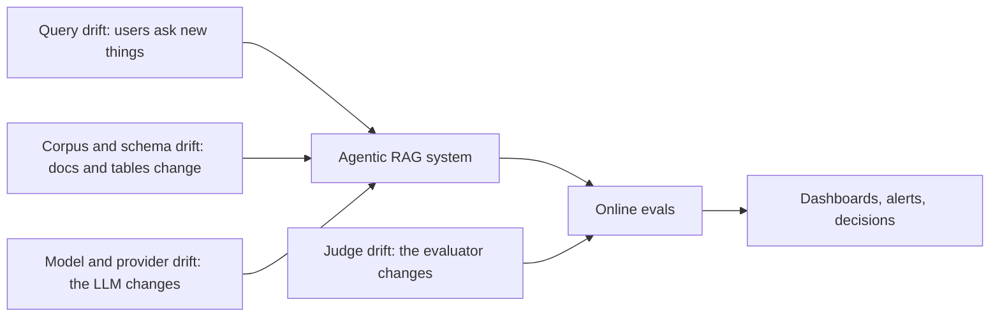
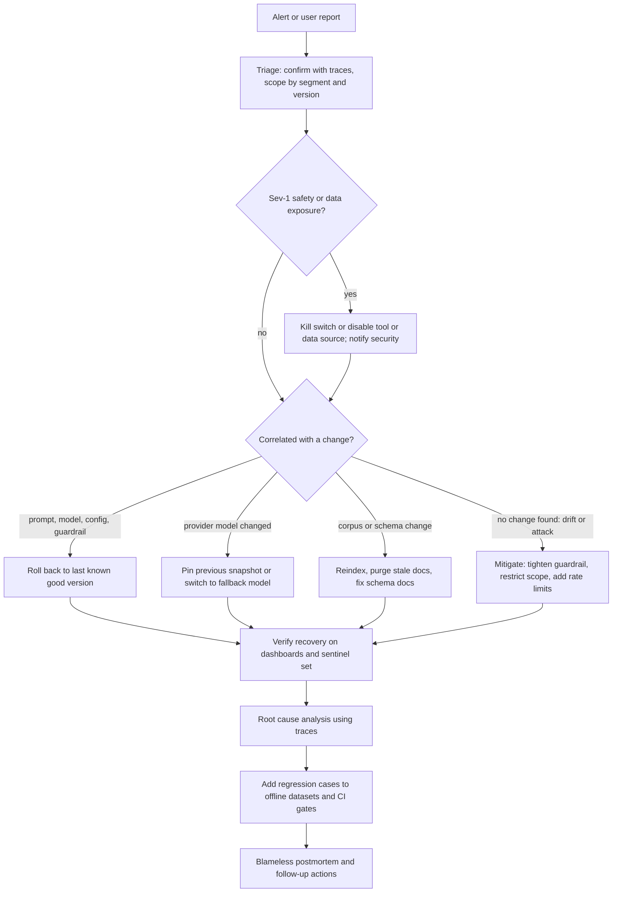

# Monitoring, Alerting & Drift

> **TL;DR** — Watch a small set of quality, safety, reliability and cost KPIs, broken down by segment and version. Define SLOs for the ones users feel, and alert on sustained, actionable deviations instead of every wiggle. Agentic RAG systems drift in four ways that ordinary software doesn't: user queries change, the corpus and schemas change, the model provider changes, and your LLM judges change. Plan for an AI quality incident the same way you plan for an outage, with a runbook, kill switches, versioned rollbacks, and a regression test for every incident.

**You'll learn:** which KPIs to put on dashboards and how to segment them · how to write SLOs for AI features · alert design that avoids fatigue · detecting query, corpus, model/provider and judge drift · an incident response runbook for AI quality incidents · a periodic re-evaluation cadence
 ·  **Prerequisites:** [Online evals](./01-online-evals.md), [Observability & tracing](./02-observability-and-tracing.md)
 ·  **Related:** [User feedback](./03-user-feedback-and-implicit-signals.md), [Guardrails architecture](../04-guardrails/01-guardrails-architecture.md), [Running offline experiments](../02-offline-evals/08-running-offline-experiments.md), [Maturity model](../05-decision-framework/05-maturity-model.md), [Implementation playbook](../05-decision-framework/04-implementation-playbook.md)

---

## 1. What makes AI monitoring different

Classic service monitoring watches **availability, latency, errors, saturation**. You still need all of that. An agentic RAG application can also be "up", fast, and error-free while it confidently gives wrong answers. Three differences:

1. **Quality is a metric, not a status code.** It comes from [online evals](./01-online-evals.md), so it's sampled, delayed, and noisy.
2. **More things change underneath you.** Prompts, models, providers, the document corpus, the warehouse schema, user behavior, and the judges themselves.
3. **Failures are often partial and segment-specific.** One role, one data source, one language, one intent.

So: monitor **by segment and by version**, and treat drift detection as a first-class job.

---

## 2. KPIs and dashboards

### 2.1 KPI catalogue

| Category | KPI | Source | Granularity | Notes |
|---|---|---|---|---|
| **Quality** | Unsupported-answer rate (faithfulness judge) | Sampled LLM judge | Daily, by segment | Primary RAG quality KPI |
| | Answer-relevance failure rate | Sampled judge | Daily | |
| | Citation resolution failure rate | Deterministic, 100% | Hourly | Prompt/format regressions show here first |
| | SQL-question misalignment rate | Sampled judge | Daily | Text-to-SQL quality proxy |
| | 👎 rate, negative follow-up rate, rephrase rate | [Feedback](./03-user-feedback-and-implicit-signals.md) | Daily | Show coverage alongside |
| | Escalation-to-human rate | Product events | Daily | Segment by intent |
| **Retrieval** | Empty-retrieval rate (before and after ACL filter) | Deterministic | Hourly | Index/ACL/query drift indicator |
| | Weak-retrieval rate (max rerank score < τ) | Deterministic | Hourly | Recalibrate τ on model change |
| | Index freshness (age of newest ingested doc, ingestion lag) | Pipeline | Hourly | Stale index = silent wrong answers |
| **Safety & security** | Guardrail trigger rate per guardrail and action | Guardrail spans | Hourly | Spikes = attack, product change or detector bug |
| | Prompt-injection detections | Input guardrail | Hourly | |
| | PII detections/redactions in output | Output guardrail | Hourly | |
| | RBAC denials; **leaked citations** (must be 0) | Deterministic | Real-time | Any non-zero leak is sev-1 |
| | Toxicity/profanity flags | Classifier, 100% | Daily | |
| **Behavior** | Refusal rate by reason (`no_context`, `policy`, `rbac`, `out_of_scope`) | Classifier/heuristic | Hourly | Watch **both** directions |
| | Avg/p95 agent steps, tool calls per turn; loop detections | Traces | Hourly | Cost and runaway agents |
| **Tools & SQL** | Tool error rate per tool (validation, execution, timeout) | Tool spans | Hourly | |
| | SQL parse failure, execution failure (by error class), empty-result rate | SQL spans | Hourly | `unknown column` spikes = schema drift |
| | Write-action volume and approval/override rate | Tool spans | Daily | Unexpected spikes need review |
| **Latency** | End-to-end p50/p95/p99; time-to-first-token | Root spans | Real-time | Use percentiles, not averages |
| | Per-component latency (retrieval, rerank, each LLM call, SQL, guardrails) | Child spans | Real-time | Attributes regressions to a component |
| **Cost** | Cost per request, per session, per active user; tokens per request | Traces + price table | Daily | Break down by model and feature |
| | Eval pipeline cost | Judge spans | Daily | Evals are a line item too |
| **Reliability** | Provider error rate (rate limits, 5xx, content-filter blocks), retry rate, fallback-model usage | LLM spans | Real-time | |
| **Adoption** | Active users, sessions, turns per session, retention by cohort | Product analytics | Weekly | Context for everything above |

### 2.2 Dashboard layout (suggested)

1. **Executive / health overview:** traffic, p95 latency, error rate, cost/day, unsupported-answer rate, 👎 rate, guardrail block rate, with week-over-week deltas.
2. **Quality:** judge-based rates with confidence intervals, broken down by role, intent cluster, data source, and version.
3. **Retrieval & corpus:** empty/weak retrieval, index freshness, top no-result queries, doc coverage.
4. **Text-to-SQL:** parse/exec failures by error class and by table, empty-result rate, SQL alignment rate.
5. **Safety & guardrails:** trigger rates per guardrail/action, top blocked categories, false-positive overrides.
6. **Cost & efficiency:** cost per session by model, token distributions, loops, cache hit rate.
7. **Release view:** every KPI split by `config_hash` / prompt version / model version, canary vs control.

**Segment everything** by at least: version (`config_hash`), user role, intent/topic cluster, data source/tool, and channel. Many regressions are invisible in the aggregate.

**Show uncertainty.** Sampled judge rates should carry confidence intervals (see [Online evals §4.1](./01-online-evals.md)). Otherwise people chase noise.

---

## 3. SLOs for AI features

An **SLI** is a measured indicator, an **SLO** is the target for that indicator over a window, and the **error budget** is how much the SLO allows you to miss (see the [Google SRE book on SLOs](https://sre.google/sre-book/service-level-objectives/)). The concepts carry over to AI quality, with care.

### 3.1 Example SLOs for the running example (heuristic starting points)

| SLI | SLO (example) | Window | Notes |
|---|---|---|---|
| End-to-end latency for doc Q&A | 95% of turns < 6 s; TTFT p95 < 1.5 s | 28 days | Separate SLO for SQL/agentic flows, which are slower |
| Availability (non-error responses) | 99.5% | 28 days | Count guardrail blocks as *success*, not errors |
| Grounded answers | ≥ 95% of judged answers labeled `supported` | 7 days, rolling | Requires a validated judge; report CI |
| Citation integrity | 99.9% of cited answers have all citations resolving | 7 days | Deterministic |
| RBAC integrity | **0** leaked citations or unauthorized tool calls | Always | Not an SLO with a budget; a hard invariant |
| SQL reliability | ≥ 97% of SQL executions succeed (excluding user-caused permission denials) | 7 days | |
| Cost | p95 cost per session < budget | 7 days | Protects against loops |

Guidance:

- **Pick few SLOs.** 4–7 user-visible ones. Everything else is a diagnostic metric.
- **Quality SLOs need a stable measuring instrument.** If you change the judge, the SLI changes. Version the judge and re-baseline when you do (section 5.4).
- **Hard invariants (data leaks, unauthorized actions) are not SLOs.** Any occurrence is an incident.
- **Use error budgets for release decisions.** If the grounded-answer budget is burned this week, freeze prompt/model changes and focus on fixes.

---

## 4. Alert design

### 4.1 Principles

- **Alert on symptoms users feel**, such as quality, latency, and safety. Use causes like provider error codes for diagnosis.
- **Every alert must be actionable** and link to a runbook (section 6) and a pre-filtered trace view.
- **Prefer sustained deviations** over single-point thresholds. LLM metrics are noisy.
- **Route by severity.** Page only for sev-1/sev-2; everything else goes to a ticket or a channel.
- **Review alerts monthly.** Delete or retune any alert that fired without action.

### 4.2 Alert types

| Type | How | Good for | Example |
|---|---|---|---|
| **Static threshold** | `metric > X for N minutes` | Hard invariants, SLO-like limits | `leaked_citations > 0` → page immediately |
| **SLO burn-rate** | Alert when the error budget is being consumed too fast over short and long windows | Latency, availability, citation integrity | Multi-window, multi-burn-rate alerting from the [SRE workbook](https://sre.google/workbook/alerting-on-slos/) |
| **Relative change / anomaly** | Compare to a seasonal baseline (same hour last week) or a rolling z-score / control chart | Guardrail trigger rates, empty retrieval, refusal rate, cost | Injection detections 5× baseline for 30 min |
| **Canary comparison** | Canary vs control difference beyond a threshold with sufficient samples | Releases | Canary SQL failure rate > control + 2 pp with n ≥ 300 |
| **Statistical test on proportions** | Two-proportion test or CI non-overlap for sampled judge rates | Quality rates | Unsupported rate this week vs last week |
| **Drift detector** | Distribution distance on embeddings or categorical features (section 5) | Query/corpus drift | New topic cluster > 5% of traffic |
| **Freshness / heartbeat** | Expected event missing | Ingestion, eval pipeline | No new docs indexed in 24 h; judge queue not draining |

### 4.3 Avoiding alert fatigue

- [ ] **Minimum sample size** before quality alerts can fire (e.g. don't evaluate a 👎-rate alert with fewer than ~100 feedback events in the window — heuristic).
- [ ] **Hysteresis**: fire at X, resolve at a lower Y, so alerts don't flap.
- [ ] **Seasonality-aware baselines** (weekday vs weekend, month-end for finance queries).
- [ ] **Group correlated alerts.** A provider outage triggers latency, error, fallback, and refusal alerts together. Make one incident, not five pages.
- [ ] **Annotate deploys and config changes** on dashboards so "what changed?" is visible.
- [ ] **Separate detection from investigation.** One alert, linked to a dashboard with all the breakdowns.

### 4.4 Example alert rules (illustrative)

```yaml
# illustrative — adapt to your alerting system's syntax
- name: rbac_citation_leak
  expr: sum(increase(app_citations_leaked_total[5m])) > 0
  severity: sev1
  action: page security + AI on-call; runbook: rbac-leak

- name: grounded_answer_slo_burn
  expr: unsupported_rate_1d > 3 * (1 - 0.95) and judged_samples_1d >= 200   # 3x budget burn, min sample size
  severity: sev2
  runbook: quality-regression

- name: empty_retrieval_anomaly
  expr: empty_retrieval_rate_30m > 2 * empty_retrieval_rate_same_hour_last_week and requests_30m > 200
  severity: sev3
  runbook: retrieval-degradation

- name: sql_unknown_column_spike
  expr: rate(sql_errors_total{class="unknown_column"}[15m]) > 5 * baseline
  severity: sev3
  runbook: schema-drift

- name: cost_per_session_p95
  expr: cost_per_session_p95_1h > 2 * budget
  severity: sev3
  runbook: runaway-agent
```

---

## 5. Drift

**Drift** means the inputs, the knowledge, the model, or the measuring instrument changed after you validated the system. Agentic RAG has four main kinds.



### 5.1 Input / query drift

**What:** the distribution of user questions shifts. New products, a reorg, a new user group onboarded, seasonal topics (budget planning, open enrollment), or new languages.

**Detect:**

- **Embedding-cluster monitoring.** Embed user queries, cluster a reference window (e.g. the period your eval set was built from), and track for each new window:
  - share of queries assigned to each cluster (distribution shift),
  - share of queries **far from any centroid** (novelty / out-of-distribution rate),
  - newly emerging dense clusters (new topics). Inspect them by sampling and labeling.
- **Distribution distances** on categorical features (intent, role, language, tool chosen) between a reference and current window, using population stability index (PSI), Jensen–Shannon divergence, or a chi-square test. Libraries such as [Evidently](https://github.com/evidentlyai/evidently) implement common drift tests.
- **Downstream symptoms:** weak/empty retrieval rate, refusal `no_context` rate, and rephrase rate in a segment.

**Act:**

- [ ] Sample new clusters → error analysis → add to datasets (see [Production data flywheel](../01-datasets/04-production-data-flywheel.md)).
- [ ] Check **coverage**: does the corpus contain the answers? If not, it's a content gap, not a model problem.
- [ ] Update intent routing / topic guardrails if the new topic is in or out of scope.

> **Simple sketch: novelty rate**
>
> ```python
> import numpy as np
>
> def novelty_rate(query_embs: np.ndarray, centroids: np.ndarray, radius: float) -> float:
>     """Share of queries whose nearest reference centroid is farther than `radius` (cosine distance).
>     Calibrate `radius` as, e.g., the 95th percentile distance on the reference window (heuristic)."""
>     q = query_embs / np.linalg.norm(query_embs, axis=1, keepdims=True)
>     c = centroids / np.linalg.norm(centroids, axis=1, keepdims=True)
>     nearest_dist = 1 - (q @ c.T).max(axis=1)
>     return float((nearest_dist > radius).mean())
> ```

### 5.2 Corpus / knowledge drift (and schema drift)

**What:** the knowledge the agent relies on changes. Docs get added, edited, or deleted, policies get superseded, permissions change, the warehouse schema evolves, and the index falls behind the source of truth.

**Typical failures:**

- **Stale index:** a policy was updated but the old chunk is still retrieved, so the answer is faithful to an outdated document. Faithfulness judges **won't catch this**.
- **Deleted/permission-changed docs** still in the index (also a security issue; see [Retrieval & context guardrails](../04-guardrails/03-retrieval-and-context-guardrails.md)).
- **Duplicate / conflicting versions** of the same doc, which the model blends.
- **Schema drift:** renamed tables/columns, changed semantics (e.g. `revenue` now net of refunds), new partitions. SQL errors spike, or worse, SQL succeeds with the wrong meaning.

**Detect:**

- [ ] **Ingestion monitoring:** last successful run, docs added/updated/deleted per run, failed parses, embedding errors, lag between source update and index update.
- [ ] **Index–source reconciliation:** periodically compare doc IDs, versions, and ACLs in the index against the source system. Alert on orphaned or ACL-mismatched docs.
- [ ] **Retrieval-age metric:** age distribution of retrieved docs; share of answers citing docs past a "review-by" date.
- [ ] **Schema change feed:** subscribe to warehouse DDL/catalog changes. Diff the schema description used in the SQL prompt against the live catalog.
- [ ] **Golden-set re-runs** after major corpus updates, because reference answers can become wrong when the source changes (see section 7).

**Act:** reindex, purge stale versions, add "effective date" metadata and prefer the newest, update schema docs/semantic layer, and **update golden-set references** that the change invalidated.

### 5.3 Model / provider drift

**What:** the LLM's behavior changes without you shipping anything. A provider updates the model behind an alias, changes default parameters or safety filters, deprecates a model, or routes you to a different backend. Chen, Zaharia & Zou documented substantial behavior changes over time in hosted model versions in ["How is ChatGPT's behavior changing over time?"](https://arxiv.org/abs/2307.09009).

**Detect:**

- [ ] Log **`response model`** (exact version string) on every call (see [Observability & tracing](./02-observability-and-tracing.md)) and alert when it changes.
- [ ] **Pin model snapshots** where providers offer them. Treat an upgrade as a release that goes through offline evals and a canary.
- [ ] **Canary prompts / sentinel set:** a small fixed set of prompts (format-sensitive, refusal-sensitive, tool-calling, SQL) run on a schedule (e.g. hourly or daily) against production config. Compare outputs to expected properties (deterministic checks) and to the previous run (judge pairwise or embedding similarity). This catches silent changes quickly and cheaply.
- [ ] Watch for shifts in **output length distribution, refusal rate, tool-call rate, JSON validity, finish_reason mix, and content-filter blocks**. These change first when a model changes.
- [ ] Track **provider deprecation schedules** and plan migrations before forced cut-overs.

**Act:** roll back to a pinned snapshot or fallback model if available, adjust prompts, and re-run the full offline suite before re-promoting.

### 5.4 Judge drift

**What:** your measuring instrument changes. The judge model is updated (same model-drift problem as above), someone edits the judge prompt, context truncation changes, or the production distribution moves into areas where the judge was never validated. Your *criteria* can also evolve as you look at more data. Shankar et al. call this **criteria drift** in ["Who Validates the Validators?"](https://arxiv.org/abs/2404.12272).

**Symptoms:** quality metric shifts with no corresponding change in feedback, deterministic checks, or the system; or a step change exactly when the judge changed.

**Detect and prevent:**

- [ ] **Version judges** (model snapshot + prompt + parsing + threshold) and log the version with every score.
- [ ] **Judge calibration set:** a fixed, human-labeled set (e.g. 100–300 traces covering pass and fail cases) that every judge version must score against. Track agreement (accuracy, precision/recall on the fail class, Cohen's κ) over time.
- [ ] **Periodic human audit:** each week or month, SMEs label a random sample of fresh production traces that the judge scored. Alert if agreement drops below your threshold.
- [ ] **Never change judge and system at the same time** in a comparison. When you upgrade a judge, **re-score a baseline window** with both versions to re-baseline dashboards and SLOs.
- [ ] Use the same judge version offline and online (see [LLM-as-a-judge](../02-offline-evals/07-llm-as-a-judge.md)).

### 5.5 Drift summary

| Drift type | Leading indicators | Detection method | First response |
|---|---|---|---|
| Query | Novelty rate ↑, new clusters, weak retrieval ↑, refusal `no_context` ↑ | Embedding clusters, PSI/JS on categorical features | Sample & label new clusters; check corpus coverage |
| Corpus/knowledge | Ingestion lag, retrieved-doc age ↑, user "outdated" reasons ↑ | Pipeline monitors, index–source reconciliation | Reindex, purge stale, update references |
| Schema | SQL `unknown column`/`no such table` ↑, SQL judge failures ↑ | Catalog change feed, schema-doc diff | Update schema docs/semantic layer; add SQL regression cases |
| Model/provider | `response model` changed; length/refusal/JSON validity shift | Sentinel prompts, version logging | Pin/rollback; run offline suite |
| Judge | Metric shift without other signals; agreement with humans ↓ | Calibration set, human audits | Roll back judge; re-baseline |

---

## 6. Incident response for AI quality incidents

AI quality incidents are real incidents: a wrong policy answer sent to thousands of employees, a data leak through citations, a runaway agent creating hundreds of tickets. Prepare as you would for outages.

### 6.1 Severity guide (example)

| Sev | Examples | Response |
|---|---|---|
| **Sev-1** | Unauthorized data exposure (RBAC leak), harmful/unsafe content at scale, unauthorized or mass write actions | Page immediately; kill switch; involve security/legal |
| **Sev-2** | Large quality regression (e.g. unsupported rate doubles), a core flow broken (SQL failing for a role), cost runaway | Page AI on-call; rollback within the hour |
| **Sev-3** | Segment-specific regression, elevated refusals, drift detected | Ticket; fix within days |
| **Sev-4** | Cosmetic/format issues | Backlog |

### 6.2 Controls you need *before* an incident

- [ ] **Versioned, runtime-configurable prompts, models, retrieval params and guardrail thresholds**, so rollback is a config change (with audit) and not a code deploy.
- [ ] **Kill switches** at several levels:
  - disable a specific **tool** (e.g. `create_ticket`) or switch it to "draft-only / requires approval",
  - disable **text-to-SQL** for a role or dataset,
  - restrict a **data source** / index from retrieval,
  - switch the **whole feature** to a safe fallback (search-only results with links, or a maintenance message).
- [ ] **Fallback model** configured and tested.
- [ ] **Rate limits** on write tools per user/session/time window (limits the blast radius of a runaway agent).
- [ ] **Trace retention** long enough to investigate (see [Observability & tracing §5](./02-observability-and-tracing.md)).
- [ ] **Owner and on-call rotation** for the AI feature, and a known contact for each data source owner.

### 6.3 Runbook



Step-by-step checklist:

1. **Triage (minutes)**
   - [ ] Confirm the signal is real: open the linked trace view and read 10–20 affected traces.
   - [ ] Scope it: which roles, intents, data sources, versions (`config_hash`), regions? When did it start?
   - [ ] Check the change log: deploys, prompt/model/config changes, ingestion runs, schema changes, provider status, `response model` changes.
   - [ ] Assign severity and an incident commander.
2. **Contain (minutes to an hour)**
   - [ ] Sev-1: flip the relevant **kill switch** first, investigate second.
   - [ ] **Roll back** the suspected prompt/model/config version, or move canary traffic to 0%.
   - [ ] If write actions were affected: list and **reverse or quarantine** created artifacts (e.g. close erroneous tickets), and notify affected users.
   - [ ] If data was exposed: preserve traces (legal hold), restrict trace access, follow the security incident process.
3. **Verify recovery**
   - [ ] Deterministic metrics back to baseline; oversample judges on post-fix traffic; run the sentinel set.
4. **Root cause** using traces: which component failed (see the component taxonomy in [User feedback §7](./03-user-feedback-and-implicit-signals.md)), and why offline evals didn't catch it.
5. **Prevent recurrence**
   - [ ] **Add regression tests**: the triggering inputs (redacted) plus variants go into the offline datasets, with expected behavior. The CI gate must fail on the old version.
   - [ ] Add or tune the **online check / alert** that would have caught it sooner.
   - [ ] Add or tighten a **guardrail** if the failure class is preventable at runtime (see [Guardrail selection decision tree](../05-decision-framework/02-guardrail-selection-decision-tree.md)).
   - [ ] Write a blameless postmortem (see [SRE workbook: postmortem culture](https://sre.google/workbook/postmortem-culture/)) that covers *eval gaps*, not just the bug.

### 6.4 Example: runaway ticket creation

- **Signal:** `create_ticket` volume is 20× baseline in 30 minutes, concentrated in one session cluster.
- **Triage:** traces show the agent looping. A tool-result format change made it think creation had failed, so it kept retrying.
- **Contain:** switch `create_ticket` to approval-required (kill switch), and bulk-close duplicate tickets via the ticketing API.
- **Fix:** tolerate both result formats; add a per-session idempotency key and a rate limit on write tools.
- **Prevent:** add a trajectory regression test (tool returns new format → exactly one ticket created), add a loop-detection online check, and add an alert on write-tool volume anomalies. See [Agent tool & trajectory evals](../02-offline-evals/04-agent-tool-and-trajectory-evals.md) and [Tool & action guardrails](../04-guardrails/05-tool-and-action-guardrails.md).

---

## 7. Periodic re-evaluation cadence

Even if nothing alerts, things decay. Use a cadence (heuristic, adjust to change velocity and risk):

| Cadence | Activity |
|---|---|
| **Every change** (PR / config change) | Offline regression suite and CI gates (see [Running offline experiments](../02-offline-evals/08-running-offline-experiments.md)); canary with automatic rollback |
| **Hourly / daily** | Deterministic checks and anomaly alerts; sentinel prompts against production config; ingestion and index-freshness checks |
| **Daily** | Sampled judge metrics with CIs; review alerts and top triggered traces |
| **Weekly** | Error-analysis session (feedback-ranked + random sample); judge–human agreement spot check; drift report (new clusters, novelty rate); add new cases to datasets |
| **Monthly** | Full offline suite on current production config **and** the latest corpus snapshot; judge calibration-set re-run; alert review (delete noisy alerts); cost review; guardrail precision/recall review using overrides and labeled samples |
| **Quarterly** | Golden-set refresh: retire stale cases, re-verify references against the current corpus, rebalance to the current traffic mix (see [Dataset strategy](../01-datasets/01-dataset-strategy.md)); red-team exercise (see [Threat model / OWASP](../04-guardrails/07-threat-model-owasp.md)); SLO review; model/provider landscape review |
| **Event-driven** | Model/provider version change, embedding-model change, major corpus migration, schema migration, new user population, new tool → treat as a release: offline suite + canary + targeted monitoring |

---

## 8. Getting started

1. Put **latency, errors, cost, guardrail trigger rates, empty retrieval, SQL failure rate and refusal rate** on one dashboard, segmented by version and role. All of these are deterministic and need no judges.
2. Add **hard-invariant alerts** (RBAC leak, write-tool volume anomaly, cost runaway) that page.
3. Add the **sampled faithfulness rate with CIs** and a weekly review.
4. Log the **response model** and set up a **sentinel prompt set**.
5. Build **kill switches and config-based rollback** before you need them.
6. Write the **runbook** and run a tabletop exercise once.
7. Add **drift detection** (query clusters, index–source reconciliation, schema diff) as traffic and corpus grow.

---

## Key takeaways

- Monitor quality, retrieval, safety, behavior, tools/SQL, latency, cost and reliability KPIs, **segmented by version, role, intent and data source**, with confidence intervals for sampled metrics.
- Keep **4–7 user-facing SLOs**. Treat data leaks and unauthorized actions as **hard invariants**, not budgets.
- Alert on sustained, actionable symptoms with minimum sample sizes, burn-rate or seasonal baselines, and runbook links. Prune noisy alerts regularly.
- Watch four drifts: **query**, **corpus/schema**, **model/provider**, and **judge**. Faithfulness judges can't see stale-but-cited documents, and judges themselves drift.
- Prepare for AI quality incidents with **kill switches, config-based rollback, fallback models, write-tool rate limits**, and a runbook that ends with **a regression test for every incident**.
- Re-evaluate on a schedule: daily sentinels, weekly error analysis, monthly full suites, quarterly golden-set refresh and red-teaming.

## Further reading

- Google SRE — [Service Level Objectives](https://sre.google/sre-book/service-level-objectives/), [Monitoring Distributed Systems](https://sre.google/sre-book/monitoring-distributed-systems/), [Alerting on SLOs](https://sre.google/workbook/alerting-on-slos/), [Postmortem Culture](https://sre.google/workbook/postmortem-culture/)
- Chen, Zaharia & Zou — [How is ChatGPT's behavior changing over time?](https://arxiv.org/abs/2307.09009)
- Shankar et al. — [Who Validates the Validators?](https://arxiv.org/abs/2404.12272) (criteria drift and evaluator alignment)
- Evidently — [open-source data & ML monitoring / drift detection](https://github.com/evidentlyai/evidently) ([docs](https://docs.evidentlyai.com))
- NIST — [AI Risk Management Framework](https://www.nist.gov/itl/ai-risk-management-framework) (the *Measure* and *Manage* functions cover ongoing monitoring)
- OWASP — [GenAI Security Project / Top 10 for LLM Applications](https://genai.owasp.org/)
- Chip Huyen — [Building A Generative AI Platform](https://huyenchip.com/2024/07/25/genai-platform.html)
- Applied LLMs — [What We've Learned From A Year of Building with LLMs](https://applied-llms.org/)
- Within this repo: [Online evals](./01-online-evals.md), [Observability & tracing](./02-observability-and-tracing.md), [Maturity model](../05-decision-framework/05-maturity-model.md), [Implementation playbook](../05-decision-framework/04-implementation-playbook.md)
