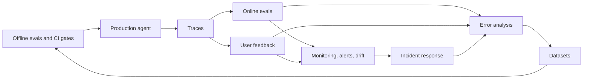

# 03 · Online Evals & Observability

> **TL;DR**
> - **Instrument full traces first.** Capture every retrieval, rerank, LLM call, tool call, SQL query, and guardrail decision in production.
> - **Evaluate live traffic without ground truth.** Run deterministic checks on 100% of requests and reference-free LLM judges on samples.
> - **Combine user signals with monitoring.** Link explicit and implicit feedback to traces, track segmented KPIs, and detect drift early.
> - **Close the production flywheel.** Route production failures and incident findings back into your offline evaluation datasets.

**You will learn:** Production tracing · Online evaluation pipelines · User feedback signals · Monitoring, alerting, and drift response  
**Prerequisites:** [The evals & guardrails map](../00-foundations/02-the-evals-and-guardrails-map.md), [Offline evals](../02-offline-evals/README.md)  
**Related:** [Production data flywheel](../01-datasets/04-production-data-flywheel.md), [Guardrails](../04-guardrails/README.md), [Eval selection decision tree](../05-decision-framework/01-eval-selection-decision-tree.md)

---

Offline evals tell you whether a version is ready to ship. This section covers what happens **after** you ship. You trace every agent step, evaluate live traffic without ground truth, and collect user feedback. You also monitor KPIs and SLOs, detect drift, and respond to AI quality incidents. Every online signal feeds back into your datasets and offline evals. This loop keeps agentic RAG applications improving instead of decaying.

This section uses an **internal enterprise assistant** as a running example. The assistant answers questions over company documents with vector search and queries a data warehouse with text-to-SQL. It also calls tools such as `create_ticket` and serves users across different roles (RBAC).

## Files in this section

| File | What it covers | Read when… |
|---|---|---|
| [01-online-evals.md](./01-online-evals.md) | Offline vs online evals, deterministic checks, sampled async LLM judges, guardrail signals, sampling, shadow/canary/A/B/interleaving tests, metric mapping, and dataset feedback loops | You are launching or operating in production and need to measure live traffic |
| [02-observability-and-tracing.md](./02-observability-and-tracing.md) | Span model for agentic RAG (retrieval, rerank, LLM, tools, SQL, guardrails), logging spec, OTel GenAI and OpenInference conventions, version tagging, PII redaction, and example trace | You are instrumenting an application or cannot answer "why did the agent say that?" |
| [03-user-feedback-and-implicit-signals.md](./03-user-feedback-and-implicit-signals.md) | Explicit feedback (thumbs, reasons, corrections), implicit signals (rephrase, regenerate, escalation, ticket outcomes, copy), biases, feedback UX, trace linking, and error analysis | You are designing feedback UX or want to use user signals without bias |
| [04-monitoring-alerting-and-drift.md](./04-monitoring-alerting-and-drift.md) | KPI catalog, dashboards, AI SLOs, low-fatigue alerting, query/corpus/model/judge drift detection, incident runbooks, kill switches, and re-evaluation cadence | You are setting up dashboards and on-call alerts, or debugging a silent quality drop |

## Suggested reading order

1. **Start with [Observability & tracing](./02-observability-and-tracing.md).** Every other practice in this section depends on complete traces.
2. **Read [Online evals](./01-online-evals.md).** Learn which deterministic checks and judges to run on your traces.
3. **Read [User feedback & implicit signals](./03-user-feedback-and-implicit-signals.md).** Capture explicit and behavioral signals from users and link them to traces.
4. **Read [Monitoring, alerting & drift](./04-monitoring-alerting-and-drift.md).** Turn traces, scores, and feedback into dashboards, alerts, and incident runbooks.

Short on time? Read the "What to do first" and "Getting started" sections in 01 and 04, plus the logging spec tables in 02.

## How this section connects to the rest

- **Upstream:** [Offline evals](../02-offline-evals/README.md) define the target metrics that online evals approximate. [LLM-as-a-judge](../02-offline-evals/07-llm-as-a-judge.md) explains how to build and validate the judges you run online.
- **Sideways:** [Guardrails](../04-guardrails/README.md) run synchronous checks and act on them at request time. Their decisions provide valuable online signals here.
- **Downstream:** Route online failures, user feedback, and drift findings into [Datasets](../01-datasets/README.md) through the [production data flywheel](../01-datasets/04-production-data-flywheel.md).
- **Decisions:** Consult the [Eval selection decision tree](../05-decision-framework/01-eval-selection-decision-tree.md), [Maturity model](../05-decision-framework/05-maturity-model.md), and [Eval & observability tools](../06-tooling-landscape/01-eval-and-observability-tools.md).

