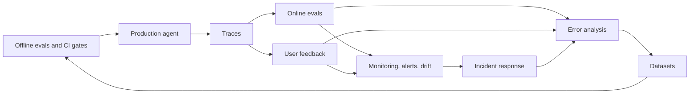

# 03 · Online Evals & Observability

Offline evals tell you whether a version is good enough to ship. This section covers what happens **after** you ship: tracing every step of the agent, scoring live traffic without ground truth, collecting user feedback, monitoring KPIs and SLOs, detecting drift, and responding to AI quality incidents. Everything here feeds back into your datasets and offline evals. That loop is how agentic RAG applications keep getting better instead of slowly decaying.

The running example throughout is an **internal enterprise assistant** that answers questions over company docs (vector search), queries a data warehouse via text-to-SQL, can call tools such as `create_ticket`, and serves users in different roles (RBAC).

## Files in this section

| File | What it covers | Read when… |
|---|---|---|
| [01-online-evals.md](./01-online-evals.md) | Offline vs online; deterministic checks on every request; sampled async LLM judges; guardrail outcomes as signals; sampling & cost control; sync vs async architecture; shadow mode, canaries, A/B tests, interleaving; offline→online metric mapping; feeding results back to datasets | You're about to launch (or have launched) and need to know what to measure on live traffic |
| [02-observability-and-tracing.md](./02-observability-and-tracing.md) | Span model for agentic RAG (retrieval, rerank, LLM, tools, SQL, guardrails); exact logging spec; OTel GenAI semantic conventions & OpenInference; sessions and version tagging; PII redaction & retention; tool landscape; full example trace | You're instrumenting an application, or you can't answer "why did it say that?" |
| [03-user-feedback-and-implicit-signals.md](./03-user-feedback-and-implicit-signals.md) | Explicit feedback (thumbs, reasons, corrections) and implicit signals (rephrase, regenerate, escalation, ticket outcomes, copy); biases & sparsity; feedback UX; linking to traces; turning feedback into labels; prioritizing error analysis | You're designing feedback UX, or want to use feedback without being misled by it |
| [04-monitoring-alerting-and-drift.md](./04-monitoring-alerting-and-drift.md) | KPI catalogue & dashboards; SLOs for AI features; alert design without fatigue; query, corpus/schema, model/provider and judge drift; incident response runbook & kill switches; re-evaluation cadence | You're setting up dashboards/on-call, or something got worse and you don't know why |

## Suggested reading order

1. **[Observability & tracing](./02-observability-and-tracing.md)** first. Everything else depends on having good traces.
2. **[Online evals](./01-online-evals.md)**: what to compute on those traces.
3. **[User feedback & implicit signals](./03-user-feedback-and-implicit-signals.md)**: the human side of online signals.
4. **[Monitoring, alerting & drift](./04-monitoring-alerting-and-drift.md)**: turn all of the above into dashboards, alerts, and an incident process.

If you're in a hurry, read the "What to do first" / "Getting started" sections of 01 and 04, and the logging spec tables in 02.

## How this section connects to the rest

- **Upstream:** [Offline evals](../02-offline-evals/README.md) define the metrics that online evals approximate. [LLM-as-a-judge](../02-offline-evals/07-llm-as-a-judge.md) covers how to build and validate the judges you run online.
- **Sideways:** [Guardrails](../04-guardrails/README.md) run the same kinds of checks synchronously and *act* on them. Their decisions are online signals here.
- **Downstream:** online failures, feedback, and drift findings flow into [Datasets](../01-datasets/README.md) via the [production data flywheel](../01-datasets/04-production-data-flywheel.md).
- **Decisions:** see [Eval selection decision tree](../05-decision-framework/01-eval-selection-decision-tree.md), [Maturity model](../05-decision-framework/05-maturity-model.md) and [Eval & observability tools](../06-tooling-landscape/01-eval-and-observability-tools.md).

