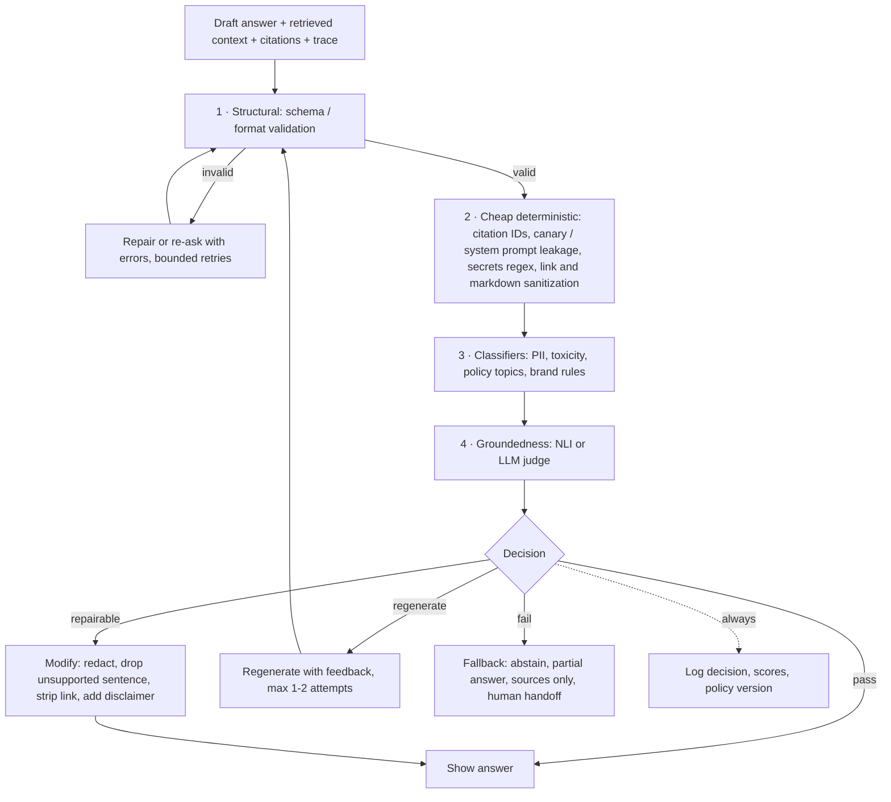

# Output Guardrails

> **TL;DR** — Output guardrails are the last check before an answer reaches the user or a downstream system. For agentic RAG the highest-value ones are groundedness (is every claim supported by the retrieved, permitted context?), citation verification (are cited IDs real, retrieved, and permitted?), leakage scans (PII, secrets, system prompt), schema validation, and unsafe markdown/link sanitization. Decide per failure whether to **repair, regenerate, fall back, or refuse**, and pick a streaming strategy that doesn't show users what you would have blocked.

**You'll learn:** how to order output rails · groundedness / hallucination gating with NLI or LLM judges · citation verification · PII, secret, and system-prompt leakage detection · toxicity and brand rules · structured-output validation with retry · policy compliance (legal/medical/financial advice) · code, SQL, and markdown/link checks · streaming trade-offs · choosing between regenerate, fallback, and refuse
&nbsp;·&nbsp; **Prerequisites:** [Guardrails architecture](./01-guardrails-architecture.md), [End-to-end RAG evals](../02-offline-evals/01-end-to-end-rag-evals.md)
&nbsp;·&nbsp; **Related:** [Retrieval & context guardrails](./03-retrieval-and-context-guardrails.md), [Input guardrails](./02-input-guardrails.md), [Tool & action guardrails](./05-tool-and-action-guardrails.md), [Instruction & citation adherence](../02-offline-evals/06-instruction-and-citation-adherence.md), [Generation quality & safety evals](../02-offline-evals/03-generation-quality-and-safety-evals.md), [LLM-as-a-judge](../02-offline-evals/07-llm-as-a-judge.md)

---

## 1. The output rail pipeline



**Ordering principles**

1. **Structural first.** If the output doesn't parse, nothing else can run on it.
2. **Cheap and deterministic before expensive and probabilistic.** Citation-ID checks and regexes cost microseconds; an LLM groundedness judge costs hundreds of milliseconds and tokens. Short-circuit on hard failures.
3. **Hard-fail rails before soft ones.** A secret leak is a block regardless of how grounded the answer is.
4. **Run independent classifiers in parallel** ([architecture §5](./01-guardrails-architecture.md#5-latency-budgets-parallelization-streaming-and-failure-modes)).
5. **Bound regeneration.** One or two attempts, then fall back. Unbounded retry loops multiply latency and cost and rarely converge.

| Rail | Detector (default) | Default action | Fail mode | Typical latency class |
|---|---|---|---|---|
| Schema / format | Pydantic / JSON Schema | Re-ask with errors → fallback | Closed | µs–ms |
| Citation verification | Set membership + optional NLI | Drop invalid citations; regenerate if none valid | Closed | ms (set check) |
| Secrets / canary / system prompt leakage | Regex + canary + n-gram overlap | Block or redact | Closed | ms |
| Unsafe links / markdown | Allowlist + sanitizer | Modify (strip) | Closed | ms |
| PII leakage | Regex + NER, compared to permitted context | Redact | Open with regex fallback | 10–100 ms |
| Toxicity / profanity | Classifier / moderation API | Regenerate → refuse | Open + flag | 10–100 ms |
| Policy compliance / brand rules | Classifier or LLM judge | Rewrite / disclaimer / refuse | Open + flag | 10 ms–1 s |
| Groundedness | NLI model or LLM judge | Remove unsupported claims / regenerate / abstain | Open with disclaimer, or closed for high-stakes | 50 ms–2 s |

---

## 2. Groundedness and hallucination checks

**What.** Verify that the claims in the answer are supported by the retrieved (and permitted) context, before showing it. This is the runtime twin of the offline *faithfulness / groundedness* metric ([end-to-end RAG evals](../02-offline-evals/01-end-to-end-rag-evals.md)).

**Why.** The most common harmful failure of enterprise RAG is a fluent, confident, unsupported answer — a wrong expense limit, a non-existent policy exception, a made-up SQL interpretation.

**Inputs required.** Answer, retrieved context chunks (the ones actually in the prompt). No ground truth required — that's what makes it usable online.

### Detector options

| Option | How it's computed | Latency/cost | Strengths | Weaknesses |
|---|---|---|---|---|
| **Sentence-level NLI** | Split answer into sentences/claims; score `P(supported given context)` with an NLI-style model, e.g. Vectara's [HHEM](https://huggingface.co/vectara/hallucination_evaluation_model) (premise/hypothesis pairs → 0–1 consistency score) | Low–moderate; self-hostable | Cheap enough for 100% of traffic; per-sentence localization | Context length limits (chunk the premise); weaker on multi-hop reasoning, numbers, and tables |
| **LLM judge, claim decomposition** | Extract atomic claims, then ask a judge whether each is supported by the context (the approach behind RAGAS faithfulness and FActScore-style evaluation) | High | Handles paraphrase, multi-hop, tables better | Slow, costly, non-deterministic; judge can be wrong or injected by context — see [LLM-as-a-judge](../02-offline-evals/07-llm-as-a-judge.md) |
| **Hosted groundedness detection** | e.g. [Azure AI Content Safety groundedness detection](https://learn.microsoft.com/en-us/azure/ai-services/content-safety/concepts/groundedness) | Moderate | Managed; some offer correction | Data leaves your boundary; vendor-specific behaviour |
| **Self-consistency (no context)** | Sample several answers and measure agreement ([SelfCheckGPT](https://arxiv.org/abs/2303.08896)) | Very high (N generations) | Works without retrieved context | Measures uncertainty, not grounding; expensive; rarely the right inline choice for RAG |

**Score & interpretation.** Per-claim support probability in [0, 1]; aggregate as **fraction of supported claims** and **minimum claim score**. The minimum matters more than the mean for gating: one unsupported number can be the harmful part.

### Actions (from least to most disruptive)

| Situation (heuristic thresholds — tune on your data) | Action |
|---|---|
| All claims ≥ 0.5 | Allow |
| A few non-essential sentences unsupported | **Modify**: drop or hedge those sentences ("I couldn't confirm …") |
| Key claims unsupported | **Regenerate** once with feedback ("Only use facts present in the context; these statements were unsupported: …") |
| Still unsupported, or context was insufficient | **Abstain** with sources: "I couldn't find a reliable answer; these documents may help: …" |
| Groundedness rail errors/timeouts | Fail open **with** a visible caveat for low-stakes intents; fail closed for high-stakes (finance, HR policy, security procedures) |

```python
import re
from typing import Callable

def split_sentences(text: str) -> list[str]:
    return [s.strip() for s in re.split(r"(?<=[.!?])\s+", text) if len(s.strip()) > 3]

def groundedness_gate(
    answer: str,
    contexts: list[str],
    entail: Callable[[str, str], float],   # (premise, hypothesis) -> P(supported) in [0, 1]
    t_claim: float = 0.5,
    max_unsupported_ratio: float = 0.2,
) -> dict:
    sentences = split_sentences(answer)
    scores = [max((entail(ctx, s) for ctx in contexts), default=0.0) for s in sentences]
    unsupported = [s for s, sc in zip(sentences, scores) if sc < t_claim]
    ratio = len(unsupported) / max(len(sentences), 1)
    if not unsupported:
        action = "allow"
    elif ratio <= max_unsupported_ratio:
        action = "modify"          # drop/hedge unsupported sentences
    else:
        action = "regenerate"      # then abstain if it fails again
    return {"action": action, "unsupported": unsupported, "min_score": min(scores, default=0.0)}
```

```python
# HHEM as the `entail` function — per the model card; verify the current API.
from transformers import AutoModelForSequenceClassification

hhem = AutoModelForSequenceClassification.from_pretrained(
    "vectara/hallucination_evaluation_model", trust_remote_code=True)

def entail(premise: str, hypothesis: str) -> float:
    return float(hhem.predict([(premise, hypothesis)])[0])
```

**Pitfalls**

- **Max over chunks misses multi-chunk claims** ("A is in Berlin" + "Berlin office uses policy B" → "A uses policy B"). For multi-hop intents, also score against the concatenated top chunks or use an LLM judge.
- **Non-claims** (greetings, "Here's what I found:", hedges) shouldn't be scored; filter them or the gate becomes noisy.
- **Numbers and tables**: NLI models are weak at arithmetic and table lookup; for text-to-SQL answers, verify numbers against the SQL result programmatically (every number in the answer must appear in, or be derivable from, the result set).
- **Grounded ≠ correct.** A faithful answer to a stale or poisoned document is still wrong — see freshness and poisoning in [03](./03-retrieval-and-context-guardrails.md).
- **Calibrate thresholds** on a labelled set of (context, answer, supported?) pairs from your domain ([LLM-as-a-judge](../02-offline-evals/07-llm-as-a-judge.md) covers judge calibration).

---

## 3. Citation verification

**What.** Check that every citation in the answer refers to a chunk that was (a) actually retrieved for this request, (b) permitted for this user, and (c) actually supports the sentence it's attached to. Runtime counterpart of [citation adherence](../02-offline-evals/06-instruction-and-citation-adherence.md).

**Why.** Models invent plausible document IDs, cite the wrong chunk, or cite a source that was in a previous turn's context. A fabricated citation is worse than none — it borrows the credibility of your knowledge base. And a citation to a non-permitted document leaks its existence and title.

**Inputs.** Answer with citation markers, the set of retrieved chunk IDs for this turn, the user's permitted set (from the ACL-filtered retrieval), chunk texts.

**How it's computed.**

```
cited          = set of IDs referenced in the answer
valid          = cited ∩ retrieved_this_turn ∩ permitted
invalid        = cited − valid                          # fabricated, stale, or forbidden
citation_precision (format) = |valid| / |cited|
uncited_claims = factual sentences with no citation     # if your policy requires citations
support check  = entail(chunk_text[id], sentence) for each (sentence, id) pair
```

```python
import re

CITE = re.compile(r"\[(?:doc:)?([A-Za-z0-9_\-:#.]+)\]")

def verify_citations(answer: str, retrieved: dict[str, str], permitted: set[str],
                     require_citations: bool = True) -> dict:
    """retrieved: chunk_id -> text for THIS turn; permitted: chunk IDs the user can read."""
    sentences = [s for s in re.split(r"(?<=[.!?])\s+", answer) if s.strip()]
    invalid, uncited, pairs = set(), [], []
    for s in sentences:
        ids = CITE.findall(s)
        if not ids and require_citations and len(s.split()) > 5:
            uncited.append(s)
        for cid in ids:
            if cid not in retrieved or cid not in permitted:
                invalid.add(cid)
            else:
                pairs.append((s, cid))      # send to entail(retrieved[cid], s) for support check
    if any(cid not in permitted for cid in invalid if cid in retrieved):
        action = "block"                    # cited a non-permitted chunk: treat as leakage incident
    elif invalid:
        action = "modify"                   # strip invalid markers, or regenerate if none remain
    elif uncited:
        action = "flag"
    else:
        action = "allow"
    return {"action": action, "invalid": sorted(invalid), "uncited": uncited, "support_pairs": pairs}
```

**Actions.** Strip invalid citation markers (modify) when the rest is fine; regenerate if no valid citations remain for key claims; **block and alert** if a citation points to a non-permitted chunk — that indicates a retrieval-layer permission bug ([03 §4](./03-retrieval-and-context-guardrails.md#4-permission-aware-retrieval)), not a model quirk.

**Rendering tip.** Render citations from **your** metadata (title, URL, last-modified) keyed by the validated ID — never from text the model wrote. The model then can't invent titles or link targets.

---

## 4. PII and secret leakage

**What.** Detect personal data, credentials, and other sensitive values in the output.

**Why.** The output can leak data that: came from a document the user is permitted to read but that shouldn't be repeated (a colleague's phone number in an incident report); came from the model's parametric memory; came from tool results (SQL rows); or came from the system prompt or configuration (connection strings, internal URLs).

**Detector options.** Same detectors as input ([02 §7](./02-input-guardrails.md#7-pii-detection-and-redaction), [02 §8](./02-input-guardrails.md#8-secrets-detection)): Presidio / regex + NER for PII; secret-pattern rules and entropy for credentials. Two output-specific refinements:

1. **Provenance comparison.** Classify each detected entity by where it came from: present in the user's own input (usually fine to echo), present in permitted context (policy decides), or **present in neither** (suspicious — parametric memory or hallucinated; redact).
2. **Policy by entity type and role.** E.g. work emails and names of document owners: allow; personal phone numbers, home addresses, government IDs, bank details: redact unless the user's role and intent explicitly require it.

**Action.** Redact/mask in place (modify) — the answer usually stays useful. **Block** for secrets of high-value types, and alert (a secret in an output usually means a secret is in your index or prompt; fix the source).

**False-positive risks.** Same as input — order IDs, product codes, example keys in documentation. Use checksums, allowlists of known-safe values, and provenance comparison.

```python
def classify_entity_provenance(entity: str, user_input: str, contexts: list[str]) -> str:
    if entity in user_input:
        return "user_supplied"
    if any(entity in c for c in contexts):
        return "from_context"
    return "unexplained"   # redact by default; investigate if frequent
```

---

## 5. Toxicity, profanity, and bias

**What.** Detect hateful, harassing, sexual, violent, or profane content and biased statements in the generated answer.

**Why.** The assistant speaks with the company's voice. Even internal tools must not produce demeaning or discriminatory content, and RAG can surface toxic text from retrieved sources (tickets, chat logs) verbatim.

**Detector options.** Moderation APIs ([OpenAI moderation](https://platform.openai.com/docs/guides/moderation), Azure AI Content Safety), [Detoxify](https://github.com/unitaryai/detoxify), [Llama Guard](https://arxiv.org/abs/2312.06674) (classifies responses as well as prompts against a configurable hazard taxonomy), profanity wordlists for tone-only rules. Bias is harder to detect inline; measure it offline with targeted test sets ([generation quality & safety evals](../02-offline-evals/03-generation-quality-and-safety-evals.md)) and use output rails only for explicit, detectable patterns.

**Action.** Use **lower thresholds than on input** — you are responsible for what the assistant says. Default: regenerate once with an instruction to keep a professional tone; if it still fails, refuse with a template. When quoting toxic source material is legitimately required (HR investigations), allow quoted spans for authorized roles, clearly marked as quotes.

---

## 6. Structured output and schema validation

**What.** Validate outputs consumed by code — JSON for UI components, tool arguments, SQL, routing decisions, extracted fields — against a schema and semantic constraints.

**Why.** Downstream code breaks or, worse, silently misbehaves on malformed output. Provider-side **structured output / constrained decoding** greatly reduces syntax errors, but it does not check **semantics**: valid JSON with a non-existent ticket queue, an end date before the start date, or a priority the user's role can't set.

**Pattern: validate → re-ask with errors → fallback.**

```python
from typing import Literal
from pydantic import BaseModel, Field, ValidationError, field_validator

ALLOWED_QUEUES = {"IT-HELPDESK", "FACILITIES", "HR-OPS"}

class TicketDraft(BaseModel):
    queue: str
    title: str = Field(min_length=5, max_length=120)
    priority: Literal["P3", "P4"]          # P1/P2 not allowed from the assistant
    description: str = Field(max_length=4000)

    @field_validator("queue")
    @classmethod
    def queue_allowed(cls, v: str) -> str:
        if v not in ALLOWED_QUEUES:
            raise ValueError(f"queue must be one of {sorted(ALLOWED_QUEUES)}")
        return v

def parse_with_retry(generate, prompt: str, max_attempts: int = 2) -> TicketDraft | None:
    """generate(prompt) -> str (model output). Returns None to trigger fallback."""
    feedback = ""
    for _ in range(max_attempts):
        raw = generate(prompt + feedback)
        try:
            return TicketDraft.model_validate_json(raw)
        except ValidationError as e:
            errors = "; ".join(f"{'.'.join(map(str, err['loc']))}: {err['msg']}" for err in e.errors())
            feedback = f"\n\nYour previous output was invalid: {errors}. Return only valid JSON."
    return None
```

**Guardrails AI concept.** [Guardrails AI](https://github.com/guardrails-ai/guardrails) packages this pattern as **validators** attached to output fields or the whole output, each with an `on_fail` policy. Its `OnFailAction` enum includes `reask`, `fix`, `filter`, `refrain`, `noop`, `exception`, `fix_reask`, and `custom`; reusable validators are distributed via the [Guardrails Hub](https://hub.guardrailsai.com/). Even if you don't use the library, the vocabulary maps cleanly onto the actions in this repo: *fix/filter* = modify, *reask* = regenerate, *refrain* = refuse/fallback, *noop* = flag, *exception* = block.

**Pitfalls**

- Don't let the model "repair" values that are **authorization decisions** (priority, assignee, target table). Validate them against the user's entitlements in code ([06](./06-access-control-rbac.md)), and let tool rails enforce them again ([05](./05-tool-and-action-guardrails.md)).
- Cap retries (1–2) and **log every retry** — a rising retry rate is an early signal of prompt or model regressions.
- Include the **validation error, not the whole invalid output**, in the re-ask to keep tokens and injection surface small.

---

## 7. Policy compliance: regulated advice and denied topics

**What.** Ensure the answer stays within content policy: no individualized legal, medical, tax, or investment advice; no HR determinations ("you will be fired for this"); no statements committing the company (pricing promises, contractual terms); no speculation about named individuals.

**Why.** Users ask an internal assistant "is this legal?", "should I report this to the regulator?", "what does my diagnosis mean for my leave?". Retrieval may return relevant policy text, but the *answer* can cross into advice.

**Detector options.**

- **Topic classifier** over the answer (and question) for denied categories.
- **LLM judge with an explicit rubric** for the gray zone: "Does the answer provide individualized legal/medical/financial advice or make a determination on behalf of HR/Legal? yes/no + span."
- **Llama Guard–style safety taxonomies** cover some categories (e.g., specialized advice) and can be customized; verify the taxonomy of the version you use.
- Rule-based phrases for commitments ("we guarantee", "you are entitled to").

**Actions.**

| Finding | Action |
|---|---|
| Informational answer near a regulated domain ("The leave policy says …") | Allow + **append a templated disclaimer** and route ("For your specific situation, contact HR / Legal at …") |
| Individualized advice or determination | **Rewrite** to informational form (regenerate with instruction) or refuse with route to the right team |
| Commitments on behalf of the company | Rewrite or block |

---

## 8. Competitor mentions and brand rules

**What.** Enforce communication rules: don't recommend competitors' products, don't disparage partners, use approved product names, keep tone and formatting consistent, don't mention unreleased products.

**Detector options.** Mostly deterministic: dictionaries of competitor names/aliases and unreleased codenames (with word-boundary and case-insensitive matching, plus fuzzy variants), approved-terminology lists; LLM judge for tone if needed.

**Actions.** Modify (replace codename with public name or remove sentence), regenerate for tone, flag for review. For **internal** assistants, competitor mentions are often legitimate (competitive analysis docs) — scope this rail to external-facing outputs or to specific intents. Codename leakage, on the other hand, matters most for anything that leaves the company (generated emails, customer-facing drafts).

```python
import re

def term_rule(text: str, terms: dict[str, str | None]) -> tuple[str, list[str]]:
    """terms: term -> replacement (None = flag only). Returns (modified_text, hits)."""
    hits = []
    for term, repl in terms.items():
        rx = re.compile(rf"\b{re.escape(term)}\b", re.IGNORECASE)
        if rx.search(text):
            hits.append(term)
            if repl is not None:
                text = rx.sub(repl, text)
    return text, hits

term_rule("Project Falcon ships with Q3.", {"Project Falcon": "the upcoming release"})
```

---

## 9. System prompt and configuration leakage

**What.** Detect when the output reproduces the system prompt, hidden instructions, tool definitions, internal configuration, or other users' data from shared context.

**Why.** Prompt extraction is usually the first step of a targeted attack (it reveals tool names, guardrail wording, internal endpoints). OWASP's Top 10 for LLM Applications lists *System Prompt Leakage* as a distinct risk; the core lesson is **never put secrets in the system prompt** — assume it will leak — and detect leakage as a signal of attack.

**Detector options.**

- **Canary token**: a random string embedded in the system prompt (rotated per deployment or per session). If it appears in output or tool arguments → leakage, near-zero false positives.
- **N-gram / longest-common-substring overlap** between the output and the system prompt (and tool descriptions). Flag above, e.g., a 20-token overlap or > 30% of the system prompt's distinctive n-grams (heuristics).
- **Embedding similarity** to the system prompt for paraphrased leakage (noisier).

```python
import secrets

CANARY = f"cnry-{secrets.token_hex(8)}"
SYSTEM_PROMPT = f"""You are Acme's internal assistant. [{CANARY}] ..."""

def ngrams(text: str, n: int = 8) -> set[tuple[str, ...]]:
    toks = text.lower().split()
    return {tuple(toks[i:i + n]) for i in range(len(toks) - n + 1)}

def prompt_leak(output: str, system_prompt: str = SYSTEM_PROMPT, n: int = 8,
                max_overlap: float = 0.1) -> dict:
    if CANARY in output:
        return {"action": "block", "reason": "canary"}
    sp = ngrams(system_prompt, n)
    overlap = len(sp & ngrams(output, n)) / max(len(sp), 1)
    return {"action": "block" if overlap > max_overlap else "allow", "overlap": overlap}
```

**Action.** Block and return a generic message; flag the session for security review (repeated attempts are an abuse signal). Also run the canary check on **tool arguments** — an agent that copies its instructions into `create_ticket(description=…)` is exfiltrating them.

---

## 10. Code, SQL, and markdown in output

### 10.1 Generated SQL and code

When the assistant *shows* SQL or code to the user (rather than executing it), check it before display:

- **Generated SQL**: parse it (e.g., with sqlglot), confirm it's a single read-only statement against tables the user can access, and that it matches the query that was actually executed (if the answer claims "I ran this query"). Execution-time enforcement belongs to tool rails ([05](./05-tool-and-action-guardrails.md)); quality is measured in [text-to-SQL evals](../02-offline-evals/05-text-to-sql-evals.md).
- **Numbers in the answer vs result set**: every number stated about the data should appear in, or be derivable from, the SQL result. Mismatches are hallucinations even when the SQL was right.
- **Code suggestions**: scan for secrets, hard-coded credentials, destructive shell commands (`rm -rf`, `DROP DATABASE`, `curl … | sh`), and dependencies not on your approved list; flag or add warnings. Never auto-execute code from an answer.

### 10.2 Markdown, HTML, and links — the exfiltration channel

If your UI renders markdown, a model output like `` makes the **user's browser** send data to the attacker when the image auto-loads — no click needed. Combined with indirect prompt injection ([03 §5](./03-retrieval-and-context-guardrails.md#5-indirect-prompt-injection-in-retrieved-content)), this is a well-documented data-exfiltration pattern in LLM chat products. Links (`[click here](…)`) are the click-required variant.

Guardrails:

- **Don't render images from arbitrary URLs.** Allowlist image domains (your CDN), or don't render model-produced images at all.
- **Allowlist link domains**; rewrite or strip others (show the URL as plain text).
- **Sanitize HTML** (or disable raw HTML in the markdown renderer) to prevent XSS in the chat UI — OWASP calls this *Improper Output Handling*.
- **Strip query strings** from links to non-allowlisted domains if you choose to show them.

```python
import re
from urllib.parse import urlparse

ALLOWED_LINK_DOMAINS = {"wiki.acme.internal", "docs.acme.com"}
MD_IMAGE = re.compile(r"!\[([^\]]*)\]\(([^)\s]+)[^)]*\)")
MD_LINK = re.compile(r"(?<!!)\[([^\]]+)\]\(([^)\s]+)[^)]*\)")

def _allowed(url: str) -> bool:
    host = (urlparse(url).hostname or "").lower()
    return urlparse(url).scheme == "https" and any(
        host == d or host.endswith("." + d) for d in ALLOWED_LINK_DOMAINS)

def sanitize_markdown(md: str) -> str:
    md = MD_IMAGE.sub(lambda m: m.group(0) if _allowed(m.group(2)) else f"[image removed: {m.group(1)}]", md)
    md = MD_LINK.sub(lambda m: m.group(0) if _allowed(m.group(2)) else m.group(1), md)
    return md
```

Also disable raw HTML and autolinking of bare URLs in the renderer, or apply the same allowlist to them.

---

## 11. Streaming considerations

Streaming makes answers feel fast but means users can see content before whole-answer rails finish. Strategy per rail (see [architecture §5.4](./01-guardrails-architecture.md#54-streaming-output-and-chunk-level-checking)):

| Rail | Works on chunks? | Recommended streaming strategy |
|---|---|---|
| Secrets / canary / system prompt leakage | Yes (pattern-local) | Chunk-level with hold-back window ≥ longest pattern; **never** optimistic |
| PII redaction | Mostly (entity-local) | Chunk-level with sentence-sized hold-back |
| Markdown/link sanitization | Yes, once the link closes | Hold back from `[` / `![` until `)` arrives |
| Toxicity / profanity | Mostly | Sentence-level chunks |
| Citation verification | Per citation marker | Validate each marker as it completes; render citations at the end from your metadata |
| Schema validation | No | Don't stream structured outputs to code; stream only to humans |
| Groundedness (whole-answer) | Partly (per sentence) | Sentence-level NLI if fast enough; else buffer for high-stakes intents, or stream then append a caveat / retract for low-stakes |
| Policy compliance (LLM judge) | No | Buffer for intents likely to trigger it (route-based), stream otherwise |

Practical pattern: **route-dependent streaming**. Stream for low-risk intents with chunk-level rails; buffer for high-stakes intents (HR policy, finance figures, anything with tool results) and show a progress indicator ("Checking sources…") — users accept a short wait when the UI explains it.

---

## 12. Regenerate vs refuse vs fallback

When an output rail fails, choose the response deliberately:

| Strategy | What | Good for | Costs / risks |
|---|---|---|---|
| **Repair in place (modify)** | Redact, strip link, drop unsupported sentence, add disclaimer | Localized problems in an otherwise good answer | Edited answer may read awkwardly; dropped sentence may have been key |
| **Regenerate with feedback** | Re-call the model with the rail's findings ("these sentences were unsupported", "schema error: …") | Format errors, partial ungroundedness, tone | Adds a full generation of latency and cost; may fail the same way; cap at 1–2 attempts |
| **Regenerate with a stricter configuration** | Lower temperature, stricter prompt, fewer/better chunks, stronger model | Persistent ungroundedness | Even more latency; stronger model costs more |
| **Fallback answer** | Sources-only response ("Here are the most relevant documents"), extractive answer (quote the best chunk), canned FAQ answer, or cached verified answer | Retrieval found good docs but generation is unreliable | Less helpful than a synthesized answer, but safe and grounded |
| **Abstain** | "I couldn't find a reliable answer in documents you have access to." | No sufficient context; groundedness fails after retry | User leaves without help — offer next steps |
| **Refuse** | Templated policy message | Policy violations, leakage, attacks | Over-refusal erodes trust; never accuse |
| **Escalate / hand off** | Route to a human (support agent, HR, analyst) with the context | High-stakes questions with uncertain answers | Requires an owned queue and SLA |

Default decision rule (heuristic):

```text
if hard violation (secret, canary, forbidden citation, unsafe content above high threshold): refuse (+ alert)
elif repairable locally:                                                                    modify
elif attempts < max_attempts and failure is generation-side (format, tone, partial grounding): regenerate with feedback
elif good sources exist:                                                                    fallback to sources/extractive answer
else:                                                                                       abstain with next steps
```

Track how often each branch fires. A high regenerate rate means you're paying twice for many answers — fix the prompt, retrieval, or model with [offline experiments](../02-offline-evals/08-running-offline-experiments.md) rather than relying on the rail.

---

## 13. Measuring output guardrails

Same machinery as every rail ([architecture §9](./01-guardrails-architecture.md#9-measuring-guardrails-themselves)), with output-specific datasets:

- **Groundedness gate**: (context, answer) pairs labelled supported/unsupported at sentence level, including multi-hop and numeric cases. Report recall on unsupported claims and false-flag rate on supported ones.
- **Citation verification**: answers with injected fabricated IDs, IDs from previous turns, and IDs of non-permitted chunks — expect 100% detection for the deterministic part.
- **Leakage**: outputs seeded with canaries, secrets, PII of various provenance; prompt-extraction attack suites (e.g., from [promptfoo red teaming](https://www.promptfoo.dev/docs/red-team/) or [garak](https://github.com/NVIDIA/garak)).
- **Markdown exfiltration**: injected docs instructing the model to emit image links with data in the URL — the sanitized output must contain no non-allowlisted image URLs.
- **Over-blocking**: a should-allow set of good answers with legitimate quotes, numbers, internal links, and disclaimers.
- **Online**: block/modify/regenerate/fallback rates per intent, added latency per rail (p95), "answer not helpful" feedback after a fallback ([user feedback](../03-online-evals-and-observability/03-user-feedback-and-implicit-signals.md)).

## 14. Checklist

- [ ] Output rails ordered: structure → cheap deterministic → classifiers → groundedness; independent rails run in parallel.
- [ ] Groundedness gate runs on high-stakes intents at minimum, with thresholds calibrated on labelled domain data; numbers in data answers are verified against SQL results.
- [ ] Citations are validated against *this turn's* retrieved **and** permitted IDs, and rendered from your metadata, not model text.
- [ ] PII and secrets are redacted in output; entities with no provenance are redacted by default.
- [ ] A canary token and n-gram overlap check detect system prompt leakage in outputs **and tool arguments**; no secrets live in the system prompt.
- [ ] Structured outputs are validated (schema + semantic + entitlement checks) with at most 1–2 re-asks, then fallback.
- [ ] Regulated-advice and brand rules are scoped to the intents/audiences where they matter, with templated disclaimers.
- [ ] Markdown images/links are restricted to allowlisted domains; raw HTML is disabled or sanitized.
- [ ] Streaming strategy is chosen per rail and per intent; leakage rails are never optimistic.
- [ ] The regenerate/fallback/refuse policy is explicit, bounded, and monitored.

---

## Key takeaways

- **Groundedness and citation verification** are the highest-value output rails for RAG: check claims against the *retrieved, permitted* context, and treat a citation to a non-permitted chunk as a security incident.
- Order rails **cheap → expensive** and **hard-fail → soft**; run independent ones in parallel.
- Prefer **repair** (redact, drop a sentence, strip a link) over regenerate, and regenerate (bounded) over refuse; always have a **fallback** such as sources-only or extractive answers.
- **Schema validity is not semantic validity**: validate business rules and entitlements in code, never let the model "fix" authorization values.
- **Assume the system prompt will leak**; detect it with canaries and overlap checks, including in tool arguments.
- **Rendered markdown is an exfiltration channel** — allowlist image and link domains.
- Streaming needs a **per-rail strategy**; leakage checks must run before tokens are shown.

## Further reading

- Vectara — [HHEM hallucination evaluation model](https://huggingface.co/vectara/hallucination_evaluation_model) · [Hallucination leaderboard](https://github.com/vectara/hallucination-leaderboard)
- Min et al. — [FActScore: Fine-grained Atomic Evaluation of Factual Precision in Long Form Text Generation](https://arxiv.org/abs/2305.14251)
- Manakul et al. — [SelfCheckGPT: Zero-Resource Black-Box Hallucination Detection for Generative Large Language Models](https://arxiv.org/abs/2303.08896)
- Es et al. — [RAGAS: Automated Evaluation of Retrieval Augmented Generation](https://arxiv.org/abs/2309.15217)
- Microsoft — [Groundedness detection in Azure AI Content Safety](https://learn.microsoft.com/en-us/azure/ai-services/content-safety/concepts/groundedness)
- [Guardrails AI](https://github.com/guardrails-ai/guardrails) · [Guardrails Hub](https://hub.guardrailsai.com/) · [Pydantic](https://docs.pydantic.dev/latest/) · [JSON Schema](https://json-schema.org/)
- Inan et al. — [Llama Guard: LLM-based Input-Output Safeguard for Human-AI Conversations](https://arxiv.org/abs/2312.06674)
- Anthropic — [Reduce hallucinations](https://docs.anthropic.com/en/docs/test-and-evaluate/strengthen-guardrails/reduce-hallucinations)
- OWASP — [Top 10 for LLM Applications](https://genai.owasp.org/llm-top-10/) (Improper Output Handling, Sensitive Information Disclosure, System Prompt Leakage)
- NVIDIA — [NeMo Guardrails documentation](https://docs.nvidia.com/nemo/guardrails/latest/index.html) (output and streaming rails)
- In this repo: [End-to-end RAG evals](../02-offline-evals/01-end-to-end-rag-evals.md) · [Instruction & citation adherence](../02-offline-evals/06-instruction-and-citation-adherence.md) · [LLM-as-a-judge](../02-offline-evals/07-llm-as-a-judge.md) · [Guardrail tools](../06-tooling-landscape/02-guardrail-tools.md)
