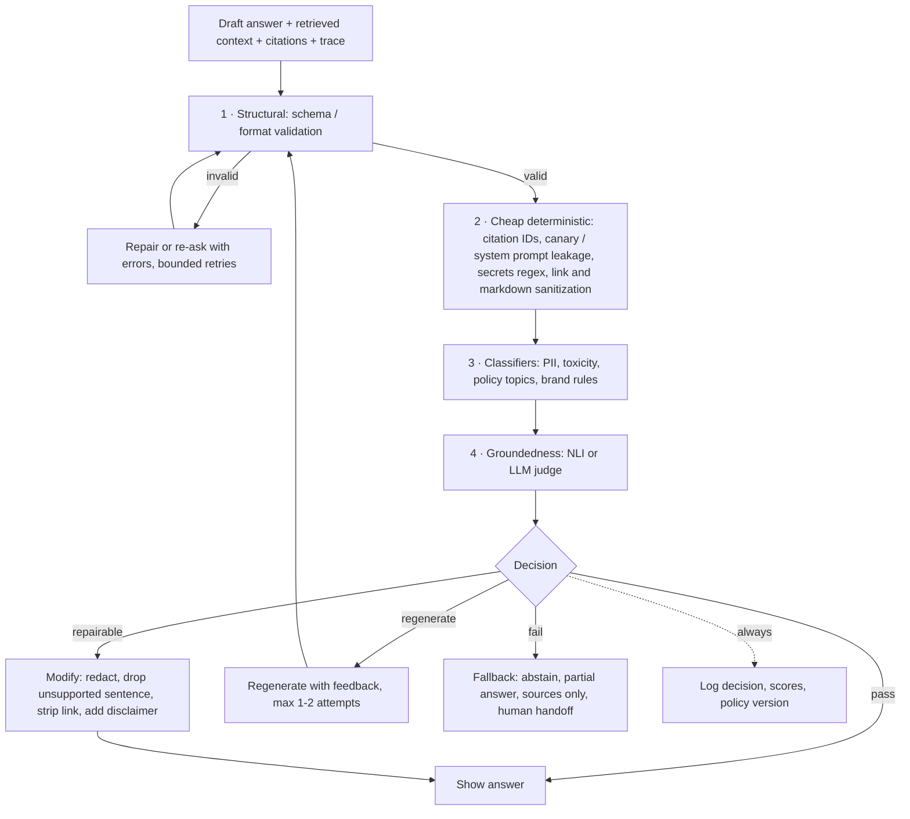

# Output Guardrails

> **TL;DR**
>
> - **Gate every response before display.** Run output guardrails as the final check before an answer reaches a user or downstream system.
> - **Verify grounding and citations first.** Confirm that permitted context supports every claim and that cited chunk IDs are real and authorized.
> - **Scrub leaks and unsafe markup.** Redact PII, block secrets and system-prompt leaks, validate schemas, and sanitize markdown links and images.
> - **Choose deliberate failure actions.** Decide per rail whether to repair, regenerate, fall back, or refuse, and buffer high-risk streams.

- **You will learn:**
    - Output rail ordering
    - Groundedness and citation verification
    - PII, secret, and system-prompt leak detection
    - Schema validation, markdown sanitization, streaming, and fallback policies
- **Prerequisites:** [Guardrails architecture](./01-guardrails-architecture.md), [End-to-end RAG evals](../02-offline-evals/01-end-to-end-rag-evals.md)
- **Related:** [Retrieval & context guardrails](./03-retrieval-and-context-guardrails.md), [Input guardrails](./02-input-guardrails.md), [Tool & action guardrails](./05-tool-and-action-guardrails.md), [Instruction & citation adherence](../02-offline-evals/06-instruction-and-citation-adherence.md), [Generation quality & safety evals](../02-offline-evals/03-generation-quality-and-safety-evals.md), [LLM-as-a-judge](../02-offline-evals/07-llm-as-a-judge.md)

---

## 1. The output rail pipeline



**Ordering principles**

1. **Validate structure first.** Nothing else can run if the output fails to parse.
2. **Run cheap, deterministic checks before expensive, probabilistic ones.** Citation-ID and regex checks take microseconds. LLM groundedness judges take hundreds of milliseconds. Short-circuit on hard failures.
3. **Run hard-fail rails before soft ones.** Block a secret leak immediately, regardless of how grounded the answer is.
4. **Run independent classifiers in parallel.** See [architecture §5](./01-guardrails-architecture.md#5-latency-budgets-parallelization-streaming-and-failure-modes) for parallel execution patterns.
5. **Bound regeneration attempts.** Retry once or twice, then fall back. Unbounded retry loops multiply latency and cost and rarely converge.

| Rail | Detector (default) | Default action | Fail mode | Typical latency class |
|---|---|---|---|---|
| Schema / format | Pydantic / JSON Schema | Re-ask with errors → fallback | Closed | µs–ms |
| Citation verification | Set membership + optional NLI | Drop invalid citations, or regenerate if none are valid | Closed | ms (set check) |
| Secrets / canary / system prompt leakage | Regex + canary + n-gram overlap | Block or redact | Closed | ms |
| Unsafe links / markdown | Allowlist + sanitizer | Modify (strip) | Closed | ms |
| PII leakage | Regex + NER, compared to permitted context | Redact | Open with regex fallback | 10–100 ms |
| Toxicity / profanity | Classifier / moderation API | Regenerate → refuse | Open + flag | 10–100 ms |
| Policy compliance / brand rules | Classifier or LLM judge | Rewrite / disclaimer / refuse | Open + flag | 10 ms–1 s |
| Groundedness | NLI model or LLM judge | Remove unsupported claims / regenerate / abstain | Open with disclaimer, or closed for high-stakes | 50 ms–2 s |

---

## 2. Groundedness and hallucination checks

**What.** Verify that the retrieved and permitted context supports every claim in the answer before display. This check is the runtime twin of the offline *faithfulness / groundedness* metric ([end-to-end RAG evals](../02-offline-evals/01-end-to-end-rag-evals.md)).

**Why.** The most common harmful failure in enterprise RAG is a fluent, confident, unsupported answer. Examples include a wrong expense limit, a non-existent policy exception, or a fabricated SQL interpretation.

**Inputs required.** Provide the draft answer and the retrieved context chunks from the prompt. This check needs no reference answer, which makes it usable online.

### Detector options

| Option | How it works | Latency/cost | Strengths | Weaknesses |
|---|---|---|---|---|
| **Sentence-level NLI** | Split the answer into sentences and score `P(supported given context)` with an NLI model such as Vectara's [HHEM](https://huggingface.co/vectara/hallucination_evaluation_model) (0–1 consistency score) | Low–moderate, self-hostable | Cheap enough for 100% of traffic, provides per-sentence localization | Has context length limits (chunk the premise), weaker on multi-hop reasoning, numbers, and tables |
| **LLM judge, claim decomposition** | Extract atomic claims, then ask a judge whether the context supports each claim (used in RAGAS faithfulness and FActScore) | High | Handles paraphrase, multi-hop reasoning, and tables better | Slow, costly, and non-deterministic. Context can also mislead or inject the judge ([LLM-as-a-judge](../02-offline-evals/07-llm-as-a-judge.md)) |
| **Hosted groundedness detection** | Call a managed API such as [Azure AI Content Safety groundedness detection](https://learn.microsoft.com/en-us/azure/ai-services/content-safety/concepts/groundedness) | Moderate | Managed service, some APIs offer automatic correction | Data leaves your boundary, behavior is vendor-specific |
| **Self-consistency (no context)** | Sample several answers and measure agreement ([SelfCheckGPT](https://arxiv.org/abs/2303.08896)) | Very high (N generations) | Works without retrieved context | Measures uncertainty rather than grounding, expensive, rarely fits inline RAG |

**Score & interpretation.** Compute the support probability in `[0, 1]` for each claim. Aggregate these scores as the **fraction of supported claims** and the **minimum claim score**. The minimum matters more than the mean for gating because one unsupported number can cause harm.

### Actions (from least to most disruptive)

| Situation (heuristic thresholds, tune on your data) | Action |
|---|---|
| All claims ≥ 0.5 | Allow |
| A few non-essential sentences unsupported | **Modify**: drop or hedge those sentences ("I couldn't confirm …") |
| Key claims unsupported | **Regenerate** once with feedback ("Only use facts present in the context. These statements were unsupported: …") |
| Still unsupported, or context was insufficient | **Abstain** with sources: "I couldn't find a reliable answer. These documents may help: …" |
| Groundedness rail errors/timeouts | Fail open **with** a visible caveat for low-stakes intents. Fail closed for high-stakes intents (finance, HR policy, security procedures) |

```python
import re
from typing import Callable

def split_sentences(text: str) -> list[str]:
    return [s.strip() for s in re.split(r"(?<=[.!?])\s+", text) if len(s.strip()) > 3]

def groundedness_gate(
    answer: str,
    contexts: list[str],
    entail: Callable[[str, str], float],   # (premise, hypothesis) -> P(supported) in [0, 1]
    t_claim: float = 0.5,
    max_unsupported_ratio: float = 0.2,
) -> dict:
    sentences = split_sentences(answer)
    scores = [max((entail(ctx, s) for ctx in contexts), default=0.0) for s in sentences]
    unsupported = [s for s, sc in zip(sentences, scores) if sc < t_claim]
    ratio = len(unsupported) / max(len(sentences), 1)
    if not unsupported:
        action = "allow"
    elif ratio <= max_unsupported_ratio:
        action = "modify"          # drop/hedge unsupported sentences
    else:
        action = "regenerate"      # then abstain if it fails again
    return {"action": action, "unsupported": unsupported, "min_score": min(scores, default=0.0)}
```

```python
# HHEM as the `entail` function (per the model card; verify the current API).
from transformers import AutoModelForSequenceClassification

hhem = AutoModelForSequenceClassification.from_pretrained(
    "vectara/hallucination_evaluation_model", trust_remote_code=True)

def entail(premise: str, hypothesis: str) -> float:
    return float(hhem.predict([(premise, hypothesis)])[0])
```

**Pitfalls**

- **Max over chunks misses multi-chunk claims.** A claim may combine facts from two chunks. For multi-hop intents, score against concatenated top chunks or use an LLM judge.
- **Filter out non-claims.** Greetings, conversational transitions ("Here's what I found:"), and hedges do not need grounding scores. Filtering them reduces false alarms.
- **Verify numbers and tables in code.** NLI models struggle with arithmetic and table lookups. For text-to-SQL answers, check that every number appears in or derives from the SQL result.
- **Grounded does not mean correct.** A faithful answer to a stale or poisoned document is still wrong. See freshness and poisoning in [retrieval & context guardrails](./03-retrieval-and-context-guardrails.md).
- **Calibrate thresholds on domain data.** Use a labeled set of `(context, answer, supported?)` pairs from your domain. See [LLM-as-a-judge](../02-offline-evals/07-llm-as-a-judge.md) for judge calibration methods.

---

## 3. Citation verification

**What.** Check every citation in the answer against three rules. The cited chunk must be retrieved in this turn, permitted for this user, and supportive of the sentence. This rail is the runtime counterpart of [citation adherence](../02-offline-evals/06-instruction-and-citation-adherence.md).

**Why.** Models invent plausible document IDs, cite the wrong chunk, or cite a source from a previous turn. A fabricated citation borrows the credibility of your knowledge base and is worse than no citation. A citation to an unauthorized document leaks its existence and title.

**Inputs.** Pass the answer with citation markers, the retrieved chunk IDs for this turn, the user's permitted chunk set, and the chunk texts.

**Computation.**

```
cited          = set of IDs referenced in the answer
valid          = cited ∩ retrieved_this_turn ∩ permitted
invalid        = cited − valid                          # fabricated, stale, or forbidden
citation_precision (format) = |valid| / |cited|
uncited_claims = factual sentences with no citation     # if your policy requires citations
support check  = entail(chunk_text[id], sentence) for each (sentence, id) pair
```

```python
import re

CITE = re.compile(r"\[(?:doc:)?([A-Za-z0-9_\-:#.]+)\]")

def verify_citations(answer: str, retrieved: dict[str, str], permitted: set[str],
                     require_citations: bool = True) -> dict:
    """retrieved: chunk_id -> text for THIS turn; permitted: chunk IDs the user can read."""
    sentences = [s for s in re.split(r"(?<=[.!?])\s+", answer) if s.strip()]
    invalid, uncited, pairs = set(), [], []
    for s in sentences:
        ids = CITE.findall(s)
        if not ids and require_citations and len(s.split()) > 5:
            uncited.append(s)
        for cid in ids:
            if cid not in retrieved or cid not in permitted:
                invalid.add(cid)
            else:
                pairs.append((s, cid))      # send to entail(retrieved[cid], s) for support check
    if any(cid not in permitted for cid in invalid if cid in retrieved):
        action = "block"                    # cited a non-permitted chunk: treat as leakage incident
    elif invalid:
        action = "modify"                   # strip invalid markers, or regenerate if none remain
    elif uncited:
        action = "flag"
    else:
        action = "allow"
    return {"action": action, "invalid": sorted(invalid), "uncited": uncited, "support_pairs": pairs}
```

**Actions.** Strip invalid citation markers when the rest of the answer is sound. Regenerate the answer if no valid citations remain for key claims. **Block and alert** if a citation points to a non-permitted chunk. That failure indicates a retrieval permission bug ([03 §4](./03-retrieval-and-context-guardrails.md#4-permission-aware-retrieval)), not a model quirk.

**Rendering tip.** Render citations from **your** metadata (title, URL, last-modified) keyed by the validated ID. Never render citation titles or URLs written by the model.

---

## 4. PII and secret leakage

**What.** Detect personal data, credentials, and other sensitive values in the generated output.

**Why.** Outputs can leak sensitive data from several sources:

- Permitted documents that contain third-party details (such as a colleague's phone number in an incident report).
- The model's parametric memory.
- Tool results (such as raw SQL rows).
- The system prompt or configuration (such as connection strings or internal URLs).

**Detector options.** Use the same detectors as input rails ([02 §7](./02-input-guardrails.md#7-pii-detection-and-redaction) and [02 §8](./02-input-guardrails.md#8-secrets-detection)). Run Presidio or regex plus NER for PII, and run secret-pattern rules plus entropy checks for credentials. Add two output-specific refinements:

1. **Compare entity provenance.** Classify each detected entity by its source. Entities in the user's input are usually safe to echo, and policy governs entities from permitted context. Redact any entity **present in neither** because it comes from parametric memory or hallucination.
2. **Apply policy by entity type and role.** Allow work emails and document owner names. Redact personal phone numbers, home addresses, government IDs, and bank details unless the user's role and intent require them.

**Action.** Redact or mask PII in place so the answer stays useful. **Block and alert** when the detector finds high-value secrets. A secret in an output usually means a secret lives in your index or prompt, so fix the source.

**False-positive risks.** Order IDs, product codes, and example keys in documentation often trigger false alarms. Use checksums, allowlists of known-safe values, and provenance comparison to reduce false positives.

```python
def classify_entity_provenance(entity: str, user_input: str, contexts: list[str]) -> str:
    if entity in user_input:
        return "user_supplied"
    if any(entity in c for c in contexts):
        return "from_context"
    return "unexplained"   # redact by default; investigate if frequent
```

---

## 5. Toxicity, profanity, and bias

**What.** Detect hateful, harassing, sexual, violent, or profane content and biased statements in the generated answer.

**Why.** The assistant speaks with the company's voice. Internal tools must not produce demeaning or discriminatory content. RAG can also surface toxic text verbatim from retrieved tickets or chat logs.

**Detector options.** Use moderation APIs ([OpenAI moderation](https://platform.openai.com/docs/guides/moderation), Azure AI Content Safety), [Detoxify](https://github.com/unitaryai/detoxify), or [Llama Guard](https://arxiv.org/abs/2312.06674). Use profanity wordlists for tone rules. Bias is hard to detect inline, so evaluate it offline with targeted test sets ([generation quality & safety evals](../02-offline-evals/03-generation-quality-and-safety-evals.md)). Use online output rails only for explicit, detectable patterns.

**Action.** Set **lower thresholds than on input** because you own what the assistant says. Regenerate once with an instruction to keep a professional tone, and refuse with a template if it fails again. For authorized roles such as HR investigators, allow clearly marked quotes of toxic source material when required.

---

## 6. Structured output and schema validation

**What.** Validate machine-consumed outputs against a schema and semantic rules. Common targets include UI JSON, tool arguments, SQL queries, routing decisions, and extracted fields.

**Why.** Malformed output breaks downstream code or causes silent misbehavior. Provider-side **structured output or constrained decoding** reduces syntax errors, but it does not check **semantics**. Valid JSON can still contain a non-existent ticket queue, an end date before a start date, or an unauthorized priority.

**Pattern: validate → re-ask with errors → fallback.**

```python
from typing import Literal
from pydantic import BaseModel, Field, ValidationError, field_validator

ALLOWED_QUEUES = {"IT-HELPDESK", "FACILITIES", "HR-OPS"}

class TicketDraft(BaseModel):
    queue: str
    title: str = Field(min_length=5, max_length=120)
    priority: Literal["P3", "P4"]          # P1/P2 not allowed from the assistant
    description: str = Field(max_length=4000)

    @field_validator("queue")
    @classmethod
    def queue_allowed(cls, v: str) -> str:
        if v not in ALLOWED_QUEUES:
            raise ValueError(f"queue must be one of {sorted(ALLOWED_QUEUES)}")
        return v

def parse_with_retry(generate, prompt: str, max_attempts: int = 2) -> TicketDraft | None:
    """generate(prompt) -> str (model output). Returns None to trigger fallback."""
    feedback = ""
    for _ in range(max_attempts):
        raw = generate(prompt + feedback)
        try:
            return TicketDraft.model_validate_json(raw)
        except ValidationError as e:
            errors = "; ".join(f"{'.'.join(map(str, err['loc']))}: {err['msg']}" for err in e.errors())
            feedback = f"\n\nYour previous output was invalid: {errors}. Return only valid JSON."
    return None
```

**Guardrails AI concept.** [Guardrails AI](https://github.com/guardrails-ai/guardrails) packages this pattern as **validators** with an `on_fail` policy on fields or whole outputs. Its `OnFailAction` enum includes `reask`, `fix`, `filter`, `refrain`, `noop`, `exception`, `fix_reask`, and `custom`. The [Guardrails Hub](https://hub.guardrailsai.com/) distributes reusable validators. This vocabulary maps directly to the actions in this guide: *fix/filter* = modify, *reask* = regenerate, *refrain* = refuse/fallback, *noop* = flag, and *exception* = block.

**Pitfalls**

- **Never let the model repair authorization values.** Validate priority, assignee, and target table against user entitlements in code ([06](./06-access-control-rbac.md)) and tool rails ([05](./05-tool-and-action-guardrails.md)).
- **Cap retries at 1–2 attempts and log every retry.** A rising retry rate signals prompt or model regressions early.
- **Pass only the validation error in the re-ask prompt.** Omitting the full invalid output keeps token usage and injection surface small.

---

## 7. Policy compliance: regulated advice and denied topics

**What.** Keep answers within content policy. Block individualized legal, medical, tax, or investment advice, HR determinations ("you will be fired"), binding company commitments, and speculation about individuals.

**Why.** Users often ask internal assistants questions like "is this legal?" or "what does my diagnosis mean for my leave?". Retrieval may return relevant policy text, but the generated answer can still cross into regulated advice.

**Detector options.**

- **Topic classifier** over the question and answer for denied categories.
- **LLM judge with an explicit rubric** for gray areas: "Does the answer provide individualized legal, medical, or financial advice, or make an HR determination? Return yes/no and the span."
- **Llama Guard safety taxonomies** for categories such as specialized advice. Verify the taxonomy of the model version you use.
- **Rule-based phrase matching** for unauthorized commitments ("we guarantee", "you are entitled to").

**Actions.**

| Finding | Action |
|---|---|
| Informational answer near a regulated domain ("The leave policy says …") | Allow, **append a templated disclaimer**, and route ("For your specific situation, contact HR / Legal at …") |
| Individualized advice or determination | **Rewrite** to informational form (regenerate with instruction) or refuse and route to the right team |
| Commitments on behalf of the company | Rewrite or block |

---

## 8. Competitor mentions and brand rules

**What.** Enforce brand and communication rules. Do not recommend competitors, disparage partners, use unapproved product names, break tone guidelines, or mention unreleased products.

**Detector options.** Use deterministic dictionaries for competitor names, aliases, unreleased codenames, and approved terminology. Match with word boundaries, case insensitivity, and fuzzy variants. Add an LLM judge for tone if needed.

**Actions.** Modify the output by replacing codenames or removing offending sentences, regenerate for tone, or flag for review. For **internal** assistants, competitor mentions are often legitimate in competitive analysis, so scope this rail to external-facing outputs or specific intents. Codename leakage matters whenever content leaves the company, such as generated customer emails.

```python
import re

def term_rule(text: str, terms: dict[str, str | None]) -> tuple[str, list[str]]:
    """terms: term -> replacement (None = flag only). Returns (modified_text, hits)."""
    hits = []
    for term, repl in terms.items():
        rx = re.compile(rf"\b{re.escape(term)}\b", re.IGNORECASE)
        if rx.search(text):
            hits.append(term)
            if repl is not None:
                text = rx.sub(repl, text)
    return text, hits

term_rule("Project Falcon ships with Q3.", {"Project Falcon": "the upcoming release"})
```

---

## 9. System prompt and configuration leakage

**What.** Detect when the output reproduces the system prompt, hidden instructions, tool definitions, internal configuration, or other users' data.

**Why.** Prompt extraction is often the first step of a targeted attack because it reveals tool names, guardrail wording, and internal endpoints. The OWASP Top 10 for LLM Applications lists *System Prompt Leakage* as a distinct risk. **Never put secrets in the system prompt.** Assume the prompt will leak, and detect leakage as an attack signal.

**Detector options.**

- **Canary token**: embed a random string in the system prompt and rotate it per deployment or session. If the canary appears in outputs or tool arguments, block the response. This check has near-zero false positives.
- **N-gram or longest-common-substring overlap**: compare the output against the system prompt and tool descriptions. Flag outputs with more than a 20-token overlap or 30% of distinctive system-prompt n-grams.
- **Embedding similarity**: compare output embeddings to the system prompt to catch paraphrased leakage (noisier).

```python
import secrets

CANARY = f"cnry-{secrets.token_hex(8)}"
SYSTEM_PROMPT = f"""You are Acme's internal assistant. [{CANARY}] ..."""

def ngrams(text: str, n: int = 8) -> set[tuple[str, ...]]:
    toks = text.lower().split()
    return {tuple(toks[i:i + n]) for i in range(len(toks) - n + 1)}

def prompt_leak(output: str, system_prompt: str = SYSTEM_PROMPT, n: int = 8,
                max_overlap: float = 0.1) -> dict:
    if CANARY in output:
        return {"action": "block", "reason": "canary"}
    sp = ngrams(system_prompt, n)
    overlap = len(sp & ngrams(output, n)) / max(len(sp), 1)
    return {"action": "block" if overlap > max_overlap else "allow", "overlap": overlap}
```

**Action.** Block the response, return a generic message, and flag the session for security review. Run the canary check on **tool arguments** too, because an injected agent can exfiltrate instructions via `create_ticket(description=…)`.

---

## 10. Code, SQL, and markdown in output

### 10.1 Generated SQL and code

When the assistant *displays* SQL or code to the user, check it before rendering:

- **Generated SQL**: parse the query with `sqlglot` and confirm it is a single read-only statement against permitted tables. If the answer claims it ran the query, verify that the displayed SQL matches the executed query. Tool rails handle execution-time enforcement ([05](./05-tool-and-action-guardrails.md)), and [text-to-SQL evals](../02-offline-evals/05-text-to-sql-evals.md) measure query quality.
- **Numbers in the answer vs result set**: verify that every number in the answer appears in or derives from the SQL result set. Mismatches are hallucinations even when the SQL query is valid.
- **Code suggestions**: scan for secrets, hard-coded credentials, destructive commands (`rm -rf`, `DROP DATABASE`, `curl … | sh`), and unapproved packages. Flag risky code or attach warnings, and never auto-execute code from an answer.

### 10.2 Markdown, HTML, and links: the exfiltration channel

If your UI renders markdown, an image tag like `` makes the **user's browser** send data to the attacker on load. No click is needed. When combined with indirect prompt injection ([03 §5](./03-retrieval-and-context-guardrails.md#5-indirect-prompt-injection-in-retrieved-content)), this pattern exfiltrates data from LLM chat products. Markdown links (`[click here](…)`) are the click-required variant.

Apply these guardrails:

- **Block images from arbitrary URLs.** Allowlist trusted image domains (such as your CDN), or disable model-generated images completely.
- **Allowlist link domains.** Rewrite or strip other links so the UI displays the URL as plain text.
- **Sanitize or disable raw HTML** in the markdown renderer to prevent XSS (*Improper Output Handling* in OWASP).
- **Strip query strings** from links to non-allowlisted domains if you choose to display them.

```python
import re
from urllib.parse import urlparse

ALLOWED_LINK_DOMAINS = {"wiki.acme.internal", "docs.acme.com"}
MD_IMAGE = re.compile(r"!\[([^\]]*)\]\(([^)\s]+)[^)]*\)")
MD_LINK = re.compile(r"(?<!!)\[([^\]]+)\]\(([^)\s]+)[^)]*\)")

def _allowed(url: str) -> bool:
    host = (urlparse(url).hostname or "").lower()
    return urlparse(url).scheme == "https" and any(
        host == d or host.endswith("." + d) for d in ALLOWED_LINK_DOMAINS)

def sanitize_markdown(md: str) -> str:
    md = MD_IMAGE.sub(lambda m: m.group(0) if _allowed(m.group(2)) else f"[image removed: {m.group(1)}]", md)
    md = MD_LINK.sub(lambda m: m.group(0) if _allowed(m.group(2)) else m.group(1), md)
    return md
```

Disable raw HTML and bare-URL autolinking in the renderer, or apply the same domain allowlist to them.

---

## 11. Streaming considerations

Streaming makes answers feel fast, but users can see content before whole-answer rails finish. Choose a streaming strategy per rail ([architecture §5.4](./01-guardrails-architecture.md#54-streaming-output-and-chunk-level-checking)):

| Rail | Works on chunks? | Recommended streaming strategy |
|---|---|---|
| Secrets / canary / system prompt leakage | Yes (pattern-local) | Check chunks with a hold-back window ≥ longest pattern. **Never** stream optimistically |
| PII redaction | Mostly (entity-local) | Check chunks with a sentence-sized hold-back window |
| Markdown/link sanitization | Yes, once the link closes | Hold back tokens from `[` or `![` until `)` arrives |
| Toxicity / profanity | Mostly | Check sentence-level chunks |
| Citation verification | Per citation marker | Validate each marker as it completes, and render citations at the end from your metadata |
| Schema validation | No | Do not stream structured outputs to code. Stream only to human interfaces |
| Groundedness (whole-answer) | Partly (per sentence) | Run sentence-level NLI if fast enough. Buffer high-stakes intents, or stream and append a caveat for low-stakes intents |
| Policy compliance (LLM judge) | No | Buffer intents likely to trigger policy rules, and stream other intents |

Use **route-dependent streaming** in production. Stream low-risk intents with chunk-level rails. Buffer high-stakes intents (HR policy, finance figures, tool-backed answers) and show a progress indicator ("Checking sources…").

---

## 12. Regenerate vs refuse vs fallback

When an output rail fails, select the response strategy deliberately:

| Strategy | What it does | Good for | Costs / risks |
|---|---|---|---|
| **Repair in place (modify)** | Redact PII, strip links, drop unsupported sentences, or add a disclaimer | Localized problems in an otherwise good answer | Edited answer may read awkwardly, or the dropped sentence may be important |
| **Regenerate with feedback** | Re-call the model with rail findings ("these sentences were unsupported", "schema error: …") | Format errors, partial ungroundedness, tone issues | Adds full generation latency and cost, and may fail again. Cap at 1–2 attempts |
| **Regenerate with a stricter configuration** | Use lower temperature, a stricter prompt, fewer chunks, or a stronger model | Persistent ungroundedness | Adds latency and model cost |
| **Fallback answer** | Return sources only ("Here are the most relevant documents"), an extractive quote, or a verified FAQ | Cases where retrieval found good documents but generation is unreliable | Less helpful than a synthesized answer, but safe and grounded |
| **Abstain** | Return "I couldn't find a reliable answer in documents you have access to." | Insufficient context or repeated groundedness failures | User leaves without an answer, so offer clear next steps |
| **Refuse** | Return a templated policy message | Policy violations, leakage, or attacks | Over-refusal erodes trust. Keep language neutral and never accuse the user |
| **Escalate / hand off** | Route the question and context to a human team (support, HR, analyst) | High-stakes questions with uncertain answers | Requires an owned queue and SLA |

Default decision rule (heuristic):

```text
if hard violation (secret, canary, forbidden citation, unsafe content above high threshold): refuse (+ alert)
elif repairable locally:                                                                    modify
elif attempts < max_attempts and failure is generation-side (format, tone, partial grounding): regenerate with feedback
elif good sources exist:                                                                    fallback to sources/extractive answer
else:                                                                                       abstain with next steps
```

Track how often each branch fires. A high regenerate rate means you pay twice for many answers. Fix the prompt, retrieval, or model through [offline experiments](../02-offline-evals/08-running-offline-experiments.md) instead of leaning on the rail.

---

## 13. Measuring output guardrails

Evaluate output guardrails with the same metrics as other rails ([architecture §9](./01-guardrails-architecture.md#9-measuring-guardrails-themselves)) using output-specific datasets:

- **Groundedness gate**: build sentence-level labeled `(context, answer)` pairs, including multi-hop and numeric cases. Measure recall on unsupported claims and false-flag rate on supported claims.
- **Citation verification**: test answers with fabricated IDs, IDs from earlier turns, and non-permitted chunk IDs. Require 100% detection on deterministic checks.
- **Leakage**: seed outputs with canaries, secrets, and PII of varied provenance, and run prompt-extraction suites ([promptfoo red teaming](https://www.promptfoo.dev/docs/red-team/) or [garak](https://github.com/NVIDIA/garak)).
- **Markdown exfiltration**: test injected documents that instruct the model to emit image links carrying data in URLs. Confirm that sanitized outputs contain zero non-allowlisted image URLs.
- **Over-blocking**: test a benign set of good answers containing legitimate quotes, numbers, internal links, and disclaimers.
- **Online**: track block, modify, regenerate, and fallback rates per intent, p95 rail latency, and negative [user feedback](../03-online-evals-and-observability/03-user-feedback-and-implicit-signals.md) after fallbacks.

## 14. Checklist

- [ ] Order output rails from structure to cheap deterministic checks, classifiers, and groundedness.
- [ ] Run independent output classifiers in parallel.
- [ ] Run a groundedness gate on high-stakes intents with thresholds calibrated on labeled domain data.
- [ ] Verify numbers in data answers programmatically against SQL results.
- [ ] Validate citations against this turn's retrieved and permitted IDs, and render citations from your own metadata.
- [ ] Redact PII and secrets in outputs, and redact entities with unexplained provenance by default.
- [ ] Check outputs and tool arguments for canary tokens and n-gram overlap, and keep secrets out of system prompts.
- [ ] Validate structured outputs for schema, semantics, and entitlements with at most 1–2 re-asks before fallback.
- [ ] Scope regulated-advice and brand rules to relevant intents and audiences using templated disclaimers.
- [ ] Restrict markdown images and links to allowlisted domains, and disable or sanitize raw HTML.
- [ ] Choose a streaming strategy per rail and per intent, and never run leakage rails optimistically.
- [ ] Define, bound, and monitor the regenerate, fallback, and refuse policy.

---

## Key takeaways

- **Prioritize groundedness and citation verification for RAG.** Check claims against retrieved, permitted context, and treat non-permitted citations as security incidents.
- **Order rails from cheap to expensive and hard-fail to soft-fail.** Run independent rails in parallel.
- **Prefer local repair over regeneration, and bounded regeneration over refusal.** Always provide a safe fallback such as a sources-only response.
- **Enforce semantic rules and entitlements in code.** Schema validity alone is insufficient, and models must never repair authorization fields.
- **Assume the system prompt will leak.** Keep secrets out of prompts, and detect leaks with canaries and overlap checks across outputs and tool arguments.
- **Treat rendered markdown as an exfiltration channel.** Allowlist image and link domains and sanitize HTML.
- **Set a streaming strategy per rail.** Run leakage checks before displaying tokens to the user.

## Further reading

- Vectara, [HHEM hallucination evaluation model](https://huggingface.co/vectara/hallucination_evaluation_model) · [Hallucination leaderboard](https://github.com/vectara/hallucination-leaderboard)
- Min et al., [FActScore: Fine-grained Atomic Evaluation of Factual Precision in Long Form Text Generation](https://arxiv.org/abs/2305.14251)
- Manakul et al., [SelfCheckGPT: Zero-Resource Black-Box Hallucination Detection for Generative Large Language Models](https://arxiv.org/abs/2303.08896)
- Es et al., [RAGAS: Automated Evaluation of Retrieval Augmented Generation](https://arxiv.org/abs/2309.15217)
- Microsoft, [Groundedness detection in Azure AI Content Safety](https://learn.microsoft.com/en-us/azure/ai-services/content-safety/concepts/groundedness)
- [Guardrails AI](https://github.com/guardrails-ai/guardrails) · [Guardrails Hub](https://hub.guardrailsai.com/) · [Pydantic](https://docs.pydantic.dev/latest/) · [JSON Schema](https://json-schema.org/)
- Inan et al., [Llama Guard: LLM-based Input-Output Safeguard for Human-AI Conversations](https://arxiv.org/abs/2312.06674)
- Anthropic, [Reduce hallucinations](https://docs.anthropic.com/en/docs/test-and-evaluate/strengthen-guardrails/reduce-hallucinations)
- OWASP, [Top 10 for LLM Applications](https://genai.owasp.org/llm-top-10/) (Improper Output Handling, Sensitive Information Disclosure, System Prompt Leakage)
- NVIDIA, [NeMo Guardrails documentation](https://docs.nvidia.com/nemo/guardrails/latest/index.html) (output and streaming rails)
- **In this repo:**
    - [End-to-end RAG evals](../02-offline-evals/01-end-to-end-rag-evals.md)
    - [Instruction & citation adherence](../02-offline-evals/06-instruction-and-citation-adherence.md)
    - [LLM-as-a-judge](../02-offline-evals/07-llm-as-a-judge.md)
    - [Guardrail tools](../06-tooling-landscape/02-guardrail-tools.md)
