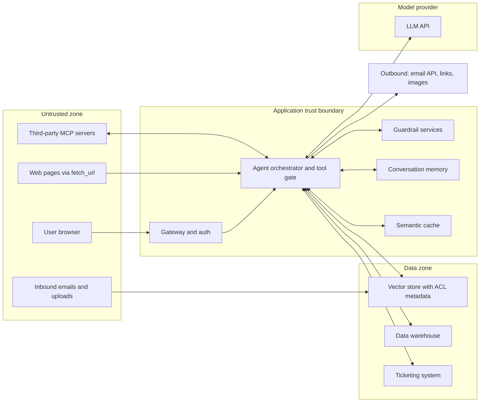
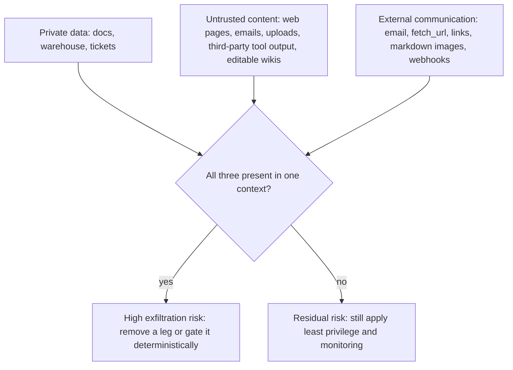
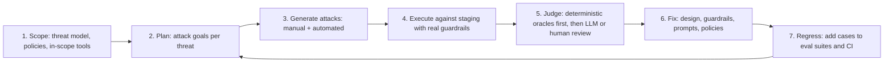

# Threat Modeling Agentic RAG: OWASP, ATLAS, NIST, and Red Teaming

> **TL;DR**
>
> - **Threat model the full system at trust boundaries.** Map where untrusted text enters, where private data lives, and where actions leave.
> - **Use OWASP LLM Top 10 and Agentic Top 10 as your baseline.** Pair every identified risk with a deterministic guardrail and an evaluation test.
> - **Break the lethal trifecta in every agent.** Never combine private data, untrusted content, and un-gated external communication in one context.
> - **Red-team the stack continuously.** Test realistic attack goals against staging guardrails and turn every finding into a CI regression test.

- **You will learn:**
    - Data-flow diagrams and trust boundaries for agentic RAG
    - OWASP LLM Top 10 (2025) and Agentic Top 10 (2026) mapped to guardrails and evals
    - MITRE ATLAS, NIST AI RMF, and breaking the lethal trifecta
    - Practical red-teaming workflows, tools, and a reusable STRIDE threat-model worksheet
- **Prerequisites:** [Agentic RAG failure modes](../00-foundations/03-agentic-rag-failure-modes.md), [Guardrails architecture](./01-guardrails-architecture.md)
- **Related:** [Input guardrails](./02-input-guardrails.md), [Retrieval & context guardrails](./03-retrieval-and-context-guardrails.md), [Output guardrails](./04-output-guardrails.md), [Tool & action guardrails](./05-tool-and-action-guardrails.md), [Access control & RBAC](./06-access-control-rbac.md), [Generation quality & safety evals](../02-offline-evals/03-generation-quality-and-safety-evals.md)

---

## 1. Why threat model an LLM app

Classic application security rules still apply, including authentication, authorization, injection prevention, secrets management, and dependency hygiene. LLM applications add three distinct risks:

1. **Instructions and data share one channel.** User prompts, retrieved chunks, tool outputs, and memory all enter the context window. Any of them can act as instructions, which causes prompt injection.
2. **Behavior is probabilistic.** An identical prompt can produce 99 safe answers and one unsafe answer. Security controls that rely on the model "deciding correctly" will eventually fail.
3. **Agents take actions.** Tool calls turn text mistakes into real-world side effects at machine speed.

A strong agentic RAG threat model focuses on **trust boundaries** where untrusted text enters, sensitive data lives, and actions leave. Enforce **deterministic controls** at each of those boundaries.

### A simple process

| Step | Question | Output |
|---|---|---|
| 1. Model the system | What are the components, data stores, tools, and trust boundaries? | Data-flow diagram (DFD) |
| 2. Find threats | What can go wrong at each component and boundary? | Threat list using OWASP LLM Top 10, OWASP Agentic threats, and STRIDE |
| 3. Rate | How likely is each threat and how severe is the impact? | Prioritized threat list |
| 4. Mitigate | Which guardrails, design changes, or process controls reduce the risk? | Controls mapped to threats |
| 5. Verify | How do we prove that each mitigation works? | Evals, unit tests, red-team cases, and production monitors |
| 6. Repeat | What changed across tools, data sources, or models? | Updated threat model on every major change |

This workflow follows the standard OWASP [threat modeling process](https://owasp.org/www-community/Threat_Modeling). Step 5 connects threat modeling to the rest of this guide: every mitigation requires a test.

### DFD for the running example

Our internal enterprise assistant combines RAG over company documents, text-to-SQL over the warehouse, ticket and email tools, and multiple roles and tenants.

Inspect every arrow that crosses a boundary and ask four questions: *Is this payload trusted? Is it authorized? Is it validated? Is it logged?*

---

## 2. OWASP Top 10 for LLM Applications (2025)

The [OWASP Top 10 for LLM Applications 2025](https://genai.owasp.org/llm-top-10/) is the standard checklist for LLM risks. Each card below summarizes the **description**, **agentic RAG example**, **guardrails**, and **evals/tests**. Read the official OWASP entries for full details.

### Summary map

| ID | Risk | Primary guardrail layers in this repo |
|---|---|---|
| LLM01 | Prompt Injection | [Input](./02-input-guardrails.md), [retrieval & context](./03-retrieval-and-context-guardrails.md), [tool & action](./05-tool-and-action-guardrails.md) |
| LLM02 | Sensitive Information Disclosure | [Access control](./06-access-control-rbac.md), [output](./04-output-guardrails.md) |
| LLM03 | Supply Chain | Process controls, [tool & action (MCP)](./05-tool-and-action-guardrails.md) |
| LLM04 | Data and Model Poisoning | [Retrieval & context](./03-retrieval-and-context-guardrails.md), ingestion controls |
| LLM05 | Improper Output Handling | [Output](./04-output-guardrails.md), [tool & action](./05-tool-and-action-guardrails.md) |
| LLM06 | Excessive Agency | [Tool & action](./05-tool-and-action-guardrails.md), [access control](./06-access-control-rbac.md) |
| LLM07 | System Prompt Leakage | [Output](./04-output-guardrails.md), design (no secrets in prompts) |
| LLM08 | Vector and Embedding Weaknesses | [Access control](./06-access-control-rbac.md), [retrieval & context](./03-retrieval-and-context-guardrails.md) |
| LLM09 | Misinformation | [Output](./04-output-guardrails.md), [E2E RAG evals](../02-offline-evals/01-end-to-end-rag-evals.md), [citation adherence](../02-offline-evals/06-instruction-and-citation-adherence.md) |
| LLM10 | Unbounded Consumption | [Tool & action (budgets)](./05-tool-and-action-guardrails.md), [monitoring](../03-online-evals-and-observability/04-monitoring-alerting-and-drift.md) |

---

### LLM01: Prompt Injection

**Description.** Crafted inputs alter the model's behavior in unintended ways. *Direct* injection comes from the user's prompt, including jailbreaks. *Indirect* injection arrives through external content the model processes, such as web pages, documents, emails, tool results, or images ([OWASP LLM01](https://genai.owasp.org/llmrisk/llm01-prompt-injection/), [Greshake et al., 2023](https://arxiv.org/abs/2302.12173)).

**Agentic RAG example.** An indexed wiki page hides instructions to call `search_docs('salary bands')` and append results to `https://evil.example/?d=`. When an employee asks for a summary, the agent executes those hidden instructions.

**Guardrails.**

- Assume prompt injection **will** sometimes succeed, and limit its blast radius with least privilege, blocked exfiltration channels, and human approval ([lethal trifecta](#5-the-lethal-trifecta)).
- Run injection and jailbreak classifiers on user inputs, retrieved chunks, and tool outputs ([input guardrails](./02-input-guardrails.md), [retrieval & context guardrails](./03-retrieval-and-context-guardrails.md)). Treat classifier scores as risk signals rather than guarantees.
- Delimit untrusted content clearly in the prompt and instruct the model to treat it as data.
- Enable taint tracking so T2 and T3 tools require approval or stay disabled once untrusted content enters the context ([tool & action guardrails](./05-tool-and-action-guardrails.md)).
- Enforce authorization in code using the end-user identity so injected cross-user queries fail ([access control](./06-access-control-rbac.md)).

**Evals/tests.**

- Run direct and indirect injection suites against a test index containing planted malicious chunks, and measure **attack success rate** and **unsafe tool-call attempt rate**.
- Measure injection classifier precision and recall on labeled attacks alongside false-positive rates on benign traffic.
- Convert every red-team or production injection finding into a permanent regression test ([production data flywheel](../01-datasets/04-production-data-flywheel.md)).

---

### LLM02: Sensitive Information Disclosure

**Description.** The application exposes PII, credentials, confidential business data, or other users' data through the context window, training data, logs, or caches ([OWASP LLM02](https://genai.owasp.org/llmrisk/llm022025-sensitive-information-disclosure/)).

**Agentic RAG example.** An `employee` asks for executive bonus numbers. An unfiltered service-account retriever fetches an HR spreadsheet, or a shared semantic cache returns an HR partner's prior answer.

**Guardrails.**

- Enforce permission-aware retrieval and database RLS keyed on the authenticated end user ([access control](./06-access-control-rbac.md)).
- Redact PII and secrets across outputs, tool arguments, and logs ([output guardrails](./04-output-guardrails.md)).
- Minimize data at ingestion by excluding secrets, credentials, and unnecessary sensitive records from the index.
- Scope all caches and conversation memory by tenant and user permissions.

**Evals/tests.**

- Run an RBAC test matrix with canary documents and require an **unauthorized retrieval rate of 0** ([access control evals](./06-access-control-rbac.md)).
- Run a PII elicitation test suite and measure leakage using deterministic detectors plus an LLM judge for paraphrased leaks.
- Scan stored traces and logs regularly for unredacted PII and secrets.

---

### LLM03: Supply Chain

**Description.** Third-party components introduce vulnerabilities, backdoors, bias, or licensing risks. Common supply-chain dependencies include base models, fine-tuning adapters (LoRA), datasets, libraries, model hubs, and MCP servers ([OWASP LLM03](https://genai.owasp.org/llmrisk/llm032025-supply-chain/)).

**Agentic RAG example.** A team installs a community MCP server for Confluence search. A subsequent update modifies a tool description to exfiltrate context via tool arguments, or an unverified model checkpoint executes arbitrary code during deserialization.

**Guardrails.**

- Maintain an AI bill of materials (AI BOM) covering models, versions, providers, datasets, embedding models, MCP servers, prompt templates, and guardrail models.
- Pin dependency versions, verify cryptographic hashes and signatures, and use safe serialization formats (`safetensors`).
- Vet and allowlist MCP servers, and diff tool manifests on every update ([MCP security](./05-tool-and-action-guardrails.md)).
- Sandbox third-party code and issue least-privilege credentials per integration.

**Evals/tests.**

- Re-run your full offline evaluation suite on every model, prompt, embedding, or dependency update ([running offline experiments](../02-offline-evals/08-running-offline-experiments.md)).
- Verify in CI that MCP tool descriptions and manifests match approved hashes.
- Run automated dependency and container vulnerability scans in CI.

---

### LLM04: Data and Model Poisoning

**Description.** Attackers manipulate pre-training, fine-tuning, embedding, or RAG knowledge-base data to introduce backdoors, false facts, or biases ([OWASP LLM04](https://genai.owasp.org/llmrisk/llm042025-data-and-model-poisoning/)).

**Agentic RAG example.** An insider edits an open internal wiki page on expense policy to state that purchases under $10,000 need no approval. The assistant then repeats that false rule as company policy, or an attacker crafts a document to rank first and deliver an injection payload.

**Guardrails.**

- Assign source trust tiers at ingestion (official policy repo > team wiki > user uploads), boost authoritative sources during ranking, and display source labels to users.
- Record provenance metadata on every chunk (author, last editor, timestamp, source system) and monitor edits to high-impact documents.
- Scan documents at ingestion for prompt-injection patterns and anomalous content ([retrieval & context guardrails](./03-retrieval-and-context-guardrails.md)).
- Require human review before indexing changes to documents that govern high-stakes policies.

**Evals/tests.**

- Run poisoning drills by inserting tampered documents into a staging index and measuring the **poison success rate**.
- Run a golden Q&A regression set on critical policies nightly and alert on answer drift ([monitoring & drift](../03-online-evals-and-observability/04-monitoring-alerting-and-drift.md)).
- Verify in retrieval tests that authoritative documents outrank lower-trust copies.

---

### LLM05: Improper Output Handling

**Description.** Passing unvalidated model output to browsers, databases, or shells enables XSS, CSRF, SSRF, privilege escalation, SQL injection, or remote code execution ([OWASP LLM05](https://genai.owasp.org/llmrisk/llm052025-improper-output-handling/)).

**Agentic RAG example.** The app runs model-generated SQL under a write role, renders `<script>` tags or tracking images, or runs Python on the host.

**Guardrails.**

- Treat all model outputs as **untrusted input** to every downstream component.
- Enforce a text-to-SQL AST guard alongside a read-only database role and RLS ([tool & action guardrails](./05-tool-and-action-guardrails.md)).
- Sanitize HTML, enforce a strict Content Security Policy, and block arbitrary remote images in the chat UI ([output guardrails](./04-output-guardrails.md)).
- Execute generated code only inside an isolated sandbox, and use parameterized APIs instead of string-concatenated commands.

**Evals/tests.**

- Run a labeled SQL guard test corpus and require 100% accuracy on safe and unsafe queries.
- Fuzz prompts to elicit HTML, JavaScript, and markdown-image payloads, and verify that the rendered DOM stays inert.
- Track schema-validation pass rates on structured outputs.

---

### LLM06: Excessive Agency

**Description.** An agent causes damage when given **excessive functionality** (broad tools), **excessive permissions** (over-privileged tokens), or **excessive autonomy** (unapproved high-impact actions) ([OWASP LLM06](https://genai.owasp.org/llmrisk/llm062025-excessive-agency/)).

**Agentic RAG example.** A ticketing integration uses an admin token and exposes a generic `ticket_api(method, path, body)` tool. A prompt-injected document tricks the agent into closing all open security tickets.

**Guardrails.**

- Build narrow, purpose-specific tools, enforce per-role tool allowlists, and use least-privilege user-scoped credentials.
- Assign tool impact tiers, require human approval and dry-run previews for destructive or external actions, and enforce step and call budgets ([tool & action guardrails](./05-tool-and-action-guardrails.md)).
- Enforce object-level authorization on every tool call ([access control](./06-access-control-rbac.md)).

**Evals/tests.**

- Run policy unit tests across all `role × tool` combinations.
- Run trajectory evaluations to confirm the agent calls the right tools with valid arguments on benign tasks ([agent tool & trajectory evals](../02-offline-evals/04-agent-tool-and-trajectory-evals.md)).
- Run adversarial injection tests targeting destructive tools and require an **unsafe action execution rate of 0**.

---

### LLM07: System Prompt Leakage

**Description.** Attackers extract system prompts to uncover embedded credentials, internal endpoints, role rules, or guardrail heuristics. OWASP emphasizes that system prompts must never hold secrets or act as security controls ([OWASP LLM07](https://genai.owasp.org/llmrisk/llm072025-system-prompt-leakage/)).

**Agentic RAG example.** A system prompt contains "Admins have emails ending in `-adm@company.com`. Never show HR data to others. Warehouse password: ...". A user extracts the full text by asking the assistant to repeat its instructions verbatim.

**Guardrails.**

- **Store zero secrets in prompts.** Keep credentials in a vault and inject them inside tool execution code.
- Enforce authorization in deterministic code rather than prompt instructions ([access control](./06-access-control-rbac.md)).
- Add canary tokens and n-gram overlap checks on outputs and tool arguments to detect extraction attempts ([output guardrails](./04-output-guardrails.md)).

**Evals/tests.**

- Run a prompt-extraction attack suite and measure verbatim and near-verbatim overlap with the system prompt.
- Scan prompt templates in CI with secret-detection tools.

---

### LLM08: Vector and Embedding Weaknesses

**Description.** Flaws in vector generation, storage, or retrieval lead to unauthorized access, cross-tenant leakage, embedding inversion attacks, or knowledge-base poisoning ([OWASP LLM08](https://genai.owasp.org/llmrisk/llm082025-vector-and-embedding-weaknesses/)).

**Agentic RAG example.** Multiple tenants share a single vector index. One retrieval helper omits the `tenant_id` filter, returning chunks from Subsidiary B to a user in Subsidiary A.

**Guardrails.**

- Build a permission-aware vector pipeline with ingestion ACL metadata, query pre-filtering, code post-checks, fast ACL sync, and deliberate tenant partitioning ([access control](./06-access-control-rbac.md)).
- Protect embeddings of sensitive text with the same access controls, encryption, and retention rules as the source documents.
- Validate and authenticate document sources at ingestion (shared with LLM04).

**Evals/tests.**

- Run cross-tenant and cross-role retrieval tests with canary documents in CI.
- Monitor production canary hits and alert on any post-check ACL mismatches.
- Measure retrieval recall and precision per role to catch overly restrictive filters ([retrieval metrics](../02-offline-evals/02-retrieval-metrics.md)).

---

### LLM09: Misinformation

**Description.** The model generates false or misleading claims that sound authoritative (hallucinations), causing users or downstream systems to make bad decisions ([OWASP LLM09](https://genai.owasp.org/llmrisk/llm092025-misinformation/)).

**Agentic RAG example.** Retrieval misses the current travel policy. The model then answers from a stale 2023 document or invents a reimbursement limit with a plausible citation.

**Guardrails.**

- Run groundedness checks and verify citations against retrieved, permitted chunks before display ([output guardrails](./04-output-guardrails.md)).
- Abstain when retrieval relevance or groundedness scores fall below threshold.
- Track document freshness metadata, boost current policy versions, and display source dates in the UI.
- Display the executed SQL query and assumptions alongside data answers so users can verify numbers.

**Evals/tests.**

- Evaluate faithfulness, answer correctness, and context recall and precision ([E2E RAG evals](../02-offline-evals/01-end-to-end-rag-evals.md)).
- Measure citation precision and recall ([instruction & citation adherence](../02-offline-evals/06-instruction-and-citation-adherence.md)).
- Measure text-to-SQL execution accuracy ([text-to-SQL evals](../02-offline-evals/05-text-to-sql-evals.md)).
- Test an unanswerable-question dataset to verify the abstention rate.

---

### LLM10: Unbounded Consumption

**Description.** Uncontrolled inference or tool execution drives denial of service, runaway cloud spend ("denial of wallet"), or model extraction via high-volume querying ([OWASP LLM10](https://genai.owasp.org/llmrisk/llm102025-unbounded-consumption/)).

**Agentic RAG example.** A crafted prompt traps the agent in a 200-step loop between `run_sql` and `search_docs`, or triggers a full-warehouse table scan.

**Guardrails.**

- Enforce per-run step, tool-call, token, cost, and wall-clock budgets alongside loop detection and per-user rate limits ([tool & action guardrails](./05-tool-and-action-guardrails.md)).
- Cap input length, enforce SQL `EXPLAIN` cost limits, and set strict database statement timeouts.
- Configure spend alerts and automated kill switches.

**Evals/tests.**

- Run load tests and scripted looping-agent tests to confirm runs stop at their budget limits.
- Monitor p95 and p99 cost and latency per request with automated alerts ([monitoring & drift](../03-online-evals-and-observability/04-monitoring-alerting-and-drift.md)).

---

## 3. OWASP agentic guidance

The OWASP GenAI Security Project's [Agentic Security Initiative](https://genai.owasp.org/initiatives/agentic-security-initiative/) publishes threat taxonomies and controls specifically for tool-using and multi-agent systems.

### 3.1 Agentic AI – Threats and Mitigations

[Agentic AI – Threats and Mitigations](https://genai.owasp.org/resource/agentic-ai-threats-and-mitigations/) defines 17 agentic threats (v1.1, December 2025) and maps them to mitigation playbooks:

| ID | Threat | In the running example |
|---|---|---|
| T1 | Memory Poisoning | Injected false facts are saved to long-term memory and reused in future sessions |
| T2 | Tool Misuse | Prompt injection steers the agent into abusing permitted tools (such as mass ticket updates) |
| T3 | Privilege Compromise | The agent's service account acts beyond the requester's permissions (confused deputy) |
| T4 | Resource Overload | Agent loops and expensive SQL queries exhaust budgets or warehouse capacity |
| T5 | Cascading Hallucination Attacks | A hallucinated value is written to a ticket or memory and treated as fact later |
| T6 | Intent Breaking & Goal Manipulation | An injected document hijacks the agent's execution plan |
| T7 | Misaligned & Deceptive Behaviors | The agent takes policy-violating shortcuts to satisfy a goal |
| T8 | Repudiation & Untraceability | Missing audit logs prevent teams from linking an action to a user, prompt, and approval |
| T9 | Identity Spoofing & Impersonation | A prompt claims "I am an admin", or an agent impersonates another user downstream |
| T10 | Overwhelming Human-in-the-Loop | Frequent approval prompts cause reviewers to rubber-stamp risky actions |
| T11 | Unexpected RCE and Code Attacks | Generated Python code escapes a weak execution sandbox |
| T12 | Agent Communication Poisoning | One compromised sub-agent passes manipulated messages to peer agents |
| T13 | Rogue Agents in Multi-Agent Systems | A compromised or drifting agent acts outside its assigned role |
| T14 | Human Attacks on Multi-Agent Systems | Attackers exploit delegation chains across agents to escalate privileges |
| T15 | Human Manipulation | Agent responses socially engineer human operators with fabricated urgency |
| T16 | Insecure Inter-Agent Protocol Abuse | Attackers exploit unauthenticated or unvalidated agent-to-agent protocols |
| T17 | Supply Chain Compromise | Malicious models, tools, MCP servers, or agent frameworks compromise the app |

The OWASP guide organizes mitigations into six playbooks:

- Preventing reasoning manipulation.
- Preventing memory poisoning and knowledge corruption.
- Securing tool execution and preventing unauthorized actions.
- Strengthening authentication, identity, and privilege controls.
- Protecting human-in-the-loop review from decision fatigue.
- Securing multi-agent communication and trust.

### 3.2 OWASP Top 10 for Agentic Applications (2026)

The [OWASP Top 10 for Agentic Applications for 2026](https://genai.owasp.org/resource/owasp-top-10-for-agentic-applications-for-2026/) distills the agentic threat landscape into ten core risks:

| ID | Risk | Closest controls in this repo |
|---|---|---|
| ASI01 | Agent Goal Hijack | Injection defenses, taint tracking, human approval ([input](./02-input-guardrails.md), [tool & action](./05-tool-and-action-guardrails.md)) |
| ASI02 | Tool Misuse and Exploitation | Tool gate, allowlists, argument validation, budgets ([tool & action](./05-tool-and-action-guardrails.md)) |
| ASI03 | Identity and Privilege Abuse | Identity propagation, OBO tokens, object-level authz ([access control](./06-access-control-rbac.md)) |
| ASI04 | Agentic Supply Chain Vulnerabilities | Approved MCP registry, version pinning, manifest hashing ([tool & action](./05-tool-and-action-guardrails.md)) |
| ASI05 | Unexpected Code Execution (RCE) | Isolated sandboxes with no network or credentials ([tool & action](./05-tool-and-action-guardrails.md)) |
| ASI06 | Memory & Context Poisoning | Ingestion validation, provenance tracking, per-user memory ([retrieval & context](./03-retrieval-and-context-guardrails.md), [access control](./06-access-control-rbac.md)) |
| ASI07 | Insecure Inter-Agent Communication | Authenticated, schema-validated peer messages treated as untrusted input |
| ASI08 | Cascading Failures | Step budgets, circuit breakers, inter-step validation ([monitoring](../03-online-evals-and-observability/04-monitoring-alerting-and-drift.md)) |
| ASI09 | Human-Agent Trust Exploitation | Clear dry-run previews, source provenance, calibrated confidence, approval UX |
| ASI10 | Rogue Agents | Least privilege, anomaly monitoring, kill switches, immutable audit logs |

Use the LLM Top 10 for model and data risks, and use the Agentic Top 10 for planning, tool execution, memory, identity, and multi-agent risks.

---

## 4. Other frameworks you will meet

### MITRE ATLAS

[MITRE ATLAS](https://atlas.mitre.org/) (Adversarial Threat Landscape for Artificial-Intelligence Systems) catalogs adversary tactics, techniques, and real-world case studies against AI systems using the MITRE ATT&CK structure. Use ATLAS for three purposes:

- **Share vocabulary with security operations teams** that already use MITRE ATT&CK.
- **Model full attack paths** from reconnaissance and initial access to execution and exfiltration.
- **Seed red-team scenarios** from documented AI attack case studies.

Pair OWASP with ATLAS: OWASP tells builders *which weaknesses to fix*, whereas ATLAS shows defenders *how adversaries chain attacks*.

### NIST AI RMF (AI 100-1) and the Generative AI Profile (AI 600-1)

The [NIST AI Risk Management Framework 1.0 (NIST AI 100-1)](https://doi.org/10.6028/NIST.AI.100-1) organizes AI risk management across four lifecycle functions:

| Function | What it means for an agentic RAG team |
|---|---|
| **Govern** | Define ownership, security policies, risk tolerance, and launch approval gates |
| **Map** | Document system context, intended use, users, data flows, and the threat model |
| **Measure** | Run offline evals, red-team suites, guardrail metrics, and online monitoring |
| **Manage** | Prioritize and mitigate risks, run incident response, and decommission unsafe features |

The [Generative AI Profile (NIST AI 600-1, July 2024)](https://doi.org/10.6028/NIST.AI.600-1) adapts the RMF to generative AI across 12 risk areas. Key areas include confabulation, data privacy, information security, information integrity, human-AI configuration, and value-chain integration. Use [NIST AI RMF](https://www.nist.gov/itl/ai-risk-management-framework) as your **governance structure**, OWASP and ATLAS as your **threat catalog**, and your evals and guardrails as the **verifiable controls**.

---

## 5. The lethal trifecta

Simon Willison's [lethal trifecta](https://simonwillison.net/2025/Jun/16/the-lethal-trifecta/) is a fast, practical heuristic for agent design reviews. An agent faces severe data-exfiltration risk whenever it combines all three legs in one context:

1. **Access to private data**
2. **Exposure to untrusted content** (any text an attacker can influence)
3. **The ability to communicate externally** (any outbound channel that can carry data out)

When all three legs meet, an attacker who places instructions inside untrusted content can trick the model into stealing private data and sending it out. LLMs follow instructions in data and cannot reliably separate trusted instructions from untrusted text.

Our running example combines all three legs by default: private enterprise data, editable wikis and `fetch_url` outputs, and outbound `send_email` calls and markdown links. Break the lethal trifecta using deterministic boundaries:

| Leg | How to remove or gate it |
|---|---|
| Private data | Run untrusted-content tasks (such as summarizing public web pages) in an isolated agent with **zero** access to private data |
| Untrusted content | Index only vetted, access-controlled sources for high-privilege agents, and treat open wikis as untrusted |
| External communication | Remove `fetch_url` and `send_email` from agents that read private data, allowlist domains and recipients, block remote markdown images, and sanitize links |
| Dynamic gating | Use taint tracking to disable or require human approval for every outbound tool once untrusted content and sensitive data both enter the context ([tool & action guardrails](./05-tool-and-action-guardrails.md)) |

Remember that "untrusted content" includes internal wikis anyone can edit, inbound emails, shared tickets, and third-party MCP tool outputs, not just the public web.

---

## 6. Red teaming

Red teaming uses structured human and automated attacks to make the system violate its security policies. Red teaming uncovers multi-step failures that static evaluation sets miss, and every finding feeds back into your regression suite.

### Process

Red-teaming checklist:

- [ ] Test the full stack (gateway, retriever, tool gate, output rails) with realistic roles and data.
- [ ] Define concrete attacker goals from your threat model, such as cross-tenant reads or external emails.
- [ ] Attack every input surface, including prompts, uploads, wiki docs, web pages, tool results, and MCP metadata.
- [ ] Grade attacks with deterministic oracles first (canaries, audit logs), and use [LLM judges](../02-offline-evals/07-llm-as-a-judge.md) for fuzzy goals.
- [ ] Track attack success rate per goal and per input surface across releases.
- [ ] Combine automated scanners for broad regression coverage with human red teamers for creative, multi-step exploits.
- [ ] Re-run the red-team suite on every material change to models, tools, data sources, or system prompts.
- [ ] Scope and authorize all red-team exercises in advance, especially when testing shared or third-party environments.

### Tools

Common open-source LLM red-teaming tools include:

| Tool | What it is | Good for |
|---|---|---|
| [garak](https://github.com/NVIDIA/garak) (NVIDIA) | LLM vulnerability scanner with attack probes and detectors | Broad model-level scans for jailbreaks, prompt injection, leakage, and toxicity |
| [PyRIT](https://github.com/Azure/PyRIT) (Microsoft) | Python Risk Identification Tool for orchestrating single- and multi-turn attack campaigns | Custom, programmable red-team campaigns against application endpoints |
| [promptfoo red teaming](https://www.promptfoo.dev/docs/red-team/) | CLI that generates adversarial test cases mapped to frameworks like the OWASP LLM Top 10 | Application-level red teaming wired directly into CI alongside offline evals |

Compare additional options in [guardrail tools](../06-tooling-landscape/02-guardrail-tools.md) and [eval & observability tools](../06-tooling-landscape/01-eval-and-observability-tools.md).

### Metrics

| Metric | Definition | Target / use |
|---|---|---|
| Attack success rate (ASR) | Successful attacks divided by attempted attacks per goal | Track per release, with a target of **0** for data leakage and unauthorized actions |
| Unsafe action execution rate | Unapproved T2 or T3 actions executed during adversarial tests | **0** |
| Detection rate | Fraction of attacks flagged by guardrails, even when blocked downstream | Higher is better to confirm defense-in-depth visibility |
| False positive rate | Fraction of benign requests blocked by security guardrails | Measure on normal traffic and keep low |
| Time to fix | Elapsed time from red-team finding to deployed fix and CI regression test | Measures security engineering responsiveness |

---

## 7. Threat-model worksheet template

Copy this STRIDE-based worksheet into your design document. STRIDE (Spoofing, Tampering, Repudiation, Information disclosure, Denial of service, Elevation of privilege) plus LLM-specific rows gives complete coverage for agentic RAG reviews.

### Part A: System summary

| Field | Your answer |
|---|---|
| System name / owner | |
| Purpose and users (roles, tenants) | |
| Model(s) and providers | |
| Data sources (and sensitivity) | |
| Tools (with tier: read / write / external / destructive) | |
| Untrusted input surfaces | |
| Outbound channels | |
| Memory / caches | |
| Lethal trifecta present? Which legs, and how is it broken? | |

### Part B: STRIDE for LLM apps

| STRIDE category | LLM/agent-specific prompts | Example threat (running example) | Mitigation | Verification (eval/test/monitor) | Owner | Status |
|---|---|---|---|---|---|---|
| **S**poofing | Can a prompt claim an identity or role? Can content impersonate the system or another agent? Are MCP servers and agents authenticated? | "I'm an HR partner" unlocks HR answers | Resolve identity from auth session only, enforce authz in code | RBAC test matrix and role-claim red-team cases | | |
| **T**ampering | Can untrusted text alter instructions (injection)? Can someone edit indexed docs, memory, or tool descriptions? | Wiki page edited to change expense policy | Source trust tiers, provenance metadata, change monitoring | Poisoning drills and nightly golden Q&A drift checks | | |
| **R**epudiation | Can we prove who asked, what was retrieved, which tool ran, and who approved? | Ticket closed with no record of approver | Immutable audit log with identity, payload hash, and approval | Audit completeness assertions in CI | | |
| **I**nformation disclosure | Can unauthorized data enter the context, exfiltrate via links/images/tools, or leak via cache, memory, logs, or system prompt? | Semantic cache returns HR answer to employee | Permission-scoped cache, ACL pre-filter, egress controls | Canary docs and unauthorized retrieval rate = 0 | | |
| **D**enial of service | Can inputs trigger loops, huge queries, token blowups, or cost spikes? | Agent loops `run_sql` 200 times | Step/call/cost budgets, loop detector, EXPLAIN caps, rate limits | Looping-agent abuse tests and p99 cost alerts | | |
| **E**levation of privilege | Can the agent do more than the user could via generic tools, over-scoped tokens, or sandbox escape? | Service account reads all tickets | OBO tokens, object-level authz, narrow tools, isolated sandbox | Policy unit tests and unsafe action execution rate = 0 | | |
| **Misinformation** *(LLM addition)* | Can the assistant state false facts confidently or report wrong numbers from SQL? | Outdated travel policy cited as current | Groundedness gate, freshness metadata, abstention | Faithfulness, correctness, and SQL execution accuracy evals | | |
| **Harmful content** *(LLM addition)* | Can the assistant emit toxic, biased, or off-policy responses? | Offensive reply to a frustrated user | Output moderation classifiers and tone regeneration | Safety evaluation suite ([generation quality & safety](../02-offline-evals/03-generation-quality-and-safety-evals.md)) | | |

### Part C: Rating and decisions

| Threat ID | Likelihood (L/M/H) | Impact (L/M/H) | Risk | Decision (mitigate / accept / transfer / avoid) | Residual risk notes |
|---|---|---|---|---|---|
| | | | | | |

### Part D: Review triggers

- [ ] Review the threat model when adding a new tool or changing a tool impact tier.
- [ ] Update the threat model when connecting a new data source or changing data sensitivity.
- [ ] Re-evaluate risks before switching models, providers, or core system prompts.
- [ ] Review trust boundaries when onboarding a new user role, tenant, or channel (such as Slack or external users).
- [ ] Update controls and regression tests after any security incident or red-team finding.
- [ ] Schedule a recurring threat-model review at a fixed cadence (such as quarterly).

---

## 8. From threat model to guardrails and evals

Close the loop by mapping every identified threat to at least one **deterministic or probabilistic control** and one **automated verification**:

| Threat (example) | Control | Blocking? | Offline verification | Online verification |
|---|---|---|---|---|
| Indirect injection via wiki | Taint tracking + approval for T2/T3, plus injection classifier on retrieved chunks | Yes (gate), No (classifier signal) | Injection suite ASR | Classifier hit rate and blocked-action logs |
| Cross-tenant retrieval | Tenant resolved from identity, namespace per tenant, code post-check | Yes | Cross-tenant test matrix | Canary monitoring and post-check mismatch alerts |
| SQL write/DDL | Read-only database role + `sqlglot` AST guard | Yes | SQL guard corpus | Denied-query rate by reason |
| Data exfiltration via images | Disable remote image rendering and rewrite external links | Yes | Output fuzzing | Outbound request logs |
| Runaway cost | Step/cost budgets + loop detection | Yes | Scripted looping-agent tests | Cost p99 alerts |
| Misinformation | Groundedness gate and abstention fallback | Optional (block or warn) | Faithfulness and correctness evals | Sampled LLM-judge scores and user feedback |

See the [guardrail selection decision tree](../05-decision-framework/02-guardrail-selection-decision-tree.md) and [implementation playbook](../05-decision-framework/04-implementation-playbook.md) to prioritize controls for your architecture.

---

## Key takeaways

- **Threat model the full system, not the model in isolation.** Map trust boundaries where untrusted text enters, private data lives, and actions leave.
- **Use OWASP LLM Top 10 (2025) and Agentic Top 10 (2026) as your baseline.** Cover model, data, tool, memory, identity, and multi-agent risks systematically.
- **Assume prompt injection will sometimes succeed.** Contain the blast radius with least privilege, code-enforced authorization, and gated outbound channels.
- **Break the lethal trifecta in every agent.** Never allow private data, untrusted content, and un-gated external communication in the same context.
- **Combine NIST AI RMF governance with MITRE ATLAS attack paths.** Use your guardrails and evaluations as the measurable controls.
- **Red-team the complete stack using deterministic oracles.** Turn every red-team or production finding into a permanent CI regression test.
- **Pair every threat with both a control and a test.** If you do not test a mitigation automatically, you cannot trust it in production.

## Further reading

- [OWASP Top 10 for LLM Applications 2025](https://genai.owasp.org/llm-top-10/) · [PDF/resource page](https://genai.owasp.org/resource/owasp-top-10-for-llm-applications-2025/)
- [OWASP Agentic AI – Threats and Mitigations](https://genai.owasp.org/resource/agentic-ai-threats-and-mitigations/)
- [OWASP Top 10 for Agentic Applications for 2026](https://genai.owasp.org/resource/owasp-top-10-for-agentic-applications-for-2026/)
- [OWASP: A Practical Guide for Secure MCP Server Development](https://genai.owasp.org/resource/a-practical-guide-for-secure-mcp-server-development/)
- [OWASP Threat Modeling](https://owasp.org/www-community/Threat_Modeling)
- [MITRE ATLAS](https://atlas.mitre.org/)
- [NIST AI RMF 1.0 (AI 100-1)](https://doi.org/10.6028/NIST.AI.100-1) · [NIST AI 600-1 Generative AI Profile](https://doi.org/10.6028/NIST.AI.600-1) · [NIST AI RMF hub](https://www.nist.gov/itl/ai-risk-management-framework)
- [Simon Willison: The lethal trifecta for AI agents](https://simonwillison.net/2025/Jun/16/the-lethal-trifecta/)
- [Greshake et al.: Not what you've signed up for: Compromising Real-World LLM-Integrated Applications with Indirect Prompt Injection](https://arxiv.org/abs/2302.12173)
- [Debenedetti et al.: Defeating Prompt Injections by Design (CaMeL)](https://arxiv.org/abs/2503.18813)
- [MCP Security Best Practices](https://modelcontextprotocol.io/specification/2025-06-18/basic/security_best_practices)
- Red-team tools: [garak](https://github.com/NVIDIA/garak) · [PyRIT](https://github.com/Azure/PyRIT) · [promptfoo red teaming](https://www.promptfoo.dev/docs/red-team/)
- **Within this repo:**
    - [Tool & action guardrails](./05-tool-and-action-guardrails.md)
    - [Access control & RBAC](./06-access-control-rbac.md)
    - [Guardrail selection decision tree](../05-decision-framework/02-guardrail-selection-decision-tree.md)
    - [References](../07-references/README.md)
