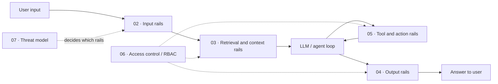

# 04 · Guardrails

Evals tell you **how good** your agentic RAG application is on average. Guardrails decide, **for this one request, right now**, whether something is allowed to happen. They are runtime controls that sit in the request path (or beside it) and can allow, block, modify, escalate, or flag inputs, retrieved context, tool calls, and outputs.

This section treats guardrails as an engineering discipline, not a checkbox: a layered architecture, a catalogue of detectors per layer, access control that is enforced in code rather than in prompts, and a threat model that tells you which guardrails you actually need. Every guardrail is also a classifier, so it has precision, recall, latency, and a cost when it is wrong — we show how to measure that.

Running example used throughout: an **internal enterprise assistant** that answers questions over company documents (vector search), queries a data warehouse via text-to-SQL, and can call tools such as `create_ticket`, used by employees in different roles (RBAC).

## Files in this section

| File | What it covers | Read when… |
|---|---|---|
| [01-guardrails-architecture.md](./01-guardrails-architecture.md) | Guardrails vs evals; the layered defense-in-depth model; actions (allow / block / modify / escalate / flag); blocking vs non-blocking, sync vs async; latency budgets, parallel rails, streaming, fail-open vs fail-closed; rules vs ML classifiers vs LLM rails; policy-as-config; refusal UX; measuring guardrails; a guardrail spec template | You are designing the guardrail layer for the first time or need a shared vocabulary for your team |
| [02-input-guardrails.md](./02-input-guardrails.md) | Normalization, length/rate limits, language detection, prompt injection & jailbreak detection, topic/scope restriction, PII and secrets detection, toxicity, SQL/code-in-input detection, malicious URLs/files | You need to decide what to check on the user's message before it reaches retrieval or the model |
| [03-retrieval-and-context-guardrails.md](./03-retrieval-and-context-guardrails.md) | Permission-aware retrieval (pre- vs post-filter), indirect prompt injection and spotlighting, provenance and source allowlists, freshness, relevance thresholds and abstention, context poisoning, data minimization, ingestion-time guardrails | Your app retrieves documents, web pages, emails, or tickets that someone other than the user could have written |
| [04-output-guardrails.md](./04-output-guardrails.md) | Groundedness checks, citation verification, PII/secret leakage, toxicity, schema validation with retry, policy compliance, brand rules, system prompt leakage, code/SQL and markdown in output, streaming, regenerate vs refuse vs fallback | You need to decide what to check before an answer is shown to the user |
| [05-tool-and-action-guardrails.md](./05-tool-and-action-guardrails.md) | Guarding tool calls and side effects: argument validation, allowlists, read-only vs write tools, SQL execution sandboxing, human approval, budgets and loop limits | Your agent can call tools, run SQL, or take actions with side effects |
| [06-access-control-rbac.md](./06-access-control-rbac.md) | Enforcing RBAC/ABAC for users and agents: identity propagation, document- and row-level security, tool permissions, least privilege | Users have different roles and must not see or do the same things |
| [07-threat-model-owasp.md](./07-threat-model-owasp.md) | Threat modelling an agentic RAG app; mapping OWASP Top 10 for LLM Applications risks to concrete guardrails | You need to justify which guardrails to build, or prepare for a security review |

## Suggested reading order

1. **[01 · Architecture](./01-guardrails-architecture.md)** — the vocabulary and design decisions every other file assumes.
2. **[07 · Threat model](./07-threat-model-owasp.md)** — decide *what* you are defending against before choosing detectors.
3. **[06 · Access control](./06-access-control-rbac.md)** — the deterministic, non-negotiable layer; get this right before any classifier.
4. **[02 · Input](./02-input-guardrails.md)** → **[03 · Retrieval & context](./03-retrieval-and-context-guardrails.md)** → **[05 · Tools & actions](./05-tool-and-action-guardrails.md)** → **[04 · Output](./04-output-guardrails.md)** — follow the request path.

**In a hurry?** Read 01 (sections on actions, fail-open vs fail-closed, and the spec template), then the permission-filtering part of 03 and the citation/groundedness parts of 04.

## How this section connects to the rest

- Guardrails are *measured* with the same machinery as evals: labelled should-block / should-allow datasets ([01-datasets](../01-datasets/README.md)), offline experiments ([02-offline-evals/08-running-offline-experiments.md](../02-offline-evals/08-running-offline-experiments.md)), and online monitoring of block rates and false positives ([03-online-evals-and-observability](../03-online-evals-and-observability/README.md)).
- Many output guardrails are the *runtime twin* of an offline metric: groundedness ↔ faithfulness ([02-offline-evals/01-end-to-end-rag-evals.md](../02-offline-evals/01-end-to-end-rag-evals.md)), citation verification ↔ citation adherence ([02-offline-evals/06-instruction-and-citation-adherence.md](../02-offline-evals/06-instruction-and-citation-adherence.md)), toxicity filter ↔ safety evals ([02-offline-evals/03-generation-quality-and-safety-evals.md](../02-offline-evals/03-generation-quality-and-safety-evals.md)).
- To pick guardrails for a concrete project, use the [guardrail selection decision tree](../05-decision-framework/02-guardrail-selection-decision-tree.md); for products and libraries, see [guardrail tools](../06-tooling-landscape/02-guardrail-tools.md).
