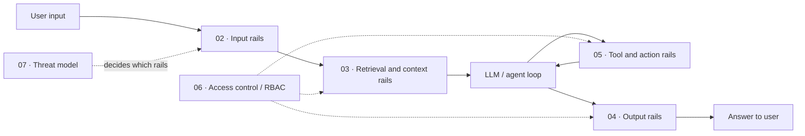

# 04 · Guardrails

> **TL;DR**
>
> - **Enforce runtime safety per request.** Guardrails inspect inputs, retrieved context, tool calls, and outputs to allow, block, modify, escalate, or flag them.
> - **Layer independent defenses.** Combine deterministic access controls, fast rules, ML classifiers, and targeted LLM checks across the request path.
> - **Do not rely on detectors to stop prompt injection.** Adaptive attackers bypass them; bound the damage with least privilege, tool limits, and human approval.
> - **Evaluate every guardrail like a classifier.** Measure precision, recall, false-positive rate, latency, and error cost before enforcing blocks in production.

- **You will learn:**
    - Guardrail architecture
    - Input, retrieval, tool, and output rails
    - Deterministic RBAC
    - OWASP threat modeling
- **Prerequisites:** [Why evals and guardrails](../00-foundations/01-why-evals-and-guardrails.md), [The evals and guardrails map](../00-foundations/02-the-evals-and-guardrails-map.md)
- **Related:** [Offline evals](../02-offline-evals/README.md), [Online evals & observability](../03-online-evals-and-observability/README.md), [Guardrail selection decision tree](../05-decision-framework/02-guardrail-selection-decision-tree.md), [Guardrail tools](../06-tooling-landscape/02-guardrail-tools.md)

---

Evals tell you **how good** your agentic RAG application is on average. Guardrails decide, **for this one request, right now**, whether an action can happen. They sit in or beside the request path. They allow, block, modify, escalate, or flag inputs, retrieved context, tool calls, and outputs.

Treat guardrails as an engineering discipline rather than a compliance checkbox. You need a layered architecture, a detector catalog per layer, code-enforced access control, and a threat model. Every guardrail is a classifier with precision, recall, latency, and error costs. This guide shows you how to build and measure each layer.

We use an **internal enterprise assistant** as a running example throughout this section. It searches company documents with a retriever, runs text-to-SQL on a data warehouse, and calls tools like `create_ticket`. Employees in different roles use this assistant under role-based access control (RBAC).

## Files in this section

| File | What it covers | Read when… |
|---|---|---|
| [01-guardrails-architecture.md](./01-guardrails-architecture.md) | Guardrails vs evals, layered defense-in-depth, five actions, sync vs async, latency budgets, streaming, fail-open vs fail-closed, detector families (incl. Llama Guard and NeMo rail types), policy-as-config with staged rollout, guardrail-model supply chain, refusal UX, metrics, and a spec template | You are designing your guardrail layer or establishing a shared vocabulary for your team |
| [02-input-guardrails.md](./02-input-guardrails.md) | Normalization, length and rate limits, language detection, prompt injection and jailbreak detection (and the known limits of injection detectors), topic scope, PII and secrets, toxicity, SQL or code in input, and malicious URLs or files | You need to check the user message before it reaches the retriever or generator |
| [03-retrieval-and-context-guardrails.md](./03-retrieval-and-context-guardrails.md) | Permission-aware retrieval (pre-filter vs post-filter), indirect prompt injection, spotlighting, instruction hierarchy and isolation patterns, provenance, source allowlists, freshness, relevance thresholds, abstention, context poisoning, data minimization, and ingestion checks | Your app retrieves documents, web pages, emails, or tickets written by someone other than the user |
| [04-output-guardrails.md](./04-output-guardrails.md) | Groundedness checks, citation verification, PII and secret leakage, toxicity, schema validation with retry, policy compliance (Llama Guard taxonomy), brand rules, system prompt leakage, code and markdown exfiltration defenses, and streaming | You need to check an answer before showing it to the user |
| [05-tool-and-action-guardrails.md](./05-tool-and-action-guardrails.md) | Tool call and side-effect controls: argument validation, allowlists, read-only vs write tools, SQL sandboxing, human approval, and loop budgets | Your agent calls tools, executes SQL, or takes actions with external side effects |
| [06-access-control-rbac.md](./06-access-control-rbac.md) | RBAC and ABAC for users and agents: identity propagation, document- and row-level security, tool permissions, and least privilege | Users have different roles and must not view or change the same resources |
| [07-threat-model-owasp.md](./07-threat-model-owasp.md) | Threat modeling for agentic RAG and mapping OWASP Top 10 for LLM Applications risks to concrete guardrails | You need to justify which guardrails to build or prepare for a security review |

## Suggested reading order

1. **Read [01 · Architecture](./01-guardrails-architecture.md)** to learn the core vocabulary and design decisions used across all files.
2. **Read [07 · Threat model](./07-threat-model-owasp.md)** to decide *what* threats you must defend against before selecting detectors.
3. **Read [06 · Access control](./06-access-control-rbac.md)** to build the deterministic, non-negotiable permission layer before adding any classifier.
4. **Follow the request path:** [02 · Input](./02-input-guardrails.md) → [03 · Retrieval & context](./03-retrieval-and-context-guardrails.md) → [05 · Tools & actions](./05-tool-and-action-guardrails.md) → [04 · Output](./04-output-guardrails.md).

**In a hurry?** Read [01](./01-guardrails-architecture.md) (actions, fail-open vs fail-closed, and the spec template), permission filtering in [03](./03-retrieval-and-context-guardrails.md), and citation and groundedness checks in [04](./04-output-guardrails.md).

## How this section connects to the rest

- **Measure guardrails with your eval machinery.** Use labeled should-block and should-allow datasets ([01-datasets](../01-datasets/README.md)), offline experiments ([02-offline-evals/08-running-offline-experiments.md](../02-offline-evals/08-running-offline-experiments.md)), and online block-rate monitoring ([03-online-evals-and-observability](../03-online-evals-and-observability/README.md)).
- **Pair output guardrails with their offline metric twins.** Groundedness matches faithfulness ([02-offline-evals/01-end-to-end-rag-evals.md](../02-offline-evals/01-end-to-end-rag-evals.md)). Citation verification matches citation adherence ([02-offline-evals/06-instruction-and-citation-adherence.md](../02-offline-evals/06-instruction-and-citation-adherence.md)). Toxicity filtering matches safety evals ([02-offline-evals/03-generation-quality-and-safety-evals.md](../02-offline-evals/03-generation-quality-and-safety-evals.md)).
- **Select and implement tools systematically.** Use the [guardrail selection decision tree](../05-decision-framework/02-guardrail-selection-decision-tree.md) to choose guardrails for your project. See [guardrail tools](../06-tooling-landscape/02-guardrail-tools.md) to compare products and libraries.
