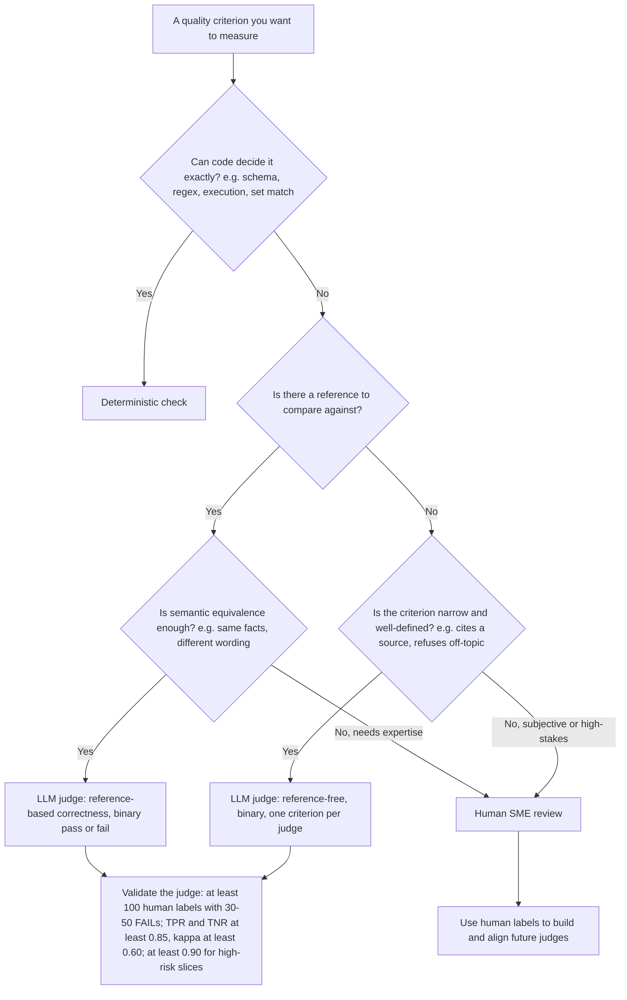
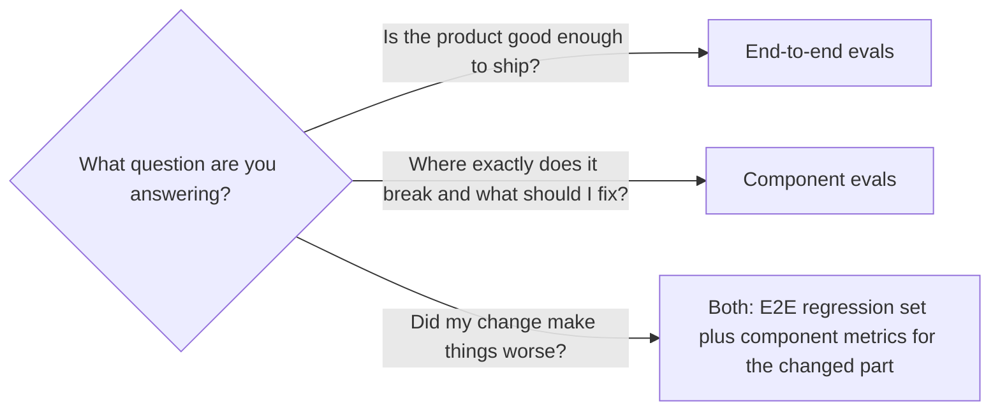
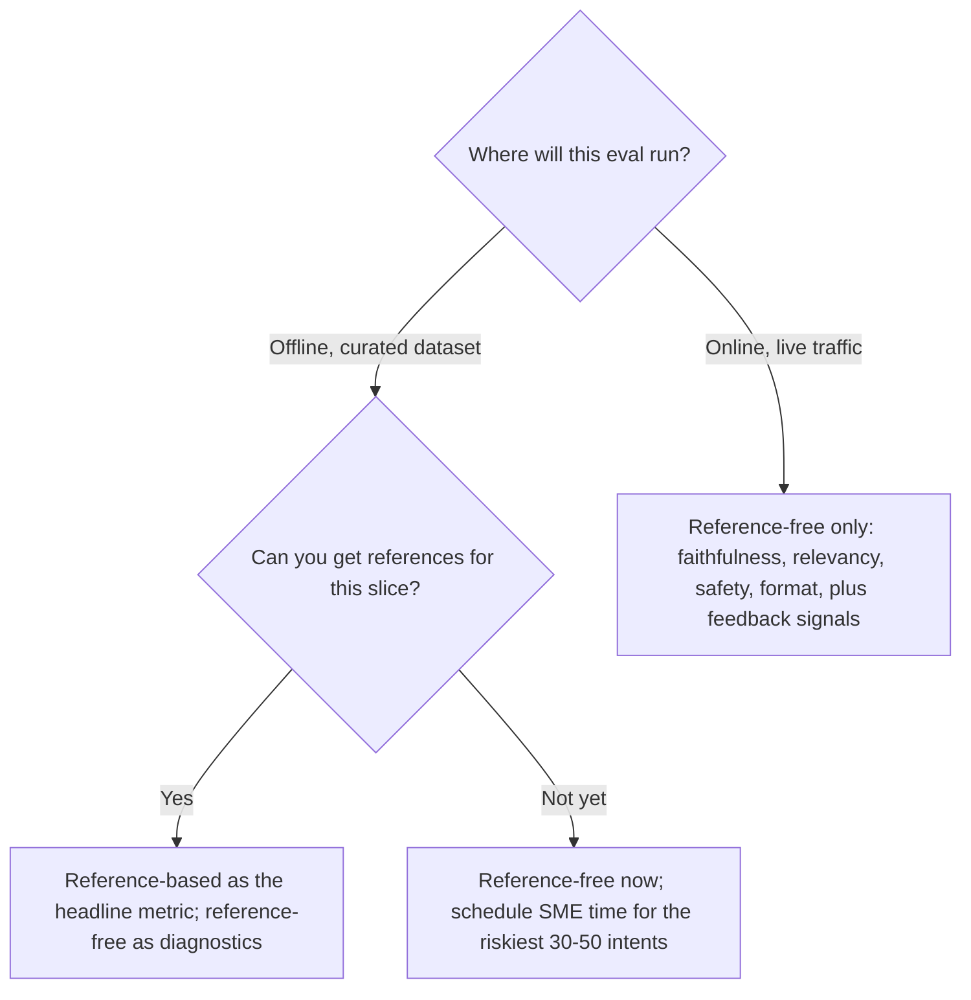

# Eval Selection Decision Tree

> **TL;DR**
>
> - **Answer five scoping questions first.** Define your architecture, failure risk, ground-truth availability, product stage, and run budget before picking metrics.
> - **Start with the universal core.** Instrument traces, run error analysis on 30–100 examples, and enforce deterministic checks first.
> - **Target your observed bottlenecks.** Add component evaluations where error analysis reveals failures, and combine them with one end-to-end gate.
> - **Validate every LLM judge.** Use binary pass/fail rubrics. Before a judge gates a release, measure it against ≥100 human labels with 30–50 FAILs (see [LLM-as-a-judge §7.4](../02-offline-evals/07-llm-as-a-judge.md#74-how-many-labels)).

- **You will learn:**
    - A step-by-step framework for choosing evaluations
    - When to use code checks, LLM judges, or humans
    - How to balance end-to-end and component metrics
    - Minimum viable evaluation stacks for five archetypes
- **Prerequisites:** [The evals & guardrails map](../00-foundations/02-the-evals-and-guardrails-map.md), [Agentic RAG failure modes](../00-foundations/03-agentic-rag-failure-modes.md)
- **Related:** [Guardrail selection](./02-guardrail-selection-decision-tree.md), [Metric cheatsheet](./03-metric-cheatsheet.md), [Implementation playbook](./04-implementation-playbook.md), [Dataset strategy](../01-datasets/01-dataset-strategy.md)

---

## 1. How to use this document

This guide is a decision aid, not a metric catalogue. You can browse the full catalogue in [02-offline-evals](../02-offline-evals/README.md) and [03-online-evals-and-observability](../03-online-evals-and-observability/README.md). Use the [metric cheatsheet](./03-metric-cheatsheet.md) for a one-page lookup table.

Follow these five steps to build your evaluation plan:

1. **Answer the five input questions** (§2) and record your answers at the top of your evaluation plan.
2. **Walk the master decision tree** (§3) to select your candidate evaluation families.
3. **Resolve the four method choices** (§4–§7): grader type, evaluation scope, reference needs, and dataset type.
4. **Select your system archetype** (§8) to get your must-have stack and implementation sequence.
5. **Check your plan against your budget** (§9) and **product stage** (§10).

> **Opinionated default:** Read §8.0 "The universal core" first if you only read one section. Every archetype starts with that core. Teams usually struggle with evaluations because they skip error analysis and jump straight to generic dashboards.

### Running example

Throughout this guide, we use an **internal enterprise assistant** that:

- answers questions over company documents using vector search over Confluence and SharePoint pages,
- queries a data warehouse using **text-to-SQL**,
- **calls tools** such as `search_docs`, `get_ticket`, `create_ticket`, `update_ticket`, `send_email`, and `fetch_url` (the full nine-tool inventory and tool tiers are in [Tool and action guardrails §1](../04-guardrails/05-tool-and-action-guardrails.md#running-example)), and
- serves users across **different roles** (RBAC: `employee`, `analyst`, `hr_partner`, `support_agent`, `admin`).

This system combines archetypes A2 (agentic RAG with tools), A3 (text-to-SQL), and later A5 (multi-turn). Each section highlights how to assemble its evaluation stack.

---

## 2. The five input questions

Answer these five questions before you select any metric.

| # | Question | Typical answers | Why it changes the eval plan |
|---|---|---|---|
| Q1 | **What is the architecture?** | • Simple RAG<br>• Agentic RAG with tools<br>• Text-to-SQL<br>• Multi-agent / multi-step workflow<br>• Multi-turn conversational<br>• Coding, browser, research, or workflow agent | Determines which components exist and which component evaluations apply (no retriever means no retrieval metrics). |
| Q2 | **What is the risk level and domain?** | • Low (internal, read-only, advisory)<br>• Medium (customer-facing, reputational)<br>• High (regulated: finance, health, legal, HR, or irreversible actions) | Sets required thresholds, human review depth, dataset size, and pre-launch safety or red-team requirements. |
| Q3 | **What ground truth can you get?** | • None<br>• SME time available<br>• Production logs (with or without feedback) | Determines whether you use reference-based or reference-free metrics and synthetic or curated datasets. |
| Q4 | **What stage are you in?** | • Prototype<br>• Pre-launch<br>• Production | Sets your rigor: fast error analysis in prototype, CI gates pre-launch, and online drift monitoring in production. |
| Q5 | **What is the budget?** | • Cost per eval run<br>• Latency tolerance for online checks<br>• Human-review hours per week | Controls how many LLM-judge calls you run, your online sampling rate, and your suite execution frequency. |

### Q1: Architecture archetypes used in this doc

| ID | Archetype | Components that can fail independently |
|---|---|---|
| **A1** | Simple RAG chatbot (single retrieve → generate) | query rewrite (optional), retriever, reranker (optional), generator |
| **A2** | Agentic RAG with tools (LLM decides when/what to retrieve and which tools to call) | planner/router, retriever(s), tool selection, tool arguments, tool execution, final synthesis |
| **A3** | Text-to-SQL agent | schema linking / table retrieval, SQL generation, SQL execution, result interpretation / answer |
| **A4** | Multi-agent or multi-step workflow (orchestrator + sub-agents, or long plans) | orchestrator routing, each sub-agent, hand-offs, state/memory, termination |
| **A5** | Multi-turn conversational assistant | everything above **plus** context carry-over, coreference, clarification behaviour, conversation-level goal completion |
| **A6** | Coding agent | code search, edit, test runs, final repository state |
| **A7** | Browser or computer-use agent | page or screen reading, UI actions, form inputs, final site or app state |
| **A8** | Deep research agent | search queries, source selection, cross-checks, final report and citations |
| **A9** | Policy-bound workflow agent | policy lookup, user dialog, write tools, final records in the system |

A6–A9 reuse the universal core in §8.0. [Agent Archetypes](../00-foundations/05-agent-archetypes.md#4-the-archetype-table) gives the environment, outcome grader, and top risks for each one. [Agent Eval Environments & Graders](../02-offline-evals/09-agent-eval-environments-and-graders.md) shows how to build the environment.

### Q2: Risk tier quick classifier

The canonical tier definitions are in [guardrail selection §2](./02-guardrail-selection-decision-tree.md#2-risk-assessment-questionnaire). Use that questionnaire to set the tier. This table shows only what each tier means for evals:

| Tier | Signals (summary of 02 §2) | Eval implication (heuristic) |
|---|---|---|
| **Tier 1 (low)** | Internal users, read-only, advisory output, and a human reviews the answer before acting | Golden set of ~50–100 examples, a few core metrics, and spot-checked judges |
| **Tier 2 (medium)** | External or broad internal users, brand exposure, answers sometimes acted on directly, or reversible internal writes | Golden set of ~100–300 examples, validated judges, safety evals, and CI regression gates |
| **Tier 3 (high)** | Regulated domain, irreversible or external writes, financial/health/legal/HR decisions, sensitive data, or the lethal trifecta | Golden set of ~300+ examples stratified by risk slice, SME labels, red-team suite, and formal sign-off |

Treat these dataset sizes as starting rules of thumb, not statistical guarantees. Calibrate them on your data. See §9.3 and [dataset strategy §5](../01-datasets/01-dataset-strategy.md#5-sizing-and-statistics) for sample sizes.

### Q3: Ground-truth availability

| Situation | What you can do |
|---|---|
| **None** (no SMEs, no logs) | Use reference-free metrics (faithfulness, relevancy, safety), deterministic format checks, synthetic Q&A, and manual trace review on 20–50 runs |
| **SME time available** | Collect golden Q&A pairs, reference chunk IDs, gold SQL, expected tool calls, and human labels to align LLM judges |
| **Production logs** | Mine real query distributions, implicit feedback (thumbs, re-asks, copies), and production failures to expand your golden set |

### Q4/Q5: Stage and budget

Apply your product stage and budget at the end as filters (§9, §10). They rarely change *which* evaluations you need. Instead, they control *how many examples you run, how often you run them, and which judge model you choose*.

---

## 3. The master decision tree

```mermaid
flowchart TD
    S["Start: new or changed agentic RAG app"] --> T{"Do you have traces of real or realistic runs?"}
    T -- No --> T1["Instrument tracing first; run 20-50 realistic queries"]
    T1 --> EA
    T -- Yes --> EA["Error analysis: read traces, open-code failures, group into a failure taxonomy"]
    EA --> R{"Is retrieval a top failure category?"}
    R -- Yes --> R1["Add retrieval diagnostics: MRR or nDCG, context precision, per-stage recall"]
    R -- No --> R0
    R1 --> R0["Always for RAG: baseline recall@k on the golden set"]
    R0 --> G{"Are answers wrong even when the right context was retrieved?"}
    G -- Yes --> G1["Add generation evals: faithfulness, answer correctness, citation adherence"]
    G -- No --> TL
    G1 --> TL{"Does the system call tools or generate SQL?"}
    TL -- Tools --> TL1["Add tool-call evals: selection, arguments, trajectory"]
    TL -- SQL --> TL2["Add SQL evals: execution accuracy, result-set match, validity"]
    TL -- Neither --> MT
    TL1 --> MT{"Multi-turn conversations?"}
    TL2 --> MT
    MT -- Yes --> MT1["Add conversation-level evals: goal completion, context retention"]
    MT -- No --> RK
    MT1 --> RK{"Risk Tier 2 or Tier 3?"}
    RK -- Yes --> RK1["Add safety, policy, RBAC and adversarial evals plus red teaming; Tier 3 adds indirect-injection ASR and memory-poisoning cases"]
    RK -- No --> E2E
    RK1 --> E2E["Always: small E2E regression set gating every change"]
    E2E --> ON{"In production?"}
    ON -- Yes --> ON1["Online: deterministic checks and cheap classifiers on 100 percent, LLM judges on 1-5 percent plus all flagged traces, feedback, drift"]
    ON -- No --> DONE["Offline suite in CI; plan online evals before launch"]
```



Follow these rules when reading the tree:

- **Start with error analysis.** You can only answer branch conditions like "Is retrieval a top failure category?" after inspecting real traces. See [LLM-as-a-judge](../02-offline-evals/07-llm-as-a-judge.md) and [running offline experiments](../02-offline-evals/08-running-offline-experiments.md).
- **Combine branches across capabilities.** An agentic text-to-SQL assistant follows multiple branches at once.
- **Implement the "Always" nodes first.** These nodes form the universal core (§8.0). Every RAG system keeps a baseline `recall@k`, even when retrieval is not the top failure category, so that you can see retrieval regressions.

### 3.1 Q&A form of the same tree

Use this checklist during planning meetings when you want fast decisions without a diagram.

**"Have you read 30+ traces and recorded what goes wrong?"**

- → No: Stop and read 30 traces first. Any metric you pick before error analysis is a guess.
- → Yes: Continue using your written failure taxonomy.

**"Do you have reference answers?"**

- → Yes, SME-written: Use reference-based answer correctness (via LLM judge or semantic match) as your headline end-to-end metric.
- → No, but you have 2–4 hours of SME time: Collect 30–50 reference answers for your highest-risk intents first, and use reference-free metrics elsewhere.
- → No, and no SMEs exist: Use reference-free metrics (faithfulness, answer relevancy) and synthetic Q&A from your corpus as directional signals.

**"Do you know which documents *should* be retrieved for each question?"**

- → Yes: Use standard IR metrics (`recall@k`, `MRR`, `nDCG`). They are cheap, deterministic, and fast.
- → No: Use reference-free LLM judges for context relevance, or label relevant chunks for 50 queries yourself.

**"Is retrieval the bottleneck?"**

- → Check failed answers to see whether the retrieved context contained the needed fact. Heuristic (not a rule): if fewer than ~70% of failures contained the needed fact, fix retrieval before you tune generation prompts. Use the [retrieval × generation 2×2](../02-offline-evals/01-end-to-end-rag-evals.md#6-diagnosing-failures-with-the-retrieval--generation-22) to classify each failure.
- → If the retrieved context contained the fact but the answer failed, focus on generation evaluations (faithfulness, reasoning, instruction adherence).

**"Is the output structured or verifiable by code?"** (JSON, SQL, tool calls, numbers, citation IDs)

- → Yes: Write deterministic checks first (schema validation, SQL execution, exact or numeric match, regex). They are free, fast, and never drift.
- → No (free text): Use an LLM judge with a binary, criterion-specific rubric validated against human labels.

**"Does the agent call tools?"**

- → Yes: Evaluate tool selection and argument correctness per step, and evaluate goal completion per run. Test side-effecting tools in a sandbox and check for unauthorized actions.

**"Does it generate SQL?"**

- → Yes: Use execution accuracy (comparing result sets against gold SQL) as your primary metric. Use string or AST similarity only as a secondary diagnostic.

**"Is it multi-turn?"**

- → Yes: Build conversation-level datasets using scripted or simulated users and measure session goal completion. Single-turn evaluations miss context-loss failures.

**"Could a bad answer harm someone, leak data, or create legal exposure?"**

- → Yes: Add safety, PII, and policy evaluations alongside adversarial red teaming, and require human review before launch.

**"Are you live?"**

- → Yes: Run deterministic checks on 100% of traffic, sample reference-free LLM judges, collect user feedback, and promote failed traces into your golden set.

---

## 4. Decision: deterministic vs LLM judge vs human

Choosing your grading method is your most important technical decision. A poor choice either wastes budget on unnecessary LLM judges or gates releases on unvalidated scores.



| Method | Use when | Strengths | Weaknesses | Cost / latency (relative) |
|---|---|---|---|---|
| **Deterministic (code)** | Output is structured or verifiable: JSON schema, SQL executes, allowed tool name, valid citation IDs, numeric bounds, PII regex, length limits | Free, fast, reproducible, never drifts, runs on 100% of traffic | Covers only formal rules and fails on free-form text nuances | ~0 |
| **Statistical / embedding** | Computing retrieval metrics with labelled docs, coarse semantic similarity screens, or drift detection | Cheap and scalable | Embedding similarity correlates weakly with factual correctness on short answers | Low |
| **Classifier (small model)** | Detecting toxicity, PII/NER, prompt injection, or topic scope | Cheap enough for 100% online traffic with low latency | Suffers from domain shift and requires false-positive tuning on your data | Low |
| **LLM judge** | Evaluating free-text faithfulness, relevance, tone, policy adherence, or reference-based correctness | Flexible and scales human judgment | Exhibits position/verbosity bias, costs money, and **requires human validation** | Medium–high |
| **Human (SME)** | Defining ground truth, aligning LLM judges, reviewing high-stakes cases, and signing off on launches | Highest validity for domain correctness | Slow, expensive, and inconsistent without a written rubric | Highest |

**Follow these five grading rules:**

1. **Use deterministic checks first.** Write a code assertion whenever possible. Checking whether an output cites a retrieved chunk ID requires a simple set lookup, not an LLM judge.
2. **Choose binary pass/fail over Likert scales.** Define clear pass/fail rules for each criterion. Scores on 1–5 scales are hard to calibrate: adjacent points have no clear meaning, and judges and humans agree less on them. This makes the metric noisy and hard to act on. Use multiple binary criteria when you need finer nuance. Binary verdicts per claim or per item still aggregate to rates (such as "faithfulness ≥ 0.90" on the [E2E page](../02-offline-evals/01-end-to-end-rag-evals.md)). Gate on the rate and its confidence interval. See [LLM-as-a-judge §3](../02-offline-evals/07-llm-as-a-judge.md#3-binary-passfail-over-likert-scales).
3. **Evaluate one criterion per judge.** Never use a single "rate overall quality" judge because you cannot debug its failures.
4. **Validate every LLM judge.** Label ≥100 examples with SMEs and oversample failures to get 30–50 FAILs. On a held-out split, measure true-positive rate (TPR, the share of human PASSes the judge passes), true-negative rate (TNR, the share of human FAILs the judge fails), and Cohen's κ. Require TPR ≥0.85, TNR ≥0.85, and κ ≥0.60 before a judge gates a release, and ≥0.90 on high-risk slices (Tier 3, text-to-SQL correctness, safety). Re-validate after every judge prompt or model change and on a schedule. These are starting rules of thumb; the canonical bar is in [LLM-as-a-judge §7.3–7.4](../02-offline-evals/07-llm-as-a-judge.md#73-agreement-metrics).
5. **Let humans define truth, judges scale it, and code enforce hard rules.** Use human labels as ground truth, LLM judges to scale grading, and deterministic code to enforce strict constraints.

---

## 5. Decision: end-to-end vs component



| Aspect | End-to-end (E2E) | Component |
|---|---|---|
| Question answered | "Does the user get a correct, safe, useful answer?" | "Is the retriever, router, SQL generator, or tool caller doing its job?" |
| Examples | Answer correctness, faithfulness, goal completion, user-facing safety | recall@k, MRR, nDCG, tool-selection accuracy, argument accuracy, SQL execution accuracy, schema-linking recall |
| Dataset shape | `(input, expected_output or rubric)` | `(input, expected intermediate output)` such as relevant chunk IDs, gold tool call, or gold SQL |
| Strength | Captures user experience and stays stable across internal refactors | Pinpoints root causes quickly and cheaply so you can optimize one module |
| Weakness | Masks which internal step caused a failure | Can pass individually even when the integrated system fails |
| When to rely on it | Launch decisions, CI regression gates, and online monitoring | Component tuning, debugging, and comparing chunkers or embedding models |

**Recommended default:** Run a small end-to-end regression set as your release gate **plus** component evaluations for your top failure modes. Relying only on end-to-end evaluations hides whether a drop came from the router, retriever, or SQL generator. Relying only on component evaluations lets integration bugs slip into production.

**Use trace spans to connect both levels.** When you record full traces ([tracing and OpenTelemetry](../03-online-evals-and-observability/02-observability-and-tracing.md)), you can score component metrics directly on spans from end-to-end runs. One dataset run then produces both end-to-end and component scores.

---

## 6. Decision: reference-based vs reference-free

| | Reference-based | Reference-free |
|---|---|---|
| Needs | Gold answer, gold contexts, gold SQL, or gold tool calls | Only the input, output, and retrieved context |
| Examples | Answer correctness, context recall, recall@k, execution accuracy, tool-call match | Faithfulness/groundedness, answer relevancy, context relevance, toxicity, format validity, policy adherence |
| Good for | Measuring factual correctness and gating releases in CI | Measuring consistency and safety, monitoring live traffic, and testing early prototypes |
| Blind spot | Cannot run on live traffic without references, and references go stale when source docs change | **Scores an answer high even when it is faithfully grounded in the wrong document** |
| Stage | Pre-launch and CI | Prototype (before references exist) and production (online monitoring) |



**Avoid the faithfulness trap:** Measuring only faithfulness gives false confidence in RAG evaluation. Faithfulness checks whether the model stuck to the retrieved chunks, not whether it answered the user's question correctly. Collect a reference-based test set for your top user intents.

---

## 7. Decision: which dataset at which stage

Read [dataset strategy](../01-datasets/01-dataset-strategy.md), [SME golden datasets](../01-datasets/02-sme-golden-datasets.md), [synthetic datasets](../01-datasets/03-synthetic-datasets.md), and [production data flywheel](../01-datasets/04-production-data-flywheel.md) for full implementation details.

| Stage | Primary dataset | Secondary | Why |
|---|---|---|---|
| **Prototype** (weeks 0–4) | 20–50 realistic builder-written queries + traces | Synthetic Q&A from the corpus to probe retrieval coverage | Prioritizes speed so you can observe real failure modes early. |
| **Pre-launch** | SME golden set: 100–300 examples stratified by intent, difficulty, and risk | Synthetic adversarial and edge cases, red-team prompts, and beta logs | Provides a trustworthy regression gate and launch readiness signal. |
| **Production** | Sampled, labelled production traces (oversampling failures) | Golden set refreshed with production failures, plus synthetic cases for new features | Keeps your offline benchmark aligned with shifting live user queries. |

**Match your dataset schema to your evaluation type.** You cannot compute `recall@k` without relevant chunk IDs, and you cannot compute SQL execution accuracy without a frozen database snapshot.

| Eval type | Minimum dataset fields |
|---|---|
| E2E answer correctness | `question`, `reference_answer` (or rubric), optional `user_role` |
| Faithfulness / relevancy | `question` (contexts and answer come from the run) |
| Retrieval IR metrics | `question`, `relevant_doc_ids` (graded relevance for nDCG) |
| Context recall (RAGAS-style) | `question`, `reference_answer` or `reference_contexts` |
| Tool-call correctness | `input`, `expected_tool`, `expected_args` (or arg constraints), allowed alternatives |
| Trajectory / goal completion | `input`, `goal` or success criteria, optional reference trajectory, environment/sandbox state |
| Text-to-SQL | `question`, `gold_sql`, DB snapshot/version, optional `user_role` for row-level security |
| Citation adherence | `question` (citations and contexts from the run), optional `reference_citations` |
| Multi-turn | `conversation_script` or simulated-user persona + goal, success criteria |
| Safety / adversarial | `attack_input`, `expected_behaviour` (refuse / redact / comply safely) |
| RBAC / permission | `input`, `user_role`, `expected_allowed: bool`, `forbidden_content_markers` |

**Choose the right data source for each job:**

- **Use synthetic data** for corpus coverage, adversarial attacks, multi-turn simulation, and cold-start bootstrapping. Never rely *only* on synthetic queries because they mirror document wording and artificially inflate retrieval scores.
- **Use SME data** for reference answers, gold SQL, grading rubrics, and LLM judge alignment. Do not rely on SMEs to generate thousands of volume test cases.
- **Use production data** to capture real query distributions and mine live failure cases. Scrub PII and sensitive data before adding production traces to your datasets.

---

## 8. Recommended eval stack per archetype

### 8.0 The universal core (every archetype, every stage)

Build this universal core before you add any archetype-specific metrics:

- [ ] **Instrument tracing** on every run: inputs, retrieved chunk IDs, tool calls, model/prompt versions, latency, tokens, and role ([tracing](../03-online-evals-and-observability/02-observability-and-tracing.md)).
- [ ] **Run error analysis** on 30–100 traces and build a failure taxonomy with category counts.
- [ ] **Create a small golden set** (start with 30–50 realistic examples and grow to 100+) with expected outcomes.
- [ ] **Enforce deterministic checks** for output schema, non-empty responses, latency/cost bounds, zero unhandled exceptions, and valid citation IDs.
- [ ] **Select one E2E headline metric** based on your error analysis (such as binary answer correctness or task completion).
- [ ] **Run a CI regression gate** on your golden set for every prompt, model, or retriever change. Gate on "no new failures in critical slices" plus a paired test or a noise-calibrated threshold (see [running offline experiments §10.2](../02-offline-evals/08-running-offline-experiments.md#102-designing-gates)).

Layer the archetype-specific stacks below on top of this universal core.

### Reading the tables

- **Must-have**: Minimum viable evaluation suite required before launch.
- **Nice-to-have**: Secondary metrics to add when error analysis or risk tier requires them.
- **Method**:
    - `Code` = deterministic check
    - `IR` = information-retrieval metric computed by deterministic code over labelled relevant IDs
    - `Judge` = LLM judge
    - `Clf` = classifier
    - `Human` = SME review
- **Mode**:
    - `Off` = offline dataset
    - `On` = online production traffic
    - `Both` = offline and online

### 8.1 A1: Simple RAG chatbot

| Priority | Eval | Metric | Method | Dataset type | Mode | Detail |
|---|---|---|---|---|---|---|
| Must | Answer correctness | % correct vs reference (binary) | Judge (ref-based) | SME golden Q&A | Off | [E2E RAG](../02-offline-evals/01-end-to-end-rag-evals.md) |
| Must | Faithfulness / groundedness | % answers fully supported by context | Judge (ref-free) | Any | Both | [E2E RAG](../02-offline-evals/01-end-to-end-rag-evals.md) |
| Must | Retrieval recall | recall@k / hit rate@k | IR | Q + relevant doc IDs | Off | [Retrieval metrics](../02-offline-evals/02-retrieval-metrics.md) |
| Must | Refusal on unanswerable | % correctly says "I don't know" | Judge or Code (marker) | Unanswerable subset | Off | [E2E RAG](../02-offline-evals/01-end-to-end-rag-evals.md) |
| Nice | Ranking quality | MRR, nDCG@k | IR | Q + graded relevance | Off | [Retrieval metrics](../02-offline-evals/02-retrieval-metrics.md) |
| Nice | Context precision | rank-weighted precision: are relevant chunks ranked above irrelevant ones? | Judge (per-chunk relevance) or IR (labelled) | Any / labelled | Off | [E2E RAG §3.5](../02-offline-evals/01-end-to-end-rag-evals.md#35-context-precision) |
| Nice | Answer relevancy | answers the question asked | Judge | Any | Both | [E2E RAG](../02-offline-evals/01-end-to-end-rag-evals.md) |
| Nice | Citation adherence | citations present, valid, supporting | Code + Judge | Any | Both | [Citation adherence](../02-offline-evals/06-instruction-and-citation-adherence.md) |
| Nice | Toxicity / tone | % flagged | Clf | Any + adversarial | Both | [Generation quality](../02-offline-evals/03-generation-quality-and-safety-evals.md) |
| Online | Feedback & implicit signals | thumbs-down rate, re-ask rate | Code | Production | On | [User feedback](../03-online-evals-and-observability/03-user-feedback-and-implicit-signals.md) |

**Minimum viable suite (A1):** Build a 50-example golden Q&A set (including ~10 unanswerable queries) and track four metrics: answer correctness, faithfulness, `recall@5`, and refusal correctness.

**Build in this order:**

1. Instrument traces, run 30 hand-written queries, and complete error analysis.
2. Measure `recall@k` on 50 labelled queries because retrieval is usually the biggest RAG bottleneck.
3. Add a validated, reference-based answer correctness judge on your golden set.
4. Add a reference-free faithfulness judge for both offline runs and sampled online monitoring.
5. Add an unanswerable and out-of-scope test slice.
6. Add citation checks, `nDCG`, and tone classifiers if error analysis reveals those issues.

### 8.2 A2: Agentic RAG with tools

| Priority | Eval | Metric | Method | Dataset type | Mode | Detail |
|---|---|---|---|---|---|---|
| Must | Task / goal completion | % runs achieving stated goal | Judge or Code (state check) | Goal-based scenarios | Off | [Agent & trajectory](../02-offline-evals/04-agent-tool-and-trajectory-evals.md) |
| Must | Tool selection accuracy | correct tool chosen (or correctly none) | Code | Input + expected tool | Off | [Agent & trajectory](../02-offline-evals/04-agent-tool-and-trajectory-evals.md) |
| Must | Tool argument correctness | args valid & semantically correct | Code (schema) + Judge | Input + expected args | Off | [Agent & trajectory](../02-offline-evals/04-agent-tool-and-trajectory-evals.md) |
| Must | Answer correctness + faithfulness | as A1 | Judge | SME golden | Off/Both | [E2E RAG](../02-offline-evals/01-end-to-end-rag-evals.md) |
| Must | Unauthorized / unsafe action rate | % runs with disallowed tool call | Code | Adversarial + RBAC cases | Both | [Tool guardrails](../04-guardrails/05-tool-and-action-guardrails.md) |
| Must | Retrieval recall (when it retrieves) | recall@k | IR | Q + relevant IDs | Off | [Retrieval metrics](../02-offline-evals/02-retrieval-metrics.md) |
| Must | Indirect prompt-injection resistance | attack success rate (ASR) on injected docs and tool outputs, reported with benign task success | Code (state check) + Judge | AgentDojo-style injected scenarios | Off | [Tool guardrails §15](../04-guardrails/05-tool-and-action-guardrails.md#15-evaluating-tool-and-action-guardrails) |
| Must | Reliability across trials | pass^k (all k trials pass) for write-tool tasks | Code | Goal-based scenarios, k ≥3 runs | Off | [Agent & trajectory §4.3](../02-offline-evals/04-agent-tool-and-trajectory-evals.md#43-reliability-across-trials-passk) |
| Nice | Trajectory efficiency | steps, redundant calls, loops | Code | Any | Both | [Agent & trajectory](../02-offline-evals/04-agent-tool-and-trajectory-evals.md) |
| Nice | Trajectory match | in-order / any-order match vs reference | Code | Reference trajectories | Off | [Agent & trajectory](../02-offline-evals/04-agent-tool-and-trajectory-evals.md) |
| Nice | Retrieval decision | retrieved when needed, skipped when not | Judge or Code | Labelled need-to-retrieve | Off | [Agent & trajectory](../02-offline-evals/04-agent-tool-and-trajectory-evals.md) |
| Nice | Instruction adherence | follows system-prompt rules | Judge | Rule-targeted cases | Both | [Instruction adherence](../02-offline-evals/06-instruction-and-citation-adherence.md) |
| Nice | Error recovery | recovers from tool error/timeouts | Code + Judge | Fault-injected scenarios | Off | [Agent & trajectory](../02-offline-evals/04-agent-tool-and-trajectory-evals.md) |
| Nice | Memory poisoning (if the agent has long-term memory) | % runs where a planted memory changes a later action | Code + Judge | Two-session scenarios: plant, then trigger | Off | [Threat model §3.2 (ASI06)](../04-guardrails/07-threat-model-owasp.md#32-owasp-top-10-for-agentic-applications-2026) |
| Online | Tool error rate, step count, cost per task | Aggregate rates | Code | Production | On | [Monitoring](../03-online-evals-and-observability/04-monitoring-alerting-and-drift.md) |

**Minimum viable suite (A2):** Create 50–100 scenarios with expected tool calls and success criteria. Measure task completion, tool selection, argument correctness, unauthorized-action rate, indirect-injection ASR, and answer correctness.

**Build in this order:**

1. Record traces with every tool span and group failures by step (plan, retrieve, select tool, pass arguments, synthesize).
2. Add deterministic tool selection and argument schema checks.
3. Measure task completion on goal-based scenarios using sandbox state checks or a validated judge.
4. Add unauthorized-action and indirect-injection test cases per role before you enable any write tool or external tool (`send_email`, `fetch_url`).
5. Add answer correctness and faithfulness evaluations for RAG responses.
6. Add trajectory efficiency and tool-error recovery checks.

> **Do not overfit to reference trajectories.** Agents often can solve a task through multiple valid paths. Grade the final outcome (sandbox state or final answer) and hard constraints (zero forbidden tool calls, `steps <= N`) instead of requiring an exact step sequence.

### 8.3 A3: Text-to-SQL agent

| Priority | Eval | Metric | Method | Dataset type | Mode | Detail |
|---|---|---|---|---|---|---|
| Must | Execution accuracy | result set of generated SQL == result set of gold SQL | Code | Q + gold SQL + DB snapshot | Off | [Text-to-SQL](../02-offline-evals/05-text-to-sql-evals.md) |
| Must | SQL validity | parses & executes without error | Code | Any | Both | [Text-to-SQL](../02-offline-evals/05-text-to-sql-evals.md) |
| Must | Safety of SQL | read-only, no DDL/DML, allowed schemas only | Code (AST/parser) | Any + adversarial | Both (also guardrail) | [Tool guardrails](../04-guardrails/05-tool-and-action-guardrails.md) |
| Must | Permission correctness | no rows/columns outside user's entitlement | Code | Q + role + expected access | Off | [RBAC](../04-guardrails/06-access-control-rbac.md) |
| Must | Answer faithfulness to result | NL answer matches the returned data | Judge or Code (numbers) | Any | Both | [Text-to-SQL](../02-offline-evals/05-text-to-sql-evals.md) |
| Nice | Schema linking recall | needed tables/columns retrieved | Code | Q + gold tables | Off | [Text-to-SQL](../02-offline-evals/05-text-to-sql-evals.md) |
| Nice | SQL similarity | exact/component/AST match | Code | Q + gold SQL | Off | [Text-to-SQL](../02-offline-evals/05-text-to-sql-evals.md) |
| Nice | Ambiguity handling | asks clarification when the question is ambiguous | Judge | Ambiguous subset | Off | [Text-to-SQL](../02-offline-evals/05-text-to-sql-evals.md) |
| Nice | Query cost/efficiency | rows scanned, runtime | Code | Any | Both | [Text-to-SQL](../02-offline-evals/05-text-to-sql-evals.md) |
| Online | Execution error rate, empty-result rate, user re-asks | Aggregate rates | Code | Production | On | [Monitoring](../03-online-evals-and-observability/04-monitoring-alerting-and-drift.md) |

**Minimum viable suite (A3):** Build 50–100 question and gold-SQL pairs against a frozen database snapshot. Measure execution accuracy, SQL validity, read-only compliance, role permissions, and answer-to-result faithfulness.

**Build in this order:**

1. Freeze a test database snapshot so execution accuracy stays reproducible across runs.
2. Collect 50 analyst-verified gold SQL pairs covering joins, aggregations, date math, and domain metric definitions.
3. Implement execution accuracy and SQL syntax/execution validity checks.
4. Add SQL safety and per-role RBAC test cases to verify your runtime guardrails.
5. Check answer-to-result faithfulness by verifying that numbers in the text match the returned SQL rows.
6. Measure schema-linking recall if error analysis shows the agent picks the wrong tables.

> **Avoid execution accuracy pitfalls:** Normalize column order, row order, and floating-point precision when comparing SQL result sets. Seed your test snapshot with edge-case rows so flawed queries do not return the right result by accident.

### 8.4 A4: Multi-agent / multi-step workflow

| Priority | Eval | Metric | Method | Dataset type | Mode | Detail |
|---|---|---|---|---|---|---|
| Must | E2E task success | % workflows meeting success criteria | Code (state) + Judge | Goal-based scenarios | Off | [Agent & trajectory](../02-offline-evals/04-agent-tool-and-trajectory-evals.md) |
| Must | Routing / delegation accuracy | orchestrator sends to correct sub-agent | Code | Input + expected route | Off | [Agent & trajectory](../02-offline-evals/04-agent-tool-and-trajectory-evals.md) |
| Must | Per-sub-agent component evals | use A1/A2/A3 tables per sub-agent | mixed | per sub-agent | Off | (above) |
| Must | Termination & loop detection | max steps, repeated calls, stuck | Code | Any | Both | [Agent & trajectory](../02-offline-evals/04-agent-tool-and-trajectory-evals.md) |
| Must | Hand-off fidelity | information preserved across hand-offs | Judge | Multi-hop scenarios | Off | [Agent & trajectory](../02-offline-evals/04-agent-tool-and-trajectory-evals.md) |
| Nice | Cost & latency per task | tokens, wall-clock | Code | Any | Both | [Monitoring](../03-online-evals-and-observability/04-monitoring-alerting-and-drift.md) |
| Nice | Plan quality | plan is complete & feasible | Judge | Planning scenarios | Off | [Agent & trajectory](../02-offline-evals/04-agent-tool-and-trajectory-evals.md) |
| Nice | Robustness | success under injected faults/noisy inputs | Code + Judge | Fault-injected | Off | [Running experiments](../02-offline-evals/08-running-offline-experiments.md) |

**Minimum viable suite (A4):** Measure end-to-end task success, orchestrator routing accuracy, loop/termination rates, and the core A1/A2/A3 suite for each critical sub-agent.

**Build in this order:**

1. Evaluate orchestrator routing accuracy first because bad routing breaks the entire workflow.
2. Add end-to-end task success and loop/termination checks.
3. Add component evaluations for your weakest sub-agent, followed by hand-off fidelity checks.
4. Run each scenario 3–5 times. Report `pass^k` (all k trials pass) for reliability, not `pass@k` (at least one passes), and report the variance across runs. See [running offline experiments §4.3](../02-offline-evals/08-running-offline-experiments.md#43-passk-vs-passk).

> **Question whether you need multi-agent complexity.** A single agent with well-designed tools is much easier to evaluate and debug. See Anthropic's [Building effective agents](https://www.anthropic.com/engineering/building-effective-agents).

### 8.5 A5: Multi-turn conversational assistant

| Priority | Eval | Metric | Method | Dataset type | Mode | Detail |
|---|---|---|---|---|---|---|
| Must | Conversation goal completion | % sessions where user goal met | Judge (session-level) | Scripted or simulated conversations | Both | [Agent & trajectory](../02-offline-evals/04-agent-tool-and-trajectory-evals.md) |
| Must | Context retention | uses facts/constraints from earlier turns | Judge | Multi-turn scripts with callbacks | Off | [Instruction adherence](../02-offline-evals/06-instruction-and-citation-adherence.md) |
| Must | Per-turn A1–A3 metrics | as applicable | mixed | turn-level extraction from sessions | Off | (above) |
| Must | Instruction persistence | system rules still followed at turn N | Judge | Long conversations | Off | [Instruction adherence](../02-offline-evals/06-instruction-and-citation-adherence.md) |
| Nice | Clarification behaviour | asks when ambiguous, doesn't over-ask | Judge | Ambiguous scenarios | Off | [Instruction adherence](../02-offline-evals/06-instruction-and-citation-adherence.md) |
| Nice | Multi-turn jailbreak resistance | holds policy under gradual escalation | Judge + Clf | Red-team scripts | Off | [Generation safety](../02-offline-evals/03-generation-quality-and-safety-evals.md) |
| Online | Session-level signals | abandonment, re-phrase rate, escalation to human | Code | Production | On | [User feedback](../03-online-evals-and-observability/03-user-feedback-and-implicit-signals.md) |

**Minimum viable suite (A5):** Run 30–50 multi-turn scripts or simulated user personas and measure conversation goal completion, context retention, instruction persistence, and per-turn archetype metrics.

**Build in this order:**

1. Evaluate individual turns extracted from real sessions first because single-turn checks are fastest to build.
2. Add scripted multi-turn conversations that test observed context-loss or contradiction failures.
3. Add simulated user personas to scale multi-turn testing before major releases.

### 8.6 The running example: putting it together

Our internal enterprise assistant combines archetypes A2 and A3 (and later A5). Its risk tier is **Tier 3** for HR/finance intents and for every tool-enabled turn, because the lethal trifecta is present by default. Read-only general policy Q&A is Tier 2. See [guardrail selection §2](./02-guardrail-selection-decision-tree.md#2-risk-assessment-questionnaire).

| Layer | Must-have evals | Dataset |
|---|---|---|
| Router | Intent routing accuracy (docs / SQL / tools / out-of-scope) | 100 labelled queries |
| Docs RAG | recall@5, answer correctness, faithfulness, citation validity | 80 SME Q&A with relevant doc IDs |
| Text-to-SQL | execution accuracy, validity, read-only | 60 gold SQL on a frozen snapshot |
| Write and external tools | tool selection, argument correctness, sandbox state check, no-ticket-when-not-asked, preview and one-click confirm before `create_ticket`, approval before `send_email` and `delete_ticket`, `pass^k` | 40 scenarios plus forbidden-call cases per tool |
| RBAC (cross-cutting) | leaked-content rate per role (hard gate: 0 leaks) | 420 role × query pairs (60 queries × 7 roles) with forbidden markers |
| Safety | indirect prompt injection via documents and tool outputs (ASR with benign task success), PII in output | ≥30 distinct attack families, with mutations |
| Online | deterministic checks and injection/PII classifiers on 100%; faithfulness judge on 1–5% plus 100% of flagged traces; SQL error rate, tool error rate, thumbs-down, RBAC-denial anomalies | Production |

**Size hard gates with the rule of three.** Zero failures in *n* independent cases gives a 95% upper bound of about 3/*n* on the true failure rate. Zero leaks in 420 RBAC pairs supports "below ~1%" (3/420 ≈ 0.7%); zero leaks in 50 pairs supports only "below ~6%". Count distinct attack families, not mutations of one attack. See [dataset strategy §5.2](../01-datasets/01-dataset-strategy.md#52-confidence-intervals-for-pass-rates).

---

## 9. Budget: making the plan affordable

### 9.1 Cost levers

| Lever | Effect | Trade-off |
|---|---|---|
| Replace judges with code where possible | Large cost reduction | Requires structured outputs or citations |
| Use a smaller judge model for narrow binary criteria | Lower cost per call | Requires re-validating human alignment for the smaller model |
| Run the full suite nightly (Stage 2) and a smoke subset plus all must-pass critical items on every PR (Stage 1) | Fast CI feedback | Catches regressions on rare slices only in nightly runs |
| Run deterministic checks on 100% online and sample judges | Bounded production cost | Detects rare failures slower unless you oversample flagged traces |
| Cache judge results keyed on `(input, output, judge_version)` | Avoids re-scoring unchanged outputs | Requires cache invalidation whenever the judge prompt changes |
| Run component evals instead of full E2E during local iteration | Cheaper, faster developer loops | Still requires a full E2E run before merging |

### 9.2 Rough cost model

```text
cost_per_suite_run ≈ N_examples × (system_cost_per_example + Σ_judges judge_calls × judge_cost_per_call)
online_judge_cost_per_day ≈ daily_traces × sample_rate × Σ_judges judge_cost_per_call
```

Calculate costs using your own token usage and provider pricing rather than external benchmarks.

### 9.3 How many examples?

Use two practical rules to size your datasets:

- **For discovery (error analysis):** Read traces until new failure categories stop appearing (theoretical saturation). Focused products usually reach saturation within 50–100 traces.
- **For measurement:** Pass-rate uncertainty shrinks with $\sqrt{N}$. Under the normal (Wald) approximation, the 95% confidence interval half-width is roughly $1.96 \times \sqrt{p(1-p)/N}$. At $p \approx 0.8$: $N=50$ gives $\pm 11$ points, $N=100$ gives $\pm 8$ points, and $N=400$ gives $\pm 4$ points. For reports, use the Wilson interval, which stays correct near 0% and 100% (for example, 81/100 gives 72–87%).
- **For comparisons:** Use paired tests on the exact same examples: McNemar for pass/fail, paired bootstrap for continuous scores. Re-run the baseline with the same dataset and judge version. At ~10% discordant pairs, McNemar needs ~312 rows to detect a 5-point change. Correct for many slices with Benjamini–Hochberg. See [dataset strategy §5.3](../01-datasets/01-dataset-strategy.md#53-comparing-two-systems-use-paired-tests) and [running offline experiments §5.4](../02-offline-evals/08-running-offline-experiments.md#54-practical-rules).
- **For zero-tolerance gates:** Use the rule of three. Zero failures in *n* cases bounds the true rate at about 3/*n* (95%). A "<1%" claim needs ≥300 independent cases.

```python
import math

def ci_halfwidth(p: float, n: int, z: float = 1.96) -> float:
    return z * math.sqrt(p * (1 - p) / n)

for n in (50, 100, 200, 400):
    print(n, round(ci_halfwidth(0.8, n) * 100, 1), "points")
```

### 9.4 Latency budget (online evals)

Run non-blocking online evaluations **asynchronously** so they add zero user-facing latency. Any check that blocks the response is a runtime *guardrail*, not an evaluation (see [guardrail selection](./02-guardrail-selection-decision-tree.md) for latency budgets).

---

## 10. Stage-by-stage summary

| | Prototype | Pre-launch | Production |
|---|---|---|---|
| **Goal** | Find the big failure modes fast | Prove quality and safety, and build a CI regression gate | Detect drift and regressions, and feed the data flywheel |
| **Dataset** | 20–50 builder-written + synthetic | 100–300 stratified SME golden examples + red-team set | Sampled and labelled production traces + refreshed golden set |
| **Methods** | Human trace reading + basic code checks | Code checks + validated judges + SME spot checks | Code on 100%, sampled judges, user feedback, weekly human review |
| **Scope** | E2E review + component checks where broken | E2E headline gate + component metrics for top failures | E2E online proxies + component health dashboards |
| **Reference** | Mostly reference-free | Reference-based headline | Reference-free online and reference-based offline |
| **Cadence** | Ad hoc on every iteration | Stage 1 smoke suite on every PR + Stage 2 full suite nightly ([08 §10.1](../02-offline-evals/08-running-offline-experiments.md#101-stages)) | Continuous monitoring + weekly review + judge re-validation on a schedule |
| **Exit criterion** | Stable failure taxonomy with top failure modes known | Slice thresholds met, judges validated, red team complete | Continuous operation |

See the [implementation playbook](./04-implementation-playbook.md) for detailed checklists at each phase.

---

## 11. Worked example: choosing evals in 15 minutes

**Context:** We are adding text-to-SQL to the internal enterprise assistant before launch. Risk is medium-high because it queries finance data. Analysts can provide 4 hours of SME time, and the compute budget is moderate.

1. **Answer Q1 (architecture):** Archetype A3 inside A2, where a router picks between SQL, docs, and ticket tools.
2. **Answer Q2 (risk):** Tier 3 for finance and HR tables, requiring per-role permission tests and slice thresholds.
3. **Answer Q3 (ground truth):** Spend 4 analyst hours verifying 60 pre-drafted SQL queries instead of writing SQL from scratch.
4. **Answer Q4 (stage):** Pre-launch stage requires automated CI gates and an adversarial red-team pass.
5. **Answer Q5 (budget):** Use cheap deterministic code for execution accuracy and number checks, plus one LLM judge for narrative faithfulness.

**Execute the resulting evaluation plan:**

- [ ] Freeze warehouse snapshot `dw_eval_v1`.
- [ ] Verify 60 gold SQL pairs with analysts, tagged by difficulty and business domain.
- [ ] Measure router accuracy on 100 labelled queries across SQL, docs, ticket, and out-of-scope intents.
- [ ] Gate execution accuracy in CI on "no newly failing critical items" plus a McNemar test against a re-run baseline. A fixed `baseline − 2 points` rule is valid only if you state *n* and the A/A noise. On 60 items, one flip is ~1.7 points, so a 2-point threshold is mostly noise.
- [ ] Enforce 100% read-only queries and zero cross-role leaks across 420 permission cases (60 queries × 7 roles) as a hard gate. By the rule of three, zero leaks in 420 bounds the leak rate below 1% (about 0.7%).
- [ ] Validate that all numbers in the natural-language answer appear in the SQL result set.
- [ ] Run ≥30 distinct SQL-injection attack families (with mutations) and require zero unsafe query executions. Zero in 30 families bounds the rate at only ~10%, so add families over time.
- [ ] Track online SQL error rate, empty-result rate, 2-minute re-ask rate, and thumbs-down feedback after launch.

---

## Key takeaways

- Answer the five scoping questions (architecture, risk, ground truth, stage, budget) before choosing metrics.
- Read 30–100 real traces and build a failure taxonomy before you select component evaluations.
- Prioritize deterministic code checks first, validated binary LLM judges second, and human SMEs to define ground truth.
- Combine an end-to-end headline metric for release gating with component metrics for root-cause debugging.
- Do not rely on faithfulness alone. Collect reference answers for your highest-risk user intents.
- Start with the must-have evaluations for your archetype and expand based on error analysis.
- Gate with paired tests and "no new critical failures", and size zero-tolerance sets with the rule of three.
- Match your dataset schema to your metrics: collect chunk IDs for `recall@k` and freeze a database snapshot for SQL execution accuracy.

## Further reading

- Hamel Husain, [Your AI Product Needs Evals](https://hamel.dev/blog/posts/evals/), [A Field Guide to Rapidly Improving AI Products](https://hamel.dev/blog/posts/field-guide/), [AI Evals FAQ](https://hamel.dev/blog/posts/evals-faq/)
- Eugene Yan, [Task-Specific LLM Evals that Do & Don't Work](https://eugeneyan.com/writing/evals/)
- Anthropic, [Demystifying evals for AI agents](https://www.anthropic.com/engineering/demystifying-evals-for-ai-agents), [Define success criteria and build evaluations](https://platform.claude.com/docs/en/test-and-evaluate/develop-tests)
- Shankar et al., [Who Validates the Validators? (arXiv:2404.12272)](https://arxiv.org/abs/2404.12272)
- Es et al., [RAGAS: Automated Evaluation of Retrieval Augmented Generation (arXiv:2309.15217)](https://arxiv.org/abs/2309.15217)
- **In this repo:**
    - [Metric cheatsheet](./03-metric-cheatsheet.md)
    - [Offline evals](../02-offline-evals/README.md)
    - [Online evals](../03-online-evals-and-observability/01-online-evals.md)
    - [Datasets](../01-datasets/README.md)
