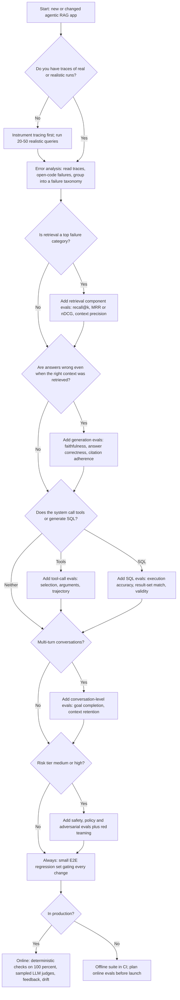
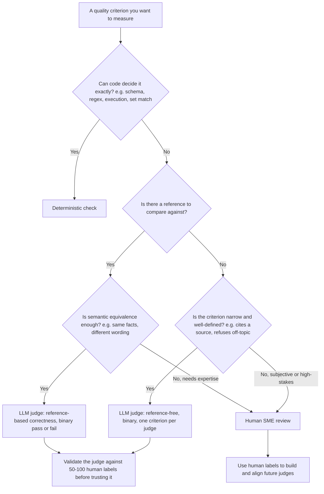
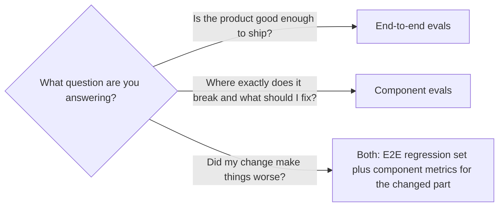
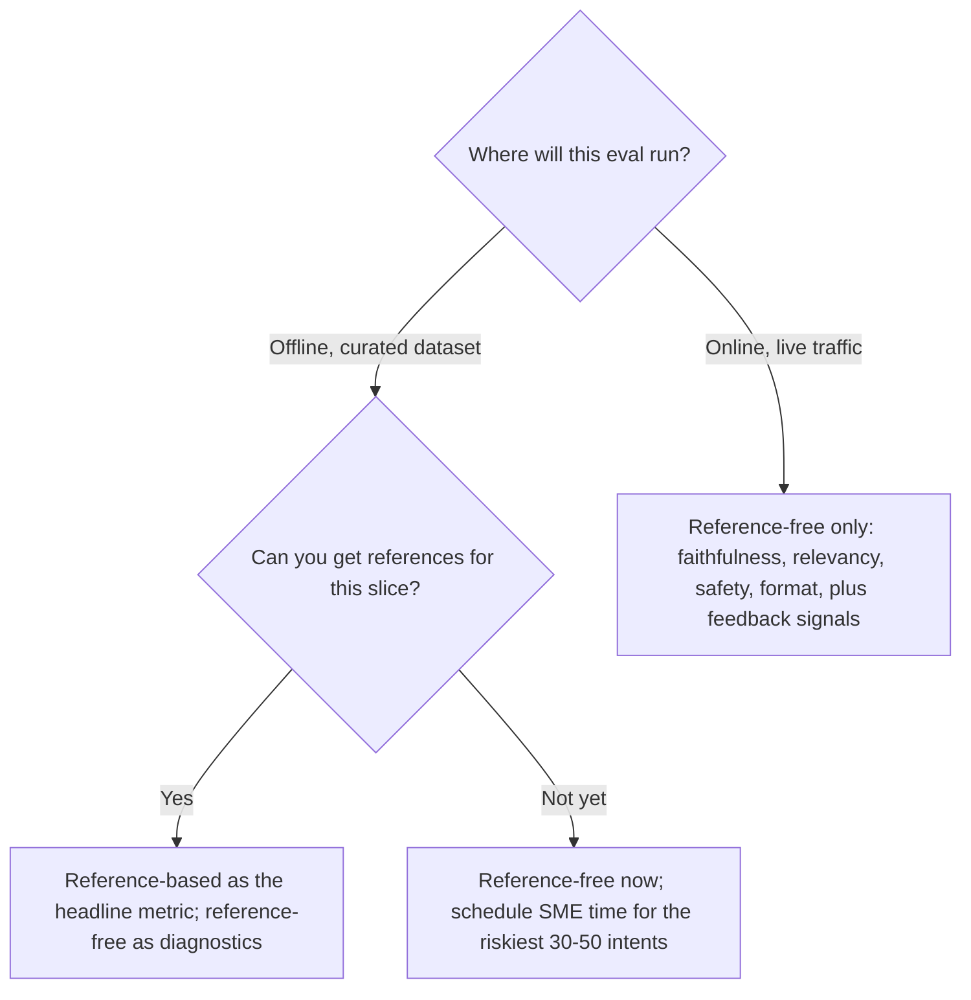

# Eval Selection Decision Tree

> **TL;DR** — Choose evals by answering five questions in order: what is your architecture, how bad is a failure, what ground truth can you get, what stage are you in, and what can you afford per run. Start every archetype with the same core (traces + error analysis + a small golden set + a few deterministic checks), then add component metrics where error analysis says the system breaks, and only then add LLM judges you have validated against human labels.

**You'll learn:** a step-by-step framework for choosing evals · when to use deterministic checks vs LLM judges vs humans · end-to-end vs component · reference-based vs reference-free · which dataset type fits which stage · a minimum viable eval suite and "add next" order for five archetypes
· **Prerequisites:** [The evals & guardrails map](../00-foundations/02-the-evals-and-guardrails-map.md), [Agentic RAG failure modes](../00-foundations/03-agentic-rag-failure-modes.md)
· **Related:** [Guardrail selection](./02-guardrail-selection-decision-tree.md), [Metric cheatsheet](./03-metric-cheatsheet.md), [Implementation playbook](./04-implementation-playbook.md), [Dataset strategy](../01-datasets/01-dataset-strategy.md)

---

## 1. How to use this document

This is a decision aid, not a catalogue. The catalogue lives in [02-offline-evals](../02-offline-evals/README.md) and [03-online-evals-and-observability](../03-online-evals-and-observability/README.md); the one-page index lives in the [metric cheatsheet](./03-metric-cheatsheet.md).

Work through it like this:

1. **Answer the five input questions** (§2) and write the answers down. They become the header of your eval plan.
2. **Walk the master decision tree** (§3) to get a first-cut list of eval families.
3. **Resolve the four method choices** (§4–§7): deterministic vs judge vs human, E2E vs component, reference-based vs reference-free, and which dataset.
4. **Look up your archetype** (§8) to get the must-have / nice-to-have stack and the order to build it.
5. **Sanity-check against budget** (§9) and **stage** (§10).

> **Opinionated default:** if you only read one section, read §8.0 "The universal core". Every archetype starts there. Most teams that struggle with evals skipped error analysis and jumped straight to a dashboard of generic metrics.

### Running example

Throughout, we use an **internal enterprise assistant** that:

- answers questions over company documents (vector search over Confluence/SharePoint-like content),
- queries a data warehouse via **text-to-SQL**,
- can **call tools** (e.g. `create_ticket`, `lookup_employee`),
- serves users in **different roles** (RBAC: employee, manager, finance, HR).

It is a composite of archetypes A2 (agentic RAG with tools) and A3 (text-to-SQL), and in its later life A5 (multi-turn). We will point out where each piece of its eval stack comes from.

---

## 2. The five input questions

Answer these before choosing a single metric.

| # | Question | Typical answers | Why it changes the eval plan |
|---|---|---|---|
| Q1 | **What is the architecture?** | Simple RAG · Agentic RAG with tools · Text-to-SQL · Multi-agent / multi-step workflow · Multi-turn conversational | Determines which *components* exist and therefore which component evals are even possible (no retriever → no retrieval metrics; no tools → no tool-call evals). |
| Q2 | **What is the risk level and domain?** | Low (internal, read-only, advisory) · Medium (customer-facing, reputational) · High (regulated: finance, health, legal, HR; or takes irreversible actions) | Sets required thresholds, how much human review you need, how big the dataset must be, and whether you need safety/red-team evals before launch. |
| Q3 | **What ground truth can you get?** | None · SME time available · Production logs (with or without feedback) | Decides reference-based vs reference-free metrics and synthetic vs curated datasets. |
| Q4 | **What stage are you in?** | Prototype · Pre-launch · Production | Determines rigor: prototype = fast error analysis; pre-launch = regression gates + red teaming; production = online evals + drift. |
| Q5 | **What is the budget?** | Cost per eval run · latency tolerance for online checks · human-review hours per week | Decides how many LLM-judge calls you can afford, the sampling rate online, and how often you run the full suite. |

### Q1 — Architecture archetypes used in this doc

| ID | Archetype | Components that can fail independently |
|---|---|---|
| **A1** | Simple RAG chatbot (single retrieve → generate) | query rewrite (optional), retriever, reranker (optional), generator |
| **A2** | Agentic RAG with tools (LLM decides when/what to retrieve and which tools to call) | planner/router, retriever(s), tool selection, tool arguments, tool execution, final synthesis |
| **A3** | Text-to-SQL agent | schema linking / table retrieval, SQL generation, SQL execution, result interpretation / answer |
| **A4** | Multi-agent or multi-step workflow (orchestrator + sub-agents, or long plans) | orchestrator routing, each sub-agent, hand-offs, state/memory, termination |
| **A5** | Multi-turn conversational assistant | everything above **plus** context carry-over, coreference, clarification behaviour, conversation-level goal completion |

### Q2 — Risk tier quick classifier

Use the [guardrail selection doc](./02-guardrail-selection-decision-tree.md) for a full risk assessment. For eval planning a three-level classification is enough:

| Tier | Signals | Eval implication (heuristic) |
|---|---|---|
| **Low** | Internal users, read-only, advisory output, a human reads the answer before acting | Golden set of ~50–100, a handful of metrics, judges spot-checked |
| **Medium** | External or many internal users, brand/reputation exposure, answers sometimes acted on directly | Golden set of ~100–300, validated judges, safety evals, regression gate in CI |
| **High** | Regulated domain, write actions, money, health/legal/HR decisions, sensitive data | Golden set of ~300+ stratified by risk slice, SME-labelled, human review of judge disagreements, red-team suite, per-slice thresholds, sign-off |

These sizes are rough heuristics, not statistical guarantees. See §9.3 for how to reason about sample size.

### Q3 — Ground-truth availability

| Situation | What you can do |
|---|---|
| **None** (no SMEs, no logs) | Reference-free metrics (faithfulness, relevancy, safety), deterministic format checks, synthetic Q&A generated from your corpus, *your own* manual error analysis on 20–50 traces |
| **SME time available** | Golden Q&A pairs, reference contexts (doc/chunk IDs), gold SQL, expected tool calls, rubric-based human labels to align judges |
| **Production logs** | Real query distribution, implicit feedback (thumbs, re-asks, copy events), failure mining, sampling for labelling → feeds the golden set |

### Q4/Q5 — Stage and budget

Stage and budget are applied at the end as filters (§9, §10). They rarely change *which* evals are right; they change *how many examples, how often, and how expensive the judge*.

---

## 3. The master decision tree



How to read it:

- **Error analysis is not optional and comes first.** The branch conditions ("is retrieval a top failure category?") can only be answered by looking at traces. See [LLM-as-a-judge](../02-offline-evals/07-llm-as-a-judge.md) and [running offline experiments](../02-offline-evals/08-running-offline-experiments.md).
- **Branches are additive.** An agentic text-to-SQL assistant walks several branches.
- **"Always" nodes are the universal core** (§8.0).

### 3.1 Q&A form of the same tree

Use this when you are in a planning meeting and don't want to draw a diagram.

**"Have you looked at 30+ traces and written down what goes wrong?"**
→ No: stop. Do that first. Any metric you choose now is a guess.
→ Yes: continue with your failure taxonomy in hand.

**"Do you have reference answers?"**
→ Yes, SME-written: use reference-based answer correctness (judge or semantic match) as your E2E headline metric.
→ No, but you can get 2–4 hours of SME time: get 30–50 reference answers for the riskiest intents first; use reference-free metrics for the rest.
→ No, and no SMEs: use reference-free metrics (faithfulness, answer relevancy) plus synthetic Q&A from your corpus; treat scores as directional, not absolute.

**"Do you know which documents *should* be retrieved for each question?"**
→ Yes: use classic IR metrics (recall@k, MRR, nDCG). They are cheap, deterministic, and fast to iterate on.
→ No: use LLM-judged context relevance / context precision (reference-free), or label relevant chunks for 50 questions (it is quicker than people expect).

**"Is retrieval the bottleneck?"**
→ Check: on failed answers, was the needed fact in the retrieved context? If < ~70% of failures had the fact present (heuristic), retrieval is your bottleneck — invest in retrieval evals and fixes before touching prompts.
→ If the fact was present but the answer was wrong, the bottleneck is generation (faithfulness, reasoning, instruction following).

**"Is the output structured or verifiable by code?"** (JSON, SQL, a tool call, a number, a citation ID)
→ Yes: use deterministic checks first (schema validation, execution, exact/numeric match, regex). They are free, fast, and never drift.
→ No (free text): use an LLM judge with a binary, criterion-specific rubric, validated against human labels.

**"Does the agent call tools?"**
→ Yes: evaluate tool selection and argument correctness at the step level, and trajectory/goal completion at the run level. If a tool has side effects, test it in a sandbox and add a "no unauthorized action" check.

**"Does it generate SQL?"**
→ Yes: execution accuracy (compare result sets against gold SQL) is the primary metric. String/AST similarity is a secondary diagnostic only.

**"Is it multi-turn?"**
→ Yes: you need conversation-level datasets (scripted or simulated users) and session-level metrics; single-turn evals will miss context-loss failures.

**"Could a bad answer harm someone, leak data, or create legal exposure?"**
→ Yes: add safety/toxicity/PII/policy evals, adversarial datasets, and red teaming; require human review on a sample before launch.

**"Are you live?"**
→ Yes: run deterministic checks on all traffic, reference-free LLM judges on a sample, collect feedback, and route low-scoring traces back into the golden set.

---

## 4. Decision: deterministic vs LLM judge vs human

The single most consequential method choice. Get it wrong and you either pay for judges you don't need or trust judges you never validated.



| Method | Use when | Strengths | Weaknesses | Cost / latency (relative) |
|---|---|---|---|---|
| **Deterministic (code)** | Output is structured or verifiable: JSON schema, SQL executes, tool name ∈ allowed set, citation IDs exist in retrieved set, numeric tolerance, regex for PII, length limits | Free, fast, reproducible, no drift, can run on 100% of traffic | Only covers what can be formalized; brittle on free text | ~0 |
| **Statistical / embedding** | Retrieval metrics with labelled relevant docs; semantic similarity as a coarse screen; drift detection | Cheap, scalable | Embedding similarity correlates weakly with correctness for short factual answers; thresholds are arbitrary | Low |
| **Classifier (small model)** | Toxicity, PII/NER, prompt-injection, topic classification | Cheap enough for 100% online, low latency | Domain shift; needs FP/FN measurement on your data | Low |
| **LLM judge** | Free-text criteria: faithfulness, relevance, tone, policy adherence, reference-based correctness | Flexible, scales human judgment | Biases (position, verbosity, self-preference), cost, non-determinism, **must be validated** | Medium–high |
| **Human (SME)** | Defining ground truth, aligning judges, high-stakes or ambiguous cases, launch sign-off | Highest validity for domain correctness | Slow, expensive, inconsistent without rubric | Highest |

**Rules of thumb (opinionated):**

1. **Deterministic first.** If you can write an assertion, write the assertion. Many "LLM judge" use cases are really "did the output contain a valid citation ID" — that's a set lookup.
2. **Binary over Likert.** Use pass/fail per criterion with a written definition. 1–5 scales produce noisy, hard-to-action numbers and judges cluster on the middle values. If you need nuance, use several binary criteria. See [LLM-as-a-judge](../02-offline-evals/07-llm-as-a-judge.md).
3. **One criterion per judge.** A "rate overall quality" judge is un-debuggable.
4. **Validate every judge.** Label 50–100 examples yourself or with SMEs; measure agreement (TPR/TNR or Cohen's kappa). Heuristic starting bar: ≥ 0.8 on both true-positive and true-negative rate before using it as a gate.
5. **Humans define, judges scale, code enforces.** Human labels are the source of truth; judges are a cheaper approximation of those labels; deterministic checks enforce the non-negotiables.

---

## 5. Decision: end-to-end vs component



| Aspect | End-to-end (E2E) | Component |
|---|---|---|
| Question answered | "Does the user get a correct, safe, useful answer?" | "Is the retriever / router / SQL generator / tool caller doing its job?" |
| Examples | Answer correctness, faithfulness, goal/task completion, user-facing safety | recall@k, MRR, nDCG, tool-selection accuracy, argument accuracy, SQL execution accuracy, schema-linking recall |
| Dataset shape | `(input, expected_output or rubric)` | `(input, expected intermediate output)` e.g. relevant chunk IDs, gold tool call, gold SQL |
| Strength | Captures what users experience; robust to internal refactors | Pinpoints root cause; fast & cheap; enables hill-climbing one component |
| Weakness | Doesn't tell you *why*; noisy | Can be green while E2E is red (components fine individually, broken together) |
| When to rely on it | Launch decisions, regression gates, online monitoring | Iterating on a specific component, debugging, A/B'ing chunkers or embedders |

**Default:** a small E2E regression set (gate) **plus** component evals for whatever error analysis says is the dominant failure. Evaluating only E2E is an anti-pattern for agentic systems: when goal completion drops 8 points you'll have no idea if the router, retriever, or SQL generator regressed. Evaluating only components is an anti-pattern too: you'll ship a system whose parts all pass while the whole fails.

**Trace-level evals bridge the two.** If you capture full traces (see [observability and tracing](../03-online-evals-and-observability/02-observability-and-tracing.md)), you can run component evals *on E2E runs* — e.g. compute retrieval recall from the retrieval span of an E2E test case. This is the most efficient setup: one dataset, many metrics.

---

## 6. Decision: reference-based vs reference-free

| | Reference-based | Reference-free |
|---|---|---|
| Needs | Gold answer / gold contexts / gold SQL / gold tool calls | Only the input, output, and (for RAG) retrieved context |
| Examples | Answer correctness, context recall, recall@k, execution accuracy, tool-call match | Faithfulness/groundedness, answer relevancy, context relevance, toxicity, format validity, policy adherence |
| Good for | Measuring *correctness*; regression gates with stable meaning | Measuring *consistency and safety*; online evals on live traffic; early prototypes |
| Blind spot | Can't run on live traffic (no reference); expensive to create; references go stale when docs change | **A faithful answer grounded in the wrong document still scores high.** Cannot detect "confidently grounded but wrong" |
| Stage | Pre-launch and CI | Prototype (when no references), production (online) |



**Opinion:** faithfulness without correctness is the most common false comfort in RAG evaluation. If your only E2E metric is faithfulness, you are measuring "did the model stick to the context," not "did the user get the right answer." Get at least a small reference set for your top intents.

---

## 7. Decision: which dataset at which stage

Details in [dataset strategy](../01-datasets/01-dataset-strategy.md), [SME golden datasets](../01-datasets/02-sme-golden-datasets.md), [synthetic datasets](../01-datasets/03-synthetic-datasets.md), and [production data flywheel](../01-datasets/04-production-data-flywheel.md).

| Stage | Primary dataset | Secondary | Why |
|---|---|---|---|
| **Prototype** (weeks 0–4) | 20–50 hand-written realistic queries by the builders + traces | Synthetic Q&A from the corpus (to probe retrieval coverage) | Speed. You need to see failures, not compute a precise score. |
| **Pre-launch** | SME golden set: 100–300 examples stratified by intent, difficulty, and risk; gold contexts/SQL/tool calls where applicable | Synthetic adversarial & edge cases; red-team set; dogfood/beta logs | You need a trustworthy regression gate and launch decision. |
| **Production** | Sampled production traces, labelled (failures over-sampled) | Golden set refreshed with production failures; synthetic for new features | Real distribution shifts; the golden set must track it. |

**Dataset shape must match eval type.** A common mistake is building a Q&A set and then trying to compute retrieval recall without relevant-chunk labels, or computing SQL execution accuracy without a frozen database snapshot.

| Eval type | Minimum dataset fields |
|---|---|
| E2E answer correctness | `question`, `reference_answer` (or rubric), optional `user_role` |
| Faithfulness / relevancy | `question` (contexts and answer come from the run) |
| Retrieval IR metrics | `question`, `relevant_doc_ids` (graded relevance for nDCG) |
| Context recall (RAGAS-style) | `question`, `reference_answer` or `reference_contexts` |
| Tool-call correctness | `input`, `expected_tool`, `expected_args` (or arg constraints), allowed alternatives |
| Trajectory / goal completion | `input`, `goal` or success criteria, optional reference trajectory, environment/sandbox state |
| Text-to-SQL | `question`, `gold_sql`, DB snapshot/version, optional `user_role` for row-level security |
| Citation adherence | `question` (citations and contexts from the run), optional `reference_citations` |
| Multi-turn | `conversation_script` or simulated-user persona + goal, success criteria |
| Safety / adversarial | `attack_input`, `expected_behaviour` (refuse / redact / comply safely) |
| RBAC / permission | `input`, `user_role`, `expected_allowed: bool`, `forbidden_content_markers` |

**Synthetic vs SME vs production — when each is the right call:**

- **Synthetic** is right for coverage (every doc gets a question), adversarial generation, multi-turn simulation, and bootstrapping. It is wrong as your *only* source: synthetic queries are cleaner, more answerable, and more "lexically aligned" with the source chunk than real user queries, which inflates retrieval scores.
- **SME** is right for correctness labels, gold SQL, rubric definition, and judge alignment. It is wrong for volume.
- **Production** is right for distribution realism and failure mining. It is wrong for pre-launch (you don't have it) and needs PII handling before use.

---

## 8. Recommended eval stack per archetype

### 8.0 The universal core (every archetype, every stage)

Before any archetype-specific metric:

- [ ] **Tracing** on every run: inputs, retrieved chunks with IDs/scores, tool calls with args/results, model/prompt version, latency, tokens, user role. ([observability](../03-online-evals-and-observability/02-observability-and-tracing.md))
- [ ] **Error analysis** on 30–100 traces → a written failure taxonomy with counts.
- [ ] **A small golden set** (start with 30–50, grow to 100+) of realistic inputs with expected outcomes.
- [ ] **Deterministic checks**: output schema/format, non-empty answer, latency and cost budgets, no exceptions, citations resolve.
- [ ] **One E2E headline metric** chosen from error analysis (usually answer correctness or task completion), binary per example.
- [ ] **A regression gate**: the golden set runs on every prompt/model/retriever change.

Everything below is *added on top* of this.

### Reading the tables

- **Must-have** = minimum viable eval suite for that archetype at pre-launch.
- **Nice-to-have** = add when error analysis points there or risk demands it.
- **Method**: Code = deterministic; Stat = statistical/IR; Judge = LLM judge; Clf = classifier; Human = SME.
- **Mode**: Off = offline (dataset); On = online (production traffic); Both.

### 8.1 A1 — Simple RAG chatbot

| Priority | Eval | Metric | Method | Dataset type | Mode | Detail |
|---|---|---|---|---|---|---|
| Must | Answer correctness | % correct vs reference (binary) | Judge (ref-based) | SME golden Q&A | Off | [E2E RAG](../02-offline-evals/01-end-to-end-rag-evals.md) |
| Must | Faithfulness / groundedness | % answers fully supported by context | Judge (ref-free) | Any | Both | [E2E RAG](../02-offline-evals/01-end-to-end-rag-evals.md) |
| Must | Retrieval recall | recall@k / hit rate@k | Stat | Q + relevant doc IDs | Off | [Retrieval metrics](../02-offline-evals/02-retrieval-metrics.md) |
| Must | Refusal on unanswerable | % correctly says "I don't know" | Judge or Code (marker) | Unanswerable subset | Off | [E2E RAG](../02-offline-evals/01-end-to-end-rag-evals.md) |
| Nice | Ranking quality | MRR, nDCG@k | Stat | Q + graded relevance | Off | [Retrieval metrics](../02-offline-evals/02-retrieval-metrics.md) |
| Nice | Context precision | share of retrieved chunks that are relevant | Judge or Stat | Any / labelled | Off | [E2E RAG](../02-offline-evals/01-end-to-end-rag-evals.md) |
| Nice | Answer relevancy | answers the question asked | Judge | Any | Both | [E2E RAG](../02-offline-evals/01-end-to-end-rag-evals.md) |
| Nice | Citation adherence | citations present, valid, supporting | Code + Judge | Any | Both | [Citation adherence](../02-offline-evals/06-instruction-and-citation-adherence.md) |
| Nice | Toxicity / tone | % flagged | Clf | Any + adversarial | Both | [Generation quality](../02-offline-evals/03-generation-quality-and-safety-evals.md) |
| Online | Feedback & implicit signals | thumbs-down rate, re-ask rate | Code | Production | On | [User feedback](../03-online-evals-and-observability/03-user-feedback-and-implicit-signals.md) |

**Minimum viable suite (A1):** golden set of 50 Q&A (incl. ~10 unanswerable) → answer correctness + faithfulness + recall@5 + refusal correctness. That's four numbers.

**Order to add:**
1. Traces + 30 hand-written queries + error analysis.
2. recall@k on 50 labelled questions (retrieval is the most common RAG bottleneck; it's cheap to measure).
3. Answer correctness (ref-based judge, validated) on golden set.
4. Faithfulness (ref-free judge) — also your first online eval.
5. Unanswerable / out-of-scope subset.
6. Citation checks, nDCG, tone — as error analysis demands.

### 8.2 A2 — Agentic RAG with tools

| Priority | Eval | Metric | Method | Dataset type | Mode | Detail |
|---|---|---|---|---|---|---|
| Must | Task / goal completion | % runs achieving stated goal | Judge or Code (state check) | Goal-based scenarios | Off | [Agent & trajectory](../02-offline-evals/04-agent-tool-and-trajectory-evals.md) |
| Must | Tool selection accuracy | correct tool chosen (or correctly none) | Code | Input + expected tool | Off | [Agent & trajectory](../02-offline-evals/04-agent-tool-and-trajectory-evals.md) |
| Must | Tool argument correctness | args valid & semantically correct | Code (schema) + Judge | Input + expected args | Off | [Agent & trajectory](../02-offline-evals/04-agent-tool-and-trajectory-evals.md) |
| Must | Answer correctness + faithfulness | as A1 | Judge | SME golden | Off/Both | [E2E RAG](../02-offline-evals/01-end-to-end-rag-evals.md) |
| Must | Unauthorized / unsafe action rate | % runs with disallowed tool call | Code | Adversarial + RBAC cases | Both | [Tool guardrails](../04-guardrails/05-tool-and-action-guardrails.md) |
| Must | Retrieval recall (when it retrieves) | recall@k | Stat | Q + relevant IDs | Off | [Retrieval metrics](../02-offline-evals/02-retrieval-metrics.md) |
| Nice | Trajectory efficiency | steps, redundant calls, loops | Code | Any | Both | [Agent & trajectory](../02-offline-evals/04-agent-tool-and-trajectory-evals.md) |
| Nice | Trajectory match | in-order / any-order match vs reference | Code | Reference trajectories | Off | [Agent & trajectory](../02-offline-evals/04-agent-tool-and-trajectory-evals.md) |
| Nice | Retrieval decision | retrieved when needed, skipped when not | Judge or Code | Labelled need-to-retrieve | Off | [Agent & trajectory](../02-offline-evals/04-agent-tool-and-trajectory-evals.md) |
| Nice | Instruction adherence | follows system-prompt rules | Judge | Rule-targeted cases | Both | [Instruction adherence](../02-offline-evals/06-instruction-and-citation-adherence.md) |
| Nice | Error recovery | recovers from tool error/timeouts | Code + Judge | Fault-injected scenarios | Off | [Agent & trajectory](../02-offline-evals/04-agent-tool-and-trajectory-evals.md) |
| Online | Tool error rate, step count, cost per task | — | Code | Production | On | [Monitoring](../03-online-evals-and-observability/04-monitoring-alerting-and-drift.md) |

**Minimum viable suite (A2):** 50–100 scenarios with expected tool(s) and success criteria → task completion + tool selection + argument correctness + unauthorized-action rate + answer correctness.

**Order to add:**
1. Traces with every tool span; error analysis grouped by step (plan / retrieve / tool select / tool args / synthesize).
2. Tool selection + argument checks (deterministic, cheap, very diagnostic).
3. Task completion on goal-based scenarios (state check if the tool has a verifiable effect, e.g. ticket exists with right fields in sandbox; judge otherwise).
4. Unauthorized-action test cases (per role) — before any write tool goes live.
5. Answer correctness/faithfulness for the RAG parts.
6. Trajectory efficiency and recovery.

> **Don't over-fit to reference trajectories.** Multiple valid paths usually exist. Prefer outcome checks (final state, final answer) + constraint checks (never called `delete_*`, ≤ N steps) over exact path matching.

### 8.3 A3 — Text-to-SQL agent

| Priority | Eval | Metric | Method | Dataset type | Mode | Detail |
|---|---|---|---|---|---|---|
| Must | Execution accuracy | result set of generated SQL == result set of gold SQL | Code | Q + gold SQL + DB snapshot | Off | [Text-to-SQL](../02-offline-evals/05-text-to-sql-evals.md) |
| Must | SQL validity | parses & executes without error | Code | Any | Both | [Text-to-SQL](../02-offline-evals/05-text-to-sql-evals.md) |
| Must | Safety of SQL | read-only, no DDL/DML, allowed schemas only | Code (AST/parser) | Any + adversarial | Both (also guardrail) | [Tool guardrails](../04-guardrails/05-tool-and-action-guardrails.md) |
| Must | Permission correctness | no rows/columns outside user's entitlement | Code | Q + role + expected access | Off | [RBAC](../04-guardrails/06-access-control-rbac.md) |
| Must | Answer faithfulness to result | NL answer matches the returned data | Judge or Code (numbers) | Any | Both | [Text-to-SQL](../02-offline-evals/05-text-to-sql-evals.md) |
| Nice | Schema linking recall | needed tables/columns retrieved | Code | Q + gold tables | Off | [Text-to-SQL](../02-offline-evals/05-text-to-sql-evals.md) |
| Nice | SQL similarity | exact/component/AST match | Code | Q + gold SQL | Off | [Text-to-SQL](../02-offline-evals/05-text-to-sql-evals.md) |
| Nice | Ambiguity handling | asks clarification when the question is ambiguous | Judge | Ambiguous subset | Off | [Text-to-SQL](../02-offline-evals/05-text-to-sql-evals.md) |
| Nice | Query cost/efficiency | rows scanned, runtime | Code | Any | Both | [Text-to-SQL](../02-offline-evals/05-text-to-sql-evals.md) |
| Online | Execution error rate, empty-result rate, user re-asks | — | Code | Production | On | [Monitoring](../03-online-evals-and-observability/04-monitoring-alerting-and-drift.md) |

**Minimum viable suite (A3):** 50–100 question/gold-SQL pairs on a frozen snapshot → execution accuracy + validity + read-only/allowed-schema check + permission tests per role + answer-matches-result.

**Order to add:**
1. Frozen DB snapshot (or seeded test DB) — without it execution accuracy is not reproducible.
2. 50 gold SQL pairs from analysts, covering joins, aggregations, date logic, and your business-metric definitions ("revenue" means what, exactly?).
3. Execution accuracy + validity.
4. SQL safety and RBAC cases (also enforce as guardrails — evals verify the guardrail works, they don't replace it).
5. Answer-vs-result faithfulness (numbers in the answer appear in the result).
6. Schema-linking recall when error analysis shows wrong-table errors.

> **Execution accuracy pitfalls:** different-but-equivalent SQL may differ in column order, row order, or float precision — normalize. Conversely, wrong SQL can return the right result on a small snapshot by accident — include discriminating test data.

### 8.4 A4 — Multi-agent / multi-step workflow

| Priority | Eval | Metric | Method | Dataset type | Mode | Detail |
|---|---|---|---|---|---|---|
| Must | E2E task success | % workflows meeting success criteria | Code (state) + Judge | Goal-based scenarios | Off | [Agent & trajectory](../02-offline-evals/04-agent-tool-and-trajectory-evals.md) |
| Must | Routing / delegation accuracy | orchestrator sends to correct sub-agent | Code | Input + expected route | Off | [Agent & trajectory](../02-offline-evals/04-agent-tool-and-trajectory-evals.md) |
| Must | Per-sub-agent component evals | use A1/A2/A3 tables per sub-agent | mixed | per sub-agent | Off | (above) |
| Must | Termination & loop detection | max steps, repeated calls, stuck | Code | Any | Both | [Agent & trajectory](../02-offline-evals/04-agent-tool-and-trajectory-evals.md) |
| Must | Hand-off fidelity | information preserved across hand-offs | Judge | Multi-hop scenarios | Off | [Agent & trajectory](../02-offline-evals/04-agent-tool-and-trajectory-evals.md) |
| Nice | Cost & latency per task | tokens, wall-clock | Code | Any | Both | [Monitoring](../03-online-evals-and-observability/04-monitoring-alerting-and-drift.md) |
| Nice | Plan quality | plan is complete & feasible | Judge | Planning scenarios | Off | [Agent & trajectory](../02-offline-evals/04-agent-tool-and-trajectory-evals.md) |
| Nice | Robustness | success under injected faults/noisy inputs | Code + Judge | Fault-injected | Off | [Running experiments](../02-offline-evals/08-running-offline-experiments.md) |

**Minimum viable suite (A4):** E2E task success + routing accuracy + loop/termination checks + the A1/A2/A3 minimum suite for each sub-agent that matters.

**Order to add:** routing first (it's the most leveraged single decision), then E2E success, then the weakest sub-agent's component suite, then hand-off fidelity. Run each scenario multiple times (e.g. 3–5) and report pass rate and variance: multi-step agents are non-deterministic and a single run per scenario will mislead you.

> **Before building A4, ask whether you need it.** A single agent with good tools is easier to evaluate. See Anthropic's [Building effective agents](https://www.anthropic.com/engineering/building-effective-agents).

### 8.5 A5 — Multi-turn conversational assistant

| Priority | Eval | Metric | Method | Dataset type | Mode | Detail |
|---|---|---|---|---|---|---|
| Must | Conversation goal completion | % sessions where user goal met | Judge (session-level) | Scripted or simulated conversations | Both | [Agent & trajectory](../02-offline-evals/04-agent-tool-and-trajectory-evals.md) |
| Must | Context retention | uses facts/constraints from earlier turns | Judge | Multi-turn scripts with callbacks | Off | [Instruction adherence](../02-offline-evals/06-instruction-and-citation-adherence.md) |
| Must | Per-turn A1–A3 metrics | as applicable | mixed | turn-level extraction from sessions | Off | (above) |
| Must | Instruction persistence | system rules still followed at turn N | Judge | Long conversations | Off | [Instruction adherence](../02-offline-evals/06-instruction-and-citation-adherence.md) |
| Nice | Clarification behaviour | asks when ambiguous, doesn't over-ask | Judge | Ambiguous scenarios | Off | [Instruction adherence](../02-offline-evals/06-instruction-and-citation-adherence.md) |
| Nice | Multi-turn jailbreak resistance | holds policy under gradual escalation | Judge + Clf | Red-team scripts | Off | [Generation safety](../02-offline-evals/03-generation-quality-and-safety-evals.md) |
| Online | Session-level signals | abandonment, re-phrase rate, escalation to human | Code | Production | On | [User feedback](../03-online-evals-and-observability/03-user-feedback-and-implicit-signals.md) |

**Minimum viable suite (A5):** 30–50 multi-turn scripts (or simulated-user personas with goals) → session goal completion + context retention + instruction persistence + the per-turn minimum suite of the underlying archetype.

**Order to add:** start by evaluating single turns of real sessions (cheapest), then add scripted multi-turn cases for the failures you see (lost context, contradicting earlier turns), then add simulated users for scale.

### 8.6 The running example: putting it together

The internal enterprise assistant = A2 + A3 (+ A5 later), medium-to-high risk (HR and finance data, write tool).

| Layer | Must-have evals | Dataset |
|---|---|---|
| Router | Intent routing accuracy (docs / SQL / ticket / out-of-scope) | 100 labelled queries |
| Docs RAG | recall@5, answer correctness, faithfulness, citation validity | 80 SME Q&A with relevant doc IDs |
| Text-to-SQL | execution accuracy, validity, read-only, per-role permission tests | 60 gold SQL on a frozen snapshot, × 4 roles for permission cases |
| Ticket tool | tool selection, argument correctness, sandbox state check, no-ticket-when-not-asked | 40 scenarios |
| RBAC (cross-cutting) | leaked-content rate per role (should be 0) | 50 role × query pairs with forbidden markers |
| Safety | prompt-injection via documents, PII in output | 50 adversarial cases |
| Online | faithfulness (sampled 5–10%), SQL error rate, tool error rate, thumbs-down, RBAC-denial anomalies | Production |

---

## 9. Budget: making the plan affordable

### 9.1 Cost levers

| Lever | Effect | Trade-off |
|---|---|---|
| Replace judges with code where possible | Large cost reduction | Requires structured outputs/citations |
| Smaller judge model for narrow binary criteria | Lower cost per call | Must re-validate alignment for the smaller model |
| Run full suite nightly, small "smoke" subset on every PR | Fast CI | Regressions caught later for rare slices |
| Online: deterministic on 100%, judges on a sample | Bounded cost | Rare failures detected later; over-sample flagged traces |
| Cache judge results keyed on (input, output, judge version) | Avoids re-paying for unchanged outputs | Cache invalidation on judge prompt changes |
| Component evals instead of full E2E runs during iteration | Cheaper, faster loops | Must still run E2E before merging |

### 9.2 Rough cost model

```text
cost_per_suite_run ≈ N_examples × (system_cost_per_example + Σ_judges judge_calls × judge_cost_per_call)
online_judge_cost_per_day ≈ daily_traces × sample_rate × Σ_judges judge_cost_per_call
```

Use your own token prices; don't plan on someone else's numbers.

### 9.3 How many examples?

There is no universal number. Two practical heuristics:

- **For discovery (error analysis):** keep reading traces until new failure categories stop appearing ("theoretical saturation"); this is often in the range of 50–100 traces for a focused product.
- **For measurement:** the uncertainty of a pass rate shrinks with √N. With a binomial approximation, the 95% interval half-width is roughly `1.96 × sqrt(p(1−p)/N)`. At p ≈ 0.8: N=50 → about ±11 points; N=100 → ±8; N=400 → ±4. If you need to detect a 3-point regression, 100 examples is not enough — use paired comparisons on the same examples, more examples, or repeated runs.

```python
import math

def ci_halfwidth(p: float, n: int, z: float = 1.96) -> float:
    return z * math.sqrt(p * (1 - p) / n)

for n in (50, 100, 200, 400):
    print(n, round(ci_halfwidth(0.8, n) * 100, 1), "points")
```

### 9.4 Latency budget (online evals)

Online evals that don't block the response should run **async** and add zero user latency. Anything that must block is a *guardrail*, not an eval — see [guardrail selection](./02-guardrail-selection-decision-tree.md) for latency budgets.

---

## 10. Stage-by-stage summary

| | Prototype | Pre-launch | Production |
|---|---|---|---|
| **Goal** | Find the big failure modes fast | Prove it's good enough & safe; build regression gate | Detect drift/regressions; feed improvements |
| **Dataset** | 20–50 builder-written + synthetic | 100–300 SME golden, stratified; red-team set | Sampled + labelled production traces; refreshed golden set |
| **Methods** | Mostly human reading of traces; a few code checks | Code + validated judges + SME spot checks | Code on 100%, sampled judges, feedback, periodic human review |
| **Scope** | E2E vibe + component where obviously broken | E2E headline + component for dominant failures | E2E online proxies + component dashboards |
| **Reference** | Mostly reference-free | Reference-based headline | Reference-free online, reference-based offline |
| **Cadence** | Ad hoc, every iteration | Every PR (smoke) + nightly (full) | Continuous + weekly review |
| **Exit criterion** | Failure taxonomy stable; top failure types understood | Thresholds met per slice; judges validated; red team done | — (continuous) |

See the [implementation playbook](./04-implementation-playbook.md) for phase-by-phase checklists.

---

## 11. Worked example: choosing evals in 15 minutes

**Context:** the running example, adding the text-to-SQL capability. Pre-launch. Medium-high risk (finance data). Analysts can give 4 hours. Budget: moderate.

1. **Q1 architecture:** A3 inside A2 (router decides SQL vs docs).
2. **Q2 risk:** high for finance/HR tables → permission tests required; per-role slices.
3. **Q3 ground truth:** 4 analyst hours ≈ 50–60 gold SQL pairs if you pre-draft candidates and have analysts verify (faster than writing from scratch).
4. **Q4 stage:** pre-launch → need a CI gate + red team.
5. **Q5 budget:** execution accuracy is code — cheap. One judge (answer-vs-result) only on numeric-free answers; numbers checked by code.

**Resulting plan:**

- [ ] Freeze warehouse snapshot `dw_eval_v1`.
- [ ] 55 gold SQL pairs (verified by analysts), tagged by difficulty and business domain.
- [ ] Router accuracy on 100 labelled queries (SQL / docs / ticket / out-of-scope).
- [ ] Execution accuracy ≥ heuristic target agreed with stakeholders (e.g. start by measuring baseline, then set gate at baseline − 2 points to prevent regressions).
- [ ] 100% read-only, 0 cross-role leakage on 40 permission cases (hard gate).
- [ ] Answer-numbers-in-result check (code).
- [ ] 30 adversarial SQL-injection-style prompts → 0 unsafe queries executed.
- [ ] Online after launch: SQL error rate, empty-result rate, re-ask within 2 minutes, thumbs-down; weekly review of 50 sampled sessions.

---

## Key takeaways

- Answer the five questions (architecture, risk, ground truth, stage, budget) before picking metrics; write them down as the header of your eval plan.
- Error analysis on real traces comes before metric selection; it tells you which branches of the decision tree matter.
- Deterministic checks first, validated binary LLM judges second, humans to define truth and align judges.
- Use an E2E headline metric as the gate and component metrics to diagnose; trace-level evals let one dataset feed both.
- Reference-free metrics (faithfulness) are necessary but insufficient; get references for your riskiest intents.
- Each archetype has a minimum viable suite of 4–6 evals — start there and add in the order error analysis dictates.
- Dataset shape must match the eval: no relevant-doc labels → no recall@k; no frozen DB → no reproducible execution accuracy.

## Further reading

- Hamel Husain — [Your AI Product Needs Evals](https://hamel.dev/blog/posts/evals/), [A Field Guide to Rapidly Improving AI Products](https://hamel.dev/blog/posts/field-guide/), [AI Evals FAQ](https://hamel.dev/blog/posts/evals-faq/)
- Eugene Yan — [Task-Specific LLM Evals that Do & Don't Work](https://eugeneyan.com/writing/evals/)
- Anthropic — [Demystifying evals for AI agents](https://www.anthropic.com/engineering/demystifying-evals-for-ai-agents), [Define success criteria and build evaluations](https://docs.anthropic.com/en/docs/test-and-evaluate/develop-tests)
- Shankar et al. — [Who Validates the Validators? (arXiv:2404.12272)](https://arxiv.org/abs/2404.12272)
- Es et al. — [RAGAS: Automated Evaluation of Retrieval Augmented Generation (arXiv:2309.15217)](https://arxiv.org/abs/2309.15217)
- In this repo: [Metric cheatsheet](./03-metric-cheatsheet.md) · [Offline evals](../02-offline-evals/README.md) · [Online evals](../03-online-evals-and-observability/01-online-evals.md) · [Datasets](../01-datasets/README.md)
