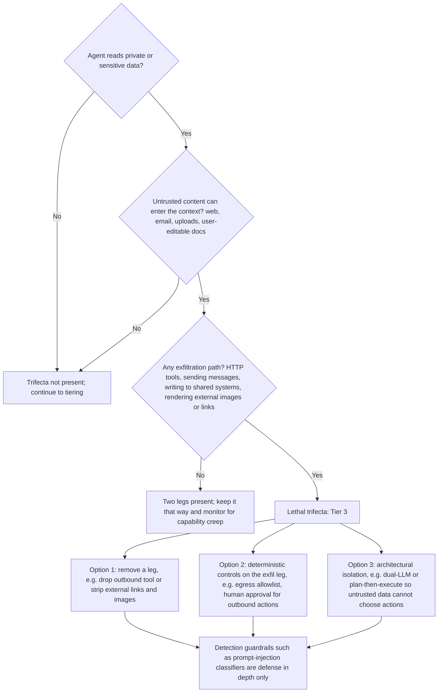
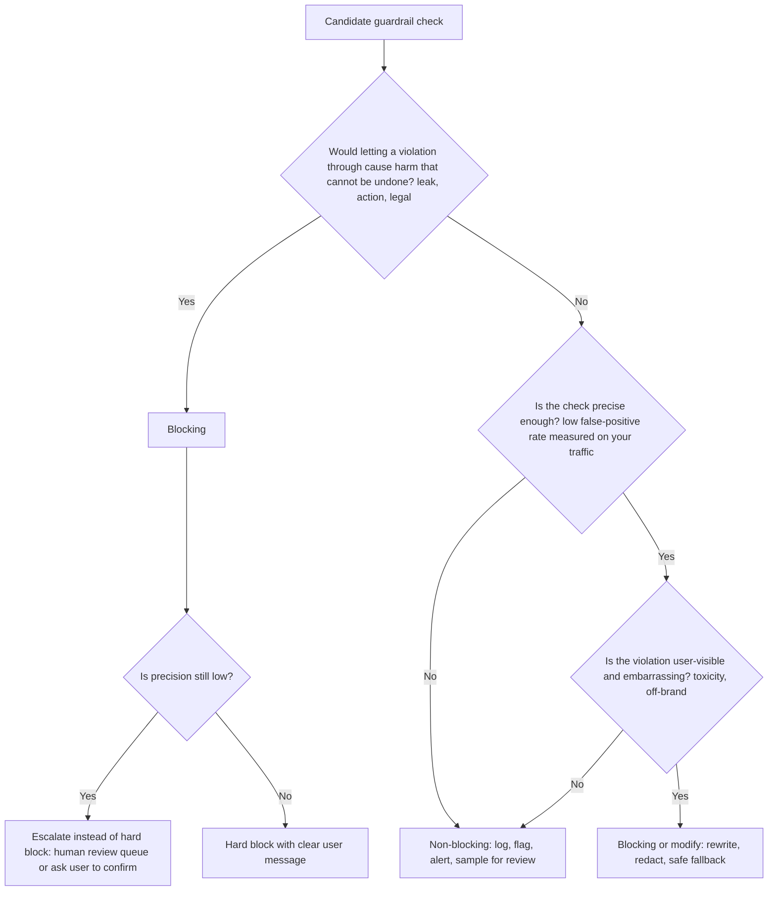
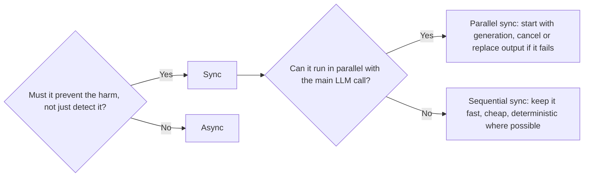
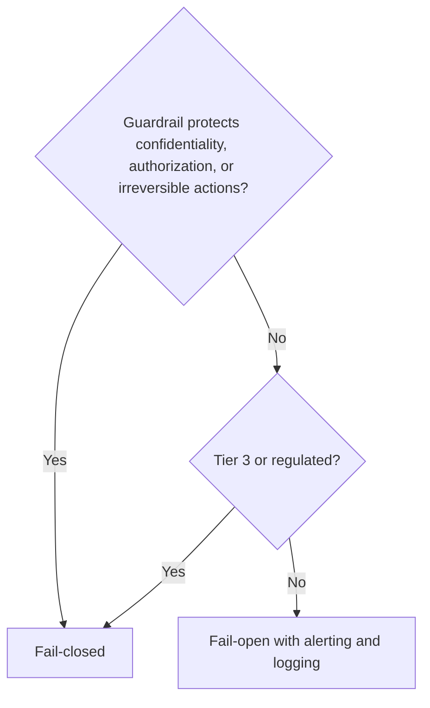
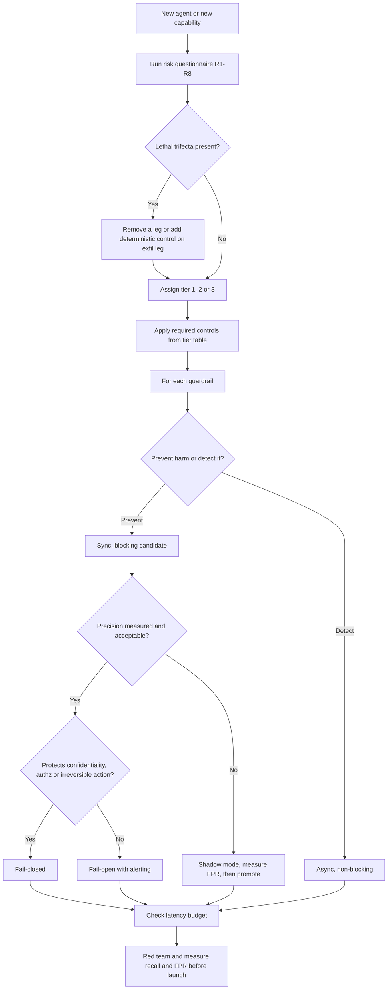

# Guardrail Selection Decision Tree

> **TL;DR** — Pick guardrails from risk, not from a vendor feature list: assess who the users are, what data the agent can see, what actions it can take, and whether untrusted content enters its context. If an agent combines private data, untrusted content, and an exfiltration path (the "lethal trifecta"), no classifier will make it safe — remove a leg or add a deterministic control. Then decide per guardrail: blocking or not, sync or async, fail-open or fail-closed, and how much latency it may spend.

**You'll learn:** a risk-assessment questionnaire · the lethal-trifecta / Rule-of-Two check · risk tiers → required guardrails · how to decide blocking vs non-blocking, sync vs async, fail-open vs fail-closed · latency budget allocation · build vs buy · per-archetype guardrail stacks
· **Prerequisites:** [Guardrails architecture](../04-guardrails/01-guardrails-architecture.md), [Threat model & OWASP](../04-guardrails/07-threat-model-owasp.md)
· **Related:** [Eval selection](./01-eval-selection-decision-tree.md), [Input guardrails](../04-guardrails/02-input-guardrails.md), [Tool & action guardrails](../04-guardrails/05-tool-and-action-guardrails.md), [Access control & RBAC](../04-guardrails/06-access-control-rbac.md), [Guardrail tools](../06-tooling-landscape/02-guardrail-tools.md)

---

## 1. Principles before trees

1. **Guardrails are controls; evals are measurements.** A guardrail changes what happens at runtime (block, redact, require approval). An eval tells you how often things go wrong. You need evals *of* your guardrails (false-positive and false-negative rates) — see [§9](#9-measuring-guardrails-false-positives-matter).
2. **Deterministic controls beat probabilistic ones for anything security-critical.** Authorization, allowed tools, SQL read-only enforcement, and egress restrictions belong in code and infrastructure, not in a prompt or a classifier.
3. **The LLM is not an authorization layer.** "The system prompt tells it not to show salaries to non-HR users" is not access control. Filter data *before* it reaches the model, using the end user's identity. See [Access control & RBAC](../04-guardrails/06-access-control-rbac.md).
4. **Defense in depth.** Layer input, context, tool, and output controls; assume each layer leaks.
5. **Design the architecture to reduce what guardrails must catch.** Removing a capability (no outbound HTTP tool) is stronger than detecting misuse of it.
6. **Every guardrail has a cost:** latency, money, and false positives that degrade UX. Add them based on risk, measure them, and remove ones that don't pay their way.

---

## 2. Risk assessment questionnaire

Answer these for each agent (or each capability, if the agent's capabilities differ a lot in risk). Score each row; the scores feed the tier in §4.

| # | Question | Low (0) | Medium (1) | High (2) |
|---|---|---|---|---|
| R1 | **Who are the users?** | Small set of trusted internal staff, authenticated | All employees / authenticated customers | Public, anonymous, or untrusted |
| R2 | **What data can the agent access?** | Public or non-sensitive docs | Internal confidential | PII, PHI, financial, HR, credentials, regulated data; or data with per-user entitlements |
| R3 | **Can the agent take actions?** | Read-only, no side effects | Reversible writes (draft ticket, internal note) | Irreversible / external effects (send email, payments, delete, deploy, modify records) |
| R4 | **Does untrusted content enter the context?** | Only curated, internally authored content | Internal content editable by many employees | Web pages, emails, user uploads, third-party APIs, tickets from customers |
| R5 | **Can output leave the trust boundary?** | Output shown only to the requesting user | Output stored/shared internally | Agent can make HTTP requests, render external images/links, send messages, write to external systems |
| R6 | **Regulatory / domain exposure?** | None | Contractual, brand-sensitive | Regulated (finance, health, legal, employment decisions, children), or EU AI Act high-risk-type use |
| R7 | **Blast radius of one bad output?** | One user, easily noticed and ignored | Many users or decisions made on it | Financial loss, safety, legal liability, data breach, mass action |
| R8 | **Autonomy?** | Human reviews every output before use | Human reviews sometimes | Fully autonomous loops, no human in the loop |

**Scoring heuristic:** any single **High (2)** on R2, R3, R5, or R7 → at least **Tier 2**. Two or more Highs, or a lethal-trifecta hit (§3) → **Tier 3**. Otherwise sum: 0–4 → Tier 1, 5–9 → Tier 2, 10+ → Tier 3. These thresholds are a starting point for discussion, not a standard; adjust them with your security team.

**Running example:** internal enterprise assistant.
R1 = 1 (all employees), R2 = 2 (HR/finance tables), R3 = 1 (create ticket — reversible), R4 = 1 (wiki editable by any employee), R5 = 1 (tickets visible to support teams; renders markdown), R6 = 1–2 (HR data → employment), R7 = 1, R8 = 1. → **Tier 2–3**: treat HR/finance paths as Tier 3.

---

## 3. The lethal-trifecta check

Simon Willison's [lethal trifecta](https://simonwillison.net/2025/Jun/16/the-lethal-trifecta/): an agent that has **(1) access to private data**, **(2) exposure to untrusted content**, and **(3) the ability to communicate externally** can be tricked by injected instructions into exfiltrating that data. Meta's [Agents Rule of Two](https://ai.meta.com/blog/practical-ai-agent-security/) generalizes this: within a session, an agent should satisfy **no more than two** of: [A] processes untrustworthy inputs, [B] has access to sensitive systems or private data, [C] can change state or communicate externally — or else require human-in-the-loop supervision.



Why classifiers alone are not enough: prompt-injection detectors are probabilistic, and an attacker only needs one miss. Treat them as a speed bump and a telemetry source, not the wall. For architectural patterns see Willison's [Dual LLM pattern](https://simonwillison.net/2023/Apr/25/dual-llm-pattern/), [Design Patterns for Securing LLM Agents against Prompt Injections (arXiv:2506.08837)](https://arxiv.org/abs/2506.08837), and [Defeating Prompt Injections by Design (CaMeL, arXiv:2503.18813)](https://arxiv.org/abs/2503.18813).

**Common hidden exfiltration paths** (check every one):

- [ ] Markdown image rendering in the chat UI (``) — the client fetches the URL.
- [ ] Clickable links with data in query strings.
- [ ] Tools that fetch URLs, call webhooks, or send email/Slack messages.
- [ ] Writing to shared systems (tickets, wiki pages, CRM notes) that others — or other agents — later read.
- [ ] Code execution sandboxes with network access.
- [ ] Logging/analytics pipelines that ship raw outputs to third parties.

**Running example:** private data (HR/finance) ✔, untrusted content (employee-editable wiki, ticket text) ✔, exfil path (ticket creation visible to others; markdown rendering) ✔ → trifecta present. Mitigations chosen: disable external image rendering and non-allowlisted links in UI; ticket tool restricted to fixed fields with no free-form external recipients; HR/finance SQL path runs without retrieving wiki content in the same turn (removes leg [A] for the sensitive path); prompt-injection classifier on retrieved chunks as defense in depth.

---

## 4. Risk tiers → required guardrails

| Guardrail | Tier 1 (low) | Tier 2 (medium) | Tier 3 (high) | Detail |
|---|---|---|---|---|
| **AuthN + user identity propagated to tools/retrieval** | Required | Required | Required | [RBAC](../04-guardrails/06-access-control-rbac.md) |
| **Document-/row-level access control before retrieval/SQL** | If data has entitlements | Required | Required, tested per role | [RBAC](../04-guardrails/06-access-control-rbac.md) |
| **Tool allowlist + argument schema validation** | Required | Required | Required | [Tool guardrails](../04-guardrails/05-tool-and-action-guardrails.md) |
| **Least-privilege credentials for tools/DB** | Recommended | Required | Required | [Tool guardrails](../04-guardrails/05-tool-and-action-guardrails.md) |
| **SQL: read-only role + parser-based statement allowlist** | Required if SQL | Required | Required + query cost limits | [Tool guardrails](../04-guardrails/05-tool-and-action-guardrails.md) |
| **Rate limiting / quotas / max steps** | Basic | Required | Required, per user & per tool | [Guardrails architecture](../04-guardrails/01-guardrails-architecture.md) |
| **Input: size limits, encoding normalization** | Required | Required | Required | [Input guardrails](../04-guardrails/02-input-guardrails.md) |
| **Input: topic/scope classifier** | Optional | Recommended | Recommended | [Input guardrails](../04-guardrails/02-input-guardrails.md) |
| **Input: prompt-injection / jailbreak detection** | Optional (log) | Recommended | Required (defense in depth) | [Input guardrails](../04-guardrails/02-input-guardrails.md) |
| **Input: PII detection/redaction** | Optional | If PII may be sent to third-party LLMs | Required where policy demands | [Input guardrails](../04-guardrails/02-input-guardrails.md) |
| **Context: injection scanning of retrieved/tool content** | Optional | Recommended if R4 ≥ 1 | Required if R4 ≥ 1 | [Retrieval guardrails](../04-guardrails/03-retrieval-and-context-guardrails.md) |
| **Context: source allowlist / provenance tagging** | Optional | Recommended | Required | [Retrieval guardrails](../04-guardrails/03-retrieval-and-context-guardrails.md) |
| **Output: format/schema validation** | Required | Required | Required | [Output guardrails](../04-guardrails/04-output-guardrails.md) |
| **Output: toxicity / harmful content** | Optional (async) | Recommended | Required | [Output guardrails](../04-guardrails/04-output-guardrails.md) |
| **Output: PII / secret leakage scan** | Optional | Recommended | Required (blocking) | [Output guardrails](../04-guardrails/04-output-guardrails.md) |
| **Output: groundedness / hallucination check** | Async eval | Async or sync for high-stakes intents | Sync for high-stakes intents | [Output guardrails](../04-guardrails/04-output-guardrails.md) |
| **Output: link/image sanitization** | Recommended | Required | Required | [Output guardrails](../04-guardrails/04-output-guardrails.md) |
| **Human-in-the-loop approval for actions** | No | For irreversible actions | For all state-changing or external actions | [Tool guardrails](../04-guardrails/05-tool-and-action-guardrails.md) |
| **Egress allowlist (network)** | Recommended | Required if any network tool | Required | [Tool guardrails](../04-guardrails/05-tool-and-action-guardrails.md) |
| **Sandboxed code execution** | If code exec | If code exec | If code exec, no network by default | [Tool guardrails](../04-guardrails/05-tool-and-action-guardrails.md) |
| **Audit logging of prompts, context IDs, tool calls, decisions** | Recommended | Required | Required, tamper-evident, retention policy | [Observability](../03-online-evals-and-observability/02-observability-and-tracing.md) |
| **Red teaming before launch** | Light self-test | Structured red-team pass | Structured + independent red team, repeated per major change | [Threat model](../04-guardrails/07-threat-model-owasp.md) |
| **Kill switch / feature flag per capability** | Recommended | Required | Required, tested | [Guardrails architecture](../04-guardrails/01-guardrails-architecture.md) |

Map each guardrail to the [OWASP Top 10 for LLM Applications](https://genai.owasp.org/llm-top-10/) risk it addresses in your threat model ([threat model doc](../04-guardrails/07-threat-model-owasp.md)), so that gaps are visible.

---

## 5. Decision: blocking vs non-blocking



| Action type | What happens | Use for |
|---|---|---|
| **Hard block** | Request/response rejected; safe message returned | Authz violations, disallowed tools, unsafe SQL, secrets in output, clear policy violations |
| **Modify / redact** | Content transformed and allowed | PII redaction, stripping external links/images, truncating oversized input |
| **Escalate / confirm** | Pause for human or user confirmation | Irreversible actions, low-precision but high-stakes detections |
| **Flag (non-blocking)** | Allowed; logged with a label, alert if rate spikes | Injection-detector hits on internal docs, low-confidence toxicity, groundedness scores |
| **Shadow mode** | Runs silently, no effect | **Every new blocking guardrail should start here** to measure false positives before enforcement |

**Rule:** a new blocking guardrail goes **shadow → flag → block**, with measured precision at each step.

---

## 6. Decision: sync vs async

| | Synchronous (in the request path) | Asynchronous (after response / in parallel) |
|---|---|---|
| Latency impact | Adds to user-perceived latency | None (or near none) |
| Can prevent harm | Yes | No — only detect, alert, remediate |
| Use for | Blocking controls: authz, tool validation, SQL policy, PII/secret output scan, injection checks before tool calls | Quality monitoring: groundedness, tone, relevance, drift; expensive judges; analytics |



**Latency tricks for sync checks:**

- Run input checks **in parallel** with retrieval or the first LLM call; abort if the check fails before you return anything.
- With **streaming**, you can't un-send tokens. Options: buffer the first N tokens/sentences and check, check per chunk with a rolling window, or reserve streaming for low-risk intents.
- Gate **tool calls**, not just final output: the moment of highest risk in an agent is when it executes an action, and the check there is usually cheap and deterministic.
- Prefer small classifiers / regex / parsers over LLM calls in the hot path.

---

## 7. Decision: fail-open vs fail-closed

When the guardrail itself errors or times out, what happens?

| | Fail-closed (deny on error) | Fail-open (allow on error) |
|---|---|---|
| Choose when | The guardrail protects against data leakage, unauthorized action, regulatory breach | The guardrail protects quality/brand only, and blocking would cause a large outage |
| Examples | Authz check, SQL policy check, tool-approval service, output secret scan on Tier 3 | Tone classifier, topic classifier on internal Tier 1 tool, async groundedness |
| Mitigation for the downside | Clear "temporarily unavailable" messaging; health checks; capacity planning | Alert on guardrail error rate; log every fail-open event; time-box |



**Anti-pattern:** the default timeout handler in many SDK wrappers returns "allowed". Check how your guardrail client behaves on timeout and make it an explicit, reviewed decision.

---

## 8. Latency budget allocation

Set a total p95 latency target for the user interaction, then allocate. A worked heuristic for a chat assistant targeting a ~3–5 s p95 for first meaningful output (your numbers will differ):

| Stage | Guardrails here | Suggested budget (heuristic) | Technique |
|---|---|---|---|
| Pre-request | AuthN/Z, rate limit, input size | ≤ 50 ms | Deterministic, in-process |
| Input checks | Injection/jailbreak classifier, PII detection, topic | ≤ 100–300 ms | Small classifiers; run parallel with retrieval |
| Retrieval / context | ACL filter (in the query), injection scan on chunks | ≤ 100–200 ms extra | Pre-compute scans at indexing time where content is static |
| Tool call gate | Allowlist, schema, SQL parser policy, approval check | ≤ 50 ms (excluding human approval) | Deterministic |
| Output checks | Schema, PII/secret scan, link sanitization, toxicity | ≤ 100–300 ms | Regex/parsers + small classifier; LLM-judge only for high-stakes intents |
| Async | Groundedness, relevance, policy judges, analytics | 0 ms user-facing | Queue + sample |

**Tip:** scan static content (your document corpus) **at indexing time** and store a flag; only scan dynamic content (web pages, emails, tool outputs) at query time.

---

## 9. Measuring guardrails: false positives matter

Every guardrail is a binary classifier and must be evaluated like one.

| Metric | Definition | Why it matters |
|---|---|---|
| Recall (catch rate) | blocked attacks / total attacks | Security effectiveness |
| False-positive rate | blocked benign / total benign | UX cost; high FPR leads teams to disable the guardrail |
| Precision | true blocks / all blocks | Trust in alerts |
| Latency p50/p95 | added time | Budget compliance |
| Error / timeout rate | guardrail failures | Interacts with fail-open/closed |

Build two datasets per guardrail: **benign-but-tricky** (legitimate queries that look suspicious — e.g. an employee asking "how do I reset someone's password" in an IT helpdesk) and **adversarial**. See [Generation quality & safety evals](../02-offline-evals/03-generation-quality-and-safety-evals.md) and [Threat model](../04-guardrails/07-threat-model-owasp.md).

```python
def guardrail_report(results):
    # results: list of (is_attack: bool, was_blocked: bool)
    tp = sum(a and b for a, b in results)
    fn = sum(a and not b for a, b in results)
    fp = sum((not a) and b for a, b in results)
    tn = sum((not a) and (not b) for a, b in results)
    return {
        "recall": tp / (tp + fn) if tp + fn else None,
        "fpr": fp / (fp + tn) if fp + tn else None,
        "precision": tp / (tp + fp) if tp + fp else None,
    }
```

---

## 10. Build vs buy

| Guardrail type | Default | Rationale |
|---|---|---|
| AuthN/AuthZ, RBAC, row/doc-level security | **Build** on your existing IAM/data platform | Must reflect your entitlement model; LLM vendors can't know it |
| Tool allowlist, schema validation, SQL policy | **Build** (with standard libs: JSON Schema, Pydantic, a SQL parser) | Simple, deterministic, app-specific |
| Rate limiting, quotas, egress control | **Reuse** API gateway / infra | Already exists in most orgs |
| PII detection | **Buy or OSS** (e.g. Microsoft Presidio), then tune | Hard to build well; needs locale coverage |
| Toxicity / harmful content | **Buy or OSS** (provider moderation endpoints, open safety classifiers) | Commodity; evaluate on your data |
| Prompt-injection detection | **Buy or OSS**, treat as defense in depth | Fast-moving threat; vendors update models |
| Groundedness / hallucination | **OSS or build** with LLM judge, calibrated on your data | Domain-specific; needs your references |
| Orchestration framework for rails | **OSS** (e.g. NeMo Guardrails, Guardrails AI) or your own middleware | Choose on fit with your stack and observability |

Questions to ask any vendor (or OSS project):

- [ ] Can I measure FPR/recall on **my** data before enforcing? Shadow mode?
- [ ] Latency p95 at my expected QPS? Self-hostable?
- [ ] Where does my data go? Retention? Compliance attestations?
- [ ] Behaviour on timeout/error — configurable fail-open/closed?
- [ ] Custom policies/categories? Multilingual?
- [ ] How are detections explained/logged for audit?

See [Guardrail tools](../06-tooling-landscape/02-guardrail-tools.md) for the landscape.

---

## 11. Per-archetype recommended guardrail stack

Archetypes match [eval selection §2](./01-eval-selection-decision-tree.md#2-the-five-input-questions). "B" = blocking, "NB" = non-blocking; "S" = sync, "A" = async.

### 11.1 A1 — Simple RAG chatbot

| Layer | Guardrail | Mode |
|---|---|---|
| Input | Size limits, rate limit; topic/scope classifier (if external) | B/S |
| Input | Injection/jailbreak detection | NB/S → B for public apps |
| Retrieval | ACL-filtered retrieval if docs have entitlements | B/S |
| Retrieval | Indexing-time scan of corpus for injected instructions (if many authors) | NB, offline |
| Output | Link/image sanitization; PII/secret scan | B/S |
| Output | Toxicity | B/S for public, NB/A internal |
| Output | Groundedness judge | NB/A |

### 11.2 A2 — Agentic RAG with tools

| Layer | Guardrail | Mode |
|---|---|---|
| Identity | User identity propagated to every tool call; tools execute with user-scoped credentials | B/S |
| Tools | Allowlist per role; JSON-schema argument validation; parameter constraints (e.g. ticket priority enum) | B/S |
| Tools | Human/user confirmation for irreversible or external actions | B/S |
| Tools | Max steps, max tool calls, per-tool rate limits, budget caps | B/S |
| Context | Treat tool outputs and retrieved docs as untrusted data; injection scanning; provenance tags | NB → B on high-risk paths |
| Architecture | Lethal-trifecta check; isolate untrusted-content processing from action selection | Design |
| Output | As A1 + scan for data that the user's role shouldn't see (secondary check, not primary authz) | B/S |
| Audit | Log every tool call with args, result status, approver | A |

### 11.3 A3 — Text-to-SQL agent

| Layer | Guardrail | Mode |
|---|---|---|
| DB | Read-only DB role; database-enforced row-level security / views keyed on end-user identity | B (infra) |
| SQL | Parse generated SQL; allow only `SELECT`; block multiple statements, DDL/DML, system catalogs, disallowed schemas | B/S |
| SQL | Query cost limits: `LIMIT` injection, timeouts, max rows scanned | B/S |
| Input | Detect raw SQL / injection-style payloads in user input and treat as a signal (flag or route), not as primary protection | NB/S |
| Output | Aggregation thresholds / small-cell suppression if privacy-sensitive | B/S |
| Output | Number-consistency check (answer numbers appear in result) | NB/A or B for high-stakes |
| Audit | Log SQL, user, role, rows returned | A |

### 11.4 A4 — Multi-agent / multi-step

| Layer | Guardrail | Mode |
|---|---|---|
| All A2 controls per sub-agent | — | — |
| Orchestration | Global step/time/cost budget; loop detection; termination conditions | B/S |
| Hand-offs | Sub-agents get least privilege; don't pass full privileges/credentials across hand-offs | B (design) |
| Hand-offs | Inter-agent messages treated as untrusted when any upstream agent read untrusted content | B/NB |
| Memory | Write validation on shared memory/state; provenance on memory entries | B/S |
| Kill switch | Per-agent and global | B |

### 11.5 A5 — Multi-turn conversational

| Layer | Guardrail | Mode |
|---|---|---|
| Session | Re-check authz each turn (roles can change; don't cache permission decisions across long sessions) | B/S |
| Session | Conversation-level jailbreak detection (gradual escalation across turns) | NB/S → B |
| Memory | PII retention policy for stored conversation history | B (policy) |
| Output | All A1–A3 output checks per turn | as above |

### 11.6 Running example — final guardrail stack

| Layer | Control | Type | Mode | Fail |
|---|---|---|---|---|
| Gateway | SSO, rate limit per user | Code | B/S | Closed |
| Input | Length limit, Unicode normalization | Code | B/S | Closed |
| Input | Prompt-injection classifier | Clf | NB/S (flag), B on HR/finance intents | Open (flag), Closed (HR/finance) |
| Router | Intent → capability allowed for role? | Code | B/S | Closed |
| Docs retrieval | ACL filter in vector query using user groups | Code | B/S | Closed |
| Docs retrieval | Injection flag computed at indexing time | Clf | NB | — |
| SQL | Read-only role, RLS views per user, parser allowlist, timeout, row cap | Code/Infra | B/S | Closed |
| Ticket tool | Fixed schema, enum fields, user-confirmation step, no external recipients | Code + UX | B/S | Closed |
| Output | Strip external images/links, PII/secret regex + NER | Code + Clf | B/S | Closed |
| Output | Groundedness judge on 10% sample; 100% for HR policy intents (async) | Judge | NB/A | Open |
| Audit | Full trace with role, chunk IDs, SQL, tool calls | Code | A | — |

---

## 12. Combined decision tree (one page)



---

## Key takeaways

- Start from a risk questionnaire (users, data, actions, untrusted content, exfil paths, regulation, blast radius, autonomy), not a list of products.
- If private data + untrusted content + an exfiltration path coexist, fix the architecture; classifiers are defense in depth only.
- Authorization, tool allowlists, and SQL policy are deterministic code and infrastructure — never delegated to the LLM.
- Block only what you can detect precisely or what is irreversible; everything else flags, escalates, or runs async. Promote guardrails shadow → flag → block.
- Fail-closed for confidentiality, authz, and irreversible actions; fail-open (with alerts) for quality/brand checks.
- Allocate a latency budget per layer; push static-content scanning to indexing time; gate tool calls, not only final text.
- Measure every guardrail's recall and false-positive rate on your own data.

## Further reading

- Simon Willison — [The lethal trifecta for AI agents](https://simonwillison.net/2025/Jun/16/the-lethal-trifecta/), [The Dual LLM pattern](https://simonwillison.net/2023/Apr/25/dual-llm-pattern/)
- Meta AI — [Agents Rule of Two: A Practical Approach to AI Agent Security](https://ai.meta.com/blog/practical-ai-agent-security/)
- Beurer-Kellner et al. — [Design Patterns for Securing LLM Agents against Prompt Injections (arXiv:2506.08837)](https://arxiv.org/abs/2506.08837)
- Debenedetti et al. — [Defeating Prompt Injections by Design (arXiv:2503.18813)](https://arxiv.org/abs/2503.18813)
- OWASP — [Top 10 for LLM Applications](https://genai.owasp.org/llm-top-10/), [Agentic AI – Threats and Mitigations](https://genai.owasp.org/resource/agentic-ai-threats-and-mitigations/)
- NIST — [AI Risk Management Framework](https://www.nist.gov/itl/ai-risk-management-framework), [Generative AI Profile (NIST AI 600-1)](https://doi.org/10.6028/NIST.AI.600-1)
- Microsoft — [Lessons From Red Teaming 100 Generative AI Products (arXiv:2501.07238)](https://arxiv.org/abs/2501.07238)
- In this repo: [Guardrails section](../04-guardrails/README.md) · [Guardrail tools](../06-tooling-landscape/02-guardrail-tools.md)
