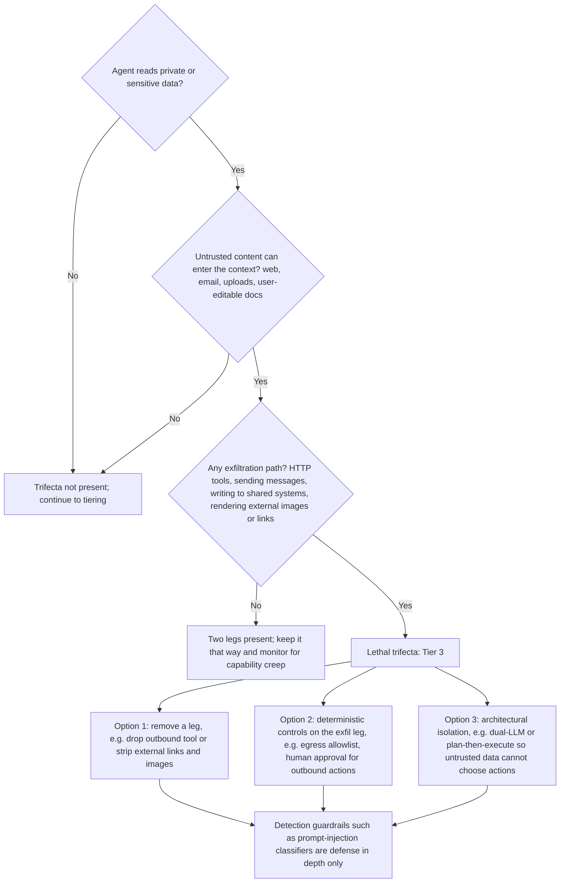
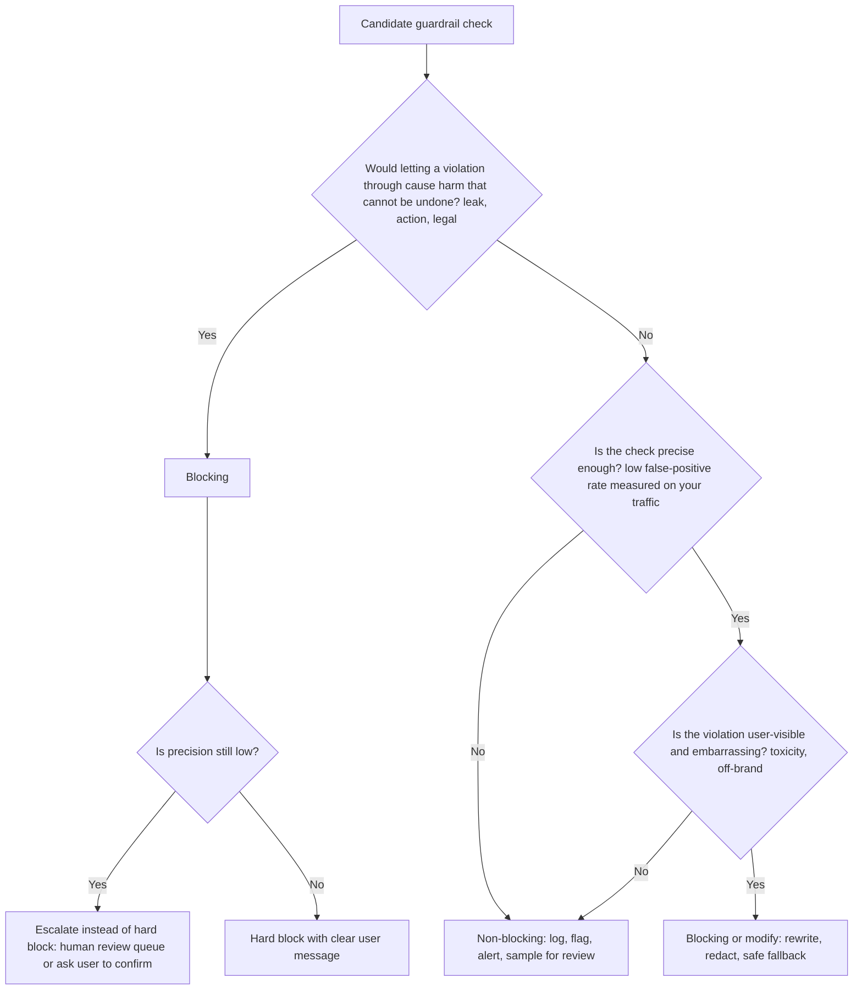
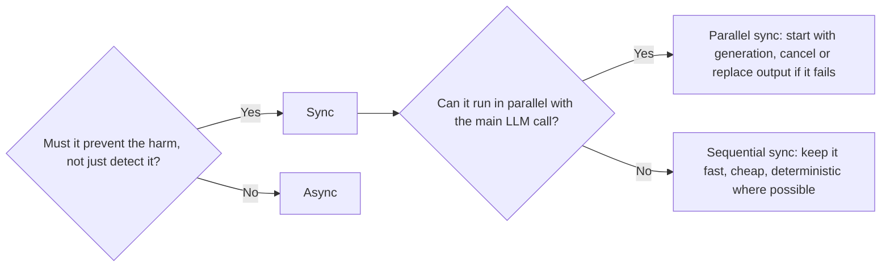
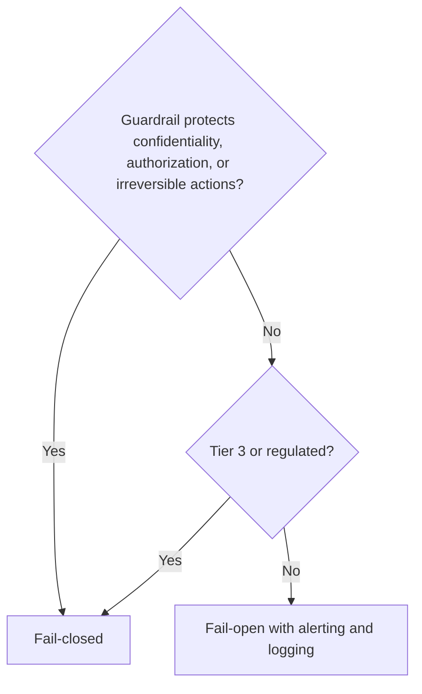
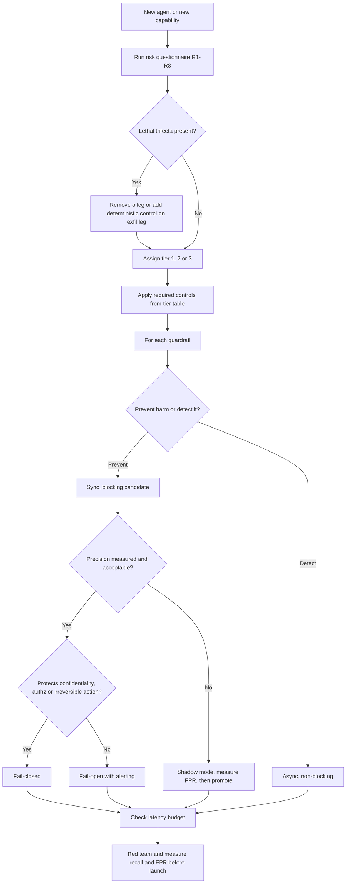

# Guardrail Selection Decision Tree

> **TL;DR**
> - **Select guardrails from risk, not vendor checklists.** Score your users, data sensitivity, action reversibility, and untrusted content exposure first.
> - **Break the lethal trifecta by design.** Never combine private data, untrusted content, and external communication without deterministic controls or human approval.
> - **Enforce security in deterministic code.** Keep authorization, tool allowlists, SQL policies, and network egress outside the LLM prompt.
> - **Configure runtime behavior explicitly.** Set blocking mode, sync vs async execution, fail-open vs fail-closed rules, and latency budgets per guardrail.

**You will learn:** How to score agent risk · How to run the lethal-trifecta check · Required guardrails by risk tier · How to choose blocking, sync, and fail-closed modes  
**Prerequisites:** [Guardrails architecture](../04-guardrails/01-guardrails-architecture.md), [Threat model & OWASP](../04-guardrails/07-threat-model-owasp.md)  
**Related:** [Eval selection](./01-eval-selection-decision-tree.md), [Input guardrails](../04-guardrails/02-input-guardrails.md), [Tool & action guardrails](../04-guardrails/05-tool-and-action-guardrails.md), [Access control & RBAC](../04-guardrails/06-access-control-rbac.md), [Guardrail tools](../06-tooling-landscape/02-guardrail-tools.md)

---

## 1. Principles before trees

1. **Use guardrails to control runtime behavior and evaluations to measure quality.** A guardrail blocks, redacts, or escalates a request at runtime. An evaluation measures how often failures occur. You also must evaluate your guardrails for false positives and false negatives (see [§9](#9-measuring-guardrails-false-positives-matter)).
2. **Use deterministic code for all security-critical controls.** Enforce authorization, tool allowlists, SQL policies, and network egress in code or infrastructure, never in prompts.
3. **Never use the LLM as an authorization layer.** Telling a system prompt "do not show salaries to non-HR users" does not secure your data. Filter records using the end user's identity *before* data reaches the model. See [Access control & RBAC](../04-guardrails/06-access-control-rbac.md).
4. **Layer your defenses.** Combine input, context, tool, and output controls, and assume each individual layer can fail.
5. **Remove unnecessary capabilities by design.** Removing an outbound HTTP tool protects your system better than trying to detect malicious requests.
6. **Measure the cost of every guardrail.** Every guardrail adds latency, compute cost, and false positives. Add guardrails based on risk, measure their recall and false-positive rate, and remove ineffective checks.

---

## 2. Risk assessment questionnaire

Score these eight questions for your agent (or for each distinct capability). Use the resulting score to assign your risk tier in §4.

| # | Question | Low (0) | Medium (1) | High (2) |
|---|---|---|---|---|
| R1 | **Who are the users?** | Small set of trusted internal staff, authenticated | All employees / authenticated customers | Public, anonymous, or untrusted |
| R2 | **What data can the agent access?** | Public or non-sensitive docs | Internal confidential | PII, PHI, financial, HR, credentials, regulated data, or per-user entitled data |
| R3 | **Can the agent take actions?** | Read-only, no side effects | Reversible writes (draft ticket, internal note) | Irreversible or external effects (send email, payments, delete, deploy, modify records) |
| R4 | **Does untrusted content enter the context?** | Only curated, internally authored content | Internal content editable by many employees | Web pages, emails, user uploads, third-party APIs, tickets from customers |
| R5 | **Can output leave the trust boundary?** | Output shown only to the requesting user | Output stored/shared internally | Agent can make HTTP requests, render external images/links, send messages, or write externally |
| R6 | **Regulatory / domain exposure?** | None | Contractual, brand-sensitive | Regulated (finance, health, legal, employment decisions, children) or EU AI Act high-risk use |
| R7 | **Blast radius of one bad output?** | One user, easily noticed and ignored | Many users or decisions made on it | Financial loss, safety harm, legal liability, data breach, or mass action |
| R8 | **Autonomy?** | Human reviews every output before use | Human reviews sometimes | Fully autonomous loops with no human in the loop |

**How to score:** Assign at least **Tier 2** if any single answer on R2, R3, R5, or R7 scores **High (2)**. Assign **Tier 3** if you have two or more High scores, or if your agent hits the lethal trifecta (§3). Otherwise sum your points: `0–4` = Tier 1, `5–9` = Tier 2, and `10+` = Tier 3. Review these thresholds with your security team.

**Running example:** Consider our internal enterprise assistant. It scores 1 on R1 (employees), R3 (reversible tickets), R4 (editable wiki), R5 (shared tickets/markdown), R7, and R8. It scores 2 on R2 (HR/finance tables) and 1–2 on R6 (HR employment data). Treat the overall system as **Tier 2** and isolate the HR/finance paths as **Tier 3**.

---

## 3. The lethal-trifecta check

Simon Willison's [lethal trifecta](https://simonwillison.net/2025/Jun/16/the-lethal-trifecta/) warns against combining **(1) private data access**, **(2) untrusted content exposure**, and **(3) external communication**. An attacker can use prompt injection to hijack any agent with all three legs and exfiltrate private data. Meta's [Agents Rule of Two](https://ai.meta.com/blog/practical-ai-agent-security/) generalizes this rule. Within a single session, an agent must satisfy **at most two** of these three properties unless a human approves every action.



Do not rely on classifiers alone to stop the lethal trifecta. Prompt-injection classifiers are probabilistic, and an attacker needs only one bypass to steal data. Use classifiers as telemetry and defense in depth after you fix the architecture. For secure design patterns, see Willison's [Dual LLM pattern](https://simonwillison.net/2023/Apr/25/dual-llm-pattern/), [Beurer-Kellner et al. (arXiv:2506.08837)](https://arxiv.org/abs/2506.08837), and [CaMeL (arXiv:2503.18813)](https://arxiv.org/abs/2503.18813).

**Audit your system for these six hidden exfiltration paths:**

- [ ] Block or proxy markdown image rendering (``) so the browser cannot leak data via URL fetches.
- [ ] Strip or sanitize clickable links that embed sensitive data in query parameters.
- [ ] Restrict tools that fetch URLs, trigger webhooks, or send email and chat messages.
- [ ] Gate writes to shared systems (tickets, wikis, CRM notes) that other users or agents read.
- [ ] Disable outbound network access inside code execution sandboxes by default.
- [ ] Scrub sensitive fields before shipping logs or analytics to third-party services.

**Running example:** Our enterprise assistant reads private HR/finance data, ingests employee-editable wiki pages, and creates shared tickets while rendering markdown. To break the trifecta, we disable external markdown images and restrict links to an allowlist. We also lock ticket creation to fixed schema fields and block wiki retrieval during HR/finance SQL runs.

---

## 4. Risk tiers → required guardrails

| Guardrail | Tier 1 (low) | Tier 2 (medium) | Tier 3 (high) | Detail |
|---|---|---|---|---|
| **AuthN + user identity propagated to tools/retrieval** | Required | Required | Required | [RBAC](../04-guardrails/06-access-control-rbac.md) |
| **Document-/row-level access control before retrieval/SQL** | If data has entitlements | Required | Required, tested per role | [RBAC](../04-guardrails/06-access-control-rbac.md) |
| **Tool allowlist + argument schema validation** | Required | Required | Required | [Tool guardrails](../04-guardrails/05-tool-and-action-guardrails.md) |
| **Least-privilege credentials for tools/DB** | Recommended | Required | Required | [Tool guardrails](../04-guardrails/05-tool-and-action-guardrails.md) |
| **SQL: read-only role + parser-based statement allowlist** | Required if SQL | Required | Required + query cost limits | [Tool guardrails](../04-guardrails/05-tool-and-action-guardrails.md) |
| **Rate limiting / quotas / max steps** | Basic | Required | Required, per user & per tool | [Guardrails architecture](../04-guardrails/01-guardrails-architecture.md) |
| **Input: size limits, encoding normalization** | Required | Required | Required | [Input guardrails](../04-guardrails/02-input-guardrails.md) |
| **Input: topic/scope classifier** | Optional | Recommended | Recommended | [Input guardrails](../04-guardrails/02-input-guardrails.md) |
| **Input: prompt-injection / jailbreak detection** | Optional (log) | Recommended | Required (defense in depth) | [Input guardrails](../04-guardrails/02-input-guardrails.md) |
| **Input: PII detection/redaction** | Optional | If PII may be sent to third-party LLMs | Required where policy demands | [Input guardrails](../04-guardrails/02-input-guardrails.md) |
| **Context: injection scanning of retrieved/tool content** | Optional | Recommended if R4 ≥ 1 | Required if R4 ≥ 1 | [Retrieval guardrails](../04-guardrails/03-retrieval-and-context-guardrails.md) |
| **Context: source allowlist / provenance tagging** | Optional | Recommended | Required | [Retrieval guardrails](../04-guardrails/03-retrieval-and-context-guardrails.md) |
| **Output: format/schema validation** | Required | Required | Required | [Output guardrails](../04-guardrails/04-output-guardrails.md) |
| **Output: toxicity / harmful content** | Optional (async) | Recommended | Required | [Output guardrails](../04-guardrails/04-output-guardrails.md) |
| **Output: PII / secret leakage scan** | Optional | Recommended | Required (blocking) | [Output guardrails](../04-guardrails/04-output-guardrails.md) |
| **Output: groundedness / hallucination check** | Async eval | Async or sync for high-stakes intents | Sync for high-stakes intents | [Output guardrails](../04-guardrails/04-output-guardrails.md) |
| **Output: link/image sanitization** | Recommended | Required | Required | [Output guardrails](../04-guardrails/04-output-guardrails.md) |
| **Human-in-the-loop approval for actions** | No | For irreversible actions | For all state-changing or external actions | [Tool guardrails](../04-guardrails/05-tool-and-action-guardrails.md) |
| **Egress allowlist (network)** | Recommended | Required if any network tool | Required | [Tool guardrails](../04-guardrails/05-tool-and-action-guardrails.md) |
| **Sandboxed code execution** | If code exec | If code exec | If code exec, no network by default | [Tool guardrails](../04-guardrails/05-tool-and-action-guardrails.md) |
| **Audit logging of prompts, context IDs, tool calls, decisions** | Recommended | Required | Required, tamper-evident, retention policy | [Observability](../03-online-evals-and-observability/02-observability-and-tracing.md) |
| **Red teaming before launch** | Light self-test | Structured red-team pass | Structured + independent red team, repeated per major change | [Threat model](../04-guardrails/07-threat-model-owasp.md) |
| **Kill switch / feature flag per capability** | Recommended | Required | Required, tested | [Guardrails architecture](../04-guardrails/01-guardrails-architecture.md) |

Map each guardrail to its [OWASP Top 10 for LLM Applications](https://genai.owasp.org/llm-top-10/) risk in your [threat model](../04-guardrails/07-threat-model-owasp.md) to expose gaps.

---

## 5. Decision: blocking vs non-blocking



| Action type | What happens | Use for |
|---|---|---|
| **Hard block** | Rejects the request or response and returns a safe fallback message | Authorization violations, disallowed tools, unsafe SQL, leaked secrets, and clear policy violations |
| **Modify / redact** | Transforms the content and allows the response to proceed | Redacting PII, stripping external links or images, and truncating oversized inputs |
| **Escalate / confirm** | Pauses execution until a human or end user confirms | Irreversible actions and high-stakes detections where classifier precision is moderate |
| **Flag (non-blocking)** | Allows the response, logs a warning label, and alerts on rate spikes | Injection-detector hits on internal docs, low-confidence toxicity, and groundedness scores |
| **Shadow mode** | Runs the check silently without changing runtime behavior | **Testing every new blocking guardrail** to measure false positives on live traffic before enforcement |

**Follow this rollout rule:** Promote every new blocking guardrail through **shadow → flag → block**, and verify precision at each stage.

---

## 6. Decision: sync vs async

| | Synchronous (in the request path) | Asynchronous (after response / in parallel) |
|---|---|---|
| Latency impact | Adds directly to user-perceived latency | Adds zero user-facing latency |
| Can prevent harm | Yes | No (detects, alerts, and triggers follow-up remediation only) |
| Use for | Blocking controls: authz, tool validation, SQL policy, PII/secret output scan, and pre-tool injection checks | Quality monitoring: groundedness, tone, relevance, drift, expensive LLM judges, and analytics |



**Use these four techniques to reduce synchronous latency:**

- Run input classifiers **in parallel** with retrieval or the initial LLM call, and abort the response if a check fails.
- Buffer the first $N$ tokens or sentences when **streaming**, or disable token streaming on high-risk intents because you cannot un-send streamed tokens.
- Gate **tool calls** right before execution using fast, deterministic schema and policy checks.
- Use regexes, parsers, and small classifiers instead of LLM judges in the synchronous hot path.

---

## 7. Decision: fail-open vs fail-closed

Decide how each guardrail behaves when the check itself throws an error or times out.

| | Fail-closed (deny on error) | Fail-open (allow on error) |
|---|---|---|
| Choose when | The guardrail prevents data leaks, unauthorized actions, or regulatory breaches | The guardrail checks quality or brand tone, and blocking would cause an unnecessary outage |
| Examples | Authorization check, SQL policy check, tool-approval service, and Tier 3 output secret scans | Tone classifier, topic classifier on an internal Tier 1 tool, and async groundedness checks |
| Mitigation for the downside | Return a clear "temporarily unavailable" message and monitor service health | Alert on guardrail error rates, log every fail-open event, and enforce a strict timeout |



**Avoid accidental fail-open defaults:** Many guardrail SDKs return "allowed" when a timeout occurs. Inspect your client timeout handling and test failure behavior explicitly.

---

## 8. Latency budget allocation

Set an overall p95 latency target for your user interaction and allocate a budget to each layer. Here is a starting allocation for a chat assistant targeting a 3–5 second p95 time to first response:

| Stage | Guardrails here | Suggested budget (heuristic) | Technique |
|---|---|---|---|
| Pre-request | AuthN/Z, rate limit, input size | ≤ 50 ms | Run deterministic checks in-process |
| Input checks | Injection/jailbreak classifier, PII detection, topic | ≤ 100–300 ms | Use small classifiers and run in parallel with retrieval |
| Retrieval / context | ACL filter (in the query), injection scan on chunks | ≤ 100–200 ms extra | Pre-compute injection scans at indexing time for static docs |
| Tool call gate | Allowlist, schema, SQL parser policy, approval check | ≤ 50 ms (excluding human approval) | Use deterministic code checks |
| Output checks | Schema, PII/secret scan, link sanitization, toxicity | ≤ 100–300 ms | Use regex, parsers, and small classifiers, and reserve LLM judges for high-stakes intents |
| Async | Groundedness, relevance, policy judges, analytics | 0 ms user-facing | Run asynchronously via background queues on sampled traffic |

**Optimization tip:** Scan static documents for prompt injections **at indexing time** and store the flag in metadata. Scan only dynamic content (web pages, emails, live tool outputs) at query time.

---

## 9. Measuring guardrails: false positives matter

Treat every guardrail as a binary classifier and measure its performance offline and online.

| Metric | Definition | Why it matters |
|---|---|---|
| Recall (catch rate) | `blocked attacks / total attacks` | Measures security effectiveness |
| False-positive rate | `blocked benign / total benign` | Measures UX friction because high false-positive rates cause teams to disable guardrails |
| Precision | `true blocks / all blocks` | Measures alert trustworthiness |
| Latency p50/p95 | Added wall-clock time | Verifies compliance with your latency budget |
| Error / timeout rate | Guardrail execution failures | Triggers fail-open or fail-closed fallback paths |

Maintain two evaluation datasets for every guardrail: an **adversarial set** and a **benign-but-tricky set**. Include legitimate queries that look suspicious, such as "how do I reset a user password?" in an IT helpdesk bot. See [Generation quality & safety evals](../02-offline-evals/03-generation-quality-and-safety-evals.md) and [Threat model](../04-guardrails/07-threat-model-owasp.md).

```python
def guardrail_report(results):
    # results: list of (is_attack: bool, was_blocked: bool)
    tp = sum(a and b for a, b in results)
    fn = sum(a and not b for a, b in results)
    fp = sum((not a) and b for a, b in results)
    tn = sum((not a) and (not b) for a, b in results)
    return {
        "recall": tp / (tp + fn) if tp + fn else None,
        "fpr": fp / (fp + tn) if fp + tn else None,
        "precision": tp / (tp + fp) if tp + fp else None,
    }
```

---

## 10. Build vs buy

| Guardrail type | Default | Rationale |
|---|---|---|
| AuthN/AuthZ, RBAC, row/doc-level security | **Build** on your existing IAM and data platform | Must match your internal entitlement model, which external vendors do not know |
| Tool allowlist, schema validation, SQL policy | **Build** with standard libraries (JSON Schema, Pydantic, SQLGlot) | Simple, deterministic, and tightly coupled to your application |
| Rate limiting, quotas, egress control | **Reuse** your API gateway and cloud infrastructure | Already available in standard platform infrastructure |
| PII detection | **Buy or use OSS** (such as Microsoft Presidio), then tune | Hard to build from scratch and requires broad locale coverage |
| Toxicity / harmful content | **Buy or use OSS** (moderation APIs or open safety classifiers) | Commodity capability that you should benchmark on your own domain data |
| Prompt-injection detection | **Buy or use OSS** as defense in depth | Fast-moving threat where dedicated maintainers update detection models |
| Groundedness / hallucination | **Use OSS or build** an LLM judge calibrated on your data | Domain-specific and requires alignment against your own reference labels |
| Orchestration framework for rails | **Use OSS** (NeMo Guardrails, Guardrails AI) or custom middleware | Choose based on integration fit with your application and tracing stack |

Check these six criteria before adopting any vendor or open-source guardrail:

- [ ] Verify that you can run the guardrail in shadow mode and measure recall and false-positive rate on your own data.
- [ ] Measure p95 latency at your target query volume and confirm whether you can self-host the model.
- [ ] Confirm data routing, retention policies, and compliance certifications.
- [ ] Check whether timeout and error handling support explicit fail-open and fail-closed configuration.
- [ ] Verify support for custom policy categories and your required languages.
- [ ] Check whether blocked requests return clear explanations and structured audit logs.

See [Guardrail tools](../06-tooling-landscape/02-guardrail-tools.md) for a comparison of available tools.

---

## 11. Per-archetype recommended guardrail stack

These archetypes match [eval selection §2](./01-eval-selection-decision-tree.md#2-the-five-input-questions). In the tables below, `B` = blocking, `NB` = non-blocking, `S` = synchronous, and `A` = asynchronous.

### 11.1 A1 — Simple RAG chatbot

| Layer | Guardrail | Mode |
|---|---|---|
| Input | Size limits, rate limits, and topic/scope classifier (if external) | B/S |
| Input | Injection and jailbreak detection | NB/S → B for public apps |
| Retrieval | ACL-filtered retrieval when documents have access restrictions | B/S |
| Retrieval | Indexing-time corpus scan for injected instructions (when many authors contribute) | NB, offline |
| Output | Link/image sanitization and PII/secret scanning | B/S |
| Output | Toxicity filter | B/S for public, NB/A for internal |
| Output | Groundedness judge | NB/A |

### 11.2 A2 — Agentic RAG with tools

| Layer | Guardrail | Mode |
|---|---|---|
| Identity | Propagate user identity to every tool call and execute with user-scoped credentials | B/S |
| Tools | Enforce per-role allowlists, JSON-schema validation, and enum/range constraints | B/S |
| Tools | Require human or user confirmation for irreversible or external actions | B/S |
| Tools | Enforce max steps, max tool calls, per-tool rate limits, and budget caps | B/S |
| Context | Treat tool outputs and retrieved chunks as untrusted data, scan for injections, and tag provenance | NB → B on high-risk paths |
| Architecture | Run the lethal-trifecta check and isolate untrusted content from action selection | Design |
| Output | Apply all A1 checks plus secondary role-based output scanning | B/S |
| Audit | Log every tool call with arguments, result status, and approver identity | A |

### 11.3 A3 — Text-to-SQL agent

| Layer | Guardrail | Mode |
|---|---|---|
| DB | Enforce a read-only DB role and row-level security views keyed on end-user identity | B (infra) |
| SQL | Parse generated SQL to allow only `SELECT` and block multi-statement, DDL/DML, system catalog, or cross-schema queries | B/S |
| SQL | Enforce query cost limits via `LIMIT` injection, timeouts, and max rows scanned | B/S |
| Input | Flag raw SQL or injection payloads in user input as telemetry alongside parser enforcement | NB/S |
| Output | Apply aggregation thresholds and small-cell suppression on privacy-sensitive tables | B/S |
| Output | Verify that numbers in the narrative answer match the SQL result set | NB/A or B for high-stakes |
| Audit | Log generated SQL, user identity, role, and row count returned | A |

### 11.4 A4 — Multi-agent / multi-step

| Layer | Guardrail | Mode |
|---|---|---|
| All A2 controls per sub-agent | Apply A2 identity, tool, context, and output controls to each sub-agent | B/S |
| Orchestration | Enforce global step, time, and cost budgets alongside loop detection | B/S |
| Hand-offs | Scope each sub-agent to least privilege and never pass broad credentials across hand-offs | B (design) |
| Hand-offs | Treat inter-agent messages as untrusted whenever an upstream agent reads untrusted content | B/NB |
| Memory | Validate writes to shared memory and attach provenance tags to stored entries | B/S |
| Kill switch | Provide both per-agent and global kill switches | B |

### 11.5 A5 — Multi-turn conversational

| Layer | Guardrail | Mode |
|---|---|---|
| Session | Re-verify user authorization on every turn rather than caching permissions across long sessions | B/S |
| Session | Run conversation-level jailbreak detection to catch multi-turn escalation attacks | NB/S → B |
| Memory | Enforce PII scrubbing and retention limits on stored conversation history | B (policy) |
| Output | Apply all A1–A3 output checks on every turn | B/S |

### 11.6 Running example — final guardrail stack

| Layer | Control | Type | Mode | Fail |
|---|---|---|---|---|
| Gateway | SSO, rate limit per user | Code | B/S | Closed |
| Input | Length limit, Unicode normalization | Code | B/S | Closed |
| Input | Prompt-injection classifier | Clf | NB/S (flag), B on HR/finance intents | Open (flag), Closed (HR/finance) |
| Router | Intent → capability allowed for role? | Code | B/S | Closed |
| Docs retrieval | ACL filter in vector query using user groups | Code | B/S | Closed |
| Docs retrieval | Injection flag computed at indexing time | Clf | NB | — |
| SQL | Read-only role, RLS views per user, parser allowlist, timeout, row cap | Code/Infra | B/S | Closed |
| Ticket tool | Fixed schema, enum fields, user-confirmation step, no external recipients | Code + UX | B/S | Closed |
| Output | Strip external images/links, PII/secret regex + NER | Code + Clf | B/S | Closed |
| Output | Groundedness judge on 10% sample and 100% of HR policy intents (async) | Judge | NB/A | Open |
| Audit | Full trace with role, chunk IDs, SQL, tool calls | Code | A | — |

---

## 12. Combined decision tree (one page)



---

## Key takeaways

- Score your system with the risk questionnaire (users, data, actions, untrusted content, exfiltration paths, regulation, blast radius, autonomy) before picking guardrails.
- Redesign your architecture if private data, untrusted content, and external communication coexist. Classifiers provide defense in depth only.
- Enforce authorization, tool allowlists, and SQL policies in deterministic code and infrastructure, never in the LLM prompt.
- Block synchronously only when detections are precise or actions are irreversible, and promote new guardrails through `shadow -> flag -> block`.
- Configure fail-closed behavior for confidentiality, authorization, and irreversible actions, and use fail-open with alerts for brand or tone checks.
- Allocate a latency budget per layer, scan static documents at indexing time, and gate tool calls before execution.
- Measure recall and false-positive rate for every guardrail using both adversarial and benign-but-tricky datasets.

## Further reading

- Simon Willison — [The lethal trifecta for AI agents](https://simonwillison.net/2025/Jun/16/the-lethal-trifecta/), [The Dual LLM pattern](https://simonwillison.net/2023/Apr/25/dual-llm-pattern/)
- Meta AI — [Agents Rule of Two: A Practical Approach to AI Agent Security](https://ai.meta.com/blog/practical-ai-agent-security/)
- Beurer-Kellner et al. — [Design Patterns for Securing LLM Agents against Prompt Injections (arXiv:2506.08837)](https://arxiv.org/abs/2506.08837)
- Debenedetti et al. — [Defeating Prompt Injections by Design (arXiv:2503.18813)](https://arxiv.org/abs/2503.18813)
- OWASP — [Top 10 for LLM Applications](https://genai.owasp.org/llm-top-10/), [Agentic AI – Threats and Mitigations](https://genai.owasp.org/resource/agentic-ai-threats-and-mitigations/)
- NIST — [AI Risk Management Framework](https://www.nist.gov/itl/ai-risk-management-framework), [Generative AI Profile (NIST AI 600-1)](https://doi.org/10.6028/NIST.AI.600-1)
- Microsoft — [Lessons From Red Teaming 100 Generative AI Products (arXiv:2501.07238)](https://arxiv.org/abs/2501.07238)
- In this repo: [Guardrails section](../04-guardrails/README.md) · [Guardrail tools](../06-tooling-landscape/02-guardrail-tools.md)
