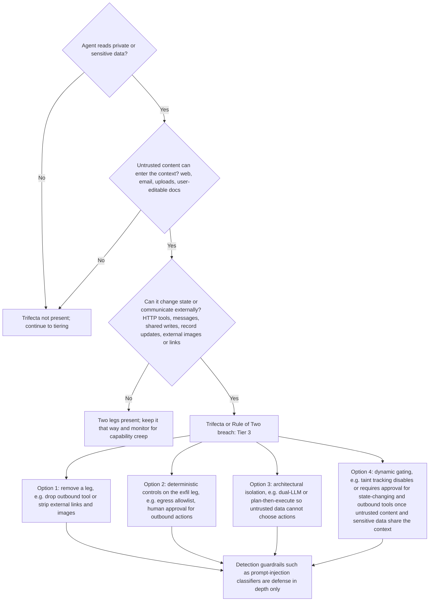
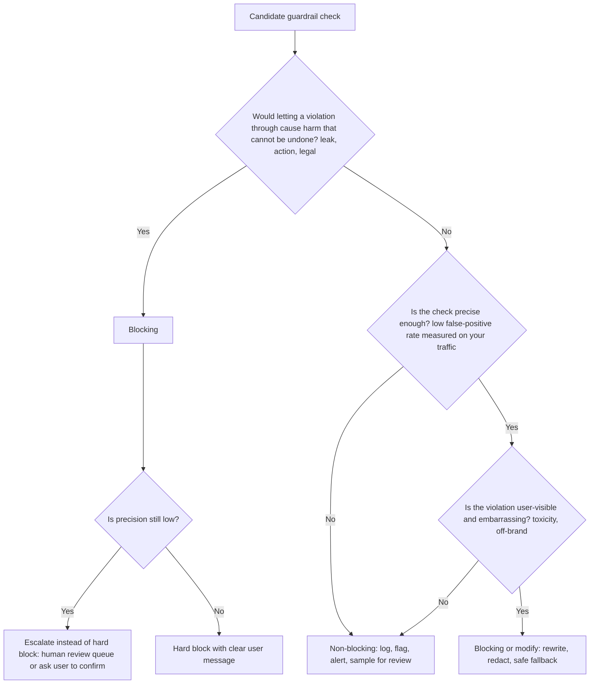
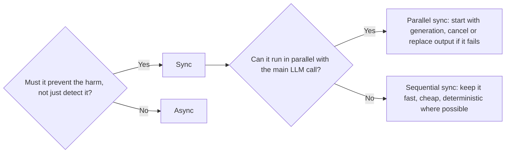
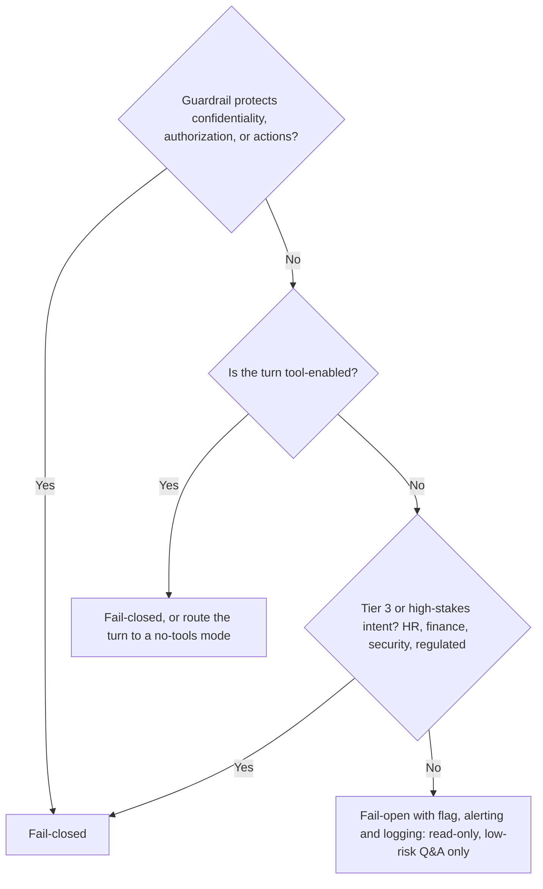
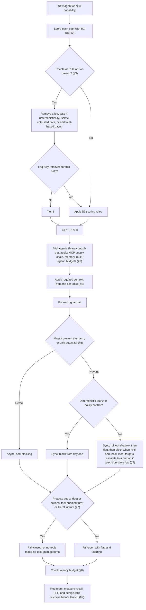

# Guardrail Selection Decision Tree

> **TL;DR**
>
> - **Select guardrails from risk, not vendor checklists.** Score your users, data sensitivity, action reversibility, and untrusted content exposure first.
> - **Break the lethal trifecta by design.** Never combine private data, untrusted content, and external communication (or, under Meta's Rule of Two, any state change) in one session without deterministic controls or human approval.
> - **Enforce security in deterministic code.** Keep authorization, tool allowlists, SQL policies, and network egress outside the LLM prompt.
> - **Configure runtime behavior explicitly.** Set blocking mode, sync vs async execution, fail-open vs fail-closed rules, and latency budgets per guardrail. Fail closed on every tool-enabled turn.

- **You will learn:**
    - How to score agent risk
    - How to run the lethal-trifecta and Rule of Two check, and which agentic threats to add
    - Required guardrails by risk tier
    - How to choose blocking, sync, and fail-closed modes
- **Prerequisites:** [Guardrails architecture](../04-guardrails/01-guardrails-architecture.md), [Threat model & OWASP](../04-guardrails/07-threat-model-owasp.md)
- **Related:** [Eval selection](./01-eval-selection-decision-tree.md), [Input guardrails](../04-guardrails/02-input-guardrails.md), [Tool & action guardrails](../04-guardrails/05-tool-and-action-guardrails.md), [Access control & RBAC](../04-guardrails/06-access-control-rbac.md), [Guardrail tools](../06-tooling-landscape/02-guardrail-tools.md)

---

## 1. Principles before trees

1. **Use guardrails to control runtime behavior and evaluations to measure quality.** A guardrail blocks, redacts, or escalates a request at runtime. An evaluation measures how often failures occur. You also must evaluate your guardrails for false positives and false negatives (see [§9](#9-measuring-guardrails-false-positives-matter)).
2. **Use deterministic code for all security-critical controls.** Enforce authorization, tool allowlists, SQL policies, and network egress in code or infrastructure, never in prompts.
3. **Never use the LLM as an authorization layer.** Telling a system prompt "do not show salaries to non-HR users" does not secure your data. Filter records using the end user's identity *before* data reaches the model. See [Access control & RBAC](../04-guardrails/06-access-control-rbac.md).
4. **Layer your defenses.** Combine input, context, tool, and output controls, and assume each individual layer can fail.
5. **Remove unnecessary capabilities by design.** Removing an outbound HTTP tool protects your system better than trying to detect malicious requests.
6. **Measure the cost of every guardrail.** Every guardrail adds latency, compute cost, and false positives. Add guardrails based on risk, measure their recall and false-positive rate, and remove ineffective checks.

---

## 2. Risk assessment questionnaire

Score these eight questions for your agent (or for each distinct capability). Use the resulting score to assign your risk tier in §4. This section is the canonical tier definition for this repo; other pages link here.

| # | Question | Low (0) | Medium (1) | High (2) |
|---|---|---|---|---|
| R1 | **Who are the users?** | Small set of trusted internal staff, authenticated | All employees / authenticated customers | Public, anonymous, or untrusted |
| R2 | **What data can the agent access?** | Public or non-sensitive docs | Internal confidential | PII, PHI, financial, HR, credentials, regulated data, or per-user entitled data |
| R3 | **Can the agent take actions?** | Read-only, no side effects | Reversible writes (draft ticket, internal note) | Irreversible or external effects (send email, payments, delete, deploy, modify records) |
| R4 | **Does untrusted content enter the context?** | Only curated, internally authored content | Internal content editable by many employees | Web pages, emails, user uploads, third-party APIs, tickets from customers |
| R5 | **Can output leave the trust boundary?** | Output shown only to the requesting user | Output stored/shared internally | Agent can make HTTP requests, render external images/links, send messages, or write externally |
| R6 | **Regulatory / domain exposure?** | None | Contractual, brand-sensitive | Regulated (finance, health, legal, employment decisions, children) or EU AI Act high-risk use (dates change; see [EU AI Act status](../04-guardrails/07-threat-model-owasp.md#isoiec-42001-and-the-eu-ai-act), not legal advice) |
| R7 | **Blast radius of one bad output?** | One user, easily noticed and ignored | Many users or decisions made on it | Financial loss, safety harm, legal liability, data breach, or mass action |
| R8 | **Autonomy?** | Human reviews every output before use | Human reviews sometimes | Fully autonomous loops with no human in the loop |

**How to score:** Assign at least **Tier 2** if any single answer on R2, R3, R5, or R7 scores **High (2)**. Assign **Tier 3** if you have two or more High scores, or if your agent hits the lethal trifecta or breaks the Rule of Two (§3). Otherwise sum your points: `0–4` = Tier 1, `5–9` = Tier 2, and `10+` = Tier 3. These cut-offs are starting rules of thumb. Review them with your security team.

Score each path (intent plus enabled tools) separately. Controls that *gate* a leg (approval, allowlists) reduce risk, but they do not lower the tier. A path moves down a tier only when you fully *remove* a trifecta leg for that path, because the tier decides which controls stay mandatory.

**Running example:** Consider our internal enterprise assistant with the nine tools in [tool and action guardrails §1](../04-guardrails/05-tool-and-action-guardrails.md#running-example). It scores 1 on R1 (employees) and R8, and 2 on R2 (HR/finance tables), R3 (`send_email` is external and `delete_ticket` is irreversible), R4 (`fetch_url` returns web pages; wikis are employee-editable), and R5 (`send_email`, `fetch_url`, markdown links). It scores 1–2 on R6 (HR employment data) and R7. The lethal trifecta is present by default. So:

- **Tier 3:** HR/finance intents and every tool-enabled turn.
- **Tier 2:** read-only general policy Q&A that uses only `search_docs` over non-HR content, with no write or external tools enabled for the turn.

---

## 3. The lethal-trifecta check

Simon Willison's [lethal trifecta](https://simonwillison.net/2025/Jun/16/the-lethal-trifecta/) warns against combining **(1) private data access**, **(2) untrusted content exposure**, and **(3) external communication**. An attacker can use prompt injection to hijack any agent with all three legs and exfiltrate private data.

Meta's [Agents Rule of Two](https://ai.meta.com/blog/practical-ai-agent-security/) is a related, broader rule. Within one session, an agent may have at most two of these properties without supervision (human approval or another reliable validation):

- **[A]** It processes untrustworthy inputs.
- **[B]** It has access to sensitive systems or private data.
- **[C]** It can change state or communicate externally.

Leg [C] is broader than the trifecta's exfiltration leg. It includes state changes such as `update_ticket` or `delete_ticket`, so the Rule of Two also covers integrity attacks that send no data out. The tree below uses the broader [C]. See [threat model §5](../04-guardrails/07-threat-model-owasp.md#metas-agents-rule-of-two).



Do not rely on classifiers alone to stop the lethal trifecta. Prompt-injection classifiers are probabilistic, and an attacker needs only one bypass to steal data. Use classifiers as telemetry and defense in depth after you fix the architecture. For secure design patterns, see Willison's [Dual LLM pattern](https://simonwillison.net/2023/Apr/25/dual-llm-pattern/), [Beurer-Kellner et al. (arXiv:2506.08837)](https://arxiv.org/abs/2506.08837), and [CaMeL (arXiv:2503.18813)](https://arxiv.org/abs/2503.18813).

**Audit your system for these six hidden exfiltration paths:**

- [ ] Block or proxy markdown image rendering (``) so the browser cannot leak data via URL fetches.
- [ ] Strip or sanitize clickable links that embed sensitive data in query parameters.
- [ ] Restrict tools that fetch URLs, trigger webhooks, or send email and chat messages.
- [ ] Gate writes to shared systems (tickets, wikis, CRM notes) that other users or agents read.
- [ ] Disable outbound network access inside code execution sandboxes by default.
- [ ] Scrub sensitive fields before shipping logs or analytics to third-party services.

**Running example:** Our enterprise assistant reads private HR/finance data, ingests employee-editable wiki pages and `fetch_url` output, and can call `send_email`, create shared tickets, and render markdown. All three legs are present by default. The policy in [tool and action guardrails §14](../04-guardrails/05-tool-and-action-guardrails.md#14-policy-table-for-the-running-example) gates each exit:

- Disable external markdown images and restrict links to an allowlist.
- `send_email`: always needs approval; recipients `@company.com` only, at most 5; blocked when the context is tainted and sensitive.
- `fetch_url`: `analyst` and `admin` only, domain allowlist through an egress proxy, approval when the context holds sensitive data.
- `create_ticket`: fixed schema, inline preview, and one-click user confirmation, because other staff can read tickets. `high` priority also needs on-call approval ([output guardrails §6](../04-guardrails/04-output-guardrails.md#6-structured-output-and-schema-validation)).
- `delete_ticket`: `admin` only, with a second approver.
- Taint tracking: once untrusted content and sensitive data share the context, every T2 tool needs approval.
- Block wiki retrieval during HR/finance SQL runs.

These controls gate the legs but do not remove them, so tool-enabled turns stay Tier 3.

### Agentic threats beyond the trifecta

The trifecta covers data exfiltration. Agents with tools, memory, and third-party servers face more threats. Map each one to an [OWASP Top 10 for Agentic Applications 2026](../04-guardrails/07-threat-model-owasp.md#32-owasp-top-10-for-agentic-applications-2026) ID and an [OWASP LLM Top 10 2026](../04-guardrails/07-threat-model-owasp.md#2-owasp-top-10-for-llm-applications-2026) ID in your threat model:

| Threat | IDs | Ask | Minimum control | Detail |
|---|---|---|---|---|
| Goal hijack via indirect injection | ASI01, LLM01:2026 | Can retrieved text or tool output change what the agent does? | Trifecta / Rule of Two check above; injection scan on context | [Retrieval guardrails](../04-guardrails/03-retrieval-and-context-guardrails.md) |
| Tool misuse, excessive agency | ASI02, LLM03:2026 | Can the agent call a tool it does not need for this intent? | Per-role allowlist, argument validation, tool tiers | [Tool guardrails §3](../04-guardrails/05-tool-and-action-guardrails.md#3-tool-allowlists-per-role-and-context) |
| Identity and privilege abuse | ASI03 | Does the agent act with its own broad credentials? | On-behalf-of tokens, least privilege | [RBAC §3](../04-guardrails/06-access-control-rbac.md#3-identity-propagation) |
| Agentic supply chain (MCP tool poisoning, rug pulls, tool shadowing) | ASI04, LLM04:2026 | Do you load tools or descriptions from third-party servers? | Server allowlist, pin and hash tool descriptions, re-approve on change, namespace tools | [MCP checklist](../04-guardrails/05-tool-and-action-guardrails.md#13-mcp-specific-concerns) |
| Unexpected code execution | ASI05 | Does the agent run model-written code? | Sandbox with no network or credentials; otherwise treat as T3 | [Sandboxing](../04-guardrails/05-tool-and-action-guardrails.md#10-sandboxing-code-execution) |
| Memory and context poisoning | ASI06 | Can one session write memory that a later session reads? | Validate memory writes, tag provenance, scope memory per user, expire entries | §11.4 |
| Insecure inter-agent communication, cascading failures | ASI07, ASI08 | Do agents pass messages or credentials to each other? | Treat inter-agent messages as untrusted; per-agent least privilege; global budgets and kill switch | §11.4 |
| Human-agent trust exploitation (approval fatigue) | ASI09 | Do reviewers see so many prompts that they rubber-stamp? | Approve only T2/T3 and shared writes; show exact payload; track approval rate and time-to-approve | [HITL](../04-guardrails/05-tool-and-action-guardrails.md#7-human-in-the-loop-approval) |
| Rogue agents | ASI10 | Can you stop one agent or capability at once? | Per-capability kill switch, audit log | §4 |
| Unbounded consumption (denial of wallet) | LLM06:2026 | Can a loop or attacker run up cost without limit? | Max steps, tool calls, wall-clock, and cost per run; loop detection | [Budgets](../04-guardrails/05-tool-and-action-guardrails.md#9-budgets-rate-limits-and-loop-detection) |

---

## 4. Risk tiers → required guardrails

| Guardrail | Tier 1 (low) | Tier 2 (medium) | Tier 3 (high) | Detail |
|---|---|---|---|---|
| **AuthN + user identity propagated to tools/retrieval** | Required | Required | Required | [RBAC](../04-guardrails/06-access-control-rbac.md) |
| **Document-/row-level access control before retrieval/SQL** | If data has entitlements | Required | Required, tested per role | [RBAC](../04-guardrails/06-access-control-rbac.md) |
| **Tool allowlist + argument schema validation** | Required | Required | Required | [Tool guardrails](../04-guardrails/05-tool-and-action-guardrails.md) |
| **Least-privilege credentials for tools/DB** | Recommended | Required | Required | [Tool guardrails](../04-guardrails/05-tool-and-action-guardrails.md) |
| **SQL: read-only role + parser-based statement allowlist** | Required if SQL | Required | Required + query cost limits | [Tool guardrails](../04-guardrails/05-tool-and-action-guardrails.md) |
| **Rate limiting / quotas / step, tool-call, and cost budgets** (denial of wallet, LLM06:2026) | Basic | Required | Required, per user & per tool, with loop detection | [Budgets](../04-guardrails/05-tool-and-action-guardrails.md#9-budgets-rate-limits-and-loop-detection) |
| **Input: size limits, encoding normalization** | Required | Required | Required | [Input guardrails](../04-guardrails/02-input-guardrails.md) |
| **Input: topic/scope classifier** | Optional | Recommended | Recommended | [Input guardrails](../04-guardrails/02-input-guardrails.md) |
| **Input: prompt-injection / jailbreak detection** | Optional (log) | Recommended | Required (defense in depth) | [Input guardrails](../04-guardrails/02-input-guardrails.md) |
| **Input: PII detection/redaction** | Optional | If PII may be sent to third-party LLMs | Required where policy demands | [Input guardrails](../04-guardrails/02-input-guardrails.md) |
| **Context: injection scanning of retrieved/tool content** | Optional | Recommended if R4 ≥ 1 | Required if R4 ≥ 1 | [Retrieval guardrails](../04-guardrails/03-retrieval-and-context-guardrails.md) |
| **Context: source allowlist / provenance tagging** | Optional | Recommended | Required | [Retrieval guardrails](../04-guardrails/03-retrieval-and-context-guardrails.md) |
| **Output: format/schema validation** | Required | Required | Required | [Output guardrails](../04-guardrails/04-output-guardrails.md) |
| **Output: toxicity / harmful content** | Optional (async) | Recommended | Required | [Output guardrails](../04-guardrails/04-output-guardrails.md) |
| **Output: PII / secret leakage scan** | Optional | Recommended | Required (blocking) | [Output guardrails](../04-guardrails/04-output-guardrails.md) |
| **Output: groundedness / hallucination check** | Async eval | Async or sync for high-stakes intents | Sync and blocking for high-stakes intents (HR, finance, security): regenerate once, then abstain with sources | [Output guardrails](../04-guardrails/04-output-guardrails.md) |
| **Output: link/image sanitization** | Recommended | Required | Required | [Output guardrails](../04-guardrails/04-output-guardrails.md) |
| **Human-in-the-loop approval for actions** | No (read-only) | T3 destructive actions; inline preview and one-click confirm for shared T1 writes | T2 external and T3 destructive actions always; inline preview and one-click confirm for shared T1 writes; approval for any action that untrusted content triggered | [HITL](../04-guardrails/05-tool-and-action-guardrails.md#7-human-in-the-loop-approval) |
| **Taint tracking / dynamic gating of outbound and state-changing tools** | N/A | Recommended if any T2 tool | Required | [Threat model §5](../04-guardrails/07-threat-model-owasp.md#5-the-lethal-trifecta) |
| **Third-party / MCP tools: server allowlist, pinned and hashed tool descriptions** | Required if MCP | Required if MCP | Required if MCP, re-review on every change | [MCP checklist](../04-guardrails/05-tool-and-action-guardrails.md#13-mcp-specific-concerns) |
| **Memory writes validated and provenance-tagged** | If long-term memory | Required if memory | Required if memory, scoped per user | [Retrieval guardrails](../04-guardrails/03-retrieval-and-context-guardrails.md) |
| **Egress allowlist (network)** | Recommended | Required if any network tool | Required | [Tool guardrails](../04-guardrails/05-tool-and-action-guardrails.md) |
| **Sandboxed code execution** | If code exec | If code exec | If code exec, no network by default | [Tool guardrails](../04-guardrails/05-tool-and-action-guardrails.md) |
| **Audit logging of prompts, context IDs, tool calls, decisions** | Recommended | Required | Required, tamper-evident, retention policy | [Observability](../03-online-evals-and-observability/02-observability-and-tracing.md) |
| **Red teaming before launch** | Light self-test | Structured red-team pass | Structured + independent red team, repeated per major change | [Threat model](../04-guardrails/07-threat-model-owasp.md) |
| **Kill switch / feature flag per capability** | Recommended | Required | Required, tested | [Guardrails architecture](../04-guardrails/01-guardrails-architecture.md) |

Map each guardrail to its [OWASP Top 10 for LLM Applications 2026](https://genai.owasp.org/resource/owasp-genai-llm-top-10-2026/) and [OWASP Agentic Top 10 2026](https://genai.owasp.org/resource/owasp-top-10-for-agentic-applications-for-2026/) IDs in your [threat model](../04-guardrails/07-threat-model-owasp.md) to expose gaps. If your threat model still uses 2025 IDs, use the [2025→2026 mapping](../04-guardrails/07-threat-model-owasp.md#mapping-from-2025-to-2026).

---

## 5. Decision: blocking vs non-blocking



| Action type | What happens | Use for |
|---|---|---|
| **Hard block** | Rejects the request or response and returns a safe fallback message | Authorization violations, disallowed tools, unsafe SQL, leaked secrets, and clear policy violations |
| **Modify / redact** | Transforms the content and allows the response to proceed | Redacting PII, stripping external links or images, and truncating oversized inputs |
| **Escalate / confirm** | Pauses execution until a human or end user confirms | T2 external and T3 destructive actions, shared T1 writes (one-click), and high-stakes detections where classifier precision is moderate |
| **Flag (non-blocking)** | Allows the response, annotates the trace, notifies reviewers, and alerts on rate spikes | Injection-detector hits on internal docs on read-only turns, low-confidence toxicity, and groundedness on low-risk Q&A |
| **Shadow mode** | Runs the check and logs the verdict only; no user effect and no reviewer notification | **Testing every new blocking guardrail** to measure false positives on live traffic before enforcement |

**Follow this rollout rule:** Promote every new blocking guardrail through three stages:

1. **`shadow`:** log the verdict only.
2. **`flag`:** annotate the trace and notify reviewers, but do not block.
3. **`block`:** enforce.

Promote to the next stage only when measured FPR at your real base rate and recall on the adversarial set meet the targets you set ([guardrails architecture §9.4](../04-guardrails/01-guardrails-architecture.md#94-choosing-thresholds)). Deterministic authorization and policy controls (ACL filters, tool allowlists, SQL policy) block from day one; shadow them only to find false blocks.

---

## 6. Decision: sync vs async

| | Synchronous (in the request path) | Asynchronous (after response / in parallel) |
|---|---|---|
| Latency impact | Adds directly to user-perceived latency | Adds zero user-facing latency |
| Can prevent harm | Yes | No (detects, alerts, and triggers follow-up remediation only) |
| Use for | Blocking controls: authz, tool validation, SQL policy, PII/secret output scan, pre-tool injection checks, and groundedness on high-stakes intents | Quality monitoring: groundedness on low-risk Q&A, tone, relevance, drift, expensive LLM judges, and analytics |



**Use these four techniques to reduce synchronous latency:**

- Run input classifiers **in parallel** with retrieval or the initial LLM call, and abort the response if a check fails.
- Buffer the first $N$ tokens or sentences when **streaming**, or disable token streaming on high-risk intents because you cannot un-send streamed tokens.
- Gate **tool calls** right before execution using fast, deterministic schema and policy checks.
- Use regexes, parsers, and small classifiers instead of LLM judges in the synchronous hot path.

---

## 7. Decision: fail-open vs fail-closed

Decide how each guardrail behaves when the check itself throws an error or times out.

| | Fail-closed (deny on error) | Fail-open (allow on error) |
|---|---|---|
| Choose when | The guardrail prevents data leaks, unauthorized actions, or regulatory breaches; the turn is tool-enabled; or the intent is Tier 3 / high-stakes | The guardrail checks quality or brand tone on read-only, low-risk Q&A, and blocking would cause an unnecessary outage |
| Examples | Authorization check, SQL policy check, tool-approval service, injection classifier on tool-enabled turns, groundedness on HR/finance intents, and Tier 3 output secret scans | Tone classifier, topic classifier on an internal Tier 1 tool, and groundedness or injection classifier on read-only low-risk Q&A |
| Mitigation for the downside | Return a clear "temporarily unavailable" message and monitor service health | Alert on guardrail error rates, log every fail-open event, and enforce a strict timeout |



This tree matches the canonical table in [guardrails architecture §5.5](../04-guardrails/01-guardrails-architecture.md#55-fail-open-vs-fail-closed).

**Avoid accidental fail-open defaults:** Integration code often lets a timeout or exception skip the check, which allows the request by default. Inspect your client timeout and error handling, and test failure behavior explicitly.

---

## 8. Latency budget allocation

Set an overall p95 latency target for your user interaction and allocate a budget to each layer. The canonical per-layer budgets are in [guardrails architecture §5.1](../04-guardrails/01-guardrails-architecture.md#51-set-a-budget-per-layer). This table repeats them as starting rules of thumb; calibrate them on your system:

| Stage | Guardrails here | Budget (p95, heuristic) | Technique |
|---|---|---|---|
| Input rails (including AuthN/Z, rate limit, size) | Injection/jailbreak classifier, PII detection, topic | 50–150 ms | Use small classifiers and run in parallel with retrieval |
| Retrieval / context | ACL filter (in the query), injection scan on chunks | 10–50 ms (+50–150 ms with a chunk classifier) | Pre-compute injection scans at indexing time for static docs |
| Tool call gate | Allowlist, schema, SQL parser policy, approval check | 5–50 ms per call (excluding human approval) | Use deterministic code checks |
| Output rails | Schema, PII/secret scan, link sanitization, toxicity, sync groundedness on high-stakes intents | 100–800 ms | Use regex, parsers, and small classifiers; reserve LLM judges and NLI for high-stakes intents |
| Async | Groundedness on low-risk Q&A, relevance, policy judges, analytics | 0 ms user-facing | Run asynchronously via background queues on sampled traffic |
| **Total guardrail overhead** | | ≤ 20–30% of end-to-end latency | Track p95 and p99, not the mean |

**Optimization tip:** Scan static documents for prompt injections **at indexing time** and store the flag in metadata. Scan only dynamic content (web pages, emails, live tool outputs) at query time.

---

## 9. Measuring guardrails: false positives matter

Treat every guardrail as a binary classifier and measure its performance offline and online.

| Metric | Definition | Why it matters |
|---|---|---|
| Recall (catch rate) | `TP / (TP + FN)` = blocked attacks / total attacks | Measures security effectiveness |
| False-positive rate | `FP / (FP + TN)` = blocked benign / total benign | Measures UX friction because high false-positive rates cause teams to disable guardrails |
| Precision | `TP / (TP + FP)` = true blocks / all blocks | Measures alert trustworthiness. Estimate it at your real production base rate, not on a balanced test set |
| Latency p50/p95 | Added wall-clock time | Verifies compliance with your latency budget |
| Error / timeout rate | Guardrail execution failures | Triggers fail-open or fail-closed fallback paths |

The canonical definitions and threshold method are in [guardrails architecture §9](../04-guardrails/01-guardrails-architecture.md#9-measuring-guardrails-themselves). For tool guardrails, also track unsafe action attempt and execution rates, false block rate, approval rate, and budget breach rate ([tool guardrails §15](../04-guardrails/05-tool-and-action-guardrails.md#15-evaluating-tool-and-action-guardrails)). Report attack success rate together with benign task success.

Maintain two evaluation datasets for every guardrail: an **adversarial set** and a **benign-but-tricky set**. Size them for the claim you want to make: zero misses in *n* attacks bounds the miss rate at about 3/*n* (rule of three), so count distinct attack families, not mutations. Include legitimate queries that look suspicious, such as "how do I reset a user password?" in an IT helpdesk bot. See [Generation quality & safety evals](../02-offline-evals/03-generation-quality-and-safety-evals.md) and [Threat model](../04-guardrails/07-threat-model-owasp.md).

```python
def guardrail_report(results):
    # results: list of (is_attack: bool, was_blocked: bool)
    tp = sum(a and b for a, b in results)
    fn = sum(a and not b for a, b in results)
    fp = sum((not a) and b for a, b in results)
    tn = sum((not a) and (not b) for a, b in results)
    return {
        "recall": tp / (tp + fn) if tp + fn else None,
        "fpr": fp / (fp + tn) if fp + tn else None,
        "precision": tp / (tp + fp) if tp + fp else None,
    }
```

---

## 10. Build vs buy

| Guardrail type | Default | Rationale |
|---|---|---|
| AuthN/AuthZ, RBAC, row/doc-level security | **Build** on your existing IAM and data platform | Must match your internal entitlement model, which external vendors do not know |
| Tool allowlist, schema validation, SQL policy | **Build** with standard libraries (JSON Schema, Pydantic, SQLGlot) | Simple, deterministic, and tightly coupled to your application |
| Rate limiting, quotas, egress control | **Reuse** your API gateway and cloud infrastructure | Already available in standard platform infrastructure |
| PII detection | **Buy or use OSS** (such as [Presidio](https://presidio.dataprivacystack.org/), originally from Microsoft and now community-maintained), then tune | Hard to build from scratch and requires broad locale coverage |
| Toxicity / harmful content | **Buy or use OSS** (moderation APIs or open safety classifiers) | Commodity capability that you should benchmark on your own domain data |
| Prompt-injection detection | **Buy or use OSS** as defense in depth | Fast-moving threat where dedicated maintainers update detection models |
| Groundedness / hallucination | **Use OSS or build** an NLI check or LLM judge validated against human labels on your data | Domain-specific; check that a vendor detector supports your use case (some, such as Bedrock contextual grounding, do not support conversational QA) |
| Orchestration framework for rails | **Use OSS** (NeMo Guardrails, Guardrails AI) or custom middleware | Choose based on integration fit with your application and tracing stack |

Check these six criteria before adopting any vendor or open-source guardrail:

- [ ] Verify that you can run the guardrail in shadow mode and measure recall and false-positive rate on your own data.
- [ ] Measure p95 latency at your target query volume and confirm whether you can self-host the model.
- [ ] Confirm data routing, retention policies, and compliance certifications.
- [ ] Check whether timeout and error handling support explicit fail-open and fail-closed configuration.
- [ ] Verify support for custom policy categories and your required languages.
- [ ] Check whether blocked requests return clear explanations and structured audit logs.

See [Guardrail tools](../06-tooling-landscape/02-guardrail-tools.md) for a comparison of available tools.

---

## 11. Per-archetype recommended guardrail stack

These archetypes match [eval selection §2](./01-eval-selection-decision-tree.md#2-the-five-input-questions). In the tables below, `B` = blocking, `NB` = non-blocking, `S` = synchronous, and `A` = asynchronous.

### 11.1 A1: Simple RAG chatbot

| Layer | Guardrail | Mode |
|---|---|---|
| Input | Size limits, rate limits, and topic/scope classifier (if external) | B/S |
| Input | Injection and jailbreak detection | NB/S → B for public apps |
| Retrieval | ACL-filtered retrieval when documents have access restrictions | B/S |
| Retrieval | Indexing-time corpus scan for injected instructions (when many authors contribute) | NB, offline |
| Output | Link/image sanitization and PII/secret scanning | B/S |
| Output | Toxicity filter | B/S for public, NB/A for internal |
| Output | Groundedness judge | NB/A on low-risk Q&A; B/S on high-stakes intents |

### 11.2 A2: Agentic RAG with tools

| Layer | Guardrail | Mode |
|---|---|---|
| Identity | Propagate user identity to every tool call and execute with user-scoped credentials | B/S |
| Tools | Enforce per-role allowlists, JSON-schema validation, and enum/range constraints | B/S |
| Tools | Require approval for T2 external and T3 destructive actions, and inline preview plus one-click confirm for shared T1 writes | B/S |
| Tools | Allowlist third-party (MCP) servers; pin and hash tool descriptions; re-approve on change | B (design) |
| Tools | Enforce max steps, max tool calls, per-tool rate limits, and budget caps | B/S |
| Context | Treat tool outputs and retrieved chunks as untrusted data, scan for injections, and tag provenance | B/S on tool-enabled turns (fail closed or no-tools mode); NB on read-only turns |
| Context | Taint tracking: once untrusted content and sensitive data share the context, require approval for T2 tools | B/S |
| Architecture | Run the lethal-trifecta check and isolate untrusted content from action selection | Design |
| Output | Apply all A1 checks plus secondary role-based output scanning | B/S |
| Audit | Log every tool call with arguments, result status, and approver identity | A |

### 11.3 A3: Text-to-SQL agent

| Layer | Guardrail | Mode |
|---|---|---|
| DB | Enforce a read-only DB role and row-level security views keyed on end-user identity | B (infra) |
| SQL | Parse generated SQL to allow only `SELECT` and block multi-statement, DDL/DML, system catalog, or cross-schema queries | B/S |
| SQL | Enforce query cost limits via `LIMIT` injection, timeouts, and max rows scanned | B/S |
| Input | Flag raw SQL or injection payloads in user input as telemetry alongside parser enforcement | NB/S |
| Output | Apply aggregation thresholds and small-cell suppression on privacy-sensitive tables | B/S |
| Output | Verify that numbers in the narrative answer match the SQL result set | NB/A or B for high-stakes |
| Audit | Log generated SQL, user identity, role, and row count returned | A |

### 11.4 A4: Multi-agent / multi-step

| Layer | Guardrail | Mode |
|---|---|---|
| All A2 controls per sub-agent | Apply A2 identity, tool, context, and output controls to each sub-agent | B/S |
| Orchestration | Enforce global step, time, and cost budgets alongside loop detection | B/S |
| Hand-offs | Scope each sub-agent to least privilege and never pass broad credentials across hand-offs | B (design) |
| Hand-offs | Treat inter-agent messages as untrusted whenever an upstream agent reads untrusted content | B/NB |
| Memory | Validate writes to shared memory and attach provenance tags to stored entries | B/S |
| Kill switch | Provide both per-agent and global kill switches | B |

### 11.5 A5: Multi-turn conversational

| Layer | Guardrail | Mode |
|---|---|---|
| Session | Re-verify user authorization on every turn rather than caching permissions across long sessions | B/S |
| Session | Run conversation-level jailbreak detection to catch multi-turn escalation attacks | NB/S → B |
| Memory | Enforce PII scrubbing and retention limits on stored conversation history | B (policy) |
| Output | Apply all A1–A3 output checks on every turn | B/S |

### 11.6 Running example: final guardrail stack

| Layer | Control | Type | Mode | Fail |
|---|---|---|---|---|
| Gateway | SSO, rate limit per user | Code | B/S | Closed |
| Input | Length limit, Unicode normalization | Code | B/S | Closed |
| Input | Prompt-injection classifier | Clf | B/S on tool-enabled turns and HR/finance intents; NB/S (flag) on read-only Q&A | Closed or no-tools mode (tool-enabled, HR/finance); Open + flag (read-only Q&A) |
| Router | Intent → capability allowed for role? (role → tool matrix in [tool guardrails §14](../04-guardrails/05-tool-and-action-guardrails.md#14-policy-table-for-the-running-example)) | Code | B/S | Closed |
| Docs retrieval | ACL filter in vector query using user groups | Code | B/S | Closed |
| Docs retrieval | Injection flag computed at indexing time | Clf | NB | N/A |
| SQL | Read-only role, RLS views per user, parser allowlist, timeout, row cap | Code/Infra | B/S | Closed |
| Tool gate (all tools) | Per-role allowlist, argument schema, budgets (steps, tool calls, cost per run), loop detection | Code | B/S | Closed |
| `create_ticket` / `update_ticket` (T1) | Fixed schema, enum fields, inline preview and one-click user confirmation; `high` priority also needs on-call approval | Code + UX | B/S | Closed |
| `send_email` / `fetch_url` (T2) | `send_email`: always approval, `@company.com` only, ≤5 recipients. `fetch_url`: `analyst`/`admin` only, egress allowlist, approval if context is sensitive | Code + UX | B/S | Closed |
| `delete_ticket` (T3) | `admin` only, second approver | Code + UX | B/S | Closed |
| `run_python` | Sandbox with no network or credentials; T3 if the sandbox is missing | Infra | B/S | Closed |
| Context | Taint tracking: approval for T2 tools once untrusted content and sensitive data share the context | Code | B/S | Closed |
| Output | Strip external images/links, PII/secret regex + NER | Code + Clf | B/S | Closed |
| Output | Groundedness check on HR/finance intents: regenerate once, then abstain with sources | NLI or Judge | B/S | Closed |
| Output | Groundedness judge on 1–5% uniform sample plus 100% of flagged traces (async) | Judge | NB/A | Open |
| Audit | Full trace with role, chunk IDs, SQL, tool calls | Code | A | N/A |

---

## 12. Combined decision tree (one page)

This tree composes §2, §3, §4, §5, §7, and §8. When a node here and a section disagree, the section wins.



---

## Key takeaways

- Score your system with the risk questionnaire (users, data, actions, untrusted content, exfiltration paths, regulation, blast radius, autonomy) before picking guardrails.
- Redesign your architecture if private data, untrusted content, and external communication coexist. Classifiers provide defense in depth only.
- Enforce authorization, tool allowlists, and SQL policies in deterministic code and infrastructure, never in the LLM prompt.
- Score each path separately. The running example is Tier 3 for HR/finance intents and every tool-enabled turn; gating a leg does not lower the tier.
- Add controls for agentic threats beyond the trifecta: MCP supply chain, memory poisoning, multi-agent messages, approval fatigue, and denial of wallet.
- Block synchronously only when detections are precise or actions are irreversible, and promote new guardrails through `shadow` (log only) → `flag` (annotate and notify) → `block` (enforce).
- Fail closed for authorization, actions, tool-enabled turns, and Tier 3 intents. Fail open with a flag only for read-only, low-risk Q&A.
- Allocate a latency budget per layer, scan static documents at indexing time, and gate tool calls before execution.
- Measure recall and false-positive rate for every guardrail using both adversarial and benign-but-tricky datasets.

## Further reading

- Simon Willison, [The lethal trifecta for AI agents](https://simonwillison.net/2025/Jun/16/the-lethal-trifecta/), [The Dual LLM pattern](https://simonwillison.net/2023/Apr/25/dual-llm-pattern/)
- Meta AI, [Agents Rule of Two: A Practical Approach to AI Agent Security](https://ai.meta.com/blog/practical-ai-agent-security/)
- Beurer-Kellner et al., [Design Patterns for Securing LLM Agents against Prompt Injections (arXiv:2506.08837)](https://arxiv.org/abs/2506.08837)
- Debenedetti et al., [Defeating Prompt Injections by Design (arXiv:2503.18813)](https://arxiv.org/abs/2503.18813)
- OWASP, [Top 10 for LLM Applications 2026](https://genai.owasp.org/resource/owasp-genai-llm-top-10-2026/), [Top 10 for Agentic Applications 2026](https://genai.owasp.org/resource/owasp-top-10-for-agentic-applications-for-2026/), [Agentic AI – Threats and Mitigations](https://genai.owasp.org/resource/agentic-ai-threats-and-mitigations/)
- Invariant Labs, [MCP Security Notification: Tool Poisoning Attacks](https://invariantlabs.ai/blog/mcp-security-notification-tool-poisoning-attacks)
- NIST, [AI Risk Management Framework](https://www.nist.gov/itl/ai-risk-management-framework), [Generative AI Profile (NIST AI 600-1)](https://doi.org/10.6028/NIST.AI.600-1)
- Microsoft, [Lessons From Red Teaming 100 Generative AI Products (arXiv:2501.07238)](https://arxiv.org/abs/2501.07238)
- **In this repo:**
    - [Guardrails section](../04-guardrails/README.md)
    - [Guardrail tools](../06-tooling-landscape/02-guardrail-tools.md)
