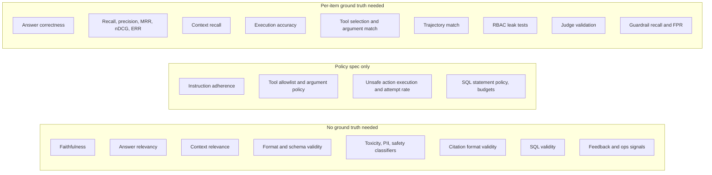

# Metric Cheatsheet

> **TL;DR**
>
> - **Look up any metric fast.** Compare every evaluation and guardrail check by ground-truth needs, method, runtime location, and cost.
> - **Start with the quick picks.** Use §3 to choose 1–2 primary metrics for your specific diagnostic question.
> - **Separate offline gates from online monitors.** Use reference-based metrics to gate releases and reference-free metrics to monitor live traffic.
> - **Prioritize cheap deterministic checks.** Run schema, citation, SQL, and tool-call checks on 100% of traffic before sampling LLM judges.

- **You will learn:**
    - The full metric landscape at a glance
    - Which metrics require reference data
    - Which checks fit 100% production traffic
    - Which metric answers each diagnostic question
- **Prerequisites:** [The evals & guardrails map](../00-foundations/02-the-evals-and-guardrails-map.md)
- **Related:** [Eval selection decision tree](./01-eval-selection-decision-tree.md), [Guardrail selection decision tree](./02-guardrail-selection-decision-tree.md), [Glossary](../00-foundations/04-glossary.md)

---

## 1. Legend

| Column | Values |
|---|---|
| **Category** | `retrieval` · `generation` · `e2e` · `agent` · `SQL` · `citation` · `safety` · `guardrail` · `ops` · `feedback` · `stats` |
| **Measures** | What the metric measures, with the formula where it is short. Unless the row says otherwise, rates and ratios range **0–1** and **higher is better**. **↓** marks lower-is-better metrics. |
| **GT?** (needs ground truth) | • **Yes** = needs a per-item reference (answer, relevant docs, gold SQL, expected tool call, label) • **No** = reference-free • **Opt** = works without, better with • **Policy** = needs only a machine-checkable spec (role → tool matrix, allowlist, SQL policy), not per-item labels |
| **Method** | • **Code** = deterministic, including IR metrics computed over labelled relevant IDs • **Stat** = statistical test, interval, or embedding/distribution measure • **Judge** = LLM-as-a-judge • **Clf** = trained classifier/NER/NLI model • **Human** = human/SME label |
| **Where** | • **Off** = offline on datasets • **On** = online eval on production traffic • **GR** = runtime guardrail (can block) |
| **Cost** | • **$0** = negligible compute • **$** = cheap model/classifier • **$$** = LLM judge per item • **$$$** = human time or multi-call judges |

Costs are relative per evaluated item. When a Judge metric runs online ("On"), you usually run it on sampled traffic (§5). Before a Judge metric gates a release, validate the judge against human labels ([LLM-as-a-judge §7](../02-offline-evals/07-llm-as-a-judge.md#7-aligning-and-validating-judges-against-humans)). The detail pages are canonical for every formula. If this table and a detail page disagree, the detail page wins.

---

## 2. The master table

### 2.1 Retrieval

| Metric | Category | Measures | GT? | Method | Where | Cost | Details |
|---|---|---|---|---|---|---|---|
| Hit rate@k | retrieval | 1 if ≥1 relevant doc is in the top-k, else 0; averaged over queries | Yes (relevant IDs) | Code | Off | $0 | [Retrieval metrics](../02-offline-evals/02-retrieval-metrics.md#hit-ratek) |
| Precision@k | retrieval | \|relevant ∩ top-k\| / k | Yes | Code | Off | $0 | [Retrieval metrics](../02-offline-evals/02-retrieval-metrics.md#precisionk) |
| Recall@k | retrieval | \|relevant ∩ top-k\| / \|relevant\| | Yes | Code | Off | $0 | [Retrieval metrics](../02-offline-evals/02-retrieval-metrics.md#recallk) |
| F1@k | retrieval | harmonic mean of P@k and R@k | Yes | Code | Off | $0 | [Retrieval metrics](../02-offline-evals/02-retrieval-metrics.md#f1k) |
| MRR | retrieval | mean of 1/rank of the first relevant result (0 if none in the cut-off) | Yes | Code | Off | $0 | [Retrieval metrics](../02-offline-evals/02-retrieval-metrics.md#mrr-mean-reciprocal-rank) |
| MAP | retrieval | mean over queries of average precision (precision at each relevant hit, divided by \|relevant\|) | Yes | Code | Off | $0 | [Retrieval metrics](../02-offline-evals/02-retrieval-metrics.md#map-mean-average-precision) |
| R-precision | retrieval | precision at k = \|relevant\|; equals recall at that cut-off | Yes (complete relevant sets) | Code | Off | $0 | [Retrieval metrics](../02-offline-evals/02-retrieval-metrics.md#r-precision) |
| nDCG@k | retrieval | DCG / ideal DCG with a log2 position discount. State the gain: linear `rel` is the library default; exponential `2^rel − 1` (Burges) is optional and gives different scores | Yes (graded) | Code | Off | $0 | [Retrieval metrics](../02-offline-evals/02-retrieval-metrics.md#ndcgk-normalised-discounted-cumulative-gain) |
| ERR@k | retrieval | expected reciprocal rank under a cascade user model; R_i = (2^g − 1) / 2^g_max (Chapelle et al., 2009) | Yes (graded) | Code | Off | $0 | [Retrieval metrics](../02-offline-evals/02-retrieval-metrics.md#err-and-rbp-user-model-metrics) |
| RBP | retrieval | rank-biased precision with persistence *p* (Moffat & Zobel, 2008); does not need \|relevant\|; report the residual (the most that unseen ranks could add) | Yes | Code | Off | $0 | [Retrieval metrics](../02-offline-evals/02-retrieval-metrics.md#err-and-rbp-user-model-metrics) |
| Context precision (RAGAS-style) | retrieval | rank-weighted precision: mean of precision@k over the positions of relevant chunks. RAGAS calls the variant judged against the answer instead of a reference "context utilization" | Opt (judge can use reference) | Judge (per-chunk relevance) or Code (labelled) | Off | $$ | [E2E RAG §3.5](../02-offline-evals/01-end-to-end-rag-evals.md#35-context-precision) |
| Context recall (RAGAS-style) | retrieval | \|reference claims attributable to context\| / \|reference claims\| | Yes (reference answer or contexts) | Judge or Code (ID match on reference contexts) | Off | $$ | [E2E RAG §3.7](../02-offline-evals/01-end-to-end-rag-evals.md#37-context-recall) |
| Context entities recall | retrieval | \|reference entities ∩ context entities\| / \|reference entities\| | Yes | Code (after entity extraction) | Off | $–$$ | [E2E RAG §3.8](../02-offline-evals/01-end-to-end-rag-evals.md#38-context-entities-recall) |
| Context relevance (RAGAS `ContextRelevance`) | retrieval | share of retrieved content that is relevant to the question, ignoring rank | No | Judge | Off/On | $$ | [E2E RAG §3.6](../02-offline-evals/01-end-to-end-rag-evals.md#36-context-relevance) |
| Index freshness / stale-chunk rate | ops | share of retrieved chunks older than their source document's latest version | No | Code | On | $0 | [Monitoring & drift §5.2](../03-online-evals-and-observability/04-monitoring-alerting-and-drift.md#52-corpus--knowledge-drift-and-schema-drift) |
| Retrieval latency / empty-result rate | ops | speed, and queries returning nothing above threshold | No | Code | On | $0 | [Monitoring](../03-online-evals-and-observability/04-monitoring-alerting-and-drift.md) |
| Retrieval score drift | ops | shift in similarity-score or query-embedding distributions | No | Stat | On | $ | [Monitoring & drift](../03-online-evals-and-observability/04-monitoring-alerting-and-drift.md) |

### 2.2 Generation and end-to-end RAG

| Metric | Category | Measures | GT? | Method | Where | Cost | Details |
|---|---|---|---|---|---|---|---|
| Answer correctness | e2e | answer matches reference facts; RAGAS `FactualCorrectness` uses claim-level F1 = TP / (TP + 0.5·(FP + FN)) | Yes | Judge (ref-based) / Human | Off | $$ | [E2E RAG §3.3](../02-offline-evals/01-end-to-end-rag-evals.md#33-answer-correctness) |
| Exact match / F1 token overlap | e2e | lexical match vs short reference | Yes | Code | Off | $0 | [Generation quality](../02-offline-evals/03-generation-quality-and-safety-evals.md#reference-based-text-metrics-bleu-rouge-bertscore) |
| Semantic similarity | e2e | cosine similarity of answer and reference embeddings. Most pairs fall in a narrow high band (such as 0.70–0.95), so thresholds do not transfer across embedding models | Yes | Stat | Off | $ | [E2E RAG §3.4](../02-offline-evals/01-end-to-end-rag-evals.md#34-answer-semantic-similarity) |
| Faithfulness / groundedness | generation | \|answer claims supported by retrieved context\| / \|answer claims\|. Measures support, not truth | No | Judge / Clf (NLI) | Off/On/GR | $$ | [E2E RAG §3.1](../02-offline-evals/01-end-to-end-rag-evals.md#31-faithfulness--groundedness) |
| Hallucination rate ↓ | generation | share of answers with ≥1 unsupported claim | No (vs context) | Judge / Clf (NLI) | Off/On | $$ | [E2E RAG §3.1](../02-offline-evals/01-end-to-end-rag-evals.md#31-faithfulness--groundedness) |
| Answer relevancy (RAGAS `AnswerRelevancy`) | generation | answer addresses the question asked; does not measure correctness. Roughly 0–1; compare variants, do not set universal thresholds | No | Judge + Stat (embedding) | Off/On | $$ | [E2E RAG §3.2](../02-offline-evals/01-end-to-end-rag-evals.md#32-answer-relevancy-response-relevancy) |
| Noise sensitivity ↓ | generation | \|incorrect claims\| / \|claims\| when irrelevant chunks are in the context | Yes | Judge | Off | $$ | [E2E RAG §3.9](../02-offline-evals/01-end-to-end-rag-evals.md#39-noise-sensitivity) |
| Completeness | generation | \|required key points covered\| / \|required key points\| | Opt | Judge | Off | $$ | [E2E RAG §3.10](../02-offline-evals/01-end-to-end-rag-evals.md#310-response-completeness) |
| Abstention correctness | e2e | abstention recall (declines when it should) **and** false-abstention rate ↓ (declines when it could answer). Report both | Yes (answerable label) | Judge / Code | Off | $–$$ | [E2E RAG §3.11](../02-offline-evals/01-end-to-end-rag-evals.md#311-abstention-correctness-i-dont-know) |
| Rubric-based quality (custom criteria) | generation | product-specific binary pass/fail criteria from error analysis | Opt | Judge / Human | Off/On | $$ | [LLM-as-a-judge](../02-offline-evals/07-llm-as-a-judge.md) |
| Pairwise preference | generation | A vs B win rate; swap positions to cancel position bias | No | Judge / Human | Off | $$ | [LLM-as-a-judge §4.4](../02-offline-evals/07-llm-as-a-judge.md#44-pairwise-judging-done-right) |
| Judge–human agreement | generation | TPR (share of human PASSes the judge passes), TNR (share of human FAILs the judge fails), Cohen's κ on a held-out split. Bar: see §2.9 | Yes (human labels) | Stat | Off | $$$ | [LLM-as-a-judge §7.3](../02-offline-evals/07-llm-as-a-judge.md#73-agreement-metrics) |
| Format / schema validity | generation | parse rate and schema-valid rate | No | Code | Off/On/GR | $0 | [Instruction adherence §3.1](../02-offline-evals/06-instruction-and-citation-adherence.md#31-parse-rate-and-schema-validity) |
| Length / verbosity | generation | within length bounds | No | Code | Off/On | $0 | [Generation quality](../02-offline-evals/03-generation-quality-and-safety-evals.md#33-conciseness--verbosity) |
| Tone / style adherence | generation | matches brand and voice guidelines | No | Judge / Clf | Off/On | $–$$ | [Generation quality](../02-offline-evals/03-generation-quality-and-safety-evals.md) |
| Readability | generation | reading-level formulas | No | Code | Off | $0 | [Generation quality](../02-offline-evals/03-generation-quality-and-safety-evals.md) |
| Language match (multilingual slices) | generation | answer language equals the user's language; report all metrics per language slice | No | Code / Clf | Off/On | $0–$ | [Online evals](../03-online-evals-and-observability/01-online-evals.md#card-language--format-match) |

### 2.3 Instruction and citation adherence

| Metric | Category | Measures | GT? | Method | Where | Cost | Details |
|---|---|---|---|---|---|---|---|
| Instruction adherence (verifiable) | generation | IFEval-style: prompt-level accuracy (all rules followed) and instruction-level accuracy | Policy (rules are the spec) | Code | Off/On | $0 | [Instruction adherence §2.2](../02-offline-evals/06-instruction-and-citation-adherence.md#22-verifiable-instruction-checks-ifeval-style) |
| Instruction adherence (non-verifiable) | generation | one binary judge per semantic rule; exclude `n/a` verdicts but track the `n/a` rate | Policy | Judge | Off/On | $$ | [Instruction adherence §2.3](../02-offline-evals/06-instruction-and-citation-adherence.md#23-non-verifiable-instructions-decomposed-binary-judges) |
| Instruction persistence (multi-turn) | generation | rules still followed late in a conversation and under pressure | Policy | Judge | Off | $$ | [Instruction adherence §2.4](../02-offline-evals/06-instruction-and-citation-adherence.md#24-system-prompt-adherence-over-multi-turn-conversations-and-under-pressure) |
| Citation format validity | citation | cited IDs exist in the current turn's retrieved set; target 1.0 (no fabricated sources) | No | Code | Off/On/GR | $0 | [Citation adherence §4.2](../02-offline-evals/06-instruction-and-citation-adherence.md#42-citation-format-validity) |
| Citation coverage | citation | cited claims / citation-worthy claims | No | Code + Judge (claim split) | Off/On | $–$$ | [Citation adherence §4.3](../02-offline-evals/06-instruction-and-citation-adherence.md#43-citation-coverage-presence) |
| Quote verification | citation | quoted text appears verbatim in the cited source | No | Code | Off/On/GR | $0 | [Citation adherence §4.4](../02-offline-evals/06-instruction-and-citation-adherence.md#44-quote-verification) |
| Citation support rate | citation | supported cited claims / cited claims | No | Clf (NLI) / Judge | Off/On | $$ | [Citation adherence §4.5](../02-offline-evals/06-instruction-and-citation-adherence.md#45-citation-faithfulness--support) |
| Citation recall and precision (ALCE) | citation | recall: statements fully supported by their citations / statements; precision: citations that are needed / all citations | No | Clf (NLI) / Judge | Off | $$ | [Citation adherence §4.6](../02-offline-evals/06-instruction-and-citation-adherence.md#46-citation-recall-and-precision-alce) |
| Cited-source recall/precision vs gold | citation | \|cited ∩ gold\| / \|gold\| and \|cited ∩ gold\| / \|cited\| | Yes (gold sources) | Code | Off | $0 | [Citation adherence §4.8](../02-offline-evals/06-instruction-and-citation-adherence.md#48-citing-the-right-sources-requires-gold) |

### 2.4 Agent, tool use, and trajectory

| Metric | Category | Measures | GT? | Method | Where | Cost | Details |
|---|---|---|---|---|---|---|---|
| Task / goal completion | agent | run achieves the user's goal; prefer final-state checks for action-taking agents | Opt (success criteria) | Code (state) / Judge / Human | Off/On | $–$$ | [Agent & trajectory §4](../02-offline-evals/04-agent-tool-and-trajectory-evals.md#4-outcome-evaluation-final-state-and-task-completion) |
| Tool selection accuracy | agent | correct tool set (or none) chosen | Yes (expected tool) | Code | Off | $0 | [Agent & trajectory §2.1](../02-offline-evals/04-agent-tool-and-trajectory-evals.md#21-tool-selection-accuracy) |
| Tool argument correctness | agent | schema-valid rate, and expected args matched / expected args | Yes for semantic, No for schema | Code / Judge | Off/On | $0–$$ | [Agent & trajectory §2.2](../02-offline-evals/04-agent-tool-and-trajectory-evals.md#22-tool-argument-correctness) |
| Tool-call precision / recall / F1 | agent | matched calls / predicted calls; matched calls / expected calls | Yes (expected calls) | Code | Off | $0 | [Agent & trajectory §2.3](../02-offline-evals/04-agent-tool-and-trajectory-evals.md#23-tool-call-precision-recall-and-f1) |
| Ordering accuracy | agent | satisfied precedence constraints / constraints (for example `get_ticket` before `update_ticket`) | Yes | Code | Off | $0 | [Agent & trajectory §2.4](../02-offline-evals/04-agent-tool-and-trajectory-evals.md#24-ordering-and-dependencies) |
| Forbidden / unnecessary / duplicate call rate ↓ | agent | runs with ≥1 forbidden call / runs (target 0); unneeded and repeated calls / calls | Policy + Opt | Code | Off/On | $0 | [Agent & trajectory §2.5](../02-offline-evals/04-agent-tool-and-trajectory-evals.md#25-unnecessary-and-forbidden-calls) |
| Tool-call schema validity | agent | args parse against tool schema | No | Code | Off/On/GR | $0 | [Tool guardrails §4](../04-guardrails/05-tool-and-action-guardrails.md#4-argument-validation) |
| Trajectory match (exact / in-order / any-order) | agent | steps vs reference trajectory | Yes (reference path) | Code | Off | $0 | [Agent & trajectory §3.1](../02-offline-evals/04-agent-tool-and-trajectory-evals.md#31-match-modes) |
| Trajectory quality (judge) | agent | logical, efficient, safe path that matches tool outputs | No | Judge | Off | $$ | [Agent & trajectory §3.3](../02-offline-evals/04-agent-tool-and-trajectory-evals.md#33-llm-judged-trajectory) |
| Step efficiency | agent | optimal steps / actual steps (cap 1), for tasks with a known optimum | Opt | Code | Off/On | $0 | [Agent & trajectory §5.1](../02-offline-evals/04-agent-tool-and-trajectory-evals.md#51-step-efficiency) |
| Loop / non-termination rate ↓ | agent | runs hitting max steps or repeating | No | Code | Off/On/GR | $0 | [Agent & trajectory](../02-offline-evals/04-agent-tool-and-trajectory-evals.md) |
| Routing / delegation accuracy | agent | router picks correct path or sub-agent; report per-class precision/recall and macro-F1 | Yes (expected route) | Code | Off | $0 | [Agent & trajectory §6](../02-offline-evals/04-agent-tool-and-trajectory-evals.md#6-routing-and-intent-classification) |
| Retrieval decision accuracy | agent | retrieves when needed and skips when not | Yes (label) | Code / Judge | Off | $0–$$ | [Agent & trajectory](../02-offline-evals/04-agent-tool-and-trajectory-evals.md) |
| Error recovery rate / false-success rate ↓ | agent | fault runs ending in correct recovery / fault runs; fault runs where the agent claims success / fault runs | Opt | Code / Judge | Off | $–$$ | [Agent & trajectory §2.6](../02-offline-evals/04-agent-tool-and-trajectory-evals.md#26-error-recovery) |
| Hand-off fidelity | agent | info preserved between agents | Opt | Judge | Off | $$ | [Agent & trajectory](../02-offline-evals/04-agent-tool-and-trajectory-evals.md) |
| pass@k | agent | P(at least one of k trials passes); unbiased estimator 1 − C(n−c, k) / C(n, k) (Chen et al., 2021). Measures capability, not reliability | Opt | Code | Off | $$ (n runs) | [Running experiments §4.3](../02-offline-evals/08-running-offline-experiments.md#43-passk-vs-passk) |
| pass^k | agent | P(all k trials pass); estimator C(c, k) / C(n, k) (τ-bench). Use it for reliability of write-tool tasks | Opt | Code | Off | $$ (n runs) | [Agent & trajectory §4.3](../02-offline-evals/04-agent-tool-and-trajectory-evals.md#43-reliability-across-trials-passk) |
| Conversation goal completion | agent | multi-turn session achieves user goal | Opt | Judge / Human | Off/On | $$ | [Agent & trajectory §7](../02-offline-evals/04-agent-tool-and-trajectory-evals.md#7-multi-turn-conversation-evals) |
| Memory poisoning resistance | agent | share of two-session scenarios where a planted memory changes a later action (↓) | Yes (planted scenarios) | Code + Judge | Off | $$ | [Threat model §3.2 (ASI06)](../04-guardrails/07-threat-model-owasp.md#32-owasp-top-10-for-agentic-applications-2026) |
| Milestone completion | agent | milestones reached / milestones defined, for long tasks. Diagnostic only. Gate on full task success | Yes (milestones) | Code | Off | $0 | [Environments & graders §9](../02-offline-evals/09-agent-eval-environments-and-graders.md#9-long-horizon-tasks) |
| Task validity (oracle pass, null-agent fail) | agent | share of tasks where the reference solution passes and a do-nothing agent fails. Target 1.0 | Yes (reference solution) | Code | Off | $ | [Environments & graders §8](../02-offline-evals/09-agent-eval-environments-and-graders.md#8-validate-every-task-before-you-trust-it) |
| Grader-tamper rate ↓ | agent | trials that change tests, graders, or scoring files / trials. Target 0. Fail those trials | No | Code (file diff) | Off | $0 | [Environments & graders §7](../02-offline-evals/09-agent-eval-environments-and-graders.md#7-grader-hacking-and-how-to-stop-it) |
| Tool error rate ↓ | ops | tool calls returning errors or timeouts | No | Code | On | $0 | [Monitoring](../03-online-evals-and-observability/04-monitoring-alerting-and-drift.md) |
| Cost & latency per task | ops | tokens, dollars, and wall-clock time per run; cost per successful task = total cost / successful tasks | No | Code | Off/On | $0 | [Agent & trajectory §5.1](../02-offline-evals/04-agent-tool-and-trajectory-evals.md#51-step-efficiency) |

### 2.5 Text-to-SQL

| Metric | Category | Measures | GT? | Method | Where | Cost | Details |
|---|---|---|---|---|---|---|---|
| Execution accuracy (EX) | SQL | result set of generated SQL equals gold SQL's (normalize column order, row order, floats) | Yes (gold SQL + DB snapshot) | Code | Off | $0 | [Text-to-SQL §5.1](../02-offline-evals/05-text-to-sql-evals.md#51-execution-accuracy-ex) |
| Test-suite accuracy | SQL | EX across several database variants, which catches queries that are right by accident | Yes | Code | Off | $0 | [Text-to-SQL §5.2](../02-offline-evals/05-text-to-sql-evals.md#52-test-suite-accuracy-zhong-et-al-2020) |
| Valid Efficiency Score (VES) | SQL | EX weighted by runtime relative to gold (BIRD) | Yes | Code | Off | $0 | [Text-to-SQL §5.3](../02-offline-evals/05-text-to-sql-evals.md#53-valid-efficiency-score-ves-bird) |
| Exact match (string / normalized) | SQL | SQL text equal to gold; diagnostic only | Yes | Code | Off | $0 | [Text-to-SQL §4.1](../02-offline-evals/05-text-to-sql-evals.md#41-exact-match-string-and-normalized) |
| Component / AST match | SQL | clause-level match (SELECT, WHERE, GROUP BY…); diagnostic only | Yes | Code | Off | $0 | [Text-to-SQL §4.2](../02-offline-evals/05-text-to-sql-evals.md#42-component-matching-spider-inspired-clause-f1) |
| SQL similarity (edit/AST distance) | SQL | partial-credit similarity to gold; diagnostic only | Yes | Code | Off | $0 | [Text-to-SQL §4.3](../02-offline-evals/05-text-to-sql-evals.md#43-ast--tree-edit-similarity) |
| SQL validity | SQL | parses and executes without error | No | Code | Off/On | $0 | [Text-to-SQL §3](../02-offline-evals/05-text-to-sql-evals.md#3-static-checks-no-database-needed) |
| Schema-linking recall/precision | SQL | correct tables and columns identified | Yes (gold tables) | Code | Off | $0 | [Text-to-SQL §8](../02-offline-evals/05-text-to-sql-evals.md#8-schema-linking-evals) |
| Semantic SQL correctness (judge) | SQL | SQL answers the question when no gold SQL exists; judge bar ≥0.90 TPR/TNR | No | Judge / Human | Off/On | $$ | [Text-to-SQL §6](../02-offline-evals/05-text-to-sql-evals.md#6-semantic-equivalence-with-an-llm-judge) |
| Answer-vs-result faithfulness | SQL | NL answer consistent with returned rows | No | Code (numbers) / Judge | Off/On | $0–$$ | [Text-to-SQL §9](../02-offline-evals/05-text-to-sql-evals.md#9-answer-level-evals-the-user-sees-prose-not-sql) |
| Ambiguity/clarification handling | SQL | asks or states assumptions when question is ambiguous | Opt | Judge | Off | $$ | [Text-to-SQL](../02-offline-evals/05-text-to-sql-evals.md) |
| Query efficiency | SQL | runtime, rows scanned, and cost | No | Code | Off/On | $0 | [Text-to-SQL §7](../02-offline-evals/05-text-to-sql-evals.md#7-efficiency-and-cost) |
| Empty-result / execution-error rate ↓ | ops | production SQL failures | No | Code | On | $0 | [Monitoring](../03-online-evals-and-observability/04-monitoring-alerting-and-drift.md) |

### 2.6 Safety and responsible-AI evals

| Metric | Category | Measures | GT? | Method | Where | Cost | Details |
|---|---|---|---|---|---|---|---|
| Toxicity ↓ | safety | hateful, abusive, harassing content | No | Clf / Judge | Off/On/GR | $–$$ | [Generation quality & safety §4.1](../02-offline-evals/03-generation-quality-and-safety-evals.md#41-toxicity-including-hate-and-harassment) |
| Profanity ↓ | safety | swear words or cursing | No | Code (wordlist) / Clf | Off/On/GR | $0–$ | [Generation quality & safety §4.2](../02-offline-evals/03-generation-quality-and-safety-evals.md#42-profanity--cursing) |
| Bias / fairness | safety | differential treatment across groups (counterfactual pairs) | Opt (paired prompts) | Judge / Stat | Off | $$ | [Generation quality & safety §4.3](../02-offline-evals/03-generation-quality-and-safety-evals.md#43-bias-and-fairness) |
| Harmful-content categories ↓ | safety | self-harm, violence, illegal activity, etc. | No | Clf / Judge | Off/On/GR | $–$$ | [Generation quality & safety](../02-offline-evals/03-generation-quality-and-safety-evals.md) |
| Jailbreak attack success rate (ASR) ↓ | safety | successful adversarial prompts / adversarial prompts; count distinct attack families | Yes (expected safe behaviour) | Judge / Code | Off | $$ | [Threat model §6](../04-guardrails/07-threat-model-owasp.md#6-red-teaming) |
| Indirect prompt-injection ASR ↓ | safety | injected instructions in docs or tool outputs that the agent follows; report with benign task success (AgentDojo-style) | Yes (attack set) | Code (canary / state) / Judge | Off | $–$$ | [Generation quality & safety §4.8](../02-offline-evals/03-generation-quality-and-safety-evals.md#48-indirect-prompt-injection-via-retrieved-content-and-tool-outputs) |
| Refusal recall / false-refusal rate ↓ | safety | must-refuse cases refused / must-refuse cases; legitimate requests refused / legitimate requests. Track both | Yes (labelled sets) | Judge / Code | Off/On | $–$$ | [Instruction adherence §2.6](../02-offline-evals/06-instruction-and-citation-adherence.md#26-refusal-policy-over-refusal-and-under-refusal) |
| PII leakage rate ↓ | safety | PII present in outputs that should not contain it | No | Clf (NER) / Code (regex) | Off/On/GR | $–$ | [Output guardrails §4](../04-guardrails/04-output-guardrails.md#4-pii-and-secret-leakage) |
| Unauthorized-data exposure (RBAC leak) ↓ | safety | content outside the user's entitlement appears in output; hard gate at 0, sized by the rule of three | Yes (role × forbidden markers) | Code | Off | $0 | [Access control & RBAC §12](../04-guardrails/06-access-control-rbac.md#12-evaluating-access-control) |
| Unsafe action execution rate ↓ | safety | disallowed or unapproved tool calls that **executed** / runs; target 0 | Policy | Code | Off/On | $0 | [Tool guardrails §15](../04-guardrails/05-tool-and-action-guardrails.md#15-evaluating-tool-and-action-guardrails) |
| Unsafe action attempt rate | safety | disallowed tool calls the agent **attempted** (the gate blocked them) / runs; rising values show injection or drift | Policy | Code | Off/On | $0 | [Tool guardrails §15](../04-guardrails/05-tool-and-action-guardrails.md#15-evaluating-tool-and-action-guardrails) |

### 2.7 Runtime guardrail checks

| Check | Category | Measures / enforces | GT? | Method | Where | Cost | Details |
|---|---|---|---|---|---|---|---|
| Input length / rate limits | guardrail | resource abuse | Policy | Code | GR | $0 | [Input guardrails](../04-guardrails/02-input-guardrails.md) |
| Topic / scope classifier | guardrail | out-of-scope requests | No | Clf / Judge | GR | $–$$ | [Input guardrails](../04-guardrails/02-input-guardrails.md) |
| Prompt-injection / jailbreak detector | guardrail | malicious instructions in input; fail closed (or no-tools mode) on tool-enabled turns | No | Clf / Judge | GR | $–$$ | [Input guardrails](../04-guardrails/02-input-guardrails.md) |
| SQL-in-input detector | guardrail | raw SQL or injection payloads in user text (telemetry; the parser policy enforces) | No | Code (regex/parser) | GR | $0 | [Input guardrails](../04-guardrails/02-input-guardrails.md) |
| Input PII detection / redaction | guardrail | PII before it reaches the model or logs | No | Clf (NER) + Code | GR | $ | [Input guardrails](../04-guardrails/02-input-guardrails.md) |
| Document/row-level ACL filtering | guardrail | user only retrieves authorized records | Policy | Code | GR | $0 | [Access control & RBAC](../04-guardrails/06-access-control-rbac.md) |
| Context injection scan | guardrail | instructions hidden in retrieved docs or tool outputs | No | Clf / Code | GR | $ | [Retrieval & context guardrails](../04-guardrails/03-retrieval-and-context-guardrails.md) |
| Source allowlist / provenance | guardrail | only trusted sources enter context | Policy | Code | GR | $0 | [Retrieval & context guardrails](../04-guardrails/03-retrieval-and-context-guardrails.md) |
| Tool allowlist per role | guardrail | agent can only call permitted tools ([role → tool matrix](../04-guardrails/05-tool-and-action-guardrails.md#14-policy-table-for-the-running-example)) | Policy | Code | GR | $0 | [Tool guardrails §3](../04-guardrails/05-tool-and-action-guardrails.md#3-tool-allowlists-per-role-and-context) |
| Tool argument validation | guardrail | schema, enums, ranges, and ownership checks | Policy | Code | GR | $0 | [Tool guardrails §4](../04-guardrails/05-tool-and-action-guardrails.md#4-argument-validation) |
| Taint tracking / dynamic gating | guardrail | outbound and state-changing tools need approval once untrusted content and sensitive data share the context | Policy | Code | GR | $0 | [Threat model §5](../04-guardrails/07-threat-model-owasp.md#5-the-lethal-trifecta) |
| MCP tool pinning | guardrail | tool descriptions match the pinned hash; servers are on the allowlist | Policy | Code | GR | $0 | [Tool guardrails §13](../04-guardrails/05-tool-and-action-guardrails.md#13-mcp-specific-concerns) |
| SQL statement policy (read-only, allowed schemas) | guardrail | only safe SQL executes | Policy | Code (parser) | GR | $0 | [Tool guardrails §12](../04-guardrails/05-tool-and-action-guardrails.md#12-text-to-sql-execution-guardrails) |
| Human approval for actions | guardrail | T2 external and T3 destructive actions approved; shared T1 writes (such as `create_ticket`) get an inline preview and one-click user confirmation | Policy | Human | GR | $$$ | [Tool guardrails §7](../04-guardrails/05-tool-and-action-guardrails.md#7-human-in-the-loop-approval) |
| Step / tool-call / cost / wall-clock budgets, loop detection | guardrail | runaway agents and denial of wallet (LLM06:2026) | Policy | Code | GR | $0 | [Tool guardrails §9](../04-guardrails/05-tool-and-action-guardrails.md#9-budgets-rate-limits-and-loop-detection) |
| Output schema validation | guardrail | malformed outputs | No | Code | GR | $0 | [Output guardrails §6](../04-guardrails/04-output-guardrails.md#6-structured-output-and-schema-validation) |
| Output PII / secret scan | guardrail | leakage | No | Code + Clf | GR | $ | [Output guardrails §4](../04-guardrails/04-output-guardrails.md#4-pii-and-secret-leakage) |
| Link / image sanitization | guardrail | exfiltration via URLs and phishing links | No | Code | GR | $0 | [Output guardrails §10.2](../04-guardrails/04-output-guardrails.md#102-markdown-html-and-links-the-exfiltration-channel) |
| Output toxicity / policy filter | guardrail | harmful output | No | Clf / Judge | GR | $–$$ | [Output guardrails](../04-guardrails/04-output-guardrails.md) |
| Groundedness gate | guardrail | ungrounded answers on high-stakes intents; sync and fail-closed on HR/finance (regenerate once, then abstain with sources) | No | Clf (NLI) / Judge | GR | $$ | [Output guardrails §2](../04-guardrails/04-output-guardrails.md#2-groundedness-and-hallucination-checks) |

### 2.8 Measuring the guardrails themselves

| Metric | Category | Measures | GT? | Method | Where | Cost | Details |
|---|---|---|---|---|---|---|---|
| Guardrail recall (catch rate) | guardrail | TP / (TP + FN): blocked attacks / attacks | Yes (attack set) | Code | Off | $ | [Guardrails architecture §9.2](../04-guardrails/01-guardrails-architecture.md#92-metrics) |
| Guardrail false-positive rate ↓ | guardrail | FP / (FP + TN): blocked benign items / benign items | Yes (benign-but-tricky set) | Code | Off/On | $ | [Guardrails architecture §9.2](../04-guardrails/01-guardrails-architecture.md#92-metrics) |
| Guardrail precision | guardrail | TP / (TP + FP): estimate at your real base rate, not on a balanced set | Yes | Code | Off/On | $ | [Guardrails architecture §9.2](../04-guardrails/01-guardrails-architecture.md#92-metrics) |
| Guardrail latency overhead | guardrail | p50/p95/p99 per rail and in total; total ≤20–30% of end-to-end latency | No | Code | On | $0 | [Guardrails architecture §5.1](../04-guardrails/01-guardrails-architecture.md#51-set-a-budget-per-layer) |
| Guardrail error / timeout rate ↓ | guardrail | how often fail-open or fail-closed paths fire | No | Code | On | $0 | [Guardrails architecture §9.3](../04-guardrails/01-guardrails-architecture.md#93-beyond-accuracy) |
| False block rate ↓ (tool gate) | guardrail | legitimate tool calls blocked / legitimate tool calls | Yes (benign task set) | Code | Off/On | $0 | [Tool guardrails §15](../04-guardrails/05-tool-and-action-guardrails.md#15-evaluating-tool-and-action-guardrails) |
| Approval rate / time-to-approve | guardrail | share of approval prompts approved, and latency. Near-100% approval with low latency signals rubber-stamping (ASI09) | No | Code | On | $0 | [Tool guardrails §15](../04-guardrails/05-tool-and-action-guardrails.md#15-evaluating-tool-and-action-guardrails) |
| Budget breach rate ↓ | guardrail | runs that hit a step, tool-call, cost, or wall-clock cap / runs | No | Code | On | $0 | [Tool guardrails §15](../04-guardrails/05-tool-and-action-guardrails.md#15-evaluating-tool-and-action-guardrails) |
| Guardrail trigger rate | ops | blocks and flags per guardrail over time; sudden spikes usually mean bugs or attacks | No | Code | On | $0 | [Monitoring](../03-online-evals-and-observability/04-monitoring-alerting-and-drift.md) |

### 2.9 Statistics for release gates

| Quantity | Category | Measures | GT? | Method | Where | Cost | Details |
|---|---|---|---|---|---|---|---|
| Wilson interval for a pass rate | stats | 95% CI that stays valid near 0 and 1 (for example 81/100 gives 72–87%); Clopper–Pearson is also fine | — | Stat | Off/On | $0 | [Dataset strategy §5.2](../01-datasets/01-dataset-strategy.md#52-confidence-intervals-for-pass-rates) |
| Rule of three | stats | 0 failures in *n* independent cases gives a 95% upper bound ≈ 3/*n*; a "<1%" claim needs ≥300 cases | — | Stat | Off | $0 | [Dataset strategy §5.2](../01-datasets/01-dataset-strategy.md#52-confidence-intervals-for-pass-rates) |
| McNemar test | stats | paired pass/fail comparison on the same items; uses only discordant pairs (~312 rows detect 5 points at 10% discordance) | — | Stat | Off | $0 | [Dataset strategy §5.3](../01-datasets/01-dataset-strategy.md#53-comparing-two-systems-use-paired-tests) |
| Paired bootstrap / permutation test | stats | paired comparison for continuous scores | — | Stat | Off | $0 | [Running experiments §5.2](../02-offline-evals/08-running-offline-experiments.md#52-paired-bootstrap-for-the-difference) |
| Benjamini–Hochberg | stats | false-discovery-rate control when you test many slices | — | Stat | Off | $0 | [Dataset strategy §5.3](../01-datasets/01-dataset-strategy.md#testing-many-slices-at-once) |
| A/A noise band | stats | spread of a metric when you re-run the same system 3–5×; any fixed threshold must exceed it | — | Stat | Off | $$ | [Running experiments §10.2](../02-offline-evals/08-running-offline-experiments.md#102-designing-gates) |
| Judge validation bar | stats | ≥100 labels with 30–50 FAILs; TPR ≥0.85, TNR ≥0.85, κ ≥0.60 on a held-out split; ≥0.90 on high-risk slices. Human-vs-human gold agreement is a separate bar (κ/α ≥0.80) | Yes | Stat | Off | $$$ | [LLM-as-a-judge §7.4](../02-offline-evals/07-llm-as-a-judge.md#74-how-many-labels) |
| Judge-corrected pass rate | stats | Rogan–Gladen: (observed + TNR − 1) / (TPR + TNR − 1); or prediction-powered inference (arXiv:2301.09633) | Yes (validation labels) | Stat | Off/On | $0 | [LLM-as-a-judge §8](../02-offline-evals/07-llm-as-a-judge.md#8-correcting-pass-rate-estimates-for-judge-error) |
| Online two-proportion / sequential test | stats | canary or A/B arm vs concurrent control; use a sequential test (such as mSPRT) if you peek; check sample-ratio mismatch | — | Stat | On | $0 | [Online evals §5.3](../03-online-evals-and-observability/01-online-evals.md#53-ab-tests-with-online-metrics) |

### 2.10 Online, feedback, and operational signals

| Signal | Category | Measures | GT? | Method | Where | Cost | Details |
|---|---|---|---|---|---|---|---|
| Thumbs up/down rate | feedback | explicit satisfaction (sparse and biased toward strong reactions) | No | Code | On | $0 | [User feedback](../03-online-evals-and-observability/03-user-feedback-and-implicit-signals.md) |
| Re-ask / rephrase rate ↓ | feedback | user did not get what they needed | No | Code / Stat | On | $0 | [User feedback](../03-online-evals-and-observability/03-user-feedback-and-implicit-signals.md) |
| Copy / accept / click-through on citations | feedback | answer was used | No | Code | On | $0 | [User feedback](../03-online-evals-and-observability/03-user-feedback-and-implicit-signals.md) |
| Escalation / handoff to human rate | feedback | assistant could not resolve the request | No | Code | On | $0 | [User feedback](../03-online-evals-and-observability/03-user-feedback-and-implicit-signals.md) |
| Session abandonment ↓ | feedback | user gave up | No | Code | On | $0 | [User feedback](../03-online-evals-and-observability/03-user-feedback-and-implicit-signals.md) |
| Sampled online judge scores | e2e | faithfulness, relevance, and policy on live traffic; 1–5% uniform (or ~500 traces/day) plus 100% of flagged traces | No | Judge | On | $$ | [Online evals §4.2](../03-online-evals-and-observability/01-online-evals.md#42-sampling-strategies) |
| Input/topic drift | ops | query distribution change vs baseline | No | Stat | On | $ | [Monitoring & drift](../03-online-evals-and-observability/04-monitoring-alerting-and-drift.md) |
| Judge drift | ops | online judge agreement with fresh human labels over time | Yes (periodic labels) | Stat | On | $$$ | [Monitoring & drift §5.4](../03-online-evals-and-observability/04-monitoring-alerting-and-drift.md#54-judge-drift) |
| Latency p50/p95, error rate, tokens, cost | ops | system health | No | Code | On | $0 | [Monitoring](../03-online-evals-and-observability/04-monitoring-alerting-and-drift.md) |
| Cost per run vs ceiling | ops | cost per run against the cap (for example 3× p99); spikes signal loops or denial of wallet | No | Code | On/GR | $0 | [Tool guardrails §9](../04-guardrails/05-tool-and-action-guardrails.md#9-budgets-rate-limits-and-loop-detection) |

---

## 3. Quick picks by question

Start with the **bold** metric. Add the secondary metrics only when you need finer diagnostic detail.

### 3.1 Retrieval

| I want to know… | Start with | Then | Needs |
|---|---|---|---|
| …if my retriever finds the right docs at all | **Recall@k / hit rate@k** | Context recall (judge) | Relevant doc IDs (or reference answers) |
| …if the best docs are ranked first | **MRR** (one right answer) / **nDCG@k** (graded; state the gain) | MAP, ERR (one good chunk is enough) | Relevant IDs, graded for nDCG/ERR |
| …if I'm stuffing the context with junk | **Precision@k** / context relevance (judge) | Context precision (rank-weighted) | Labels or judge |
| …which chunker/embedder/reranker is better | **Recall@k + nDCG@k** on the same labelled set | Downstream answer correctness | Fixed labelled set |
| …if retrieval is the bottleneck vs generation | **"Fact present in context?"** on failed answers | Context recall | Error analysis traces |
| …how retrieval behaves without labels | **Context relevance (judge)** | Synthetic Q from chunks → hit rate | Nothing or corpus |
| …if my relevance labels are incomplete | **RBP** with its residual | Re-pool after each new retriever | Partial labels |
| …if retrieval returns stale content | **Index freshness / stale-chunk rate** | Freshness slice in the golden set | Source version timestamps |

### 3.2 Generation and answers

| I want to know… | Start with | Then | Needs |
|---|---|---|---|
| …if answers are correct | **Answer correctness (ref-based judge)** | Human SME spot checks | Reference answers |
| …if the model is making things up | **Faithfulness / groundedness** | Citation precision | Retrieved context |
| …if it answers the actual question | **Answer relevancy** | Completeness | None |
| …if it knows when to say "I don't know" | **Abstention recall** on an unanswerable set | False-abstention rate on an answerable set | Answerable labels |
| …if it follows my system-prompt rules | **Instruction adherence** (one binary check per rule) | Instruction persistence | Rule list |
| …if output is well-formed | **Schema/format validity** | Length bounds | Schema |
| …if my LLM judge can be trusted | **Judge–human agreement (TPR/TNR)** | Cohen's κ | ≥100 human labels with 30–50 FAILs ([bar](#29-statistics-for-release-gates)) |
| …if it works in every language I support | **Language match** + per-language slices of the core metrics | Native-speaker spot checks | Multilingual golden set |

### 3.3 Citations

| I want to know… | Start with | Then |
|---|---|---|
| …if citations are real | **Citation format validity** (IDs in retrieved set) | Quote verification, cited-source recall vs gold |
| …if citations support the claims | **Citation support rate** | ALCE citation recall/precision, citation coverage |

### 3.4 Agents and tools

| I want to know… | Start with | Then | Needs |
|---|---|---|---|
| …if the agent gets the job done | **Task / goal completion** (final-state checks) | pass^k for consistency | Success criteria |
| …if it picks the right tool | **Tool selection accuracy** | Retrieval decision accuracy | Expected tool labels |
| …if tool inputs are right | **Schema validity + argument correctness** | None | Expected args/constraints |
| …if it wanders or loops | **Step efficiency, loop rate** | Trajectory quality (judge) | Traces |
| …if my orchestrator routes correctly | **Routing accuracy** | Hand-off fidelity | Expected routes |
| …if it's reliable, not lucky | **pass^k** (all k runs succeed) | pass@k for capability; Wilson CI | n ≥ k repeated runs |
| …if it does anything it shouldn't | **Unsafe action execution rate** (target 0) | Attempt rate, indirect-injection ASR with benign success | Policy + adversarial set |
| …if it can be steered across sessions | **Memory poisoning resistance** | Taint-tracking coverage | Two-session scenarios |
| …if it can run up the bill | **Budget breach rate + cost per successful task** | Loop rate | Budgets, traces |

### 3.5 Text-to-SQL

| I want to know… | Start with | Then | Needs |
|---|---|---|---|
| …if the SQL returns the right answer | **Execution accuracy** | Test-suite accuracy; semantic SQL judge (no gold) | Gold SQL + DB snapshot |
| …why SQL is wrong | **Schema-linking recall** | Component/AST match | Gold tables / SQL |
| …if SQL even runs | **Validity** | Empty-result rate | DB |
| …if the narrative matches the data | **Answer-vs-result faithfulness** | None | Result rows |
| …if users see only their data | **RBAC leak tests per role** | None | Role × query cases |

### 3.6 Safety and guardrails

| I want to know… | Start with | Then |
|---|---|---|
| …if outputs are toxic/profane | **Toxicity classifier** | Profanity wordlist, judge for borderline |
| …if it's biased | **Counterfactual paired prompts** | Judge-scored disparity |
| …if it can be jailbroken | **Attack success rate on a red-team set** (count attack families) | Multi-turn jailbreak scripts |
| …if documents can hijack it | **Indirect prompt-injection ASR with canary instructions**, reported with benign task success | Context injection scan recall |
| …if it leaks PII or restricted data | **PII leakage rate + RBAC leak tests** | Output PII scan recall |
| …if my guardrail is any good | **Recall + FPR on attack + benign sets** | Precision at the real base rate, latency p95 |
| …if a zero-tolerance gate is proven | **Rule of three** (0 failures in n → ≤3/n) | Count distinct attack families, not paraphrases; a "<1%" claim needs ≥300 cases |

### 3.7 Production

| I want to know… | Start with | Then |
|---|---|---|
| …if quality dropped this week | **Sampled online faithfulness/relevance + thumbs-down rate** | Re-ask rate, drift |
| …what users are asking that we don't handle | **Topic clustering + low-score traces** | Escalation rate |
| …if a model upgrade is safe | **Offline regression suite (golden set)** with a paired test, then **canary + online judges** against a concurrent control | Pairwise preference |
| …if a canary should roll back | **Pre-defined rollback triggers** (any RBAC leak; guardrail or quality drop past threshold) | Two-proportion or sequential test vs control |
| …if my online judge still agrees with humans | **Judge drift** on fresh labels | Re-validate after any judge or prompt change |

---

## 4. Ground-truth requirements at a glance

Run reference-free and policy checks **online** on live traffic. Run reference-based metrics offline to **gate releases**. A policy spec (role → tool matrix, allowlist, SQL policy) is ground truth you write once. You do not label each item.

---

## 5. Cheap enough for 100% of traffic?

| Yes (run on everything) | Sample (1–5% uniform or ~500 traces/day, plus 100% of flagged and negative-feedback traces) | Offline only |
|---|---|---|
| Schema/format validity, citation format validity, quote verification, SQL validity and SQL policy, tool-call schema and allowlist, unsafe action attempts, step/loop counts and budgets, latency/cost, PII regex, cheap classifiers (toxicity, PII, language, prompt injection), guardrail trigger counts, feedback signals | Faithfulness, answer relevancy, context relevance, instruction adherence (judge), citation support, tone, semantic SQL judge, conversation goal completion | Answer correctness, retrieval IR metrics, execution accuracy, trajectory match, tool selection accuracy, pass^k, red-team and indirect-injection ASR, memory poisoning, judge validation |

Treat these sampling rates as starting heuristics ([online evals §4.2](../03-online-evals-and-observability/01-online-evals.md#42-sampling-strategies)). Stratify the sample so that rare, high-risk intents (such as HR/finance) get enough traces. Calculate your exact sampling rate from your traffic volume and judge budget (see [eval selection §9](./01-eval-selection-decision-tree.md#9-budget-making-the-plan-affordable)).

---

## Key takeaways

- Use deterministic checks first because schema, citation validity, SQL execution, tool-call match, policy gates, and step counts are fast and free.
- Run reference-free metrics (faithfulness, relevancy, safety) online, and use reference-based metrics (correctness, recall@k, execution accuracy) to gate releases.
- Start with 1–2 metrics per diagnostic question and skip metrics that nobody will act on.
- Report every rate with a confidence interval. Compare systems with paired tests, and size zero-tolerance gates with the rule of three.
- Validate every LLM judge against human labels before it gates a release, and measure recall, false-positive rate, and latency for every guardrail.
- For agents, measure both capability (pass@k) and reliability (pass^k). Measure unsafe action execution separately from attempts.

## Further reading

- **In this repo:**
    - [Retrieval metrics](../02-offline-evals/02-retrieval-metrics.md)
    - [E2E RAG evals](../02-offline-evals/01-end-to-end-rag-evals.md)
    - [Agent & trajectory evals](../02-offline-evals/04-agent-tool-and-trajectory-evals.md)
    - [Text-to-SQL evals](../02-offline-evals/05-text-to-sql-evals.md)
    - [LLM-as-a-judge](../02-offline-evals/07-llm-as-a-judge.md)
    - [Running offline experiments](../02-offline-evals/08-running-offline-experiments.md)
    - [Dataset strategy §5: sizing and statistics](../01-datasets/01-dataset-strategy.md#5-sizing-and-statistics)
    - [Guardrails](../04-guardrails/README.md)
    - [Tooling landscape](../06-tooling-landscape/README.md)
- Es et al., [RAGAS (arXiv:2309.15217)](https://arxiv.org/abs/2309.15217)
- Zheng et al., [Judging LLM-as-a-Judge with MT-Bench and Chatbot Arena (arXiv:2306.05685)](https://arxiv.org/abs/2306.05685)
- Chen et al., [Evaluating Large Language Models Trained on Code (arXiv:2107.03374)](https://arxiv.org/abs/2107.03374), the unbiased pass@k estimator
- Yao et al., [τ-bench (arXiv:2406.12045)](https://arxiv.org/abs/2406.12045), pass^k
- Chapelle et al., [Expected Reciprocal Rank for Graded Relevance (CIKM 2009)](https://doi.org/10.1145/1645953.1646033)
- Moffat & Zobel, [Rank-Biased Precision for Measurement of Retrieval Effectiveness (TOIS 2008)](https://doi.org/10.1145/1416950.1416952)
- Eugene Yan, [Task-Specific LLM Evals that Do & Don't Work](https://eugeneyan.com/writing/evals/)
- OWASP, [Top 10 for LLM Applications 2026](https://genai.owasp.org/resource/owasp-genai-llm-top-10-2026/) and [Top 10 for Agentic Applications 2026](https://genai.owasp.org/resource/owasp-top-10-for-agentic-applications-for-2026/)
