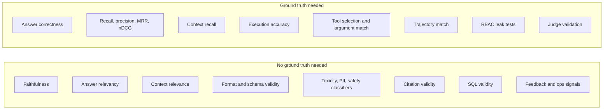

# Metric Cheatsheet

> **TL;DR**
>
> - **Look up any metric fast.** Compare every evaluation and guardrail check by ground-truth needs, method, runtime location, and cost.
> - **Start with the quick picks.** Use §3 to choose 1–2 primary metrics for your specific diagnostic question.
> - **Separate offline gates from online monitors.** Use reference-based metrics to gate releases and reference-free metrics to monitor live traffic.
> - **Prioritize cheap deterministic checks.** Run schema, citation, SQL, and tool-call checks on 100% of traffic before sampling LLM judges.

- **You will learn:**
    - The full metric landscape at a glance
    - Which metrics require reference data
    - Which checks fit 100% production traffic
    - Which metric answers each diagnostic question
- **Prerequisites:** [The evals & guardrails map](../00-foundations/02-the-evals-and-guardrails-map.md)
- **Related:** [Eval selection decision tree](./01-eval-selection-decision-tree.md), [Guardrail selection decision tree](./02-guardrail-selection-decision-tree.md), [Glossary](../00-foundations/04-glossary.md)

---

## 1. Legend

| Column | Values |
|---|---|
| **Category** | `retrieval` · `generation` · `e2e` · `agent` · `SQL` · `citation` · `safety` · `guardrail` · `ops` · `feedback` |
| **GT?** (needs ground truth) | • **Yes** = needs a reference (answer, relevant docs, gold SQL, expected tool call) • **No** = reference-free • **Opt** = works without, better with |
| **Method** | • **Code** = deterministic • **Stat** = statistical/IR/embedding • **Judge** = LLM-as-a-judge • **Clf** = trained classifier/NER • **Human** = human/SME label |
| **Where** | • **Off** = offline on datasets • **On** = online eval on production traffic • **GR** = runtime guardrail (can block) |
| **Cost** | • **$0** = negligible compute • **$** = cheap model/classifier • **$$** = LLM judge per item • **$$$** = human time or multi-call judges |

Costs are relative per evaluated item. When a Judge metric runs online ("On"), you usually run it on sampled traffic.

---

## 2. The master table

### 2.1 Retrieval

| Metric | Category | Measures | GT? | Method | Where | Cost | Details |
|---|---|---|---|---|---|---|---|
| Hit rate@k | retrieval | ≥1 relevant doc in top-k | Yes (relevant IDs) | Stat | Off | $0 | [Retrieval metrics](../02-offline-evals/02-retrieval-metrics.md) |
| Precision@k | retrieval | share of top-k that are relevant | Yes | Stat | Off | $0 | [Retrieval metrics](../02-offline-evals/02-retrieval-metrics.md) |
| Recall@k | retrieval | share of all relevant docs found in top-k | Yes | Stat | Off | $0 | [Retrieval metrics](../02-offline-evals/02-retrieval-metrics.md) |
| F1@k | retrieval | harmonic mean of P@k and R@k | Yes | Stat | Off | $0 | [Retrieval metrics](../02-offline-evals/02-retrieval-metrics.md) |
| MRR | retrieval | rank of first relevant result (1/rank, averaged) | Yes | Stat | Off | $0 | [Retrieval metrics](../02-offline-evals/02-retrieval-metrics.md) |
| MAP | retrieval | precision averaged over each relevant hit, then over queries | Yes | Stat | Off | $0 | [Retrieval metrics](../02-offline-evals/02-retrieval-metrics.md) |
| nDCG@k | retrieval | ranking quality with graded relevance and position discount | Yes (graded) | Stat | Off | $0 | [Retrieval metrics](../02-offline-evals/02-retrieval-metrics.md) |
| Context precision (RAGAS-style) | retrieval | relevant chunks ranked above irrelevant ones | Opt (judge can use reference) | Judge / Stat | Off | $$ | [E2E RAG evals](../02-offline-evals/01-end-to-end-rag-evals.md) |
| Context recall (RAGAS-style) | retrieval | reference answer's claims attributable to retrieved context | Yes (reference answer or contexts) | Judge / Stat | Off | $$ | [E2E RAG evals](../02-offline-evals/01-end-to-end-rag-evals.md) |
| Context relevance | retrieval | retrieved context is relevant to the question | No | Judge | Off/On | $$ | [E2E RAG evals](../02-offline-evals/01-end-to-end-rag-evals.md) |
| Retrieval latency / empty-result rate | ops | speed and queries returning nothing above threshold | No | Code | On | $0 | [Monitoring](../03-online-evals-and-observability/04-monitoring-alerting-and-drift.md) |
| Retrieval score drift | ops | shift in similarity-score or query-embedding distributions | No | Stat | On | $ | [Monitoring & drift](../03-online-evals-and-observability/04-monitoring-alerting-and-drift.md) |

### 2.2 Generation and end-to-end RAG

| Metric | Category | Measures | GT? | Method | Where | Cost | Details |
|---|---|---|---|---|---|---|---|
| Answer correctness | e2e | answer matches reference facts | Yes | Judge (ref-based) / Human | Off | $$ | [E2E RAG evals](../02-offline-evals/01-end-to-end-rag-evals.md) |
| Exact match / F1 token overlap | e2e | lexical match vs short reference | Yes | Code | Off | $0 | [E2E RAG evals](../02-offline-evals/01-end-to-end-rag-evals.md) |
| Semantic similarity | e2e | embedding similarity to reference | Yes | Stat | Off | $ | [E2E RAG evals](../02-offline-evals/01-end-to-end-rag-evals.md) |
| Faithfulness / groundedness | generation | every claim in answer supported by retrieved context | No | Judge / Clf (NLI) | Off/On/GR | $$ | [E2E RAG evals](../02-offline-evals/01-end-to-end-rag-evals.md) |
| Hallucination rate | generation | share of answers with unsupported claims | No (vs context) | Judge | Off/On | $$ | [E2E RAG evals](../02-offline-evals/01-end-to-end-rag-evals.md) |
| Answer relevancy | generation | answer addresses the question asked | No | Judge / Stat | Off/On | $$ | [E2E RAG evals](../02-offline-evals/01-end-to-end-rag-evals.md) |
| Completeness | generation | covers all parts of the question or reference | Opt | Judge | Off | $$ | [E2E RAG evals](../02-offline-evals/01-end-to-end-rag-evals.md) |
| Refusal correctness (unanswerable) | e2e | abstains when context lacks the answer without over-refusing | Yes (answerable label) | Judge / Code | Off | $–$$ | [E2E RAG evals](../02-offline-evals/01-end-to-end-rag-evals.md) |
| Rubric-based quality (custom criteria) | generation | product-specific pass/fail criteria from error analysis | Opt | Judge / Human | Off/On | $$ | [LLM-as-a-judge](../02-offline-evals/07-llm-as-a-judge.md) |
| Pairwise preference | generation | A vs B comparison | No | Judge / Human | Off | $$ | [LLM-as-a-judge](../02-offline-evals/07-llm-as-a-judge.md) |
| Judge–human agreement (TPR/TNR, kappa) | generation | validity of an LLM judge | Yes (human labels) | Stat | Off | $$$ | [LLM-as-a-judge](../02-offline-evals/07-llm-as-a-judge.md) |
| Format / schema validity | generation | output parses and matches JSON schema or template | No | Code | Off/On/GR | $0 | [Instruction adherence](../02-offline-evals/06-instruction-and-citation-adherence.md) |
| Length / verbosity | generation | within length bounds | No | Code | Off/On | $0 | [Instruction adherence](../02-offline-evals/06-instruction-and-citation-adherence.md) |
| Tone / style adherence | generation | matches brand and voice guidelines | No | Judge / Clf | Off/On | $–$$ | [Generation quality](../02-offline-evals/03-generation-quality-and-safety-evals.md) |
| Readability | generation | reading-level formulas | No | Code | Off | $0 | [Generation quality](../02-offline-evals/03-generation-quality-and-safety-evals.md) |

### 2.3 Instruction and citation adherence

| Metric | Category | Measures | GT? | Method | Where | Cost | Details |
|---|---|---|---|---|---|---|---|
| Instruction adherence | generation | follows system-prompt rules (scope, format, persona, do/don't) | No (rules are the spec) | Code + Judge | Off/On | $–$$ | [Instruction adherence](../02-offline-evals/06-instruction-and-citation-adherence.md) |
| Instruction persistence (multi-turn) | generation | rules still followed late in a conversation | No | Judge | Off | $$ | [Instruction adherence](../02-offline-evals/06-instruction-and-citation-adherence.md) |
| Citation presence | citation | answer includes citations where required | No | Code | Off/On/GR | $0 | [Citation adherence](../02-offline-evals/06-instruction-and-citation-adherence.md) |
| Citation validity | citation | cited IDs exist in retrieved set (no fabricated sources) | No | Code | Off/On/GR | $0 | [Citation adherence](../02-offline-evals/06-instruction-and-citation-adherence.md) |
| Citation precision (support) | citation | each cited source supports the attached claim | No | Judge / Clf (NLI) | Off/On | $$ | [Citation adherence](../02-offline-evals/06-instruction-and-citation-adherence.md) |
| Citation recall (coverage) | citation | each claim needing a source has one | No | Judge | Off | $$ | [Citation adherence](../02-offline-evals/06-instruction-and-citation-adherence.md) |
| Citation correctness vs reference | citation | cites the gold source(s) | Yes (gold sources) | Code | Off | $0 | [Citation adherence](../02-offline-evals/06-instruction-and-citation-adherence.md) |

### 2.4 Agent, tool use, and trajectory

| Metric | Category | Measures | GT? | Method | Where | Cost | Details |
|---|---|---|---|---|---|---|---|
| Task / goal completion | agent | run achieves the user's goal | Opt (success criteria) | Code (state) / Judge / Human | Off/On | $–$$ | [Agent & trajectory](../02-offline-evals/04-agent-tool-and-trajectory-evals.md) |
| Tool selection accuracy | agent | correct tool (or none) chosen | Yes (expected tool) | Code | Off | $0 | [Agent & trajectory](../02-offline-evals/04-agent-tool-and-trajectory-evals.md) |
| Tool argument correctness | agent | args valid (schema) and semantically correct | Yes for semantic, No for schema | Code / Judge | Off/On | $0–$$ | [Agent & trajectory](../02-offline-evals/04-agent-tool-and-trajectory-evals.md) |
| Tool-call schema validity | agent | args parse against tool schema | No | Code | Off/On/GR | $0 | [Tool guardrails](../04-guardrails/05-tool-and-action-guardrails.md) |
| Trajectory match (exact / in-order / any-order) | agent | steps vs reference trajectory | Yes (reference path) | Code | Off | $0 | [Agent & trajectory](../02-offline-evals/04-agent-tool-and-trajectory-evals.md) |
| Trajectory quality (judge) | agent | reasonable, non-redundant path | No | Judge | Off | $$ | [Agent & trajectory](../02-offline-evals/04-agent-tool-and-trajectory-evals.md) |
| Step efficiency | agent | step count and redundant calls vs minimum | Opt | Code | Off/On | $0 | [Agent & trajectory](../02-offline-evals/04-agent-tool-and-trajectory-evals.md) |
| Loop / non-termination rate | agent | runs hitting max steps or repeating | No | Code | Off/On/GR | $0 | [Agent & trajectory](../02-offline-evals/04-agent-tool-and-trajectory-evals.md) |
| Routing / delegation accuracy | agent | orchestrator or router picks correct path or sub-agent | Yes (expected route) | Code | Off | $0 | [Agent & trajectory](../02-offline-evals/04-agent-tool-and-trajectory-evals.md) |
| Retrieval decision accuracy | agent | retrieves when needed and skips when not | Yes (label) | Code / Judge | Off | $0–$$ | [Agent & trajectory](../02-offline-evals/04-agent-tool-and-trajectory-evals.md) |
| Error recovery rate | agent | recovers after tool failure | Opt | Code / Judge | Off | $–$$ | [Agent & trajectory](../02-offline-evals/04-agent-tool-and-trajectory-evals.md) |
| Hand-off fidelity | agent | info preserved between agents | Opt | Judge | Off | $$ | [Agent & trajectory](../02-offline-evals/04-agent-tool-and-trajectory-evals.md) |
| pass@k / pass^k (consistency) | agent | success in any of k runs or all of k runs | Opt | Code | Off | $$ (k runs) | [Agent & trajectory](../02-offline-evals/04-agent-tool-and-trajectory-evals.md) |
| Conversation goal completion | agent | multi-turn session achieves user goal | Opt | Judge / Human | Off/On | $$ | [Agent & trajectory](../02-offline-evals/04-agent-tool-and-trajectory-evals.md) |
| Tool error rate | ops | tool calls returning errors or timeouts | No | Code | On | $0 | [Monitoring](../03-online-evals-and-observability/04-monitoring-alerting-and-drift.md) |
| Cost & latency per task | ops | tokens, dollars, and wall-clock time per run | No | Code | Off/On | $0 | [Monitoring](../03-online-evals-and-observability/04-monitoring-alerting-and-drift.md) |

### 2.5 Text-to-SQL

| Metric | Category | Measures | GT? | Method | Where | Cost | Details |
|---|---|---|---|---|---|---|---|
| Execution accuracy | SQL | result set of generated SQL equals gold SQL's | Yes (gold SQL + DB snapshot) | Code | Off | $0 | [Text-to-SQL](../02-offline-evals/05-text-to-sql-evals.md) |
| Exact match (string / normalized) | SQL | SQL text equal to gold | Yes | Code | Off | $0 | [Text-to-SQL](../02-offline-evals/05-text-to-sql-evals.md) |
| Component / AST match | SQL | clause-level match (SELECT, WHERE, GROUP BY…) | Yes | Code | Off | $0 | [Text-to-SQL](../02-offline-evals/05-text-to-sql-evals.md) |
| SQL similarity (edit/AST distance) | SQL | partial-credit similarity to gold | Yes | Code | Off | $0 | [Text-to-SQL](../02-offline-evals/05-text-to-sql-evals.md) |
| SQL validity | SQL | parses and executes without error | No | Code | Off/On | $0 | [Text-to-SQL](../02-offline-evals/05-text-to-sql-evals.md) |
| Schema-linking recall/precision | SQL | correct tables and columns identified | Yes (gold tables) | Code | Off | $0 | [Text-to-SQL](../02-offline-evals/05-text-to-sql-evals.md) |
| Semantic SQL correctness (judge) | SQL | SQL answers the question when no gold SQL exists | No | Judge / Human | Off/On | $$ | [Text-to-SQL](../02-offline-evals/05-text-to-sql-evals.md) |
| Answer-vs-result faithfulness | SQL | NL answer consistent with returned rows | No | Code (numbers) / Judge | Off/On | $0–$$ | [Text-to-SQL](../02-offline-evals/05-text-to-sql-evals.md) |
| Ambiguity/clarification handling | SQL | asks or states assumptions when question is ambiguous | Opt | Judge | Off | $$ | [Text-to-SQL](../02-offline-evals/05-text-to-sql-evals.md) |
| Query efficiency | SQL | runtime, rows scanned, and cost | No | Code | Off/On | $0 | [Text-to-SQL](../02-offline-evals/05-text-to-sql-evals.md) |
| Empty-result / execution-error rate | ops | production SQL failures | No | Code | On | $0 | [Monitoring](../03-online-evals-and-observability/04-monitoring-alerting-and-drift.md) |

### 2.6 Safety and responsible-AI evals

| Metric | Category | Measures | GT? | Method | Where | Cost | Details |
|---|---|---|---|---|---|---|---|
| Toxicity | safety | hateful, abusive, harassing content | No | Clf / Judge | Off/On/GR | $–$$ | [Generation quality & safety](../02-offline-evals/03-generation-quality-and-safety-evals.md) |
| Profanity | safety | swear words or cursing | No | Code (wordlist) / Clf | Off/On/GR | $0–$ | [Generation quality & safety](../02-offline-evals/03-generation-quality-and-safety-evals.md) |
| Bias / fairness | safety | differential treatment across groups (counterfactual pairs) | Opt (paired prompts) | Judge / Stat | Off | $$ | [Generation quality & safety](../02-offline-evals/03-generation-quality-and-safety-evals.md) |
| Harmful-content categories | safety | self-harm, violence, illegal activity, etc. | No | Clf / Judge | Off/On/GR | $–$$ | [Generation quality & safety](../02-offline-evals/03-generation-quality-and-safety-evals.md) |
| Jailbreak resistance / attack success rate | safety | share of adversarial prompts that succeed | Yes (expected safe behaviour) | Judge / Code | Off | $$ | [Generation quality & safety](../02-offline-evals/03-generation-quality-and-safety-evals.md) |
| Prompt-injection attack success rate | safety | injected instructions in docs or tools followed | Yes (attack set) | Code (canary) / Judge | Off | $–$$ | [Threat model](../04-guardrails/07-threat-model-owasp.md) |
| Over-refusal rate | safety | benign requests wrongly refused | Yes (benign set) | Judge / Code | Off/On | $–$$ | [Generation quality & safety](../02-offline-evals/03-generation-quality-and-safety-evals.md) |
| PII leakage rate | safety | PII present in outputs that should not contain it | No | Clf (NER) / Code (regex) | Off/On/GR | $–$ | [Output guardrails](../04-guardrails/04-output-guardrails.md) |
| Unauthorized-data exposure (RBAC leak) | safety | content outside user's entitlement appears in output | Yes (role × forbidden markers) | Code | Off | $0 | [Access control & RBAC](../04-guardrails/06-access-control-rbac.md) |
| Unauthorized action rate | safety | disallowed or unapproved tool calls attempted or executed | Yes (policy) | Code | Off/On | $0 | [Tool guardrails](../04-guardrails/05-tool-and-action-guardrails.md) |

### 2.7 Runtime guardrail checks

| Check | Category | Measures / enforces | GT? | Method | Where | Cost | Details |
|---|---|---|---|---|---|---|---|
| Input length / rate limits | guardrail | resource abuse | No | Code | GR | $0 | [Input guardrails](../04-guardrails/02-input-guardrails.md) |
| Topic / scope classifier | guardrail | out-of-scope requests | No | Clf / Judge | GR | $–$$ | [Input guardrails](../04-guardrails/02-input-guardrails.md) |
| Prompt-injection / jailbreak detector | guardrail | malicious instructions in input | No | Clf / Judge | GR | $–$$ | [Input guardrails](../04-guardrails/02-input-guardrails.md) |
| SQL-in-input detector | guardrail | raw SQL or injection payloads in user text | No | Code (regex/parser) | GR | $0 | [Input guardrails](../04-guardrails/02-input-guardrails.md) |
| Input PII detection / redaction | guardrail | PII before it reaches the model or logs | No | Clf (NER) + Code | GR | $ | [Input guardrails](../04-guardrails/02-input-guardrails.md) |
| Document/row-level ACL filtering | guardrail | user only retrieves authorized records | No (policy) | Code | GR | $0 | [Access control & RBAC](../04-guardrails/06-access-control-rbac.md) |
| Context injection scan | guardrail | instructions hidden in retrieved docs or tool outputs | No | Clf / Code | GR | $ | [Retrieval & context guardrails](../04-guardrails/03-retrieval-and-context-guardrails.md) |
| Source allowlist / provenance | guardrail | only trusted sources enter context | No (policy) | Code | GR | $0 | [Retrieval & context guardrails](../04-guardrails/03-retrieval-and-context-guardrails.md) |
| Tool allowlist per role | guardrail | agent can only call permitted tools | No (policy) | Code | GR | $0 | [Tool guardrails](../04-guardrails/05-tool-and-action-guardrails.md) |
| Tool argument validation | guardrail | schema, enums, ranges, and ownership checks | No | Code | GR | $0 | [Tool guardrails](../04-guardrails/05-tool-and-action-guardrails.md) |
| SQL statement policy (read-only, allowed schemas) | guardrail | only safe SQL executes | No | Code (parser) | GR | $0 | [Tool guardrails](../04-guardrails/05-tool-and-action-guardrails.md) |
| Human approval for actions | guardrail | irreversible actions confirmed | No | Human | GR | $$$ | [Tool guardrails](../04-guardrails/05-tool-and-action-guardrails.md) |
| Step / budget / loop limits | guardrail | runaway agents | No | Code | GR | $0 | [Guardrails architecture](../04-guardrails/01-guardrails-architecture.md) |
| Output schema validation | guardrail | malformed outputs | No | Code | GR | $0 | [Output guardrails](../04-guardrails/04-output-guardrails.md) |
| Output PII / secret scan | guardrail | leakage | No | Code + Clf | GR | $ | [Output guardrails](../04-guardrails/04-output-guardrails.md) |
| Link / image sanitization | guardrail | exfiltration via URLs and phishing links | No | Code | GR | $0 | [Output guardrails](../04-guardrails/04-output-guardrails.md) |
| Output toxicity / policy filter | guardrail | harmful output | No | Clf / Judge | GR | $–$$ | [Output guardrails](../04-guardrails/04-output-guardrails.md) |
| Groundedness gate | guardrail | ungrounded answers on high-stakes intents | No | Judge / Clf (NLI) | GR | $$ | [Output guardrails](../04-guardrails/04-output-guardrails.md) |
| Guardrail recall / FPR | guardrail | effectiveness and UX cost of a guardrail | Yes (attack + benign sets) | Stat | Off | $ | [Guardrail selection §9](./02-guardrail-selection-decision-tree.md#9-measuring-guardrails-false-positives-matter) |

### 2.8 Online, feedback, and operational signals

| Signal | Category | Measures | GT? | Method | Where | Cost | Details |
|---|---|---|---|---|---|---|---|
| Thumbs up/down rate | feedback | explicit satisfaction | No | Code | On | $0 | [User feedback](../03-online-evals-and-observability/03-user-feedback-and-implicit-signals.md) |
| Re-ask / rephrase rate | feedback | user did not get what they needed | No | Code / Stat | On | $0 | [User feedback](../03-online-evals-and-observability/03-user-feedback-and-implicit-signals.md) |
| Copy / accept / click-through on citations | feedback | answer was used | No | Code | On | $0 | [User feedback](../03-online-evals-and-observability/03-user-feedback-and-implicit-signals.md) |
| Escalation / handoff to human rate | feedback | assistant could not resolve the request | No | Code | On | $0 | [User feedback](../03-online-evals-and-observability/03-user-feedback-and-implicit-signals.md) |
| Session abandonment | feedback | user gave up | No | Code | On | $0 | [User feedback](../03-online-evals-and-observability/03-user-feedback-and-implicit-signals.md) |
| Sampled online judge scores | e2e | faithfulness, relevance, and policy on live traffic | No | Judge | On | $$ | [Online evals](../03-online-evals-and-observability/01-online-evals.md) |
| Input/topic drift | ops | query distribution change vs baseline | No | Stat | On | $ | [Monitoring & drift](../03-online-evals-and-observability/04-monitoring-alerting-and-drift.md) |
| Latency p50/p95, error rate, tokens, cost | ops | system health | No | Code | On | $0 | [Monitoring](../03-online-evals-and-observability/04-monitoring-alerting-and-drift.md) |
| Guardrail trigger rate | ops | blocks and flags per guardrail over time | No | Code | On | $0 | [Monitoring](../03-online-evals-and-observability/04-monitoring-alerting-and-drift.md) |

---

## 3. Quick picks by question

Start with the **bold** metric. Add the secondary metrics only when you need finer diagnostic detail.

### 3.1 Retrieval

| I want to know… | Start with | Then | Needs |
|---|---|---|---|
| …if my retriever finds the right docs at all | **Recall@k / hit rate@k** | Context recall (judge) | Relevant doc IDs (or reference answers) |
| …if the best docs are ranked first | **MRR** (one right answer) / **nDCG@k** (graded) | MAP | Relevant IDs, graded for nDCG |
| …if I'm stuffing the context with junk | **Precision@k** / context precision | Context relevance (judge) | Labels or judge |
| …which chunker/embedder/reranker is better | **Recall@k + nDCG@k** on the same labelled set | Downstream answer correctness | Fixed labelled set |
| …if retrieval is the bottleneck vs generation | **"Fact present in context?"** on failed answers | Context recall | Error analysis traces |
| …how retrieval behaves without labels | **Context relevance (judge)** | Synthetic Q from chunks → hit rate | Nothing or corpus |

### 3.2 Generation and answers

| I want to know… | Start with | Then | Needs |
|---|---|---|---|
| …if answers are correct | **Answer correctness (ref-based judge)** | Human SME spot checks | Reference answers |
| …if the model is making things up | **Faithfulness / groundedness** | Citation precision | Retrieved context |
| …if it answers the actual question | **Answer relevancy** | Completeness | None |
| …if it knows when to say "I don't know" | **Refusal correctness** on unanswerable set | Over-refusal rate | Answerable labels |
| …if it follows my system-prompt rules | **Instruction adherence** (one binary check per rule) | Instruction persistence | Rule list |
| …if output is well-formed | **Schema/format validity** | Length bounds | Schema |
| …if my LLM judge can be trusted | **Judge–human agreement (TPR/TNR)** | Cohen's kappa | 50–100 human labels |

### 3.3 Citations

| I want to know… | Start with | Then |
|---|---|---|
| …if citations are real | **Citation validity** (IDs in retrieved set) | Citation correctness vs gold |
| …if citations support the claims | **Citation precision (support)** | Citation recall (coverage) |

### 3.4 Agents and tools

| I want to know… | Start with | Then | Needs |
|---|---|---|---|
| …if the agent gets the job done | **Task / goal completion** | pass^k for consistency | Success criteria |
| …if it picks the right tool | **Tool selection accuracy** | Retrieval decision accuracy | Expected tool labels |
| …if tool inputs are right | **Schema validity + argument correctness** | None | Expected args/constraints |
| …if it wanders or loops | **Step efficiency, loop rate** | Trajectory quality (judge) | Traces |
| …if my orchestrator routes correctly | **Routing accuracy** | Hand-off fidelity | Expected routes |
| …if it's reliable, not lucky | **pass^k** (all k runs succeed) | Variance across runs | k repeated runs |
| …if it does anything it shouldn't | **Unauthorized action rate** | Attack success rate | Policy + adversarial set |

### 3.5 Text-to-SQL

| I want to know… | Start with | Then | Needs |
|---|---|---|---|
| …if the SQL returns the right answer | **Execution accuracy** | Semantic SQL judge (no gold) | Gold SQL + DB snapshot |
| …why SQL is wrong | **Schema-linking recall** | Component/AST match | Gold tables / SQL |
| …if SQL even runs | **Validity** | Empty-result rate | DB |
| …if the narrative matches the data | **Answer-vs-result faithfulness** | None | Result rows |
| …if users see only their data | **RBAC leak tests per role** | None | Role × query cases |

### 3.6 Safety and guardrails

| I want to know… | Start with | Then |
|---|---|---|
| …if outputs are toxic/profane | **Toxicity classifier** | Profanity wordlist, judge for borderline |
| …if it's biased | **Counterfactual paired prompts** | Judge-scored disparity |
| …if it can be jailbroken | **Attack success rate on a red-team set** | Multi-turn jailbreak scripts |
| …if documents can hijack it | **Prompt-injection ASR with canary instructions** | Context injection scan recall |
| …if it leaks PII or restricted data | **PII leakage rate + RBAC leak tests** | Output PII scan recall |
| …if my guardrail is any good | **Recall + FPR on attack + benign sets** | Latency p95 |

### 3.7 Production

| I want to know… | Start with | Then |
|---|---|---|
| …if quality dropped this week | **Sampled online faithfulness/relevance + thumbs-down rate** | Re-ask rate, drift |
| …what users are asking that we don't handle | **Topic clustering + low-score traces** | Escalation rate |
| …if a model upgrade is safe | **Offline regression suite (golden set)** then **canary + online judges** | Pairwise preference |

---

## 4. Ground-truth requirements at a glance

Run reference-free metrics **online** on live traffic. Run reference-based metrics offline to **gate releases**.

---

## 5. Cheap enough for 100% of traffic?

| Yes (run on everything) | Sample (e.g. 1–10%, plus all flagged/negative-feedback traces) | Offline only |
|---|---|---|
| Schema/format validity, citation validity, SQL validity, tool-call schema, step/loop counts, latency/cost, PII regex, toxicity classifier, guardrail trigger counts, feedback signals | Faithfulness, answer relevancy, context relevance, instruction adherence (judge), tone, semantic SQL judge, conversation goal completion | Answer correctness, retrieval IR metrics, execution accuracy, trajectory match, tool selection accuracy, red-team ASR, judge validation |

Treat these sampling rates as starting heuristics. Calculate your exact sampling rate from your traffic volume and judge budget (see [eval selection §9](./01-eval-selection-decision-tree.md#9-budget-making-the-plan-affordable)).

---

## Key takeaways

- Use deterministic checks first because schema, citation validity, SQL execution, tool-call match, and step counts are fast and free.
- Run reference-free metrics (faithfulness, relevancy, safety) online, and use reference-based metrics (correctness, recall@k, execution accuracy) to gate releases.
- Start with 1–2 metrics per diagnostic question and skip metrics that nobody will act on.
- Validate every LLM judge against human labels, and measure recall and false-positive rate for every guardrail.

## Further reading

- **In this repo:**
    - [Retrieval metrics](../02-offline-evals/02-retrieval-metrics.md)
    - [E2E RAG evals](../02-offline-evals/01-end-to-end-rag-evals.md)
    - [Agent & trajectory evals](../02-offline-evals/04-agent-tool-and-trajectory-evals.md)
    - [Text-to-SQL evals](../02-offline-evals/05-text-to-sql-evals.md)
    - [LLM-as-a-judge](../02-offline-evals/07-llm-as-a-judge.md)
    - [Guardrails](../04-guardrails/README.md)
    - [Tooling landscape](../06-tooling-landscape/README.md)
- Es et al., [RAGAS (arXiv:2309.15217)](https://arxiv.org/abs/2309.15217)
- Zheng et al., [Judging LLM-as-a-Judge with MT-Bench and Chatbot Arena (arXiv:2306.05685)](https://arxiv.org/abs/2306.05685)
- Eugene Yan, [Task-Specific LLM Evals that Do & Don't Work](https://eugeneyan.com/writing/evals/)
- OWASP, [Top 10 for LLM Applications](https://genai.owasp.org/llm-top-10/)
