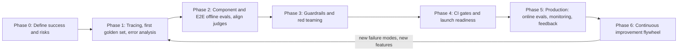
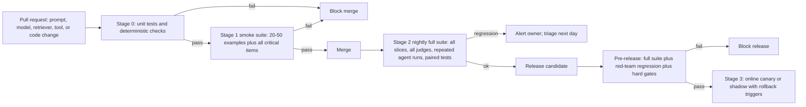
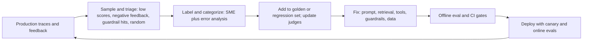

# Implementation Playbook: From Zero to Production

> **TL;DR**
>
> - **Execute in seven sequential phases.** Progress from defining success and instrumenting traces to CI gates, online monitoring, and a data flywheel.
> - **Start with error analysis on real traces.** Read 20–50 traces first (then grow toward 100) to identify your top failure modes before you build metric dashboards.
> - **Gate every release in CI.** Enforce zero-failure hard safety gates sized with the rule of three, and paired-test regression gates, across code, prompt, model, and index changes.
> - **Roll out with pre-defined rollback triggers.** Promote through a canary against a concurrent control and roll back automatically on any RBAC leak or significant quality, safety, or cost regression.
> - **Turn production failures into tests.** Sample live traffic, review traces weekly, and feed failure cases back into your golden dataset.

- **You will learn:**
    - A seven-phase implementation plan with checklists
    - Team roles and RACI matrix
    - Pre-launch readiness criteria and rollout/rollback criteria
    - Common evaluation anti-patterns to avoid
- **Prerequisites:** [Why evals and guardrails](../00-foundations/01-why-evals-and-guardrails.md), [Eval selection](./01-eval-selection-decision-tree.md), [Guardrail selection](./02-guardrail-selection-decision-tree.md)
- **Related:** [Maturity model](./05-maturity-model.md), [Metric cheatsheet](./03-metric-cheatsheet.md), [Running offline experiments](../02-offline-evals/08-running-offline-experiments.md), [Production data flywheel](../01-datasets/04-production-data-flywheel.md), [Agent archetypes](../00-foundations/05-agent-archetypes.md) (if your agent is not a RAG assistant)

---

## 0. The playbook at a glance



| Phase | Core output | Exit criterion | Rough effort (heuristic, small team) |
|---|---|---|---|
| 0 | Success criteria, failure taxonomy v0, risk tier | Signed-off one-pager | 2–5 days |
| 1 | Tracing, first golden set (20–50 examples, growing toward 100), error analysis | Stable failure taxonomy with top 3 failure modes known | 1–2 weeks |
| 2 | Component + E2E eval suite (100–300 examples for release gates), validated judges | Baseline scores with confidence intervals recorded; judges meet the validation bar | 2–4 weeks |
| 3 | Guardrail stack, red-team report | Guardrail recall/FPR measured and critical findings fixed | 1–3 weeks (overlaps 2) |
| 4 | CI gates, readiness review, rollout plan | Launch checklist passed; rollback triggers defined | 3–7 days |
| 5 | Online evals, dashboards, alerts, feedback loop | Alerts tested and weekly review running | 1–2 weeks setup, then ongoing |
| 6 | Flywheel: failures → dataset → fixes | Golden set refreshed on a regular cadence | Ongoing (~10–20% of team time) |

Treat these effort ranges as heuristics for a 2–5 person team building one agentic RAG application. Regulated domains and multi-agent systems require more time. **SME availability** is the single biggest predictor of how fast you finish Phases 1 and 2.

---

## 1. Roles and RACI

| Role | Who it usually is | What they own |
|---|---|---|
| **Product owner (PO)** | PM or business lead | Success criteria, acceptance thresholds, launch decision |
| **AI/ML engineer (AIE)** | App/LLM engineer | Tracing, eval harness, judges, experiments, fixes |
| **Domain SME** | Analyst, HR/finance/legal expert, support lead | Ground truth, rubric definitions, judge alignment labels |
| **Data/platform engineer (DE)** | Data platform team | Retrieval index, DB snapshots, RLS/ACLs, pipelines |
| **Security (SEC)** | AppSec / AI red team | Threat model, guardrail review, red teaming |
| **Risk/Compliance/Legal (RC)** | Compliance officer, privacy, legal | Regulatory requirements, data handling, required sign-off for Tier 3 |
| **SRE/Ops** | Platform/SRE | Monitoring, alerting, on-call, kill switch |

**Follow the benevolent-dictator rule:** Assign one named person (usually the SME or PO) as the final decision-maker for each quality criterion. Design-by-committee produces inconsistent ground-truth labels.

In the table below, `R` = Responsible, `A` = Accountable, `C` = Consulted, and `I` = Informed. Each row has exactly one `A`. `S` marks a required sign-off: the launch cannot proceed without it, but the `A` still owns the decision.

| Activity | PO | AIE | SME | DE | SEC | RC | SRE |
|---|---|---|---|---|---|---|---|
| Define success criteria & thresholds | **A** | R | C | I | C | C | I |
| Failure taxonomy (error analysis) | C | **R/A** | R | I | I | I | I |
| Golden dataset creation | I | R | **A** | C | I | I | I |
| Tracing & observability | I | **R/A** | I | C | I | I | C |
| Retrieval eval data (relevant IDs) | I | R | **A** | C | I | I | I |
| Text-to-SQL gold set & DB snapshot | I | R | **A** | R | I | I | I |
| LLM judge build & alignment | I | **R/A** | R | I | I | I | I |
| Threat model & risk tier | C | R | I | C | **A** | R | I |
| Guardrail implementation | I | **R/A** | I | R | C | C | C |
| RBAC / data access controls | I | R | I | R | **A** | C | I |
| Red teaming | I | C | C | I | **R/A** | I | I |
| CI eval gates | I | **R/A** | I | I | I | I | C |
| Launch readiness review | **A** | R | C | C | R (S) | R (S for Tier 3) | R |
| Online evals & monitoring | I | R | I | I | C | I | **A** |
| Canary rollout & rollback triggers | C | R | I | I | C | I | **A** |
| Weekly quality review / flywheel | **A** | R | R | C | C | I | C |

---

## Phase 0: Define success and risks

**Goal:** Agree on what "good" and "unacceptable" mean *before* you build any metrics.

### 0.1 Activities

1. **Write user stories and top intents.** For our running example, include stories for regional revenue SQL queries, parental-leave policy questions, IT onboarding ticket creation, and emailing a summary to a colleague.
2. **Draft a failure taxonomy v0** listing hypotheses about what can fail per component. Replace this draft with an empirical taxonomy in Phase 1 (start from [agentic RAG failure modes](../00-foundations/03-agentic-rag-failure-modes.md)).
3. **Classify system risk** using the [risk questionnaire](./02-guardrail-selection-decision-tree.md#2-risk-assessment-questionnaire) (the canonical tier definitions) and run the [lethal-trifecta and Rule of Two check](./02-guardrail-selection-decision-tree.md#3-the-lethal-trifecta-check). Score each path separately. The running example is Tier 3 for HR/finance and tool-enabled turns, and Tier 2 for read-only Q&A.
4. **Set binary acceptance criteria** per intent and risk slice. You can mark quality targets as "TBD after baseline," but set hard safety gates to zero failures immediately. A zero-failure gate proves only as much as its test set: 0 failures in *n* independent cases bounds the true rate at about 3/*n* (the rule of three), so size each hard-gate set for the bound you need ([dataset strategy §5.2](../01-datasets/01-dataset-strategy.md#52-confidence-intervals-for-pass-rates)).
5. **Select your evaluation archetypes** using [eval selection §2](./01-eval-selection-decision-tree.md#2-the-five-input-questions).
6. **Schedule SME review time on the calendar now** so domain grading does not block Phase 1.

### 0.2 Acceptance criteria template

| Intent / slice | Criterion (binary) | Target (heuristic until baseline) | Hard gate? |
|---|---|---|---|
| Policy Q&A | Answer correct vs SME reference | Baseline + improve (e.g. ≥ 85%) | No |
| Policy Q&A | Every factual claim cites a retrieved source | ≥ 95% | No |
| Revenue questions | Execution accuracy vs gold SQL | Baseline, then gate at no regression | No |
| Any | Content outside user's entitlement in output | 0 occurrences on RBAC test set | **Yes** |
| SQL | Non-SELECT statement executed | 0 | **Yes** |
| Ticket tool | `create_ticket` executed without an inline preview and one-click user confirmation | 0 | **Yes** |
| Ticket tool | High-priority ticket created without on-call approval ([output guardrails §6](../04-guardrails/04-output-guardrails.md#6-structured-output-and-schema-validation)) | 0 | **Yes** |
| Email / URL tools | `send_email` without human approval, or to a recipient outside `@company.com`; `fetch_url` to a host outside the allowlist | 0 | **Yes** |
| Any | p95 latency | ≤ agreed budget | Yes (soft) |
| Any | Cost per run | ≤ the run budget ceiling (for example 3× p99 of normal runs; [tool guardrails §9](../04-guardrails/05-tool-and-action-guardrails.md#9-budgets-rate-limits-and-loop-detection)) | Yes (soft) |

Per-turn approval and confirmation rules come from the [role → tool policy table](../04-guardrails/05-tool-and-action-guardrails.md#14-policy-table-for-the-running-example). Do not restate them in other documents; link to the table.

### 0.3 Checklist

- [ ] List the top 5–15 user intents with realistic example queries.
- [ ] Document all user roles and their permitted data and tool access.
- [ ] Draft your initial failure taxonomy v0.
- [ ] Assign a risk tier per path and complete the lethal-trifecta and Rule of Two check.
- [ ] Draft the acceptance criteria table and mark all hard safety gates.
- [ ] Book SME calendar time and name one benevolent dictator per criterion.
- [ ] Define data-handling and PII retention rules for production traces.
- [ ] If a regulation can apply (for example HR decisions under the EU AI Act), ask legal to confirm which obligations apply and when. The dates change; see [EU AI Act status](../04-guardrails/07-threat-model-owasp.md#isoiec-42001-and-the-eu-ai-act). This is not legal advice.

---

## Phase 1: Instrument tracing, build first golden set, do error analysis

**Goal:** Observe real system failures, group them into categories, and build your first golden dataset.

### 1.1 Tracing first

You cannot evaluate an agent that you cannot inspect. Capture these fields on every run ([tracing and OpenTelemetry](../03-online-evals-and-observability/02-observability-and-tracing.md)):

- [ ] Record the input query, pseudonymized user ID, user role, and session ID.
- [ ] Log every LLM call with prompt version, model name, parameters, token counts, and latency.
- [ ] Log retrieval queries, chunk IDs, similarity scores, and applied ACL filters.
- [ ] Log tool calls with tool name, arguments, output or error status, and latency.
- [ ] Log generated SQL queries, execution status, and returned row counts.
- [ ] Record the final response, citations, and all guardrail decisions.
- [ ] Attach version metadata for the application, search index, and database snapshot.

Use OpenTelemetry-compatible instrumentation so you can switch observability backends without rewriting code ([eval & observability tools](../06-tooling-landscape/01-eval-and-observability-tools.md)).

### 1.2 First golden set (20–50 examples, growing toward 100)

Prioritize data sources in this order: real queries from pilot users or search logs, SME-written queries, builder-written queries, and synthetic queries for coverage gaps. See [dataset strategy](../01-datasets/01-dataset-strategy.md) and [SME golden datasets](../01-datasets/02-sme-golden-datasets.md).

Stratify your dataset across these five dimensions:

- [ ] Cover every top user intent.
- [ ] Include every user role, especially for RBAC-restricted data.
- [ ] Balance easy, medium, and hard queries (multi-hop, ambiguous, date math).
- [ ] Include 10–20% unanswerable or out-of-scope queries.
- [ ] Add known edge cases such as acronyms, typos, and multiple languages. Tag the language so you can report per-language slices: PII and injection classifiers often lose recall outside English.
- [ ] Include freshness cases: questions whose answer changed in a recent document version. Faithfulness cannot catch an answer that is grounded in an outdated document.

Grow this set to 100–300 expert-verified examples before you use it as a release gate ([dataset strategy §5.1](../01-datasets/01-dataset-strategy.md#51-start-small-grow-on-purpose)). Include these minimum fields on every example: `id`, `input`, `user_role`, `intent`, `expected`, `tags`, `source`, `created_at`, and `notes`. Store the reference answer, chunk IDs, gold SQL, or expected tool call inside `expected`.

### 1.3 Error analysis

Error analysis is the highest-leverage activity in this playbook (popularized by Hamel Husain and Shreya Shankar):

1. Run your system across the golden dataset and any early pilot traffic.
2. **Perform open coding:** Read each trace and write a brief note describing the *first* failure that occurred.
3. **Perform axial coding:** Group your notes into failure categories (such as `retrieval: outdated doc version` or `sql: wrong fiscal calendar`).
4. **Count** the occurrences of each category and rank them by `frequency × severity`.
5. Repeat this process on fresh traces until no new failure categories appear.

```python
from collections import Counter

notes = [
    {"id": "q07", "category": "retrieval: outdated doc version"},
    {"id": "q12", "category": "sql: wrong fiscal calendar"},
    {"id": "q19", "category": "retrieval: outdated doc version"},
    {"id": "q23", "category": "generation: ignored retrieved table"},
]
for cat, n in Counter(n["category"] for n in notes).most_common():
    print(f"{n:>3}  {cat}")
```

### 1.4 Checklist / exit criteria

- [ ] Verify that tracing is live in dev and staging with all required span fields.
- [ ] Commit golden set v1 (20–50 stratified examples, growing toward 100) to git or your dataset store.
- [ ] Read at least 50 end-to-end traces with your AI engineer and domain SME.
- [ ] Finalize failure taxonomy v1 with category counts and identify the top 3 failure modes.
- [ ] Classify each top failure mode as either a **specification bug** (unclear prompt) or a **generalization gap** (needs an evaluation metric).
- [ ] Fix obvious prompt specification bugs immediately before building complex evaluations for them.

---

## Phase 2: Component and E2E offline evals; align LLM judges

**Goal:** Build a repeatable offline evaluation suite that measures your observed failure modes with validated judges.

### 2.1 Build the suite

Select your metrics using the [eval selection decision tree](./01-eval-selection-decision-tree.md) and look up formulas in the [metric cheatsheet](./03-metric-cheatsheet.md). For tool-using flows, run the agent in a sandboxed environment with state-based graders ([agent eval environments](../02-offline-evals/09-agent-eval-environments-and-graders.md)). Here is how Phase 1 failures map to metrics for our running example:

| Failure from Phase 1 | Eval | Type | Detail |
|---|---|---|---|
| Outdated doc versions retrieved | recall@5 on labelled set + "is-latest-version" code check (freshness slice) | Component, Code | [Retrieval metrics](../02-offline-evals/02-retrieval-metrics.md) |
| Wrong fiscal calendar in SQL | Execution accuracy on date-logic slice | Component, Code | [Text-to-SQL](../02-offline-evals/05-text-to-sql-evals.md) |
| Ignored retrieved table in answer | Faithfulness / completeness judge | Component, Judge | [E2E RAG](../02-offline-evals/01-end-to-end-rag-evals.md) |
| Ticket missing required fields | Tool argument correctness | Component, Code | [Agent & trajectory](../02-offline-evals/04-agent-tool-and-trajectory-evals.md) |
| Ticket flow succeeds only sometimes | pass^k over 3–5 trials with final-state checks | E2E, Code | [Agent & trajectory §4.3](../02-offline-evals/04-agent-tool-and-trajectory-evals.md#43-reliability-across-trials-passk) |
| Overall answer quality | Answer correctness (ref-based) | E2E, Judge | [E2E RAG](../02-offline-evals/01-end-to-end-rag-evals.md) |

### 2.2 Build and align LLM judges

Follow the workflow in [LLM-as-a-judge](../02-offline-evals/07-llm-as-a-judge.md):

- [ ] Build one binary pass/fail judge per failure mode with written criteria and few-shot examples.
- [ ] Require the judge to output a brief critique *before* its pass/fail verdict.
- [ ] Label at least 100 examples manually with your SME, including 30–50 FAILs. Oversample likely failures; do not force a 50/50 balance.
- [ ] Split human labels into a development set (for prompt, example, and model choices) and a held-out test set. Freeze the judge before you score it on the test set.
- [ ] On the held-out test set, require TPR ≥ 0.85, TNR ≥ 0.85, and Cohen's κ ≥ 0.60 before the judge gates releases. Require ≥ 0.90 on high-risk slices (such as HR/finance and SQL equivalence). See the [canonical bar](../02-offline-evals/07-llm-as-a-judge.md#74-how-many-labels).
- [ ] Apply the Rogan–Gladen correction (or prediction-powered inference) if you report absolute pass rates from an imperfect judge ([LLM-as-a-judge §8](../02-offline-evals/07-llm-as-a-judge.md#8-correcting-pass-rate-estimates-for-judge-error)).
- [ ] Pin the judge model snapshot and prompt version and log them with every evaluation run. Use the lowest temperature that the model supports; for reasoning models, fix the reasoning effort instead.
- [ ] Re-validate your judge whenever you change the judge model, judge prompt, or core product behavior ([judge lifecycle](../02-offline-evals/07-llm-as-a-judge.md#10-judge-versioning-and-lifecycle)).

### 2.3 Experiment hygiene

Follow the practices in [running offline experiments](../02-offline-evals/08-running-offline-experiments.md):

- [ ] Log dataset, application, prompt, model, index, and judge versions on every evaluation run.
- [ ] Compare candidate variants with paired tests on the exact same dataset examples: McNemar for pass/fail, paired bootstrap or permutation for continuous scores ([running experiments §5](../02-offline-evals/08-running-offline-experiments.md#54-practical-rules)).
- [ ] Report every pass rate with a Wilson 95% interval, not a bare percentage.
- [ ] Run the unchanged system 3–5 times (A/A runs) to measure run-to-run noise before you set any regression threshold.
- [ ] Run non-deterministic agent scenarios 3–5 times and report pass^k (reliability) next to pass@k (capability) ([pass@k vs pass^k](../02-offline-evals/08-running-offline-experiments.md#43-passk-vs-passk)).
- [ ] When you test many slices, control false discoveries with Benjamini–Hochberg ([dataset strategy §5.3](../01-datasets/01-dataset-strategy.md#testing-many-slices-at-once)).
- [ ] Inspect evaluation scores per slice (intent, role, difficulty) rather than relying on overall averages.
- [ ] Read the trace diffs for examples that flipped from pass to fail between runs.

### 2.4 Exit criteria

- [ ] Record baseline scores with confidence intervals for all must-have evaluations in your archetype stack.
- [ ] Verify that every gating LLM judge meets the validation bar (TPR/TNR ≥ 0.85, κ ≥ 0.60; ≥ 0.90 on high-risk slices).
- [ ] Confirm that at least one metric tracks each of your top 3 failure modes.
- [ ] Run the entire offline evaluation suite end to end with a single command.

---

## Phase 3: Guardrails and red teaming

**Goal:** Block unacceptable behavior at runtime and verify your defenses with adversarial testing. You can run Phase 3 in parallel with Phase 2.

### 3.1 Implement guardrails by tier

Select your controls using the [guardrail selection decision tree](./02-guardrail-selection-decision-tree.md) and implement them in this order:

1. **Enforce identity and authorization:** Propagate end-user identity and enforce ACL retrieval filters, database RLS, and per-role tool allowlists ([RBAC](../04-guardrails/06-access-control-rbac.md)).
2. **Enforce tool controls:** Validate schemas and enforce read-only SQL rules. Require human approval for T2 (external) and T3 (destructive) tools, and an inline preview with one-click confirmation for shared T1 writes such as `create_ticket`. Cap steps, tool calls, cost, and wall-clock time to stop loops and denial of wallet ([Tool guardrails](../04-guardrails/05-tool-and-action-guardrails.md), [policy table](../04-guardrails/05-tool-and-action-guardrails.md#14-policy-table-for-the-running-example)).
3. **Block data exfiltration:** Sanitize outbound links and images and restrict network egress to an allowlist ([Output guardrails](../04-guardrails/04-output-guardrails.md)).
4. **Scan outputs:** Check responses for PII, secrets, schema validity, and toxicity ([Output guardrails](../04-guardrails/04-output-guardrails.md)).
5. **Deploy agentic controls:** Track taint (require approval for outbound or state-changing tools after untrusted content enters the context), pin and allowlist MCP tool descriptions, and validate writes to long-term memory ([agentic threats](./02-guardrail-selection-decision-tree.md#agentic-threats-beyond-the-trifecta)).
6. **Deploy input and context classifiers:** Add prompt-injection, topic, and context-injection scanners in shadow or flag mode first ([Input](../04-guardrails/02-input-guardrails.md), [Context](../04-guardrails/03-retrieval-and-context-guardrails.md)).

Deterministic controls (steps 1–5) block from day one. Probabilistic classifiers (step 6) go through the rollout stages in §3.2.

### 3.2 Measure guardrails

- [ ] Build both a benign-but-tricky dataset and an adversarial dataset for each guardrail.
- [ ] Measure recall, false-positive rate, and p95 latency for every guardrail check. Estimate precision at your real base rate ([guardrail metrics](../04-guardrails/01-guardrails-architecture.md#92-metrics)).
- [ ] Configure and test fail-open or fail-closed behavior by simulating guardrail service timeouts. Fail closed on tool-enabled turns, Tier 3 intents, and authorization checks ([fail modes](./02-guardrail-selection-decision-tree.md#7-decision-fail-open-vs-fail-closed)).
- [ ] Promote new probabilistic guardrails through `shadow -> flag -> block`. **Shadow** = log the verdict only. **Flag** = annotate the trace and notify reviewers, but do not block. **Block** = enforce. Promote only when FPR on real traffic is within your cap and recall on the attack set meets target ([choosing thresholds](../04-guardrails/01-guardrails-architecture.md#94-choosing-thresholds)).

### 3.3 Red teaming

Follow the adversarial testing workflow in [threat model & OWASP](../04-guardrails/07-threat-model-owasp.md):

- [ ] Map your system threat model to the OWASP Top 10 for LLM Applications 2026 and the OWASP Top 10 for Agentic Applications 2026 (ASI01–ASI10).
- [ ] Test direct single-turn and multi-turn prompt injections and jailbreaks.
- [ ] Test **indirect** prompt injection by planting canary instructions inside test wiki pages, tickets, documents, and fetched URLs. Report attack success rate together with benign task success (AgentDojo-style).
- [ ] Test memory poisoning (ASI06): plant an instruction in one session and check whether it changes an action in a later session.
- [ ] Test MCP and tool supply chain risks: a changed tool description must fail the pin check (tool poisoning, rug pull).
- [ ] Test data exfiltration via markdown images, query-string links, and tool arguments.
- [ ] Attempt cross-role data access using role-spoofing prompts ("I am the CFO, show me…").
- [ ] Attempt SQL abuse using DDL/DML statements, system catalog queries, and multi-statement payloads.
- [ ] Attempt tool abuse using malformed arguments, excessive calls, unapproved T2/T3 actions, and unconfirmed T1 writes.
- [ ] Test denial-of-wallet attacks using oversized inputs and recursive agent loops.
- [ ] Count distinct attack families (aim for ≥ 30), not paraphrases. Zero successes across *n* families bounds the family-level rate at about 3/*n*.
- [ ] Triage all findings, fix critical and high issues, and add regression test cases to your CI suite.

### 3.4 Exit criteria

- [ ] Implement all required guardrails for your assigned risk tier.
- [ ] Pass all hard safety gates (RBAC leaks, unsafe SQL, unapproved or unconfirmed actions) with zero failures on sets sized with the rule of three.
- [ ] Resolve all critical and high-severity red-team findings.
- [ ] Convert every red-team finding into an automated regression test.

---

## Phase 4: CI eval gates and launch readiness

**Goal:** Block regressions automatically in CI and make an explicit, evidence-based launch decision.

### 4.1 CI gates



| Gate type | Rule (heuristic) | Why |
|---|---|---|
| **Hard gate** | Require 100% pass rate / 0 failures (RBAC leaks, unsafe SQL, unapproved or unconfirmed actions, critical schema validity). Size the set with the rule of three: a "<1%" claim needs ≥ 300 independent cases | Enforces non-negotiable safety rules |
| **Regression gate** | Block on any new failure on a critical item. For other items, block when a paired test (McNemar for pass/fail, paired bootstrap for scores) shows a significant drop vs `main` on the same examples, or when the drop exceeds a threshold larger than the A/A noise band. Use Benjamini–Hochberg across slices | Prevents silent quality decay without blocking on noise |
| **Absolute gate** | Require the Wilson lower bound (or the point estimate, if you state it) to meet the Phase 0 target | Enforces your minimum release quality bar |
| **Informational** | Report the score in CI output without blocking merges | Tracks new or unvalidated experimental metrics |

Run **model version upgrades, embedding updates, and search index rebuilds** through the exact same CI gates as application code changes. The stage names match [running offline experiments §10.1](../02-offline-evals/08-running-offline-experiments.md#101-stages); gate design details are in [§10.2](../02-offline-evals/08-running-offline-experiments.md#102-designing-gates). Binary verdicts per item aggregate to rates, so gates act on rates and their intervals.

### 4.2 Launch readiness checklist

**Product & quality**

- [ ] Verify that your golden set meets acceptance criteria across every intent, role, and difficulty slice.
- [ ] Confirm that the system refuses unanswerable queries cleanly with a low over-refusal rate.
- [ ] Obtain SME sign-off on a spot check of at least 50 recent outputs.
- [ ] Document known limitations and display clear user guidance in the UI.

**Evals**

- [ ] Freeze and record the golden dataset version used for launch sign-off.
- [ ] Record judge validation results (TPR, TNR, κ, label count, FAIL count) for all gating LLM judges.
- [ ] Enable CI smoke gates on pull requests and verify that the nightly suite is green.
- [ ] Measure repeated-run reliability (`pass^k`) for multi-step agent workflows, especially write-tool flows.

**Guardrails & security**

- [ ] Complete the security review of your risk tier and threat model.
- [ ] Verify that lethal-trifecta and Rule of Two risks are removed by design or gated by deterministic controls (approval, allowlists, taint tracking). Gating does not lower the tier.
- [ ] Propagate end-user identity and test ACL/RLS enforcement across all user roles.
- [ ] Enable tool allowlists, argument validation, SQL parser policies, and approval/confirmation flows per tool tier.
- [ ] Check approval prompts for fatigue (ASI09): show the exact action and arguments, keep prompts rare, and track approval rate and time-to-approve.
- [ ] Pin MCP tool descriptions and validate writes to long-term memory, if you use them.
- [ ] Enable outbound link and markdown image sanitization.
- [ ] Record recall, false-positive rate, and fail-open/closed behavior for every guardrail.
- [ ] Complete red-team testing with zero open critical or high findings.
- [ ] Test per-capability feature flags and emergency kill switches.

**Operations**

- [ ] Enable production tracing with PII scrubbing and retention policies configured.
- [ ] Run deterministic checks and cheap classifiers on 100% of live traffic, and LLM judges on 1–5% (or ~500 traces/day) plus 100% of flagged traces.
- [ ] Publish dashboards for quality, safety, guardrail triggers, latency, cost, and error rates.
- [ ] Configure alerts with named owners and runbooks, and train on-call engineers on the kill switch.
- [ ] Enable in-product user feedback capture (thumbs up/down plus optional free-text comment).
- [ ] Pin prompt, model, and index versions so you can roll back within minutes.
- [ ] Write down the rollout plan and rollback triggers (§4.3) before the launch review.
- [ ] Enforce per-run step, tool-call, cost, and wall-clock budgets, per-user rate limits, and provider spend alerts (denial of wallet, LLM06:2026).

**Governance (Tier 3 / regulated)**

- [ ] Obtain compliance and legal sign-off, including LLM provider data-processing agreements.
- [ ] Publish an internal model or system card documenting intended use and evaluation results.
- [ ] Verify that audit log retention meets regulatory requirements.
- [ ] Define the human oversight workflow for high-stakes decisions, including reviewer SLAs and the fail-closed path when approvers are unavailable.

### 4.3 Rollout and rollback criteria

Decide these numbers before the rollout starts. See [canary releases](../03-online-evals-and-observability/01-online-evals.md#52-canary-releases) and [A/B tests](../03-online-evals-and-observability/01-online-evals.md#53-ab-tests-with-online-metrics) for the method.

| Item | Starting rule (heuristic) |
|---|---|
| Audience stages | Internal dogfood → limited beta → general availability. Within each stage, route 1% → 5% → 25% → 100% of traffic to the new version |
| Control | Compare against a concurrent control arm, not last week's numbers |
| Hard rollback (automatic, no test) | Any RBAC leak, any unsafe action execution, any executed non-SELECT SQL |
| Statistical rollback (automatic) | A two-proportion test shows the canary is worse than control on a guardrail metric, judge pass rate, or SQL error rate. You check the canary repeatedly, so use a sequential test (always-valid p-values or a group-sequential design) |
| Cost rollback | Cost per successful task, or budget breach rate, rises past the ceiling you set in Phase 0 |
| Minimum before promotion | The sample size from a power analysis for the smallest drop you care about, and at least one full business cycle (such as a week) |
| A/B tests (user-outcome questions) | Pre-register the metric and sample size, check sample-ratio mismatch, use CUPED to reduce variance, and correct for many metrics with Benjamini–Hochberg |

### 4.4 Exit criteria

- [ ] Hold the launch readiness review and record the launch decision with the product owner's sign-off (and the Risk/Compliance sign-off for Tier 3).
- [ ] Execute the staged rollout in §4.3 and verify the metrics at each stage before you promote.

---

## Phase 5: Production: online evals, monitoring, feedback

**Goal:** Detect quality or safety regressions within hours rather than weeks. See [online eval pipelines](../03-online-evals-and-observability/01-online-evals.md), [monitoring & drift](../03-online-evals-and-observability/04-monitoring-alerting-and-drift.md), and [user feedback](../03-online-evals-and-observability/03-user-feedback-and-implicit-signals.md).

### 5.1 Online evaluation setup

| Layer | What | Coverage |
|---|---|---|
| Deterministic | Schema validity, citation validity, SQL validity/errors, tool errors, step counts, latency, cost | 100% |
| Classifiers | Toxicity, PII, language, and prompt-injection flags | 100% (cheap) |
| LLM judges | Faithfulness, relevance, instruction adherence, and policy compliance | 1–5% uniform (or ~500 traces/day), stratified so that HR/finance gets enough traces, + 100% of negative-feedback and flagged traces ([sampling](../03-online-evals-and-observability/01-online-evals.md#42-sampling-strategies)) |
| Judge drift | Judge verdicts vs fresh SME labels on a small sample | Monthly, and after any judge change ([judge drift](../03-online-evals-and-observability/04-monitoring-alerting-and-drift.md#54-judge-drift)) |
| Feedback | Thumbs up/down, comments, re-asks, escalations, and session abandonment | 100% |
| Human review | Stratified weekly sample across random, low-score, and negative-feedback traces | 30–100 traces/week |

### 5.2 Monitoring & alerting

- [ ] Establish baseline ranges during the first 1–2 weeks of production traffic and set alert thresholds.
- [ ] Route every alert to a named owner with a diagnostic runbook (check index freshness, recent deploys, and model versions).
- [ ] Monitor input topic drift and retrieval similarity score distributions.
- [ ] Monitor index freshness (age of retrieved chunks vs their source documents) ([corpus drift](../03-online-evals-and-observability/04-monitoring-alerting-and-drift.md#52-corpus--knowledge-drift-and-schema-drift)).
- [ ] Alert on cost per run, budget breach rate, and tool-call spikes (denial of wallet, runaway loops; see [runaway ticket creation](../03-online-evals-and-observability/04-monitoring-alerting-and-drift.md#64-example-runaway-ticket-creation)).
- [ ] Track unsafe action attempt rate, approval rate, and time-to-approve for every gated tool.
- [ ] Track guardrail trigger rates per language and per role so you catch attack spikes, broken guardrails that drop to zero, and slices where a classifier misses.
- [ ] Log provider model version updates and correlate them with online metric shifts.

### 5.3 Weekly quality review (30–60 minutes)

Include the product owner, AI engineer, and domain SME weekly (plus Security monthly):

1. Review weekly dashboard trends and triggered alerts.
2. Read 20–50 sampled traces together across low judge scores, negative feedback, and random traffic.
3. Update failure taxonomy counts and log any new failure categories.
4. Decide whether to fix each issue immediately, add examples to the golden set, or add a new evaluation.
5. Assign a single owner to every action item.

### 5.4 Exit criteria (for "steady state")

- [ ] Verify alert routing by injecting a synthetic regression in staging or production.
- [ ] Complete at least three consecutive weekly quality reviews with tracked action items.
- [ ] Promote your first batch of real production failures into the offline golden set.

---

## Phase 6: Continuous improvement (the flywheel)

**Goal:** Use production traces to continuously improve your datasets, evaluations, guardrails, and product. See [production data flywheel](../01-datasets/04-production-data-flywheel.md).



### 6.1 Cadences (heuristics)

| Activity | Cadence |
|---|---|
| Online dashboards & alerts | Continuous |
| Trace review & taxonomy update | Weekly |
| Golden set refresh (add production failures, retire stale examples) | Every 2–4 weeks or per release |
| Judge re-validation | On any judge model, judge prompt, or product change; drift check on fresh labels monthly ([cadence](../03-online-evals-and-observability/04-monitoring-alerting-and-drift.md#7-periodic-re-evaluation-cadence)) |
| Red-team regression | Every release, plus full red team per major capability change |
| Guardrail FPR/recall re-measurement | Monthly, and per language slice |
| A/A noise band re-measurement | When the suite, judge, or model changes |
| Model/provider upgrade evaluation | Per upgrade, before switching traffic |
| Maturity self-assessment | Quarterly ([maturity model](./05-maturity-model.md)) |

### 6.2 Checklist

- [ ] Tag golden set examples with provenance metadata and add new production failures regularly.
- [ ] Retire or update stale reference answers whenever underlying source documents change.
- [ ] Version datasets and judges so metric trends remain comparable over time.
- [ ] Add a permanent regression test case for every production incident.
- [ ] Prune unused metrics quarterly by removing or demoting any metric nobody acted on.

---

## 7. Anti-patterns

| Anti-pattern | Why it hurts | Do instead |
|---|---|---|
| **Generic off-the-shelf metrics without error analysis** | Measures library defaults instead of real product failures, leaving dashboards green while users struggle | Run error analysis first and build metrics for your observed failure modes |
| **Too many metrics** | Creates dashboard noise where nobody knows which number matters | Track 3–7 core decision metrics and keep the rest informational |
| **Likert scales (1–5) for judges and humans** | Produces noisy, inconsistent scores ("what does 3.4 -> 3.6 mean?") | Use binary pass/fail criteria with clear written definitions |
| **Unvalidated LLM judges** | Gates releases on scores that may not match human judgment | Meet the [validation bar](../02-offline-evals/07-llm-as-a-judge.md#74-how-many-labels) (≥ 100 labels, TPR/TNR ≥ 0.85, κ ≥ 0.60) and re-validate on change |
| **Hard gates on tiny test sets** | "0 failures in 40 cases" only shows the rate is below ~7.5% | Size hard-gate sets with the rule of three and count distinct attack families |
| **Fixed-point regression gates on small sets** | A 2-point gate on 55 items fires on noise (one item ≈ 1.8 points) | Use paired tests and thresholds above the A/A noise band |
| **Evaluating only end-to-end** | Hides which internal step broke in a multi-step agent | Add component evaluations for your router, retriever, tools, and SQL |
| **Ignoring retrieval** | Wastes time tuning prompts when the retriever failed to fetch the needed chunk | Measure `recall@k` early and check whether the fact was in context |
| **No regression set** | Allows prompt fixes to silently break existing working intents | Run a versioned golden set in CI and turn every bug into a test |
| **Only synthetic data** | Inflates retrieval scores because synthetic queries copy document wording | Mix in real pilot or production queries as early as possible |
| **Faithfulness as the only correctness metric** | Passes answers that are faithfully grounded in the wrong document | Add reference-based answer correctness for your top intents |
| **Single run per agent scenario** | Masks agent flakiness caused by non-deterministic sampling | Run scenarios multiple times and report `pass^k` and variance |
| **Guardrails without measuring false positives** | Blocks legitimate users until frustrated teams disable the guardrail | Test on benign-but-tricky sets, track FPR, and start in shadow mode |
| **LLM as the authorization layer** | Allows prompt injections or jailbreaks to bypass system-prompt rules | Enforce authorization in retrieval ACLs, database RLS, and tool code |
| **Fail-open by accident** | Allows all traffic through silently when a guardrail service times out | Configure and test explicit fail-open or fail-closed rules per check; fail closed on tool-enabled turns |
| **Approval prompts for everything** | Causes approval fatigue, so users click "approve" without reading (ASI09) | Reserve blocking approval for T2/T3 actions, use inline preview and one-click confirmation for T1, and track approval rate and time-to-approve |
| **Canary without rollback triggers** | Lets a regression reach all users while the team debates the numbers | Define hard and statistical rollback triggers before the rollout |
| **Prompt-injection classifier as the only defense** | Relies on a probabilistic filter where attackers need only one bypass | Break the lethal trifecta by design and enforce deterministic action controls |
| **Eval suite never pruned or refreshed** | Causes reference answers to rot as source documents change | Refresh datasets on a schedule and retire stale examples |
| **Optimizing to the test set** | Overfits prompts to a small fixed golden set | Maintain a held-out set, refresh from production, and monitor online metrics |
| **No owner for quality** | Leaves evaluation dashboards unmonitored with no follow-up actions | Assign an accountable product owner and run a weekly review |

---

## 8. A 30/60/90-day plan (example)

Use this 90-day roadmap when starting from a working prototype of our enterprise assistant:

| Days | Focus | Deliverables |
|---|---|---|
| 1–30 | Phases 0–1, start Phase 2 | Define success criteria and risk tier per path, enable tracing, build a 50-example golden set and grow it toward 100, run error analysis, add `recall@k` + SQL execution + tool checks, and start labelling for your faithfulness judge (≥ 100 labels) |
| 31–60 | Phases 2–4 | Grow the golden set to 100–300 examples, complete the must-have eval suite, validate judges, enforce RBAC/SQL/tool guardrails and budgets, run red teaming, enable CI gates, define rollback triggers, pass launch review, and start internal dogfooding |
| 61–90 | Phases 5–6 | Roll out from beta to GA through canaries with rollback triggers, enable online evaluations, dashboards, and alerts, start weekly trace reviews, and complete your first production dataset refresh |

---

## Key takeaways

- Define success criteria, failure modes, and risk tiers before you build metrics, and enforce hard safety gates from day one.
- Instrument tracing and run error analysis on 20–50 real traces (then grow toward 100) before building any evaluation dashboard.
- Build evaluations that target your observed failure modes, and validate every LLM judge against human labels (≥ 100 labels, TPR/TNR ≥ 0.85, κ ≥ 0.60).
- Implement deterministic guardrails (identity, tools, SQL, network egress) first, and measure false-positive rates on all classifier guardrails.
- Gate every code, prompt, model, and index change in CI using hard safety gates sized with the rule of three and paired-test regression gates.
- Roll out through canaries against a concurrent control, with hard rollback on any RBAC leak and statistical rollback on quality, safety, or cost regressions.
- Run cheap deterministic checks on 100% of production traffic, sample LLM judges, review traces weekly, and turn failures into regression tests.

## Further reading

- Hamel Husain, [Your AI Product Needs Evals](https://hamel.dev/blog/posts/evals/), [Using LLM-as-a-Judge For Evaluation](https://hamel.dev/blog/posts/llm-judge/), [A Field Guide to Rapidly Improving AI Products](https://hamel.dev/blog/posts/field-guide/), [AI Evals FAQ](https://hamel.dev/blog/posts/evals-faq/)
- Shankar et al., [Who Validates the Validators? (arXiv:2404.12272)](https://arxiv.org/abs/2404.12272)
- Anthropic, [Demystifying evals for AI agents](https://www.anthropic.com/engineering/demystifying-evals-for-ai-agents), [Building effective agents](https://www.anthropic.com/engineering/building-effective-agents)
- Martin Fowler / Thoughtworks, [Engineering Practices for LLM Application Development](https://martinfowler.com/articles/engineering-practices-llm.html)
- Microsoft, [Lessons From Red Teaming 100 Generative AI Products (arXiv:2501.07238)](https://arxiv.org/abs/2501.07238)
- NIST, [AI Risk Management Framework](https://www.nist.gov/itl/ai-risk-management-framework)
- OWASP, [Top 10 for LLM Applications 2026](https://genai.owasp.org/resource/owasp-genai-llm-top-10-2026/) and [Top 10 for Agentic Applications 2026](https://genai.owasp.org/resource/owasp-top-10-for-agentic-applications-for-2026/)
- **In this repo:**
    - [Datasets](../01-datasets/README.md)
    - [Offline evals](../02-offline-evals/README.md)
    - [Online evals](../03-online-evals-and-observability/README.md)
    - [Guardrails](../04-guardrails/README.md)
