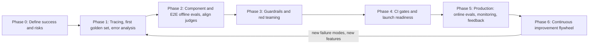
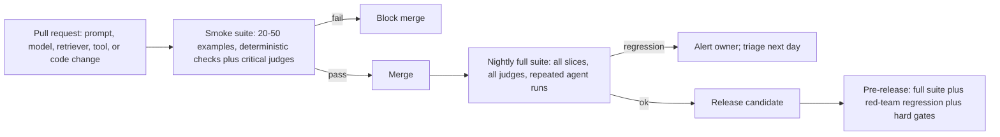
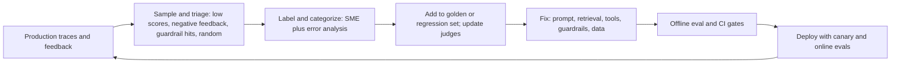

# Implementation Playbook: From Zero to Production

> **TL;DR** — Build evals and guardrails in seven phases: define success and risks; instrument tracing and do error analysis on a first 30–100 example golden set; build component and E2E offline evals with aligned judges; add guardrails and red-team; wire evals into CI and run a launch-readiness review; run online evals, monitoring and feedback in production; then turn production data into a continuous improvement flywheel. Each phase has an exit criterion — don't skip ahead.

**You'll learn:** a phased plan with checklists · who does what (RACI) · rough time estimates · a launch readiness checklist · the anti-patterns that waste the most time
· **Prerequisites:** [Why evals and guardrails](../00-foundations/01-why-evals-and-guardrails.md), [Eval selection](./01-eval-selection-decision-tree.md), [Guardrail selection](./02-guardrail-selection-decision-tree.md)
· **Related:** [Maturity model](./05-maturity-model.md), [Metric cheatsheet](./03-metric-cheatsheet.md), [Running offline experiments](../02-offline-evals/08-running-offline-experiments.md), [Production data flywheel](../01-datasets/04-production-data-flywheel.md)

---

## 0. The playbook at a glance



| Phase | Core output | Exit criterion | Rough effort (heuristic, small team) |
|---|---|---|---|
| 0 | Success criteria, failure taxonomy v0, risk tier | Signed-off one-pager | 2–5 days |
| 1 | Tracing, 30–100 example golden set, error analysis | Failure taxonomy stable; top 3 failure modes known | 1–2 weeks |
| 2 | Component + E2E eval suite, validated judges | Baseline scores; judges meet agreement bar | 2–4 weeks |
| 3 | Guardrail stack, red-team report | Guardrails measured (recall/FPR); critical findings fixed | 1–3 weeks (overlaps 2) |
| 4 | CI gates, readiness review | Launch checklist passed | 3–7 days |
| 5 | Online evals, dashboards, alerts, feedback loop | Alerts tested; weekly review running | 1–2 weeks to set up, then ongoing |
| 6 | Flywheel: failures → dataset → fixes | Golden set refreshed on a cadence | Ongoing (~10–20% of team time) |

Effort ranges are rough heuristics for a 2–5 person team building one agentic RAG application; regulated domains and multi-agent systems take longer. The single best predictor of how long Phase 1–2 takes is **SME availability**.

---

## 1. Roles and RACI

| Role | Who it usually is | What they own |
|---|---|---|
| **Product owner (PO)** | PM or business lead | Success criteria, acceptance thresholds, launch decision |
| **AI/ML engineer (AIE)** | App/LLM engineer | Tracing, eval harness, judges, experiments, fixes |
| **Domain SME** | Analyst, HR/finance/legal expert, support lead | Ground truth, rubric definitions, judge alignment labels |
| **Data/platform engineer (DE)** | Data platform team | Retrieval index, DB snapshots, RLS/ACLs, pipelines |
| **Security (SEC)** | AppSec / AI red team | Threat model, guardrail review, red teaming |
| **Risk/Compliance/Legal (RC)** | Compliance officer, privacy, legal | Regulatory requirements, data handling, sign-off for high tier |
| **SRE/Ops** | Platform/SRE | Monitoring, alerting, on-call, kill switch |

**Benevolent-dictator rule:** for each quality criterion, one named person (usually the SME or PO) is the final judge of "pass." Committees produce inconsistent labels.

R = Responsible, A = Accountable, C = Consulted, I = Informed.

| Activity | PO | AIE | SME | DE | SEC | RC | SRE |
|---|---|---|---|---|---|---|---|
| Define success criteria & thresholds | **A** | R | C | I | C | C | I |
| Failure taxonomy (error analysis) | C | **R/A** | R | I | I | I | I |
| Golden dataset creation | I | R | **A** | C | I | I | I |
| Tracing & observability | I | **R/A** | I | C | I | I | C |
| Retrieval eval data (relevant IDs) | I | R | **A** | C | I | I | I |
| Text-to-SQL gold set & DB snapshot | I | R | **A** | R | I | I | I |
| LLM judge build & alignment | I | **R/A** | R | I | I | I | I |
| Threat model & risk tier | C | R | I | C | **A** | R | I |
| Guardrail implementation | I | **R/A** | I | R | C | C | C |
| RBAC / data access controls | I | R | I | R | **A** | C | I |
| Red teaming | I | C | C | I | **R/A** | I | I |
| CI eval gates | I | **R/A** | I | I | I | I | C |
| Launch readiness review | **A** | R | C | C | R | R (high tier: A) | R |
| Online evals & monitoring | I | R | I | I | C | I | **A** |
| Weekly quality review / flywheel | **A** | R | R | C | C | I | C |

---

## Phase 0 — Define success and risks

**Goal:** agree on what "good" and "unacceptable" mean *before* building metrics.

### 0.1 Activities

1. **Write user stories and top intents.** For the running example: "As a finance analyst, I ask for last quarter's revenue by region and get a correct number with the SQL shown"; "As an employee, I ask the parental-leave policy and get the answer with a link to the policy page"; "As a manager, I ask the agent to open an IT ticket for a new hire."
2. **Draft a failure taxonomy v0** — hypotheses about what can go wrong, by component. You'll replace it with an empirical one in Phase 1. Start from [agentic RAG failure modes](../00-foundations/03-agentic-rag-failure-modes.md).
3. **Classify risk** with the [risk questionnaire](./02-guardrail-selection-decision-tree.md#2-risk-assessment-questionnaire) and run the lethal-trifecta check.
4. **Set acceptance criteria** per intent and per risk slice. Express them as *binary* checks with target pass rates; it's fine to say "TBD after baseline" for quality targets, but **not** for hard safety constraints.
5. **Decide the eval archetype(s)** — see [eval selection §2](./01-eval-selection-decision-tree.md#2-the-five-input-questions).
6. **Book SME time.** Calendar it now; this is the most common bottleneck.

### 0.2 Acceptance criteria template

| Intent / slice | Criterion (binary) | Target (heuristic until baseline) | Hard gate? |
|---|---|---|---|
| Policy Q&A | Answer correct vs SME reference | Baseline + improve; e.g. ≥ 85% | No |
| Policy Q&A | Every factual claim cites a retrieved source | ≥ 95% | No |
| Revenue questions | Execution accuracy vs gold SQL | Baseline; gate at no regression | No |
| Any | Content outside user's entitlement in output | 0 occurrences on RBAC test set | **Yes** |
| SQL | Non-SELECT statement executed | 0 | **Yes** |
| Ticket tool | Ticket created without user confirmation | 0 | **Yes** |
| Any | p95 latency | ≤ agreed budget | Yes (soft) |

### 0.3 Checklist

- [ ] Top 5–15 intents listed with example queries
- [ ] User roles and what each may see/do documented
- [ ] Failure taxonomy v0 drafted
- [ ] Risk tier assigned; lethal-trifecta check done
- [ ] Acceptance criteria table drafted; hard gates identified
- [ ] SME time booked; a single "benevolent dictator" named per criterion
- [ ] Data-handling rules agreed (can production traces with PII be used for evals? retention?)

---

## Phase 1 — Instrument tracing, build first golden set, do error analysis

**Goal:** see the system fail, categorize failures, and create the first dataset.

### 1.1 Tracing first

You can't evaluate an agent you can't see. Capture per run ([observability & tracing](../03-online-evals-and-observability/02-observability-and-tracing.md)):

- [ ] Input, user ID/role (pseudonymized if needed), session ID
- [ ] Every LLM call: prompt version, model, params, tokens, latency
- [ ] Retrieval: query, chunk IDs, scores, filters applied (incl. ACL filter)
- [ ] Tool calls: name, args, result/errors, latency
- [ ] Generated SQL, execution status, rows returned
- [ ] Final output, citations, guardrail decisions
- [ ] Version metadata: app version, index version, DB snapshot

Prefer an OpenTelemetry-compatible approach so you can switch backends ([eval & observability tools](../06-tooling-landscape/01-eval-and-observability-tools.md)).

### 1.2 First golden set (30–100 examples)

Sources, in order of preference: real queries (pilot users, support tickets, search logs) → SME-written → builder-written → synthetic to fill coverage gaps. See [dataset strategy](../01-datasets/01-dataset-strategy.md) and [SME golden datasets](../01-datasets/02-sme-golden-datasets.md).

Stratify across:

- [ ] Each top intent
- [ ] Each user role (especially for RBAC-sensitive data)
- [ ] Easy / medium / hard (multi-hop, ambiguous, date math)
- [ ] Unanswerable / out-of-scope (aim for roughly 10–20%, heuristic)
- [ ] Known edge cases (acronyms, typos, multilingual if relevant)

Minimum fields per example: `id`, `input`, `user_role`, `intent`, `expected` (answer, relevant doc IDs, gold SQL, or expected tool call — whatever applies), `tags`, `source` (real/SME/synthetic), `created_at`, `notes`.

### 1.3 Error analysis

The highest-leverage activity in the whole playbook (popularized by Hamel Husain and Shreya Shankar; see Further reading):

1. Run the system on the golden set (and any real traffic).
2. **Open coding:** read each trace; write a short free-text note on the *first* thing that went wrong.
3. **Axial coding:** cluster notes into categories (e.g. "retrieved outdated policy version", "SQL used wrong fiscal calendar", "created ticket without required field", "answered HR question for wrong country").
4. **Count** each category; sort by frequency × severity.
5. Repeat on new traces until no new categories appear.

```python
from collections import Counter

notes = [
    {"id": "q07", "category": "retrieval: outdated doc version"},
    {"id": "q12", "category": "sql: wrong fiscal calendar"},
    {"id": "q19", "category": "retrieval: outdated doc version"},
    {"id": "q23", "category": "generation: ignored retrieved table"},
]
for cat, n in Counter(n["category"] for n in notes).most_common():
    print(f"{n:>3}  {cat}")
```

### 1.4 Checklist / exit criteria

- [ ] Tracing live in dev/staging with all fields above
- [ ] Golden set v1: 30–100 examples, stratified, versioned in git or a dataset store
- [ ] ≥ 50 traces read end to end by the AIE (and a sample by the SME)
- [ ] Failure taxonomy v1 with counts; top 3 failure modes identified
- [ ] For each top failure mode: is it a **specification** problem (prompt/instructions unclear — just fix it) or a **generalization** problem (needs an eval to track)?
- [ ] Quick fixes for obvious specification failures applied before building evals for them

---

## Phase 2 — Component and E2E offline evals; align LLM judges

**Goal:** a repeatable offline suite that measures the failures you found, with judges you trust.

### 2.1 Build the suite

Use the [eval selection decision tree](./01-eval-selection-decision-tree.md) to pick metrics. For the running example:

| Failure from Phase 1 | Eval | Type | Detail |
|---|---|---|---|
| Outdated doc versions retrieved | recall@5 on labelled set + "is-latest-version" code check | Component, Code/Stat | [Retrieval metrics](../02-offline-evals/02-retrieval-metrics.md) |
| Wrong fiscal calendar in SQL | Execution accuracy on date-logic slice | Component, Code | [Text-to-SQL](../02-offline-evals/05-text-to-sql-evals.md) |
| Ignored retrieved table in answer | Faithfulness / completeness judge | Component, Judge | [E2E RAG](../02-offline-evals/01-end-to-end-rag-evals.md) |
| Ticket missing required fields | Tool argument correctness | Component, Code | [Agent & trajectory](../02-offline-evals/04-agent-tool-and-trajectory-evals.md) |
| Overall answer quality | Answer correctness (ref-based) | E2E, Judge | [E2E RAG](../02-offline-evals/01-end-to-end-rag-evals.md) |

### 2.2 Build and align LLM judges

Follow [LLM-as-a-judge](../02-offline-evals/07-llm-as-a-judge.md). The short version:

- [ ] One judge per failure mode; **binary** pass/fail; written definition of pass and fail with examples
- [ ] Judge outputs a short critique *before* the verdict (helps debugging)
- [ ] Label 50–100 examples by hand (SME + AIE), balanced pass/fail
- [ ] Split labels into dev (to iterate on the judge prompt) and test (held out)
- [ ] Measure TPR and TNR on test set; heuristic bar ≥ 0.8 each before gating on it
- [ ] Estimate the true pass rate correcting for judge error if you report absolute numbers
- [ ] Pin judge model + prompt version; store with results
- [ ] Re-validate when you change judge model/prompt or when the product changes significantly

### 2.3 Experiment hygiene

See [running offline experiments](../02-offline-evals/08-running-offline-experiments.md).

- [ ] Every run records: dataset version, app/prompt/model/index version, judge version, seed/temperature
- [ ] Compare variants on the **same** examples (paired comparison)
- [ ] Repeat non-deterministic agent runs (e.g. 3–5×) and report mean and spread
- [ ] Look at per-slice results (intent, role, difficulty), not just the average
- [ ] Read the diffs: examples that flipped pass→fail between versions

### 2.4 Exit criteria

- [ ] Baseline scores recorded for all must-have evals of your archetype
- [ ] Every judge used for gating meets the agreement bar
- [ ] Each top-3 failure mode has at least one eval tracking it
- [ ] Suite runs end to end with one command

---

## Phase 3 — Guardrails and red teaming

**Goal:** prevent the unacceptable, not just measure it. Can start in parallel with Phase 2.

### 3.1 Implement guardrails by tier

Use the [guardrail selection decision tree](./02-guardrail-selection-decision-tree.md). Order of implementation (opinionated):

1. **Identity & authorization**: propagate end-user identity; ACL-filtered retrieval; DB row-level security; tool allowlist per role. ([RBAC](../04-guardrails/06-access-control-rbac.md))
2. **Tool/action controls**: schemas, SQL parser policy, read-only creds, confirmation for actions, step/budget limits. ([Tool guardrails](../04-guardrails/05-tool-and-action-guardrails.md))
3. **Exfiltration controls**: link/image sanitization, egress allowlist. ([Output guardrails](../04-guardrails/04-output-guardrails.md))
4. **Output scans**: PII/secrets, schema, toxicity. ([Output guardrails](../04-guardrails/04-output-guardrails.md))
5. **Input & context detection**: prompt-injection classifiers, topic filters, context injection scans — in shadow/flag mode first. ([Input](../04-guardrails/02-input-guardrails.md), [Context](../04-guardrails/03-retrieval-and-context-guardrails.md))

### 3.2 Measure guardrails

- [ ] Benign-but-tricky set and adversarial set per guardrail
- [ ] Recall and false-positive rate measured; latency p95 measured
- [ ] Fail-open/fail-closed behaviour explicitly configured and tested (kill the guardrail service and see what happens)
- [ ] New blocking guardrails promoted shadow → flag → block

### 3.3 Red teaming

See [threat model & OWASP](../04-guardrails/07-threat-model-owasp.md).

- [ ] Threat model mapped to OWASP Top 10 for LLM Applications
- [ ] Direct prompt injection & jailbreaks (single- and multi-turn)
- [ ] **Indirect** prompt injection: plant instructions in a test wiki page / ticket / document and check whether the agent follows them (use canary strings)
- [ ] Data exfiltration attempts via links, images, tool arguments
- [ ] Cross-role data access attempts ("I'm the CFO, show me…")
- [ ] SQL abuse: DDL/DML, expensive queries, system tables, multiple statements
- [ ] Tool abuse: unexpected args, excessive calls, actions without confirmation
- [ ] Denial-of-wallet: long inputs, loops
- [ ] Findings triaged; critical/high fixed; regression cases added to the eval suite

### 3.4 Exit criteria

- [ ] All tier-required guardrails implemented
- [ ] Hard-gate tests (RBAC leak, unsafe SQL, unconfirmed actions) at 0 failures
- [ ] Red-team findings: no open critical/high
- [ ] Every red-team finding converted into a regression test

---

## Phase 4 — CI eval gates and launch readiness

**Goal:** no change ships without passing the suite; a deliberate launch decision.

### 4.1 CI gates



| Gate type | Rule (heuristic) | Why |
|---|---|---|
| **Hard gate** | Must be 100% / 0 failures (RBAC leak, unsafe SQL, unconfirmed action, schema validity on critical paths) | Non-negotiable safety |
| **Regression gate** | Metric must not drop more than X points vs main on the same examples (pick X from your CI noise; measure it by re-running main several times) | Prevent silent decay |
| **Absolute gate** | Metric ≥ threshold agreed in Phase 0 | Release quality bar |
| **Informational** | Reported, not blocking | New or unvalidated metrics |

Treat **changes to the model provider version, embeddings, or index** as code changes: they go through the same gates.

### 4.2 Launch readiness checklist

**Product & quality**

- [ ] Acceptance criteria met on the golden set, **per slice** (intent × role × difficulty)
- [ ] Unanswerable/out-of-scope behaviour acceptable (refuses appropriately, low over-refusal)
- [ ] SME spot-check of ≥ 50 recent outputs signed off
- [ ] Known limitations documented and communicated to users (UI disclaimer where appropriate)

**Evals**

- [ ] Golden set version frozen and recorded for the launch
- [ ] All gating judges validated (TPR/TNR recorded)
- [ ] CI gates live; nightly suite green
- [ ] Repeated-run reliability measured for agent tasks (e.g. pass^k)

**Guardrails & security**

- [ ] Risk tier and threat model reviewed by Security
- [ ] Lethal-trifecta check passed or mitigated by design
- [ ] Identity propagated; ACL/RLS enforced outside the LLM; tested per role
- [ ] Tool allowlists, arg validation, SQL policy, confirmation flows live
- [ ] Output link/image sanitization live
- [ ] Guardrail recall/FPR measured; fail-open/closed reviewed
- [ ] Red team completed; no open critical/high findings
- [ ] Kill switch / feature flags per capability tested

**Operations**

- [ ] Production tracing on, with PII handling and retention policy
- [ ] Online evals configured (deterministic on 100%, sampled judges)
- [ ] Dashboards: quality, safety, guardrail triggers, latency, cost, errors
- [ ] Alerts with owners and runbooks; on-call knows the kill switch
- [ ] Feedback capture in the UI (thumbs + optional comment)
- [ ] Rollback plan (prompt/model/index versions pinned and revertible)
- [ ] Cost guardrails (per-user/day budgets, provider spend alerts)

**Governance (Tier 3 / regulated)**

- [ ] Compliance/legal sign-off; data processing agreements for LLM providers
- [ ] Model/system card or equivalent documentation
- [ ] Audit log retention meets policy
- [ ] Human oversight process defined for high-stakes decisions

### 4.3 Exit criteria

- [ ] Readiness review held; launch decision recorded with owner (PO) and date
- [ ] Rollout plan: internal dogfood → limited beta → general availability, with metrics checked at each stage

---

## Phase 5 — Production: online evals, monitoring, feedback

**Goal:** know within hours, not weeks, when quality or safety degrades. See [online evals](../03-online-evals-and-observability/01-online-evals.md), [monitoring & drift](../03-online-evals-and-observability/04-monitoring-alerting-and-drift.md), [user feedback](../03-online-evals-and-observability/03-user-feedback-and-implicit-signals.md).

### 5.1 Online evaluation setup

| Layer | What | Coverage |
|---|---|---|
| Deterministic | Schema validity, citation validity, SQL validity/errors, tool errors, step counts, latency, cost | 100% |
| Classifiers | Toxicity, PII, injection flags | 100% (cheap) |
| LLM judges | Faithfulness, relevance, instruction adherence, policy | Sample (e.g. 1–10%) + 100% of negative-feedback and flagged traces |
| Feedback | Thumbs, comments, re-asks, escalations, abandonment | 100% |
| Human review | Weekly sample, stratified (random + low-score + negative feedback) | e.g. 30–100 traces/week |

### 5.2 Monitoring & alerting

- [ ] Each online metric has a baseline from the first 1–2 weeks and an alert threshold
- [ ] Alerts route to an owner with a runbook ("faithfulness dropped: check index freshness, recent prompt deploy, provider model change")
- [ ] Drift monitoring on input topics/intents and retrieval scores
- [ ] Guardrail trigger rates monitored (spikes = attack or broken guardrail; drops to zero = broken guardrail)
- [ ] Provider/model version changes logged and correlated with metric changes

### 5.3 Weekly quality review (30–60 minutes)

Attendees: PO, AIE, SME (and SEC monthly).

1. Review dashboard trends & alerts.
2. Read 20–50 sampled traces together (low scores + negative feedback + random).
3. Update failure taxonomy counts; identify new categories.
4. Decide: fix now / add to dataset / add eval / accept.
5. Assign owners.

### 5.4 Exit criteria (for "steady state")

- [ ] Alerts tested by injecting a synthetic regression
- [ ] Weekly review held at least 3 times with actions completed
- [ ] First batch of production failures added to the golden set

---

## Phase 6 — Continuous improvement (the flywheel)

**Goal:** production data continuously improves datasets, evals, guardrails, and the product. See [production data flywheel](../01-datasets/04-production-data-flywheel.md).



### 6.1 Cadences (heuristics)

| Activity | Cadence |
|---|---|
| Online dashboards & alerts | Continuous |
| Trace review & taxonomy update | Weekly |
| Golden set refresh (add production failures, retire stale examples) | Every 2–4 weeks or per release |
| Judge re-validation | Quarterly or on judge/product change |
| Red-team regression | Every release; full red team per major capability change |
| Guardrail FPR/recall re-measurement | Monthly |
| Model/provider upgrade evaluation | Per upgrade, before switch |
| Maturity self-assessment | Quarterly ([maturity model](./05-maturity-model.md)) |

### 6.2 Checklist

- [ ] Golden set has provenance tags and grows from production failures
- [ ] Stale examples retired when source docs change (reference answers go stale)
- [ ] Dataset and judge versions tracked; metrics comparable across time
- [ ] Each incident produces a regression test
- [ ] Eval suite pruned: metrics nobody acted on in a quarter are removed or made informational

---

## 7. Anti-patterns

| Anti-pattern | Why it hurts | Do instead |
|---|---|---|
| **Generic off-the-shelf metrics without error analysis** | You measure what a library offers, not what breaks in your product; dashboards look fine while users suffer | Error analysis first; pick or build metrics for your top failure modes |
| **Too many metrics** | Nobody knows which number matters; no one acts on any | 3–7 metrics that map to failure modes and decisions; the rest informational |
| **Likert scales (1–5) for judges and humans** | Noisy, poorly calibrated, unactionable ("3.4 → 3.6?") | Binary pass/fail per criterion with written definitions |
| **Unvalidated LLM judges** | You gate releases on a number that may not reflect human judgment | Measure TPR/TNR vs human labels; re-validate on change |
| **Evaluating only end-to-end** | Can't localize regressions in agents with many steps | Add component evals for router, retriever, tools, SQL |
| **Ignoring retrieval** | Most RAG failures start with missing or wrong context; prompt tweaks can't fix that | Measure recall@k early; check "fact present in context?" on failures |
| **No regression set** | Every fix risks breaking something else, unnoticed | Golden set in CI; every bug becomes a test case |
| **Only synthetic data** | Synthetic queries are cleaner than real ones; scores are inflated | Mix in real/pilot queries ASAP; label production samples |
| **Faithfulness as the only correctness metric** | Grounded in the wrong doc still "passes" | Add reference-based correctness for top intents |
| **Single run per agent scenario** | Non-determinism hides flakiness | Repeat runs; report pass^k / variance |
| **Guardrails without measuring false positives** | Legit users get blocked; teams quietly disable the guardrail | Benign-but-tricky sets; FPR tracked; shadow mode first |
| **LLM as the authorization layer** | Prompt instructions are bypassable by injection or jailbreak | Enforce authz in retrieval filters, DB RLS, tool layer — with end-user identity |
| **Fail-open by accident** | Guardrail timeouts silently allow everything | Explicit, reviewed fail mode per guardrail; alert on guardrail errors |
| **Prompt-injection classifier as the only defense** | Probabilistic; attackers only need one miss | Remove trifecta legs; deterministic controls on actions/egress |
| **Eval suite never pruned or refreshed** | References go stale as docs change; suite drifts from reality | Refresh cadence; retire stale examples |
| **Optimizing to the test set** | Overfitting prompts to a small golden set | Hold-out set; refresh with production data; watch online metrics |
| **No owner for quality** | Metrics exist but no one decides | Named PO accountable; weekly review |

---

## 8. A 30/60/90-day plan (example)

For a team starting from a working prototype of the running example:

| Days | Focus | Deliverables |
|---|---|---|
| 1–30 | Phases 0–1, start 2 | Success criteria; risk tier; tracing; 80-example golden set; failure taxonomy; recall@k + execution accuracy + tool-call checks; first judge (faithfulness) aligned |
| 31–60 | Phases 2–4 | Full must-have suite; RBAC/SQL/tool guardrails; red team; CI gates; readiness review; internal dogfood |
| 61–90 | Phases 5–6 | Beta → GA; online evals; dashboards; alerts; weekly review; first golden-set refresh from production |

---

## Key takeaways

- Define success, failure, and risk tier before building metrics; hard safety gates are non-negotiable from day one.
- Tracing and error analysis on 30–100 real examples come before any metric dashboard.
- Build evals for the failure modes you observed; align every judge to human labels before trusting it.
- Implement deterministic guardrails (identity, tools, SQL, egress) first; detection classifiers are defense in depth and must be measured for false positives.
- Gate every change in CI: hard gates, regression gates, absolute thresholds — and treat model/index changes as code changes.
- In production, run cheap checks on everything, judges on a sample, and review traces weekly; every failure becomes a test.

## Further reading

- Hamel Husain — [Your AI Product Needs Evals](https://hamel.dev/blog/posts/evals/), [Using LLM-as-a-Judge For Evaluation](https://hamel.dev/blog/posts/llm-judge/), [A Field Guide to Rapidly Improving AI Products](https://hamel.dev/blog/posts/field-guide/), [AI Evals FAQ](https://hamel.dev/blog/posts/evals-faq/)
- Shankar et al. — [Who Validates the Validators? (arXiv:2404.12272)](https://arxiv.org/abs/2404.12272)
- Anthropic — [Demystifying evals for AI agents](https://www.anthropic.com/engineering/demystifying-evals-for-ai-agents), [Building effective agents](https://www.anthropic.com/engineering/building-effective-agents)
- Martin Fowler / Thoughtworks — [Engineering Practices for LLM Application Development](https://martinfowler.com/articles/engineering-practices-llm.html)
- Microsoft — [Lessons From Red Teaming 100 Generative AI Products (arXiv:2501.07238)](https://arxiv.org/abs/2501.07238)
- NIST — [AI Risk Management Framework](https://www.nist.gov/itl/ai-risk-management-framework)
- In this repo: [Datasets](../01-datasets/README.md) · [Offline evals](../02-offline-evals/README.md) · [Online evals](../03-online-evals-and-observability/README.md) · [Guardrails](../04-guardrails/README.md)
