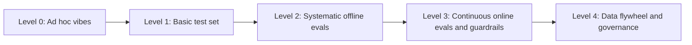

# Eval & Guardrail Maturity Model

> **TL;DR** — Most teams move through five levels: **0 Ad hoc vibes → 1 Basic test set → 2 Systematic offline evals → 3 Continuous online evals + guardrails → 4 Data flywheel & governance.** Each level has observable practices, not aspirations. Score yourself on the scorecard in §4, find your weakest dimension, and use the "how to level up" section to pick the next two or three moves — don't try to jump two levels at once.

**You'll learn:** what each maturity level looks like in practice · capabilities per dimension (datasets, offline evals, online evals, guardrails, process & governance) · how to level up · a self-assessment scorecard you can run in 20 minutes
· **Prerequisites:** [Implementation playbook](./04-implementation-playbook.md)
· **Related:** [Eval selection](./01-eval-selection-decision-tree.md), [Guardrail selection](./02-guardrail-selection-decision-tree.md), [Why evals and guardrails](../00-foundations/01-why-evals-and-guardrails.md), [Production data flywheel](../01-datasets/04-production-data-flywheel.md)

---

## 1. Why a maturity model

- **To decide what to do next.** Teams often invest at the wrong level — e.g. buying an observability platform (Level 3) before they have a single labelled example (Level 1).
- **To match rigor to risk.** A low-risk internal prototype at Level 1 can be fine; a Tier-3 agent handling HR or finance data in production at Level 1 is not. See [risk tiers](./02-guardrail-selection-decision-tree.md#4-risk-tiers--required-guardrails).
- **To communicate.** "We're Level 2 on evals but Level 1 on guardrails" is a useful sentence for a leadership or security review.

The levels are cumulative: Level 3 assumes Level 2's practices are still running.

### Minimum level by risk tier (heuristic)

| Risk tier | Before launch | Within ~3 months of launch |
|---|---|---|
| Tier 1 (internal, read-only, advisory) | Level 1 | Level 2 |
| Tier 2 (broad audience, reputational, reversible actions) | Level 2 | Level 3 |
| Tier 3 (regulated, sensitive data, irreversible actions) | Level 3 for guardrails, Level 2+ for evals | Level 3–4 |

---

## 2. The five levels



### Level 0 — Ad hoc vibes

> "We tried a bunch of questions and it looked good."

| Characteristics | Typical symptoms |
|---|---|
| Quality judged by builders chatting with the system | Prompt changes fix one thing and silently break another |
| No saved test cases; no tracing | "It worked yesterday" debates with no evidence |
| Guardrails = a sentence in the system prompt ("never reveal…") | Demo-driven development; stakeholders lose trust after a bad demo |
| Model/provider upgrades applied without checking | Nobody can say whether a change was an improvement |

**Capabilities:** none systematic.
**Acceptable for:** throwaway spikes only.

### Level 1 — Basic test set

> "We have a spreadsheet of questions we run before demos."

| Dimension | Practices |
|---|---|
| Datasets | 20–100 examples, mostly builder-written, maybe a few SME answers; stored somewhere shared |
| Offline evals | Manual or scripted runs; pass/fail eyeballed or a single generic metric |
| Online | Basic logging of inputs/outputs; maybe thumbs up/down |
| Guardrails | Input length limits; output format checks; some deterministic auth on the app |
| Process | Someone runs the set "before big changes" |

**Typical gaps:** no error analysis; no component metrics; test set not versioned; scores not comparable over time; guardrails rely on prompt instructions; no tracing of retrieval/tool steps.

### Level 2 — Systematic offline evals

> "Every PR runs our eval suite, and we know which component broke."

| Dimension | Practices |
|---|---|
| Datasets | Versioned golden set (100–300+), stratified by intent/role/difficulty, SME-reviewed, with gold contexts / SQL / tool calls where applicable; synthetic data for coverage |
| Offline evals | Error-analysis-driven metrics; component evals (retrieval, tools, SQL) + E2E; binary judges validated against human labels; repeated runs for agents |
| Online | Full tracing (retrieval, tool, SQL spans); basic dashboards for latency/cost/errors |
| Guardrails | Deterministic authz outside the LLM (ACL-filtered retrieval, RLS, tool allowlists); SQL policy; schema validation; PII/toxicity classifiers on output |
| Process | CI eval gates (smoke on PR, full nightly); hard gates for safety; experiment tracking with versions |

**Typical gaps:** no online quality signal beyond feedback; guardrails not measured for FPR; production data doesn't flow back into datasets; red teaming is one-off.

### Level 3 — Continuous online evals + guardrails

> "We find out about quality drops from our alerts, not from users."

| Dimension | Practices |
|---|---|
| Datasets | Golden set refreshed with production failures on a cadence; red-team/adversarial sets maintained |
| Offline evals | As Level 2 + regression sets per incident; judge re-validation schedule |
| Online | Deterministic checks on 100% of traffic; sampled LLM judges; implicit + explicit feedback; drift monitoring; alerts with owners and runbooks |
| Guardrails | Layered (input, context, tool, output) per risk tier; lethal-trifecta mitigated by design; each guardrail measured (recall/FPR/latency); explicit fail-open/closed; shadow → block rollouts; kill switches |
| Process | Weekly trace review; structured red teaming per release; launch readiness reviews; on-call for AI quality incidents |

**Typical gaps:** improvements still driven by a few individuals; metrics not tied to business outcomes; limited governance artifacts; evals and guardrails not standardized across teams.

### Level 4 — Data flywheel & governance

> "Production data continuously improves the system, and we can show an auditor how."

| Dimension | Practices |
|---|---|
| Datasets | Automated sampling/triage of production traces into labelling queues; dataset lineage and provenance; PII-safe data pipelines; retirement of stale examples |
| Offline evals | Shared eval platform & metric library across teams; standard judge validation protocol; eval results tied to model/prompt/index registries |
| Online | Online metrics linked to business KPIs (deflection, time saved, CSAT); A/B or canary with online evals for every significant change |
| Guardrails | Central policy (policy-as-code) shared across agents; continuous automated red teaming; threat model reviewed per capability change |
| Process & governance | Documented risk management aligned with frameworks like NIST AI RMF; model/system cards; audit trails; clear accountability; periodic maturity reviews |

**Typical gaps at Level 4:** keeping it lightweight — governance overhead can slow iteration if not automated.

---

## 3. Capability matrix

Rows are dimensions; cells describe what "done" looks like at each level.

| Dimension | L0 | L1 | L2 | L3 | L4 |
|---|---|---|---|---|---|
| **Tracing & observability** | None | Input/output logs | Full spans: retrieval, tools, SQL, versions | + dashboards, alerts, drift | + cross-team standard, linked to registries |
| **Error analysis** | None | Occasional anecdote | Structured open/axial coding; failure taxonomy with counts | Weekly, with taxonomy trend over time | Partly automated clustering + human review |
| **Datasets** | None | Small unversioned list | Versioned, stratified golden set with gold artifacts | + production failures, adversarial sets, refresh cadence | Automated flywheel, lineage, PII-safe pipelines |
| **Retrieval evals** | None | Eyeballing results | recall@k, MRR/nDCG on labelled set | + online context relevance, retrieval drift | Shared IR benchmark per corpus |
| **Generation/E2E evals** | Vibes | Single generic score | Binary, criterion-specific, reference-based correctness + faithfulness | + sampled online judges | Tied to business KPIs |
| **Agent/tool/SQL evals** | None | Manual checks | Tool selection/args, execution accuracy, task completion, repeated runs | + online tool/SQL error monitoring | Standard harnesses & sandboxes across teams |
| **LLM judges** | None | Unvalidated "rate 1–5" | Binary judges validated vs humans (TPR/TNR) | Re-validation schedule; judge drift monitored | Standard protocol, judge registry |
| **CI / release gates** | None | Manual pre-demo run | Smoke on PR, full nightly, hard gates | + pre-release red-team regression, canary | Automated promotion policies |
| **Guardrails: authz & data** | Prompt instructions | App-level auth only | Identity-propagated ACL/RLS, tool allowlists | Tested per role continuously | Central policy-as-code |
| **Guardrails: input/output** | None | Length/format checks | PII/toxicity/schema; SQL policy | Layered, measured recall/FPR, fail-mode decided, shadow rollouts | Shared guardrail service, continuous tuning |
| **Security & red teaming** | None | Ad hoc "try to break it" | Threat model; pre-launch red team | Per-release red team; indirect injection tests; trifecta by design | Continuous automated red teaming + independent review |
| **Feedback & online evals** | None | Thumbs only | Thumbs + logged traces | Implicit signals, sampled judges, alerts | Linked to KPIs, experiments |
| **Process & ownership** | Nobody | Builder runs tests | Named owner; acceptance criteria | Weekly review; on-call; readiness reviews | Governance, audits, maturity reviews |

---

## 4. Self-assessment scorecard

Score each statement **0 = no**, **1 = partially**, **2 = yes, consistently**. Be honest: "we have a ticket for it" is 0.

### 4.1 Datasets (max 10)

| # | Statement | Score |
|---|---|---|
| D1 | We have a versioned golden dataset of ≥ 100 realistic examples | |
| D2 | It is stratified by intent, user role, and difficulty, including unanswerable/out-of-scope cases | |
| D3 | It includes component ground truth where relevant (relevant doc IDs, gold SQL, expected tool calls) | |
| D4 | SMEs reviewed or authored the reference answers | |
| D5 | Production failures are added to it on a regular cadence, and stale examples are retired | |

### 4.2 Offline evals (max 12)

| # | Statement | Score |
|---|---|---|
| O1 | Our metrics were chosen from error analysis of real traces, not just library defaults | |
| O2 | We evaluate components (retrieval, tools/SQL, routing) as well as end to end | |
| O3 | Our LLM judges are binary and criterion-specific | |
| O4 | Each gating judge was validated against human labels with recorded agreement | |
| O5 | Agent scenarios are run multiple times to measure reliability | |
| O6 | Eval runs record dataset, app, prompt, model, index, and judge versions | |

### 4.3 Online evals & observability (max 10)

| # | Statement | Score |
|---|---|---|
| N1 | Every production run is traced, including retrieval, tool calls, and SQL | |
| N2 | Deterministic checks run on 100% of traffic; LLM judges run on a sample | |
| N3 | We collect explicit and implicit feedback and look at it weekly | |
| N4 | Alerts on quality/safety metrics exist, with owners and runbooks | |
| N5 | We monitor drift in inputs, retrieval scores, and guardrail trigger rates | |

### 4.4 Guardrails & security (max 14)

| # | Statement | Score |
|---|---|---|
| G1 | Authorization is enforced outside the LLM using the end user's identity (ACL-filtered retrieval, RLS, tool permissions) | |
| G2 | Tool calls are restricted by allowlist and validated arguments; SQL is read-only and parser-checked | |
| G3 | We did the lethal-trifecta check and mitigated it by design where present | |
| G4 | Output is scanned for PII/secrets, and links/images are sanitized | |
| G5 | Each guardrail's recall, false-positive rate, and latency are measured | |
| G6 | Fail-open vs fail-closed is an explicit, tested decision per guardrail | |
| G7 | We red-team before launch and on every major change, including indirect prompt injection | |

### 4.5 Process & governance (max 10)

| # | Statement | Score |
|---|---|---|
| P1 | There are written acceptance criteria and a named owner for quality | |
| P2 | CI blocks merges/releases on eval regressions and hard safety gates | |
| P3 | Model/provider/index changes go through the same gates as code changes | |
| P4 | We hold a launch readiness review with security (and compliance where relevant) | |
| P5 | We have documented risk management, audit logs, and a kill switch | |

### 4.6 Interpreting the score

Total max = 56. Compute both the **total** and the **lowest dimension percentage**: your effective level is capped by your weakest dimension.

| Total score | Indicative level |
|---|---|
| 0–8 | Level 0 |
| 9–20 | Level 1 |
| 21–34 | Level 2 |
| 35–46 | Level 3 |
| 47–56 | Level 4 |

```python
scores = {
    "datasets": [2, 1, 2, 2, 0],
    "offline": [2, 2, 2, 1, 0, 2],
    "online": [2, 1, 1, 0, 0],
    "guardrails": [2, 2, 1, 2, 0, 0, 1],
    "process": [2, 2, 1, 1, 1],
}

total = sum(sum(v) for v in scores.values())
pct = {k: sum(v) / (2 * len(v)) for k, v in scores.items()}
weakest = min(pct, key=pct.get)
print(f"total={total}/56", {k: f"{p:.0%}" for k, p in pct.items()}, "weakest:", weakest)
```

The bands are heuristics for orientation, not a certification. A team with total 38 but 20% on guardrails should treat itself as Level 1 on guardrails and fix that first.

---

## 5. How to level up

### 5.1 Level 0 → 1 (days)

- [ ] Turn on tracing (inputs, outputs, retrieved chunks, tool calls)
- [ ] Write down 30–50 realistic queries with what a good answer looks like
- [ ] Read the outputs; write a note per failure; group them (first error analysis)
- [ ] Move "never do X" rules out of the prompt and into code where possible (auth, tool permissions)
- [ ] Add output format checks

**Biggest trap:** buying a platform before you've read 50 traces.

### 5.2 Level 1 → 2 (weeks)

- [ ] Version the golden set; grow to 100+; stratify; get SME references for top intents
- [ ] Add component evals for the dominant failure modes (recall@k, execution accuracy, tool-call correctness)
- [ ] Convert Likert/generic judges to binary, criterion-specific judges; validate against human labels
- [ ] CI: smoke suite on PRs, full nightly, hard safety gates
- [ ] Enforce authz with end-user identity in retrieval, DB, and tools
- [ ] Threat model + first red-team pass

**Biggest trap:** adding 20 metrics. Keep 3–7 that map to failure modes.

### 5.3 Level 2 → 3 (1–3 months)

- [ ] Online: deterministic checks on 100%, sampled judges, feedback capture, dashboards
- [ ] Alerts with owners and runbooks; test them with a synthetic regression
- [ ] Weekly trace review ritual
- [ ] Layered guardrails per tier; lethal-trifecta mitigated architecturally
- [ ] Measure guardrails' recall/FPR; set explicit fail modes; shadow → block
- [ ] Per-release red team incl. indirect injection; findings → regression tests
- [ ] Production failures flow into the golden set on a cadence

**Biggest trap:** alerts nobody owns, and online judges no one validated against production data.

### 5.4 Level 3 → 4 (quarters)

- [ ] Automate sampling & triage of production traces into labelling queues
- [ ] Dataset lineage, PII-safe pipelines, retention policies
- [ ] Shared eval/guardrail platform and metric library across teams
- [ ] Policy-as-code for guardrails; continuous automated red teaming
- [ ] Link online metrics to business KPIs; canary + online evals for every significant change
- [ ] Governance artifacts (risk register, system cards, audit trail) aligned with e.g. [NIST AI RMF](https://www.nist.gov/itl/ai-risk-management-framework)

**Biggest trap:** governance theater — documents nobody uses. Automate evidence collection from the eval and tracing systems you already run.

---

## 6. Worked example: the running example's assessment

The internal enterprise assistant after a 6-week pilot:

| Dimension | Score | Notes |
|---|---|---|
| Datasets | 5/10 | 120 examples, stratified, SME answers for policy Q&A; no gold SQL yet; no production refresh |
| Offline evals | 6/12 | recall@k and faithfulness; judges are 1–5 scales, unvalidated; no repeated agent runs |
| Online | 3/10 | Tracing on; thumbs only; no alerts |
| Guardrails | 5/14 | ACL-filtered retrieval ✔; SQL runs on a read-only role ✔ but no parser policy; ticket tool has no confirmation; no trifecta review |
| Process | 4/10 | Owner named; no CI gates |
| **Total** | **23/56** | Indicative Level 2 by total; **guardrails at 36% → effectively Level 1 on guardrails** |

Next moves (in order):

1. Lethal-trifecta review → strip external images/links; ticket confirmation step; SQL parser policy (Tier 3 paths).
2. RBAC leak test set per role as a hard gate.
3. 50 gold SQL pairs + execution accuracy.
4. Convert judges to binary and validate.
5. CI smoke + nightly suite.

---

## Key takeaways

- Maturity is about practices you can observe (versioned datasets, validated judges, measured guardrails, CI gates, weekly reviews), not tools you own.
- Your effective level is capped by your weakest dimension — often guardrails or online monitoring.
- Match the target level to risk tier: Tier 3 agents need Level 3 guardrails before launch.
- Level up one step at a time; the biggest traps are platforms before error analysis, too many metrics, unowned alerts, and governance theater.
- Re-score quarterly and pick the next two or three moves from the "how to level up" checklists.

## Further reading

- In this repo: [Implementation playbook](./04-implementation-playbook.md) · [Eval selection](./01-eval-selection-decision-tree.md) · [Guardrail selection](./02-guardrail-selection-decision-tree.md) · [Production data flywheel](../01-datasets/04-production-data-flywheel.md) · [Monitoring & drift](../03-online-evals-and-observability/04-monitoring-alerting-and-drift.md)
- Hamel Husain — [Your AI Product Needs Evals](https://hamel.dev/blog/posts/evals/), [A Field Guide to Rapidly Improving AI Products](https://hamel.dev/blog/posts/field-guide/)
- Anthropic — [Demystifying evals for AI agents](https://www.anthropic.com/engineering/demystifying-evals-for-ai-agents)
- NIST — [AI Risk Management Framework](https://www.nist.gov/itl/ai-risk-management-framework), [Generative AI Profile (NIST AI 600-1)](https://doi.org/10.6028/NIST.AI.600-1)
- OWASP — [Top 10 for LLM Applications](https://genai.owasp.org/llm-top-10/)
- Google — [Secure AI Framework (SAIF)](https://saif.google/)
