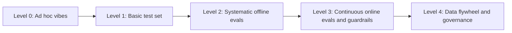

# Eval & Guardrail Maturity Model

> **TL;DR**
> - **Progress through five observable levels.** Advance from Level 0 (ad hoc vibes) to Level 4 (data flywheel and governance).
> - **Fix your weakest dimension first.** Your overall maturity is capped by your lowest-scoring dimension across datasets, evals, guardrails, and process.
> - **Match your target level to your risk tier.** Reach at least Level 2 for medium-risk launches and Level 3 guardrails for high-risk systems.
> - **Advance one level at a time.** Score yourself in 20 minutes with §4 and pick your next two actions from §5.

**You will learn:** What each maturity level looks like in practice · Capabilities across five dimensions · How to level up step by step · How to score your system in 20 minutes  
**Prerequisites:** [Implementation playbook](./04-implementation-playbook.md)  
**Related:** [Eval selection](./01-eval-selection-decision-tree.md), [Guardrail selection](./02-guardrail-selection-decision-tree.md), [Why evals and guardrails](../00-foundations/01-why-evals-and-guardrails.md), [Production data flywheel](../01-datasets/04-production-data-flywheel.md)

---

## 1. Why a maturity model

- **Decide what to build next.** Teams often buy an observability platform (Level 3) before they create a single labelled example (Level 1).
- **Match rigor to risk.** Level 1 suffices for a low-risk internal prototype. A Tier-3 agent handling HR or finance data in production requires Level 3 controls. See [risk tiers](./02-guardrail-selection-decision-tree.md#4-risk-tiers--required-guardrails).
- **Communicate status clearly.** Stating "We are at Level 2 on evaluations but Level 1 on guardrails" aligns engineering, leadership, and security teams.

The levels are cumulative. Level 3 requires all Level 2 practices to remain active.

### Minimum level by risk tier (heuristic)

| Risk tier | Before launch | Within ~3 months of launch |
|---|---|---|
| Tier 1 (internal, read-only, advisory) | Level 1 | Level 2 |
| Tier 2 (broad audience, reputational, reversible actions) | Level 2 | Level 3 |
| Tier 3 (regulated, sensitive data, irreversible actions) | Level 3 for guardrails, Level 2+ for evals | Level 3–4 |

---

## 2. The five levels



### Level 0 — Ad hoc vibes

> "We tried a bunch of questions and it looked good."

| Characteristics | Typical symptoms |
|---|---|
| Builders judge quality by chatting with the system | Prompt changes fix one bug and silently break another behavior |
| No saved test cases and no tracing | Teams debate whether quality regressed without any evidence |
| Guardrails consist of a system-prompt rule ("never reveal…") | Stakeholders lose trust after a single failed live demo |
| Teams upgrade models or providers without testing | Nobody knows whether a change improved the system |

**Capabilities:** None systematic.
**Acceptable for:** Throwaway spikes only.

### Level 1 — Basic test set

> "We have a spreadsheet of questions we run before demos."

| Dimension | Practices |
|---|---|
| Datasets | 20–100 examples, mostly builder-written with a few SME answers, stored in a shared location |
| Offline evals | Manual or scripted runs where engineers eyeball pass/fail or check one generic metric |
| Online | Basic input/output logging and optional thumbs up/down feedback |
| Guardrails | Input length limits, output format checks, and basic application authentication |
| Process | An engineer runs the test set before major changes |

**Typical gaps:** You lack error analysis, component metrics, versioned datasets, and retrieval or tool traces. Your scores cannot be compared over time, and your guardrails rely on prompt instructions.

### Level 2 — Systematic offline evals

> "Every PR runs our eval suite, and we know which component broke."

| Dimension | Practices |
|---|---|
| Datasets | Versioned golden set (100–300+), stratified by intent/role/difficulty, SME-reviewed, with gold contexts, SQL, or tool calls |
| Offline evals | Error-analysis-driven metrics, component + E2E evals, binary judges validated against human labels, and repeated agent runs |
| Online | Full tracing across retrieval, tool, and SQL spans, plus dashboards for latency, cost, and errors |
| Guardrails | Deterministic authorization outside the LLM (ACL retrieval, RLS, tool allowlists), SQL policy, schema validation, and output safety classifiers |
| Process | CI evaluation gates (smoke on PR, full nightly), hard safety gates, and versioned experiment tracking |

**Typical gaps:** You have no online quality signals beyond user feedback, and you do not measure guardrail false-positive rates. Production failures do not flow back into datasets automatically, and red teaming happens only once.

### Level 3 — Continuous online evals + guardrails

> "We find out about quality drops from our alerts, not from users."

| Dimension | Practices |
|---|---|
| Datasets | Golden set refreshed with production failures on a regular cadence, plus maintained red-team and adversarial sets |
| Offline evals | All Level 2 practices, plus incident regression sets and a scheduled judge re-validation cadence |
| Online | Deterministic checks on 100% of traffic, sampled LLM judges, implicit and explicit feedback, drift monitoring, and actionable alerts |
| Guardrails | Layered controls per risk tier, architectural lethal-trifecta mitigation, measured recall/FPR/latency, explicit fail modes, shadow rollouts, and kill switches |
| Process | Weekly trace reviews, per-release red teaming, launch readiness reviews, and on-call rotation for AI quality incidents |

**Typical gaps:** A few individuals still drive improvements manually, and metrics do not connect to business KPIs. Teams lack shared standards and automated governance artifacts.

### Level 4 — Data flywheel & governance

> "Production data continuously improves the system, and we can show an auditor how."

| Dimension | Practices |
|---|---|
| Datasets | Automated production trace sampling into labelling queues, dataset lineage, PII-safe pipelines, and automated retirement of stale examples |
| Offline evals | Shared evaluation platform and metric library across teams, standard judge validation protocols, and links to model/prompt/index registries |
| Online | Online metrics linked to business KPIs (deflection, time saved, CSAT), plus canary rollouts with online evaluations for major changes |
| Guardrails | Central policy-as-code shared across agents, continuous automated red teaming, and threat model updates for every capability change |
| Process & governance | Documented risk management aligned with NIST AI RMF, system cards, audit trails, clear accountability, and quarterly maturity reviews |

**Typical gaps at Level 4:** Governance overhead can slow iteration if you do not automate evidence collection.

---

## 3. Capability matrix

Rows represent dimensions. Cells describe what "done" looks like at each level.

| Dimension | L0 | L1 | L2 | L3 | L4 |
|---|---|---|---|---|---|
| **Tracing & observability** | None | Input/output logs | Full spans: retrieval, tools, SQL, versions | + dashboards, alerts, drift | + cross-team standard, linked to registries |
| **Error analysis** | None | Occasional anecdote | Structured open/axial coding and failure taxonomy with counts | Weekly review with taxonomy trends over time | Partly automated clustering + human review |
| **Datasets** | None | Small unversioned list | Versioned, stratified golden set with gold artifacts | + production failures, adversarial sets, refresh cadence | Automated flywheel, lineage, PII-safe pipelines |
| **Retrieval evals** | None | Eyeballing results | recall@k, MRR/nDCG on labelled set | + online context relevance, retrieval drift | Shared IR benchmark per corpus |
| **Generation/E2E evals** | Vibes | Single generic score | Binary, criterion-specific, reference-based correctness + faithfulness | + sampled online judges | Tied to business KPIs |
| **Agent/tool/SQL evals** | None | Manual checks | Tool selection/args, execution accuracy, task completion, repeated runs | + online tool/SQL error monitoring | Standard harnesses & sandboxes across teams |
| **LLM judges** | None | Unvalidated "rate 1–5" | Binary judges validated vs humans (TPR/TNR) | Re-validation schedule and judge drift monitoring | Standard protocol, judge registry |
| **CI / release gates** | None | Manual pre-demo run | Smoke on PR, full nightly, hard gates | + pre-release red-team regression, canary | Automated promotion policies |
| **Guardrails: authz & data** | Prompt instructions | App-level auth only | Identity-propagated ACL/RLS, tool allowlists | Tested per role continuously | Central policy-as-code |
| **Guardrails: input/output** | None | Length/format checks | PII/toxicity/schema and SQL policy | Layered, measured recall/FPR, fail-mode decided, shadow rollouts | Shared guardrail service, continuous tuning |
| **Security & red teaming** | None | Ad hoc "try to break it" | Threat model and pre-launch red team | Per-release red team, indirect injection tests, trifecta by design | Continuous automated red teaming + independent review |
| **Feedback & online evals** | None | Thumbs only | Thumbs + logged traces | Implicit signals, sampled judges, alerts | Linked to KPIs, experiments |
| **Process & ownership** | Nobody | Builder runs tests | Named owner and acceptance criteria | Weekly review, on-call, readiness reviews | Governance, audits, maturity reviews |

---

## 4. Self-assessment scorecard

Score each statement **0 = no**, **1 = partially**, or **2 = yes, consistently**. Score a **0** if you only have an unimplemented backlog ticket.

### 4.1 Datasets (max 10)

| # | Statement | Score |
|---|---|---|
| D1 | We have a versioned golden dataset of ≥ 100 realistic examples | |
| D2 | It is stratified by intent, user role, and difficulty, including unanswerable/out-of-scope cases | |
| D3 | It includes component ground truth where relevant (relevant doc IDs, gold SQL, expected tool calls) | |
| D4 | SMEs reviewed or authored the reference answers | |
| D5 | Production failures are added to it on a regular cadence, and stale examples are retired | |

### 4.2 Offline evals (max 12)

| # | Statement | Score |
|---|---|---|
| O1 | Our metrics were chosen from error analysis of real traces, not just library defaults | |
| O2 | We evaluate components (retrieval, tools/SQL, routing) as well as end to end | |
| O3 | Our LLM judges are binary and criterion-specific | |
| O4 | Each gating judge was validated against human labels with recorded agreement | |
| O5 | Agent scenarios are run multiple times to measure reliability | |
| O6 | Eval runs record dataset, app, prompt, model, index, and judge versions | |

### 4.3 Online evals & observability (max 10)

| # | Statement | Score |
|---|---|---|
| N1 | Every production run is traced, including retrieval, tool calls, and SQL | |
| N2 | Deterministic checks run on 100% of traffic, and LLM judges run on a sample | |
| N3 | We collect explicit and implicit feedback and review it weekly | |
| N4 | Alerts on quality and safety metrics exist, with owners and runbooks | |
| N5 | We monitor drift in inputs, retrieval scores, and guardrail trigger rates | |

### 4.4 Guardrails & security (max 14)

| # | Statement | Score |
|---|---|---|
| G1 | Authorization is enforced outside the LLM using the end user's identity (ACL-filtered retrieval, RLS, tool permissions) | |
| G2 | Tool calls are restricted by allowlist and validated arguments, and SQL is read-only and parser-checked | |
| G3 | We ran the lethal-trifecta check and mitigated it by design where present | |
| G4 | Output is scanned for PII/secrets, and links/images are sanitized | |
| G5 | Each guardrail's recall, false-positive rate, and latency are measured | |
| G6 | Fail-open vs fail-closed is an explicit, tested decision per guardrail | |
| G7 | We red-team before launch and on every major change, including indirect prompt injection | |

### 4.5 Process & governance (max 10)

| # | Statement | Score |
|---|---|---|
| P1 | There are written acceptance criteria and a named owner for quality | |
| P2 | CI blocks merges/releases on eval regressions and hard safety gates | |
| P3 | Model/provider/index changes go through the same gates as code changes | |
| P4 | We hold a launch readiness review with security (and compliance where relevant) | |
| P5 | We have documented risk management, audit logs, and a kill switch | |

### 4.6 Interpreting the score

The maximum total score is 56. Calculate both your **total score** and your **lowest dimension percentage**. Your weakest dimension caps your effective maturity level.

| Total score | Indicative level |
|---|---|
| 0–8 | Level 0 |
| 9–20 | Level 1 |
| 21–34 | Level 2 |
| 35–46 | Level 3 |
| 47–56 | Level 4 |

```python
scores = {
    "datasets": [2, 1, 2, 2, 0],
    "offline": [2, 2, 2, 1, 0, 2],
    "online": [2, 1, 1, 0, 0],
    "guardrails": [2, 2, 1, 2, 0, 0, 1],
    "process": [2, 2, 1, 1, 1],
}

total = sum(sum(v) for v in scores.values())
pct = {k: sum(v) / (2 * len(v)) for k, v in scores.items()}
weakest = min(pct, key=pct.get)
print(f"total={total}/56", {k: f"{p:.0%}" for k, p in pct.items()}, "weakest:", weakest)
```

Use these score bands for orientation, not certification. If your team scores 38 overall but 20% on guardrails, treat your guardrail maturity as Level 1 and fix it first.

---

## 5. How to level up

### 5.1 Level 0 → 1 (days)

- [ ] Enable tracing for inputs, outputs, retrieved chunks, and tool calls.
- [ ] Write 30–50 realistic queries with expected answer notes.
- [ ] Read the outputs, record one note per failure, and group them into categories.
- [ ] Move "never do X" rules out of the prompt and into deterministic code for auth and tool permissions.
- [ ] Add deterministic output format checks.

**Biggest trap:** Buying an evaluation platform before you read 50 traces.

### 5.2 Level 1 → 2 (weeks)

- [ ] Version your golden set, grow it to 100+ stratified examples, and collect SME references for top intents.
- [ ] Add component evaluations for your dominant failure modes (recall@k, execution accuracy, tool-call correctness).
- [ ] Replace Likert or generic judges with binary, criterion-specific judges validated against human labels.
- [ ] Configure CI to run a smoke suite on pull requests, full evaluations nightly, and hard safety gates.
- [ ] Enforce authorization with end-user identity across retrieval, databases, and tools.
- [ ] Complete a threat model and your first red-team pass.

**Biggest trap:** Adding 20 metrics at once. Keep 3–7 metrics that map directly to your observed failure modes.

### 5.3 Level 2 → 3 (1–3 months)

- [ ] Run deterministic checks on 100% of online traffic, sample LLM judges, capture user feedback, and build dashboards.
- [ ] Configure alerts with named owners and runbooks, then test them with a synthetic regression.
- [ ] Run a weekly trace review meeting.
- [ ] Implement layered guardrails for your risk tier and remove lethal-trifecta legs by design.
- [ ] Measure recall and false-positive rate for each guardrail, configure explicit fail modes, and promote from shadow to block.
- [ ] Run red-team tests on every release, including indirect injection, and turn findings into regression tests.
- [ ] Add production failures to your golden set on a regular schedule.

**Biggest trap:** Creating alerts with no owner and running online judges that were never validated on production data.

### 5.4 Level 3 → 4 (quarters)

- [ ] Automate sampling and triage of production traces into human labelling queues.
- [ ] Implement dataset lineage, PII-safe data pipelines, and retention policies.
- [ ] Standardize a shared evaluation and guardrail platform across teams.
- [ ] Manage guardrails as policy-as-code and run continuous automated red teaming.
- [ ] Link online metrics to business KPIs and require canary rollouts with online evaluations for major changes.
- [ ] Maintain governance artifacts (risk register, system cards, audit trail) aligned with the [NIST AI RMF](https://www.nist.gov/itl/ai-risk-management-framework).

**Biggest trap:** Building governance theater with static documents nobody reads. Automate evidence collection directly from your evaluation and tracing systems.

---

## 6. Worked example: the running example's assessment

Here is the scorecard for our internal enterprise assistant after a 6-week pilot:

| Dimension | Score | Notes |
|---|---|---|
| Datasets | 5/10 | 120 stratified examples and SME answers for policy Q&A, but no gold SQL or production refresh yet |
| Offline evals | 6/12 | Has recall@k and faithfulness, but judges use unvalidated 1–5 scales and agent runs are not repeated |
| Online | 3/10 | Tracing is enabled with thumbs feedback only and no alerts |
| Guardrails | 5/14 | Has ACL-filtered retrieval and a read-only SQL role, but lacks SQL parser policy, ticket confirmation, and trifecta review |
| Process | 4/10 | Quality owner is named, but no CI gates exist |
| **Total** | **23/56** | Indicative Level 2 overall, but **guardrails score 36% (effectively Level 1)** |

Prioritize these next steps in order:

1. Complete the lethal-trifecta review, strip external images and links, require ticket confirmation, and enforce a SQL parser policy.
2. Build an RBAC leak test set per role and enforce it as a hard CI gate.
3. Create 50 gold SQL pairs and measure execution accuracy.
4. Convert LLM judges to binary pass/fail criteria and validate them against human labels.
5. Enable CI smoke gates on pull requests and a full nightly evaluation suite.

---

## Key takeaways

- Measure maturity by observable practices (versioned datasets, validated judges, measured guardrails, CI gates, weekly reviews), not by purchased tools.
- Remember that your weakest dimension caps your effective maturity level.
- Match your target maturity level to your risk tier, and require Level 3 guardrails before launching Tier 3 agents.
- Advance one level at a time, and avoid buying platforms before error analysis or creating unowned alerts.
- Re-score your system every quarter and pick your next two or three improvements from the leveling checklists.

## Further reading

- In this repo: [Implementation playbook](./04-implementation-playbook.md) · [Eval selection](./01-eval-selection-decision-tree.md) · [Guardrail selection](./02-guardrail-selection-decision-tree.md) · [Production data flywheel](../01-datasets/04-production-data-flywheel.md) · [Monitoring & drift](../03-online-evals-and-observability/04-monitoring-alerting-and-drift.md)
- Hamel Husain — [Your AI Product Needs Evals](https://hamel.dev/blog/posts/evals/), [A Field Guide to Rapidly Improving AI Products](https://hamel.dev/blog/posts/field-guide/)
- Anthropic — [Demystifying evals for AI agents](https://www.anthropic.com/engineering/demystifying-evals-for-ai-agents)
- NIST — [AI Risk Management Framework](https://www.nist.gov/itl/ai-risk-management-framework), [Generative AI Profile (NIST AI 600-1)](https://doi.org/10.6028/NIST.AI.600-1)
- OWASP — [Top 10 for LLM Applications](https://genai.owasp.org/llm-top-10/)
- Google — [Secure AI Framework (SAIF)](https://saif.google/)
